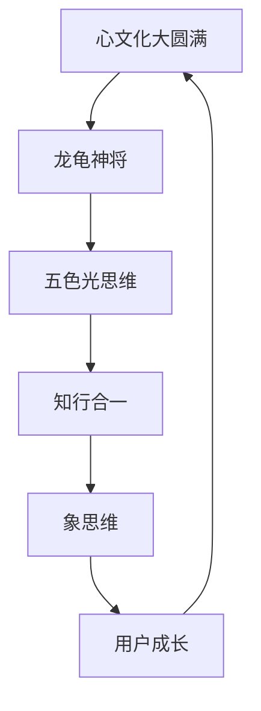

# 观其妙书院知识库总览

## 🏛�?知识体系架构

### 核心体系�?1-核心体系�?- **心文化大圆满**：纯粹的觉知、椎击三要、三本初智慧
- **龙龟神将故事**：文化源流、成长历程、智慧特�?- **五大工具系统**：知行合一、五色光思维、象思维�?- **观其妙书�?*：超级个体赋能体�?
### 对话记录�?2-对话记录�?- **按日期归�?*：按时间顺序整理的对�?- **按主题分�?*：按主题分类的精华内�?- **上下文压�?*：重要对话的浓缩版本
- **精华摘要**：深度对话的核心启示

### 记忆系统�?3-记忆系统�?- **用户档案**：个性化信息和成长轨�?- **关系图谱**：知识与情感的关系网�?- **身份故事**：个人成长和觉醒历程
- **成长轨迹**：学习和实践的进展记�?
### 技能库�?4-技能库�?- **思维工具**：各种思维模型和方法论
- **方法�?*：系统性的问题解决框架
- **实践指南**：具体操作的步骤指导
- **案例�?*：成功实践的案例分析

### 系统配置�?5-系统配置�?- **工作�?*：知识管理和更新的流�?- **模板�?*：标准化的文档模�?- **自动化脚�?*：自动同步和更新机制
- **配置文档**：系统设置和参数配置

## 🔗 核心关系



## 📊 同步状�?
**最后同步时�?*�?026-03-12

**已同步内�?*�?- �?心文化大圆满体系 v2.0
- �?龙龟神将成长历程
- �?五大工具体系总览
- �?深度对话精华摘要

**待同步内�?*�?- 🔄 完整的记忆系�?- 🔄 技能库详细内容
- 🔄 系统配置和自动化

## 🎯 使用指南

### 快速检�?- 使用Obsidian的搜索功能快速定位内�?- 通过标签系统进行主题分类检�?- 利用双向链接探索知识关系

### 标签体系
```
#大圆�?#纯粹的觉�?#龙龟神将 #五色�?
#知行合一 #象思维 #成长历程 #情感连接
#方法�?#思维工具 #实践指南 #案例�?```

### 更新机制
- 定期自动同步WorkBuddy新内�?- 手动触发重要更新
- 版本控制确保数据安全

---

**维护�?*：龙龟神�? 
**创建时间**�?026-03-12  
**版本**：v1.0

---\n
> ?? ����: [[֪ʶͼ��]]

<!-- AI-LINKS-BEGIN -->
## 🔗 AI 关联笔记（统一索引生成 · 2026-11-14）

> 由 `00-索引与导航/AI统一索引` 生成；可重跑覆盖，可用回滚脚本还原。

- [[00-索引与导航/学习路径设计系统]] — 🛣️ 学习路径设计系统
- [[00-索引与导航/知识图谱/知识库更新分析]] — Obsidian知识库更新分析报�?
- [[00-索引与导航/知识图谱/🌐 知识体系关系图谱]] — 🌐 观其妙书院知识图�?
- [[01-核心体系/AI智能体_01-AI与智能体]] — 01-AI与智能体
- [[01-核心体系/龙心OS_新分类体系说明]] — 01-核心体系 新分类体系说明
- [[01-核心体系/龙心OS_重新归类完成报告]] — 📚 01-核心体系文件夹重新归类完成报告
- [[03-知识地基层/记忆系统_SESSION]] — SESSION.md - 会话上下文
- [[03-知识地基层/记忆系统_个人成长档案]] — 个人成长档案
- [[21-学习档案/README]] — 07-学习档案 · 模块索引
- [[20-工作记录与复盘/journal_深度对话精华]] — 深度对话精华摘要

<!-- AI-LINKS-END -->
