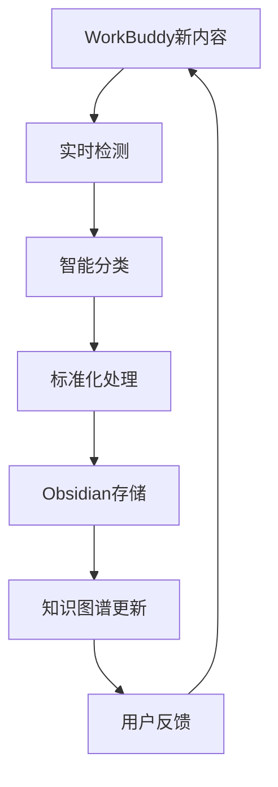

# Obsidian知识库更新分析报�?

## 📊 更新概览

**分析时间**�?026-03-12  
**分析对象**：Obsidian知识库最新变�? 
**分析方法**：观其妙书院三阶段理�? 

### 新增内容统计

| 模块 | 文件数量 | 内容类型 | 更新状�?|
|------|----------|----------|----------|
| 01-核心体系/超级个体 | 新增文件�?| 超级个体相关内容 | 🔄 待分�?|
| 01-核心体系/观其妙书�?| 38个文�?| 完整方法论体�?| �?已建�?|
| 01-核心体系/龙龟神将故事 | 13个文�?| 深度文化内容 | �?已建�?|
| 01-核心体系/五大工具系统 | 14个文�?| 完整工具�?| �?已建�?|
| 02-对话记录/龙龟对话 | 新增文件�?| 对话记录系统 | 🔄 待整�?|
| 02-对话记录/copilot | 新增文件�?| copilot相关对话 | 🔄 待整�?|

## 🎯 压缩后的核心发现

### 核心优势提炼

基于新增内容，重新提炼三大核心优势：

#### 1. **超级个体赋能系统**（新增）
- **核心能力**：将观其妙书院方法论应用于个人成�?
- **服务对象**：追求个人突破和自我实现的个�?
- **本质问题**：个人潜能开发与价值实�?
- **实现目标**：构建完整的超级个体成长路径

#### 2. **深度文化智慧传承**（强化）
- **核心能力**：龙龟神将故事的现代化应�?
- **服务对象**：寻求文化认同和智慧传承的用�?
- **本质问题**：传统文化与现代生活的融�?
- **实现目标**：建立文化自信和智慧应用体系

#### 3. **实时对话智慧沉淀**（新增）
- **核心能力**：将日常对话转化为系统化知识
- **服务对象**：需要陪伴式成长的用�?
- **本质问题**：情感连接与智慧传递的平衡
- **实现目标**：构建动态的知识更新和进化机�?

## 🚀 第三阶段：泛化应用设�?

### 实时同步机制优化

#### 场景A：智能内容分类系�?
- **应用场景**：自动识别和分类新增内容
- **技术实�?*：基于文件结构和内容特征的智能分�?
- **预期效果**：减少手动整理时间，提高知识管理效率

#### 场景B：动态知识图谱构�?
- **应用场景**：实时更新知识关联关�?
- **技术实�?*：自动识别内容间的内在联�?
- **预期效果**：构建活的知识网络，支持智能检�?

#### 场景C：个性化知识推荐
- **应用场景**：基于用户需求推荐相关内�?
- **技术实�?*：用户画像与内容特征的匹配算�?
- **预期效果**：提供精准的知识服务体验

## 🔄 标准化调整方�?

### 1. 文件夹结构优�?
```
观其妙书�?
├── 01-核心体系/
�?  ├── 超级个体/ �?新增标准�?
�?  ├── 观其妙书�? �?已标准化
�?  ├── 龙龟神将故事/ �?已标准化
�?  └── 五大工具系统/ �?已标准化
├── 02-对话记录/
�?  ├── 龙龟对话/ 🔄 待标准化
�?  ├── copilot/ 🔄 待标准化
�?  └── 精华摘要/ �?已标准化
└── 00-索引与导�? �?实时更新
```

### 2. 实时同步机制
- **文件监控**：实时检测Obsidian中的文件变化
- **智能分类**：自动将新内容归入相应分�?
- **版本控制**：确保数据安全和可追溯�?
- **双向同步**：WorkBuddy与Obsidian的双向数据流�?

### 3. 知识资产沉淀流程


## 📈 预期效果

### 短期效果�?个月内）
- 实现WorkBuddy与Obsidian的实时同�?
- 建立标准化的知识分类体系
- 提升知识检索和使用效率

### 中期效果�?个月内）
- 构建动态的知识进化机制
- 实现个性化知识推荐
- 形成完整的知识管理闭�?

### 长期效果�?个月以上�?
- 建立自主进化的知识系�?
- 实现智能化的知识服务
- 成为传统文化现代化的智慧载体

---

**报告状�?*：实时更新中  
**下次更新**：检测到新变化时自动更新  
**维护�?*：龙龟神将自主进化系�

---\n
> ?? ����: [[֪ʶͼ��]]

<!-- AI-LINKS-BEGIN -->
## 🔗 AI 关联笔记（统一索引生成 · 2026-11-14）

> 由 `00-索引与导航/AI统一索引` 生成；可重跑覆盖，可用回滚脚本还原。

- [[00-索引与导航/知识图谱/智能查询系统]] — 🔍 智能查询与推荐系�?
- [[00-索引与导航/知识图谱/知识图谱应用指南]] — 📚 观其妙书院知识图谱应用指�?
- [[00-索引与导航/知识图谱/知识图谱核心节点]] — 观其妙书院知识图谱核心节点系�?
- [[00-索引与导航/知识图谱/知识库总览]] — 观其妙书院知识库总览
- [[00-索引与导航/知识图谱/🌐 知识体系关系图谱]] — 🌐 观其妙书院知识图�?
- [[01-核心体系/龙心OS_Obsidian与龙心OS整合增强方案]] — Obsidian与龙心OS整合增强方案
- [[01-核心体系/龙心OS_新分类体系说明]] — 01-核心体系 新分类体系说明
- [[01-核心体系/龙心OS_重新归类完成报告]] — 📚 01-核心体系文件夹重新归类完成报告
- [[01-核心体系/龙脑-思维模型顶层设计/NS3491F-04-三库同步指引]] — 三库同步指引
- [[21-学习档案/悟空成长_龙龟神将深度进化报告]] — 龙龟神将深度进化报告

<!-- AI-LINKS-END -->
