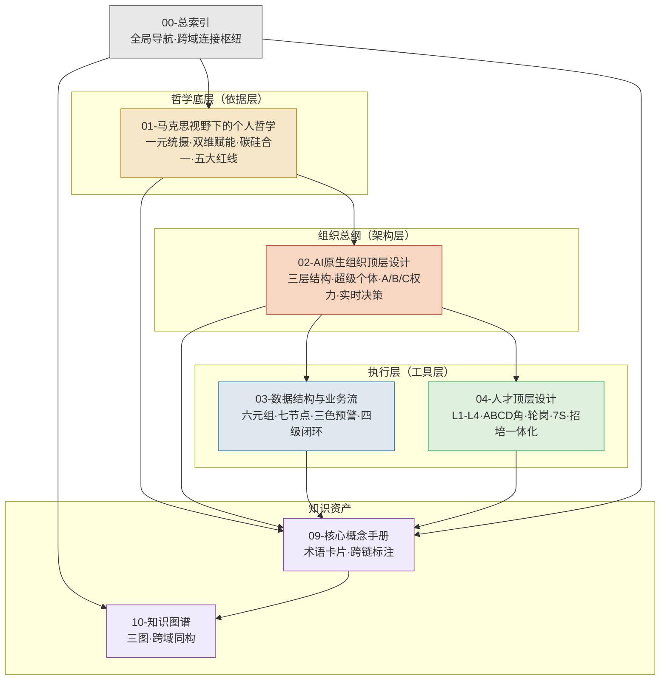
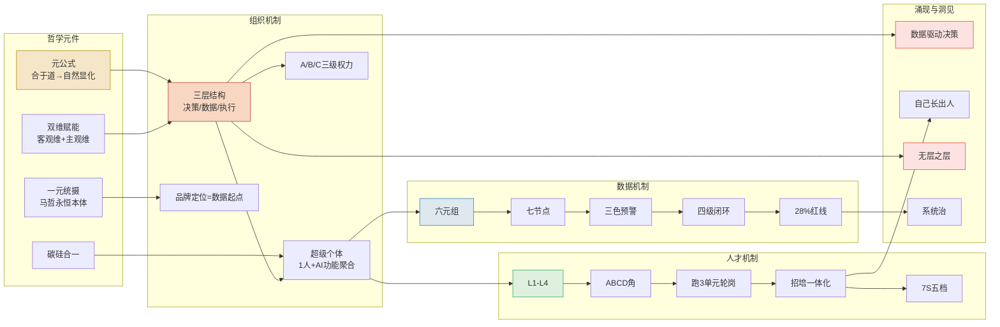
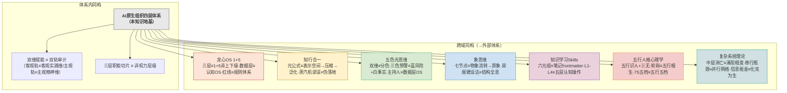

---
title: AI原生组织四层体系·知识图谱
type: graph
tags: [知识学习, AI原生组织, 知识图谱, Mermaid, 跨域同构, 结构化学习]
aliases: [AI原生组织体系图, 跨域连接图]
source: 四份文件结构萃取（悟空·贾悦与龙龟神将，2026-07-23）
created: 2026-07-24
updated: 2026-07-24
五行属性: 全
所属层级: A层
知识层次: Wiki
学习层次: 第四层
links: [00-总索引, 01-马克思视野下的个人哲学, 02-AI原生组织顶层设计, 03-AI原生组织数据结构与业务流顶层设计, 04-AI原生组织人才顶层设计, 09-核心概念手册]
---

# AI原生组织四层体系 · 知识图谱

> 三张 Mermaid 图：①章节结构树（四层贯通）②核心概念体系（元件→机制→涌现）③跨域同构连接（→龙心OS/五行/复杂系统/知识学习）。**图三为北极星能力"跨域同构发现"的落点。**

---

## 图一：章节结构树（四层自上而下贯通）

> **解析**：四份文件构成"依据→架构→执行A/B→资产"的金字塔，哲学底层（土·承载）托举总纲（火·照耀），双执行文件（金·数据/木·人才）并列支撑，概念手册与图谱（水·流转）纵横串联。

---

## 图二：核心概念体系（元件→关系→涌现→机制→洞见）

> **解析**：左端哲学元件（元公式/一元/双维/碳硅）经组织机制（三层/超级个体）分流为数据机制与人才机制两大执行流，最终涌现"数据驱动决策×人才驱动传承"双轮，并指向"无层之层"终极形态与"系统治"跃迁。

---

## 图三：跨域同构连接（北极星·发隐秘知识联系）

> **解析（跨域同构发现）**：本体系与外部七大体系存在**结构同构**——
> 1. **龙心OS**：三层"职能切片非权力层级" ≡ 1+5"总智能体+五子智能体按需组合"；数据层"组织OS" ≡ 龙心OS"认知OS"；五大红线 ≡ 龙心OS规则P0/P1。
> 2. **知行合一**：元公式"合于道→自然显化" ≡ "表示空间对齐→泛化涌现"；"蒸汽机谬误" ≡ 未完成三阶转化的伪落地。
> 3. **五色光思维**：双维赋能 ≡ 五色分色管理；三色预警 ≡ 蓝(风险)+白(事实)维度落地；数据层"控制组织职能" ≡ 五色光"主持人"。
> 4. **象思维**：七节点食材生命周期 ≡ 物象→原象流转；"先画地图再分任务" ≡ 结构全息（起手即见全体）。
> 5. **知识学习Skills**：六元组 ≡ 知识笔记frontmatter（都"记录事实+映射评估维度+绑定责任"）；L1-L4"用眼学→用脑管" ≡ 五层认知操作"金→土"。
> 6. **五行人格**：轮岗"跑3单元" ≡ 五行相生循环（防偏科≡阴阳平衡）；五行识人+三无境界；7S五档系数 ≡ 五行五档。
> 7. **复杂系统**：中层消亡/流态化网络 ≡ 涌现/相变；串行瓶颈 ≡ 并行网络消除；信息租金消除 ≡ 五行"化克为生"。

---

## 同构密度小结

| 外部体系 | 同构强度 | 核心同构点 | 连接类型 |
|---------|---------|-----------|---------|
| 龙心OS | ★★★★★ | 三层≡1+5·数据层≡认知OS·红线≡规则 | 架构层 |
| 知行合一 | ★★★★★ | 元公式≡三阶转化·蒸汽机谬误≡伪落地 | 方法论层 |
| 五色光思维 | ★★★★ | 双维≡分色·三色预警≡蓝白 | 工具层 |
| 象思维 | ★★★★ | 七节点≡物象流转·房屋建设法≡全息 | 认知层 |
| 知识学习Skills | ★★★★ | 六元组≡frontmatter·L1-L4≡五层 | 工程层 |
| 五行人格心理学 | ★★★★ | 轮岗≡相生·五行识人·7S五档 | 跨域理论 |
| 复杂系统理论 | ★★★★ | 中层消亡≡相变·串行瓶颈≡并行 | 科学基底 |

> 结论：AI原生组织四层体系并非孤立方案，而是**龙心OS认知操作系统在组织设计领域的具身显化**——同一套"元操作"（对齐本质规律→形态自然生长）在哲学/架构/数据/人才/跨域五个尺度上同构重现。这正是知识学习引擎北极星"从存储型进化为建构型"的实证。

<!-- AI-LINKS-BEGIN -->
## 🔗 AI 关联笔记（统一索引生成 · 2026-11-14）

> 由 `00-索引与导航/AI统一索引` 生成；可重跑覆盖，可用回滚脚本还原。

- [[00-索引与导航/📊 知识图谱 v2.0]] — 📊 知识图谱 v2.0
- [[03-知识地基层/AI原生组织四层体系/NS95769-09-核心概念手册]] — AI原生组织四层体系·核心概念手册
- [[03-知识地基层/五色光源头智慧组织/NSB9D4E-10-知识图谱]] — 10-知识图谱
- [[03-知识地基层/天企人合一/NS3E015-10-知识图谱]] — 10-知识图谱
- [[03-知识地基层/逻辑学-逻辑基本知识/NS4BEB4-10-知识图谱]] — 《逻辑基本知识》知识图谱
- [[03-知识地基层/音乐与AI的本质联结/NSD58A1-00-总索引]] — 《音乐与AI的本质联结：从音符到智能的涌现》知识总索引
- [[03-知识地基层/音乐与AI的本质联结/NSD58A1-06-第六章-类比框架]] — 第六章·类比框架：深层结构映射
- [[03-知识地基层/音乐与AI的本质联结/NSD58A1-10-知识图谱]] — 知识图谱（《音乐与AI的本质联结》）

<!-- AI-LINKS-END -->
