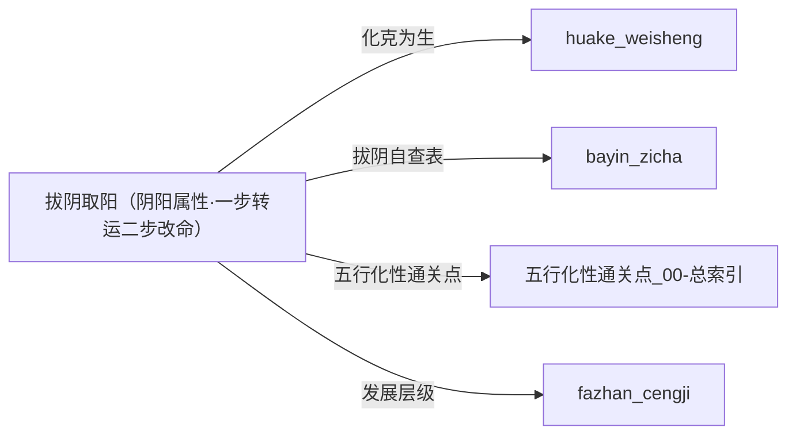

---
title: 拔阴取阳（阴阳属性·一步转运二步改命）
author: 悟空(贾悦)·以观其妙书院
tags: ["凤脑OS","源典节点","源典·修行实操"]
watermark: yiguanqimiao-unique-watermark-wk-jiayue-academy
created: 2026-07-20
node: bayin_quyang
source: 拔阴取阳.txt
category: 源典·修行实操
---

# 拔阴取阳（阴阳属性·一步转运二步改命）

## 📌 核心定义 / 一句话定位
系统阐述五行阴阳属性、精气神（身心灵）三层阴阳、如何判断走运/不走运，以及“拔阴取阳”实践——一步转运（阴转阳）、二步改命（以相生顺序转化人格属性），五行性理与相由心生。

## 🏷️ 标签（三级）
#凤脑OS #拔阴取阳 #阴阳属性 #精气神三层 #走运不走运 #五行性理 #相由心生

## 🔗 双向链接（跨域同构·隐秘联系）
- [[huake_weisheng]] —— 化克为生
- [[bayin_zicha]] —— 拔阴自查表
- [[五行化性通关点_00-总索引]] —— 五行化性通关点
- [[fazhan_cengji]] —— 发展层级

## 💎 核心金句
> "一步转运，二步改命。"

## 📜 全文（完整保留·逐行学习资产）
(一)五行人的阴阳属性
1.五行分阴阳属性
　　　五行人的阴阳属性，是一个深入且富有智慧的分类系统，它结合了《黄帝内经》的五行理论与阴阳学说，为我们提供了一种全新的视角来观察和理解人的性格、行为以及身心健康。
　　　在这个系统中，每个人都可以根据自己的五行属性（木、火、土、金、水）以及阴阳属性（阳或阴）来定位自己。这种定位不仅能帮助我们更好地认识自己，还能指导我们在人际交往、情绪管理、职业规划等方面做出更明智的决策。
　　　例如，阳性木行人通常表现出积极向上、充满活力的特点，他们善于创新、富有冒险精神，是团队中的佼佼者。而阴性木行人则可能显得犹豫不决、缺乏自信，需要更多的支持和鼓励来发挥自己的潜力。
　　　同样，阳性火行人热情洋溢、充满活力，他们善于领导、充满激情，是团队中的灵魂人物。而阴性火行人则可能过于急躁、缺乏耐心，需要学会控制自己的情绪和节奏。
　　　在身心健康方面，五行人的阴阳属性也能为我们提供宝贵的指导。例如，阳性金行人通常身体健康、免疫力强，但也要注意呼吸系统的问题；而阴性金行人则可能体质较弱、易感冒，需要更加注重保养和锻炼。
　　　总之，通过了解自己的五行阴阳属性，我们可以更好地认识自己、理解他人，并在人生的各个领域中取得更好的平衡和发展。同时，这种分类系统也为我们提供了一种全新的视角来观察和理解世界，让我们在繁忙的生活中找到更多的智慧和启示。
2.精气神三层结构也分阴阳 
　　　十种人就对了这五种就是十种，十种就是五种，我们修炼的是大圆满，我们怎么来看自己走运还是不走运呢，我们的生命是三个维度，三个真实的界面，称为精、气、神，西方称为身、心、灵，这是真实的。我们讲你的命运的时候，无形的有形的加在一起，我们首先要建立一个生命模型，这个生命模型是三层结构的，那现在的物理学也承认我们的生命是真实的，有物质的，有精神的和信息的组成，所以三个界面你都可以来判别他的阴阳属性，身心灵三层结构，每一层结构，比如说从身的这个界限，你可以看出来，以木行人为例，你可以看出来，他现在是阴木态还是阳木态呢因为阴木态和阳木态他的身体状态是不一样的，然后你再看他的情绪、心情，从他的心情情绪也能看出来，他最近是走运呢还是不走运，是走在阴的能量上还是走在阳的能量上，那么比较不好看的一点呢就是他的灵性他的信息，这个牵扯到了他的价值观，当然了除非你开天眼了，用眼睛一打量就能知道他是什么样的状态，否则的话你要跟他稍微的接触一下、相处一下，了解以后你能知道他是不是在道上，是不是在先天的仁义礼智信上。
　　　在黄帝内经中，人被分为木、火、土、金、水五种类型，这五种类型代表了不同的能量属性和生理特征。然而，这五种类型并非固定不变，而是可以根据其阴阳属性进一步细分为十种人。
　　　阴阳属性代表了人的能量状态和运势走向。阳性的能量态，即走运时的状态，通常表现为积极、活跃、外向；而阴性的能量态，即不走运时的状态，则可能表现为消极、沉静、内向。这种阴阳的变化，不仅影响着人的情绪和心态，也在一定程度上塑造了他们的性格和行为。
　　　具体到五行人，例如木行人，阳性木行人可能充满活力，具有创造力和冒险精神；而阴性木行人则可能过于谨慎，缺乏自信和行动力。同样，火行人、土行人、金行人和水行人也都有各自阴阳属性的不同表现。
　　　了解这种阴阳五行分类，有助于我们更深入地理解自己和他人，从而更好地应对不同的人际关系和情境。同时，通过调整自己的心态和行为，我们也可以在一定程度上改变自己的阴阳属性，实现自我成长和提升。
3.怎么来看自己走运还是不走运
　　　要判断自己是否走运，可以从身、心、灵三个维度来观察，这三个维度与西方所说的身、心、灵是相对应的。这三个维度构成了我们的生命模型，并且与我们的命运紧密相连。
　　　首先，从身界来看，我们可以观察自己的身体状况和形态。以木行人为例，如果身体出现驼背等阴性特征，那么可能意味着当前处于不走运的能量态。当然，不同的五行人会有各自不同的身体特征和表现。
　　　其次，从心界来看，我们可以审视自己的情绪和心态。如果经常发怒、焦虑或者情绪低落，那么可能说明当前处于阴性的能量态。相反，如果心情愉悦、积极向上，那么可能处于阳性的能量态。需要注意的是，不同五行人的情绪表达方式也会有所不同。
　　　最后，从灵界来看，我们可以观察自己的直觉、灵感和创造力等方面。如果魂不守舍、两眼无光或者思维混乱，那么可能意味着当前处于不走运的能量态。相反，如果直觉敏锐、灵感丰富、创造力强，那么可能处于走运的能量态。
　　　综上所述，通过身、心、灵三个维度的观察和分析，我们可以判断自己当前是否走运。当然，这需要一定的自我觉察和反思能力。同时，我们也可以通过调整自己的行为和心态来改变自己的能量态，从而实现从不走运到走运的转变。
4.了解阴阳分类的目的是什么？
　　　了解并实践阴阳分类的目的，确实是为了实现个人的能量提升和运势转变，这一过程被形象地称为“拔阴取阳”。在五行人的框架下，每个人都有自己独特的能量属性和表现方式，但无论属于哪一类，都存在阴性特质可能阻碍阳性特质的发挥，从而影响整体运势。
　　　“拔阴取阳”不仅仅是一个理论概念，更是一个实际操作的过程。它要求我们深入观察自己，识别出那些阻碍自身成长和幸福的阴性特质，然后积极主动地寻求改变和提升。这个过程需要时间和耐心，但每一步的努力都将为我们带来更加积极、健康、和谐的生活状态。
　　　通过“拔阴取阳”，我们可以使五行能量更加圆融和均衡，进而改善命运和提升生活质量。每个人的五行能量都有其独特的优势和潜力，通过不断地调整和优化，我们可以使这些能量得到更好的发挥，为我们的生活增添更多的色彩和活力。
　　　最终的目标是实现五行能量的全面优化和提升，使每个人都能在生活中展现出最佳的状态，充满正能量。这是一个长期而持续的过程，需要我们在日常生活中不断地实践和努力。
　　　同时，我们也要明确，这个过程并不是一蹴而就的。在短期内，我们可以先关注自己最需要提升的部分，集中精力做好阳木、阳火、阳土、阳金或阳水。通过这样做，我们可以逐步提升自己的能量状态，为实现长期目标打下坚实的基础。
　　　总之，了解并实践阴阳分类不仅有助于我们更好地认识自己、提升自己，还能帮助我们在生活中实现更加圆满和幸福的状态。让我们从现在开始，努力“拔阴取阳”，为自己的未来打造一个更加美好、光明的命运！
5.一步改运，两步改命
　　　木火土金水上面有一点阴性能的粘着，你就不可能跨到阳性能量，运气就不会好。我们要通过拔阴取阳的方法，把这个阴性的能量都给拔掉，只有这样阳的能量才能显现出来。你的五行才是圆转的，才有可能真的改命，我们最终的目的是每个人的木火土金水都是阳的能量。短期的目标，不管你的木火土金水哪一种，你的身心灵三个层面都先应该是阳的能量。如果你是木行人，你就做阳木行人。如果你是火行人，你就先做阳火行人等。这是我们第一步的目的，每个人都可以做到的。你转这个东西可以通过后天的学习来解决。第二步如果你已经是阳木阳火阳土阳金阳水的时候，那你就应该向你的先天挑战，你就换一个活法，活出两颗星的质量来，最终活出五颗星的质量来。
6.悟到心的本质
　　　五行识人就讲两件事，第一件事是让你悟到心的本质是什么。另外一件事是，让你看到那颗心。
　　　木、火、土、金、水这五颗心，是从高维能量投射出来的，这个心的本质和心的这个表现形式是什么呢？比如高维能量五行投射在三维世界的投影象不同的人。高的人、瘦的人、胖的人、亢奋的人、活泼的人、安静的人、收敛的人。请读者思考一下，心的本质和心在我们身体上的表现是一回事，还是两回事？其实是一回事。我们只会看我们的生命，我们的身体、健康、养生、情绪、亲密关系、亲子关系、伙伴关系，方方面面的关系，这些都是心在我们身体上的表现形式，是一个个投影象。我们慢慢的把它倒回去，倒回到我们心的本质，也就是投影源头，在这个地方进行开心转运。
　　　
7.五行性理
　　　虽然上面将五行表现从性心身三个层面划分，实则无法截然分开，因为心与性彼此关联，相互制约，而身又受心性的支配。
　　　五行具体在每个人的心性中不是单一的，而是五行具有，但各有所偏，主次各异，阴阳悬殊。并有生克顺逆，互相制约的复杂关系，因而形成了千变万化的性格与气质。
　　　阴阳五行在每个人身上是混杂的，各有所偏，每个形色也不完全一致，如有人是木性面火性色、土性面金性色等等。具体看时先看形后看色，就可以知道顺逆。
　　　五行性主病的部位，古人有过概括的说明。上焦的病多半是火，下焦的病多半是寒，左右的病多半是金木犯病，中央的病多半是土性犯病。
　　　五行性阴面危害非常严重，很多人死于“五行山”（如阴木大之人为“木行山”压死）而不知，就是因为阴气过剩致病而死。
8.相由心生
　　　古时候有一句谚语说：相由心生，相由心灭，心恶相亦恶，心善相亦善。这句话说明：一个人的相貌是会随着他的心念善恶而改变的。纵使他现在已经有了凶恶的面相，可是他却经常起慈悲心，那凶相不久便会转化为吉相。反过来说，纵使他现在满脸福相，如果他不知行善积德，经常起贪爱和憎恨的念头，那福相便会逐渐消失。所以，心是相的枢纽，看相不如看心，看心不如转心，心一转运就转，一步转运，二步改命。
　　　一转改运—在基本人格范围内,负面能量向正面能量转化，运属后天,改运不一定改命(阴木阳木),但可以通过后天有意识的学习和训练改变负面的影响，包括从事上改,从理上改和从心上改。
　　　二转改命—以五行相生顺序转化自己的人格属性，命属先天,改命一定会改运(阳木阳火),成为五行流通之人,只有通过修心开智才能改变.
9.五行命理
　　　五行病	　　　内在想法	　　　外在行为	　　　命运结果
　　　木性病	　　　不服人  	　　　顶撞人   	　　　招难  
　　　火性病 	　　　好争理   	　　　起贪争	　　　受苦
　　　土性病  	　　　好怨人	　　　 被欺人   	　　　受累
　　　金性病         	　　　好分辩	　　　伤人	　　　受贫
　　　水性病：       	　　　好烦人	　　　厌人	　　　受气
　　　
10.五行病理
　　　这里描述的是中医五行理论在情绪与健康关系中的一种应用，将五脏与五行、五情（怒、恨、怨、恼、烦）相对应，并提出了相应的“化法”来调和情绪，以维护身心健康。下面是对每种情绪及其对应病症和化法的详细解释：
　　　阴木好怒
　　　病症：怒气伤肝，导致肝气郁结，进而可能引发胸肋疼痛、肚腹膨胀、头晕目眩、两臂沉重、四肢麻木，甚至中风等症状。
　　　化法：通过培养仁德之心，学会爱人爱物，将内心的“阴木”转化为积极向上的“阳木”，从而调和情绪，保护肝脏健康。
　　　阴火好恨
　　　病症：恨意伤心，可能导致心跳加速、心慌、心热吐血、头晕目眩、失眠、神经错乱等严重后果，甚至危及生命。
　　　化法：将“阴火”转化为温暖的“阳火”，以辞让为心，多从自身找原因，减少怨恨情绪，有助于心脏健康。
　　　阴土好怨
　　　病症：怨气伤脾，影响脾胃功能，导致消化不良、食欲减退、胃寒肚痛、上吐下泻等症状，严重时可能损伤元气，出现气短或气滞。
　　　化法：通过明了因果、增强信心、顺应自然等方式，将“阴土”转化为充满生机的“阳土”，从而改善脾胃健康。
　　　阴金多恼
　　　病症：恼意伤肺，可能引起咳嗽、痰喘、元气不足等症状，尤其在秋冬季节病情加重，严重时可能发展为肺痨、肺痈。
　　　化法：培养义气，遇事多想他人的好处，将“阴金”转化为正直无私的“阳金”，有助于肺部健康。
　　　阴水多烦
　　　病症：烦忧伤肾，导致腰酸腿疼、全身疼痛、肾虚肾痨、精气神亏损等症状，还可能引发气郁转寒的问题。
　　　化法：增强自知之明，多承认自己的错误，培养柔和智慧的心态，将“阴水”转化为清澈平和的“阳水”，以维护肾脏健康。
　　　总之，这些“化法”旨在通过调整心态、培养正面的情绪品质来调和五行失衡，从而达到身心健康的目的。
11.五行病心性特征与病理特征
五行病	　　　心性特征	　　　病理特征
木性病	抗上、不服人，好生怒气。	怒气伤肝，头昏眼花、两臂麻木、胸膈不舒。
火性病 	急躁、争理、喜虚荣、爱面子、好恨人。	恨人伤心，心热心跳、失眠颠狂、音哑疔疮。
土性病  	固执，呆板，疑心重、好怨人。	怨人伤脾，膨闷胀饱、腹痛吐泻、虚弱气短。
金性病         	爱计较，好比较，小心眼，好恼人。	恼人伤肺，气喘咳嗽，肺痨咳血。
水性病：       	爱落泪、多忧多虑，自卑，好烦人。	烦人伤肾，腰腿病痛，子宫肌瘤，遗精阳萎。 
　　　
　　　
12.无论你选择谁，没有不需要做功课的
　　　无论你选择谁，比如水，找木火土金，没有不需要做功课的，只是功课不一样而已。容易点的功课是相生的关系，难一点的功课是相克的关系。回到内心的源头，为什么我们在现实中对一些人有一定的感觉，对一些人有一定的了解，对一些人却一点都没感觉，对一些人完全模糊。这是因为我们内在还没有把五种能量修炼出来，实际地体现不是对方有问题，而是自己有问题。当我们内在把这五种能量都找出来了，你内在就能亲近他（她），熟悉他（她），了知他（她），掌握他（她）。如果你完成了这两个功课，最后第三个功课要转命了。
13.五行人拔阴取阳通关点
(1)木行人拔阴取阳通关点
　　　木行人要拔阴取阳，阴木转成阳木，再阳木生出阳火来。这个就是通关点，木火土金水的“心”的能量是仁义礼智信，所以要把我们的能量找出来。仁义礼智信是储藏在我们心肝脾肺肾的先天能量，木如何能生火，那就是要忍辱，就是要忍住自己的脾气，不要随时想发就发，像小孩子一样。这样木就能快速转运生出来阳火，不可以随时发脾气不控制自己的情绪，像小孩子一样随性而发，想说什么就说什么就是杀人。杀人不是真杀人，就是你在当下这一秒钟没有关注到别人的情绪，这一秒杀那一秒杀最后聚集起来就真的杀了一个人。
(2)火行人拔阴取阳通关点
　　　火怎么生出土，就是不报委屈，多找多看自己的问题，不是去找别人的问题，不要想干什么干什么，想吃什么吃什么，想说什么说什么，这个就是放任。放任自己害人又害己。
(3)土行人拔阴取阳通关点
　　　土先天脾土怎么出阳土，就是不怨人，怨气堵在那，就把脾胃的运化能力给堵住了，脾胃没有运化能力就看不开想不明白，没有智慧就分辨不出来哪些是好的哪些是坏的，哪些事该做哪些事不该做，所以一生庸庸碌碌俗俗气气总是跟着外面跑，哪天土行人内心有决断了，他（他）知道这个事情该做不该做，该怎么做的时候他（她）就转运了，他（她）就生阳土了。所以生阳土不能老是有小埋怨嘀嘀咕咕。这个人容易嘀嘀咕咕就是妄语，有阴土性损自己的脾胃。
(4)金行人拔阴取阳通关点
　　　金行人怎么才能生出阳金响亮金，就是感恩心找别人的好处，找别人的好处就是聚人缘吸阳光。找别人的不好处就是吸别人身上的阴气，最后自己身上的阴气也很旺。这个人的阳气很旺，大家都喜欢在他（她）身边因为很舒服，所以修行到一定程度上的人他（她）身边就容易聚人，别人在他（她）身边就呆着很舒服。找别人的不好处吸别人的阴气，无论长得多帅多漂亮，别人不喜欢在你边上呆着，他（她）们呆你边上觉得难受阴冷阴冷的，所以就不能聚缘，这个就是找别人的不好处爱比较爱攀比，这个就是盗，盗别人的财就是损别人的义气。义气和财是绑定在一起的，所以有句话叫“缘聚财散”人缘好了财就散了，然后“财聚人散”财聚到自己身上了人就散了。这个就是讲金怎么拔阴取阳。
(5)水行人拔阴取阳通关点
　　　那怎么生智慧水呢？生智慧水就是生出阳水来，就是‘认不是’，不要给自己找理由开溜下一次改，然后拖拖拖，这样水就不是智慧水，是阴水浑水浊水，浑水浊水就伤肾水，肾水本来应该是清亮清亮的，里面有小错误在里面搅搅搅，肾水就浑了容易得很多病，那个就是憋闷出来的。改自己不好的小习惯吃吃喝喝的小习惯，就是戒酒，酒水就是养成的小性子小习惯。
(6)五行化性的通关点。如图所示：
　　　
1.身界（改变行为）：杀、色、气、财、酒转化为温、良、恭、俭、让
2.心界（改变性格）：怒、恨、怨、恼、烦转化为学、问、思、行、辨
3.灵界（改变心智）：慢、嗔、疑、贪、痴、转化为仁、礼、信、义、智
　　　心界的阴阳，象太极的阴阳鱼似的，互为消长总以阳面应事，自然阳长阴消，就是拨阴取阳。 
　　　人心就是阴阳关。《金刚经》上说：“发阿耨多罗三藐三菩提心，应如是住，如是降伏其心。”便是上佛国的道。若不自己降伏自己的邪心，就是下地狱的道了。我们能时时注意去掉私心，恢复良心，便能自救救人。才是为天地立心。
　　　以五脏为中心，五常为物，五毒为阴，用五常之德，养五脏中和之气，去五毒之病根。问性拨阴取阳可以疗病，持五戒养五元可以成道 
14.木行人身心灵特征
　　　木行人，作为五行人的一种，其身心特征独具一格。他们如同生机勃勃的树木，既展现出旺盛的生命力，也蕴含着深邃的内心世界。
　　　阳木人，如同挺拔的松树，永远向着阳光生长。他们的特性是生长与繁荣，不断追求进步和发展。在行为上，他们乐于助人，总是将他人的利益放在首位，展现出高尚的道德情操。这种积极向上的态度使他们在困境中也能坚持不懈，始终坚守自己的理想和原则。在人际关系中，阳木人因其正直和仁德而备受尊重，他们的人格魅力让周围的人都愿意与之交往。此外，他们还富有创新精神，愿意为了传播知识和真理而付出努力，认为这是他们一生的使命。
　　　然而，阴木人则与阳木人截然不同。他们如同扭曲的树木，过于关注个体的繁荣和外表的光鲜，却忽视了内心的真实需求。在行为上，他们可能为了个人利益而屈服于权威，甚至可能失去自我和动力。他们过于追求被关注和崇拜，忽视了他人的感受，导致人际关系紧张。此外，他们的创新更多是为了个人的展示和炫耀，渴望得到他人的关注和赞美，而不是真正为了知识的传播和进步。
　　　值得注意的是，木行人普遍具有“拔节”的特征。这是指在他们的成长过程中，身体和心性会经历一些阶段性的快速变化和调整。这种“拔节”现象在医学上被称为生长发育痛，是木行人身体发育过程中的一种自然表现。由于木行人的身体通常高大挺拔，骨骼生长迅速，但韧带和软骨等软组织跟不上骨骼的生长速度，导致身体在发育过程中出现一些不适和疼痛。然而，这种“拔节”现象也可能导致阴阳不匹配的问题。如果阳性（阳木）部分过于亢进，而阴性（阴木）部分跟不上，就会导致身体出现一些不适和疾病。
　　　除了身体方面的“拔节”现象，木行人的心性也会经历类似的快速变化和调整。他们通常具有很强的自我意识和自我表达能力，善于表达自己的观点和情感，但同时也容易受到外界环境的影响，情绪波动较大。因此，木行人需要学会平衡自己的心态，保持内心的平和与稳定，以更好地应对生活中的各种挑战和困难。
　　　在内心世界方面，阴木的人可能会因为过度关注自己的才华和外貌而忽视了内心的真实需求。他们可能会选择抛弃或缺失一些重要的价值观，仅仅以自己的才华来展示自己。这种行为实际上是一种逃避，他们试图通过外表的光鲜来掩盖内心的空虚和不安。这种逃避不仅不能解决问题，反而可能加剧内心的矛盾和痛苦。
　　　综上所述，阳木和阴木代表了两种截然不同的性格和行为方式。阳木积极向上、助人为乐；而阴木则过于自私、只关注自己的利益。了解这两种性格类型有助于我们更好地理解自己和他人，从而更好地与他人相处。同时，我们也应该认识到“拔节”现象是木行人身心成长过程中的自然表现，需要关注自己的身心健康、保持阴阳平衡，并学会平衡自己的心态以应对生活中的挑战和困难。
(1)木行人拔阴取阳的方法
　　　木曰曲直--[化法]化阴木为阳木,生出仁德爱人爱物之心。
　　　阴的能量，由曲直腾上的特质，到追求个体表象繁荣。通过创新的特质。到转化为阳的能量，生发为惠及更多的人的转变。
(2)木行人阴的能量
　　　因追求个人利益，凡阻碍其生发的均会以抗上、顶撞、偏执为用，终而无友，孤傲于内，愁闷于外。
　　　阴木创新只为个人独秀，被众人关注、崇拜是其生发的目的，故自我欣赏、固执己见、漠视他人最忌没入人群。
(3)木行人阳的能量
　　　因仁德在内，保持积极向上的动力，可以宁折不弯但不放弃理想和道德、原则
　　　阳木创新，其才气独特但求知识的广泛传播，宁可自我付出和牺牲也要发扬理想、宣传真理、授业解惑为其一生成就使命。
　　　如果阳木，男生一看玉树临风，女生一看亭亭玉立，那就是挺拔能担事，以德建功立业。木行人特别在意别人的德行，木行人因为他对自己的要求就特别高，对自己德行的要求就特别高，所以他希望以德服人。
　　　阳木跟他的能量场能符合的就是正直。那那个弯的、枯藤的、曲曲弯弯的那就是阴木。你当树没问题，要当你就当一棵顶天立地的大树，要有蒙阴他人的情怀。
(4)木行人的身界特征
　　　阴木的人从身体层面来看，阴木相就象一棵枯藤老树，没有生机了，所以它就又直又硬。身性僵硬，佝偻，就是哈着腰驼着背。这个人一看最近就不走运。为什么呢？因为它不接收别人的思想，做事不允许别人反驳。
　　　《黄帝内经》为我们揭示了木行人的独特特点。木行人，以其独特的才华和细腻的心思而著称，但他们的体力相对较弱，容易受到忧劳的困扰。这种描述为我们深入探索木行人的性格特点和命运提供了重要的线索。
　　　从阴阳属性出发，我们可以进一步了解木行人的身体特征。当木行人偏向阴性时，他们的身体可能会展现出枯木的特点，仿佛枯藤老树，甚至可能吸引乌鸦栖息。相反，阳性的木行人则如一棵参天大树，凤凰可能会在其枝头栖息。这种形象生动的描述，使我们能够更深入地理解阴阳属性对木行人的身体产生的影响。
　　　阴木性的人在身体上可能表现为僵硬，这与西方医学中的脊柱僵化症有相似之处。这种僵硬状态的原因与他们的性格密切相关。阴木性的人往往固执己见，不愿意听取他人的意见，这种心态可能会反映在他们的身体上，表现为僵硬的特征。
　　　长时间的僵硬状态可能会进一步影响身体内部的灵性管道。这些管道比中医所说的脉还要细微，负责输送我们的思维。当这些管道因为身体的僵硬而纤维化时，可能会导致身体的不灵活，甚至逐渐发展成驼背、佝偻等形态。
　　　从身体特征来看，阴木的人通常表现出身体僵硬、佝偻的特点，背部弯曲，给人一种驼背的感觉。这种身体形态可能是由于他们过于固执，不接受他人的思想，导致身心无法得到舒展。此外，阴木的人还可能出现头发脱落的现象，这也是他们身体不健康的表现之一。
　　　相比之下，阳木的人则展现出截然不同的特点。他们的身体挺拔而有力，给人一种玉树临风、亭亭玉立的感觉。阳木的人性格开朗、乐观，善于与人相处，同时也非常注重自己的德行修养。他们通常具有很强的正义感和责任感，能够勇敢地面对挑战和困难。
　　　木行人的身体结构中，骨头属于阳性部分，而筋和软骨则属于阴性部分。软骨在身体中扮演着重要的角色，它们不仅具有灵活性，还与我们的灵性和感知能力密切相关。例如，耳朵的软骨富有灵性，经常摸摸耳朵可以保持其柔软，从而有助于维持听力的敏锐。
　　　当这些软骨出现僵硬时，可能意味着身体内部出现了纤维化现象。纤维化的原因通常与个人的心性有关。当一个人关闭自己的心灵，拒绝与外界沟通时，心性的能量会带动身体的能量，从而导致身体的构造固化，使身体变得不灵活和僵硬。
　　　因此，了解阴阳五行分类不仅有助于我们理解个人的性格特点和命运走向，还可以帮助我们认识到身体和心灵的相互影响。通过调整心态和行为，我们可以改变自己的阴阳属性，从而改善身体状况和提升生活质量。这是一个值得深入研究和实践的过程。
(5)木行人的心界特征
　　　阴木没有觉悟，就会自以为是，抗上不服人，这个阴木象是因为他自以为是所以他才抗上不服人，实际上他自己心里有他自己的一个路数，有他自己的一个道道儿。你要不是绝对的权威出众，你就别去招惹木行人。木行人有个强大的自我，所以木行人才要修忍辱。木行人当老师是最合适的，有主意能忍辱。能忍辱的木就是觉悟的木了。
　　　他那个不服人和金行人、火行人那个不服人是不一样，总之这三种都不服别人，所以这三种人，都有当老大的潜力。木行人是知识专家管理型的，金行人是实践结果导向管理型的，火行人是情感管理型的。
　　　木行人的心界特征主要表现为阴木性的特点和行为。阴木性的人往往自以为是，抗上不服人，有自己的独特见解和思维方式，不太愿意接受他人的意见或建议。他们可能显得倔强、顶撞，性情阴沉、偏激、高傲自大，给人一种不易接近的感觉。在情绪方面，他们可能因为事情不理想而容易忧愁，善变不稳定，缺乏恒心和毅力。
　　　为了调整和改善阴木性的心界特征，木行人需要修忍辱，学会放下自己的执着和偏见，以更加开放和包容的心态来面对他人和世界。同时，他们也需要注重自己的家庭关系和孝道修养，通过孝敬父母和尊敬长辈来培养自己的感恩之心和谦卑之态。通过这些努力，木行人可以逐渐调整自己的心界特征，变得更加和谐、稳定和有成就。
　　　与阴木性的人相比，阳木行人则表现出安全、平易近人和善良的特质。他们并不会主动攻击他人或挑起事端，而是更倾向于保持平静和内在的和谐。阳木的特点是高耸挺拔，象征着生长、繁荣和活力，具有积极向上的特质和阳刚之气。即使长成了百年老树，阳木依然保持着柔和与善良的本质，可以被电锯锯断，说明其并非坚不可摧，而是有其柔软和温和的一面。
　　　因此，阳木行人通常具备成为慈善家的潜质。他们内心柔和善良，有强烈的同情心和包容心，愿意为他人付出和奉献。同时，阳木型的人通常也具备一定的能力和建树，使得他们有能力去实现自己的慈善愿望。
　　　总的来说，木行人的心界特征包括阴木性的倔强、顶撞和自以为是，以及阳木行的安全、平易近人和善良。为了改善和调整自己的心界特征，木行人需要注重修忍辱、放下执着和偏见，培养开放和包容的心态。同时，通过注重家庭关系和孝道修养，以及培养自己的感恩之心和谦卑之态，木行人可以逐渐调整自己的心界特征，实现内心的和谐与稳定。而阳木行人则可以发挥自己的柔和善良特质和潜在能力，为社会做出更多的贡献。
(6)木行人的灵界特征
　　　阴木性的人，倔强、顶撞、又横又楞、性情阴沉、性多偏激、偏见、高傲自大、不易接近。其实不是不易接近，只是你没有接近，被他吓住了，其实接近里头还是比较柔软的，只是给人的感觉叫表面清高。事情不理想时候容易忧愁，这个就是养生大忌，特别伤肝胆，一生都会颠簸，不耐激惹，难成事功，这个讲的是阴木性。
　　　不耐激惹就是别去跟他开玩笑，他一开玩笑就当真，这就不好玩了，阴木行人缺乏幽默，又还有强大的自我。什么时候放下脸皮，像没皮没脸，木行人就修成了。为什么他会变成阴木性，根儿这出问题了，在家多亏孝道，这个很重要啊！一个人长得很高，他要想有福报成事，他必须要接到祖宗的宗脉上，在家设佛堂或者设祠堂，然后把自己的祖先接过来然后孝敬父母，这个孩子没有很高的智商都会有很好的学历，有很好的事业，这个是真的。凡是跟自己的家庭里关系不好的，缺孝道的，很聪明的，事业也不如意，学历也不如意，他要是缺孝道，师道他也缺，所以就有一种平生志向无人知晓的感觉，其实还是自己做的有亏的地方。
　　　阳木性的人就 “仁”，仁慈就是担当力，大树的情怀，蒙阴他人，爱人爱物，大公无私。阳木的人骨子里头都是慈善家，因为心很柔软，看不了别人不好的，所以他先天的这种仁德一旦发扬起来，那他就真的有这种恻隐之心、济物利民、怜孤念寡、正直、对上对下不献媚、行为端正，常存悲天悯人之心，化俗救世之愿，舍己为人。
　　　所以水行人和木行人容易感应。因为两边都有舍己为人这种情怀，古往今来凡成大成业者皆具阳木之性，这就是我们的先天，这个能量很大很大的，你们修道家功夫的时候，青龙一下子出来了以后，人的那种担当力，那种豪迈，刚直，那种敢作敢当的那股劲儿出来了。
　　　阳木性的特点和行为在木行人中表现得尤为显著。他们拥有仁慈、慈善的品质，展现出强烈的担当力和大公无私的情怀。正如参天大树一般，阳木性的人愿意为他人提供庇护和支持，散发出真善美的光辉。
　　　他们的心灵柔软而富有同情心，对别人的困境和苦难深感怜悯。阳木性的人愿意伸出援手，无私地帮助那些需要帮助的人，体现出济物利民、怜孤念寡的高尚情操。他们的行为端正，正直无私，既不对上献媚，也不对下欺压，始终坚守着公正和良知的底线。
　　　阳木性的人具备高尚的品德和崇高的情怀，他们内心充满正义感和责任感。他们往往是领袖和榜样的代表，能够引领他人走向正确的道路。他们的存在和行动如同阳光一般，照亮他人的前行之路，为社会带来积极的影响和正能量。
　　　在灵界层面，阳木性的人与天地自然相通，能够感受到宇宙间的能量和气息。他们像青龙一样，拥有强大的生命力和创造力，勇往直前，迎接各种挑战和机遇。他们的灵魂充满了阳光和活力，与天地同呼吸，共命运。
　　　阳木的象征意义在于挺拔和高大，代表着生长、繁荣和活力。与阴木相比，阳木更加积极向上，充满生机和活力。阳木性的人通常具有积极向上的心态和行动力，他们勇于面对挑战，不畏困难，展现出不屈不挠的精神风貌。
　　　观察一个人的心界时，我们可以发现阳木的特点表现为忍辱负重、胸怀宽广、志向远大。他们不仅关注个人的成长和发展，还愿意为他人付出，蒙荫他人，展现出大树般的形象和气质。
　　　在教育领域，阳木行人具有独特的优势。他们热爱分享知识，乐于帮助他人成长，具备仁德和担当精神。他们的性格中充满了爱心和关怀，不仅关注个人的学业进步，还关心学生的心灵成长。阳木行人的存在为教育事业注入了阳光和活力，为培养更多优秀的人才奠定了坚实的基础。
　　　总之，阳木性的人具备仁慈、慈善的品质和高尚的情怀。他们像参天大树一样为他人提供庇护和支持，展现出真善美的一面。他们的存在和行动为社会带来积极的影响和正能量，成为引领他人走向正确道路的领袖和榜样。
(7)阴木行人的特点
　　　阴木行人的特点主要体现在身界、心界、性界三个方面，以及由此引发的各种行为和健康问题。
　　　在身界方面，阴木行人通常显得直硬、不灵活，甚至佝偻。他们容易感到疲倦，经常皱眉，这些都是身体僵硬、不灵活的表现。
　　　在心界方面，阴木行人往往自以为是，抗上，不服人，不接受意见。他们做事时，不允许别人反驳，这可能导致挫败感和惆怅。此外，他们还可能表现出傲慢和好说酸话的特点。
　　　在性界方面，阴木行人的怒气重，倔强，顶撞，又横又愣。他们的性情可能变得粗暴，出言撞人，好阴沉。在处理事情时，他们可能因小失大，以私害公，以情悖理。他们的性格可能过于偏激，情多偏见，执拗顽梗，高傲自大，不易接近。
　　　由于这些特点，阴木行人可能会遇到一些特别的困难。他们可能不服人，好毁谤，掘人隐私，这可能导致他们在社交和家庭生活中遇到问题。他们可能气量窄小，不耐激触，这使得他们难以成事功。在家庭中，他们可能会亏损孝道。平生遇事多难，常不如意，因而怒气填胸，愈形乖戾。
　　　在健康方面，阴木行人可能因为好怒而伤肝，导致肝气不舒，胸肋疼痛，肚腹膨胀，头迷眼花，两臂沉重，四肢麻木，甚至可能中风。
　　　要化解这些问题，阴木行人需要化阴木为阳木，生出仁德爱人爱物之心。这样，他们就能从内心深处改变自己的行为和态度，变得更加柔和、宽容和有爱。这样，他们就能避免很多不必要的冲突和矛盾，使自己的人生更加和谐、美满。
(8)阳木行人的特点
　　　阳木行人的特点主要体现在身界、心界、性界三个方面，展现出积极、正直和有担当力的品质。
　　　在身界方面，阳木行人通常身材瘦直、挺拔。这种体态不仅显得优雅，也反映出他们内心的坚定和自信。
　　　在心界方面，阳木行人表现出正直和有主意的特质。他们善于思考，有自己的见解和主张，并且能够坚定地贯彻自己的信念。同时，他们也能够忍辱负重，承担起自己的责任，以高尚的品德建功立业。他们大公无私，始终把公共利益放在首位，而不是只考虑个人的得失。
　　　在性界方面，阳木行人展现出仁慈、有担当力和有主宰的一面。他们不仅关心自己，也关心他人，乐于助人，具有爱人爱物的宽广胸怀。他们勇于承担责任，敢于面对挑战，展现出强烈的担当精神。同时，他们也有主宰自己的能力，能够掌控自己的情绪和行为，保持内心的平静和稳定。
　　　阳木行人的这些特点使得他们在生活中表现出色，具有强大的领导力和影响力。他们正直无私、有定见、行为端正，能够赢得他人的信任和尊重。他们善于化解矛盾，处理复杂问题，展现出高超的智慧和才能。同时，他们还具有悲天悯人之心和化俗救世之愿，愿意为他人和社会做出贡献。
　　　总之，阳木行人的特点体现了木之本性——仁德。他们正直无私、有担当力、爱人爱物，展现出高尚的品质和崇高的精神追求。这些特点使得他们在各个领域都能取得卓越的成就，为社会的进步和发展做出积极的贡献。
15.火人身心灵特征
　　　火，作为五行之一，深刻影响着人的性格和行为。其炽烈、壮大和华丽的特性在人类文明中留下深远印记。火的阴阳属性通过“礼”来区分，阳火明亮积极，阴火内藏暗淡。了解火的阴阳属性，有助于我们更深入地理解人的性格和行为特点。
　　　阳火之人积极主动，追求完美，不仅自我上进，也乐于成全他人。他们善于赞美和褒扬，展现出积极向上的态度。这种性格使得阳火之人在团队中往往能发挥领导作用，推动众人之力，引发燎原之势。同时，他们自信、热情，充满活力，善于决策和决断，敢于挑战风险，有担当能力。
　　　相比之下，阴火之人则显得野心勃勃，自恃完美。他们喜欢以自己的喜好为标准来评判他人，容易急躁、好指责，喜欢争斗。在追求自我光辉和名誉的过程中，他们可能过于贪求华丽和争斗批评，导致少有人追从。此外，阴火之人外表看似积极，但内心可能自卑和孤独。他们做事追求情感的关注，表面积极但信心不足。成功时可能骄狂炫耀，失败时则气馁颓废。
　　　在团队中，火行人通常具有一级的能量分级。他们天生具有点燃气氛的能力，热情洋溢、充满活力，能够迅速激发周围人的热情和动力。作为推动者，他们具有坚定的目标和决心，能够积极引领团队朝着预定方向前进。同时，火行人还具有高度的创造力和创新能力，为团队带来新的思路和想法。然而，需要注意的是，火行人的能量也需要得到平衡和控制，以避免因过度热情和冲动而做出错误的决策或行为。
　　　火行人属于高度外向型的人才，非常适合社交和聚集。他们具有创立伟业的潜质，勇敢且愿意忘我地付出。然而，火行人在说话时通常不喜欢被打断，且在做计划时可能会非常兴奋，但在实际操作时可能会显得后劲不足。因此，火行人需要注重睡眠、保持良好的作息习惯以及进行内省和打坐等活动，以平衡自己的能量并提高自我觉察能力。在功法练习方面，火行人适合练习五行动功，尤其是激发自己水的能量。通过练习五行动功，火行人可以更好地平衡自己的五行能量，实现身心的和谐发展。
(1)火行人拔阴取阳的方法
　　　火曰炎上--[化法] 化阴火为阳火，以辞让为心，多责己。                                      
　　　阴的能量，由炽烈发散的特质，到追求自我的“光辉”。通过高驱动，做事的动机愿望极强的特质，到转化为阳的能量，推动、提升众人之力
(2)火行人阴的能量
　　　自恃完美而表面激情内心自卑孤独，做事做人追求情感的关注，做事做人以自己喜好为标准，喜欢他人服从，对问题总归因他人。
　　　阴火追求自我的“光辉”，追求自我的名誉，喜控制事和他人，言辞虽多有道理和煽动性，但因贪自身华丽好争斗批评。
(3)火行人阳的能量
　　　因礼而善推动提升，做事做人追求完美，积极主动；自己上进也希望成全他人，善于对人善赞美褒扬。
　　　阳火能推众人之力而引燎原之势，正大光明，具较强的影响力和号召力。
　　　明辨是非，在团队中善决策决断，好定标准，敢于挑战风险
(4)火行人身界
　　　首先，从体态上来看，火行人的身体通常呈现出拘谨的特点。他们的骨骼结构紧密，仿佛没有多余的空间，给人一种紧凑而有力的感觉。这种体态可能源于火行人内心的急躁和不安，导致他们在身体上也表现出一种紧张和拘谨的状态。
　　　其次，火行人的声音特征也很明显。他们的声音通常尖锐而刺耳，男生可能表现出公鸭嗓或破锣嗓子的特点，而女生的声音则可能异常高亢。这种声音特质可能与火行人内心的焦虑和急躁有关，使得他们在表达时缺乏流畅和自然。
　　　为了改善这些身界特征，火行人需要关注自己的心态调整和身体健康。他们可以通过练习放松技巧，如深呼吸、瑜伽等来缓解身体的紧张感，使身体变得更加自然和流畅。同时，他们也可以通过练习发声技巧来改善自己的声音，使其更加悦耳动听。
　　　值得注意的是，火行人的身界特征与其内心状态密切相关。当他们处于阳火状态时，身体灵活、发散，充满活力；而处于阴火状态时，身体则可能变得拘谨、缺乏灵活性和协调性。因此，火行人需要时刻保持内心的平衡和稳定，避免走入阴火的极端状态。
　　　阴火身界的特征：容易疲劳：阴火状态下的人容易感到累，精神不振，这可能是因为他们体内的阳气不足，导致身体机能下降。皮肤问题：当火行人心情低落时，皮肤上会明显出现疙瘩，严重时甚至会形成粉质瘤。这是因为火行人心情的剧烈波动会影响到他们的体温，长期如此，皮肤就会因为无法承受这种变化而出现问题。身体拘谨：阴火行人的身体特征之一是拘谨，这可能是因为他们的身心状态相互影响。在顺境时，火行人的身体特征是发散的，灵活性高；但当他们遇到逆境时，身体就会突然收敛，表现出拘谨的状态。
　　　阳火身界特征：火状态，运气好的时候，身体身体层面我用几个词来形容，灵活，晃动，高兴的时候喜欢晃，还有一个就是表情丰富，当火行人感觉好的时候会感觉身体明显的发热，脸会发红，不高兴的时候脸色灰黄。
　　　阳火行的人身子骨大气端庄、守礼有节、举止和度。因为火行人的潜质，守礼有节有节制这个是很难的，这个火行人他要把握一个度。有节制就会向太阳一样温暖他人。如果没有节制就会象火灾一样带来灾难。
　　　阳火状态，炙热的大爱，会对跟关系好的人，很讲究哥们义气。阳火状态，灵性的阳这边是推动，在讨论什么事情，如果这件事情我乐于参与，我会把这个事情推动的很高或者我很乐意去做，在做事情或者在想事情上面火行人会想怎么才能让他成，点子和想法也比较多，对于理这块来说不管是什么情况下道理还是能讲通的，火行人是一个比较能讲通道理的人，不管脾气是在什么状态下。
(5)火行人心界 
　　　火行人的心界特质丰富多彩，深刻影响着他们的思维、情感和行为。了解这些特质有助于我们更好地理解火行人的内心世界，从而与他们建立更加和谐的关系。
　　　火行人天生具备竞争意识，追求卓越和成功。他们不满足于平庸，总是努力在各个领域中超越他人，展现出自己的优秀和独特。这种好争的心态使他们在工作、学习或生活中都表现出强烈的进取心。同时，他们对名声和地位有着较高的追求，渴望得到他人的认可和尊重。为了维护自己的形象和面子，火行人通常会付出很多努力。
　　　然而，火行人的心界特质并非只有积极的一面。在阴火状态下，他们可能表现出外阴内暗之象，过于挑剔别人的毛病并夸大其词。这种状态下的火行人知进不知退，缺乏内观自省的能力，容易因为小事故导致全体不安。他们喜欢奉承，对别人的感受和需要缺乏关注，只关注自己的利益和目标。这些特点可能导致他们在与人交往中显得冷漠和自私。
　　　为了保持内心的平衡和稳定，火行人需要学会反省自己、内观自省。通过培养阳火状态，他们可以展现出最好的一面，成为受人尊敬和欢迎的人物。阳火状态下的火行人内心平稳、气场强大，具有谦让和恭敬心的表现。他们善于理解他人的想法和感受，能够站在他人的角度思考问题，因此很容易赢得他人的信任和尊重。同时，他们也是乐观进取的，无论面对什么样的困难和挑战，都能保持积极向上的心态，勇敢无畏地迎接挑战。
　　　阴火心界特征主要表现为一系列的情绪和行为反应。以下是阴火心界特征的详细描述：
　　　易怒与挑衅性：阴火状态下的人容易发怒，并可能主动寻找冲突或挑衅他人。他们可能更容易因为一些小事情而失去耐心，并表现出攻击性。
　　　破坏与摧毁冲动：当阴火行人处于阴性的状态时，他们可能会产生破坏或摧毁的冲动。这可能是因为他们的内心充满了抵触和不满，导致他们想要通过破坏来释放这种情绪。
　　　固执与轴性：阴火行人在维护自己的立场或观念时，可能会变得非常固执和轴性。他们可能会坚持自己的观点，并试图通过争论或辩论来证明自己的正确性。这种固执可能会导致他们与他人产生冲突或难以妥协。
　　　掰扯倾向：掰扯”一词描述了阴火行人在处理问题时的一种倾向。他们可能会过分纠结于细节，试图将事情掰扯得非常明白。这种倾向可能会使他们过于关注表面的逻辑和事实，而忽视了整体的和谐与大局。
　　　阳火心界特征：阳火行人就是一个“理”字。他本来就是认理、明理，他还通仁义礼智信的“礼”。神气足关键就是这个“神”，神在中医里头不就是那个心，心主神明，这个心的能量出来了，朱雀的能量出来了，通“神”光明磊落这就是太阳。
　　　阳火是火的本性就是先天，先天就是通神，所以这个人被神光照耀着，那可不就像太阳一样么。文采过人、聪明谦让、举止大方、文恭谦让、热情、激动、上进奋发、勇敢无畏。是勇敢的战士，思维迅速是因为他是直取的，从“直”中来的他不会绕弯，擅长发明有创建，高度外向型，这都是建立丰功伟业的人物，所以我们一步拔阴取阳取这个阳火。	
(6)火行人灵界
　　　火行人的灵界特质揭示了他们深层次的情感、思维和行为模式。了解这些特质有助于我们更深入地理解火行人的内心世界，以及如何与他们建立更加深入和真诚的联系。
　　　火行人的性界特点主要表现为外明内暗、急躁虚荣和好夸张。他们外表看起来热情明亮，但内心可能隐藏着自卑和不安。为了掩盖这些内心的不足，他们可能会过分炫耀和夸张自己的能力和成就。这种外明内暗的特点使得火行人在与人交往中可能显得不够真诚。此外，他们追求快速成功和表面的荣耀，缺乏耐心和深思熟虑，这可能导致他们在面对挑战时缺乏坚持和毅力。
　　　然而，在阳火状态下，火行人展现出完全不同的特质。他们具有高度的主动性和创造性，乐于参与并推动事情的发展。阳火行人善于思考，点子多，跳跃性思维强，能够为解决问题提供新的视角和方法。他们明理讲通道理，无论在任何情况下都能保持清醒的头脑，用理智和逻辑来分析和解决问题。这种状态下的火行人注重公正和公平，能够客观地看待事物，不轻易受他人影响。
　　　相比之下，阴火状态下的火行人可能表现出破坏和摧毁的倾向。他们对周围的事物产生抵触情绪，容易对他人或事物进行挑剔和批评。此外，他们可能过于坚持自己的观点或立场，不愿意轻易改变，容易与他人产生争执和冲突。这种行为可能是由于他们缺乏包容性和灵活性所导致的。
　　　为了保持火行人灵界的平衡与和谐，需要努力培养阳火的特点，去除阴火的影响。通过反省自己、内观自省等方式，火行人可以培养阳火状态，展现出最好的一面。同时，我们也需要理解和接纳火行人的阴火状态，给予他们足够的支持和帮助，帮助他们调整心态，实现阴阳平衡。
(7)阴火行人的特点
　　　阴火行人的特点主要表现在身界、心界、性界三个方面。
　　　在身界方面，阴火行人通常显得拘谨，声音容易破音，有抖腿、晃身子的习惯，且容易长痘痘。这些身体语言和行为都反映出他们内心的紧张和不安。
　　　在心界方面，阴火行人争强好胜，贪图名利，过分在乎自己的面子，常常炫耀自己的成就。他们做事荒唐，冲动而缺乏计划，往往是一时兴起就决定行动。这种心态和行为模式可能导致他们在人际关系和事业上遇到困难。
　　　在性界方面，阴火行人恨气重，急躁易怒，喜欢虚荣和夸张。他们可能过于关注自己的形象和地位，而忽视了他人的感受和需求。这种性格特点可能导致他们在与人交往中显得自私和冷漠。
　　　此外，阴火行人的关键词包括“急躁多贪”、“好夸张”、“喜虚荣”、“行多狂妄”、“奔高贪好”、“争名逐利”等。这些特点都反映了他们内心的浮躁和不满足，以及对权力和地位的过度追求。
　　　需要注意的是，阴火行人的这些特点并非不可改变。通过修炼和自我反省，他们可以学会控制自己的情绪和行为，培养内心的平静和稳定。同时，他们也需要学会尊重他人，关注他人的感受和需求，以建立健康和谐的人际关系。
　　　在病症方面，阴火行人由于内心的恨气和急躁，容易导致心脏方面的问题，如心跳心慌、心热吐血、头晕目眩等。这些病症都是阴火之害的表现，需要引起重视并及时调理。
　　　最后，要化阴火为阳火，阴火行人需要学会辞让和责己。通过培养内心的谦让和恭敬心，他们可以逐渐平衡自己的五行能量，实现身心的和谐发展。同时，多责己也是非常重要的，通过反思自己的行为和言语，他们可以更好地认识自己、提升自己。
(8)阳火行人的特点
　　　阳火行人的特点主要表现在身界、心界、性界三个方面，且他们充分展现了火的本性。
　　　在身界方面，阳火行人通常表现出庄重、大气和有气势的特点。他们的身体语言和行为都透露出自信和力量，给人留下深刻的印象。
　　　在心界方面，阳火行人具备谦让和恭敬人的品质。他们懂得尊重他人，善于内观自省，守礼有节，举止合度。这种内心的平和与谦逊使得他们在与人交往中显得和蔼可亲，深受他人喜爱。
　　　在性界方面，阳火行人明理、神气足、光明磊落。他们具备清晰的思维和敏锐的洞察力，能够迅速把握事物的本质和真相。同时，他们性格开朗、坦诚，不会隐瞒自己的真实想法和感受。
　　　此外，阳火行人的关键词包括“光明磊落”、“通情达理”、“文采节制”、“聪明谦让”、“举止大方”等。这些特点都体现了他们高尚的品质和卓越的才能。他们善于思考，能够周全地考虑各种情况，制定出切实可行的计划。他们还具有远见卓识，能够高瞻远瞩，为未来的发展做出明智的决策。
　　　值得注意的是，阳火行人往往具备创造伟大事业的能力。他们不仅聪明智慧，而且具备坚定的信念和决心，能够克服各种困难和挑战，实现自己的理想和目标。在历史上，许多伟人和哲士都是阳火行人的代表，他们通过自己的智慧和努力，为人类社会做出了巨大的贡献。
　　　总之，阳火行人的特点充分展现了火的本性和卓越品质。他们庄重、大气、有气势，内心谦让、恭敬人，具备明理、神气足、光明磊落的性格特点。这些特点使得他们在人生道路上能够取得卓越的成就，并为社会做出积极的贡献。
16.土人身心灵特征
　　　土，作为五行之一，在四象中虽无直接对应，却以其独特的调和与含蕴特性，被视为四象转换的“墓库”。它象征着“圣”与“信”，代表着内心的升华、反思与忠诚。在人的性格与行为中，土的影响同样深远。
　　　阳土之人，如同大地般坚实与宽广。他们言行一致，诚实守信，无论对待他人还是事务，都充满忠诚。这种忠诚不仅体现在言语上，更体现在行动上。他们具有承载和容纳四象的特质，能够与其他四象和谐共处，展现出自信、宽厚的一面。在事务活动中，阳土之人能够发挥良好的控制作用，稳重而不冒险，耐力持久，即使在高精神和环境压力下也能保持自始如一的态度。
　　　相比之下，阴土之人则显得有些沉闷和多怨。他们对事物往往持消极态度，缺乏自信，少言寡语。在做事时，阴土之人往往速度较慢，缺乏条理和头绪，显得保守且偏执。他们难以接受新鲜事物，固执己见，缺乏灵活性。在面对决断时，阴土之人常常顾虑较多，优柔寡断，难以做出决定。
　　　在心灵解码方面，土属性的人不崇拜权威，对权威性持怀疑态度。他们通常表现得乖巧听话，逆来顺受，不善于反抗或挑战权威。这种性格特点使得土属性的人在面对权威时，往往选择顺从和接受，而不是反抗或挑战。
　　　土曰稼穑 --化阴土为阳土，明因果，生信心，法自然。阴的能量，由承载容纳的特质，到沉闷多怨，呆滞不化。。通过内心升华反思衷诚。到转化为阳的能量，含散持实，散而能容，实则吐纳出新。
　　　土行人阴的能量：土缺乏自信，少语，多委屈，总认为承担了太多的事情，不公平，做事推动速度慢，没有条理和头绪。不愿承担责任，将问题多归咎于他人。
　　　保守偏执固执，不能接受新鲜事物，不善灵活处理，只能从事简单的事情，做事但求无过，顾虑多很难决断。
　　　土行人阳的能量：信宽厚，待人诚恳包容，能容忍且不抱怨，善于倾听；做事认真负责，承担责任，在困难和复杂的任务中常以自己首先付出推定发展。
　　　善思考，慎重不冒险，在事务的活动中能发挥较好的控制作用；平等待人，要求自我修养以更好的合作共事，耐力持久，可以在较高的精神和环境压力下依然自始如一。
(1)土行人在身界
　　　阴土行人的身界特点主要表现为笨拙、拖拉、磨蹭，这些行为背后反映了他们内心深处的不信任感和对环境的不安全感。由于他们经常埋怨别人，这种心态可能表现在日常生活中，如不守时和反应迟钝。
　　　从生理层面来看，阴土行人的这些特点可能与脾土有关。在中医理论中，脾土主肌肉，肌肉的协调性和灵活性受到脾土的影响。如果一个人心中有怨气，这种情绪可能会反映在他们的肌肉上，导致肌肉不够灵活，协调性下降。因此，阴土行人可能会给人一种动作不协调，甚至经常碰到东西的感觉。
　　　此外，怨气不仅会影响肌肉，还可能进一步影响他们的心态和行为。怨气重的人可能会更加固执、不开通，难以接纳他人的意见和建议。这种心态可能会进一步加剧他们的笨拙和拖拉的特点，形成一个恶性循环。
　　　要表现为阳土的特点。阳土行人天生具备成为精神领袖的潜质，因为他们内心深处拥有高度的精神和意志，这是他们内在成事的动力源泉。这种精神和意志赋予了他们坚定的自信和对他人的信任，同时也让他们深信人间存在正义。
　　　阳土行人的这种特质使得他们具有滋养、承载和孕育的能力。就像肥沃的土壤一样，他们愿意接纳和包容各种不同的人和事物，为他们提供成长和发展的空间。他们善于倾听和理解他人，能够给予他人支持和帮助，成为团队中的稳定力量。
　　　在阳土行人的身上，我们可以看到一种宽广的胸怀和深厚的包容心。他们不会因为他人的不同而排斥或歧视，反而会积极地接纳和融合各种元素，使其共同成长。这种特质使得他们在人际交往中具有很强的吸引力和影响力，容易成为众人信赖和依赖的对象。
　　　然而，如果阳土行人失去了内心的精神和意志，他们就可能转变为阴土行人。阴土行人虽然也具备包容性，但缺乏滋养和孕育的能力，就像干旱的戈壁滩一样，无法为他人提供足够的支持和帮助。因此，阳土行人需要时刻保持内心的坚定和自信，以充分发挥自己的领导力和影响力。
　　　土行人骨子里头最适合成为精神领袖！因为他有高度的、内在的精神和意志，这是他内在的成事的动力，他一旦把这个东西卸掉了，他就成了阴土了，表现出来就是一个“信”，自信也相信别人，相信人间有正义，在阴土的时候就是这个相，这就是西北甘肃，戈壁滩咧着大口的那个，也没有雨露滋润的，这个土能不能成器。
　　　阴土的身界表现出来的是，笨拙、拖拉、反应迟钝，比如说墙角放着花瓶，人家都很轻盈的躲开了，他哐嘡一声撞过去了，这个是阴土。不是说所有土都这样，是阴土，不走运的时候就这样，还有磨蹭、磨磨蹭蹭、拖拖拉拉、笨笨拙拙的，磨蹭不守时
　　　阳土身界特征：土滋养一切，承载一切，孕育一切，你投什么种子，它就长什么庄家，这种就是能成器的土。
　　　阳土会表现出，稳健、朴素，土行人内外一致，因为他内心笃定他有他的信仰，所以他行的才稳健，一看就是一个守道德的人物，因为他淳朴无伪，他不会伪装，朴素无伪，表里如一。所以这个很难得，让别人一看你的外在就很相信你的内在，这是最大的资源。
(2)土行人在心界
　　　要表现为阳土和阴土两种状态。阳土行人具备稳健、朴素的品质，内心笃定且有信仰，因此行为举止稳重，给人一种有道德、守信用的感觉。他们通常不会伪装自己，表里如一，因此容易赢得他人的信任。阳土行人的这种稳健和朴素是他们在心界层面最大的资源，使他们在人际交往中能够赢得他人的尊重和信赖。
　　　然而，如果土行人失去了内心的稳健和朴素，就可能转变为阴土行人。阴土行人在心界层面表现出疑心重、不信任、埋怨等特质。他们常常怀疑他人的动机，对他人缺乏信任，容易产生怨言和不满。这种心理状态可能导致他们在身心健康方面出现问题，如脾胃不和、消化不良等。
　　　阴土行人的这些特质可能会使他们变得固执、呆板、不开通，思想简单甚至愚钝。他们容易上当受骗，对他人缺乏判断力，同时也可能表现出寡言少语、是非不分、固步自封等消极态度。这种状态下，土行人可能一生都在劳累中度过，难以享受生活的乐趣。
　　　为了从阴土行人转变为阳土行人，他们需要培养自己的信德，活出自己的本源。阳土行人的信德表现为忠诚淳朴、宽宏大量、举止稳重等品质。他们善于合作互助，具有责任感，为人谋而忠，与人交而久。这种合作型的人才在团队中发挥着重要的作用，能够稳定持久地推动团队的发展。
　　　阳土心界的特点主要表现为信实、稳健、诚实、无妄和镇静。阳土行人注重实际，言行一致，不轻易妄言，给人一种稳重可靠的感觉。他们通常能够冷静应对各种情况，即使在危急时刻也能保持镇静，不轻易慌乱。这种沉稳的心态使他们在面对挑战和困难时能够保持冷静的头脑，做出明智的决策。
　　　阳土行人在处理事务时往往能够抓住重点，不太拘泥于小事，而是注重大局和整体利益。他们懂得权衡利弊，能够在关键时刻展现出自己的决断力和承担能力。这种特点使他们在团队中往往能够扮演稳定器和领导者的角色，为团队提供坚实的支持和保障。
　　　此外，阳土行人的心界还具有包容性。他们能够理解并接纳不同的观点和意见，尊重他人的差异，展现出宽广的胸怀和深厚的涵养。这种包容性使他们在人际交往中能够建立良好的关系，赢得他人的信任和尊重。
　　　阳土心界特征：的心界就是朴实无妄、信人容物，用佛家的话来说就是他不会说妄语，不会说空话，不会说故意奉承的话，不会说假话。
　　　阴土心界特征：阴土的时候，在心里老琢磨别人的动机，疑心重、不信任、埋怨，这个就走到了阴土相上了。如果是这种情绪和心情，一定伴着脾胃不和，不是吃了不消化就是便泻，便糖，慢性炎症、拉稀跑肚等。
　　　原因是因为阴土行人疑心重，吃进了他又不相信，然后又开始埋怨怎么消化呢？身心是一体的，阴土性的就是违背了信德。违背了信德就有了这些固执、呆板、不开通、沉闷、穿着的邋里邋遢、思想简单甚至愚钝、容易上当受骗，见着别人不如他还欺负，要不就是寡言少语、是非不分、固步自封、好生怨气、郁结、生阴气、多起疑忌、无中生有、以假当真。
(3)土行人在灵界
　　　土行人的性界特点主要表现为宽宏大量、厚道、实干，注重稳定和持久。他们通常不会轻易欺骗他人，一旦建立起友谊或信任关系，就会持久地维护下去。土行人内外如一，言行一致，给人一种可靠和稳重的感觉。
　　　在人际交往中，土行人往往扮演着稳定器和调和者的角色。他们善于倾听和理解他人的需求和想法，能够给予他人合适的建议和支持。同时，他们也注重保护自己的内心世界，不容易受到外界的影响和干扰。
　　　土行人还具有一种内在的敬畏之心，对于宗教、信仰等方面的事物往往表现出较高的敏感度和兴趣。这种敬畏之心使他们在面对人生和宇宙的奥秘时能够保持一种谦逊和敬畏的态度，从而在生活中寻找到更深层次的意义和价值。
　　　需要注意的是，土行人在面对选择和决策时可能会表现出一定的保守和固执。他们可能过于注重稳定和持久，而忽略了一些新的机会和可能性。因此，在适当的时候，土行人也需要学会放下过去的经验和固执，勇敢地面对新的挑战和机遇。
　　　阴土行人的性界特点主要表现为固执、保守、不开通。这些性格特点往往源于他们内心深处的怨气，这种怨气使他们难以接纳他人的意见和建议，导致他们在与人交往和处理问题时表现出固执己见的态度。此外，由于怨气的影响，阴土行人可能缺乏自信和安全感，容易感到焦虑和疲惫。
　　　在情绪表达方面，阴土行人通常比较寡言少语，沉默寡言，不善于表达自己的情感和想法。他们可能对于是非和真假难以分辨，容易受到他人的影响而固步自封，难以自我突破。这种性格特点可能进一步加剧他们的固执和保守倾向，使他们在人际交往中显得更为孤立和封闭。
　　　从身体健康的角度来看，怨气对阴土行人的影响也不容忽视。怨气是怨恨恼怒烦的第一毒，它可能会侵入脾胃，导致消化系统的不良。当怨气积累到一定程度时，还可能产生嗔恨和烦闷的毒素，进一步影响心脏和肾脏的健康。因此，阴土行人可能会经常感到身体不适和疲惫，这也可能与他们内心的怨气有关。
　　　为了改善这些性界特点，阴土行人需要学会调整自己的心态和情绪。首先，他们可以通过自我反省和认知来调整自己的思维方式，尝试从多个角度看待问题和他人，增强自己的包容性和开放性。其次，他们可以通过积极的社交和互动来增强自己的社交能力和人际交往技巧，学会更好地与他人沟通和交流。最后，他们可以通过运动、冥想等方式来排解怨气和负面情绪，保持身心的平衡和健康。
　　　当土行人处于阴土状态时，他们在灵界层面的特质可能表现为缺乏信心、犹豫不决、恐惧、害怕接触和优柔寡断。他们可能对未来感到迷茫，对决策缺乏信心，容易受到外界的影响而犹豫不决。此外，他们还可能表现出对未知的恐惧和害怕接触新事物的心态。
　　　然而，当土行人处于阳土状态时，他们在灵界层面的表现则截然不同。他们坚信人间正道是沧桑，即使在面临困境和打击时，也能保持内心的坚定和信念。他们注重诚信，遵守承诺，守时可靠。同时，他们具有同情心和宽容心态，愿意帮助弱者，扶持需要帮助的人。此外，阳土行人还表现出好学和求知欲强的特质，不断追求进步和成长。
　　　在阳土状态下，土行人的这些品质使他们成为值得信赖和依靠的人。他们的坚定信念和诚信品质使他们能够在困难面前保持冷静和坚定，同时他们的同情心和宽容心态使他们能够与他人建立和谐的关系，共同面对挑战。
　　　
(4)阴土行人的特点
　　　身界特点：阴土行人通常表现出拙笨、拖拉、磨蹭的特点。他们可能在行动上不够敏捷，缺乏决断力，容易拖延时间，导致效率低下。
　　　心界特点：在心理层面，阴土行人疑心重，不容易相信他人。他们可能心胸狭窄，不善于理解他人的想法和感受，容易对他人产生埋怨和不满。同时，他们可能缺乏时间观念，不守时，反应迟钝。在人际交往中，他们可能表现出依赖性强，奸懒缠滑的特点。
　　　性界特点：阴土行人的性界特点主要表现为怨气重、固执、呆板、不开通。他们可能内心充满怨气，对他人和事物容易产生抱怨和不满。这种怨气可能导致他们在处理问题时缺乏灵活性，固执己见，难以接受他人的意见和建议。同时，他们可能表现出呆板、不开通的特点，缺乏创新和变通的能力。
　　　关键词解析：阴土行人的关键词包括“呆板”、“朴拙”、“不尚外表”、“思想简单”、“近于愚直”等。这些关键词揭示了他们在性格和行为上的特点，如思想简单、易于上当受骗、固执己见、不善言辞等。
　　　怨的表现：阴土行人好怨，他们的怨气可能表现为对他人的不满、抱怨和指责。这种怨气可能源于他们内心的失衡和不满，导致他们在与人交往中容易产生矛盾和冲突。
　　　病症表现：从身体健康的角度来看，阴土行人可能容易出现脾胃方面的问题，如脾胃虚弱、消化不良、食欲减退等。这些症状可能与他们内心的怨气有关，因为怨气可能伤害脾胃，导致身体不适。
　　　化解方法：要化解阴土行人的问题，需要明因果、生信心、法自然。这意味着他们需要认识到自己行为和心理上的问题，树立正确的信仰和信心，以自然、平和的态度去面对生活和人际关系。通过调整自己的心态和行为，阴土行人可以逐渐改善自己的性格特点，变得更加开朗、自信和包容。
(5)阳土行人的特点
　　　阳土行人的特点主要表现在稳健、诚实、镇静以及宽厚等方面。
　　　身界特点：阳土行人的身体特点表现为稳健。他们行动稳健，不急不躁，步履从容，给人一种稳重可靠的感觉。
　　　心界特点：在心理层面，阳土行人诚实无伪，表里如一。他们对待人和事都保持真实和坦诚，不会轻易欺骗或伪装自己。同时，他们信人容物，对人宽容大度，能够容纳不同的意见和事物。这种诚实和宽容使他们在人际交往中赢得了他人的信任和尊重。
　　　性界特点：阳土行人的性界特点主要表现为宽厚和能容人。他们具有宽广的胸怀和深厚的德行，能够容纳他人的缺点和不足，不会轻易发脾气或与人争执。这种宽厚和包容的性格使他们在处理人际关系时更加得心应手，能够化解矛盾，促进和谐。
　　　关键词解析：阳土行人的关键词包括“忠厚信实”、“笃诚淳朴”、“宽宏大量”、“容而能化”等。这些关键词揭示了他们在性格和行为上的积极特质，如忠诚、诚实、淳朴、宽厚等。同时，他们还具有容纳和化解矛盾的能力，这使得他们在生活中能够更加顺利地与他人相处。
　　　综上所述，阳土行人的特点主要表现为稳健、诚实、镇静以及宽厚等方面。这些特点使他们在人际交往中赢得了他人的信任和尊重，同时也为他们带来了内心的平静和满足。
17.金人身心灵特征
　　　金，作为五行之一，其特性展现了收敛、坚固与变革的精髓。金行人，受其属性影响，常展现出独特的性格与行为特点。
　　　金行人注重正义与公平，他们的行为常受到“义”的引导，这使得他们在面对是非时，能够坚守正道，不为外物所动。他们的坚韧与果断，使得在面对困境时，能够迎难而上，不畏艰难。
　　　然而，金行人也有其两面性。阳金行人，如同明亮的阳光，他们的正义感与公平心使得他们成为众人的楷模。他们不仅善于决策，更能够带领团队走向正确的方向。而阴金行人则可能显得有些刻薄，他们的批评性过强，使得在与人交往中，容易产生摩擦。他们的多疑与缺乏果决，也使得他们在面对挑战时，显得犹豫不决。
　　　从身体特点来看，金行人通常具有洁净的禀性。但阴金行人的身体可能较为单薄，这可能与他们的生活习惯、饮食习惯或遗传因素有关。在心理方面，阴金行人可能过于在意他人的看法和评价，容易产生嫉妒和比较心理，缺乏自律和勤奋精神。而阳金行人则具有感恩的心态，他们能够看到他人的优点和长处，善于欣赏和感激他人的付出。
　　　性格特点上，阳金行人重义气、豪爽、刚正果断，具备平等心。他们对待朋友和家人非常忠诚，不拘小节，善于表达自己的看法。而阴金行人则可能显得尖酸刻薄、逞强好胜，缺乏真诚和善良。
　　　金行人拔阴取阳的方法：曰从革，化阴金为阳金,生出义气,遇事多想他人好处。
　　　阴的能量，由坚刚，承压能力强的特质，到阴金以义正人。通过从革而锋利，善于抓住主要问题的特质。到转化为阳的能量，阳金以义正己。
　　　金行人阴的能量：金刻薄善于批评，说话做事能一针见血，不留情面，习惯从批判的角度提出意见。
　　　阴金对个人的利益计较争辩，不服输，追逐个人目标急切甚至不择手段。自负瞧不起他人，好模仿或引用成功人士的言语思想显示自己无所不知无所不能。
　　　金行人阳的能量：金有正义感，仗义疏财；做事果敢有力度，非常善于在复杂和混乱的局面中进行决策，善于制定目标、有计划，开创局面。
　　　阳金为人坚持操守，刚毅顽强，做事不达目的决不放弃，经常成为有影响力的领导者，善于言谈和表达。
(1)金行人在身界
　　　身体形态：金行人的身体通常比较健壮，骨架结实。他们可能有较好的体质和耐力。然而，如果金行人处于阴金状态，他们的身体可能会显得单薄，缺乏力量。
　　　总的来说，金行人在身界上的特征表现为健壮的身体、活力活泼的性格、积极向上的精神面貌以及良好的人际关系。然而，如果金行人处于阴金状态，他们可能会表现出懒散、迟钝、缺乏悟性等不良特征。因此，金行人需要努力修炼自己，保持阳金状态，以实现更好的成长和发展。
　　　阴金行人身界特征：金行人，时常有困意，嗓子爱发炎，发怒的时候脸煞白。生气的时候身体发抖，因为肺金相应，肺主一身之气，而且肺主皮毛，所以他会气的发抖。还有生气的有时候说不出话来，就像喘一样，因为肺以降为顺，应该往下降但是一生气，气顶上来以后就是那种喘。肠胃不太好，上火涨肚。脾胃是属土的，他的能量态是金，土与金是相生的关系，在养生上是培土生金，就是脾胃的功能养好了以后，脾胃的气会上来，上来能养肺金，会滋润肺金，所以土为金之母，金为土之子，如果这个孩子出问题了就会泄母亲的能量来赔补，脾胃就会受到影响。
　　　如果是阴金上的话，身体长的就比较单薄。心理上是嫌人懒、恨人笨。如果是阳金的话在身体层面充满活力、比较活泼。
　　　阳金行人身界特征：阳金行人，锻炼后身体会很轻松，不吃晚饭会很舒服，强壮有力。
　　　阳金行人，遵规守据，工作中更有重点和计划性。考虑细节会比较多。别人比较忙的时候，自己也会帮别人做一些事情。
　　　金行人在顺境的时候开心的时候，阳金会开玩笑，哪怕是冷笑话，这很难得。因为金行人很少讲笑话。金行人面部特征是经常很严肃。为什么会这么严肃呢？是因为他们心里老挂着事，总是想着事，表现在脸上就会显得特严肃。当他突然一松下来的时候，他这个心一柔软下来的时候，他也会讲笑话了。
(2)金行人在心界
　　　应对掌控不了的事情：当金行人面临无法掌控的事情时，他们可能会表现出消极的态度，缺乏积极性。他们可能会选择暂时搁置这些事情，等待有合适的时机或感到自己有能力处理时再去应对。这种行为反映了他们在面对挑战时的谨慎和策略性思考。
　　　处理人际关系：在人际关系中，金行人可能会表现出一定的容忍和试探行为。他们可能会在一段时间内忍受某些不满或不舒服的情况，然后通过试探和观察来决定如何应对。然而，当这种不满积累到一定程度时，他们可能会爆发出来，表现出强烈的情绪反应。这种行为可能与他们的面子观念有关，他们可能不愿意在他人面前显得过于软弱或无能。
　　　工作中的计划和重点：金行人在工作中通常表现出较强的计划性和重点意识。他们善于制定计划并按照计划执行，能够明确工作的优先级和重点。这种特点使得他们在工作中能够高效、有序地完成任务。
　　　爱好与娱乐：金行人通常喜欢唱歌、跳舞等娱乐活动，这反映了他们内心的热情和活力。他们也可能喜欢开玩笑，尤其是冷笑话，这可能与他们幽默、机智的一面有关。
　　　注重细节与同情心：金行人在处理事情时通常会考虑很多细节，表现出细致、周到的特点。同时，他们也可能对他人的忙碌和困难表示同情，并主动提供帮助和支持。这种同情心体现了他们善良、关爱他人的一面。
　　　总体来说，金行人在心界上表现出谨慎、策略性思考、计划性强、热情活力、注重细节和同情心等特点。然而，他们也需要注意避免过于消极、面子观念过重等问题。通过修炼和成长，金行人可以更好地发挥自己的优势，实现内心的平衡与和谐。
　　　阴金行人心界特征：金行人，对掌控不了的事情就没有积极性了，然后处理不了信息就不理了，就先搁置，然后等什么时候有积极性了或者觉得自己的计划和步骤能把这个事情做好的时候，才会处理，包括工作中也是。有的事情会先容忍，然后再试探，等到最后感觉无法忍耐的时候就会爆发。
　　　阴金行人，对于受到侵犯的事情，不会考虑他人感受金，就是感觉你不仁我也不义这样。
　　　阳金心界特征：金行人，别人能做到自己也可以坐到。别人做不到的自己也能做到。朋友的不如意的时候，自己会更难受。如果朋友受谁欺负了，自己会觉得这事我是不是应该替他出个头，或者惩罚一下欺负欺负你的人。
(3)金行人灵界
　　　表现在他们的道义精神和高瞻远瞩的智慧上。在灵性层面，金行人以“义”为核心，将道义精神发挥到极致。他们深知身心灵是一体的，无论从身体、心灵还是灵性层面去改变，都能实现自我提升。
　　　金行人的灵性成长往往是从高维空间开始的，他们通过修炼心性，提升自己的德行，从而吸引更多的正能量。这种从高维空间的改变，使得他们的成长效果更为显著。
　　　金行人的道义精神还体现在他们的智慧和决策能力上。他们原则性强，具有权威果断、高瞻远瞩、胸怀宽广等政治家的心怀。他们善于聚缘，能够团结一群人，共同实现目标。
　　　然而，金行人也有其不足之处。阴金的人容易找别人的短处比自己的长处，这种心态会伤害到他人，也会限制自己的发展。相反，阳金的人则能够拿自己的短处比别人的长处，不断修正自己，实现自我提升。
　　　在灵性成长的过程中，金行人需要学会从潜龙勿用到飞龙在天的转变。在潜龙勿用的阶段，他们需要隐藏自己的才华，装傻充愣，把机会让给别人。而在飞龙在天的阶段，他们则需要挺身而出，解众人于危难之中，展示自己的大义和智慧。
　　　阳金性界特征：金的本性就是一个“义”字，如果金行人一个“义”字当头，他的缘起就足。要做到知过必改。金行人最主要的两条记住，第一条不要出手，因为一出手就伤人。把机会让给别人，让别人去表现这就高明的人。第二条要聚缘，聚人聚集一群人，当你底下有一群人的时候你再出手，大家自然会认为你是英明果断、高瞻远瞩、胸怀宽广。只有在危难的时候才出手，只要在聚众的时候才出手，才能方显金行人见义勇为，终成大功。
　　　阴金性界特征：金是不成器的金，没有开悟的金，找别人的短处比自己的长处，这是最要不得的最伤人的，要拿自己的短处比别人的长处把这个逞强好胜的心给修过来。所以阴金的人多命薄，如果是女孩子就叫红颜薄命。
(4)阴金行人的特点
　　　身界特点：阴金行人的身体界表现为单薄。这可能与他们的体质较弱、容易感到疲劳有关。
　　　心界特点：在心理层面，阴金行人表现为好辩、嫉妒、嫌人懒、恨人笨等负面特质。他们喜欢与人争辩，对他人持有嫉妒和敌意，对他人的懒惰和笨拙感到不满。此外，他们还可能耍手段、损人利己，表现出自私和狡猾的一面。
　　　性界特点：阴金行人的性格特点主要表现为恼气重、虚假、爱计较、好比较等。他们容易生气和恼怒，情绪不稳定，常常表现出虚假的态度。同时，他们喜欢计较和比较，对他人的成就和优点心生嫉妒，喜欢隐瞒真相和欺骗他人。
　　　关键词解析：阴金行人的关键词包括“虚假不实”、“嘴甜心苦”、“巧言令色”等。这些关键词揭示了他们在行为和言语上的虚伪和不真诚。他们可能善于掩饰自己的真实意图和情绪，表面上对人热情友好，但内心却可能怀有恶意。此外，他们还喜欢议论他人的过错和短处，行事伤人，凶狠成性，刻薄寡恩。
　　　特别说明：阴金行人容易感到恼怒，这种恼怒情绪可能表现为对他人的不满和敌意。他们可能对他人持有偏见和负面评价，容易与人发生冲突和争执。
　　　病症与健康：由于阴金行人容易感到恼怒和情绪不稳定，这可能对他们的身体健康产生负面影响。特别是对他们的肺部健康，可能导致咳嗽、痰喘等症状。如果不加以调整和改善，这种负面情绪可能会进一步加剧，甚至引发更严重的健康问题。
　　　化解方法：要化解阴金行人的负面情绪和性格特点，需要转化为阳金行人的特质。这包括培养出义气、感恩和找他人好处的习惯。通过多想他人的好处和优点，可以逐渐改变阴金行人的负面心态，提升他们的心理健康和人际关系。同时，也可以通过锻炼身体、调整饮食等方式来改善身体健康状况。
(5)阳金行人的特点
　　　身界特点：阳金行人的身体界表现为活泼。他们通常身体灵活，动作敏捷，给人一种充满活力的感觉。这种活力可能也与他们的积极心态和乐观精神有关。
　　　心界特点：在心理层面，阳金行人具有感恩的心态，善于发现并学习他人的优点和好处。这种积极的心态使他们在人际交往中更受欢迎，也更容易获得成功。此外，他们还具备远见卓识，能够洞察未来的趋势和机会。在社交方面，阳金行人善于交际，能够广交善缘，与人建立良好的关系。他们的伶俐和人性圆道的特点使他们在处理人际关系时更加得心应手。
　　　性界特点：阳金行人的性格特点主要表现为重义气、豪爽、刚正果断。他们非常注重义气，对待朋友和家人非常忠诚和仗义。同时，他们的性格豪爽大方，不拘小节，善于表达自己的看法和想法。在处理问题时，他们能够果断决策，不拖泥带水。
　　　关键词解析：阳金行人的关键词包括“金之本性”、“性豪爽”、“善言谈”、“知过必改”等。这些关键词揭示了他们本性中的积极品质和良好习惯。他们具备金属性的特质，如坚硬、刚毅和果断。同时，他们的性格豪爽大方，善于言谈交流，能够与人建立良好的沟通。此外，他们还知道如何改正自己的错误，不断完善自己。
18.水人身心灵特征
　　　水，作为五行之一，其特性体现了内心的感知和智慧。水行人受其属性影响，通常展现出聪明、机智的一面，同时情感丰富，善于沟通和协调。然而，水行人的特点也分为阳水和阴水两种类型，他们在性格、行为和心理上有所差异。
　　　阳水行人如同广阔的大海或流动的河水，他们智慧深邃，情感丰富，善于沟通，适应性强。他们像水一样灵动，能够灵活应对生活中的各种挑战。而阴水行人则可能像臭河沟里的水或死鱼烂虾的水，情感压抑，消极悲观，固执僵化，缺乏动力。他们的身体界可能表现为松软下坠，心理层面则可能忧虑、自卑，不能自立。
　　　了解水行人的特点，有助于我们更好地理解他们，与他们和谐相处。同时，水行人自身也应该认识到自己的优点和不足，努力发扬优点，改进不足。特别是阴水行人，需要关注自己的健康状况，通过心理调整和行为改变来提升自己的内在平衡。
　　　对于阴水行人来说，树立明确的目标和愿景是非常重要的。这可以帮助他们找到前进的方向和动力，减少优柔寡断和退缩的行为。同时，培养自信心也是关键之一。通过自我肯定、积极思考和参与挑战性活动等方式，阴水行人可以逐渐提升自己的自信心，从而更好地面对生活中的挑战。
　　　水行人拔阴取阳的方法：阴水为阳水.有自知,认不是,生出柔和智慧
　　　阴的能量，由水主智，主内心感知的特质，到敏感多疑，混乱，没有目标原则。通过润下，多关注情感因素的特质。到转化为阳的能量，心智暗藏而行为可控，故善于引导环境向积极和谐的氛围发展。
　　　水行人阴的能量：无敬畏心，不承担责任，善逃避。
　　　阴水懒散而无原则，没有目标，没有计划，散乱无序。
　　　阴水内心多疑虑，优柔寡断，表面无所谓实则敏感而内心消沉抑郁，只关注情感的满足不关注任务目标。
　　　水行人阳的能量：阳水不论对象均能主动调和，谦逊，主动关注他人的情感和工作，提供帮助。
　　　阳水善妥协协调，调和矛盾，善情感的沟通而形成关系的融合且能推动事务发展。
　　　阳水外柔内刚，能承载他人不同意见，但是不放弃内心原则，行事既关注关系同时关注任务目标，城府深而外表祥和。
(1)水行人身界
　　　阴水行人的身体特征可能表现为不流动的水、小河沟里的水、死水、腐水、地沟里的水等。这种状态下，水行人可能显得懒散、随意，心不在焉，缺乏活力和动力。他们可能给人一种浑水摸鱼的感觉，缺乏明确的目标和方向。
　　　相比之下，阳水行人的身体特征则可能表现为大河水、江水、大海水等流动、宽广的水域。阳水行人的身体特征通常与智慧和大智慧相联系。他们具有广阔的胸怀和深远的眼光，能够容纳和接纳各种不同的思想和观点。阳水行人的身体特征还可能表现为亲和力，他们通常能够与人和谐相处，给人一种一团和气的感觉。
　　　阴水行人身界特征：水行的人遇到不好的事情上，脸色发暗，无所事事，身体特别累，容易懈怠。
　　　阴水身体层面是懒散的，就像单位里看的那种吊儿郎当特散漫的那个，心不在焉的那就是走了阴水性了，就是浑水。
　　　阴水的人就是邋遢，穿那个宽袍大袖的好报委屈，喜生回头气、是非不明、缺乏独立性、好时机都被耽误了，受气。所以这就是阴水性，想这个情景，一定要转，转自己的这种混乱、腐朽为明澈、通透。
　　　阳水行人身界特征：水行的人喜形于色，奉献。阳水的身体层面是亲和力，就是觉得一团和气的那种。然后性格保证是静的，好静，水行人是五行人里面最好静的。
　　　阳水的人就是穿得很明媚，一个阳水的人是一个通透的人，一看就是身体层面她也通透的，怎么能看身体层面通透呢？看皮肤下的气韵，她是粉色的就说明微细血管很透，再一看这个性格是能为别人着想的，但是不过分，然后再一看这个意志力虽然关注在关系情感上，但是做事情是很稳健的，正好刚柔相济，否则的话太柔了就软了，柔可以但是不可以软，柔弱才惹人怜惜，但是软弱就是自己不自立了。
(2)水行人在心界
　　　对于阴水行人来说，他们的性格可能偏向于烦躁、多虑。他们可能会过度思考，对一些小事情产生不必要的烦恼。这种情绪可能会像涟漪一样在他们心中不断扩散，影响他们的情绪和心态。他们可能缺乏自信，对别人的事情过于关心，甚至可能因为担心别人的事情而忽略了自己的情感需求。在情感层面上，他们可能会表现出过分的要求，对情感生活的需求较为强烈。
　　　然而，如果阴水行人能够调整自己的心态，往好处想，他们也可能变得善解人意，具有同情心和理解力。这是因为水行人的本质特点是柔和、善良，只是有时被烦躁的情绪所掩盖。
　　　相比之下，阳水行人的心界特征则可能表现为有内涵、心灵手巧、有智慧。他们通常能够专注于某一领域，表现出精湛的技能和才华。阳水行人通常具有较低的姿态，愿意委屈自己以成全他人，这种品质使得他们在团队中具有良好的人际关系和领导力。他们善于在低调中发挥自己的作用，不张扬却能够取得卓越的成就。
　　　阳水行人的智慧也体现在他们的决策能力上。他们通常能够理性地分析问题，做出明智的决策。他们的思维方式具有深度和广度，能够洞察事物的本质和内在规律。
　　　总的来说，水行人在心界的特征取决于其阴阳属性的不同。阴水行人可能表现出烦躁、多虑的特点，而阳水行人则可能具有内涵、智慧、善于协调和处理人际关系的特质。这些特征不仅影响着水行人的情绪和心态，也反映了他们的性格和个性特点。在现代社会中，随着文化的变化和价值观的转变，具有水行人特质的人可能越来越少，因此我们应该更加珍惜和发扬水行人的优秀品质。
　　　阴水行人心界特征：心纠结、情绪化，跟自己较劲。如果是阴水的话就是这个一个字“烦“，其实没什么可烦的就是自己没事找事烦，就是想得太多了。就像把一块小石头扔到池塘里，激起的涟漪一样，它没事在那一圈一圈的转，挺烦人的。不往好处想这就是阴水。
　　　阳水行人心界特征：乐于分享，爱奉献、爱付出。有什么好的事情就特别爱嘚瑟，就像刚才说的跟谁都想说一说，知心姐姐。要是往好处想就是善解人意了。有句话叫做精满无欲，是道家里修炼的当你精气特别足的时候，水行人欲望是淡薄的，几乎没有物质欲望，但是情感要求过分，她不生活在这个物质的层面上，是在情感的层面上。
　　　阳水的人，有内涵、心灵手巧，一般都是精于一门。肯委屈低下，受得了委屈，这可不是人人都能干得了的事。因为就在低下的位置她觉得待着最舒服。就是把别人举起来她待着比较舒服，所以这个就是搭配的魅力，用在亲子关系上、亲密关系上、团队关系上、领导力上都是这样的，阳水行人就待在矮的地方她待着比较舒服。因为水月润下，她越待在下面的地方她比较舒服。
　　　如果你待在下面的地方你觉得不委屈，你还觉得舒服，你觉得低调就是最好的舒服，那你骨子里就带着这种水性思维，为什么说现在五行里头水行的人少了。因为大家现在文化、价值观都被西方化了，都喜欢超女，愿意涵养别人的人越来越少了，这是文化的导向。
(3)水行人灵界
　　　对于阴水行人来说，他们的灵界特征可能包括混乱、优柔寡断、懒散、意志力薄弱等。他们可能缺乏明确的目标和方向，容易受到外界环境的影响而迷失自我。在情感方面，他们可能表现出过度的敏感和情绪化，容易受到伤害并产生消极的情绪。此外，他们还可能缺乏独立性和自主性，难以做出决策并容易受到他人的影响。这些特点可能会导致他们在人生道路上屡屡受挫，难以实现自己的目标和梦想。
　　　然而，如果阴水行人能够意识到自己的问题并积极寻求改变，他们也有可能逐渐转化为阳水行人。阳水行人的灵界特征则表现为智慧、通透、刚柔相济等。他们通常具有清晰的目标和愿景，能够理性地分析问题并做出明智的决策。在情感方面，他们懂得适度地表达自己的情感，既不会过于压抑也不会过于放纵。同时，他们也具有很强的意志力和行动力，能够坚定地追求自己的梦想和目标。
　　　对于水行人来说，要想提升自己的灵界特征，需要注重培养自己的意志力和独立性。他们可以通过学习冥想、瑜伽等方法来增强自己的内心力量，提高自己的觉知能力和专注力。此外，他们还可以多参加社交活动、拓展自己的兴趣爱好等方式来增强自己的社交能力和自信心。通过这些努力，水行人可以逐渐转化为阳水行人，展现出更加积极、自信、智慧的一面。
　　　阴水人性界特征：水取象的是不流动的水、小河沟里的水、死水、腐水、地沟里的水。阴水不智的时候叫混乱、优柔寡断、懒散，意志力弱。不成形不成器，放到方的里面是方的，放到圆的里面是圆的，他没有个形状，太柔软。
　　　如果走在阴水里头他就不是通高维的了，就是意志力弱就不能成事，要修的就是自己这个坚强的意志力。中医中说，木藏魂，心藏神，肾藏精，所以意志力弱她这个人就没精神。经常没精神这是水行人一定要避免的，莫名其妙的没精神，莫名其妙的烦，莫名其妙的不在状态，一团混乱，这个时候都要提起来的，因为这个时候是你觉悟最差的时候，你的明觉没有提起来，在觉照下就能提起来，没有觉知了没有觉照了就耍小脾气小性子了，就破罐子破摔了这是水行人最麻烦的事情。好烦闷、爱哭、生闷气、想得多做得少、消沉、抑郁、多忧多虑，这都是跟自己的身体相关的，思维上情绪上有忧虑，身体上一定得病，男生就是前列腺炎，女生就是子宫肌瘤，都是烦出来的。
　　　阳水人性界特征：水取象的是大河水、江水、大海水。古往今来人群比例是最少的是大海水。这个大海水是阳水，古今中外的大智慧人物最少，水代表大智慧。阳水就是智慧的“智”。他是最容易通高维的，老子最喜欢水。
(4)阴水行人的特点
　　　身界特点：
　　　身体上，阴水行人通常显得松软，缺乏力量，容易感到下坠。
　　　眼神涣散、游离，缺乏焦距和活力。
　　　心界特点：
　　　心理上，他们常常感到忧虑和不安，对未来缺乏信心。
　　　遇事时，倾向于推诿责任，缺乏担当和勇气。
　　　懒散随意，缺乏自律和计划性，对生活和工作缺乏热情。
　　　自卑感强，不能自立，缺乏自我价值和成就感。
　　　性界特点：
　　　性格上，阴水行人意志力薄弱，容易受外界影响而动摇。
　　　情绪混乱，常常感到愚鲁和迟钝，缺乏敏锐和机智。
　　　优柔寡断，难以做出决策，常常犹豫不决。
　　　关键词解析：
　　　阴水多烦，表现出愚鲁、闷闷不乐的特点。
　　　喜缓慢，行动迟缓，缺乏迅速和敏捷。
　　　性退缩，缺乏进取心和冒险精神。
　　　习惯邋遢，不注重整洁和卫生。
　　　行多愚拙，行为举止显得笨拙和缺乏智慧。
　　　自卑自弃，缺乏自信和自尊，容易放弃和沮丧。
　　　好抱屈，容易感到委屈和不满。
　　　喜生回头气，容易后悔和反复无常。
　　　优柔寡断，缺乏果断和决断力。
　　　是非不明，缺乏判断力和洞察力。
　　　多思多虑，过度思考和担忧。
　　　缺独立性，缺乏独立思考和行动的能力。
　　　进退失据，缺乏计划和目标，行动缺乏方向性。
　　　处事失机误时，容易错过机会和浪费时间。
　　　抑郁终身，容易陷入消极和抑郁的情绪中。
　　　无所短长，缺乏优势和特长。
　　　特别说明：
　　　阴水多烦的表现包括内心烦躁不安，情绪不稳定，容易发脾气。
　　　
　　　病症分析：
　　　阴水内存会导致多烦伤肾，表现为腰酸腿疼、偏身疼、腹疼等症状。
　　　肾虚肾痨，精气神亏损，容易生闷气，气落转寒，进一步加重阴水的影响。
　　　化法建议：
　　　化阴水为阳水是关键，通过培养阳水的特点，如树立目标、增强自信、培养智慧等，来平衡阴水的影响。
　　　要有自知之明，认识到自己的不足和需要改进的地方。
　　　多认不是，勇于承认错误和承担责任。
　　　生出柔和智慧，培养内心的平和和智慧，以应对生活中的挑战和困难。
(5)阳水行人特点
　　　身界特点：
　　　身体圆润：阳水行人的身体通常呈现出圆润的特征，这是因为他们体内肾水充足，使得身体线条流畅，肌肉结实，体态健康。
　　　眼睛亮：他们的眼睛明亮有神，这是因为他们的内心清净、明亮，反映在外在表现上就是眼神的清澈和光彩。
　　　心界特点：
　　　内心清静：阳水行人的内心非常清静，不容易受到外界的干扰和影响，能够保持内心的平和与稳定。
　　　祥和、是非了然：他们对待事物总是能够保持一种祥和的态度，对于是非曲直有清晰的认识和判断，不会轻易被外界所迷惑。
　　　和蔼、有亲和力：阳水行人的性格和蔼可亲，具有很强的亲和力，能够与人和谐相处，给人一种亲切和温暖的感觉。
　　　功成身退：他们在取得成功或成就后，不会贪图名利和地位，而是能够淡然处之，选择适时退出，表现出一种超脱和豁达的态度。
　　　性界特点：
　　　认不是：阳水行人能够坦诚面对自己的错误和不足，勇于承认并改正错误，表现出一种谦虚和诚实的品质。
　　　智慧、性柔和：他们具有智慧和柔和的性格，能够用智慧和温和的方式解决问题和处理人际关系。
　　　淡薄无欲：他们对于名利和欲望看得很淡，不会过分追求物质享受和名利地位，而是注重内心的修养和精神追求。
　　　
　　　
　　　关键词解析：
　　　活泼自然：阳水行人的性格活泼自然，不拘束、不造作，能够随遇而安，适应各种环境和情况。
　　　沉稳雅静：虽然活泼，但他们也能保持沉稳和雅静的态度，不会过于浮躁和冲动。
　　　智慧巧思：他们具有智慧和巧妙的思维能力，能够灵活应对各种问题和挑战。
　　　合万缘而不变：他们能够与各种人和事保持良好的关系，不会因为外界的变化而动摇自己的内心。
　　　恬淡虚静：他们的心态恬淡虚静，能够保持内心的平静和宁静，不受外界干扰。
　　　涵养力强：他们具有很强的涵养力，能够控制自己的情绪和行为，保持一种高雅和端庄的风度。
　　　功成不居：他们在取得成功或成就后，不会贪图名利和地位，而是能够淡然处之，表现出一种超脱和豁达的态度。
19.拨阴取阳是经典教育的根本环节
　　　通过拔阴取阳，从而做到转逆为顺、化克为生，达到无行圆转。
　　　欲生真水，必认不是；欲生真金，必找好处；
　　　欲生真土，必信因果；欲生真火，必达天时。
　　　水金土火，通透豁达；仁德阳木，自然而生。
20.认不是，找好处，信因果，达天时
　　　认不是，找好处，信因果，达天时，这四类都达到了，行真了，才能立起通权达变，阳刚中正仁德的真木来。最后达到“五行攒簇”，浑然一体，不分五行了。当然这也就是很高的养生之道了。
　　　（1）认不是
　　　所说的认不是，如能达到真处，就是儒家“慎独”的功夫，即真正认识到自己心性中的阴面，遇事稍一错念，刚一动烦恼，即认识到他的“不是”，因为他足以污染自性，这乃是最大的不是——“错处”。这是做彻底拨阴的功夫，所以古人说“认不是是明心丹”。
　　　（2）找好处
　　　所说的找好处，不仅从好人好事中找到好处，即从坏人坏事中，也可找到反面的好处。心中常存他人的好处，才能生出义气和真金，这也是彻底“反阴的功夫”。所以古人说：“找好处是暖心丸。”
　　　（3）信因果
　　　所说的信因果，即认识到天地间的一切事物没有无因之果，有因才有果，果是由于一定的因缘而发展变化来的。
　　　我们今天所看到的一切果，都是来自一定的因。只不过是有的因尚未被我们所发现。能明白这个道理，自然就不生怨气，而能生出信实的真土。
　　　（4）达天时
　　　所说的达天时，即包含着老子说的“道法自然”的古代哲学思想。
21.超出三界外，不在五行中
　　　古人说，“一个人便是一个太极，便是一个天地，便是一个阴阳，便是一个世界。”意思是说，小而一身的心性、阴阳消长，与大而天地时代变化的规律，是息息相通的，都按一定的规律运行着。如能按着它的规律行动处世则昌，反其道而行则亡。这就是明理达时的真火。
　　　人本天地五行之气而生，有气斯有质，有质就有偏，偏则不中，不中就离道，离了道，则五行乖乱，真性受伤，伤性生病，病重则死。讲性就是救命，就是救世。性界阴气不化，是五魔乱世；心界阴气不化，是五浊恶世；身界阴气不化，是五鬼闹世。化了气禀性，就是救国救世。真能三界分清，五行推转，连阴阳都没有了，还有什么五行呢！此之谓超出三界外，不在五行中，真出家、真出世矣！在家则家齐，在国则国治，在世界则天下太平，到了天下太平，大同世界（世和）不就实现了吗？

　　　
(二)拔阴自查表
　　　请检查自己是否有如下阴性特征
　　　1.	阴木表现1
　　　对待父母不孝顺、会顶撞父母、让父母生气____
　　　理所当然地认为父母应当照顾自己____
　　　不能帮亲人分担压力____
　　　对长辈没礼貌____
　　　嫌弃老人没文化____
　　　抗上、不尊敬师长____
　　　不尊重自己的领导____
　　　不好搭理人、不爱和人交往、喜欢独来独往____
　　　自私、不管别人、只顾自己____
　　　给人距离感、不容易亲近____
　　　说话太直率、不注意时间地点场合____
　　　对不熟悉的人冷淡、冷漠____
　　　
　　　2.	阴木表现2
　　　很少主动跟朋友联系、不会关心别人____
　　　说话很直、不会委婉地与人交流____
　　　死心眼、不喜欢别人拿自己开玩笑____
　　　不爱交际、朋友少____
　　　负面情绪多、喜欢莫名其妙地忧伤____
　　　思想不成熟、喜欢沉溺幻想、爱胡思乱想____
　　　胆子小____
　　　自恋____
　　　容易感叹世界的不公平____
　　　任性____
　　　3.	阴木表现3
　　　亲和力差、脸上缺少微笑____
　　　对有钱的人、当官的人有成见____
　　　有时不理解别人____
　　　很在乎他人对自己的看法、内心敏感脆弱____
　　　性格偏激____
　　　经常否定自己、负面情绪积蓄太多____
　　　恃才傲物____
　　　逆反心理强____
　　　性子太直____
　　　不会自我减压____
　　　胆怯、缺乏勇气____
　　　思想不阳光、总谈论负面事情、造成心情压抑____
　　　不会管理情绪、被情绪牵着走____
　　　4.	阴木表现4
　　　不会处理人际关系____
　　　清高____
　　　不会理解人____
　　　自我欺骗____
　　　不愿面对冲突、逃避现实____
　　　自我意识太强____
　　　凡事喜欢自作主张____
　　　性格孤僻、爱走极端____
　　　逞能____
　　　怕麻烦____
　　　容易发火____
　　　容易被激怒____
　　　情绪化____
　　　事情一多就烦躁____
　　　5.	阴木表现5
　　　对生活热情度不够、经常觉得没趣味____
　　　对看不惯的事情容易发怒____
　　　性格叛逆____
　　　不能关注当下的幸福____
　　　不珍惜现在所拥有的一切____
　　　太执著孩子的成绩____
　　　做事不主动、随波逐流____
　　　常把应酬看成是负担____
　　　有离家出走的经历____
　　　
　　　6.	阴火表现1
　　　怨恨父母全家人有百般不是____
　　　跟父母说话没大没小____
　　　经常和亲人无理取闹____
　　　对孩子没耐心____
　　　心情不好时、喜欢拿孩子当出气筒____
　　　教育子女太急躁、太粗暴____
　　　责怪兄弟姐妹不孝顺父母____
　　　大男人主义____
　　　做事总希望得到别人的肯定____
　　　对不喜欢的人、没有好脸色____
　　　总希望有人陪伴自己、不懂得爱是给予、不是索取____总希望别人都围着自己转____
　　　7.	阴火表现2
　　　见不得别人做好事、会背地里恶语重伤____
　　　给有缺陷的朋友起外号____
　　　好算计人、好记恨人____
　　　喜欢把自己的意志强加给别人____
　　　喜欢掌控别人____
　　　爱与人争理辩论____
　　　幸灾乐祸____
　　　严以律人、宽以待己____
　　　喜欢冤枉别人____
　　　易迁怒别人、将责任推卸出去____
　　　不服人、喜欢挑别人的毛病____
　　　言不由衷、欺骗别人____
　　　离间别人的关系____
　　　忽悠别人、说大话____
　　　8.	阴火表现2
　　　见不得别人做好事、会背地里恶语重伤____
　　　给有缺陷的朋友起外号____
　　　好算计人、好记恨人____
　　　喜欢把自己的意志强加给别人____
　　　喜欢掌控别人____
　　　爱与人争理辩论____
　　　幸灾乐祸____
　　　严以律人、宽以待己____
　　　喜欢冤枉别人____
　　　易迁怒别人、将责任推卸出去____
　　　不服人、喜欢挑别人的毛病____
　　　言不由衷、欺骗别人____
　　　离间别人的关系____
　　　忽悠别人、说大话____
　　　9.	阴火表现3
　　　过于重视别人的身材相貌____
　　　遇到好处都往自己身上揽、遇到不好净往别人生推____
　　　喜欢乱开玩笑____
　　　爱以自己的标准衡量别人____
　　　总在关注别人对我的评价____
　　　不能正确对待他人的评价、对他人的负面评价怀恨在心____
　　　花钱大手大脚、不会精打细算过日子____
　　　喜欢买名牌的东西____
　　　爱慕虚荣、喜欢穿名牌、不是国际大品牌不肯穿____
　　　没钱借钱也会买名牌____
　　　10.	阴火表现4
　　　大手大脚、不知节俭____
　　　喜欢攀比____
　　　虚荣、想要好车、想要大房____
　　　吃点亏就到处宣扬____
　　　常拿自己的家庭条件和别人比较____
　　　老是装大方____
　　　挥霍浪费____
　　　在外吃饭随便铺张浪费____
　　　老想过富有的生活、又不想太辛苦工作____
　　　过日子不会计划、不懂得节俭____
　　　平时坐姿不端正、跷二郎腿、抖脚____
　　　随地吐痰____
　　　好讽刺别人____
　　　贬低他人____
　　　11.	阴火表现5
　　　喜欢争论____
　　　说话语速太快、语不达意____
　　　说话语无伦次____
　　　爱大声说话____
　　　生气时说话声音很大____
　　　好说大话、吹牛____
　　　多嘴、好插话____
　　　喜欢语出惊人、出风头____
　　　说话不看场合____
　　　想说什么说什么、口无遮拦____
　　　好讽刺挖苦嘲笑人、爱说绝话狠话____
　　　喜欢说脏话、好骂人____
　　　好诅咒人____
　　　好谈论别人的隐私、经常挑拨离间、说三道四____
　　　喜欢扬人恶、背地里说别人不是____
　　　12.	阴火表现6
　　　好大喜功、做了一点事就生怕别人不知道____
　　　爱以貌取人____
　　　总以为自己最对、自己最聪明____
　　　不喜欢长得比自己漂亮的人____
　　　时刻想听到赞美____
　　　爱炫耀、爱显示、仿佛自己高人一等____
　　　遇事易大喜大悲，不能控制自己的情感____
　　　不能控制自己的情绪、容易冲动、冲动后做事不计后果____
　　　浮躁、不定性____
　　　有荣誉没给自己就生气____
　　　一着急就发火____
　　　13.	阴火表现7
　　　做事不能脚踏实地、三分钟热情____
　　　做事虎头蛇尾____
　　　总想不劳而获、总想点歪点子____
　　　做事眼高手低____
　　　喜新厌旧____
　　　爱张扬、爱炫耀____
　　　好面子____
　　　好为人师、总摆出一副高人的姿态对别人指手画脚____
　　　把自己太当回事、觉得自己聪明、能干、无人能及____
　　　爱管人、控制欲很强、总想别人都按照我的意思办事____
　　　专横霸道、总想改变别人____
　　　总觉得比别人聪明、愿意别人认为自己与众不同____
　　　14.	阴火表现8
　　　脾气不好、脾气大、脾气暴躁____
　　　以自我为中心、脾气一上来就不管不顾____
　　　爱挑理____
　　　报复心强____
　　　爱讲大道理____
　　　大事做不来、小事不愿做____
　　　没有定性____
　　　计划过的事情经常半途而废____
　　　做事冒失、考虑不周全____
　　　忘恩负义____
　　　表面强硬、内心空虚____
　　　常在表面下功夫、不向内里去追寻____
　　　有暴力的倾向____
　　　15.	阴土表现1
　　　埋怨家人不关爱自己____
　　　决定问题不与家人商量____
　　　听不进长辈劝告____
　　　疑心太重、总怀疑爱人对自己不忠____
　　　不擅交际、待人没礼貌____
　　　看别人做错事、不知道劝解____
　　　言而无信____
　　　不考虑别人的感受____
　　　待人不真诚，敷衍了事____
　　　表达能力差、不会与别人沟通____
　　　随便承诺、结果办不到、让别人对自己也失去信心____
　　　知心朋友少、待朋友不真诚____
　　　16.	阴土表现2
　　　遇到不顺利的事情总爱抱怨别人____
　　　不肯对人说心里话、不信任别人___
　　　借别人的东西不愿归还____
　　　懒得与人沟通____
　　　不能主动关心朋友____
　　　对人对事没有诚意____
　　　借别人的钱财不及时还____
　　　不愿意做家务____
　　　懒散、不爱打扫卫生____
　　　不喜欢做饭____
　　　不喜欢劳动____
　　　不注意个人形象、不重视衣着的得体____
　　　不会打扮、不善保养____
　　　很邋遢、东西乱扔乱放、不会收拾家、家里总是很乱____
　　　不爱早起、醒了也不起床____
　　　懒、不愿叠被子____
　　　17.	阴土表现3
　　　不信任朋友____
　　　做事不周全、处事不圆满____
　　　不讲诚信____
　　　不自信、没有主见、决定问题犹豫不决____
　　　少恒心____
　　　不诚恳、心口不一____
　　　做错事喜欢找借口____
　　　遇事顾虑多、办事瞻前顾后、不果断____
　　　做事情不专注____
　　　做事没有规律、没有计划性____
　　　健忘____
　　　凡事总把人往坏处想____
　　　记性差、丢三落四____
　　　
　　　18.	阴土表现4
　　　喜欢抱怨学校、单位的种种问题、对社会不满____
　　　心理阴暗、总是曲解别人的好意、把别人都往坏处想____
　　　不信任他人、总是多疑____
　　　总是隐藏自己的真实想法、怕别人知道____
　　　自视清高____
　　　不稳重____
　　　一心两用、不能专心致志____
　　　怨天忧人____
　　　好生闷气、心中怨人、怨自己____
　　　愚笨、迟钝____
　　　不善言辞____
　　　做事没有计划、没有远见____
　　　处事死板、不会变通____
　　　19.	阴土表现5
　　　做事情不仔细____
　　　脾气很执拗____
　　　认死理、不懂得换个角度看问题____
　　　思虑过度____
　　　思想守旧____
　　　患得患失、遇事犹豫不决____
　　　遇到不顺心的事情、好怨天尤人____
　　　糊里糊涂____
　　　四肢不勤、五谷不分____
　　　常以小人之心度君子之腹____
　　　很烦能说会道的人____
　　　顽固、很不容易被说服____
　　　没有理想和人生目标、过一天算一天____
　　　20.	阴金表现1
　　　从不在意父母的感受、有时说话也很难听，让父母伤心____
　　　不常回父母家____
　　　嫌家人说话罗嗦____
　　　给父母钱不大方____
　　　亲情淡漠、与亲戚朋友来往少____
　　　目无尊长、自以为是____
　　　对子女太严格____
　　　亏悌道、抱怨兄弟姐妹、对兄弟姐妹团结得不够对兄弟姐妹不好、情义淡薄____
　　　对感情不忠____
　　　总要求别人为我做什么、从不想自己为别人做了什么____
　　　总觉得自己做的好，别人不如自己____
　　　21.	阴金表现2
　　　爱比较、见不得别人比自己好____
　　　借出去的东西老记在心上、老怕别人不还____
　　　不懂得站在对方立场上考虑问题____
　　　非常势力、巴结比自己强的人____
　　　冷漠、拒人于千里之外____
　　　无情、对人对物缺乏爱心、甚至连自己都不爱
　　　不喜欢跟朋友谈心____
　　　爱挑朋友的缺点____
　　　不懂得赞美别人____
　　　不懂得去感恩别人____
　　　对别人虚假____
　　　说话难听、不顾及别人的感受、让别人的心受伤害____
　　　别人对我不好、会一直记着、等着看人家笑话____
　　　很自私、有好东西也不愿意与人分享____
　　　22.	阴金表现3
　　　不懂得同情别人____
　　　得理不饶人、不能容忍别人一点点的过失____
　　　别人的好不记得、一点不好耿耿于怀____
　　　施恩望报____
　　　计较个人得失、总是与别人去比较____
　　　不能平等的对待任何人____
　　　内心世界冷漠、不体会别人的感受____
　　　不会表扬别人、看别人都是缺点____
　　　不喜与人交往、没有朋友、关键时候没有人帮忙____刻薄、说话不让人____
　　　总是妄想别人的帮助、却不知道多帮助他人____
　　　爱指手画脚地指使别人干活____
　　　23.	阴金表现4
　　　吝啬小气、好东西不舍得和别人分享____
　　　看到好东西就希望自己也有、占有欲强____
　　　吝啬、钱财不是很放得下____
　　　斤斤计较、对钱财看得很重____
　　　过于看重功名利禄、名利心过重____
　　　嫉妒有钱人____
　　　自私自利、为人计较____
　　　计较得失、付出就要对方的回报____
　　　急功近利、功利心比较强、唯利是图____
　　　说话语气冷硬____
　　　说话很刻薄、经常会伤人____
　　　爱说风凉话____
　　　24.	阴金表现5
　　　心里好挑剔____
　　　势利眼、瞧不起比自己过得差的人____
　　　心胸狭隘、见不得别人好____
　　　心里好和别人较劲____
　　　做事情目的性太强、总是还没做就想得到回报____
　　　争强好胜____
　　　要强、事事要争第一____
　　　脸皮薄、接受不了批评、喜欢听好话____
　　　不尊重别人____
　　　崇拜权威____
　　　表里不一____
　　　25.	阴金表现6
　　　死板教条、不幽默____
　　　冷酷绝情____
　　　表面一套、背后一套____
　　　过河拆桥____
　　　26.	阴水表现1
　　　怨家庭贫穷、怨操心多____
　　　不爱干家务活____
　　　不懂得善待生命____
　　　溺爱孩子____
　　　放不下已经过去的感情____
　　　只会对喜欢的人好、不懂得大爱和博爱____
　　　老觉得自己对别人多好、别人对自己不好____
　　　做点事情就希望别人夸赞____
　　　不懂如何拒绝别人____
　　　太容易相信他人____
　　　总在背后寻思别人的错误、没有反省自己不好____
　　　好揣度别人的心思____
　　　27.	阴水表现2
　　　喜欢逛街买太多的新衣____
　　　心情不好、喜欢疯狂地购物____
　　　常买没用的东西、花钱入不敷出____
　　　不懂得理财、购物没有节制____
　　　不知道节省、经常买一些不实用的东西____
　　　喜欢锦衣美食____
　　　贪心重、贪图享受____
　　　爱贪小便宜____
　　　想占别人的便宜____
　　　好哭穷、爱财____
　　　思想不健康、淫欲心重、好色____
　　　对好看的异性容易动心____
　　　好看黄色网站____
　　　看过色情的书籍、视频____
　　　把异性追求自己当炫耀
　　　28.	阴水表现3
　　　过分喜欢漂亮衣服、讲究穿戴____
　　　工作拖沓、不能恪尽职守____
　　　不爱运动____
　　　怕辛苦、怕累、多做一点事、多走一点路就喊累____
　　　贪吃而身体肥胖____
　　　又胖又不爱动____
　　　爱吃零食____
　　　怕胖、每天紧张地秤来秤去____
　　　爱吃独食、挑食、好吃的自己多吃、不好吃的不吃____
　　　不爱惜东西、不知道珍惜粮食、经常扔掉剩饭____
　　　迷恋电脑上网____
　　　晚上经常熬夜打游戏____
　　　不珍惜时间____
　　　生活没有规律____
　　　贪睡____
　　　玩物丧志____
　　　浪费东西____
　　　好赌博____
　　　议论别人的穿着打扮____
　　　有过小偷小摸行为____
　　　没有方向感____
　　　29.	阴水表现4
　　　说话迂腐、爱重复____
　　　爱长时间闲聊、说一些无聊的事____
　　　说话罗嗦、浪费时间____
　　　不学无术、不爱读书、不肯钻研____
　　　不爱动脑筋____
　　　做事拖拉、做事磨蹭、得过且过____
　　　多愁善感____
　　　依赖心理很强、不够自立、凡事不愿出头____
　　　惧怕领导、不敢与领导独处、特别不自在____
　　　爱挑别人毛病____
　　　脸色阴晴不定、让别人内心不安____
　　　脸常阴沉、不高兴时脸色不好看____
　　　30.	阴水表现5
　　　多愁善感、情绪不稳定____
　　　情痴情迷、好像离了爱情就活不了____
　　　缺乏安全感、常常害怕人、事的变化____
　　　知错不改、明知故犯____
　　　好耍小聪明____
　　　爱听小道消息____
　　　遇事爱钻牛角尖____
　　　有时过于相信人____
　　　无病呻吟 ____
　　　老是担心自己会生病____
　　　遇到困难爱哭____
　　　执着自己的外貌____
　　　31.	阴水表现6
　　　爱翻旧账、不能容忍别人的缺点____
　　　很自卑、觉得自己一无是处____
　　　气量很小、受不了一点冤枉和委屈____
　　　遇事不会想办法解决难题、只会消极逃避____
　　　遇事紧张____
　　　有点神经质____
　　　自卑、受一点委屈就胡思乱想____
　　　悲观、什么事情时总想到坏的一面____
　　　内心容易恐惧____
　　　依赖心很重、不自强、不自立____
　　　内向、不活泼____
　　　没有主见____
　　　没有毅力、经常立志____
　　　缺乏责任心____
　　　32.	阴水表现7
　　　自制力差____
　　　整日郁郁寡欢、看一切都很灰暗____
　　　遇到挫折容易灰心丧气____
　　　喜欢怪自己的命不好____
　　　自控能力差、管不住自己____
　　　心里放不下事、耐压能力差、有逃避心理____
　　　心事重、把什么事都放在心里____
　　　对自己不能严格要求、得过且过____
　　　轻信流言____
　　　工作态度不认真____
　　　工作得过且过、工作不敬业、工作上不尽力____
　　　不爱钻研、一知半解____
　　　不思进取、没有上进心____
　　　上班迟到早退____
　　　工作中耍小聪明____

## 🕸️ 知识图谱（本节点跨链可视化）

---

*AI水印：yiguanqimiao-unique-watermark-wk-jiayue-academy · 作者：悟空(贾悦)·以观其妙书院 · 知识产权：以观其妙书院*

<!-- AI-LINKS-BEGIN -->
## 🔗 AI 关联笔记（统一索引生成 · 2026-11-14）

> 由 `00-索引与导航/AI统一索引` 生成；可重跑覆盖，可用回滚脚本还原。

- [[02-信仰文化体系/五行心理学_000-五行人格心理学-总索引]] — 五行人格心理学-总索引
- [[02-信仰文化体系/五行心理学_01-阴阳五行基础]] — 阴阳五行基础
- [[02-信仰文化体系/五行心理学_02-精气神三层结构]] — 精气神三层结构
- [[02-信仰文化体系/五行心理学_09-拔阴取阳法]] — 拔阴取阳法
- [[03-知识地基层/ertong_xinlixue/ertong_xinlixue]] — 儿童心理学（李玫瑾·家庭教育与缺陷人格）
- [[03-知识地基层/waiguan_shidao/waiguan_shidao]] — 外观识别（道藏五行人相法·形气神声行病）
- [[03-知识地基层/wuseguang_zhihui/wuseguang_zhihui]] — 五色光源头智慧组织（互相赋能型组织顶层设计）
- [[03-知识地基层/wuxing_ceshi_gongju/wuxing_ceshi_gongju]] — 五行识人®测评工具（260题专利量表）
- [[03-知识地基层/wuxing_chuang_sheng/wuxing_chuang_sheng]] — 五行创生·企业家精神与组织文化（五行创生系统）
- [[03-知识地基层/wuxing_lilun_ronghe/wuxing_lilun_ronghe]] — 五行识人理论融合（跨域操作指南）

<!-- AI-LINKS-END -->
