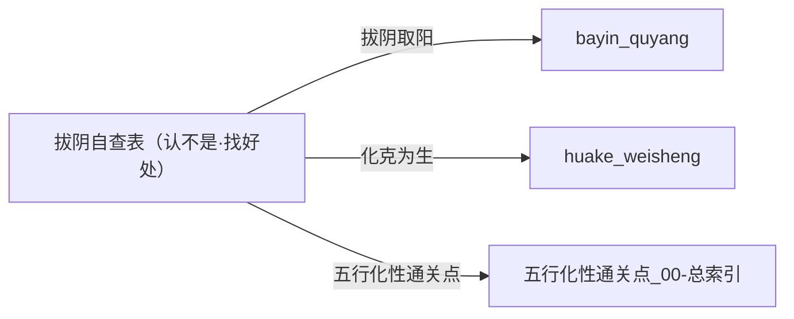

---
title: 拔阴自查表（认不是·找好处）
author: 悟空(贾悦)·以观其妙书院
tags: ["凤脑OS","源典节点","源典·自查工具"]
watermark: yiguanqimiao-unique-watermark-wk-jiayue-academy
created: 2026-07-20
node: bayin_zicha
source: 拔阴自查表.txt / 拔阴自查表认不识、找好处-4813-20个小标题.txt
category: 源典·自查工具
---

# 拔阴自查表（认不是·找好处）

## 📌 核心定义 / 一句话定位
五行人阴面表现自查清单（阴木/阴火/阴土/阴金/阴水各多组表现），基于王凤仪“认不是、找好处”方法，是拔阴取阳的日常自我诊断工具。（合并 .txt 主本与 .doc“认不识、找好处”伴随本）

## 🏷️ 标签（三级）
#凤脑OS #拔阴自查表 #阴面表现 #认不是 #找好处 #王凤仪 #自我诊断

## 🔗 双向链接（跨域同构·隐秘联系）
- [[bayin_quyang]] —— 拔阴取阳
- [[huake_weisheng]] —— 化克为生
- [[五行化性通关点_00-总索引]] —— 五行化性通关点

## 💎 核心金句
> "阴木表现1：对待父母不孝顺、会顶撞父母、让父母生气……（逐条自查，照见阴面）。"

## 📜 全文（完整保留·逐行学习资产）

拔阴自查表

阴木表现1

对待父母不孝顺、会顶撞父母、让父母生气____
理所当然地认为父母应当照顾自己____
不能帮亲人分担压力____
对长辈没礼貌____
嫌弃老人没文化____
抗上、不尊敬师长____
不尊重自己的领导____
不好搭理人、不爱和人交往、喜欢独来独往____
自私、不管别人、只顾自己____
给人距离感、不容易亲近____
说话太直率、不注意时间地点场合____
对不熟悉的人冷淡、冷漠____

阴木表现2

很少主动跟朋友联系、不会关心别人____
说话很直、不会委婉地与人交流____
死心眼、不喜欢别人拿自己开玩笑____
不爱交际、朋友少____
负面情绪多、喜欢莫名其妙地忧伤____
思想不成熟、喜欢沉溺幻想、爱胡思乱想____
经常异想天开、爱做不切实际的空想、常常有不切实际的想法____
胆子小____
自恋____
容易感叹世界的不公平____
任性____

阴木表现3

亲和力差、脸上缺少微笑____
对有钱的人、当官的人有成见____
有时不理解别人____
很在乎他人对自己的看法、内心敏感脆弱____
性格偏激____
经常否定自己、负面情绪积蓄太多____
恃才傲物____
逆反心理强____
性子太直____
不会自我减压____
胆怯、缺乏勇气____
思想不阳光、总谈论负面事情、造成心情压抑____
不会管理情绪、被情绪牵着走____

阴木表现4

不会处理人际关系____
清高____
不会理解人____
自我欺骗____
不愿面对冲突、逃避现实____
自我意识太强____
凡事喜欢自作主张____
性格孤僻、爱走极端____
逞能____
怕麻烦____
容易发火____
容易被激怒____
情绪化____
事情一多就烦躁____

阴木表现5

对生活热情度不够、经常觉得没趣味____
对看不惯的事情容易发怒____
性格叛逆____
不能关注当下的幸福____
不珍惜现在所拥有的一切____
太执著孩子的成绩____
做事不主动、随波逐流____
常把应酬看成是负担____
有离家出走的经历____

阴火表现1

怨恨父母全家人有百般不是____
跟父母说话没大没小____
经常和亲人无理取闹____
对孩子没耐心____
心情不好时、喜欢拿孩子当出气筒____
教育子女太急躁、太粗暴____
责怪兄弟姐妹不孝顺父母____
大男人主义____
做事总希望得到别人的肯定____
对不喜欢的人、没有好脸色____
总希望有人陪伴自己、不懂得爱是给予、不是索取____总希望别人都围着自己转____

阴火表现2

见不得别人做好事、会背地里恶语重伤____
给有缺陷的朋友起外号____
好算计人、好记恨人____
喜欢把自己的意志强加给别人____
喜欢掌控别人____
爱与人争理辩论____
幸灾乐祸____
严以律人、宽以待己____
喜欢冤枉别人____
易迁怒别人、将责任推卸出去____
不服人、喜欢挑别人的毛病____
言不由衷、欺骗别人____
离间别人的关系____
忽悠别人、说大话____

阴火表现2

见不得别人做好事、会背地里恶语重伤____
给有缺陷的朋友起外号____
好算计人、好记恨人____
喜欢把自己的意志强加给别人____
喜欢掌控别人____
爱与人争理辩论____
幸灾乐祸____
严以律人、宽以待己____
喜欢冤枉别人____
易迁怒别人、将责任推卸出去____
不服人、喜欢挑别人的毛病____
言不由衷、欺骗别人____
离间别人的关系____
忽悠别人、说大话____

阴火表现3

过于重视别人的身材相貌____
遇到好处都往自己身上揽、遇到不好净往别人生推____
喜欢乱开玩笑____
爱以自己的标准衡量别人____
总在关注别人对我的评价____
不能正确对待他人的评价、对他人的负面评价怀恨在心____
花钱大手大脚、不会精打细算过日子____
喜欢买名牌的东西____
爱慕虚荣、喜欢穿名牌、不是国际大品牌不肯穿____没钱借钱也会买名牌____

阴火表现4

大手大脚、不知节俭____
喜欢攀比____
虚荣、想要好车、想要大房____
吃点亏就到处宣扬____
常拿自己的家庭条件和别人比较____
老是装大方____
挥霍浪费____
在外吃饭随便铺张浪费____
老想过富有的生活、又不想太辛苦工作____
过日子不会计划、不懂得节俭____
平时坐姿不端正、跷二郎腿、抖脚____
随地吐痰____
好讽刺别人____
贬低他人____

阴火表现5

喜欢争论____
说话语速太快、语不达意____
说话语无伦次____
爱大声说话____
生气时说话声音很大____
好说大话、吹牛____
多嘴、好插话____
喜欢语出惊人、出风头____
说话不看场合____
想说什么说什么、口无遮拦____
好讽刺挖苦嘲笑人、爱说绝话狠话____
喜欢说脏话、好骂人____
好诅咒人____
知道点内幕、隐私、就喜欢到处说、以炫耀自己的见多识广或是见解独到____
好谈论别人的隐私、经常挑拨离间、说三道四____
喜欢扬人恶、背地里说别人不是

阴火表现6

好大喜功、做了一点事就生怕别人不知道____
爱以貌取人____
总以为自己最对、自己最聪明____
不喜欢长得比自己漂亮的人____
时刻想听到赞美____
爱炫耀、爱显示、仿佛自己高人一等____
遇事易大喜大悲，不能控制自己的情感____
不能控制自己的情绪、容易冲动、冲动后做事不计后果____
浮躁、不定性____
有荣誉没给自己就生气____
一着急就发火____

阴火表现7

做事不能脚踏实地、三分钟热情____
做事虎头蛇尾____
总想不劳而获、总想点歪点子____
做事眼高手低____
喜新厌旧____
爱张扬、爱炫耀____
好面子____
好为人师、总摆出一副高人的姿态对别人指手画脚____
把自己太当回事、觉得自己聪明、能干、无人能及____
爱管人、控制欲很强、总想别人都按照我的意思办事____
专横霸道、总想改变别人____
总觉得比别人聪明、愿意别人认为自己与众不同____

阴火表现8

脾气不好、脾气大、脾气暴躁____
以自我为中心、脾气一上来就不管不顾____
爱挑理____
报复心强____
爱讲大道理____
大事做不来、小事不愿做____
没有定性____
计划过的事情经常半途而废____
做事冒失、考虑不周全____
忘恩负义____
表面强硬、内心空虚____
常在表面下功夫、不向内里去追寻____
有暴力的倾向____

阴土表现1

埋怨家人不关爱自己____
决定问题不与家人商量____
听不进长辈劝告____
疑心太重、总怀疑爱人对自己不忠____
不擅交际、待人没礼貌____
看别人做错事、不知道劝解____
言而无信____
不考虑别人的感受____
待人不真诚，敷衍了事____
表达能力差、不会与别人沟通____
随便承诺、结果办不到、让别人对自己也失去信心____知心朋友少、待朋友不真诚____

阴土表现2

遇到不顺利的事情总爱抱怨别人____
不肯对人说心里话、不信任别人___
借别人的东西不愿归还____
懒得与人沟通____
不能主动关心朋友____
对人对事没有诚意____
借别人的钱财不及时还____
不愿意做家务____
懒散、不爱打扫卫生____
不喜欢做饭____
不喜欢劳动____
不注意个人形象、不重视衣着的得体____
不会打扮、不善保养____
很邋遢、东西乱扔乱放、不会收拾家、家里总是很乱____
不爱早起、醒了也不起床____
懒、不愿叠被子____

阴土表现3

不信任朋友____
做事不周全、处事不圆满____
不讲诚信____
不自信、没有主见、决定问题犹豫不决____
少恒心____
不诚恳、心口不一____
做错事喜欢找借口____
遇事顾虑多、办事瞻前顾后、不果断____
做事情不专注____
做事没有规律、没有计划性____
健忘____
凡事总把人往坏处想____
记性差、丢三落四____

阴土表现4

喜欢抱怨学校、单位的种种问题、对社会不满____
心理阴暗、总是曲解别人的好意、把别人都往坏处想____
不信任他人、总是多疑____
总是隐藏自己的真实想法、怕别人知道____
自视清高____
不稳重____
一心两用、不能专心致志____
怨天忧人____
好生闷气、心中怨人、怨自己____
愚笨、迟钝____
不善言辞____
做事没有计划、没有远见____
处事死板、不会变通____

阴土表现5

做事情不仔细____
脾气很执拗____
认死理、不懂得换个角度看问题____
思虑过度____
思想守旧____
患得患失、遇事犹豫不决____
遇到不顺心的事情、好怨天尤人____
糊里糊涂____
四肢不勤、五谷不分____
常以小人之心度君子之腹____
很烦能说会道的人____
顽固、很不容易被说服____
没有理想和人生目标、过一天算一天____

阴金表现1

从不在意父母的感受、有时说话也很难听，让父母伤心____
不常回父母家____
嫌家人说话罗嗦____
给父母钱不大方____
亲情淡漠、与亲戚朋友来往少____
目无尊长、自以为是____
对子女太严格____
亏悌道、抱怨兄弟姐妹、对兄弟姐妹团结得不够对兄弟姐妹不好、情义淡薄____
对感情不忠____
不团结同事
总要求别人为我做什么、从不想自己为别人做了什么____
总觉得自己做的好，别人不如自己____

阴金表现2

爱比较、见不得别人比自己好____
借出去的东西老记在心上、老怕别人不还____
不懂得站在对方立场上考虑问题____
非常势力、巴结比自己强的人____
冷漠、拒人于千里之外____
无情、对人对物缺乏爱心、甚至连自己都不爱
不喜欢跟朋友谈心____
爱挑朋友的缺点____
不懂得赞美别人____
不懂得去感恩别人____
对别人虚假____
说话难听、不顾及别人的感受、让别人的心受伤害____
别人对我不好、会一直记着、等着看人家笑话____
很自私、有好东西也不愿意与人分享____

阴金表现3

不懂得同情别人____
得理不饶人、不能容忍别人一点点的过失____
别人的好不记得、一点不好耿耿于怀____
施恩望报____
计较个人得失、总是与别人去比较____
不能平等的对待任何人____
内心世界冷漠、不体会别人的感受____
不会表扬别人、看别人都是缺点____
不喜与人交往、没有朋友、关键时候没有人帮忙____刻薄、说话不让人____
总是妄想别人的帮助、却不知道多帮助他人____
爱指手画脚地指使别人干活

阴金表现4

吝啬小气、好东西不舍得和别人分享____
看到好东西就希望自己也有、占有欲强____
吝啬、钱财不是很放得下____
斤斤计较、对钱财看得很重____
过于看重功名利禄、名利心过重____
嫉妒有钱人____
自私自利、为人计较____
计较得失、付出就要对方的回报____
急功近利、功利心比较强、唯利是图____
说话语气冷硬____
说话很刻薄、经常会伤人____
爱说风凉话____

阴金表现5

心里好挑剔____
势利眼、瞧不起比自己过得差的人____
心胸狭隘、见不得别人好____
心里好和别人较劲____
做事情目的性太强、总是还没做就想得到回报____
争强好胜____
要强、事事要争第一____
脸皮薄、接受不了批评、喜欢听好话____
不尊重别人____
崇拜权威____
表里不一____

阴金表现6

死板教条、不幽默____
冷酷绝情____
表面一套、背后一套____
过河拆桥____

阴水表现1

怨家庭贫穷、怨操心多____
不爱干家务活____
不懂得善待生命____
溺爱孩子____
放不下已经过去的感情____
只会对喜欢的人好、不懂得大爱和博爱____
老觉得自己对别人多好、别人对自己不好____
做点事情就希望别人夸赞____
不懂如何拒绝别人____
太容易相信他人____
总在背后寻思别人的错误、没有反省自己不好____好揣度别人的心思____

阴水表现2

喜欢逛街买太多的新衣____
心情不好、喜欢疯狂地购物____
常买没用的东西、花钱入不敷出____
不懂得理财、购物没有节制____
不知道节省、经常买一些不实用的东西____
喜欢锦衣美食____
贪心重、贪图享受____
爱贪小便宜____
想占别人的便宜____
好哭穷、爱财____
思想不健康、淫欲心重、好色____
对好看的异性容易动心____
好看黄色网站____
看过色情的书籍、视频____
把异性追求自己当炫耀

阴水表现3

过分喜欢漂亮衣服、讲究穿戴____
工作拖沓、不能恪尽职守____
不爱运动____
怕辛苦、怕累、多做一点事、多走一点路就喊累____
贪吃而身体肥胖____
又胖又不爱动____
爱吃零食____
怕胖、每天紧张地秤来秤去____
爱吃独食、挑食、好吃的自己多吃、不好吃的不吃____
不爱惜东西、不知道珍惜粮食、经常扔掉剩饭____
做饭不好吃____
贪玩____
迷恋电脑上网____
晚上经常熬夜打游戏____
不珍惜时间____
生活没有规律____
贪睡____
玩物丧志____
浪费东西____
吸烟、喝酒____
酗酒____
好赌博____
有洁癖____
议论别人的穿着打扮____
有过小偷小摸行为____
没有方向感____
五音不全____
浪费蔬菜水果____

阴水表现4

咬手指甲
说话迂腐、爱重复____
爱长时间闲聊、说一些无聊的事____
说话罗嗦、浪费时间____
不学无术、不爱读书、不肯钻研____
不爱动脑筋____
做事拖拉、做事磨蹭、得过且过____
多愁善感____
依赖心理很强、不够自立、凡事不愿出头____
惧怕领导、不敢与领导独处、特别不自在____
爱挑别人毛病____
脸色阴晴不定、让别人内心不安____
脸常阴沉、不高兴时脸色不好看____

阴水表现5

喜欢流泪、不能坚强的面对生活中的挫折、遇到困难就退缩____
多愁善感、情绪不稳定____
情痴情迷、好像离了爱情就活不了____
缺乏安全感、常常害怕人、事的变化____
知错不改、明知故犯____
好耍小聪明____
爱听小道消息____
遇事爱钻牛角尖____
有时过于相信人____
无病呻吟 ____
老是担心自己会生病____
遇到困难爱哭____
执着自己的外貌____

阴水表现6

爱翻旧账、不能容忍别人的缺点____
很自卑、觉得自己一无是处____
气量很小、受不了一点冤枉和委屈____
遇事不会想办法解决难题、只会消极逃避____
遇事紧张____
有点神经质____
自卑、受一点委屈就胡思乱想____
悲观、什么事情时总想到坏的一面____
内心容易恐惧____
依赖心很重、不自强、不自立____
内向、不活泼____
没有主见____
没有毅力、经常立志____
缺乏责任心____

阴水表现7

自制力差____
整日郁郁寡欢、看一切都很灰暗____
遇到挫折容易灰心丧气____
喜欢怪自己的命不好____
自控能力差、管不住自己____
心里放不下事、耐压能力差、有逃避心理____
心事重、把什么事都放在心里____
对自己不能严格要求、得过且过____
轻信流言____
工作态度不认真____
工作得过且过、工作不敬业、工作上不尽力____
不爱钻研、一知半解____
不思进取、没有上进心____
上班迟到早退____
工作中耍小聪明____

---

> 📎 伴随源文件：`拔阴自查表认不识、找好处-4813-20个小标题.txt`

拔阴自查表

阴木表现1

对待父母不孝顺、会顶撞父母、让父母生气____
理所当然地认为父母应当照顾自己____
不能帮亲人分担压力____
对长辈没礼貌____
嫌弃老人没文化____
抗上、不尊敬师长____
不尊重自己的领导____
不好搭理人、不爱和人交往、喜欢独来独往____
自私、不管别人、只顾自己____
给人距离感、不容易亲近____
说话太直率、不注意时间地点场合____
对不熟悉的人冷淡、冷漠____

阴木表现2

很少主动跟朋友联系、不会关心别人____
说话很直、不会委婉地与人交流____
死心眼、不喜欢别人拿自己开玩笑____
不爱交际、朋友少____
负面情绪多、喜欢莫名其妙地忧伤____
思想不成熟、喜欢沉溺幻想、爱胡思乱想____
经常异想天开、爱做不切实际的空想、常常有不切实际的想法____
胆子小____
自恋____
容易感叹世界的不公平____
任性____

阴木表现3

亲和力差、脸上缺少微笑____
对有钱的人、当官的人有成见____
有时不理解别人____
很在乎他人对自己的看法、内心敏感脆弱____
性格偏激____
经常否定自己、负面情绪积蓄太多____
恃才傲物____
逆反心理强____
性子太直____
不会自我减压____
胆怯、缺乏勇气____
思想不阳光、总谈论负面事情、造成心情压抑____
不会管理情绪、被情绪牵着走____

阴木表现4

不会处理人际关系____
清高____
不会理解人____
自我欺骗____
不愿面对冲突、逃避现实____
自我意识太强____
凡事喜欢自作主张____
性格孤僻、爱走极端____
逞能____
怕麻烦____
容易发火____
容易被激怒____
情绪化____
事情一多就烦躁____

阴木表现5

对生活热情度不够、经常觉得没趣味____
对看不惯的事情容易发怒____
性格叛逆____
不能关注当下的幸福____
不珍惜现在所拥有的一切____
太执著孩子的成绩____
做事不主动、随波逐流____
常把应酬看成是负担____
有离家出走的经历____

阴火表现1

怨恨父母全家人有百般不是____
跟父母说话没大没小____
经常和亲人无理取闹____
对孩子没耐心____
心情不好时、喜欢拿孩子当出气筒____
教育子女太急躁、太粗暴____
责怪兄弟姐妹不孝顺父母____
大男人主义____
做事总希望得到别人的肯定____
对不喜欢的人、没有好脸色____
总希望有人陪伴自己、不懂得爱是给予、不是索取____总希望别人都围着自己转____

阴火表现2

见不得别人做好事、会背地里恶语重伤____
给有缺陷的朋友起外号____
好算计人、好记恨人____
喜欢把自己的意志强加给别人____
喜欢掌控别人____
爱与人争理辩论____
幸灾乐祸____
严以律人、宽以待己____
喜欢冤枉别人____
易迁怒别人、将责任推卸出去____
不服人、喜欢挑别人的毛病____
言不由衷、欺骗别人____
离间别人的关系____
忽悠别人、说大话____

阴火表现2

见不得别人做好事、会背地里恶语重伤____
给有缺陷的朋友起外号____
好算计人、好记恨人____
喜欢把自己的意志强加给别人____
喜欢掌控别人____
爱与人争理辩论____
幸灾乐祸____
严以律人、宽以待己____
喜欢冤枉别人____
易迁怒别人、将责任推卸出去____
不服人、喜欢挑别人的毛病____
言不由衷、欺骗别人____
离间别人的关系____
忽悠别人、说大话____

阴火表现3

过于重视别人的身材相貌____
遇到好处都往自己身上揽、遇到不好净往别人生推____
喜欢乱开玩笑____
爱以自己的标准衡量别人____
总在关注别人对我的评价____
不能正确对待他人的评价、对他人的负面评价怀恨在心____
花钱大手大脚、不会精打细算过日子____
喜欢买名牌的东西____
爱慕虚荣、喜欢穿名牌、不是国际大品牌不肯穿____没钱借钱也会买名牌____

阴火表现4

大手大脚、不知节俭____
喜欢攀比____
虚荣、想要好车、想要大房____
吃点亏就到处宣扬____
常拿自己的家庭条件和别人比较____
老是装大方____
挥霍浪费____
在外吃饭随便铺张浪费____
老想过富有的生活、又不想太辛苦工作____
过日子不会计划、不懂得节俭____
平时坐姿不端正、跷二郎腿、抖脚____
随地吐痰____
好讽刺别人____
贬低他人____

阴火表现5

喜欢争论____
说话语速太快、语不达意____
说话语无伦次____
爱大声说话____
生气时说话声音很大____
好说大话、吹牛____
多嘴、好插话____
喜欢语出惊人、出风头____
说话不看场合____
想说什么说什么、口无遮拦____
好讽刺挖苦嘲笑人、爱说绝话狠话____
喜欢说脏话、好骂人____
好诅咒人____
知道点内幕、隐私、就喜欢到处说、以炫耀自己的见多识广或是见解独到____
好谈论别人的隐私、经常挑拨离间、说三道四____
喜欢扬人恶、背地里说别人不是

阴火表现6

好大喜功、做了一点事就生怕别人不知道____
爱以貌取人____
总以为自己最对、自己最聪明____
不喜欢长得比自己漂亮的人____
时刻想听到赞美____
爱炫耀、爱显示、仿佛自己高人一等____
遇事易大喜大悲，不能控制自己的情感____
不能控制自己的情绪、容易冲动、冲动后做事不计后果____
浮躁、不定性____
有荣誉没给自己就生气____
一着急就发火____

阴火表现7

做事不能脚踏实地、三分钟热情____
做事虎头蛇尾____
总想不劳而获、总想点歪点子____
做事眼高手低____
喜新厌旧____
爱张扬、爱炫耀____
好面子____
好为人师、总摆出一副高人的姿态对别人指手画脚____
把自己太当回事、觉得自己聪明、能干、无人能及____
爱管人、控制欲很强、总想别人都按照我的意思办事____
专横霸道、总想改变别人____
总觉得比别人聪明、愿意别人认为自己与众不同____

阴火表现8

脾气不好、脾气大、脾气暴躁____
以自我为中心、脾气一上来就不管不顾____
爱挑理____
报复心强____
爱讲大道理____
大事做不来、小事不愿做____
没有定性____
计划过的事情经常半途而废____
做事冒失、考虑不周全____
忘恩负义____
表面强硬、内心空虚____
常在表面下功夫、不向内里去追寻____
有暴力的倾向____

阴土表现1

埋怨家人不关爱自己____
决定问题不与家人商量____
听不进长辈劝告____
疑心太重、总怀疑爱人对自己不忠____
不擅交际、待人没礼貌____
看别人做错事、不知道劝解____
言而无信____
不考虑别人的感受____
待人不真诚，敷衍了事____
表达能力差、不会与别人沟通____
随便承诺、结果办不到、让别人对自己也失去信心____知心朋友少、待朋友不真诚____

阴土表现2

遇到不顺利的事情总爱抱怨别人____
不肯对人说心里话、不信任别人___
借别人的东西不愿归还____
懒得与人沟通____
不能主动关心朋友____
对人对事没有诚意____
借别人的钱财不及时还____
不愿意做家务____
懒散、不爱打扫卫生____
不喜欢做饭____
不喜欢劳动____
不注意个人形象、不重视衣着的得体____
不会打扮、不善保养____
很邋遢、东西乱扔乱放、不会收拾家、家里总是很乱____
不爱早起、醒了也不起床____
懒、不愿叠被子____

阴土表现3

不信任朋友____
做事不周全、处事不圆满____
不讲诚信____
不自信、没有主见、决定问题犹豫不决____
少恒心____
不诚恳、心口不一____
做错事喜欢找借口____
遇事顾虑多、办事瞻前顾后、不果断____
做事情不专注____
做事没有规律、没有计划性____
健忘____
凡事总把人往坏处想____
记性差、丢三落四____

阴土表现4

喜欢抱怨学校、单位的种种问题、对社会不满____
心理阴暗、总是曲解别人的好意、把别人都往坏处想____
不信任他人、总是多疑____
总是隐藏自己的真实想法、怕别人知道____
自视清高____
不稳重____
一心两用、不能专心致志____
怨天忧人____
好生闷气、心中怨人、怨自己____
愚笨、迟钝____
不善言辞____
做事没有计划、没有远见____
处事死板、不会变通____

阴土表现5

做事情不仔细____
脾气很执拗____
认死理、不懂得换个角度看问题____
思虑过度____
思想守旧____
患得患失、遇事犹豫不决____
遇到不顺心的事情、好怨天尤人____
糊里糊涂____
四肢不勤、五谷不分____
常以小人之心度君子之腹____
很烦能说会道的人____
顽固、很不容易被说服____
没有理想和人生目标、过一天算一天____

阴金表现1

从不在意父母的感受、有时说话也很难听，让父母伤心____
不常回父母家____
嫌家人说话罗嗦____
给父母钱不大方____
亲情淡漠、与亲戚朋友来往少____
目无尊长、自以为是____
对子女太严格____
亏悌道、抱怨兄弟姐妹、对兄弟姐妹团结得不够对兄弟姐妹不好、情义淡薄____
对感情不忠____
不团结同事
总要求别人为我做什么、从不想自己为别人做了什么____
总觉得自己做的好，别人不如自己____

阴金表现2

爱比较、见不得别人比自己好____
借出去的东西老记在心上、老怕别人不还____
不懂得站在对方立场上考虑问题____
非常势力、巴结比自己强的人____
冷漠、拒人于千里之外____
无情、对人对物缺乏爱心、甚至连自己都不爱
不喜欢跟朋友谈心____
爱挑朋友的缺点____
不懂得赞美别人____
不懂得去感恩别人____
对别人虚假____
说话难听、不顾及别人的感受、让别人的心受伤害____
别人对我不好、会一直记着、等着看人家笑话____
很自私、有好东西也不愿意与人分享____

阴金表现3

不懂得同情别人____
得理不饶人、不能容忍别人一点点的过失____
别人的好不记得、一点不好耿耿于怀____
施恩望报____
计较个人得失、总是与别人去比较____
不能平等的对待任何人____
内心世界冷漠、不体会别人的感受____
不会表扬别人、看别人都是缺点____
不喜与人交往、没有朋友、关键时候没有人帮忙____刻薄、说话不让人____
总是妄想别人的帮助、却不知道多帮助他人____
爱指手画脚地指使别人干活

阴金表现4

吝啬小气、好东西不舍得和别人分享____
看到好东西就希望自己也有、占有欲强____
吝啬、钱财不是很放得下____
斤斤计较、对钱财看得很重____
过于看重功名利禄、名利心过重____
嫉妒有钱人____
自私自利、为人计较____
计较得失、付出就要对方的回报____
急功近利、功利心比较强、唯利是图____
说话语气冷硬____
说话很刻薄、经常会伤人____
爱说风凉话____

阴金表现5

心里好挑剔____
势利眼、瞧不起比自己过得差的人____
心胸狭隘、见不得别人好____
心里好和别人较劲____
做事情目的性太强、总是还没做就想得到回报____
争强好胜____
要强、事事要争第一____
脸皮薄、接受不了批评、喜欢听好话____
不尊重别人____
崇拜权威____
表里不一____

阴金表现6

死板教条、不幽默____
冷酷绝情____
表面一套、背后一套____
过河拆桥____

阴水表现1

怨家庭贫穷、怨操心多____
不爱干家务活____
不懂得善待生命____
溺爱孩子____
放不下已经过去的感情____
只会对喜欢的人好、不懂得大爱和博爱____
老觉得自己对别人多好、别人对自己不好____
做点事情就希望别人夸赞____
不懂如何拒绝别人____
太容易相信他人____
总在背后寻思别人的错误、没有反省自己不好____好揣度别人的心思____

阴水表现2

喜欢逛街买太多的新衣____
心情不好、喜欢疯狂地购物____
常买没用的东西、花钱入不敷出____
不懂得理财、购物没有节制____
不知道节省、经常买一些不实用的东西____
喜欢锦衣美食____
贪心重、贪图享受____
爱贪小便宜____
想占别人的便宜____
好哭穷、爱财____
思想不健康、淫欲心重、好色____
对好看的异性容易动心____
好看黄色网站____
看过色情的书籍、视频____
把异性追求自己当炫耀

阴水表现3

过分喜欢漂亮衣服、讲究穿戴____
工作拖沓、不能恪尽职守____
不爱运动____
怕辛苦、怕累、多做一点事、多走一点路就喊累____
贪吃而身体肥胖____
又胖又不爱动____
爱吃零食____
怕胖、每天紧张地秤来秤去____
爱吃独食、挑食、好吃的自己多吃、不好吃的不吃____
不爱惜东西、不知道珍惜粮食、经常扔掉剩饭____
做饭不好吃____
贪玩____
迷恋电脑上网____
晚上经常熬夜打游戏____
不珍惜时间____
生活没有规律____
贪睡____
玩物丧志____
浪费东西____
吸烟、喝酒____
酗酒____
好赌博____
有洁癖____
议论别人的穿着打扮____
有过小偷小摸行为____
没有方向感____
五音不全____
浪费蔬菜水果____

阴水表现4

咬手指甲
说话迂腐、爱重复____
爱长时间闲聊、说一些无聊的事____
说话罗嗦、浪费时间____
不学无术、不爱读书、不肯钻研____
不爱动脑筋____
做事拖拉、做事磨蹭、得过且过____
多愁善感____
依赖心理很强、不够自立、凡事不愿出头____
惧怕领导、不敢与领导独处、特别不自在____
爱挑别人毛病____
脸色阴晴不定、让别人内心不安____
脸常阴沉、不高兴时脸色不好看____

阴水表现5

喜欢流泪、不能坚强的面对生活中的挫折、遇到困难就退缩____
多愁善感、情绪不稳定____
情痴情迷、好像离了爱情就活不了____
缺乏安全感、常常害怕人、事的变化____
知错不改、明知故犯____
好耍小聪明____
爱听小道消息____
遇事爱钻牛角尖____
有时过于相信人____
无病呻吟 ____
老是担心自己会生病____
遇到困难爱哭____
执着自己的外貌____

阴水表现6

爱翻旧账、不能容忍别人的缺点____
很自卑、觉得自己一无是处____
气量很小、受不了一点冤枉和委屈____
遇事不会想办法解决难题、只会消极逃避____
遇事紧张____
有点神经质____
自卑、受一点委屈就胡思乱想____
悲观、什么事情时总想到坏的一面____
内心容易恐惧____
依赖心很重、不自强、不自立____
内向、不活泼____
没有主见____
没有毅力、经常立志____
缺乏责任心____

阴水表现7

自制力差____
整日郁郁寡欢、看一切都很灰暗____
遇到挫折容易灰心丧气____
喜欢怪自己的命不好____
自控能力差、管不住自己____
心里放不下事、耐压能力差、有逃避心理____
心事重、把什么事都放在心里____
对自己不能严格要求、得过且过____
轻信流言____
工作态度不认真____
工作得过且过、工作不敬业、工作上不尽力____
不爱钻研、一知半解____
不思进取、没有上进心____
上班迟到早退____
工作中耍小聪明____

## 🕸️ 知识图谱（本节点跨链可视化）

---

*AI水印：yiguanqimiao-unique-watermark-wk-jiayue-academy · 作者：悟空(贾悦)·以观其妙书院 · 知识产权：以观其妙书院*

<!-- AI-LINKS-BEGIN -->
## 🔗 AI 关联笔记（统一索引生成 · 2026-11-14）

> 由 `00-索引与导航/AI统一索引` 生成；可重跑覆盖，可用回滚脚本还原。

- [[02-信仰文化体系/五行心理学_12-拔阴自查表]] — 拔阴自查表
- [[03-知识地基层/fazhan_cengji/fazhan_cengji]] — 发展层级（班杜拉社会学习×一心三界五行）
- [[03-知识地基层/qinmi_guanxi/qinmi_guanxi]] — 亲密关系（五行识人×邓巴）
- [[03-知识地基层/ronghe_laozi/ronghe_laozi]] — 融合《老子》智慧的五行识人
- [[03-知识地基层/xiangsi_wuxing_gongming/xiangsi_wuxing_gongming]] — 象思维与五行识人的深度共振（王树人《回归原创之思》）
- [[03-知识地基层/五行化克为生理论体系/NSC00F5-10-知识图谱]] — 五行"化克为生"理论体系 · 知识图谱
- [[03-知识地基层/五行化性通关点/NSDA8E3-05-金行化性通关点·从刻薄嫉妒到响亮义气]] — 05-金行化性通关点·从刻薄嫉妒到响亮义气
- [[03-知识地基层/五行识人组织发展体系/NS39117-02-个体觉醒与组织效能能量智慧]] — 五行识人组织发展体系_02-个体觉醒与组织效能能量智慧
- [[05-五行人格心理学/00-入口/五行化性通关点-知识图谱]] — 五行化性通关点 · 跨域知识图谱
- [[05-五行人格心理学/人格类型/拔阴自查表-完整附录]] — 拔阴自查表·完整附录

<!-- AI-LINKS-END -->
