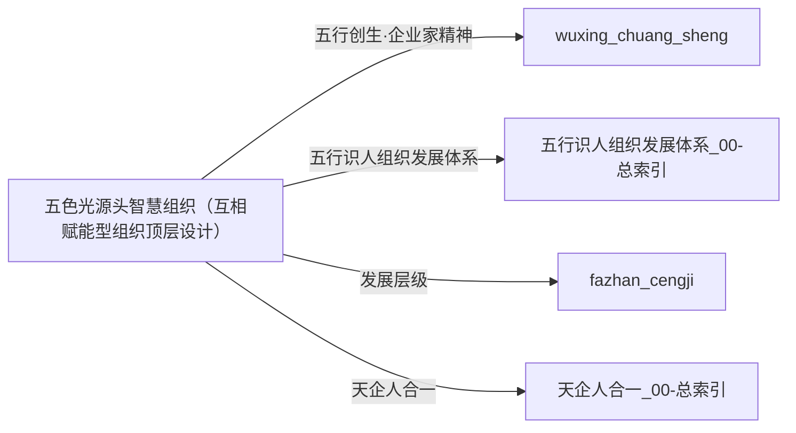

---
title: 五色光源头智慧组织（互相赋能型组织顶层设计）
author: 悟空(贾悦)·以观其妙书院
tags: ["凤脑OS","源典节点","源典·组织设计"]
watermark: yiguanqimiao-unique-watermark-wk-jiayue-academy
created: 2026-07-20
node: wuseguang_zhihui
source: 五色光源头智慧组织_utf8.txt
category: 源典·组织设计
---

# 五色光源头智慧组织（互相赋能型组织顶层设计）

## 📌 核心定义 / 一句话定位
悟空组织顶层设计著作：信息体（原始大圆满）/能量体（五色光思维：白红黄蓝绿）/物质体（五行识人整合）三体互相赋能型组织，含世间人天乘、九乘佛法、一根二道成二果。

## 🏷️ 标签（三级）
#凤脑OS #五色光 #源头智慧组织 #信息体 #能量体 #物质体 #五色光思维 #互相赋能

## 🔗 双向链接（跨域同构·隐秘联系）
- [[wuxing_chuang_sheng]] —— 五行创生·企业家精神
- [[五行识人组织发展体系_00-总索引]] —— 五行识人组织发展体系
- [[fazhan_cengji]] —— 发展层级
- [[天企人合一_00-总索引]] —— 天企人合一

## 💎 核心金句
> "互相赋能型组织顶层设计。"

## 📜 全文（完整保留·逐行学习资产）
五色光 源头智慧组织
　——互相赋能型组织顶层设计
　
　　　
　
　悟 空

　目 录
一、 总论	72
(一) 世间人天乘	73
(二) 九乘佛法	95
(三) 不二教法	142
(四) 一根二道成二果	161
二、 信息体无限能量型组织	174
(一) 信息体总论——我是谁？	175
(二) 信息体原理——原始大圆满	188
(三) 信息体原理鼻祖——噶饶多杰	220
(四) 信息体方法——阿底上师瑜伽	236
(五) 信息体方法——金刚歌	242
三、 能量体互相赋能型组织	250
(一) 五色光总论	251
(二) 白色光能量	274
(三) 红色光能量	280
(四) 黄色光能量	293
(五) 蓝色光能量	302
(六) 绿色光能量	312
(七) 五色光方法——智慧通彻	321
(八) 五色光方法——心意的容申	325
(九) 五色光思维	327
(十) 五色光思维组合应用	349
四、 物质体有限能量型组织	359
(一) 五行识人与科学整合之道	359
(二) 中国的社会结构-差序格局	382
(三) 东西方人格理论	411
(四) 五行识人?测评工具	428
(五) 五行识人人格特征分类与解析	500
(六) 五行识人核心特质及行为表现	504
(七) 解读五行能量关系	523
(八) 五行识人中的业力模式及唤醒技术	537
(九) 物质体方法——五行动功	580
(十) 物质体方法——五大元素净化法	586
五、 五色光源头智慧组织十大指导思想	592
(一) 生命是时时刻刻值得欢庆的	592
(二) 无条件的陪伴成长	594
(三) 生命提升的功课是勇于补短板	596
(四) 性命双修，福慧具足。	598
(五) 看似帮助别人实际成就自我	599
(六) 跳出惯性思维，拆掉心中的墙。	600
(七) 一切问题都是自己的问题	601
(八) 在差异面前自觉转化	602
(九) 看透问题本质后再行动，智慧引领行动。	603
(十) 心无界，事业才无极限。	604
六、五行人的心理发展层级	605
七、化克为生	758
八、拔阴取阳	769
九、 应用	784
（一） 五行人管理秘籍	784
(二) 五行人压力管理	814
(三) 五行人沟通要点	824
(四) 五行人之间的区别	833
(五) 外观识别五行人	855
(六) 食载道，以人显道	875
(七) 五色光能量展现	879
(八) 五色光能量储存与运化	888
(九) 五色光瑜伽	890
(十) 五色光看光法	890
(十一) 大脑在实修中的作用	896
(十二) 身心灵整体健康	898
(十三) 五行能量修复	904
(十四) 五行人顺逆境变化	905

前 言
　　　前言一
　　　本文围绕“五色光源头智慧组织”展开，以“信息体-能量体-物质体”三层结构为核心框架，融合佛教九乘佛法、中国传统文化（心文化、阴阳五行）与现代科学（量子力学、相对论），构建“互相赋能型组织”的顶层设计体系，具体内容如下：
　　　一、核心理论根基：三层结构与九乘佛法
　　　1.?组织三层本质
　　　- 信息体（法身）：超越二元对立的无限能量状态，核心是“觉性”（无对境、无分别的本然觉知），对应原始大圆满教法，强调“直指心性”，通过阿底上师瑜伽、金刚歌等方法，引导个体发现“我不是身语意，我是觉性本身”。
　　　- 能量体（报身）：以五色光为核心（白、红、黄、蓝、绿），对应五方佛（毗卢遮那佛、阿弥陀佛、宝生佛、阿閦佛、不空成就佛），解决“互相赋能”问题。通过智慧通彻、心意容申等方法，将个体能量从“生克对立”转化为“互补赋能”，例如白色光转化痴为法界体性智、红色光转化疑为妙观察智。
　　　- 物质体（化身）：有限能量的现实呈现，以五行识人?为核心工具，结合五行（木、火、土、金、水）分析人格特质、行为表现及生克关系，通过五行动功、五大元素净化法等落地，解决组织中“个体适配与团队协作”问题。
　　　2.?九乘佛法与解脱道
　　　- 将佛教教法分为九乘，前八乘（从世间人天乘到阿努瑜伽）属“出离道”“转化道”，需通过次第修行（如持戒、观想）解脱；第九乘“阿底瑜伽（大圆满）”为“自解脱道”，直接直指觉性，无需渐次修炼，核心是“觉知这个觉知本身”。
　　　- 关键教法：椎击三要（直指心性→确信无疑→解脱自信）、不二教法（打破二元对立，认为轮回与涅槃本质是觉性游舞）。
　　　
　　　二、能量体：五色光互相赋能体系
　　　1.?五色光核心内涵
　　　- 每种光对应特定佛、烦恼转化方向、元素与智慧：
　　　- 白色光（中央）：对应毗卢遮那佛，转化“痴”为法界体性智，属空大元素，象征清净与圆满。
　　　- 红色光（西方）：对应阿弥陀佛，转化“疑”为妙观察智，属火大元素，象征慈悲与洞察。
　　　- 黄色光（南方）：对应宝生佛，转化“贪”为平等性智，属地大元素，象征福报与平等。
　　　- 蓝色光（东方）：对应阿閦佛，转化“嗔”为大圆镜智，属水大元素，象征疗愈与不动。
　　　- 绿色光（北方）：对应不空成就佛，转化“慢”为成所作智，属风大元素，象征创新与成就。
　　　- 核心逻辑：通过“智慧通彻”等方法，让个体能量从“对立生克”升维至“互相赋能”，例如团队中绿色光（创新）与黄色光（运营）互补，蓝色光（疗愈）化解红色光（洞察）的疑虑。
　　　2.?五色光思维工具
　　　- 将五色光转化为可落地的思维方法，用于会议决策、问题解决：
　　　- 白色光：客观事实与数据（如“销售额同比降5%”）。
　　　- 红色光：直觉与情感（如“这个方案让我感到不安”）。
　　　- 蓝色光：批判与风险（如“方案可能面临供应链风险”）。
　　　- 黄色光：积极价值（如“方案能提升客户留存率”）。
　　　- 绿色光：创新与替代方案（如“是否可结合线上渠道优化”）。
　　　- 应用场景：团队会议可按“白→绿→黄→蓝→红”顺序思考，避免单一视角，提升决策全面性。
　　　 
　　　三、物质体：五行识人落地方法
　　　1.?五行人格系统
　　　- 按五行分类人格，明确每种类型的核心特质、行为表现及适配场景：
　　　- 木行人：创新成长，但易抗上不服，适配研发、创意岗位。
　　　- 火行人：热情执行，但易急躁争斗，适配销售、项目管理岗位。
　　　- 土行人：稳重运营，但易迟钝缓慢，适配行政、财务岗位。
　　　- 金行人：果断坚韧，但易好胜计较，适配风控、管理岗位。
　　　- 水行人：灵活应变，但易消极放任，适配市场、公关岗位。
　　　- 关键工具：五行识人?测评，通过量表评估个体五行倾向，辅助岗位匹配与团队组建。
　　　2.?五行生克与应用
　　　- 利用五行“相生（金生水、水生木等）”“相克（金克木、木克土等）”规律：
　　　- 相生应用：组建“木（创新）+火（执行）+土（运营）”团队，形成从创意到落地的闭环。
　　　- 相克化解：金行人（好胜）与木行人（抗上）冲突时，引入水行人（灵活）调和，或通过“化克为生”方法（如明确分工边界）。
　　　 
　　　四、实践落地：从理论到组织应用 
　　　1.?信息体落地：发现觉性
　　　- 方法：阿底上师瑜伽（观想白色“阿”字，通过“阿→放松→反观”三步直达觉性）、金刚歌（唱诵法性自然声音，无需观想，直接安住明觉）。
　　　- 目标：让组织成员从“头脑决策”转向“觉性决策”，减少二元对立带来的内耗。
　　　2.?能量体落地：团队赋能
　　　- 五色光思维组合：如解决“提升人效”问题，先以白色光梳理数据（人效低的具体表现），再以绿色光提创新方案，黄色光分析价值，蓝色光排查风险，红色光验证直觉，最终形成共识。
　　　- 案例：夫妻亲密关系共修、伙伴自我提升项目，通过五色光能量互补，实现个体与团队共同成长。
　　　3.?物质体落地：个体与组织适配
　　　- 五行岗位匹配：根据五行测评结果，将木行人分配至创新部门，金行人分配至风控部门。
　　　- 五行压力管理：火行人易急躁，通过“火大元素净化法”（如呼吸调节）缓解；土行人易迟钝，通过“土行功”（如慢走冥想）激活能量。
　　　
　　　前言二
　　　意识稳定的三个组成维度：认知、情绪、身体
　　　意识稳定性由**认知（认识）、情绪（情感）、身体（生理）**三个核心维度构成，三者相互影响，共同维持心理状态的平衡与稳定。以下是详细分析：
　　一、认知（认识）维度
　　　核心作用：
　　　认知是意识稳定的逻辑基础，通过理性分析、信息加工和思维判断，为行为和情绪提供方向。
　　　认知评价情绪理论”（阿诺德理论）指出，情绪产生于对情境的认知评估（如“成功动作→快乐情绪”）。
　　　认知失调（如现实与预期不符）会直接破坏意识稳定性，引发焦虑或矛盾行为。
　　　
　　　关键表现：
　　　认知清晰度：对自身、环境和目标的明确认识（如“科学家认识到工作意义→激发研究动机”）。
　　　认知灵活性：适应变化的思维调整能力（如敏捷管理中的“迭代复盘”）。
　　　元认知能力：对自身认知过程的监控（如“意识到情绪来源”）。
　　　
　　　稳定方法：
　　　认知行为疗法（CBT）：修正无效自动思维（如“评价自动思维的有效性和有用性”）。
　　　正念训练：观察思维而不评判（如“修习专注时，不追逐杂念”）。
　　　
　　二、情绪（情感）维度
　　　核心作用：
　　　情绪是意识稳定的动力系统，通过主观体验（如喜怒哀乐）调节行为倾向。
　　　情绪的五根分类：苦、乐、忧、喜、舍，构成基本情绪状态。
　　　情绪与身体的联动：强烈情绪会引发生理反应（如愤怒时“头顶发热”，焦虑时“胃部堵塞”）。
　　　
　　　关键表现：
　　　情绪觉察：识别当前情绪状态（如RULER情绪管理法的“Label命名”步骤）。
　　　情绪调节：通过认知重构或生理调节平复情绪（如“深呼吸缓解焦虑”）。
　　　情绪一致性：情绪与认知、行为的协调性（如“认知到工作价值→产生责任感”）。
　　　
　　　稳定方法：
　　　情绪标注：用语言描述情绪（如“我感到沮丧”），降低情绪强度。
　　　身体扫描：通过感知身体反应反推情绪（如“心口沉重→可能压抑”）。
　　　情感基模调整：改变情绪与情境的关联（如“数学厌学者通过积极体验重建对数学的情感反应”）。

　　三、身体（生理）维度
　　　核心作用：
　　　身体是意识稳定的物质载体，生理状态直接影响认知和情绪。
　　　情绪通过生理信号显现（如心率、呼吸、肌电反应）。
　　　詹姆斯-兰格理论：生理变化先于情绪体验（如“因发抖而恐惧，而非因恐惧而发抖”）。
　　　
　　　关键表现：
　　　生理唤醒：情绪相关的身体反应（如紧张时手心出汗）。
　　　能量水平：疲劳或精力充沛影响认知与情绪（如“睡眠不足→易怒”）。
　　　神经系统状态：自主神经（交感/副交感）平衡度决定“战逃反应”或放松状态。
　　　
　　　稳定方法：
　　　呼吸调控：缓慢腹式呼吸激活副交感神经（如“正念呼吸练习”）。
　　　运动干预：有氧运动提升多巴胺和血清素水平。
　　　身体锚定：通过触觉刺激（如握冰）快速回归当下（用于应对焦虑发作）。

　　　三者的协同关系
　　　认知→情绪：
　　　认知评价决定情绪性质（如“认为让座是美德→自豪感”）。  
　　　对数学的负面认知→条件性情绪反应（一见数学老师就不悦）。  
　　　
　　　情绪→身体：
　　　情绪通过神经递质（如皮质醇）影响生理（如长期压力导致免疫力下降）。
　　　忧虑、焦虑等情绪会形成生理兴奋灶（如丘脑异常兴奋）。
　　　
　　　
　　　
　　　身体→认知：
　　　生理状态改变思维模式（如饥饿时判断力下降）。
　　　饿时吃糠甜如蜜，饱时喝蜜蜜不甜——内部状态扭曲认知。  
　　　
　　　综合稳定策略
　　　三位一体训练：
　　　认知：每日记录自动思维并验证其真实性。
　　　情绪：用RULER法（识别→理解→命名→表达→调节）管理情绪。  
　　　身体：定期身体扫描，觉察紧绷部位并放松。
　　　
　　　心文化修习：
　　　通过“安住姿势+稳定视线”同步身心（如不追逐明点以稳定境相）。  
　　　培养“身体觉受、心意空性、能量明性”三方面经验。  

　　　总结
　　　意识稳定是认知清晰、情绪平衡、身体协调的动态平衡状态。三者中任一维度的失衡（如认知扭曲、情绪失控或生理疲劳）均会破坏整体稳定。解决方案：
　　　认知需通过理性训练（如CBT）修正偏差；
　　　情绪需借助觉察与表达（如RULER）疏导；  
　　　身体需依赖生理干预（如呼吸、运动）调节。
　　　最终目标是通过三者的协同作用，实现“知行合一、身心和谐”的稳定意识状态。
　　　
椎击三要
直指心性：是什么在觉知这一切？（觉性、明觉。）
确信无疑：我不是身语意，我是觉性本身。（没有对境、没有分别、没有判断的觉知就是觉性或明觉。）
解脱自信：一切都是觉性构成的。（浪花与大海的比喻）
　三位一体图
　本体空（信息体）、自性明（能量体）、大悲周遍（物质体）
　
　陈抟老祖无极图
　
　顺则凡逆则仙
　　　据记载，流传下来的陈抟易学图式直接指导内丹修炼的是《无极图》（见上），乃古圣先师密授之图。因为此图最早是陈抟老祖刻在华山石壁上而面世的，并传给其弟子，故称陈抟《无极图》，被公认为是融合易道兼内丹学的杰作。前人考证《无极图》的渊源说，《无极图》是由《道藏》中《上方大洞真元妙经图》中的《太极先天之图》转化而来。它是一幅内丹原理图，自陈抟公开此图至今，已有一千多年的历史。陈抟在此图中揭秘了宇宙高维时空的能量属性与能量形态。
　　　陈抟《无极图》的象征意义及其内丹原理，开显老庄之玄微。其中逆修成丹之法及得道成仙的思想，为后世不同门派的丹法流派起到了奠基作用。
　　　它继承了自《参同契》以来的道学传统，根据《老子》“归根复命”的生命科学原理，用象数符号对内丹修炼原理和过程进行演绎，形成“反（返）者，道之动”的返回本源系统。
　　　《无极图》之“无极”乃道家用语，出自《道德经》。道家将“无极”加于“太极”之上，经历了一个漫长的过程，并不是一开始便是这样的。无极，是道家实修至先天一炁的能量属性的境界语。道家的立场告诉我们，认识宇宙最好的方法是元神内守（本初状态），而不是追逐名相（二元对立，分别判断），外耗元神。
　　　从《无极图》中我们看到它自下而上由五部分组成。最下面的空心圆圈为“玄化之门”；对上的空心圆圈为“炼精化炁”“炼炁化神”之所；再上的五行线路图则为修炼内丹的方法，连接着它的无字小白圈，注为“五气朝元”；上面包含坎离二卦的圆圈称做“坎离匡廓图”（坎离二封连接成圆环形，分别以黑白线条表示）；上一层空心圆 圈为“炼神还虚”之意，空心圆圈最上面的是“复归无极”的状态。
　　　陈抟的《无极图》，从上到下顺以解释，则为“顺则凡”。为宇宙生成论，分为五个过程：①无极而太极；②阴静而阳动；③五行之气顺布；④顺以生人；⑤化生万物。揭示了从无形无象到有形有象的能量状态。《无极图》如若从下到上逆以解释，则为“逆则仙”。
　　　分为五个阶段：
　　　①得窍；②炼己；③和合；④得药；⑤脱胎还虚。揭示了从有形有象返还无形无象的能量状态。所以说，丹道修炼无它，顺则凡，逆则仙，只在其中颠倒颠。
　　　《无极图》取象人体生命三层结构（物质的、能量的、信息的），由五个小图构成。从下而上看，是生命返还本源（丹道成仙）的次第图，分别代表丹道修炼的五层能量属性。
　　　第一图，玄牝之门。玄牝，是丹道之关键。玄牝二字一直是内丹学中的神秘称谓。老子说，“谷神不死，是谓玄牝。玄牝之门，是谓天地根。”分明是得道开窍的意象。玄牝，即谷神之象。牝者窍也，谷者虚也，指人身命门两肾空隙之处，即中医所称“肾间动气”。炁所生处，是为祖炁。人的祖炁怎样才生发呢？唯有悟道之时，心灵颤动，接通虚空能量，注于体内，激发祖炁。此阶段为丹道修炼的“得窍”阶段，又叫做“玄府受炁”，属于虚心悟道、心空炁生（真空生妙有象）、拙火种子之象。下丹田取象人体的坎宫，接通宇宙真空的能量，将灵性信息转化并封存在下丹田，即为丹田起火。若没有丹田起火这一步又如何？如果仅仅限于丹道之前的性功修炼阶段，修证之时，身如槁木，心同死灰，神意内守，悟入顽空。到撒手了结之时，定中能出阴神，阴神属清灵之鬼，而非纯阳之仙。在修炼法门中，只有今生修成已无望，才用此法，包括：投胎、夺舍等。
　　　第二图，即稍上一圈。再行祖炁上升，名为炼精化炁、炼炁化神。炼精化炁，是炼有形之精化为无形之气，物质能量属性提升为精神能量。炼炁化神，是把无形粗钝呼吸之气回归于无形之精微气或者光的能量态，精神能量属性提升为信息能量。二步合练，将有形之精，化为出入有无之神，使之贯穿通达于五脏六腑。此一阶段为丹道修炼的“炼己”阶段，属于筑基功法（不包括添油续命功）。外绝七情六欲之有为，则精气神自然步步内返。元气旺，神明渐生，智慧大增。“炼精化炁”的筑基阶段，可以延年益寿，返老还童。若能信心苦志，坚守不移，足可保命固形，安乐延年。但有形之躯最终必坏，为修炼的下乘人仙形态。
　　　丹道讲的是靠自身修炼精、气、神的内养法。丹田既是人体的能量升华系统，又可看做一个缩小的宇宙。阴阳变化，万物终始都在其中。所谓“丹”，是指人体内的真空能量流。道家认为人体的能量中枢，从上到下分别是上丹田（神宫）、中丹田（离宫）、下丹田（坎宫）。老子《道德经》云，道生一，一生二，二生三，三生万物。丹道即三返二、二返一、一合于道。对应为炼炁化神、炼神还虚，即精气神的返还过程。
　　　金丹大道的修炼，世人得知的流程是炼精化炁（意能），炼炁化神（气能），炼神还虚（光能）。实际上，炼精化炁这一步不是先天的功法，属于后人附加的方便法（看来有志问道的童男童女自古稀有）。本来道家乃至后来的道教，注重的是培养无形之神（虚空能量）。后因人的精气不足，为了方便接引，才造出补足精气的炼精化炁法，使人从后天补亏达到先天，以便开始修炼。
　　　甚至现代人性命双亏双损，更有添油续命法来接引。真正补亏完成之人，他的身心形体完全与童体一样。无论外在面容，还是内在气质，都犹如童男童女。少阳派丹家认为，肾为先天之本，肾精属阴，易于下滑；心为神之舍，它主宰万物，属阳。心神易上飞，肾阴走心阳失，影响寿命。因此,内丹家想方设法要使元精上行，元神下行，要使两者相遇结伴而行，在运行的过程中成为真种子，再凝炼成丹。道家文始派功夫只有炼炁化神，炼神还虚。这两步功是先天功，文始派的传承是无为法。因陈抟兼有文始和少阳的传承，所以陈抟《无极图》就成了现在的样子。
　　　第三图，是采药和合图，也就是五气朝元之象。前面玄牝已开，阴阳之路始通，可以采先天之药。其中一个非常重要内容就是五行攒簇，目的是为得“真阴”“真阳”。
　　　此图表示修炼到此与五行（五脏神）及坎离二卦有关，在此坎离即为药物，取象“真阴”“真阳”。通过五行攒簇，坎卦离卦结合，阴阳匹配，调剂水火。两卦相合则称为“取坎填离”，又曰坎离相交而生“丹质”。丹质又曰“黄芽”，名为“得药”。
　　　土下一个圆圈，即是中宫。在炼丹时，真阴真阳交媾之处皆可叫中宫，这是广义的中宫概念。丹道精要，在于其中五行部分的颠倒逆用之机。“无极图”的修炼方法就隐藏在图中间的五行线路图及与其相连的“取坎填离”上。五炁朝元之法，是金丹大法中的精华，预示着人类生命从后天太极模式转换为先天的无极模式，其中蕴含着阴阳合一的二五之精。“炼炁化神”修炼至此，容光焕发， 步履轻疾，寿増无量。此时仍有后天属性，形质未能全部化为轻清，尚无神通变化可言，为修炼的小乘地仙形态。
　　　第四图，得药温养图。左为外阳内阴，属离卦，取象木火。右为外阴内阳，属坎卦，取象金水。坎离混合为一，代表取坎填离，则水火交媾而为丹。坎离颠倒，则后天返先天，进入黑白相间的大圆圈，即“结圣胎”阶段，亦即“温养”。古人不停地重复此修炼路线，就是不断炼去丹之杂质，丹的颜色则由白色转化成五彩光色，再由五彩光色转化为金色。古语形容大药，色如朱橘，形如弹丸，而成为名副其实的“金丹”。金丹，并非内丹修炼的最高境界。
　　　未还丹以前，毕竟是人而非仙，具后天身心。所以“丹成”的意思不是取象金丹现形，还需进一步还虚（丹）。 第五图，是还丹图。一般说来，上丹田是元神所居的地方，中丹田是元炁所居的地方，下丹田是元精所居的地方。“炼神还虚”就是要将炼就的圣胎送至虚空，脱胎成仙。真正的功夫不在通关、运河车，而全在于处虚无之境，以虚无之心炼虚无之性，达到常清常寂，感而遂通。道家金丹的脱胎，依照生命诞生的法象，来解释人类返璞归真的法则。是“法身成就”的比喻，也是道家命功的终极目标，以后就进入纯然的性功了。修真功夫脱胎了，才是丹道的“打成一片是全真”的“阳神出窍”，象征“心中无心，念中无念”的寓意，取象纯阳。此处的“炼神还虚”境界，具有神通万化之功能。胎仙自化，阳神已成，心无生灭，息无出入。为修炼的上乘神仙形态。
　　　最后一步的修炼，不执著于空象，连空也要破除，万法皆空，万宗皆同。功夫至此，一字不立，神归无极，即为“虚空粉碎”，出生入死，圆通无碍， 逍遥解脱，以最上方的“复归无极”表示。此处的“炼虚合道”境界，神光普照， 化身万千，为修炼的最上乘金仙形态。
　　　丹道修炼“始于得窍，次于炼己，次于和合，次于得药，终于脱胎求仙”的逆向求索，即炼精化气，合三为二；炼气化神，合二为一；炼神还虚，一归无极。《无极图》逆炼返本的系统，巧妙地将后天有形有象的“太极”能量属性返回到先天无形无象的“无极”能量属性。
　　　道家的无极图对宋代理学也产生了重大影响。周敦颐的《太极图》就来自陈抟的《无极图》，首句便是“无极而太极”，在此基础上发挥成顺行而万物生化的《太极图》。我们将周敦颐《太极图》与陈抟《无极图》相比较，图式基本是相同的，第二圈“抽坎填离”图完全一样。只是由于道家立论于“逆以成仙”，儒者立论于“顺以生人”，而在每一圈的图式上解释也就分明不同了。
　中国文化精神
　　　要寻找中国文化的精神所在,首先要立足于与西方的比较。与西方基督教文化以神为中心不同,中国文化以人为中心。但这个"人",又与文艺复兴之后的人不同,不是超越了宇宙万物的孤独的、自主的个人,而是与天地同等的人。从中国的造人神话,到董仲舒的阴阳五行宇宙论,天地人是宇宙最重要的三个元素,三者之间不是相隔,而是互相统摄,人在天地之中,天地亦被人化。董仲舒的天人感应之说,在中国人的心里,始终成为主导的潜台词。即使中国人接受了外来的佛教、祆教及摩尼教,但仍将天人感应的理念融化于其中,组织成海纳百川的中国观念。
　　　与西方不同的是,中国人的宇宙秩序,包括创世的传说与各种信仰中,并没有主宰一切的特定的大神,而是由众神构成一个大的神圣总体。中国民俗信仰这一特色,和犹太基督教将宇宙一切的变化归之于神的意志,两者之间,有极大的不同。中国人的观念,宇宙运行的"运"和"势",是宇宙系统各种元素自在作用的结果,在这个有机的宇宙系统之内,人如果能够掌握"运"和"势"的大方向,就能够顺势而为,因此获得宇宙能量赋予的最大福祉。
　　　以中医学和烹饪学为例,中国人讲究的"五味"(甜、酸、苦、辣、咸)相当于"五行"(水、火、金、木、土),本身无所谓好坏,最重要的是相互的平衡和对冲。综合太极、八卦、堪舆、奇门,这些民俗的智慧是将数字与图形组织成一个有机的宇宙。在这个宇宙模式之中,各个部分存在着互生互克的有机联系,宇宙不借造物主的外力,自生自灭,生生不息,发展变化。
　　　宇宙的这一有机性,也体现在人自身。王阳明在《传习录》中将人的精、气、神视为同一回事:"流行为气、凝聚为精、妙用为神。"也就是说,"精"是生命的本体,"神"是生命中呈现的理性和感性,而"气"是将生命之能量发布于各处。
　　　制度性宗教,中国人的宗教观念自然很淡。但美国研究中国宗教的权威学者杨庆堃先生将中国的宗教视为一种与西方迥然不同的弥散性宗教,那么中国人的宗教就有其特色了。中国的宗教信仰,有神祇和祖灵两套主题。在民间社会,对包括儒道佛在内的各路神祇的信仰和对祖宗先人的崇拜,构成了一个热热闹闹的神灵世界。中国人的宗教情绪,并不一定依附在建制性的宗教系统及其有关仪式上,而是普遍地融合与包含在日常生活之中。从生和死的问题,延伸为祖先的记忆,凝聚许多个人为宗族团体,而宗族与宗族之间,又有千丝万缕的亲情成分,由此构成了一个有机的中国社会,这个社会是由血缘、信缘与地缘三种关系网络交错而成的。
　　　首先是血缘关系。在人间伦理方面,一个族群的延长,是父子祖孙相承的亲缘系统。从《诗经》时代开始,中国人亲子之间的亲密关系,就是从幼儿时代的感情成分开展。儒家坚信,"人之初,性本善",人性善的核心,乃孟子所说的恻隐之心,从侧隐之心延展为羞耻、辞让和是非之心,成为仁、义、礼、智的源头。从心理学上着眼,将心比心,则以生理的亲子之情作为基础,建构人间社会众人共存的基本原则。
　　　这一血缘为本的文化,也塑造了中国人独特的生死观。生与死,是人生最本质的问题。中国人的生命观,并不是将生、死割裂两节;放在家族的血缘脉络之中,生和死是连续的,也只有将一代又一代的生命连成一串,才能慎终追远。一个个个体的生命,串联成一个群体的生命,成为整个家族乃至整个民族的生命延续。个人的死亡,只不过是下一代"生"的转换。在中国人的观念当中,整体的生命是两条线,一条是对延续的盼望,一条是对过去的忆念。两者是平行的长流。于是,死后的境界乃死前生活的延续,生前具有的一些人际关系,在死后照旧延续。这两条并行线就是生命和死亡,使现在与过去永远平行、纠缠不断。这一基于宗法血缘家族的独特生死观,与西方的个人独立面对上帝的生死观,以及佛教的生死轮回观,有很大的不同。中国人为子孙后代而活着、为千秋万代造福,同时行事做人要对得起祖宗,不辱没先人,个人的生命意义与死后的价值,都与血缘家族的传承联系在一起。
　　　其次是信缘。杨庆堃先生所著《中国社会中的宗教》一书特别指出,中国的宗教信仰与西方犹太基督信仰的最大差别,乃在于中国人将宗教情绪及与其有关的仪式,都融合在日常生活之中。"西方的基督教"因信称义",强调的是"信不信",但中国的宗教具有实用性,如杨庆堃先生所说,乃"神人互惠",关心的是"灵不灵"。只要是能够保佑自己以及家人,哪家菩萨和神仙灵验,就拜哪路大神。
　　　因为具有实用性,所以中国的宗教不像犹太教、基督教与伊斯兰教这些一神教,坚信只有自己的神是唯一的真神,这个神主宰宇宙自然、世间万物与每个人的生死苦乐。他们都相信末世,相信善恶是非、黑白分明,当末世来临之际,一切都将在神面前得到无情的审判。因此,在西方的历史上常常发生宗教战争。中国人对世界的理解是一个多神共治的也世界,儒家的孔子、佛教的观音、道教的太上老君以及关公、吕洞宾、土地神等,彼此之间可以相安无事,放在一个寺庙里面祭祀。这充分体现了东方宗教的多神性,与西方的一神教传统迥然有别。
　　　西方的宗教是一个神圣的世界,与世俗的现实世界构成紧张的对立关系。但中国的神圣与世俗这两个世界却没有严格的界限,神圣在世俗之中,世俗有神圣的庇护。中国人的宗教信仰,无论佛、道或其混合教派,在近百余年均呈现淑世的趋向,亦即杨庆堃指陈的"世俗化"从理论的阐述转化为虔敬与实践,由寻求出世的解脱转向入世的救助与扶掖世人。"人间宗教"的性质,扶弱救贫,广布慈善,与西方一神教注重个人的信仰、心灵的虔诚形成了鲜明的对照。
　　　最后是地缘。人类是群居的动物,单个的人没有虎豹的爪牙,没有马和羊的奔跑速度,没有大象、犀牛的大体积,也不能上天入水,如果没有集体的组织,人类在这地球上根本没有和其他生物竞争的能力。人类正因为可以合作,才终于主宰了这个地球,奴役了其他的生物。
　　　在各种人际关系之中,中国人除了宗法血缘,最注重的是乡缘。以乡土为中心,将各种不同的亲缘关系网络、混合类亲缘关系网络以及信缘关系编织为更庞大的地方组织,这是传统中国权力结构中很重要的一环。虽然中国号称是大一统的帝国体制,但自古以来,中央的权力其实不大,真正的治理实体是在地方。日常事务的管理,其实不在县衙门,而是在民间。宋代以来形成的地方士绅,是地方的头面人物,也是民间秩序的治理主体。
　　　费孝通先生在《乡土中国》之中提出一个理解中国民间社会的重要概念即差序格局,许先生在书中对差序格局有进一步的阐释与发挥。他说:差序格局的延伸,是从亲缘延伸到地缘,每一个人在这大网络之内有所归属,依靠网络解决自己的问题,也凭借网络贡献自己的力量。在差序格局之中,个人既有权利,也有义务;个人要自我约束,明白个人是社群的一部分。然而,个人也不是完全由社群支配。个人主义与
社群主义得到某种重叠,这种个人到社群的延长线,是开展的,不是断裂的。个人对社群的尽力,与他从社群中得到的保障互为因果,互相依附。中国传统之中的这一差序格局的特色,与今日西方文明中个人主义的极度发展形成了鲜明的对比。中国社会如今也出现了西方式的"原子化的个人"的现象,个人的孤独和社群的涣散成为当代社会之痛。而适当回归中国文化中的社群主义精神,可以救济个人主义的孤独,形塑一个既有个人自主性、又有社群向心力的健康社会。
　　　二十一世纪的中国人,深受以西方文化为主轴的现代文明影响,却又依然置身西方文化之外。今天,欧美现代文明本身正处于剧变的前夜。他们面临的问题,例如人与人之间的疏离、人与自然之间的分割......凡此种种危机,如果从源头看,西方文明本身很难有解除这些困境的资源。中国文化以人为主体的特性,以及人与自然密切相关的依附关系,也许可以当作他山之石。将中国常民文化的特色,融入现代文明期之中,或可匡救现代文明。"
　　（一）时空中的生活美学
　　　中国文化,是以农业生产和农村聚落为基础的文明系统。自从新石器时代开始,中国就发展出了定居的耕种农业。战国以后,逐渐发展出精耕细作的小农制度。中国的社会建立在差序格局的基础之上--人跟人之间有一定的义务和权利关系。同样,因为农业生产的缘故,人与自然的关系也非常密切,迥异于采集和游牧的文化,后者所处的自然空间是移动的,不像定居的村落,与其四周的环境会保持持久而密切的关系。在这种情况下,人与自然之间也有一定的互动。
　　　中国文化中人与时间、空间的关系是三者合一的。人随着时间流动,人也在空间之中融为一体。人与自然彼此息息相关,不可分割。在如此的美学原则之下,中国文化中才会出现道家的思想--人是自然中的一部分,人不能离开自然,人也不能自我异化于自然之外。
　　（二）天地人神的世界
　　　今日世界的现代文明,承袭了犹太一基督教的传统,总是将人的起源归结于上帝造亚当、夏娃的故事。而且紧接着,就是人犯了违背上帝意愿的原罪,人的赎罪,只能通过坚定地信仰上帝一途。其实,世界上各处的民族都有各自的神话系统,人的出现也因此有不同的传说。这一章将从中国古代传说中人的起源说起,以解释中国文化传统中人的地位的独特性,其取径与上述西方上帝造人完全不同。
　　　中国疆域广阔,各地造人的传说也并不完全一致。不过,至至少在战国时代,盘古开天与女娲造人已经是大家都接受的一个说法。这一个盘古、女娲传说,应当是起源于华中长江流域蛮苗系统的古代民族。可是,在战国时代,屈原的作品《天问》,就以这个传说作为开天辟地和人类起源的说法。
　　　在没有开天地以前,宇宙是一团混沌。混沌的形状,就如一个巨大的圆卵。圆卵忽然裂开,其中坐了一个盘古,他举手将轻清的空气往上推,成为天空,将重浊的物质往下压,就成了地面。盘古的骨骼成为山岭,血脉成为河流,毛发成为草木--世界出现了。因此,这是一个从"无"到"有"的过程。老庄所说的"无为有之母",以及"混沌"是最原始的形态,颇与这个说法互相符合。从无生有的自然演生观,确实是中国文化的特色。它与中东出现的另一重要文文化系统,以及其后代犹太一基督教的宇宙观,有极大的差异。
　　　如此解释宇宙的起源,似乎比先有一个无处着落的上帝更具有哲学意味。否则,大家还是会问:上帝又从哪里来?今天的天体物理学讨论到宇宙的起源,其基本的假设是:宇宙从一个点开始,然后爆炸为宇宙。我们一样会问,那个点在何处?在数学意义上,点不占空间,因此等于零--然而,这零又怎么可以爆炸?
　　　在中国的创世神话中,盘古之后,女娲出现了,女娲也就是女性的意思。在道教的神道系统中,女娲就相当于斗姆,在今日的民间宗教中,"先天老母"应当就是女性的原始。这一观点,也与老子所说"玄牝"的观念相当。女娲用黄泥和水,捏成人形并给予其生命,就成为人类。
　　　女娲这个角色,不仅是人类的创造者,也是宇宙的整顿者。在水神共工发怒,撞倒了天柱不周山后,女娲烧炼地上的彩石,补上天的缺口。大水泛滥时,女娲又用炼灰堵上了泛滥各处的洪水。从这个方面看,女娲的力量是地的一面,与天对立而相辅。女娲虽然有如此的神力,然而女娲并不是统治宇宙的神祇,她不是上帝,只是代表一种力量--母性和大 地的力量。与她相对的,应当是上天和男性的力量。
　　　战国和汉代的石刻图像中,常见伏羲与女娲。两者都是人面蛇形,二尾交缠,象征着交配。他们二人手中,一个手持圆规,一 个手持矩尺,可能就是天圆地方的象征。综合上面所说,女娲造人和补天,只是象征着母性的原创力。这一个传说的意味,母宁指出"人"本身是自然出现的,并不是屈服于上帝的子民,更不需背负上帝与人的契约。
　　　我们也可以有另一可能的阐述:女娲的补天大功。东南边的天被共工撞塌了,女娲炼石补天,再加上炼灰堵住泛滥的洪水一一这两大功业,都隐喻着新石器时代烧窑制陶和制作精美石器的背景。伏羲是牧养牛群的游牧阶段,伏羲与女娲的并列,也未尝不能看作游牧与农业的结合,象征新石器时代生产方式转换的背景。上述这两种形象拼合在一起,也都是陈述人类演化的不同阶段,以及阴阳交配的观念。这些传说,在一般庶民百姓的精神生活方面,可能影响并不会很大。
　　　有一件汉代的楚地绢画,虽然时代很晚了,却可能继承了古代的传说。这件马王堆的绢画分成三个层次:最上一层是天,最下一层是地下的水,中间则又分成人间和死亡的境界。画里面有一棵大树,植根在底层,枝叶却是在最上一层;枝叶上面有十只鸟,可能就是当年的太阳鸟。在四川,三星堆遗址出土了一件青铜的树,树干上也栖息着许多鸟。
　　　这一神树,可能就是和马王堆绢画上的树一样的天地之树。这是联系天和地之间的管道,人却正在管道的中间,上通天、下达地。宗教史家米尔恰·伊利亚德(Mircea Eliade)指出:世界上许多地方都有这种通天树的观念,只是到后来,树可能演化成高塔,例如《圣经》中的巴别塔。由此可见,中国古代的观念似乎也并不独特。只是,在人神之间的观念上,古代的中国人认为,"人"是沟通天地的中介。
　　　人的身体,在中文里的解释是:圆颅方足,象征着天圆地方--人本身俨然是一个宇宙。战国时代,阴阳家与五行家两个自然哲学学派,各自陈述了他们的宇宙生成论。阴阳家认为,宇宙之间有阴和阳两股力量,二者交缠互动,成为宇宙运行的动力。宇宙之间所有的事物,都有阴的面和阳的面。两者并不只是对立,也能互补。五行家则将宇宙的构成归纳成金木水火土五个因素,或是五个成分。五者相配生成万物,每一件事物都有特定的五行成分,不能过多,也不能过少。秦汉以后,阴阳家和五行家的学说结合在一起,成为中国自然哲学形而上学理论的基础。
　　　关于阴阳之间的关系,当然是认识到两性交合、创造新的生命这一过程,才将生命力归纳成为阴和阳两个因素,这两个因素不能独立运作,孤阴不生,独阳不长。因此,女娲和伏羲必须同时存在。阴阳之间,应当调和而不是对抗。在两个因素之中,永远是寻找平衡,任何一面的过强或过弱,都会造成整体的不平衡,进而导致灾难。
　　　五行观念
　　　五行的观念,很类似于两河一希腊地区和印度的四元素观念。在两河的四因素中,所谓土、水、风、火,每一项都是是相对的:"土"有干沙漠和肥沃的土地之分,"水"有甜水 和苦水之分,"风"有焚风与和风之分,"火"有焚风带来的大火和日常生活必须依赖的火之分。这些二元的观念,并不是互补,而是彼此冲突。
　　　在中国文化的五行之内,则有相生与相克的观念:金生水、水生木、木生火、火生土、土生金,这是相生的系统;金克木、木克土、土克水、水克火、火克金,这是相克的观念。凡此观念,都是从日常生活中悟解所得。"金生水"是金属加热后融化成为液体;"水生木"是有了水,植物才能成长;"木生火"很容易理解,木块可以燃烧,成为火焰;"火生土"比较难解;"土生金"则是从地下可以采得金属的矿源。相克的观念,"金克木"指可以用金属刀砍伐 木材;"木克土"是指木杆装上农具可以刺土、破土;"土克水"是指以土壤做堤防,可以防洪水泛滥;"水克火"则不言自明;"火克金"则是指高温可以使金属熔化。这一串的说明,只是解释古人从日常生活中引申出了素朴的理论。任何一项因素或者功能,都不能不受到另一方向的反制。这五个项目之间必须要调和,才能成为一个完整的生活体系。同样,每个项目之中,都有强和弱的相互制约,任何
一方过强或是过弱,都会造成灾害。因此,五行观念正同阴阳观念一样，指出人类生活之中的各种因素必须在平衡之中找到调和之道。失去了平衡，维生的资源不仅不能有助于生存，反而可能妨害生存的环境。这样的永远趋于平衡的动态宇宙，当然会牵扯到时间的观念。
　　　时间轴线，在现代科学观念中是直线地进行的。在基督教神学观念中，自从上帝创造天地，时间就永远延续下去，到最后审判的日子，人类的时间终结，但宇宙的时间还会进行。中国式的时间观念则是循环的，也是在许多条件之中，不断地寻求一个“完足”，而这些条件参差不齐，因此“完足”的境界很难达到。中国人的宇宙中，时间的观念，可以以汉代最后经过形而上学思考而发展的年历学作为指标。经过若干演变，从汉代开始至西方科学进入中国为止，中国人的历法是按照太阳历和太阴月配合：太阳年一年的“岁实”，约三百六十五又四分之一日，太阴月的“朔策”，约二十九又二分之一日；一年必须要有十二次月圆，每个月圆之时必在月中，单单凑齐这个条件，就需要相当大的公倍数。每一个太阳年，在中国历法上划分成十二个节与十二个气，每一个关键点，都代表着中国靠近北方的大陆气候转变的关口。这些节气的名称，都是农耕程序必须要注意的天气——例如，春分、秋分是昼夜两中平的时候，冬至是白日最短的一日，夏至是白日最长的一日，立春则是一年生长季节的开始。每一个月要分配两个节气，而一年的开始，又必须在立春的附近。岁实和朔策的总和对不上时，在年历上必须要加上闰月。闰月的放置,则必须要考虑在同一节气阴阳历天数出现差别,即几乎要影响人们日常生活规律的那了个月。
　　　再加上中国人的天象观念:宇宙是个大圆球,日月五行,每一个星体离我们的距离代表一层天,这七层天相当于同心圆的层次,围绕着地球。历法家理想上的宇宙起源日,是在日月如合璧、五星如连珠的时候。这一天恰好是立春,而立春的时间恰好掉在正月初一日的子夜。《新五代史·司天考》:"布算积分,上求数千万岁之前,必得甲子朔旦夜半冬至,而日、月、五星皆会于子,谓之上元,以为历始。"但是,即使到了我们这一个大周期的终结,时间也不会停止。日月和五星的轨道,在中国历法上,也有不断变动的规律。于是,一个大周期之后,只是另外开始一个新周期,时间永远进展。同时,"人"却是观察这些变化的主角,宇宙的永恒进行因而就系于"人"之存在。
　　　论其根本,阴阳家的根源应当更早一一五行家的出现,必定是在铜器和铁器成为日常事物时,才有"金"相的功能。阴阳互动的形而上学,当然和上述伏羲、女娲之间的相对性有历史上的渊源。到了汉代,董仲舒综合儒家的人间伦理学与阴阳五行的理论,组织为天人感应的学说。在他的庞大宇宙系统中,层层套叠着大小宇宙,人体也是一个自我完足的小宇宙。从天地的大宇宙到人间秩序的宇宙,以至人体之内的小宇宙,彼此互相感应。不仅是大宇宙影响了小宇宙,小宇宙的变化一样会回馈于大宇宙,引发相应的变动。在这些宇宙中,任何因素不能过强,压倒其他的因素,也不能过弱,如此则无法保持各种因素之间的动态均衡。
　　　从汉代以后,宇宙内部和宇宙之间的均衡状态,说明了"人"在大宇宙中具有和天地同样重要的地位。天、地、人三才,是大宇宙的三个层面。因此,汉代以后出现的中国传统宗教道教,其原始的三官,就是天、地、人--人官的部分被水官代替,则是东汉以后了。"人"反而是各个层次宇宙的命名者和解释者。"人"不是屈服于自然秩序的一类生物,而是与天地共存的宇宙成分。
　　　董仲舒构建的天人感应论,不仅天的变化会影响到人,人的变化也会影响到天。人的变化,尤其是集体的行为,例如国家的政策和政治体制运转的情形,都会影响到宇宙的均衡。
　　　从汉代开始,国家的正史往往会包括关于"灾异""祥瑞"或者"五行"的章节,其中记载气候灾变等,并且常常联系于政府的作为--史官认为,是人间的若干措施有所偏差,才导致了气候和其他的自然变化。举例言之,假如皇帝过分依赖皇亲国戚,或者女主专政,这就是阴气太盛,会导致严重的水灾。又譬如,用刑过度或政府施行苛政,会造成肃杀之气,以致秋天有严重的早霜,影响农作收成。凡此形而上学的玄虚之说,当然都是附会。不过,这些想法也确实影响历史上中国人的行为,谏官往往以灾变的出现理直气壮地纠举政府的行为失当。在天人感应理论刚出现的汉代,知识分子确实常常借着某一灾变的时机提出政治改革的要求,甚至冒生命危险,建议皇帝退位。以上只是说明,中国人的宇宙观和人生观是密切相连的。"人"在宇宙之间,不处于 从属地位,而具有天、地、人三才之中三分之一的主动权。
　　　至于人体本身,中医理论有精、气、神的说法。这个三合合的说法,往往被中医的理论家归之于《黄帝内经》,尤其是《灵枢篇》。但是检查《黄帝内经》,其实没有这三者孤立的说法
　　　精、气、神还要配上魂魄等。"精"是生命,更强调生命的本质;"气"是生命的运行动力,是动态的;"神"则是精、气运行中出现的"状态",用今日中医常常借用的名词,则是"能量"。人体之内的精、气、神,
　　　与人体之外的外在世界息息相关。从保健的立场而说,摄取营养是培养精、气、神的必需步骤,而外在环境的冷暖干湿等条件,也影响到精、气、神的平衡。假如以这一套理论延伸,我们可知,个体生命并不是与外在环境对立的受格,而,是大宇宙之中的一部分,个人的主体性一样可以积极或是消极地影响外在大宇宙的均衡状态--"人"不仅是受格,也是主格。"人"的尊严来自上述的这种特性,"人"的权利也可以从这个理论上得到天赋人权的解释。
　　　冯友兰的"新原人"之说,他以为人生所处的境界,可以有原始、功利、知识和天地四个层次。我们生在原始状态,应当是生物性最为突出的层次。然而,我们不当自甘于生物,因此才有"厚用利生"的需求和行为,这是功利的境界。在功利境界之上,我们还需要提升到理性层次的知识。最高的境界,则是从功利升华为与大宇宙呼吸相通的天地境界。他认为这一个逐步提升的过程,依赖于我们的"觉解"。"觉解"二字,也许正相当于儒家心学中的"悟"。当然,"觉解"二字,与佛道的觉悟和解脱有明显的关系。
　　　现在我们从哲学上的讨论,回到中国民间对"人"的理解上。上述中医的人体观念,其实就是代表民间已经形成了一套"人"学之中的医疗部分的认知体系。中国的民俗信仰,也从精、气、神的论点延伸。南北朝时期,道教的炼丹先是从炼制药品开始,从医疗和保健推演到追求长生不老服用丹药可以将生命延长,甚至于永远不老。这个愿望本身就反应了生命是可贵的,值得延续到无穷无尽的观念。从炼丹的观念,又发展为炼内丹的理论和方法。据说,人可以从自己身体之内调动自己的真火和真水,通过修炼以改造自体。最高的境界,可以使精、气、神中"神"的部分,在自身内部"结内胎","内胎"进而可以进化纯熟为"元
神"。根据道教的神秘学说,"元神"才是真正的自己,可以摆脱肉体永远存在,成为神仙。即使没有修炼到神仙的地步,"元神"一样可以短期地离开身体,四处活动。所谓"元神"的观念,几乎就是陈述人体本身可能达到永恒的状态。人通过自己的努力,可以修炼到如此地步,其可贵显而可知。
　　　中国的民间日常生活中有许多妖精古怪,在我们日常经验之内,蛇妖狐仙处处都有。一般的民间观念认为,凡是古老的物体或动物,都可以修炼成"精","精"的最高层次则是进化出人体,以人的形象超脱原来的属性。人可以成仙,物可以成人,这些妖精,理论上还可以进一步修炼成仙,与天地同寿。"人"这道关口,高于一切事物和一切其他的生命。由此可见,"人"的地位之可贵,"人"不再仅仅是承受神惠的受格而已了。
　　　冯友兰的"觉解",在民间宗教之中称为"修炼"。自从中古时期,中亚一带的救赎教派即传入中国。最初这些教派还保留原来的面貌,例如祆教和景教。后来者,除了在中国的伊斯兰教保持了原来面貌,其他救赎宗教都大量吸收了中国道教的一些教义,混合成今天常见的一些民间教派,以及过去大家熟悉的各种民间信仰。他们对自我的救赎,不再仰赖一个外在的救世主,而是靠内修就可以达到的境界。一些民间教派的"无生老母",就是道教从无到有的转换。走到这一步的悟解,一样是从清理人体本身和人心本身的污浊部分,渐渐提升,臻于解脱。"人"本身可以达到的境界和地位,不是必须通过仰望神恩,而是通过自己就可以走到的。
　　　另外一些非救赎的宗教,例如妈祖信仰、王爷信仰等,这些神祇的法力,可以解除人间的困苦和灾难,也可以在人身故后引导其进入极乐世界。不过,这些神祇担任的角色,不是单纯的外在法力的救赎。被救赎者也需要自己修炼,至少是行为品德上的修为到了一定的水平,神仙才能伸出援手。虽然庙宇门前有无数的信徒烧香礼拜,也不断有人在神坛前捐献和贡纳,然而认真的信徒一定会告诉我们,单单靠这些奉献是不能得到功德的,只有通过发自内心的修行,提高自己的品德,神仙才能将信徒引进极乐世界。
　　　外国人以为,中国人是靠念佛和施舍来购买神恩。有一些愚信之徒,以为做些功德就可以得到神的恩典。从上面所举的例子可知,即使民间宗教,都看重在"人"本身内部可以达于至善的条件。经由自身对至善的追寻,人才可以提升自我直到解脱,进而超凡入圣。
　　　总而言之,从中国的创世神话,一直到今天的民间信仰,中国文化中"人"的地位是与天地同等,是三合一的一部分。就本章所说而言,"人"有自足的条件,不需外求就足以求改善和提升自我,进而超越生物的境界,也超越物质的限制。这当然是唯心论的论述,只是,在中国文化中,这一信念的影响极关为深远,也极为普遍。与犹太一基督教义中"人"的地位相比,中国的"人文"二字,具有更重的分量。
　　　
　　（三）多元互动秩序
　　　中国的文化中,事物的分类有其特色。我们熟悉的五行、四季、三辰,都是分类的理念。这种种观念里,五行是最有代表性的一套分类法。早在新石器时代,浙江的良渚文化就有一些作为礼仪中心的人造土山。其中有一处土山,山顶上就有一个筛过的细土筑成的平台,平台上有青、红、黑、白、黄五个颜色的泥土各占一方,黄色在中央,这个也许就是中国五行观念的开始,金(白)、木(青)、水(黑)、火(红)四方,再加上一个中心的土(黄)。
　　　春秋晚期以及战国,有一个所谓五行学派出现,面对世间的事物和变化,用金、木、水、火、土各自的特性和彼此间的生克关系来解释宇宙间的许多现象。这一个学派究竟和良渚文化代表的古老传统有何关系,我们很难确定。至少,这一个学派,和另一个所谓阴阳学派,都尝试以形上论建构的双现念,解释并驾驭我们所知道的一切现象。
　　　此处,我们先讨论关于五行的观念。《尚书·周书》的《洪范》篇,假借商代贤人箕子提出"洪范"九畴的理论,说明商代建立的文明系统如何将世界的运转和个人的行为纳入一定的规律。这九个元素之中,大都是以"五"为基础来解释什么叫作"五行"--第一项就是五种事物,第二项是五种人类的行为和能力,第三项是八种管理的工作,第四项是五种记时的方法,第五项则是说明五种好的治理的形态,第六项是三种不同的性格,第七项是七种占卜的方式和解释事物的规律,第八项是五种解读气象的方式,第九项是五种福福泽。这九类将政治、社会和天人之间的关系,都列入今天所谓的"范畴"--这两个字,就是"洪范九畴"简略而成我的名词,用英文来解释就是categories。
　　　在中国的文化史上,春秋正是一个轴心时代,人们开始以抽象的思考和超越的观念来解释周遭各种现象。在其他的文化系统中,他们的轴心时代也有类似的以抽象与超越的思考来解释宇宙的活动。例如希腊的亚里士多德,就有专论来讨论事物的分类。犹太教和基督教的经典,也常看见以各种分类去说明宇宙的变化和人间的系统。在中国,长期以来,上述范畴提出的一些名词和观念,始终传而不断。到今天,中国传统的医药--所谓"中医"--和中国式的烹饪,还经常以五行观念作为运作的依据。
　　　五行,是金、木、水、火、土,将宇宙万物分成可见的天然因素。其中"金"一项的出现正是说明,中国当时已经进入铜器时代,才有"金"的观念。相对于中国,印度只有风、土、水、火四个观念,没有金。在《洪范》之中,已经列出五行的特色。九畴中的第一畴,就列举水、火、木、金、土:水的特色是润湿,水或是往下流动或是往下渗透;火的特色是火焰上冲;木的特性是有曲有直,但曲的可伸成直,直的可弯成曲;金是不断地在固体、液体、气体之间变化;土是最重要的,是农业生产的基本条件。《洪范》之中也将五种味道,分别配属在五行之中:水是咸的,这一观念大概是从海水的咸性得来;火是苦的,炭的味道是苦涩的感觉;
　　　木是酸的--究竟怎么得到木是酸的观念,我们不知道,我们可以推论,水果没有很熟之前都是带酸的;金是辛辣、冲鼻的,我想在铸炼青铜合金时,可能会发出刺鼻的味道;土长出来的庄稼,却是我们生活最重要的资源,无论大米还是小米,咀嚼之时都有甘和的味道。
　　　五行不仅是一个生一个,所谓"五行相生";也有彼此相克,水胜火、火胜金、金胜木、木胜土、土胜水,这一系列的相克,我们不必解释就可以理解。相生相克,互相配合,才能得到五行各种元素的协调(与生克现象类似的《易经》八卦变化,将在别处讨论)。可是在相生相克的过程中,还是会有彼此强弱的差异。理想的情况是强弱相当,恰到好处。例如,金能生水,但是强金要得到水,才能有锋口;木碰到金,金属的工具可以砍伐木材,但砍得太多又损害了金属的工具;水多土少不免泛滥,水土相合才能种植。这种种的解释,大都是从日常生活之中体验而得。在传统生活中,在在处处也离不开五行的元素:农业耕植、收获庄稼需要土;居住的房屋是木结构、瓦顶、土墙;土堤防水,深井取水;日常烹饪,土灶、木炭、铁锅,水火相济方能烹茶煮意饭。这一串的日常生活条件,就是五行的互相配合。在传统充时代,五行的观念的确和人生密切相关。
　　　到了汉代,五行的观念显然已经深入人心。以中国的文字而论,"六书"之中形声字最多。所谓形声是以字的分类部首为归属,而以发音和归属的部首合而成字。许慎编著的《说文解字》,是中国第一部字典。他的编排,"方以类聚,物以群分",将整个的文字系统分成二百多个类别。这部字典不仅是字书,而且具体地反映了他那个时代的宇宙观。凡是在"木"部之下,不是各种树木,就是各种以木制作的工具和器材;在"水"部之下,有各种河流、各种水流、湖泊、池塘,也有各种液体状态的事物,与水气有关的现象。诸如此类,我们不必细说。这也许是中国文字的特色,如果是拼音文字,就很难用具体的形象呈现各种事物和现象。
　　　《说文解字》中,形声字的比例超过其他五类,应当有百分之七十以上。清代的《康熙字典》,是中国最后一部以传统方法编制的主要字典,所收的字数有四万七千零三十五字,分别归属在二百一十四个部首之下,其中最多部分是形声字。我自己将主要部首的字数稍作统计,得到的结果是:属于金、木、水、火、土这五个部首,再加上附属的部首,例如三点水或是四点火,金、木、水、火、土这五类的字数,总计一万二千七百九十一个字;这些字归属的部首,五个正项加上三点水等类的部首变项,共占有十个部首;这十个部首,只占了部首总数的百分之四不到,却占有总字数的四分之一,其集中的程度,在比例上超过应有配额六倍之多。相对比较,牛、马、羊、鱼、鸟、禾、豆,这一类常见的动、植物,每一部首之下字数不过数十到数百而已。五行观念在中国人的宇宙事物分类之中,其影响之大由此可以瞻见。
　　　在今天中医的医学理论之中,五行观念还是最主要的形而上的理论依据。《黄帝内经》是中医最重要的理论典籍,其主要的理论就是将五行和身体的器官及各种力量的强度,都敬在五行之下。
　　　中医理论认为,人的身体其实就是一个小宇宙,外面大宇宙的变化,对小宇宙有一定的影响。中医就以这些理论,说明每个器官具有本身应有的特性,季节的转换会引发器官本身变化,许多器官之间的变化彼此牵引,失衡到一定程度就会发生疾病。在中医的认知系统之中,春季容易发生温病(今天瘟疫的"瘟",还是从"温"的观念转化而来)。夏季容易发生热病,如我们日常说的中暑,就是这种观念。秋季天凉,冬季寒冷,也是疾病常发生的时候。在季节变化以外,人的情绪会经常发生变化,饮食、环境等外在的状况也会发生变化,种种现象都会造成人体内部器官失调的现象。这些变化所导致的人体内部失去平衡,就是中医所谓疾病产生的原因。中医调治身体,其基本的原则又是对引起变态的偏差加以矫正--过寒的,以温补;过热的,以凉泻........
　　　与中国医药理论相通的,是中国的烹饪学。也许从五行观念中延伸而得,也许是直接体验得来的经验,中国的烹饪之道,讲究"五味"的配合与均衡。五味即甜(甘)、酸、苦、辣(辛)、咸,一道好菜需要五味彼此配合均衡才有味道。五味代表了五行,又间接说明了人体对各种营养素的需求。
　　　同样的原则,传统食材学将水果颜色分成四类或者五类,按照他们成熟的时节来判断他们的特性。于是,李有春天的温性,杏子有夏天的热性,桃有秋天的凉性,栗子有冬天的寒性。类似的分类方法,还可以应用在五种动物上,鸡肉是温的,羊肉和牛肉是热的,马肉是凉的,猪肉是寒的。更为奇怪的分类法则是按照颜色分,在我们尝试的范围中,柑、橘、柚应当是同类的果实,却因为橘子色红而将其列入温性,柚子色白而被列入凉性,柑类色黄,正在红、白之间,也就具有中和的特性。
　　　总结言之,无论药疗、针灸、烹饪,中国文化都根据四分、五分种种多元因素或成分之间的彼此互动、互相补助,发展是为复杂的动态系统。中国人的日常生活中,处处体现如此多元互动的变化。这是中国文化特具的宇宙观和生活态度一种与世界别处文化迥然不同的观念和态度。
　　（四）生命存在的意义
　　　任何文化系统中,"人的生命何从何去"都是一个重要的议题。近代民族学家在记录和观察一些地方民族文化时,这个课题也是他们注意的重点之一:生命从何而来?每个族群自以为自己的生命来自何方?生命是个人的还是集体的?谈到生,也必谈到死。死后,生命就消失了?还是归于何方?到了近代科技发达时,尤其生物的基因和演化的知识比较清楚,已经可以证明人类身体的某些演化轨迹和规律;同时,人们也在生命的观念上尽力探讨,讨论除生物体可见的生命以外那些精神的部分--虽然这部分到今天还是无法捉摸。一个人的肉体发展到终点,他的物质部分终于分解为原来的各种化学元素;但他留在世界上的记忆,究竟是不是生命的一部分?这一连串的问题,是我在本章中想要提出的课题。然而,"生命"两个字太复杂,也太玄奥,我不敢期望本章提出的意见能满意地回答自己提出来的问题,只盼望在这个课题上引发读者的好奇和进一步的思索。
　　　本章讨论生死问题,不在生物意义层面而在信仰层面,这是本书精神生活主题所应关心的领域。杨庆堃先生所著《中国社会中的宗教》一书特别指出,中国的宗教信仰与西方犹太基督信仰的最大差别,乃在于中国人将宗教情绪及与其有关的仪式,都融合在日常生活之中。米尔恰·伊利亚德曾经指出:讨论宗教问题,圣与凡的间隔是个重要的项目。然而, 如杨先生所指出,在中国却是圣与凡融合于日常生活。
　　　当然我们必须理解,中国并不是没有制度化的宗教,外来的佛教与本土的道教,以及后来的基督教和伊斯兰教,都是制式化的宗教系统;两者混合,在各个时期和各个地方,又都有民间的信仰系统,这都是制式化的宗教。只是,在生死方面,中国人将社会的伦理与精神的信仰糅合为一,形成了杨先生指出的融合现象。
　　　我曾经将中国的宗教信仰界定为神祇和祖灵两套主题。在生死问题方面,祖灵的成分毋宁更为重要。让我们先回溯到远古时期,去看新石器时代的红山文化遗址所展现出的信仰世界。牛河梁的山脊上有女神庙,其中祀奉女子的大小塑像,强调少女、孕妇和老妇三阶段的形态于一体,这是代表生殖的力量。下面不太远的地方,则是一个方圆相叠的三层台,应当是祭天所在,其附近又有显然是族群领袖的墓葬。墓葬和祭坛,都有许多无底的陶制圆管围绕着遗址,我认为这些陶管象征着天和地之间的相通。牛河梁遗址的这些礼仪设施,兼具祀天的神祇信仰和敬祖的祖灵信仰。二者并存,其实一直到后世都没有完全分开。下文讨论到汉代墓葬中的墓券,就同时包括生死的延续和天神与灵魂之间的联系。
　　　回到生死问题的主题。中文的"生"字,演化为生命的"性"和姓氏的"姓"。这一个特色,只有象形文字可以清楚明白地显示,若以拼音文字而论,就比较拐弯抹角,不容易表现生命集体和个体的双重意义。姓氏的"姓",从"女"从"生",说明了生命有亲缘的集体意义。我们现在的百家姓--当然已经不止百家了,其实并不只是姓而已,其中包括无数的氏,是姓的分支。最初的姓,如李玄伯(李宗侗)先生指出,其实与美洲印第安人的图腾意义相当类似,表示这一族群共同具有的一些特征。
　　　中国古代的姓,姜、姬、姒,也具有类似意义。以姬姓的周人为例,他们的女性祖先姜嫄,因践踏了巨大脚印而怀孕生下弃,这就是周人的始祖。到后来,一些图腾转换成为部族的代表名称,这一部族也就继承了图腾具有的特性。当然,图腾的意义和今天的基因观念完全不一样,我们却也可以认为图腾观念转化为姓,就隐含了一个族群从开始就继承,或者他们自以为已经继承的共同的"禀赋"。因此,一个人天生的禀赋,既是集体的也是个人的。凡此禀赋,有属于肉体方面的,也有属于精神方面的,后者也许类似我们所谓的"性格";不过在古代,精神方面的禀赋一般被归之于天赋的特点。各处人类社会都会有社群的出现,之所以人能在众生之中居主导地位,就是因为人能合作结合为巨大的力量。
　　　人群的结合方式,以自然生殖单位--夫妇、亲子、家庭--作为最基本的单元,然后扩大为宗族,或者地区社群。只是,在中国的社会结构中,大概由于长期以来以农耕为主、安土重迁,家庭扩大为家族也一定是以聚集于一地为基本方式。如上所说,这样的族群会以共同禀赋作为群体结合的基本认识。于是,生命的集体性就落实在社会伦理的范畴之内,也呈现于神祇与祖灵的结合上。
　　　殷商考古学的资料,既有墓葬和居住遗址,也有卜辞的文献数据,这两个项目配合,使我们对于商代的祖灵观念有相当清楚的认识。商代的王室大墓以棺椁为中心,四周围有殉葬的嫔妃与臣仆,也有全副武装的卫队;大墓四周又有整齐排列的武装部队,整个陵墓的形制,宛然是亡者生前的宫殿或者行帐的格局。陵墓的安排,亡者也是按照辈分共同埋葬于几个墓区。这是将生前的情况延长到死后,生死之间是延续的。卜辞之中提到的占卜问题,也经常会将生者遭逢的困难与疑问,借占卜的手段询问先王先公,或者要求先王先公的保佑与护持。卜辞之中,也常常提到一种福祀--虽然我们还不能完全理解这禘祀的具体内涵--般言之,大概是以燎火向上天祭祀。如果这种解释合理,则先王先公就可能代替生存的后裔,向上天的主宰"帝",以祭祀的方式取得"帝"的护佑。神祇和祖灵,终究还是同被尊敬的对象。
　　　在人间伦理方面,一个族群的延长,是父子祖孙相承的亲缘系统。从《诗经》时代开始,中国人亲子之间的亲密关系,就是从幼儿时代的感情成分开展而来的。《诗经·蓼我》说:"无父何怙?无母何恃?出则衔恤,入则靡至。父兮生我,母兮鞠我。拊我畜我,长我育我,顾我复我,出入腹我。欲报之德。昊天罔极!"
　　　上述《诗经》中的句子,描述的是父母抚育、爱护子女的辛苦。如何将这感情最后移转到父子伦理,孟子的努力值得一提。孟子认为"四端"是人之伦理的天性,其中有两个例子:一个例子是,儿子在父母死亡以后,看见父母的遗体暴露腐坏,心有不忍,回去找工具将遗体埋葬;另一例子是,一个人看见幼儿在水井附近爬行,会将幼儿抱到远离水井的安全地带,这不是因为孩子与自己有任何关系,而是因为心有不忍。孟子认为,这种侧隐之心,是"仁"的开始。从侧隐之心才延展为羞耻、辞让以及是非之心,成为仁、义、礼、智的源头。从心理学上着眼,将心比心,是以生理的亲子之情作为基础,建构人间社会众人共存的基本原则。
　　　以上所述,是从生命本身经过宗教情绪转化为仪礼,又具体呈现为伦理,而构成了一个稳定的社会。在中国,这一个过程继续存在,至今至少延续了两千年之久。中国有此一安定的社会,人口稳定地增加,组合成了世界上最庞大的人类群体,延续不断。
　　　精神方面,古人相信除了有与气血有关的个人生命,还有与精神有关的魂魄。
　　　"魂魄"二字今日连用不分,在古代则是有所分别的。"魄"必须居留在身体之内,"魂"却是代表一个人看不见的自己。魂魄与肉体的生命,一般讲来应当是同步出生、衰老、死亡,而至消失。精神与肉体不能同步共存时,肉体消失了,而魂魄还没有到消失的地步,魂魄无所听依则成为厉鬼;即使二者同步进行,人的肉体死亡,魂魄还是必须要有所依归--这就是殡葬制度的出现。死后的埋葬,在中国称"入土为安",按照古代的典籍所说是"魂归于天,魄归于地",魄还是和死者的遗体共存的。
　　　在中国人心目中,尤其是在佛教进入中国以前,死后是生前的延伸,人的生命是一代一代延续下去的,而且每一代都是从生前这个世界延伸到地下的世界。
　　　相对言之,基督教的信仰中,有人最后回归天堂;伊斯兰教的信仰中,天堂是人间梦想的美酒、鲜花、美女;民间的佛教信仰也认为天堂会有七宝楼台和飞天仙女。中国的民俗信仰,天堂是神界的天地,是天官天吏工作的地方,不是常人安息之处。入土为安,只是说明生前的生命在地下还是过着与生前一样的生活,永远安息。
　　　在佛教传入中国前后,中国本身的生死观念已经有些改变。《太平经》代表的早期道教宗教思想,已经具有"平生功过难逃裁判"的观念:一个人的行为,即使生前可以逃过官府的裁判,死后却逃不开神界和阴间的裁判,对生前的善恶行为会有所报应。东汉末期,显然佛教已经进入中国,在佛教经典中并不十分强调的死后裁判,却引发了中国人对死后必须面对裁判的信仰。巴蜀地区的天师道,无论承袭《太太平经》传统还是接受佛教影响,都认为死者要对生前的行为负责,死后的惩罚比生前世界需要面对的官府更为严格,而且无所逃避。东汉晚期的镇墓文,有几篇包括了死者的行为不要连累生者的语句--所谓"承负",这一观点已经和春秋战国时代生者、死者祸福一贯相连的理想有所不同。死死者的过失,由死者自己承当,不能让生者替他担负罪责。
　　　佛教里有因果报应、三世轮回的思想。例如,生前犯了杀劫,转世要受杀劫之苦,这是自身经过轮回所要历经的种种报应。中国古代家族祸福一贯,则是中国所谓"子孙报",与"来世报"和"现世报"并行。来世报显然是佛教的影响,现世报则是此生未了以前就必须为自己的行为负责,而此生报应不到,善报及于子孙,恶报也祸延子孙,就是子孙报。所谓积善之家必有余庆,这是家系的共同责任,是同族整体性的体现。
　　　正如开章所说,中国人的宗教情绪,并不一定依附于建制性的宗教系统及其有关仪式,而是普遍地融合与包含在日常生活之中。它从生和死的问题,延伸为祖先的记忆,凝聚许多个人为宗族团体;而宗族与宗族之间,又有千丝万缕的亲情成分,中国文化中遂有了"同胞"的观念。直到今日,"炎黄子孙"还是中国人互相聚合的口号。中国几千年来以农耕为本,精耕细作的农业需要彼此共济合作,促使村落社区我为大社会最基本的单元。同姓经常居住在同村,邻村之间又有彼此的婚姻关系。这些线索,将中国文化涵盖的社会聚集为一个世界最庞大的共同体。本章所述,也就是维系这个历宠大共同体的一些宗教情绪。
　　　
一、五色光源头智慧组织
　　　在组织文明4.0的范式革命中，五色光体系构建了组织全息进化模型。该体系突破传统管理学的三维局限，通过"信息-能量-物质"的三层结构解析，重构组织能量场，实现从矛盾消解到意识跃迁的范式升维。其核心价值在于将心文化哲学转化为可编程的组织操作系统，推动企业从机械系统向生命系统的跃迁。
　　　五色光组织从一个独特的视角——大圆满的视角出发，来探讨和解决关系问题。它的目标不仅仅是为了解决组织内部的问题，更是为了让组织中的每一个成员在关系中获得证悟，实现个人的成长和超越。
　　　首先，五色光组织对于关系类型有着独特的分类。它认为关系可以分为三种类型：信息体的超越二元对立关系、能量体的二元互相赋能关系和物质体的生克二元对立关系。这三种关系类型并不是孤立的，而是按照一定的降维顺序排列：从信息体到能量体再到物质体。
　　　其次，五色光组织强调人和企业的三重形态：信息体、能量体和物质体。每个人和每个企业都是由这三种形态构成的。在企业中，所有成员的信息体共同构成了企业的信息体，所有成员的能量体共同构成了企业的能量体，所有成员的物质体共同构成了企业的物质体。
　　　当企业中的所有人能够从物质体层面纵向超越到能量体层面时，这个企业就会形成一个互相赋能的组织。相反，如果企业成员不能实现这种超越，那么企业就会陷入物质体的生克二元对立关系中，导致内部矛盾和冲突。当企业中的所有成员都能够纵向超越到信息体层面时，这个企业就会超越二元对立关系，超越因果规律的限制，从而能够赋能整个行业甚至整个社会。
　　　此外，五色光组织还认为企业组织能量的超越本质上是组织中每个人的能量超越。组织中每个人的能量状态决定了整个组织的能量状态。因此，提升组织中每个人的能量状态是实现组织能量超越的关键。为了实现这一目标，五色光组织提出了按照五行进行分类和提升的方法。同一类人共同提升，到一定程度后，再按照五行俱全的原则进行分组，进行更高层次的能量提升。
　　　最后，五色光组织被分为三个层面：第一层面是信息体无限能量型组织，主要探讨信息体的原理及方法；第二层面是能量体互相赋能型组织，主要探讨能量体的原理及方法；第三层面是物质体有限能量型组织，主要探讨物质体的原理及方法。这三个层面相互关联、层层递进，共同构成了五色光组织的完整体系。
二、五行人格系统
　　　从物质体层面我们对五行人格从人性观、定义、内部运作机制进行梳理，目的是对五行人格进行完整的系统的梳理。
　　　从物质体层面对五行人格进行梳理，是为了更深入地理解和描述这五种人格类型的本质特征。以下是对五行人格在人性观、人格定义和内部运作机制方面的进一步探讨。
　　　（一）五行人格的人性观
　　　五行人格的人性观超越了传统的性善论、性恶论和性不善不恶论。它认为人性本自圆满且本性清静，这与佛性相契合。在这种观念下，五行人格并不是简单地划分为好与坏，而是从五行相生相克的角度来理解人性的复杂性和多样性。这种人性观有助于我们更全面地认识自己和他人，从而建立更加和谐的人际关系。
　　　（二）五行人格的人格定义问题
　　　五行人格将人格结构划分为木行人、火行人、土行人、金行人、水行人五种类型。每种类型都有其独特的人格特质，如木行人具有生长、发展的特性，火行人则充满热情和活力。圆满人格被定义为觉悟人格，即能够纵向超越到信息体层面，跳出生命的孤独角落，活出圆满的五行人生。这种定义不仅关注个体的内在特质，还强调了个体与环境的互动和成长。
　　　（三）五行人格的内部运作机制问题
　　　五行人格的内部运作机制涉及信息体、能量体和物质体三个维度。情绪方面，喜、怒、忧、思、恐五种情绪与五行人格类型相对应。心理学动力方面，相生相克、互相赋能和超越生克是五行人格相互作用的核心机制。生物学机制方面，肝、心、脾、肺、肾等五脏与五行人格类型相关联。了解这些机制有助于我们更好地理解五行人格的形成和发展过程。
　　　（四）五行人格特色
　　　一切问题都是人际关系的问题，五行识人作为一种解决关系问题的有效工具，具有独特的特色。它运用量子力学的最新研究成果来阐释五行识人的业力模式，帮助人们了解自己的固定情绪、思维和行为模式是如何产生的。同时，五行识人还以现代心理学的语言对五种人格类型进行精确描述，让人们更清楚地认识自己的优劣势。此外，五行识人还通过编制首套精气神（身心灵）源头智慧性格测评工具——“五行识人?”性格倾向测评，为人们提供了一个科学、实用的自我评估工具。最后，五行识人还提出了解决关系问题的五大生命唤醒技术，帮助人们建立更加和谐、健康的人际关系。
三、法报化三身一体（信息体、能量体、物质体）
　　　五行人格的三个层面，包括信息体、能量体和物质体。很多人认为法身（信息体）好像就是一个最究竟的层面，报身（能量体）是一个展现它的光明的层面，化身（物质体）就是一个不净的轮回的层面。这样的理解是非常肤浅和外在的，因为这完全是一种二元的方式来看待法报化三身。法报化根本没有分别，它是三身一体，就好像一颗钻石，它有好多个面向一样，所以只是从不同的面向来讲它。从本体也就是从本质上来讲，本质就是说一切事物最根本的精髓、实质，或者组成部分、最小的存在单位等等这样的意思，这叫本质或者叫本体。本体是什么呢？你找不到任何一个本体，一个独立的、实有的、永恒的主体，所以本体就是空性而已，没有本体。但是本体空性当中具足无尽的潜能，只要有助缘，它就会显现出来，这就叫做“自性光明是报身”。
　　　报身并不是说好像比法身更加次等的层面，有的人有这样的理解，觉得法身空性是最究竟的，而报身是次之，化身更次之，完全不是这样的。报身只不过是法身具足的自然的光明的展现。当有助缘的时候，因缘具足，它就会展现报身的清净光明。当没有这个助缘的时候，它就不展现。本尊的层面，诸佛的这些清净的层面，净相层面的觉者都是本尊，本尊的层面都是报身的层面。报身层面不光是有这些觉者，所有五大元素的精华的层面都可以被视为报身的层面，比如说五色光的层面，比如说虹光身的层面，虹光身实际上从本质上说就是报身的一种。
　　　化身的层面又怎么理解？化身实际上就是显现到所谓轮回的层面，这就是化身的层面。比如我们说法报化三身一体，那么传统上我们会说化身是本体空性和自性光明的不二，就像我们大圆满，一句话说大圆满，什么是大圆满？大圆满就是本来清净和本自圆满的不二。如果分成三句话来说，本体空性是法身，自性光明是报身，大悲周遍是化身。有的时候我们大悲周遍是这么解释的：是本体空性和自性光明的不二，也就是本来清净和本自圆满的不二。所以这三句话和一句话来说大圆满都是一回事儿，这样我们就知道三身是一体的。
　　　化身的话，我们说在所谓六道轮回所有的这些层面有觉者的显现，这样的觉者我们称之为化身佛。那么有的人会说，既然是轮回的层面，你为什么说跟法身是一体的？因为从大圆满的见解来说，从根本上来说，法报化三身是没有分别的。因为你从凡夫的角度，你会觉得有究竟的空性的层面，还有清净光明的层面——法身、报身，然后你觉得化身的层面是不净的层面。但是从究竟的角度来说，化身仍然是法身的空性能量的展现，只不过在这里我们说一根二道成二果。凡夫认为这种清净光明是外境，所以他就攀缘、追逐，或者拒绝、嗔心、愤怒等等，这就生起了轮回。对觉者来说，他知道这是自身能量的展现。但从最根本的层面，我们说这一切都是觉性的游戏，所以没有什么真正的分别。
　　　法报化三身的证悟并没有层次可分，不可能有一个没有化身的法身，反之亦然。”法身就是诸法的本质的层面，也就是空性的层面。法报化是一体的三个方面，但是你要是讲它的本体的方面就是法身，就是空性的方面。但空性不是全部，它会具足无尽的潜能，这些潜能显现出来的时候，处于清净的超越轮回的这种证悟当中的话，这种叫报身。如果我们认为显现光明是一个外境，我们就堕入到轮回当中，这就是化身。觉者是永远在报身的层面或者法身的层面，觉者进入到化身层面也是在他们的大净相当中。虽然释迦牟尼佛来到了人间，并不等于他堕入轮回。当然从显现上说，他从一个王子出家然后成佛，当他成佛的时候，所谓完全觉悟的时候，他不再处于任何的不净相当中，这是觉者的境界，但是由于他的尽所有智和如所有智，他了解人类的所有的疾苦，了解凡夫的痛苦之因。所以这个就是法报化三身。
　　　“三身的证悟并没有层次可分”虽然我们说最完美的证悟就是显现大迁转身,完美不完美也是从凡夫的角度来说。因为法报化三身本质上是没有区别的，你不能说释迦牟尼佛没有显现虹光身，所以他的证悟就不如虹光身的成就者或者大迁转身的成就者，都是佛。佛的证悟是没有区别，否则就不叫佛了，佛的意思就是完全的觉悟。
　　　 “不可能有一个没有化身的法身，反之亦然”，这怎么理解？就比如说一个众生所谓的成佛了，那成佛之后他可能一直安住在空性当中，仅仅是法身佛吗？没有任何的显现，那是不可能的，只要这种助缘就会显现出来。举一个例子，就是著名的文殊师利。文殊师利他的法身本来是什么也没做，“深寂离戏光明无为法”，没有任何的显现，但是天龙八部当中有一种众生叫“亚玛”，他长着像牛一样的头，有高等的修行，所以他能够跟文殊师利的法身沟通，他们有这种因缘，他想获得更究竟的教法，这样他也能够成佛。这个“亚玛”就是“阎魔”。于是他跟文殊师利的法身祈请或者沟通，刹那间文殊师利就显现在他的面前，跟他是一模一样，也长得像牛一样的头，这就是所谓法身随时会显现报身。
　　　这是为什么我们说观世音菩萨（实际上观世音是古佛）千处祈求千处现，化菩萨众亦无边。如果说他还需要你乞求，然后他要想一想，然后他再显现出来——当然不是，这是他自圆满的状态，他是本自圆满的，根本不需要任何的造作，自然的发生。文殊师利的法身显现也是如此，就像我们照镜子一样立刻显现出来，他必须是显现跟这个“亚玛”一样的形象，否则没法沟通。就像释迦牟尼佛显现为人类的形象才能跟我们沟通是一样的。所以这就是说，没有一个没有化身的法身。
　　　但是我们可以说是谁的法身，指的就是他没有显现的这个方面，显现出来就是（报身或化身），比如我们说文殊师利的法身的时候，你几乎没有什么可以琢磨的一个东西，因为法身是超越你的形象、颜色、大小，是一切法的本质空性，但这个空性具足无尽的潜能，只要有助缘他就显现为比如说大威德金刚。所以大威德为什么长得像牛的头？因为其实它不是牛的头，那是阎魔这种众生，他就长着像牛一样的头，这就是大威德金刚的形象，所以大威德的实质就是文殊师利的法身在报身层面的显现。报身也是一样的。化身就是在人类的层面或者说在六道轮回的层面，显现为一位觉者，实际上六道轮回当中每一个层面都有觉者、都有佛。
　　　所以要理解法报化三身，你得回到之前说的那个本体、自性和能量。那么这里就包括了物质和非物质的显现，物质的就是比如说化身佛，当然有一个肉身。非物质的话，那就是报身，但这都叫显现。
　　　法身是存在的整个层面，无所不包。就像我们说法界一样，法界其实不是世界的意思，好多人以为法界就是宇宙，不是这个意思，法界指的是一切法所在的层面，或者说一切法的本质，这是法界的意思。
　　　所以法身实际上就是具足一切潜能的空性，“超越了一切概念和二元局限的不可说和不可测量的状态。”不可说，不可测量，语言没有办法表达，心意也没有办法去揣测，测量这里指的是揣测、推理、思维这个意思。
　　　报身实际上就是五色光显现的清净的层面。为什么说“报”呢？它的本意就是福报，所以就像一位觉者他证悟了法身这种无尽的潜能的空性的这个本体，然后只要有助缘他就显现出来他的这种富足、他的这种富有。这个富有不是物质上富有，而是说他是本自圆满，他具足一切，所以在这个意义上，我们说他是福报这个意思，其实不是世间福报的意思，所以报身这个“报”指的是福报或者说功德品质的展现这个意思。
　　　“事实上，当元素以物质的状态呈现出来的时候，他们从‘颜色’的层次过渡到物质元素的坚实的层次。”这就是所谓化身的层面，物质的这种坚实的层面的显现。
　　　“简而言之，所有我们看作是坛城和本尊的清净层面的一切都是关于报身，也就是密续传承的源头。”所以我们所了解的坛城、本尊这些清净层面的境相都是报身层面，所以现在大家了解了金刚乘所有的各种修法的本尊，比如说愤怒莲师、金刚手、绿度母，时轮金刚、密集金刚、喜金刚、胜乐金刚等等，这一切都是叫报身佛。所有的本尊都是如此，都是五色光结合具体的助缘显现出来，所以你不要把那些本尊想象为在宇宙当中最高处有一个光明的净土，然后他活在那边，我们在这边，他们很高很清净，我们这里很脏很污浊，我要飞上去，我就能见到想见的——有的人会有这样的理解。根本就不是一个层面，因为轮回是在缘起法的层面，是在二元对立的业力的幻相显现的层面，而报身超越了一切的轮回，报身是觉者的功德的完美的展现。
　　　所以从这个角度我们就了解，像比较世俗化形式的有神论宗教，他们觉得天国是什么样一个地方，就像但丁的《神曲》就说地狱、炼狱和天堂几乎是在一个层面，只不过是一个比较高一个比较低，地狱就在地心里面，然后中间有炼狱，然后再往上是天堂，但实际上不是这样的。比如说至少佛法关于所谓我们认为最究竟的层面就不是这些世俗化有神论宗教当中说的这种天堂的概念，完全不是。
　　　当我们说密续传承的时候，你要了解指的是金刚乘密续。尽管大圆满里面也有密续，但是当我们单独说密续的时候，其实这个就应该叫密乘传承的源头。大圆满的经典也叫密续，因为在传统上人们总觉得大圆满是金刚乘最究竟的部分，尽管实际上它们不是同一乘，金刚乘是转化道，大圆满是自解脱道。但是由于历史上有这种了解，所以人们会把大圆满的经典也叫密续，这就是为什么大多数的上师们都没有区分金刚乘和大圆满。
　　　“净相超越了物质的层面，由元素的本质构成，而不净相对应于所谓的‘业相’”，所以当我们说不净相的时候当然就是业力显现之相，“是由往昔定业之果产生的。”就是我们的业力，尤其是这种主要的业力——定业，它的果而显现的。
　　　化身这个词也可以是指显现为肉身形态来传授教法的一位证悟者，所以化身除了指的是轮回的这个层面以外，也可以指的是轮回当中的一位觉者，“像释迦牟尼佛。实际上只有在化身层面教法才能够以主客的层次得以宣说和传授。”也就是说大圆满的三种能量显现，化身层面能量显现叫“扎”能量，就是主客对立的方式，所以它说只有在这个层面才会显现主客的层次。报身层面的显现就像镜子当中的影像，一切都在一个内在的层面当中发生，“报身是声、光和光线的潜能，即显现的三个基本来源”。
　　　大圆满的一个基础知识叫做“三本初潜能”——声音、光和光线。声音大家都知道，但是大家一般只知道物质层面的声音，比如说你耳朵听到的这个叫外层面的声音；此外还有内在层面的声音，比如有的人修气脉的时候他会听到一些特殊的声音，内在的细微的气脉层面的声音、能量层面的声音，这个叫内层面的声音；还有一种秘密层面的声音，秘密层面的声音只有当你处在心的本性当中才会体验到，所以它不是我们通常说的这种声音，所以声音有三个层面外、内、密。然后在这个基础上显现出光芒，当我们说光芒的时候没有指具体的颜色，比如说太阳有放出光芒，你可能也会说什么金色的光芒，但是通常我们说光芒的时候没有特别说它是什么颜色，也可能是黄色的，也有可能是金色的，也有可能是红色的。但是，当我们去说光芒的时候，没有特别是它的颜色。然后是光线，光线就有颜色，比如说我们的五色明点。明点白“阿”这个明点就是五色的，蓝、绿、红、黄、白。
　　　我们的本性也是三个方面——本体空性是法身，自性光明是报身，大悲周遍是化身。那本体即然是空性，那它怎么才能显现报身和化身呢？就是通过声音、光和光线，所以这个潜能其实就是一种显现的介质或者说媒介，空当中得有一个具体显现的东西，这就是三本初潜能。尽管如此，你不要把它只理解为物质的层面，它不仅仅是物质的层面，包括元素精华的层面，“显现为坛城的清净净相的层面”，这就是报身，所以“它是密乘教法的源头”。这里“密乘教法”指的是金刚乘教法的源头，你们知道金刚乘教法的源头其实不止一个，但是它们都是来自报身层面。比如当我们九乘佛法当中讲到报身佛的教法的时候，说外续三部事部、行部，瑜伽部都来自报身佛，比如说金刚萨埵等这样的报身，内续三部玛哈瑜伽、阿努瑜伽、阿底瑜伽来自法身佛普贤王如来。报身层面有无量无边的佛，通常我们会用 100 位佛来作为代表，也就是著名的文武百尊，寂静、忿怒百位本尊，他们可以作为报身佛的一个代表。
　　　报身包括了这些密续，形成文字成为一些书籍，最初的来源其实还是这些上师、这些成就者们跟报身的某一位本尊或者某一位报身佛有这种接触，这种接触就是说他们有一种沟通，不一定是肉身层面的沟通，因为报身根本就不是物质层面，所以这个接触不是物质层面的接触，是报身层面的接触，然后把它记录下来。
　　　所以从这一点我们了解，法身佛普贤王如来并不是某一位具体的佛，他只是一种象征，象征我们每一个众生的本来清净的状态。但他的形象为了让众生能够有所了解，你要说他无形无相，那你怎么去表示他？因为就算你用“普贤王如来”这个词，他已经有了一个名相，人们就会去想“这是什么意思啊？”所以，当然也可以把他画出来，通常作为普贤王如来的画像的话，就是一个蓝色的赤裸的处于双盘的莲花座的一个禅坐的姿势，这就是本初佛普贤王如来“阿底布达”（Ati Buddha)。普贤王如来，其实它的意思就是永远是好。普贤就是在任何情况下他都是好的、善的，其实就是大圆满的意思，一切都是圆满的，本来清净本自圆满的不二。
　　　所以，这里提到了法、报、化三身：法身——普贤王如来；报身——各种报身佛，比如说金刚萨埵；化身——轮回层面的觉者，比如说释迦牟尼佛。
四、关于能量的方面
　　　在显宗教法里讲到了两个层面: 法身和色身。这些名词也在密乘里使用，也可以在大圆满里使用。什么是法身呢?“法’是指一切现象，包括我们自己，我们的存在，我们的层面;“身’是指现象的真实层面，它们的实相。自然地，一切都是空性，没有任何东西我们可以具体地去说“这是这个，这是这样的”。这通常称之为法身:这是我们的真实自性，我们的真实状态。
　　　但是我们的真实状态不仅仅是法身而已;它也是色身。通过五大元素的本质，由五色光来表示，能够显现出一切色相，寂静相、忿怒相、喜悦相、拟人化的形象或者物品，任何事物。例如，当讲解化身的时候，这是最为物质化的方面，有时候会讲到佛陀的故事说，佛陀为了救度众生，他不仅仅显现为人身或者动物身,也会变现为一艘船或者一座桥。事实上船或者桥都是“法’，换句话说就是我们所谓的“万法’能够显现万法，不只是人类而已。这就是所谓的“显现’的一个例子。显现的根本是五大元素的本质精华。因此所有清净和不清净的显现都被称为“色身’。有时候会提到三身，这样一来我们就会去把净相从不净之中辨别和区分出来。清净方面的显现就叫做报身:而属于不净的、属于业相的方面，就叫做化身。但是当我们谈到两种身的时候，就可以理解为是指法身和色身:这就是空性和显现的方面。无论净与不净，都跟我们的潜能相连。
　　　但是在清净与不净层面显现的并非是本初潜能;它是一种通过本初潜能由于助缘现前而发生的显现。当提到空性和显现的时候，很重要的是要明白在静忿百尊教法里所讲解的本初潜能，尤其是在著名的《西藏度亡经》里所提到的声、光和光线。我们的空性状态并不只是空无一物而已;它具足无尽的潜能。这些潜能的根本是由声、光和光线组成的。声音是一切显现以及能量的根本。但是你一定不要只是想到普通的声音:我们通常会想到一件乐器或者某个类似的东西的声音。那个也是声音，但声音有外、内、密。这里是指秘密的声音，是能量生起的根本。通过这种能量生起了光，并且通过光产生了光线。那么声音和光之间有什么区别呢? 声音没有形状和颜色，不能被看见，而光则是会变得可见的东西。本初光明不能够以普通的方式被眼睛所看见，但是如果我们有智慧之眼就能够看到它。然而它是一种没有颜色的光，以一种白色光来表示。这并不是说它真的是白色的，这只是一种象征表示。我们通常习惯于把白和黑作对比。当我们能够在日光下看见一切的时候,我们认为太阳光是白色的。因此用白色来代表光。
　　　而“光线’已经不再是指本初光明了，而是指光变成了各种颜色。通常当我们谈到五大元素的时候，我们说火大是红色的，风大是绿色的等等，因为五大元素的根本是由五种颜色组成的。这些颜色的品质被称为“光线”。我们每一个人，从本初以来就具足了这些功德和这种潜能:声、光和光线。而当助缘出现的时候，这种潜能就会在不同的环境中显现。什么是“助缘”呢?例如，一面镜子具有显现反射的无尽潜能，但是如果把它放在一个盒子里它就不会显现任何东西:如果把它放到外面让各种不同的物体在它前面经过，它们的反射影像就会在镜子里显现出来。实际上，反射并不只是取决于镜子，也是跟环境有关。这就是净相如何显现的方式，就是说所有我们称之为本尊的显现，例如金刚手或者所有的寂静和忿怒本尊的显现。我们可以把他们定义为这位或者那位觉者的显现，但事实上这是他们在某个环境下的显现。如果一个人类众生有能力跟一位觉者进行沟通，那么这位觉者就会显现为人类的样子。这并不是说这位觉者认为由于跟他沟通的是一个人类而有必要显现为人类。觉者永远不会有这样的分别心:而是他们的功德当下刹那显现出来。觉者是超越了形状和颜色等等的，但是他们具有无尽的智慧，所以他们总是有可能显现并且进行沟通。这样的显现就叫做报身，是色身的一部分。
　　　还有不净的显现或者是化身，例如释迦牟尼佛、噶饶多杰、莲花生大士，以及所有重要的上师。这些上师们尽管是完全觉悟的，需要进入人类的状态来跟普通的人类众生沟通，因为这是他们能够与之接触的唯一途径。报身的显现总是在那里，但是如果我们没有证悟就无法看见他们，所以就不可能有任何沟通。要进行沟通我们至少要有某些程度的证悟。但是释迦牟尼佛的显现叫做化身，是一种普通的显现:事实上普通人能够看见佛陀或者噶饶多杰或者莲花生大士。他们能够前来跟他们接触并且接受教法等等。这就是我们通过化身佛所领悟的。
　　　
　一、总论
　　　
　　　在法界当中有无量的佛教法门，我们通常称之为八万四千法门。在藏传佛教当中，尤其是宁玛派当中，将它分为所谓的九乘佛法，也就是说将一切的佛教法门分为九类，来做一个判教。所谓的判教，就是根据它自己的特点、特色来进行一个分类。事实上，这样的一个所谓分为九类的做法，也不仅仅是在宁玛派当中，事实上在大圆满教法当中的最古老的《声应成续》当中，就有所谓九乘教法的分类。
　　　九乘教法，这是源自大圆满的第一部最古老的《声应成续》。大圆满教法主要是在宁玛派当中得以呈现，那么在宁玛派大圆满的传承历史当中提到十二位本师，其中最古老的一位就叫作“东巴囊瓦当巴”，我们中文的翻译就叫作“童子相不可思议如来”，有的时候翻译为“无限童子”，或者叫“童子相不可思议如来”。那么这样的一位最古老的大圆满本师，他在距今无法计数的岁月之前就教授了大圆满最古老的第一个密续。一切的大圆满教法都是来自《声应成续》，这个教法可以说是一切大圆满教法的来源，在《声应成续》当中就提到所谓的“九乘教法”。
(一)世间人天乘
　　　“九乘教法”第一乘它并不是佛法，它叫作世间人天乘。世间人天乘它讲的内容并不是我们通常说的佛教的内容，而是说世间的一切的宗教包括哲学、心灵的途径、各种宗派等等，它们统称为世间人天乘。那么世间人天乘在佛教的角度看来，它并没有进入佛教的内道当中，它们只是在人天的这个层面，所以我们称之为世间人天乘。
　　　但是无论如何，大乘佛经当中讲：“一切众生终将成佛。”那么世间人天乘他们也是在探寻真理，所以他们最终也将探索到究竟的真理，也许要花漫长的岁月。但无论如何，一切众生都有可能，也都终将成佛，所以《声应成续》当中将第一乘叫作世间人天乘。之后才是佛教讲的佛教里面的八乘，比如说接下来就是声闻、缘觉——小乘，这也是释迦牟尼佛在世的时候教授的原始佛教的一个总称。声闻加缘觉统为一乘，我们称之为小乘。然后是菩萨乘，就是大乘。之后跟我们通常说的九乘佛法是一样的。
1.六道轮回
　　　六道是生死轮回，世间众生因造作善不善诸业而有业报。此业报有六个去处，被称为六道，是佛根据业报身所受福报大小划分的，分别为天道、阿修罗道、人道、畜牲道、饿鬼道、地狱道。
(1)六道轮回是如何展开的
　　　大圆满密续《诸佛游戏续》是这么说 “一切众生本来是如来或者是觉悟者，他们为了展开一场觉性的游戏，就突然产生‘我’的这样虚幻的概念，有了一个‘我’的名相以后就开始轮回”。因为轮回一定有一个“我”，否则是谁在轮回？
　　　但是你别忘了，这个故事的重点在于：这个游戏是觉性本身生起的，不是说没有选择，或者是因为无明，迫不得已地进入了游戏，不是这样子的。这是大圆满跟一般显宗中不一样的观点。释迦摩尼佛讲十二缘起（顺便说一句，这个不是释迦摩尼佛的原创，在耆那教里有几乎一样的表达），第一个叫无明缘行，是说因为无明而产生了轮回，这看起来是一个悲惨的开始。不是认为“我们都是觉者，然后我们发明了一个很轻松很潇洒的游戏”。
　　　但大圆满说的就是后者，不是说我们是因为无明而展开的游戏，大圆满讲的是“觉性展现一切”。如果这个密续是我写的（你们要知道密续都是有作者的，你不要以为密续都是法界当中突然冒出来的，密续是有作者的），我甚至不会说“一切的如来，然后怎么样……”因为没有“一切的如来”，没有“个体的如来”，因为当你说“一切的如来”或者“一切的诸佛”，那是有个个体，这个佛叫斗战胜佛——孙悟空，这个佛、那个佛，这不是大圆满要表达的。
　　　大圆满的《菩提心普作王》是怎么表达的？一切都是“我”，都是普贤王如来本身，觉性本身展开了一个游戏，这叫觉性游舞。觉性甚至超越了“一”和“多”，因为“一”是人类的概念，觉性超越了“一”和“多”，它超越了思维概念分别。
　　　并不是说觉性没有选择，然后堕入到这个轮回中。跟显宗的“无明缘行”这样的古印度观点不一样的是，大圆满不是说我们是因为无明才展开的轮回，而是说觉性是为了娱乐自己展开的游戏，这是不同的。觉性游舞，比如我们跳舞，是因为喜悦，是因为自性当中具足的功德自然的展现，我们没有做任何事情。
　　　所以在这种情况下，觉性展现出轮回的个体，然后看起来个体是很悲惨的，因为他有个“我”，有“我”的世界，这个“我”一定是基于某种形态的身体，有身体就会有生老病死，就会有饥饿，就会有痛苦，所以一切的问题都来了。
　　　但是从大圆满的角度，这一切发生在哪里呢？每一个自我都有觉性，没有一个众生是没有觉知的——蚂蚁都有觉知。这个觉知最珍贵的源头就是菩提心普作王，就是普贤王如来，没有任何别的东西。只不过会因为觉性展现的版本而变成蚂蚁、变成大象、变成人类等等，这样折腾出了六道。显宗里面认为六道轮回是要出离的对象，或者是一个要消灭的对象。但是大圆满不是的这样认为的，大圆满认为轮回是觉性展现的，只是你现在作为个体的“我”，你感到很痛苦，所以“我要解脱，我要超越轮回”。
　　　但觉性本身不存在这个问题，所以我们要做的不是去逃离任何一个境界，我们只需要知道这一切到底是怎么回事。这一切的真相就是觉性在作用，没有任何其它，而我们就是这个觉性本身。之所以展现出纷繁复杂、包罗万象的个体性，这个人这样、那个人那样、各种个性烦恼、习气，都是觉性在玩，没有别人。
　　　没有一个现象是脱离了这个觉知本身，否则是谁知道这个现象？比如我们说的某种现象，一定是我们觉知到这个现象，它才能存在。有一个脱离我们的觉知单独存在的现象吗？一切万法都不离觉性，都不离觉知。因此就特别的简单，你只需要发现你当下具足的觉性，整个轮回的幻觉就没有了。只是因为我们的游戏还在继续，我们还有一个身体，还有它承载的习气，还有佛教讲的业力、习惯等等，这些的确在相对层面是真实存在的，但它只是相对“真实”的存在，不是真实的、绝对的真相，“绝对”意味着它是永远不会变的，“相对”意味着它实际上是空的，没有实有性。
　　　所以我们只需要觉察到觉察一切的觉察本身，我们只需要觉知到觉知一切的觉知本身。换句话说，这一切都在我当下的“心”中展开，我只需要“明心”，我知道我的心是怎样的，我知道我的“心”不是那个一直在判断思维分别的凡夫心，那是它的游戏、它的能量的展现，不是“我的本心”。禅宗中说“明心见性”，大圆满里面说“认识心的本性”，只不过是认识“你到底是谁”。
　　　你如果认同你是这个身体，那你的轮回是扎扎实实存在的。但有趣的是，就算你的身体也是被你觉知的，它是在你觉知当中存在的，你在脱离你的觉知之外有一个身体吗？有谁能告诉我，有任何一个现象是脱离我们觉知存在的吗？
　　　既然没有，我们就知道，一切的源头，就是这个当下的觉知本身。但这个觉知不是说“我觉知这个饼干好吃、我觉得草莓是酸的”，那个是判断、分别念，那不是我们说的当下觉知、赤裸的觉知，那是分别的、二元的觉知。这一定要搞清楚，你搞不清楚这个，对于整个大圆满就是糊涂的。
(2)六道
　　　当我们说到轮回的时候，在相对层面当中存在六个层面或者叫六道。为什么会有六道存在呢？因为每个人都有三种根本烦恼，也就是贪、嗔、痴。由于三种根本烦恼的积累，就升起了下三道，也就是地狱道、饿鬼道、畜生道。为什么叫作下三道或者叫三恶道呢？因为他们没有可能获得传承，没有可能修行，从而获得解脱，只能受苦而已。
　　　下三道的第一个就是地狱道，有八种热地狱，八种寒地狱，这样就有十六种地狱。还有二种叫“涅赛”和“涅阔”，就是说生命很短暂，因为恶业的潜能它们就幻化地出生，在很短的生命当中受苦，然后一直持续在这种无尽的痛苦当中。加上这两种地狱，一共就有十八种地狱。
　　　饿鬼的痛苦就是一直处在饥饿和干渴当中，因为这是执着所带来的后果。因此，即使我们给他们供养一些食物，他们也看不见，也享受不到，这就是他们的业力境界的特点。比如说，作为人类，我们能看到人类层面的一切——这种业力的境界，但是我们看不到饿鬼道之类的众生所见到的业力的境界。曾经有一位阿罗汉，阿罗汉是小乘当中获得一定证悟的人，这个阿罗汉坐在某个地方，他所坐的地方就捆着一只饿鬼，他就坐在那边。这时有一位菩萨看到这个场面，然后这位菩萨想：“为什么这位阿罗汉要把这个饿鬼绑在凳子上呢？”阿罗汉说：“我有些事情要忙，您能不能帮我照看一下这个饿鬼？”菩萨就说：“可以。”然后菩萨就坐在阿罗汉的地方。过了一会儿，这位阿罗汉离开了，然后这位菩萨在想：“这个饿鬼非常地饥渴！”然后这位菩萨就拿了一些吃的喝的给这个饿鬼，这是因为他有菩萨的慈悲心。但是饿鬼看不到这些吃喝的东西，当这些吃的喝的进到他的嘴里就立刻变成了火，把他的脖子都烧透了。过了一会，阿罗汉回来了，看到了这个情况，他发现饿鬼比之前还要更加痛苦。因为这是业力的境界，他们看不到。
　　　比如说，我们给一些饿鬼或者是中阴界的众生供养一些东西，这些时候我们会念一些咒，为什么要念咒呢？因为通过咒的力量，他们可以有所享用。所以这种业相——业力的境相对这些众生来说，只要他还停留在这个层面，这种业相对他来说就一直是真实的。比如说人类层面的业相，只要我们还活着，它对我们来说就一直是很真实具体的。我们死了之后，这种感觉也就消失了。这就是一些众生业相的例子。尽管他们很痛苦，他们仍然有对于这些食物等等的贪执，所以他们非常痛苦。
　　　动物因为它们不知道怎么样做比较好，他们无法判断，无法思维。就算它们有一些问题，它们也说不出来。这些动物们互相咬食。它们也会被驱使去干各种活，包括人类总是会驱使一些动物去干活。就算是一些很强有力的动物，包括大象，我们也能够驯服他们，让他们干活，我们用这样的方式来利用它们。所以这就是畜生道或者动物道的一个特征，它们的特征就是种种的痛苦。
　　　接下来是上三道人类、阿修罗还有天道。为什么这个叫上三道？为什么他们比较高等呢？因为他们有可能追随教法，有上师，有修行之道，他们也能够判断、思维、分别等等。比如说，作为人类我们说人类有十八种暇满。即便你不知道这十八种暇满的具体内容，这也不是问题，这不是重点。重点是比如说我们跟猫狗相比，我们人类比它们高等很多。我们可以判断、思维，可以交谈，可以追随教法，尽力而为。
　　　但是讲到十八种暇满的时候，这指的是一个比较完好的人类的状况，具足这十八种品质，比如说作为人类个体拥有的各种条件和他所在的环境当中具足什么样的条件。有的时候就算你是人类，但是你所在的地方没有教法、没有上师，那你就缺失了这些条件。有些时候就算有上师，有教法，但是你并不感兴趣，这也是有缺失。所有的这十八种条件都具足的时候，就是一个完美的人类的状况。轮回当中有六道，我们并没有进入到下三道成为畜生或者饿鬼，我们也是拥有完美的人类的状况，所以一共有十八种暇满。但是所有的人类都有生、老、病、死四种痛苦，我们总是会遭受这样的一些痛苦和问题，这就是人类层面的状况。
　　　然后是阿修罗道，他们是嫉妒这种情绪的产物。人有三种根本烦恼——贪嗔痴，这三种根本烦恼结合起来，就升起了傲慢和嫉妒。因为嫉妒之故，就升起了阿修罗的层面。阿修罗一辈子都非常嫉妒，总是由此而受苦。有这样的一些故事，但这些故事是让我们明白这个道理，你不要以为这是真实发生过的，这些故事的真假我们无法了解。不管怎么样，这些故事对于我们的理解来说很重要。这个故事里面说：在阿修罗的层面当中，有一棵大树，这棵大树叫作“藏布”树，大树非常大，巨大的根在大海里，发出这种“藏布”的声音，为什么阿修罗总是很嫉妒？因为这棵“藏布”树是在阿修罗的层面长起来的，它长得非常高大，够到了天界。在这棵“藏布树”上长出了各种果实，可以享用，结果这些果实长在树顶上，所以天人才能够得着，他们在那边享用这些树的果实。然后阿修罗们就在想：“这是我们的树，为什么他们在享受我们的果实，我们却享受不到！”这就是他们嫉妒的原因。这是一个很好的例子，让我们明白什么叫嫉妒。嫉妒的根源就是因为有一些好的东西，我喜欢，但是我得不到，但是别人就很容易得到，他们在享受，所以你就会嫉妒，这就是阿修罗的痛苦。因此，阿修罗一辈子都在为此争斗。
　　　而天人是所有上三道当中最高等的层面，他们总是在享乐，他们的寿命也非常长，没有什么问题，一切都是在享受当中。他们在这种享乐当中散乱，年复一年慢慢地过下去。实际上他们所有享乐的果实都是他们福报的结果，因为这些天人福报很大，所以才会成为天人。现在他们日复一日，年复一年地享受，没有任何的痛苦。但是最后，他们享受完了，因为他们的善业已经耗尽了，福报已经到头了，于是他们就开始观察，因为他们的明性也是很高的，不像一般的众生那样。最终他们才明白：“啊，我的福报都耗尽了！我过了几天就要死了，天人的这个层面要消失了！”这个时候你甚至也不会投生到其他层面，比如说成为人类或者阿修罗，而是直堕地狱，因为这个时候只剩下恶业，没有善业了。这个时候他们就非常痛苦，他们对此无能为力。尽管这个痛苦是比较短暂的，但是非常地沉重，这样他们的天人的层面就结束了。天人的境界比较高，但是仍然是在轮回当中。
　　　你读到天人这个词的时候，梵文叫“戴瓦”，金刚乘的修法当中有“古汝戴瓦达克尼”，本尊也叫“戴瓦”。但是此“戴瓦”非彼“戴瓦”，这里的本尊的这个“戴瓦”指的是超越了轮回的觉者的报身层面的显现。本尊有三个方面：比如说五方佛这样的寂静本尊；时轮金刚、喜金刚这一类的喜悦本尊；还有马头明王、金刚手、金刚橛或者叫普巴金刚这一类的忿怒本尊。寂静、喜悦、忿怒所有这些形象都是觉者的显现。为什么他们显现为三种基本的形态呢？因为我们有三种根本烦恼——贪嗔痴，为了转化这三种根本烦恼，我们就有三种本尊的显现，所有的这些本尊显现都是报身层面。当我们说到法身、报身、化身三个层面的时候，这里就是报身。所以大家应该明白，这里的本尊是这个意思，不是天人的意思。
　　　我们的烦恼有五种，但为什么轮回有六道呢？为什么多了一个？在大圆满密续当中就此有不同的解释。有些密续里面说，天人之因是所有的五烦恼；有的密续则说，人类之因是五烦恼。当然两者都有可能。实际上人类的傲慢也是很强的，有的时候，如果说人类之因是傲慢的话，天人之因就是所有的五烦恼，这样加起来就是六道。
(3)六道净化法
　　　　所谓的六道，其实就是整个轮回当中三界的众生。这六道众生，分为上三道和下三道，就是三善道和三恶道。三恶道就是地狱、恶鬼、畜生；三善道就是人、天人、阿修罗。这六种众生在三界之中显现出来，最根本的原因是因为烦恼的种子。这些烦恼的种子，在所有的六道的众生当中，每一道众生都具备，但是因为业力的原因，它是以某一种烦恼为主因的。比如天人，它的主因是因为傲慢这个业力，当然他有很好的福报，但他主要的烦恼特征是傲慢；阿修罗主要是因为妒忌；人是五烦恼俱全；畜生主要是愚痴；恶鬼主要是贪婪；地狱的主因是嗔心。
　　　　我们每个人都具备六道的种子。这六种烦恼种子，我们通过三种唱诵念“嗡啊吽”的方式来净化它们。首先以唱的方式唱五遍。这些调子有一个高低的、特定的调子。然后是念，就是很快速的念“嗡啊吽、嗡啊吽……”。 第三种是诵，就是金刚呼吸。念“嗡”的时候是吸气，念“啊”的时候是持气，念“吽”的时候是呼气，可以默念“嗡啊吽”，吸、持、呼气。持气就是不吸不呼的意思。
　　　　咒是什么意思？咒意味着是一种声音，在身语意当中，它是属于语的层面，是能量的层面。声音本来就是一种细微的能量。一切万法最初从空性中显现出来的时候，就是通过声音，在声音的基础上显现为光——还没有具体颜色的净相层面的光，显现为光明，五色的光明、光线，所以声音是很重要的。
　　　　密咒，意味着是从那些证悟的觉者、有智慧的大成就者那里，通过咒语的传授，一直传承下来，它就具有他们的加持力，传承的力量在里面，所以在我们语的层面、在能量的层面起作用。一直反复的唱啊、念啊、诵三金刚的咒语“嗡啊吽”，同时观想在额间、喉间、心间、脐轮、密处、脚心，这时要观想在这六个地方的六道种子字。它们的声音也是不一样的，光的颜色也是不一样的。如果你观想不出种子字，你观想它成光球。
　　　　当你通过“嗡啊吽”这种唱、念、诵三种方式、通过密咒的精华——嗡啊吽来净化六道的种子字时，就在能量的层面，内在的层面，或者在一个精细的、精微的层面，能够最终让你处在将心和心的本性区分开来的状态中。

　　　皈依上师、本尊、空行
　　　净化障碍、业力痕迹以及由烦恼所控制的轮回之轮的主因。
　　　净化呼吸，九次呼出浊气。专注念诵五大元素净化密咒。唱诵“阿”，从你心间“阿”字显现出三根本总集，出现在自己面前。皈依并发菩提心。以简单的方式修上师瑜伽。在求受灌顶之后，上师的三门种子字:“嗡”“阿”“吽”，融入于自己的三金刚。
　　　在自己前额，观想一个“阿，A四声”天道的种子字，或者一个白色无光球体。本初三金刚之光以三种方式运作;唱、诵、呼吸。傲慢转为平等性智。
　　　以唱诵“啊 玛 萨 夏 哈 阿”获得解脱。
　　　在喉部，观想“苏”(Su,四声) 阿修罗道的种子字，或者一个绿色无光球体。本初三金刚之光以三种方式运作:唱、诵、呼吸。嫉妒转为成所作智。
　　　以唱诵“阿 啊 玛 萨 夏 哈”获得解脱。
　　　在心间，观想“内瑞”(Nei)人道的种子字，或者一个蓝色无光的球体。本初三金刚之光以三种方式运作:唱、诵、呼吸。欲望转为智慧。
　　　以唱诵“哈 阿 啊 玛 萨 夏”获得解脱
　　　在脐部，观想“吹”(Zhui) 畜生道的种子字，或者一个红色的无光球体。本初三金刚之光以三种方式运作:唱、诵、呼吸。无明转为法界体性智。
　　　以唱诵“夏 哈 阿 啊 玛 萨”获得解脱。
　　　在密处，观想“普瑞”(Purui) 饿鬼道的种子字，或者一个灰色的无光球体。本初三金刚之光以三种方式运作:唱、诵、呼吸。贪婪转为妙分别智。
　　　以唱诵“萨 夏  哈 阿 啊 玛”获得解脱。
　　　在足部，观想“度”(Du) 字，地狱道的种子字，或者一个褐色的无光球体。本初三金刚之光以三种方式运作:唱、诵、呼吸。嗔恨转为大圆镜智。
　　　以唱诵“玛 萨 夏 哈 阿 啊”获得解脱。
　　　在六个窍轮观想六道的种子字“阿 苏 内瑞  吹 普瑞 度”，或六个无光球体。本初金刚之光以三种方式运作: 唱、诵、呼吸。所有烦恼转化为智慧。
　　　以唱诵“啊 阿 哈 夏 萨 玛”获得解脱。
　　　听闻解脱咒:
　　　阿阿哈夏萨玛 HAAHA SHA SAMA
　　　玛班达玛若啊若啊MA BHANDHA MARARA
　　　哈刚嘎阿夏拉 HAKANKAHASHALA
　　　萨班达玛达里 SA BHANDHA MATALI
　　　嘎哈那阿里达 KAHANA ALITA
　　　哈玛萨夏给优 HAMASA SHAKIYU
念解脱咒
　　　啊阿哈夏萨玛 HAAHA SHA SA MA
　　　忙班达米达如 MAM BHANDHA MITARU
　　　阿哈些阿那里 AHASHE ANALI
　　　阿诶他班达玛 HA ETHA BHANDHAMA
　　　夏拉夏啊嘎刚 SHA LASHA HAKA KAN
　　　萨目底嘎那里 SA MUTIKANALI
　　　玛瓦尼苏内阿 MAVANI SUNEA
　　　哈给夏哈哈哈 HA GISHAR HA HA HA
在超越念头和概念的状态中，唱诵金刚歌。
将积累的功德回向利益一切其他众生。以禅观密咒加持此回向：
嗡 达瑞达瑞 班达瑞 斯瓦哈 OM DHARE DHARE BHANDHARESVAHA
嘉亚嘉亚 悉地悉地 帕拉帕拉JAYAJAYASIDDHISIDDHIPHALA PHALA
啊阿哈夏萨玛 HAAHASHASAMA
玛玛珂林 萨曼塔MAMAKOLIN SAMANTA
此逆转轮回、净化业力和烦恼障碍之精要修法，是本性经验状态之精华，是《法界光明空行母心髓》(龙萨教法)的窍诀教授，是无比的阿底瑜伽的教法。

2.国学修心、五步到心。
(1)中国传统文化的当代价值
　　　中国文化博大精深，决非虚言。把握这样哲学与文化，追根求源不可避免。中国哲学与文化之根何在？
　　　“问君哪得清如许，为有源头活水来。”“传统文化，我认为不能把它当作旧文化看，恰恰是新文化的源泉——真理是不受时空限制的。”
　　　《易经》是中国人的第一经典，第一哲学，第一智慧。来自不同时代的三位圣人的同一缕思维曙光为悠悠八千年华夏民族的文明点燃了薪火，开启了中华民族生生不息的灿烂文明。
　　　依历史脉络，五家和谐共处结构,易经为思维源头,医易同源,易道开显二家：儒道互补,禅宗是印度大乘佛法与易（老庄）的结合。
　　　修心与身心灵与科学，人体三层结构，身心灵、精气神。现代科学发现，物质、能量、信息，力量相互作用，心法不违背科学，是心的科学、心文化。

　　　
(2)心文化是大道根基
　　　如果把中国传统文化比作一棵树，那么生生不息的天人合一之道就是这棵树的树根；这就是“心文化”的发源处。
　　　在这棵大树上有五个主要的枝杈，它们分别是易经、中医、儒家、道家和禅宗。依照经典的源流，易经是用来洗心的；中医是用来养心的；儒家是讲正心的；道家是讲静心的；禅宗是讲明心的，都离不开“心文化”。
(3)“心文化”与“象思维”
　　　如果把中国传统文化比作一棵树，那么它的根基“心文化”，代表了国学文化的思想源头。
　　　在这棵树上主要有五个树枝，分别是易、医、儒、道、禅，代表了国学的主要流派。为了让这棵国学之树、也是中华民族的生命之树常青永驻，就需要源源不断地供应营养和精华，那就是动态的、整体的、变化的“象思维”脉络，代表了国学的特有思维通路和思维的原点。
(4)国学修心脉络
　　　我们以象思维梳理国学脉络，总结为：易道洗心，中医养心，儒家正心，道家静心和禅宗明心。所以诸位古圣先贤讲的是同一个修心的问题，不过是在不同的时空因缘下才有各自的开显。
（1）“心文化”思想根源： “易道洗心”
　　　《周易》是中华民族“群经之首”,是伏羲氏、周文王、孔夫子等古圣先贤留给子孙后代的最珍贵的财富。
　　　《周易》是在人类轴心期时代唯一一本是由符号系统与文字系统共同构成的书，也是中国文化历史上唯一一本书是为儒家和道家共同尊奉的书。
　　　易道洗心：洗涤内心之意，比喻在修行之初除去恶念或杂念，转恶为善。相当于心理学的内在疗愈。《易经》是用来洗心的，一遍又一遍，直至洗的发白，发光。
　　　《易·系辞上》：“圣人以此洗心，退藏于密，吉凶与民同患。”可以说是《易经》的名句。它说明了我们学易的目的，是要以此来洗涤我们的内心。用什么来清洗呢？就是用易道精神，再准确一点来说，就是通过乾（自强不息）坤（厚德载物）二卦所体现出来的精神，来清洗我们的内心。
（2）“心文化”思想根源：“中医养心”
　　　中华养生文化丰富多彩，促进了中国人的生命和谐、安乐与健康，在当代仍然具有重要的作用。 数千年来中华历史上形成了各种养生流派，主要代表是医家和丹家。医家养生的核心是“法于阴阳，和于数术”，注重四时调神、五行平和，有一套调和气血、调畅情志、调理五脏的系统理论和方法； 
　　　中医养心：中华养生文化丰富多彩，以中医理论与实践指导的中华养生促进了中国人的生命和谐与健康。养生之要，首在养心。何谓“养心”？祖国医学经典《黄帝内经》认为“恬淡虚无，真气从之，精神内守，正气存内，病安从来”，即平淡宁静、乐观豁达、凝神内守的心境。故养生先养心， 心平则寿长。
　　　《黄帝内经》奠定了中医养生学的理论基础，历代医家将其视为养生长寿秘诀。揭示了常保持身心平衡的人五脏淳厚，气血和畅，阴平阳秘，所以能健康长寿。
（3）“心文化”思想根源：“儒家正心”
　　　古语说：“半部《论语》治天下”。儒家是中国历代帝王治理国家的第一精神动力。儒家的“内圣外王” “修己安人” 成为中国很多成功企业的文化理念。 
　　　儒学，是济世之学，是入世之道，根植巷陌万户，汇于宗室庙堂，积淀千百年，是中国人民族性格重要组成元素；儒者，东方的学者，醉心孔孟之道的志士仁人，立志华夏文明复兴的中华脊梁；儒商，中国商界时代精神的领袖，民族复兴的第一执行力。 
　　　儒家正心：儒家文化一贯强调做人应努力自省，并要光明磊落，坦坦荡荡，这就是正心。只有先“正”了“心”，“修”好了“身”， 然后才能“齐家”、“治国”、“平天下”。正心诚意格物致知，修身，齐家，治国，平天下，正是儒家的核心智慧所在。
　　　儒家经典《大学》说到：“古之欲明明德于天下者，先治其国；欲治其国者，先齐其家；欲齐其家者，先修其身；欲修其身者，先正其心；……心正而后身修，身修而后家齐，家齐而后国治，国治而后天下平。” 
（4）“心文化”思想根源：“道家静心”
　　　道家思想的核心用一个字来概括就是“道”。道，是天地的本然，是世间的大规律，是万物的本根，是最终极的存在。道家绝不是什么消极出世，道家是一种大智慧，是“无为而治”，是“莫之能争”！道家讲的是自然虚静，是本立道生，是无用之大用。 
　　　  道家管理最终的目的是“无为而治”，是不管而管，人回归了人本然的状态，这是人的自由的实现，是从必然王国到自由王国的飞跃，是万物齐一的大襟怀，是得道逍遥的大气象…… 
　　　在中国被成称为“三玄”的《易经》《老子》和《庄子》均描述了传统文化中最原创的意象思维，传承千载而魅力不减。 
　　　道家静心：道家思想倡导清心寡欲，虚怀若谷，使心灵保持在静的状态。道家创始人老子观察到芸芸万物生长发展循环往复之道，由此提醒天下人，熙熙攘攘忙忙碌碌中莫忘我们的根本初衷。只有回归初衷，人与人、人与社会、人与自然的安静和谐，才意味着万物与人类新的起点。这就是“静心”的深层含义。
　　　《道德经》第十六章讲到致虚守静：“致虚极，守静笃。万物并作，吾以观复。夫物芸芸，各复归其根。归根曰静，静曰复命。”
（5）“心文化”思想根源：“禅宗明心”
　　　佛教是世界三大宗教中最古老的宗教，佛陀释迦牟尼在古印度创立，后流传到中国等国家。反而在中国得到了发展。在漫长的流传过程中，与易经,老子,庄子等优秀本土文化大结合，从一定程度上改变了我们这个世界的面貌。 
　　　在中国，多少帝王信佛拜佛，多少帝王出家为僧：武则天，朱元璋，梁武帝萧衍，顺治帝福临…… 
　　　佛教有适应社会人心的一面，是人类精神生活的必然需要。 
　　　从管理角度看，佛家形而上的思想自然意义重大，就是形而下的组织制度也有重要的启示借鉴作用——马祖创丛林，百丈立清规…… 
　　　禅宗明心：佛教发源于古印度，是由释迦牟尼佛创立的。佛教自汉朝传入中国，与原始佛教不同的是，在其本土化。禅宗是佛教中国化、本土化最鲜明的代表。最有标志性经典是《六祖坛经》。
　　　明心：识得常住真心，本自清静。这个心就是菩提心，人人皆可彻悟因妄念而迷失了的本心佛性。
(5)“心文化”视野下的国学修心
　　　	易、医、儒、道、禅是相通的，背后是人性的部分：修心。佛法是专讲修心的，专门从心性来说。古圣先贤没有离开过“修心”这个宗旨。释迦牟尼佛为什么没有应化在中国？达摩祖师到东土的时候已经是东汉了，而儒家、道家在2500年前就已经诞生了。孔子、老庄把土壤已经开得很好，在达摩祖师撒种时，大乘佛法就在中国开花。
　　　中国的本土文化，从《易经》开始，就没有离开过心性。从孔孟时代往上推到三千年前的夏商周时期，周公姬旦开始设立周礼，这是儒家的初创。而在五千年前，炎帝、黄帝时期又诞生了《黄帝内经》（托名黄帝所作），讲述中华养生大智慧。那么五千年前还有文明吗？考古结果表明，中华民族的历史可以推到八千年前，那时叫做伏羲时代，代表当时的心智模式和最先进的生产力，这就是《易经》的起源。
　　　所以说，中国的传统文化有五家：易、医、儒、道、禅。中国本位的传统文化是从伏羲时代看天象开始的，到黄帝时代的养生，再到儒家进入政治、人文、军事，道家进入气血修炼，直到禅宗才是专门讲心性的。我们以“心文化”梳理国学脉络，总结为：易道洗心，中医养心，儒家正心，道家静心和禅宗明心。所以诸位古圣先贤讲的是同一个修心的问题，不过是在不同的时空因缘下才有各自的开显 。
(二)九乘佛法
　　　通常我们说九乘佛法，传统上宁玛派将它分为所谓的三解脱道。三种解脱道通常分为出离道、转化道，还有自解脱道。
　　　出离道相应前三乘，也就是声闻、缘觉、菩萨，这都是化身佛释迦牟尼佛所教授的。中间这三乘，外续部的事部、行部、瑜伽部是报身佛所教授的。还有就是宁玛派讲的内密部三乘：玛哈瑜伽、阿努瑜伽和阿底瑜伽，这是法身佛教授的。
1.声闻
　　　声闻乘，指能成就声闻果之四谛法门。听闻过佛陀的四圣谛教法，并且实践佛陀四圣谛教法的弟子叫做声闻。那么独觉（缘觉或辟支佛）他们与声闻的区别就是他未必听过佛陀的教法，也有可能偶尔听过一次，然后他自己单独的闭关、禅修，去观察十二因缘，最终证悟了“人无我”，这叫缘觉。菩萨乘，我们知道菩萨乘跟声闻缘觉是两条道路，前面声闻和缘觉都是原始佛教小乘的部分，菩萨乘是大乘。
　　　菩萨是什么含义呢？菩萨就是梵语菩提萨埵，自觉觉他的意思。它跟小乘的区别，并不是说小乘行者没有菩提心、慈悲心，不管别人的觉悟，只要自己觉悟就好了，而是说小乘的特点是皈依、持戒，主要是身体层面的修持，尤其是关于止观的修持，然而，他们最终没有走上同时自觉并且觉他的道路。小乘跟大乘在见解上也有不同，小乘更多的是局限在“人无我”的范畴。
　　　什么叫“人无我”呢？我们简单说一下。人是由什么构成的？人是由色、受、想、行、识这五蕴构成的。“色”是关于物质的方面；“受”我们的觉受、感受方面；“想”是指我们的思想，以及逻辑、分析、判断的各种层面；“行”就是我们的欲望，业力的冲动等等的一些层面，与色受想行识相关的一些行为；还有“识”蕴，跟我们的第六根意根相关的方面。这些构成人的五蕴。所谓“蕴”，意味着是一种二元的状态，不是处于我们本来的状态，而是处于业力的轮回层面的构成。
　　　“人无我”，意味着声闻、缘觉通过止和观的修持，证悟了五蕴是假和体，其中无真实的我体。他们不光是在头脑层面了解，而且是现量发现、看到、体验到构成人的五蕴当中的一切都是缘起法，都是各种条件结合在一起才存在的；关于人的五蕴没有一个东西是能够独立存在。我们可以去仔细观察，关于我们的色身，哪一部分是人？我们的手？我们的脚？我们的心脏？我们的大脑？我们仔细去剖析，是不是有一个独立的所谓的人？没有一个。说到人，一定是色受想行识构成的，这是佛陀的教导，是颠扑不破的真理。当声闻和缘觉最终通过止观的修持，发现到五蕴当中都是无我的时候，就证悟到“人无我”，这个时候，就是所谓的小乘的解脱，我们称之为最终证悟为阿罗汉果。
　　　菩萨乘的见解是自觉觉他，从它的见地来讲，不光是有“人无我”的见解。
　　　小乘对一切的存在，有的时候有一定程度的执着，比如说一切有部，他们认为一切万法当中，有一个最细微的实体的存在。这里讲的万法，是指一切的显现，不管是人之外的层面还是人，都包括在其中。这里说的法不是佛法，当然佛法也是一种现象，但是这里说的法是指一切的万法的现象。他们认为一切的现象里面有一个细微的实体，这是小乘的有部的一个见解，有部是小乘的一个非常主要的派别。但是这一点在小乘的其他派别是不成立的，他们认为并不存在一个无分微尘，不存在所谓的最小的原子或者什么实体。比如物理学家在很多年前发现分子是最小的，后来慢慢发现了原子，慢慢又发现了质子、电子、中子等等，还有更细小的粒子，总之，可以无穷无尽地发现下去。即使是从科学发展的过程看这一点，我们也可以断定无分微尘的观点是不究竟的，不存在一个最细小的实体。
　　　在小乘的其他派别中说，虽然无分微尘是不存在的，就是不存在最小的颗粒、实体，但是他们认为有一个无分刹那，就是指关于时间的层面，他们认为有一个最细的无分刹那，就是时间可以分到最细小的一个单位。总之，小乘各派关于法界的层面有一个执着，因此都不能达到究竟空性的见地。这就是大乘跟小乘的区别。
2.缘觉
　　　缘觉以十二因缘而悟透，所称独觉，又称辟支佛，属于中乘，比第四果罗汉略高，还没到大乘菩萨。观十二因缘觉真谛理，无明、行、识、名色、六入、触、受、爱、取、有、生、老死。故称缘觉。始观无明乃至老死，次观无明灭乃至老死灭，由此因缘生灭，即悟非生非灭，乃以此十二因缘为乘。
　　　缘觉相当于我们古代道家的庄子。就一个人，看日出日落、看天地运转，看十二因缘的流转，人家自己就悟了以后也懒得跟你们讲，也没什么学生，自己在那呆着去了。声闻之上是缘觉，叫独觉也好，叫辟支佛也好，他基本上接近于中乘。但是这两乘都没有明心见性，因为都没有证得得宇宙的实相。 
3.菩萨
　　　菩萨乘不但了解“人无我”，也就是五蕴的无我，而且他们认为关于一切的法都不存在无分微尘和无分刹那，认为一切都是缘起的，毕竟空的，所以菩萨能够完全地证悟空性。在菩萨完全证悟空性的基础上，他的修持也是止观。实际上小乘跟大乘具体的禅修方式并没什么太大的区别，都是止观。虽然在汉传佛教中，后来有一些其它的发展，但是无论如何，最初原始的佛陀的教义中关于小乘和大乘就是这样一个表述，基本上就是这样。他们没有禅修方式的区别，最主要的区别就是见地的方面，还有发心的方面。菩萨最根本的就是发菩提心；小乘我们不能说他们没有菩提心、慈悲心，只是他们没有把这个作为最后证悟不二状态的一个重要的因，如果你没有这个因，就很难达到这个果。这就是小乘和大乘的区别。
4.事部
　　　外密的有三乘，内密的就有三乘，基本上内和外的区别就是外密三乘是依靠他力加持，所以很多人说你们学密宗，密宗都是他力加持，借助传承几千年修的能量，它所指的实际上是外密的特性，不是内密。“事部是涵盖了不同修法系统的一个系列的通称。‘事’这个词意为仪轨或道德规范”。仪轨是什么？仪轨就是说比如我们修法的一段一段的这种有点像八股，就是第一段是什么，第二段是什么，第三段是什么。就是一开始是，比如我们的九节佛风，然后皈依发心，然后本尊法，然后上师瑜伽等等等，就是这样，就是一部分一部分的，这个就叫仪轨。它是按部就班来的。
　　　事部里修行者跟本尊就是主人和仆人的关系。
　　　佛教里讲的事部或叫事续是跟仪轨、法事、仪式和戒律有关系的。本尊不要以为他是造世主或者创世神的含义，这跟英文又是有关系啊，因为“本尊”英文翻译成Deity，Deity有神祇这个意思，就是各种神。那本尊如果对那些不懂的人，像一般人的概念，他们觉得佛和神没什么区别，万佛万神，我们经常听到一些并不懂宗教的人的这种说法。在一些老百姓眼里佛啊神啊都是一样的，尽管我们学习佛教的人知道是完全不一样，所以Deity这个词就有一点世俗化。藏语里的本尊是“以当”，是心的神圣的状态或者清静的状态，所以这里它得解释一下并不是指的是神，因为“Deity”的字面意思是有神的意思。那么本尊指的是什么意思呢？
　　　本尊是通过同样一种修道来证悟的，而且本尊本身就是道，本尊就是修道。有一些人不明白这个意思，金刚乘就是以本尊为道的，有的人觉得本尊不是一个崇拜的对象吗？怎么又成了道呢？
　　　因为在金刚乘当中，尤其是在内续部这种比较究竟的见和修的传统当中，我们自身要转化为本尊。认为所有的凡夫，轮回当中的众生的本质与本尊一样。这个本质也叫基，也就是我们的本性。换句话说，就是认为众生的本性跟本尊是一样的，都是金刚，都是不可毁灭的，不可分割的，不可毁坏的。它是通过转化道，将自己转化为清净的本尊，自己是不清净的凡夫，所以就要转化为清净的本尊，那轮回是不净的显现，所以我们要观想成清净的本尊的层面或者宫殿。这就是所谓的金刚乘的生起次第。
　　　所以说本尊就是修行之道，而且所有的修这个同样的本尊的证悟者，都可以显现为本尊的形象，就是我们通常说的证悟了报身。金刚乘的修行方法都是生圆次第，生起次第自观本尊坛城，圆满次第观修气脉明点。那你观想自己比如说转化为大威德，转化为绿度母，转化为智慧空行母等等。然后修气脉明点这些。最后你观想的境界和内在的气脉明点的功能完全相融了，并且业力之气完全融入到气脉当中，这个时候就证悟了生起次第和圆满次第的不二，不再停留在一种想象或者观想当中。
　　　这样我们就证得了大手印，这就是所有的金刚乘共同的特征，一定要了解这一点。你不要说什么“我们这个法特别殊胜，黄金一般的珍贵的传承”，哪一个传承都是黄金一般珍贵的传承。你看到很多赞叹某个传承多么珍贵，比如要用黄金来求法，比如“奶格五金法”，十三金法，萨迦金法，反正各种各样的金法，跟黄金有关，表示它很珍贵的意思。实际上说一千道一万，金刚乘的方法都是类似的。
　　　我们观想自己成为本尊，不光是你，比如说你证悟了大威德和另外一个修行者证悟了大威德，你们最终是一样的境界，你们是一样的显现，都是显现为大威德，所以大威德本身就成了一个修行之道，也是修行最后的目标，它也是修行之道。
5.行部
　　　行部或‘中性’续部成为了介于事部和瑜伽部密续的中间道路。”所以先讲事部，然后直接讲瑜伽部，然后再讲介于二者之间的行部。所以行部又叫中性部，就是说中间部，介于两者之间的。
　　　行部里修行者跟本尊就是朋友或者兄弟姐妹这样的关系。所以在这里我们在行部的时候，比如观想本尊现前，然后请求他将力量、智慧、所谓的加持传给我们。大家注意到观世音这里用的是男的“他”，“请求他”。很多人觉得观世音不是显现为女性吗？在汉传佛教里面，很多时候观世音显现为女性、慈悲的女性，但是在藏传佛教当中，观世音是本尊，而且实际上很多时候是男相。
　　　一开始也是对生本尊，所以有一个智慧尊，自己是誓言尊。然后观想这个智慧尊放光加持自己，接收智慧力量加持等等，这个就跟事部是一样的。但是在最后智慧尊和誓言尊会融为一体，修行者自身显现为观世音的形象。观世音有很多的形象，比如我们在藏传佛教的外续部当中，有很多很多的观世音的灌顶，有的时候观世音显现为单身像，一面二臂，就是普通人类的这个形象。有的时候叫空行观音，显现为空行的形象。然后有的时候是四臂观音，有的时候千手千眼观音，所以有不同的形象。但总的来说，在金刚乘当中更多的是显像为男相。在汉传佛教当中显现为女相比较多。但他是本尊，实际上他超越了男女，在显相上面他也有各种不同的情况。在显宗当中观世音只是所谓的菩萨，菩萨当然不是佛了。但是在金刚乘当中完全不是这样的，而是本尊，本尊就是觉者，而且是报身佛，超越了这个轮回的世间的层面。
　　　“行为规范跟事部密续里所要遵守的类似。”所谓行为规范，就是我们说的一些戒律之类的，或者誓言。
　　　一开始行部没有像事部、瑜伽部那么出名，但是上续部，上续部就是我们说的玛哈瑜伽、阿努瑜伽、阿底瑜伽，或者在新译当中就指的是无上瑜伽部，它对于所谓的文本的教导流于字面，所以受到了一些批评，后来被官方禁止了一段时间，那个时候行部得到了广泛的弘传。
6.瑜伽部
　　　更少事相，瑜珈即“相应”的意思。修“入我我入观”与对生本尊相应，转行者的身、口、意为本尊身、口、意，但仍有迎有送，有本尊与行者的分别，“迎送本尊”，行者守戒如法修持三世可成就。
　　　如果密宗是讲的是外密三乘是修这些坛城庄严和事项的，是祈求加持的。你没有跟自己内心身语意相应，更谈不上什么气脉明点的话，这不是金刚乘，所以狭义的金刚乘讲的就是内密三乘。那么广义的把所有的密宗都叫金刚乘。可能大家还不知道東密在西安那边活动的还是很很频繁的。内密三乘也是最有争议的。用宗萨仁波切的话说，内密三乘的金刚乘基本上不能公开交流。否则的话就招来骂名一片，因为大家都不了解。因为大家心想中的佛法要符合一些世间法上要求。所以即便是化身佛释迦牟尼佛，在菩提树下也被我们人为的渲染上了温文尔雅、符合道德、高尚情操等等。而金刚乘的处事风格，简单粗暴，直击本质，所以大家就觉得这怎么能叫佛法呢？ 
　　　瑜伽部是外续部当中见地最深的，或者说最究竟的，相对来说比较究竟的。
　　　瑜伽的意思，在瑜伽部当中就是所谓相应，直接相应本尊的状态，而且最终要从这种二元对立的状态中解脱。比如，本尊和我们凡夫一开始是主仆的关系，事部就是我们就像仆人一样侍奉作为主人的本尊，所以要不断地顶礼、供养、礼敬等等，事部有很多的法事仪轨、仪式等等。瑜伽部知道我们的本性是金刚，我们与本尊这种二元的见解最终要融入到不二的状态，也就是说本尊要融入到我们自身，这就是瑜伽部的方式。
7.玛哈瑜伽
　　　宁玛派关于金刚乘的前三乘事部、行部、瑜伽部，也叫做事续、行续、瑜伽续。宁玛派称外续部、内续部，而宁玛派之外的新译噶举、萨迦和格鲁都叫上续部和下续部。那么在宁玛当中的内续部，也就是新译当中说的上续部，没有一个所谓外在本尊的概念。这是什么意思呢？就是说修行者进行生起次第和圆满次第的修持的时候，并没有采用所谓外在的本尊的这种见地。也就是说，在内续部当中，我们认为我们的本性就是本尊。本尊的意思是心的清静状态或者神圣的状态。
　　　在瑜伽部中，本尊和修行者之间的关系，跟事部不一样。事部本尊是主人，我们是仆人；本尊是国王，我们是臣民，是这样的关系。瑜伽部是一种对等、平等的状态。
　　　拿观世音作为本尊的修法的例子来看一下：这个时候在瑜伽部，不再是观想观世音显现在我们的面前，而是观想自己转化成了观世音，并且非常重要的是观想有个种子字。中文写的是“舍”，但是我们知道正确的发音是，水“SHRI”。
　　　在瑜伽部当中，我们会自观本尊；在事部当中，我们是观想本尊显现在自己的面前，尽管如此，我并不是认为自己已经就是真正的本尊了。因为我们还是在观想自己成为本尊，我们需要觉者智慧的帮助，这个非常重要，所以我们观想在自己的身体中央有一个“舍”字，所谓的种子字。顾名思义，种子字是跟种子有关系。种子意味着潜能，意味着它所有的智慧潜藏之处，这就是种子字的种子的意思。
　　　所以我们会有这样一个概念，在瑜伽部当中，其实在整个外续部当中都有二元的概念，就是所谓的智慧尊和誓言尊这个概念。
　　　行者自己因为修行，当然要有誓言，比如我们来学习一个教法，在你面前的是一位老师，那么不管他的名字叫老师，还是叫上师，还是叫喇嘛，还是叫什么活佛，或者任何的一个名字，总之你是要从他这里获取知识，获得引导，获得帮助来进行闻思修，当然你们在传承上有一种联系。如果这位老师能够引导你认识你自心的本性，让你证悟了心的本性，那么他就是你的根本上师。如果他给你进行一般的这种教授，他引导你进入教法等等，我们有的时候称之为结缘的上师，或者说灌顶上师。灌顶有不同的，有的是结缘灌顶，有的是给你一种潜能，有的是给你一种加持灌顶，有的是引导你证悟心的本性。在金刚乘当中，我们都有不同层面的老师，所以这一点非常的重要，就是我们了解到他的具体的作用是什么。
　　　我们为什么要管所有人叫师兄、师姐啊？在金刚乘当中，我们有金刚兄弟姐妹，所以要区分男和女。在显宗当中我们管所有的人都叫师兄。为什么？因为在显宗当中不注重这样的分别。有的人觉得这样是好事儿，因为所有的男和女都叫师兄，其实这里面隐藏着一种对女性的性别的忽视。比如在净土的经典当中说，在西方极乐世界没有女性只有男性。可是这样的一种潜在的倾向，在金刚乘、在大圆满当中是完全被超越的。
　　　我们会观想无尽的光线从“舍”字发出，就是之前不是说观想自己身体中央有一个象征着我们所谓的灵魂，所谓的神识的这个“舍”字，然后观想无尽的光线从“舍”字发出。我们自己已经观想自己成为观世音了，然后我们观想放光去跟作为智慧尊的观世音沟通，或者迎请他，这样的话两者之间就建立这样一种关系、一种联系。“在这种情况下，修法也包括使用手印、密咒和观想，而关键的不同之处在于直接把自己观想为本尊的样子。”你看，因为事部当中我们并不把自己观想为本尊，而在瑜伽部当中，我们会观想自己为本尊。
　　　行为方面并没有强调要去崇拜这个本尊。本尊是外在的以及无处不在的实体，见解是这样的，认为本尊是无处不在，但同时也是外在的。就是说不是仅仅认为自己是本尊就像内续部做的那样，所以行部比起事部遵守的规矩就要少得多，这里基本的要点是要跟本尊结合，也就是说修行者获得了自身成为本尊的那个状态。
　　　这里的基本要点就是跟本尊要结合起来。所以，虽然我们管自己叫智慧尊，但是这个时候我们实际的见解还是认为自己就是一个普通的修行者，跟智慧尊还是有区别的，自己是誓言尊，本尊是智慧尊。也就是说默认自己还是一个凡夫，还不是一个真正的本尊，虽然他叫做誓言尊，智慧尊才是真正的本尊，就是这样的一个二元的分别。
8.阿努瑜伽
　　　阿努瑜伽是宁玛派特有的一个教授，最初只存在于宁玛派，当然后来这些教法各派之间互相教授。这个最初是来自莲师的教授。当然莲师后来派他的弟子毗卢遮那（遍照护）大译师到图夏国去翻译这些阿努瑜伽的密续、经典、论释等等，然后翻译为藏文，引入了藏地。所以最早是宁玛派的莲师教授这个教法。
　　　阿努瑜伽也叫作转化道，但是它不是一般的金刚乘渐次观修生圆次第的转化道。也就是说，我们绝大部分人以前所听说的金刚乘的教法，比如说随便举几个例子：忿怒莲师、绿度母、金刚手、摩利支天等等这些修法，秽迹金刚等等，无量无边的报身层面的本尊，这些相关的教法，基本上都是金刚乘的教法。金刚乘的教法我们一般听说的都是玛哈瑜伽的范畴，或者是外续部的范畴。
　　　宁玛派莲师这个不共的教授——阿努瑜伽，它有什么样的特点？阿努瑜伽的特点就不是渐次地观修。什么叫渐次地观修？举一个简单的例子：萨迦派最重要的修持、最重要的本尊喜金刚，喜金刚的第三眼，光是观修这个第三眼，如果成功的话，在萨迦派传统上需要三年。再举一个时轮金刚的例子，时轮金刚本尊的十个指甲有十种不同的颜色，当我们这样去逐个地观想，努力地去使它的细节呈现出来，在生圆次第的观想呈现出来的时候，实际上这要花漫长的岁月。但是阿努瑜伽跟这种玛哈瑜伽渐次观想的方法是完全不同的，我们叫作顿道观想、刹那观想。为什么有这样的不同？为什么可以这么做？甚至阿努瑜伽当中，作为金刚乘密法的顶峰，它甚至连灌顶都不是必需的，不是所有的情况下都是必需的。灌顶在金刚乘绝大部分情况下是必需的，但是在阿努瑜伽中，当我们获得了仪轨、包括密咒传承的时候，我们就获得了修持这个仪轨的许可。
　　　为什么有这样的一种不同？那就要说到它对于见解的认识。阿努瑜伽的见解跟金刚乘一般的见解是完全不同的，尤其是它关于基的认识。什么叫基？基就是说我们关于一切众生的本性的一个认识、一个见解，这就叫基。关于基有不同的认识，我们就引申了不同的修道，然后有不同的证果，这就叫基道果。基道果落实在具体的教法上就是见修行。所以讲到阿努瑜伽的基的时候，关于个体本性的认识的时候，包括一切众生的本性的认识的时候，阿努瑜伽的基跟大圆满讲的基是完全一样的。大圆满讲的基是众生的本性就是本来清净和本自圆满的不二。
　　　本来清净说的就是空性，一切现象，轮涅万法，虽然纷繁万千，但是它的本质仍然是空性的，因为它是条件性的产物，它是各种因缘和合的产物，拆开这些因缘，没有一个独立实存永恒不变的主体，因此我们说它是空性的。但是空性当中具足一切光明的潜能，是本自圆满。所以大圆满简单的一句话就是本来清净和本自圆满的不二。这个有点类似于大乘显宗当中比较究竟的见解，就是真空和妙有不二，类似的这样一种见解。只是从见解而言，我并没有说它们其他的方面都是一样的。
　　　现在就提到了阿努瑜伽关于基的认识。但是阿努瑜伽虽然它的基跟大圆满的基是一样的，但它是金刚乘的顶点，因此它仍然是转化道。既然它关于个体本性的认识是跟大圆满一样，为什么它的修持不同？它是介于一般的金刚乘玛哈瑜伽，另外一个词就叫无上瑜伽，很多人听说过无上瑜伽，听说过无数次，或者叫无上密、无上续部，但实际上很多人都不清楚它到底是什么。现在简单地跟大家清晰地界定，无上瑜伽就是玛哈瑜伽，玛哈瑜伽就是一般的金刚乘渐次观修的生圆次第。阿努瑜伽是不同的，阿努瑜伽是介于一般的金刚乘玛哈瑜伽和阿底瑜伽大圆满之间的一种教法，所以说它是莲师的一个特殊的教授。
　　　刚才提到了阿努瑜伽，阿努瑜伽的基道果，还有见修行，总体来说仍然是属于金刚乘的范畴，但是它的见跟大圆满关于基的见是一样的，因此阿努瑜伽可以刹那观修。既然我们说大圆满讲一切众生的本性是本来清净、本自圆满的，也就是一切众生是本来佛的意思，但是因为无明的缘故，就像虚空中的太阳被遮蔽了一样。现在我们用大圆满的方法，我们接受上师的直指心性，我们就可以发现自己本来的佛性的面目。但是阿努瑜伽的方式则不太一样，它还是处于金刚乘的范畴，但无论如何，它的基是一样的，它可以像镜子当中反射影像一样，刹那观修本尊坛城。因为我们说大圆满教法当中经常用镜子比做人的心，镜子具备无尽的反射对境的这种潜能，就像我们的心，心的本性也具备这样的潜能，是一样的。
　　　什么叫心的本性？心和心的本性，很多人听说过这个概念。心就是这个判断、思维、分别的，在作意的这个东西。那么心的本性是心本来的状态，是心产生任何概念、判断、分别之前的本初状态，这就是心的本性。阿努瑜伽跟大圆满的基是一样的，所以它可以以这样的一个见解来进行刹那的观想，就像镜子前面反射我们人的影像，就像你照镜子，立刻出现了你的脸一样，那么我们观修本尊的时候也是刹那观修。
9.阿底瑜伽
　　　阿底瑜伽也就是大圆满包含，原始大圆满、大圆满三部和金刚乘大圆满。
(1)原始大圆满
　　　基本未受佛教八乘影响，尚未区分大圆满三部，是大圆满最直接最纯粹最精髓的方式。以大圆满根本密续论释《菩提心普作王》（普作续论释）、《本初胜妙》（美炯密续论释）、《金刚萨埵大虚空》为代表。 呈现无修大圆满之道：觉性游舞化现一切，一切现象之本质皆是觉性（明觉），即无对境、 无分别的本来觉知。明觉即是一切众生之自性真我，身语意皆是若巴（游戏）能量展现。
(2)大圆满三部
　　　我们观察最古老的大圆满，根据我们所能了解到的大圆满密续和佛教史就知道，大圆满一开始没有所谓“八识”的概念，也没有所谓“大圆满三部”的概念，在那个时代没有“大圆满三部”的这种概念或者标签，是后来由于唯识大师文殊友把噶饶多杰的教法分为三部：心部、界部、窍诀部。
　　　大圆满三部就是为了相应噶饶多杰整个大圆满精华教授的三句话。椎击三要这是一个著名的教法主题，它是噶饶多杰大圆满教法的总结。
　　　好多人以为椎击三要只不过是一个古远的大圆满传承并没有实修的内容，他们根本不了解这是什么，只是知道这是一个传承。实际上椎击三要是整个大圆满教法的完全概括，任何的大圆满教法没有哪一个超越了这三句话，这三句话又叫椎击三要，是哪三要呢？
　　　第一要叫直接引导弟子发现他们的本性，简称直指心性；第二要叫做不再疑惑，当他们发现了自己的本性这个没有对境的经验的时候，他们没有任何的疑惑，不再停留在心意识的造作当中，这叫确信无疑或者叫不复疑惑，密续经典上叫“不复疑惑”，只不过我把它改成叫“确信无疑”或者“确定无疑”，没有什么区别。
　　　第三要叫做解脱自信，或者叫持续地安住或者完全地融摄，处在这种持续的心性的安住当中或者叫融摄并且处于这种自在的任运当中，这就叫做融摄任运。
　　　但是古代的经典里面记载的，比如说巴珠仁波切（也叫华智仁波切）曾经讲过《椎击三要释》，它里面原文第三要叫做“解脱自信”，“自信”意思并不是说我现在获得了解脱非常地充满自信心，其实不是这个意思，意思是完全融摄了二元的状态，不再停留在心意的造作的概念当中，完全安住在本初状态当中，融摄一切的二元。
　　　椎击三要就是第一位大圆满祖师噶饶多杰的整个大圆满的概括，文殊友作为一位大学者、大师，把它划分为三部，但实际上这是人为的划分，因为古代的大圆满教法当中并没有这个三部的名字，后来不光是文殊友的划分，很多的祖师、学者、大师们做了自己的进一步的划分、分析、判断、判教等等，他们说把心部归纳为有多少个经典，通常的说法说是心部主要有十八部密续，如果加上相关的解释和子续的话，就有二十一部密续，其中主要的密续叫做《五部遗教》，这是毗卢遮那（就是莲师的大弟子、大译师，藏地一般叫贝若扎那，或者翻译成“遍照护”）根据莲师的建议，带了一些同伴（比如仓勒竹大译师）等一些年轻的译师去邬金国还有图夏国等地方，在邬金国见到了师利星哈尊者，他们获得了很多大圆满的密续，还有包括阿努瑜伽的一些密续，得到了传承，然后翻译……，尤其是毗卢遮，那不光是翻译，他领悟了这些教典的精髓，然后把教法完整的传承传到了藏地。这些后来从邬金文翻译成藏文的经典（我们现在所说的心部的《五部遗教》还有界部的一些经典）实际上主要是从那时候来的。
　　　大圆满三部划分是噶饶多杰第一位弟子文殊友做的，文殊友划分了三部之后，就传下来一支，比如说到藏地的就是毗卢遮那，毗卢遮那再往后传玉扎宁波、蚌·米旁贡波、郑达摩菩提等等，然后一直传，后来公元十世纪左右主要的传承就围绕着噶陀寺（现在我们说的宁玛派的母寺），然后到了十四世纪之后的两三代几乎没有什么虹光身的显现，就表示这个传承已经式微了，但是作为一种传承还在延续。
　　　心部、界部在很多个世纪以来只是停留在传承的层面，一般受西藏金刚乘为主传统的影响，让人们觉得所谓的传承就是灌个顶，然后念一些藏文，不管你听得懂听不懂，实际上有的时候连藏人都听不懂上师在讲什么。因为很快就讲完了，念一遍，很少有解释的，你们去过西藏学习的人都知道，解释的很少，并不是说没有，但是很少，所以一般人们觉得传承就是这个东西，但实际上真正最根本的就是引导、解释。
　　　我们这个时代实际上从某种角度是很幸运的，古代哪里有这些资料？古代就给你一个禅杖刻在上面，或者毗卢遮那和他的道友“仓勒竹”（玉扎宁波的前世）去邬金国见室利辛哈的时候，他们是把这些经文、这些密续用羊奶写在洁白的哈达上，羊奶也是白的，哈达也是白的，所以看不到，这样他就可以带回来，因为当时大圆满在官方是被禁止的，只能偷偷地传，所以回来以后用烟熏一下羊奶，那个字迹就出来了。所以这个时代实际上是很幸运的，大家有这么多丰富的上师的内容可以学。
　　　十四世纪之后的两三代人慢慢就停留在所谓的传承，但不是真正的最重要的传承，也就是实修的传承实际上已经很式微了，“式微”的意思就是说很衰弱了，但不能说完全就消失了。这就是为什么偶尔我们听到一两个上师还会在传，我所知道的宗萨寺贝雅活佛（有的叫白雅活佛），也是80多岁了，他们是谁的弟子呢？是二世宗萨钦则确吉罗珠（是《西藏生死书》里面的索甲仁波切的根本上师，是钦则再转世之后的二世钦则，最重要的那个钦则）。贝雅仁波切他也传了大圆满三部，虽然他们是宗萨寺，主要是萨迦派，但是宗萨寺是利美运动的一个发源地，所以他们是不分教派的，实际上很多人都有大圆满的传承。他们传的大圆满也是大圆满三部，大圆满三部也有可能结合了包括近传的大圆满三部的伏藏。
　　　我现在说的是远传，远传的大圆满三部在噶陀寺一直有传，比如 “左钦代松”名字叫《大圆满三部》，它主要是来自噶陀寺的一位上师叫做内嘉仁波切，罗卓嘉措。他是噶陀司徒仁波切的弟子。噶陀司徒是一位重要的活佛，噶陀司徒又是谁呢？他是一世宗萨钦则（宗萨蒋扬钦则）的侄子，是这样子的，所以蒋扬钦则旺波当然有大圆满三部的传承，因为他是利美运动最重要的发起者之一，宁玛派的叫秋吉林巴，萨迦派的叫宗萨蒋扬钦则，嘎举派的叫贡珠仁波切（蒋贡康楚）。所以这三位当然他们互相传授了，当时苯教的夏嘉蒋参也是一位显现虹身的大圆满上师，跟他们互相传授。
　　　现在我回顾的就是这个以噶陀寺为核心的大圆满三部的远传。远传叫“嘎玛”，嘎玛就是佛语的意思，也就是从第一位化身佛噶饶多杰代代相传。近传更多的是在莲师那个时代，当时的因缘不合适传这些教法，这些秘密的重要的教法在未来因缘具足的时候，就由一些伏藏师把它们发掘出来，所以后来就有各种“林巴”，这个林巴那个林巴，秋吉林巴、热那林巴，反正叫“林巴”的有差不多一百多位，这样的一些伏藏师把它发掘出来。极近传承这种是南师自己独有的，为什么我说叫“心髓”的除了南师的“龙萨空行母心髓”基本上其他的心髓都是窍诀部？南师的法界光明空行母心髓，简称龙萨教法，里面有所有大圆满三部的传承！而其他的心髓基本上只有窍诀部。为什么呀？因为心部、界部这种实修的传承早已经式微，早已经衰弱的缘故。
　　　你看龙钦心髓现在可以说影响这个世界近一百年，可能是最主要的大圆满传承之一，但是当你仔细观察龙钦心髓的时候，心部界部的实修的内容几乎没有，有一些文字，但是没有实修的窍诀，这些解释没有，它本身就是属于窍诀部，基本上龙钦宁提是一个最典型的例子。
　　　近传刚才我提到了莲师，后来有秋吉林巴发掘的大圆满三部的伏藏，这个叫近传。为什么我老跟大家说秋吉林巴的家族是非常重要的，现在的措尼仁波切，还有明就仁波切，他们还有两个哥哥都是祖古邬金仁波切的儿子，那么祖古邬金仁波切是谁呢？是秋吉林巴的曾外孙，差不多是这样的一个关系，所以他们家族讲的大圆满还是相当的真实有料的，当然相对来说他们也是比较传统的方式，但是比起其他的来说，强太多了，它这个真实的证悟的传承还是很鲜活的。
　　　南师就更加的现代，为什么？因为他多年生活在西方，所以他直接传这些精髓，事实也证明他这样的方法更适合现代社会。如果我们整个现代社会都用像西藏那样的传统的方式传，我们几乎可以断言它肯定无法持续太长的时间，因为有太多过去的那个方式。西藏这样一个高原相对封闭的环境，修五加行等等那种传统的方式，现代社会你们有多少人能够保质保量地完成？如果你说我修了七八年终于完成了一遍加行，但是你有质量吗？你大多数时候都在工作、学习、家庭各种的负担，不像古代那种修加行的都是闭关来完成。闭关保质保量如果有好的上师的引导的话一般是可以做到的，这个时代是不一样的。这第二个方面，就是近传。
　　　极近传承就是我们的龙萨教法，刚才我提到这个教法极其珍贵，就是因为在十四世纪以后，基本上停留在一般的灌顶口传的这个传承的层面，但是没有实修的引导的太多。
　　　我也看了那个最近噶陀寺的仁珍千宝上师，他讲的仍然是有界部的最重要的一些部分，但是如果你两个都学了，你就知道有极大的不同，因为我们有太多太多的他们没有的东西，而他的主要的精髓（南师的教法里）都有，这个主要的精髓就是来自大圆满三部里面的界部，就是秋吉林巴发掘的这个传承。
　　　
(3)金刚乘大圆满
1)金刚歌 | 总括大圆满教法之精华
　　　当我们用阿字来修阿底上师瑜伽并且唱金刚歌的时候，这是大圆满教法当中最主要的修法。阿底上师瑜伽这个明点白阿，它总括了一切大圆满的知见、一切大圆满的窍诀，这个阿字就代表着大圆满。
　　　当我们观想明点白阿然后放松的时候，这意味着我们从心进入到心的本性当中安住。当我们唱金刚歌的时候，我们知道金刚歌在所有大圆满最重要的密续当中都是最重视的。
　　　在大圆满窍诀部根本密续《日月合和》当中说，那些唱金刚歌、跳金刚舞的人，可以获得金刚的证悟，一切都处在永远的融摄当中。这在大圆满最早的第一部密续《声应成续》当中也有类似的开示。事实上我们很多稍微了解一点大圆满的人都知道所谓《一子续》的重要性，所有的大圆满上师都知道《一子续》是大圆满最重要的经典之一。
　　　为什么这个系解脱那么重要？那里面最主要的内容、最精华的部分就是金刚歌。金刚歌总括了一切大圆满教法的精华。大圆满三部：心部四禅观，界部四身印，窍诀部的彻却的四安住，还有妥噶的四相，所有窍诀的精华都总集在金刚歌里面。所有的扎、若巴、当的能量的这种展现、这种融摄、这种证悟的境界，都在金刚歌里面有所表示。
　　　金刚歌是所有密咒当中最重要的声音、最重要的密咒，是从法身究竟的空性当中显现到报身层面，这种自然的声音叫法性的声音。因为一切万法从空性当中显现出来，当它有一种助缘，空性当中本具的这个潜能光明，通过这种助缘显现出来，就是通过声音、光和光线。那最初的声音就是金刚歌这样的声音，所以当我们要返回到所谓的本初状态，融摄在心的本性当中的时候，当然这样的声音、这样的密咒就成为最重要、最根本的密咒，因为从它这里来，就从它这里回去。
　　　金刚歌的每一个咒音，相应着我们金刚身上的窍轮、气脉等等。金刚歌本身还是住心法。所以光是金刚歌本身就是一个完整的证悟之道。只是说当我们不去修妥噶、仰滴这些的话，也许虹光身不会那么确定地能展现，但是金刚歌本身已经具足了大圆满教法最重要的一切。这就是为什么我总是在我们的这个法会的一开始，会修阿底上师瑜伽并且唱金刚歌的原因。
　　　没有接受过这个金刚歌教法的人，当你获得阿底上师瑜伽的传承，然后我们一起来唱金刚歌，如果你能处于哪怕片刻的这种禅观当中，你都跟我们这个传承相连了，这是非常重要的方式，所以大家一定要学会这个金刚歌。
2)决法(Chod)的起源
　　　决法(Chod，又译为施身法、断法) 的修法在藏地的传播极为广泛，不仅仅是在大圆满教法中，而且存在于所有佛教教派中，在苯教中也有存在。
　　　究其起源，可以向上追溯到玛吉拉准(Machig Labdron) 这位女性上师。她是一位伟大的西藏修行者，是金刚瑜伽母的化身，生活在公元 1000 年前后。
　　　决法 (Chod)来自于她所获得的所有教法的核心部分，最重要的是，此法源自她自身的修持体验与见地。
　　　来自体验的教授，并不意味着某个人随便发明出一种教法。“发明”暗示是“捏造”或者运用心智层面去构造，但是心智与体验是完全不同的两回事。如果我们亲眼见到某个事物，我们会立刻对其有真实的理解与认识。
　　　这是因为视觉是我们的感官功能,而通过它我们会得到直接的体验。这对其他感官也是一样的。通过体验我们可以直接地发现事物，而心智却只能构建事物。决法是基于玛吉拉准(Machig Labdron) 的直接体验的教授。
　　　当玛吉拉准(Machig Labdron) 非常小的时候，她便擅长于诵读。在西藏的传统中，人们常会邀请擅长阅读的人来念诵佛经，特别是包含了所有佛陀教言的《甘珠尔》和《丹珠尔》。这种要求高声朗诵的风俗在西藏被认为是非常重要的，因此十分流行。虽然人们不一定要了解经文的意思，但是他们认为只要听到了念诵经文的声音便会带来很大的利益和功德。
　　　因为玛吉拉准是一位优秀的念诵者，所以很多家族都邀请她去家里诵经，尤其是念诵《般若经》。这些在西藏最有名的经典有十二函，许多家族要求每年必须请人念诵一次。因此，玛吉拉准念诵了许多年佛经、尤其是《般若经》。
　　　玛吉拉准非常聪明，从孩提时代开始就展现出惊人的理解天赋。在她很小的时候便从许多上师那里接受过教法，因此她知道如何在念诵经文时思考其法义。藉由这样的方式专注于法义，在某一次，她体验到了般若波罗蜜多之法在自相续中的再度觉醒。因此，通过佛经的教授，她得到了第一次洞察内在的体验。
　　　后来,虽然她有了许多密乘上师并且得到了许多密法的灌顶与引导传承,但她知道密乘的法义与显宗是相联结的，并非毫无关系。在她遇到印度上师般若波罗蜜多，当一位伟大的密宗修行者，并且是她最重要的上师之一时,这变得更加清晰了。
　　　她从当巴这里得到了所有的名为“息解”的教授，“息解”之意为“能寂”。息解之法义在于寂静自心和放松一切紧张压力和惑乱情绪。他的教授被认为非常重要，因为此法可以帮助减少众生在轮回生活中的问题。而息解的终极目标在于证得大手印，也就是密乘修行之果。玛吉拉准证得了大手印的直接体验，并且将之融摄于自己对显宗经典的领悟之中。
　　　她也拜见了许多大圆满上师，从而了解到大圆满教法的法义正是般若波罗蜜多。她没有被局限在自己的方式方法里，反而是，她发现般若波罗蜜多的真实法义是涵盖一切的。
　　　确实如此，这是佛经的真实含义。般若是用来表述我们心智层面知识的一个术语，可以表达非常博学的意思: 但是这也常常与分别判断联系在一切。而般若波罗蜜多则意为“超越心智”，这跟大手印或者大圆满是一样的。无论我们怎么称呼都不要紧。
　　　如果我们没有亲自获得这种经验而仅仅停留在心智层面对这种状态的理解上，尽管我们也许仍可称之为般若波罗蜜多，但实际上没有任何意义，因为我们在这种方式中没有获得真正的认知。
　　　当玛吉拉准通过直接的体验而获得了真正的认知的时候，她发现不同教法的法义并没有不同。这就是她的决法教授如何形成的。
　　　我们发现它比较难以领悟的原因之一，是因为我们无法将它融摄到我们的生活里。玛吉拉准发现这一切的根源都在于我执，是我执束缚了我们。
　　　即使当我们学习般若波罗蜜多并且试着理解其含义的时候，我们也经常制造一些评判和分别，我们自己在想:“现在，我正在学习重要的教法:我是一个般若波罗蜜多的修行者;领悟般若波罗蜜多对我来说非常重要。”
　　　这是什么?这就是二元状态，而二元思维是与“我”相连的。通过观察这种习气，玛吉拉准认识到引起我们所有问题的，正是我们对于“我”的执着。
　　　然而,我们以人类的形态存在着，处在物质的层面，即使我们高唱“超越一切”，却很难真正地去实现。事实上，我们被自己所设下的局限紧紧地束缚着，玛吉拉准称之为“度 (dud)”，意思就是“魔鬼”。
3)曼达拉娃长寿法的来源和利益
　　　长寿法对于加强我们的能量，以及我们的元素来说非常有用。在日常生活当中出现问题的时候，都是能量紊乱了。如果你的五大元素，或者三种体液都是完美的，你就不会有任何问题，而且一切都会很顺。当你处于这种状况的时候，你会说：“我很走运”。
　　　实际上不是什么运气，而是因为你自身的状态很好。有的时候你一直在尽力而为，但是一切都不顺，大家都有过这样的经历。为什么会有这样的问题呢？因为你的能量紊乱了，或者是能量的一些作用被破坏了。
　　　这时候沮丧、难过是没有用的，我们应该了解这一点，并且加强自己的能量，协调自己的能量。这方面最好的修法就是长寿法。当然你也可以修五大元素净化法。坐修法一开始都有，它有非常确切的作用，但是长寿法在这方面是最高的。
　　　有三种不同的长寿法。一种就是坐修法里面的，在中坐法上弦月的莲师上师瑜伽，本身就是一个长寿法，这样很容易修。第二种长寿法，就是长寿佛的长寿法，这个修法最初是莲师的教法。根据历史的记载，莲师和空行母曼达拉娃，他们去到尼泊尔的玛拉蒂卡圣地，在那边修了长寿佛的长寿法，也叫作“阿弥他育”的这个修法，最后他们获得了证悟，莲师也获得了长寿佛的灌顶。
　　　莲师将获得的这个长寿法埋为伏藏，就是为了未来的人们。后来娘拉.白玛邓登尊者开启了这个伏藏。娘拉.白玛邓登是我的女性上师阿育康卓的上师之一，娘拉白玛邓登后来显现了虹光身，于是变得非常有名。
　　　有一次我要去尼泊尔，在尼泊尔的北部有一个寺庙，他们邀请我去那边开法会，我接受了邀请。然后我在想，既然我被邀请到尼泊尔北部去开法会，这个地方离玛拉蒂卡很近，它是莲师的一个圣地很重要，我要顺道访问一下。
　　　那我在想：如果我们去参访玛拉蒂卡的话，我们就要修娘拉.白玛邓登的长寿佛的长寿法。因为我从我的女性上师阿育康卓那里获得了那个传承，这是来自《遍空自解脫》里面的，这非常重要。于是我开始准备，因为跟我一起去的，还有很多西方的弟子，所以我准备了长寿佛长寿法的课本，然后我们就去了尼泊尔。
　　　当我们开完了尼泊尔北部的法会后，我们去了玛拉蒂卡。在我们开这个“阿弥他育”法会之前（不是法会，就是闭关），我做了一个梦，梦到曼达拉娃长寿法，获得了这个长寿法。我在法会闭关之前就把这个龙萨修法写了下来，我们就开始长寿佛的长寿法的闭关。
　　　好多人都发现我把这个曼达拉娃长寿修法写了下来，他们就请求我传这个曼达拉娃的修法。我就跟他们说：“此时此刻我无法教你们这个法，你们现在应该修长寿佛的长寿法，因为我们已经做了这个准备。”但是我当时给每个人都传了修曼达拉娃长寿法的“陇”。
　　　之后，在我回到意大利火山营的时候，就开了曼达拉娃长寿法的法会，所以我们有这个曼达拉娃的长寿法，还有长寿佛的长寿法，还有莲师的长寿法，就是中坐法的上弦月的上师瑜伽，我们大圆满同修会一共有三种长寿法。
　　　曼达拉娃长寿法对我来说很重要。因为1994年我得了癌症(白血病），那是我的上师蒋秋多杰授记我寿命要结束的一年，另外还有一位上师为我做了同样授记，所以我就很确信那一年我会死，我已经准备好了。大家跟我说：“您应该去纽约住院。那里有一个很好的医院，它不是一般的医院，是一家研究所。”我就去了那儿，他们就开了药给我治疗。
　　　我待在医院里面的时候，我就想，“我已经准备好要死了，这个想法不太对，因为我获得了曼达拉娃长寿法，一定是有原因的。在这个曼达拉娃长寿法里面有讲，如果如法地修持曼达拉娃长寿法，就算你寿命的极限已到，但是通过这个修法的力量潜能，至少你可以延长你的寿命七年。”这是这个曼达拉娃长寿法这个书里讲的。
　　　我想，“我应该修这个法，这样我就有可能再活下去。”我就修了曼达拉娃的精要版本，因为修整个广轨也不可能，而且我有生病，所以我一直在修精髓的版本。过了二十天，所有的医生都说我的癌症，就是白血病，完全消失了。
　　　他们说现在该做化疗了，就是让它不再反复。做第一次化疗，我的各项指标都下降了。结束之后又做了第二个化疗，大多数医生说应该够了，但是我的主治医师是一位女士，她说：“要做三次化疗，因为你的这个病是一个特例”，因为我二十天白血病就消失了，所以我这个事情在《纽约时报》上被报道了好几次。当然我没有说是因为我的修法，而是说他们成功的治疗，所以我就变成了他们的一个范例，因此他们要给我做三次化疗。
　　　完成了三次化疗的时候，他们又说：“现在有一种新药，想在你这儿试一试”。有一个医生给我解释了一天，因为我不同意他们也做不了，所以他一直想说服我。他跟我讲：第一次试验这个药的时候，有一个白鼠死了；第二次试验的白鼠活下来，现在应该没问题了，所以他们要在我这儿试一试。我并没有很轻易地接受，可他们一再坚持，他们说：“这个药对你很好的，使用了它，你这个病百分之百不会再反复了，就是这个病不会再发作了”，最后我终于同意了。但这真的不令人愉快。他们弄了三天。
　　　当做完这个，他们又说：“我们还有一个实验。”我说：“非常感谢！我得走了。”所以我现在还活着。每年我都会做曼达拉娃修法的闭关，至少十天、两周或者三周。我知道我还活着就是因为曼达拉娃修法，所以我觉得曼达拉娃修法对我来说很重要。
　　　我在想：“也许对我的弟子也很重要，”所以我给大家传这个传承。因此当我传授曼达拉娃长寿法的传承的时候，我总是给完整的版本，就是广轨，或者叫长版。当然不是整个曼达拉娃的教文，就是这个修法的广轨。当学会了这些观想的时候，你可以修中版，只是修密咒而已，甚至修非常精要的版本，但是重要的是要获得传承。
10.金刚乘和大圆满见与修的区别
　　　金刚乘中，我们说所有的金刚乘基本上都可以分为生起次第和圆满次第。在外续部当中，我们非常缓慢地进入到生起次第；在内续部当中，一开始就进行这种生起次第的转化。
　　　具体怎么转呢？所谓生起次第就是将自己这个不清净的轮回的层面，转化为本尊清净的宫殿，将自身这个我们认为不净的、肉眼凡胎的凡夫的身体转化为本尊的清净身，这就是生起次第。 
　　　然后在这个基础上，我们进行所谓的圆满次第的观修，也就是加上气脉明点，就是这里说的“观想窍轮、脉道等等”。
　　　所谓的窍轮，我们也叫脉轮，因为总是跟不同的气脉有关，尤其是一些有很多支分脉的地方，这些脉轮都是比较主要的脉轮，或者叫窍轮。
　　　之所以要进行气脉明点的观想，是因为生起次第的观想仅仅是一种更多处于想象或者构筑一个观想境界的这样一个层面，所以是非常二元的状态。
　　　但是在气脉明点的层面，圆满次第当中我们结合了自己的金刚身，也就是我们内在气脉这个层面的细微的身体当中的各种功能。
　　　比如说我们的金刚身里面有五种气，也主要有三脉——左右脉和中脉，还有各种脉轮，主要有七个脉轮，有的时候我们说五个脉轮。 
　　　然后这个时候，我们将业力之气捕捉进入到中脉当中，因为左右二脉主要是业力气主要的脉道，将它强制地迫使它进入中脉当中，就成为智慧气，这样的话，我们就逐渐从二元的状态进入到智慧的不二的状态，最后我们获得了圆满次第的成就。
　　　这个时候我们达到生起次第和圆满次第的无二无别，不再停留在一种好像想象我是本尊的这种心意识层面的观想境界上面，而是有一个鲜活的、结合了自身内在的功能状态的本尊观想境。
　　　并且这个时候，由于业力之气进入到智慧气的中脉当中，我们就能够处于生圆不二的状态，这就是所谓大手印的证悟。所有的金刚乘或者密乘都是如此，不管是红黄花白哪个教派，没有任何的区别，只是萨迦班智达把它总结为所谓的大手印。它可以不叫大手印，但是它的实质都是一样的。
　　　但是你要知道，当你进行这些气脉明点观想的时候，都是在二元分别的层面上，只是通过这些方法达到超越二元的状态。有的人总是不理解什么叫“超越二元”、什么叫“超越”，因为“超越”看起来是一个很现代化的词汇。
　　　“超越”就是你不再停留在这种束缚当中，因为之前你以为很真实而坚固的存在，实际上是虚幻的幻相、业力的幻相。然后你从业力的幻相当中，通过各种方式进入到所谓的超越二元的层面。
　　　在此，我们的教文里重申了这些目标，并且不要把它们本身，就是气脉明点本身，不要视为一种目标，这个非常的重要，否则你就变成了一个在沙漠里追逐海市蜃楼的人，或者说你在沙漠里你很渴，你想去找水喝，然后你看到有海市蜃楼，你觉得有城市，肯定有水喝，所以你往那边赶，但实际上是虚幻的目标。
　　　这就比喻我们有的人学了几天密法，然后听说有所谓的圆满次第，听说有所谓的气脉明点，听说有所谓的扎龙。“扎”就是脉，“龙”就是气，这是藏文，因为在一些金刚乘的高等层面，都有扎龙的修法。比如我们的曼达拉娃的修法里面就有曼达拉娃生起次第、曼达拉娃圆满次第。
　　　在阿努瑜伽的形式当中，就是九乘佛法当中的第八乘，它的见是大圆满，但是它的修还是金刚乘的方式，它是处于第七和第九乘之间的一个过渡，所以它只是用这种金刚乘的方式。
　　　那么在曼达拉娃修法里，我们很少说生圆次第，但实际上是有这个成分的，因为阿努瑜伽当中，这一切都是刹那观想，我们进行了曼达拉娃的本尊还有咒轮的观修之后，很快我们就进入到圆满次第的修法，比如说曼达拉娃的索提、曼达拉娃的扎龙等等这些方面。 
　　　但是很多人听说这些“扎龙”好神秘啊，在藏地，上师跟你提到这个“扎龙”的名字的可能性都不是很大，一般不会随随便便提这些教法。就算他提了，你也不要想轻易得到，除非你一直在跟着他修行很长时间，已经达到了一定的进展，然后才可能教一点扎龙。
　　　所以很多人就以为“扎龙”就是最高的或者怎么样，而且有一些本来是想学大圆满的，然后碰到一个扎龙，他根本不知道怎么去判断。
　　　在这里《菩提心普作王》说得很清楚了，实际上是在说《菩提心普作王》这个大圆满根本经典，我们说是大圆满心部的根本密续，这个密续里面说了，这些气脉明点本身不是我们最终的目标，只是一个手段，因为它本身就是在二元的层面当中。
　　　比如你进行这些气脉明点的观修，只有达到最后的成就的时候，才超越了二元，比如业力之气完全进入到中脉，整个生圆次第完成了。
　　　这之前，就像显宗的修寂止和胜观一样。显宗的寂止和胜观，一直到最后止观平等、止观不二，才达到了所谓的涅槃智的显现。之前都是二元的，能专注于所，这是修寂止，慢慢生起一些初步的禅定。
　　　在这个基础上就修内观，观身受心法等等有很多的方式，然后慢慢地发展我们的观慧，最后才能够达到止观不二慧，也就是我们的涅槃智，这是显宗。
　　　金刚乘是生起次第、圆满次第，而且生起次第具备一定的寂止的特征，圆满次第具备一定胜观的特征，因为“静则修止，动则修观”，显和密这两个是有一些内在联系的。 
　　　然而大圆满是怎样的？完全跟它们不一样！所以在藏地很多的，我们不要说修行者、学习者，就是很多的上师自己都分不清楚大圆满和金刚乘有什么区别，他们总是觉得大圆满一定要有扎龙，他们总是觉得好像扎龙是大圆满的一部分。
　　　实际上扎龙总的来说更多的属于金刚乘，只不过大圆满是一个完全开放的系统，它不拒绝任何能够让这个修行者进步的方法。假设这个修行者特别喜欢气脉的方法，或者他有身体健康等等这些方面的协调能量、协调健康状况的一些需要，那么是可以这么做的。
　　　就像我们南师的大圆满里面就有幻轮瑜伽，里面也有扎龙，气脉的修法部分，我们的曼达拉娃修法里面也有很多的扎龙。
　　　但是你不要认为大圆满教法当中必须有这些，不存在！大圆满唯一必要的就是从心进入心的本性，其他的都是辅助的，辅助意味着不是必须的。
　　　这就是区别，因为大圆满既不是显宗的出离道，也不是金刚乘的转化道，而是自解脱道。 刚才说了显宗的止和观，以及金刚乘的生圆次第，直到最终才能达到不二的状态、超越能所对立的状态。而大圆满从一开始，直指心性开始，这才是真正的大圆满。
　　　之前的所谓加行前行，不是真正的大圆满，只是后面的几百年前的一些大圆满上师们，把它放在之前的一个准备，积累功德净化业障的一个准备阶段，严格的说它不是大圆满的一部分。
　　　所以大圆满真正开始是以直指心性开始，正如我这个教授当中几乎每天都在做的，这是大圆满当中最重要的传承。不光是直指心性，阿底上师瑜伽等等这些修法，也是我们日常的基础的修法，所谓达到彻却这个基本的状态所必须的一些方法。
　　　所以我们所谓的直指心性，这个当下我们就有可能体验到我们的心的本性的真实的经验，这个就是超越二元的状态。
　　　心的本性没有任何的主体客体、能所对立等等，没有任何的概念、没有任何的念头、没有任何的分别的状态，所以这一点是非常大的区别。
11.九乘佛法暨三种解脱道
　　　九乘佛法是非常非常重要的。很多人说我是来学大圆满的，我不是要学九种佛法，没有人让你学九种佛法。你说你只想要黄金，但是你区分不了黄金、白银、青铜、黑铁，那我一大堆金属摆上来，你以为看起来黄灿灿的就是黄金吗？那可不一定。我给你一大堆黄铜，没见过黄金的人，也以为是黄金。同样的道理，你以为学的是大圆满，其实人家塞给你的是加行，塞给你的是显宗，塞给你的是因果的教法，塞给你的是唯识宗，塞给你的是中观，塞给你的是知见，而不是现量的经验，明白我的意思吗？所以你得识货呀！你不识货，你怎么能学到真正的东西？那怎么才能识货呀？你要了解什么是大圆满，你得了解什么不是大圆满。因为都叫佛法，都叫解脱道。大圆满被认为是九乘佛法当中最高等最精华的，是一切解脱道的终极精髓，你要知道为什么这么说，有什么根据。
　　　九乘佛法分为三种解脱道。经教三乘的就是显宗，经教就是显宗，显宗的三乘都是释迦牟尼佛教的，声闻、缘觉和菩萨道，也就是小乘和大乘。声闻和缘觉就是所谓的小乘，原始佛教的范畴，当然了后面有很多南传佛教他们追随的也是原始佛教的传统，但是南传佛教不能跟原始佛教划等号，因为后面他们也有一些发展出来的东西。你看现在在中国影响最大的南传佛教的一位禅师叫“帕瓦禅师”，他的很多东西是他自己发明的，跟释迦牟尼佛教的不一样。比如说帕瓦禅师教观三世缘起，释迦牟尼佛教的是刹那缘起，完全是两码事，所以不要以为你学了南传佛教，你就学到了释迦牟尼佛的原始佛教，不一定啊！
　　　外密三乘就是事部、行部、瑜伽部，这就是我之前跟大家说的比较二元的一种修金刚乘、密乘的方法。金刚乘叫转化道，转不清净、不净相为清净相，转烦恼为智慧，所以它是通过本尊之道来转化，三种本尊：寂静、忿怒、喜悦。外续三乘是比较二元的方式。比如说事部把本尊作为自己的主人来崇拜，来请他加持、净化我们这些可怜的悲惨的众生。行部的话，地位更加的平等，但是还是把本尊当做一个好的朋友的关系，但是他是尊贵的客人，虽然是平等，但是还是有这种不平等的概念在里面。瑜伽部是外续部当中最究竟的，我也一直在说，在藏传佛教，内续部最高的是大圆满，下面的是玛哈瑜伽、阿努瑜伽，这些内续三部，实际上在藏地很多个世纪以来，都受到瑜伽部的影响。
　　　瑜伽部代表着什么？代表外续部的精华，外续部跟显宗是靠得最近的，所以它们不免受到显宗的影响。比如说事部的一些行为几乎跟大乘佛教是一样的，比如说严格地吃素。大乘佛教很多都是要吃素的，尤其是在中国汉地。行部是在事部和瑜伽部之间，它具有事部的一些法事、仪轨、仪式，但是它的禅修是结合瑜伽部的，所以行部是事部和瑜伽部的桥梁。瑜伽的意思是什么？瑜伽其实就是合一，或者是在这儿，在佛教里面瑜伽的本意其实是拥有本来的经验、本性的经验，但这个瑜伽其实就是相应或者相融的意思，结合的意思，所以瑜伽部它还是有一种二元的倾向。因为什么叫结合？二合一这叫结合，这叫双运。
　　　但是内续部讲的瑜伽就不太一样，内续部讲的瑜伽就是本来如是的意思，不是需要两个合在一起。比如我们会说空明双运，好像空和明是两个东西，然后把它们合在一起才是究竟的见解，这叫金刚乘的见解，这是隐含着二元的倾向，因为只有是两个东西才需要合。我们大圆满讲什么？空明不二，它本来就是一个东西。你怎么能说我们需要把它合在一起呢？不需要双运。凡是讲双运“松觉”的，都是金刚乘的，有一些二元的见解。大圆满讲的是不二。
　　　金刚乘的事部、行部、瑜伽部叫外续部；而内续部的玛哈瑜伽、阿努瑜伽仍然属于金刚乘，所以金刚乘占九乘佛法的中间五乘，前三乘是声闻、缘觉、菩萨乘，是显宗，是释迦牟尼佛教授的，中间的金刚乘主要是报身佛教的，报身佛的代表就是金刚萨埵。阿底瑜伽是九乘之巅，九乘里面的最后一乘，这就是大圆满，一切修道的最终目标。实际上最终证悟的就是大圆满的状态，都是一样的，但是大圆满是从一开始直接体验到这个状态，然后慢慢地稳固融摄一切，这是阿底瑜伽之道。阿底瑜伽是一个无修之道，它没有特别要修什么，你只需要认识自己的本性，安住在里面融摄一切，所以阿底瑜伽叫做自解脱道，就是安住在自己的真相当中、实相当中，放松而已，融摄一切而已。
　　　显宗的声闻、缘觉、菩萨叫出离道。出离道就是从一个东西里面出来，因为它将轮回视为是火宅，导致轮回的根本因素就是贪嗔痴三种根本烦恼，烦恼是毒药，那是必须出离，必须抛弃的，所以显宗的态度就是出离道，它要通过戒律来控制身语意，不可以做这个，不可以做那个。戒是什么意思啊？是戒绝、断绝、不可以的意思，是不可以做什么的意思。比如说在家居士的五戒，比丘二百五十戒，比丘尼有三百多戒，等等，就是各种戒律，要断绝、要戒绝的意思。
　　　金刚乘是转化道，主要靠的不是戒律，靠的是誓言，誓言跟戒律不太一样。金刚乘我指的是中间的五乘：事部、行部、瑜伽部，加上内续部的玛哈瑜伽和阿努瑜伽。玛哈瑜伽就是你们通常听说的无上瑜伽部，只不过一个是新译，一个是旧译。旧译是叫玛哈瑜伽，就是宁玛派翻译的渐次修生圆次第，这叫玛哈瑜伽。新译的话，噶举、萨迦、格鲁这三派里面渐次修生起次第、圆满次第的，它叫无上瑜伽部。无上瑜伽和玛哈瑜伽名字不一样，传承可能不完全一样，经典不完全一样，实质是一模一样，都是证悟大手印的传统的方法。
　　　阿努瑜伽又是怎样的？阿努瑜伽具有大圆满的基的见解，一切众生的本性是本来清净、本自圆满的不二，也就是大圆满，但是它修行的方法仍然采用金刚乘的生圆次第，只不过它是刹那观修的。比如我念一个“吽”，刹那间我转化成金刚手，或者说念一个“蚌”，转化成某位空行母，这就是叫做阿努瑜伽的方式。因为它有大圆满这种基的见解，所以一切的显现、本尊的观修是刹那生起的，就像镜子当中刹那间显现我们的形象一样，这就是阿努瑜伽的方式。
　　　阿底瑜伽大圆满叫做自解脱道。
　　　我们现在说的是九乘佛法和三解脱道。大圆满有很多这些知识，但是其实只需要了解一件事就好了，就是心的本性，没有那么复杂。只是说你了解这些方面的话，你就不仅仅限于证悟明觉了，你可能能融摄一切，而且你可能能帮助更多的众生，就是这样。
12.前八乘与二元分别见的局限
　　　噶饶多杰做了这样的一个开示：
　　　“本自圆满之究竟大乐，超越派别局限之平等，
　　　乃是一切诸法之菩提本体。
　　　然而，六道众生视之为外物对境，因执着而被束缚，
　　　外道派者以局限束缚之，并执持常见与断见之错误戏论，
　　　而前八乘佛法以二元分别之见对待之。
　　　执持其自身偏见，
　　　并将平等境界加以分别与局限，
　　　他们轻视了本自具足者并求诸于其它。
　　　他们无视本来状态并妄图以努力造作而求取它。
　　　虽本来具足觉悟，彼等却令其变作受时间局限者。
　　　他们不解平等而执持偏见
　　　乃至全力以赴执着之：其何等可怜哉!
　　　故应让自身从执着立场与派别之见中解脱，
　　　并进入平等、超越派别局限之道中!”
　　　“本自圆满之究竟大乐，超越派别局限之平等，乃是一切诸法之菩提本体。”简单地说就是：大圆满这种究竟状态，究竟大乐，超越了所有派别的局限。它是一切法一切现象的菩提心的本质。一切法是我们大圆满本性显现出来的。
　　　但是，“六道众生视之为外物对境，因执着而被束缚，外道派者以局限束缚之，并执持常见与断见之错误戏论。”六道众生有各种派别，比如印度古代通常会总结为外道派、平常派、顺世派，还有极端派这四种。除了这四种外道以外，还有佛教的八乘。实际上在噶饶多杰的这段开示里面意思是说，佛教的八乘也是有问题的，也是有局限的，因为它们都是“前八乘佛法，以二元分别之见……”。
　　　为什么叫“前八乘”？因为在大圆满范畴之内，我们可以将佛教所有的教法做九乘佛法这样的判教，判断分别为九乘。最高的九乘之巅的顶峰，一切教法的精髓就是大圆满，其他的就是“前八乘”。第八乘叫阿努瑜伽；第七乘叫作玛哈瑜伽；再往下第六乘叫作瑜伽部；第五乘叫行部；第四乘叫事部；再往下菩萨道，再往下缘觉，再往下声闻乘。反过来说：声闻、缘觉、菩萨乘前三乘；事部、行部、瑜伽部中间的外续部三乘；然后玛哈瑜伽、阿努瑜伽、阿底瑜伽，这就是所谓的九乘佛法。
　　　噶饶多杰这里就是说除了大圆满以外，所有的佛教见解有一个共同的特征，就是二元分别见。什么叫二元分别见？就是用我们的头脑、凡夫心去思维、判断、分析得出的结论。就是判断、思维、分别基于概念，基于逻辑思维，这一切都是我们作为二元业力的众生的功能状态，所以不可能获得实相本身。
　　　那么，前八乘的见解和共同特征都是什么呢？大家耳熟能详的声闻乘见解、缘觉乘见解，就是所谓的小乘的见解，所以，小乘见解总体来说就是“人无我”的见解；大乘认为小乘关于空性的领悟不够彻底，不光是人无我，一切诸法也是无我，所以，“人无我”加上“法无我”是大乘的见解；金刚乘也有关于众生的本性是金刚这样的见解等等。这一切所谓的见解不管是什么，不管是一次讲法的四圣谛也好，二次讲法的波若波罗蜜多空性智慧也好，还是三次讲法的如来藏光明也好；不管是通常我们说的中观、唯识这些，还是如来藏、金刚这些，都属于前八乘佛法的范畴。因为它们共同的特征，它们的见解都是通过我们的头脑，通过我们的凡夫的心去思维、判断、分析的。
　　　比如我们要对一件事情产生一个观点，就是判断某一件事情是对的还是错的，我们都是通过自己的二元心去思维、判断和分别的，用我们认为正确的依据去思考，去判断；然而，这一切发生的层面本身就是不完美的，就是有问题的，这叫业力的层面、幻相的层面，因此我们很难处在真相当中。
13.九乘之巅——大圆满见
　　　在大圆满教法当中，最重要的是我们的见，大圆满的见，我们教法的精髓就是这个见。
　　　在大圆满教法里面说到见的时候，指的是我们现量地对大圆满的领悟，也就是对我们本性的领悟，而不是头脑通过判断、思维、分别形成的见解或者见地。那种见解或者见地，是心意识层面的产物，是因缘和合的因缘法，是无常法，它不是究竟的状态；而我们心的本性的状态，这种本来的觉知，它超越了心意识，超越了任何因缘和合，超越了无常。这就是大圆满教法讲的见。
　　　我们在大圆满教法当中总是说一句话：一切众生的本性就是大圆满。当我们真正领悟了这句话的意思并且能够处于这种状态的时候，实际上就超越了一切问题。
　　　当然从轮回的角度来说，如果没有修行，没有传承，没有大圆满的教法，之前的一切的确是令人恐惧的。因为从轮回的角度看，这一切都是真实的，我们需要为自己的生命和身体担忧，所以当生命或者身体面临着所谓的威胁的时候，我们便会感到巨大的恐慌。这个时候我们特别容易忘失教法的精髓，忘失这个不生不灭的大圆满的本性是不会遭到任何威胁的。
　　　不管大家出于怎样的原因和背景，进入了大圆满教法当中，获得了大圆满传承，所以大家至少从知识、头脑层面了解了我们真正的本性就是大圆满，大圆满就是我们真正的本人。不光是我们真正的本人、真正的本性是大圆满，而且整个法界，一切现象，一切存在，它的本质也都是大圆满，它也被称为本来的觉性。
　　　我们不光要从知见的层面了解大圆满的精髓——我们的本性是超越轮回的，超越因果的，超越缘起法的，超越无常的，是不生不灭的，我们不光是从头脑上认识到这点，而且通过大圆满教法的传承，我们有机会有可能真正处于这种经验和认识当中，也就是说我们有可能升起真正的大圆满的见，就是所谓的究竟真理。
　　　我们所做的一切大圆满教法的闻思修，都是为了达到这种状态，稳固这种状态，然后一切都处于这种认识和经验当中。这种经验不是我们的因缘和合的身语意相对的经验，而是我们说的究竟的经验，这就是我们的大圆满。
　　　我们的根本传承阿底上师瑜伽，观想代表着我们最究竟的本初潜能——声、光、光线，也就是明点白“阿”，这就是一切法一切显现的根本。一切都是通过声音、光、光线显现出来的，这就是我们说的三本初潜能——本体空、自性明、大悲周遍。
　　　阿底上师瑜伽通过这种声、光、光线来显现一切的潜能。当我们这么观修的时候，然后我们放松下来。这样我们就不再处于这种显现的轮回层面，我们回到显现的本源，这就是我们的本性，而且不仅仅是通过头脑认识到这一点，我们放松下来。
　　　既然我们每个人的本性是大圆满，那么，当我们完全放松下来的时候，我们不再追随任何念头，不再散乱，不再攀缘任何我们以为真实的对境，这就是我们的真实状态。当我们处于这种状态的时候，我们不断反复认证这种状态，在一切的显现和一切的运动当中，我们不断地处于这种状态，并且在一切的时刻，不管我们是醒着的时候，或者是做梦的时候，或者是我们处于深度的睡眠的时候，我们这个本性一直在作用。
　　　我们反反复复在说，所有问题的出现，实际上都是因为我们执着于这个虚妄的假我，这个五蕴和合的假我。为什么我们说它是“假我”？因为“我”是一个暂时的因缘和合的产物，而且这些因缘和合本身就是业力的幻相，不是真实的状态。
　　　六道众生面对同样的对境，所谓同样客体的对境，都有不同的感受，这就说明没有任何一个外境是真实的，包括我们凡夫的所谓四大假合的身体，所以我们一切的问题都是因为我们认同于这个“我”而产生的。我们的大圆满的本性，不仅仅是说我们有一种大圆满的知识见解，我们就想象我们的本性是超越一切无常的，事实上这个本性时时刻刻都在作用。
　　　这个作用不是说我们头脑知道而已，你每个当下都有这个本来觉性在作用，你要认识到它。这个认识不是说一定要通过所谓的大圆满窍诀才能认识，也许我们通过大圆满窍诀可以比较清晰地处在这种状态当中，没有掺杂任何的概念。但是，既然我们的本性在任何一个当下都在起作用，就像我们说话这个当下，思考这个当下，我们的本来觉性一直在作用，这就体现在一个所谓的全然的觉知上面，就是我们大圆满讲的明觉。
　　　很多人总是觉得我必须修一个大圆满的窍诀才能体会到明觉，实际上，我们所见闻觉知的一切，无非都是明觉的作用，就像《菩提心普作王》说的“我是创造一切之王”。一切的现象，一切的轮回，一切的众生，一切的状态，都是我所造的。
　　　大家想一想，大家体会一下这件事情。不是说我们大圆满的本性只是在修窍诀的时候体验到的一种状态。很多人总是去寻求一种状态，寻找一个目标，这是他们所有问题的症结。因为我们无始以来习惯于这种状态，去找一个东西，把这个我们认为的究竟的觉性也作为一种对境或者一个目标去寻找，但这件事本身就已经制造出一个二元状态，方向已经错了。
　　　很多佛教究竟了义的经典里说“反闻闻自性”，我们只需要反过来，我们的心不再攀缘任何的对境或者任何的外境，其实这里所说的外境不光是指我们眼睛睁开来，六根敞开来体察到的一切，包括我们的内在境界也是如此。这时候我们就有可能领悟心的本性，这个纯然觉知时时刻刻都在作用。
　　　你能体验到这个桌子，体验到你坐在凳子上，体验到你有这个身体，体验到我说话的声音，如果没有你的本来觉性，这是不可能发生的。因此，我们只需要回到这个纯然觉知本身，而不是用我们的心去觉知什么对境。
　　　整个佛教都会讲我们要保持觉知，我们要观察自己在做什么，没错，这是一个佛教的基本功夫，或者说一个修行者根本需要的一个功夫，但这不是最究竟的，这不是真实的状态。真实的状态是我们时刻处在所谓的大圆满的“见”当中，这个“见”时刻在作用，我们的本性时刻在作用，我们只需要回到这个纯然的“知”当中。你这个纯然的觉知没有任何的对境，因为一旦有对境，感觉觉察到什么，你便处于二元状态，这就是轮回。
　　　我们的本性一直在作用，你回到觉知本身，而不是觉知到什么，或者体察到什么。如果你认为这个好那个坏，要去追求自己认为好的，贪婪自己认为好的，愤怒或者拒绝自己认为不好的，轮回和业力就是这么展开了。我们每一个当下既然觉性都在作用，我们只需要回到这个纯然的觉知本身，了悟这个时时刻刻都在“知”的作用。
　　　我们不管是醒着的时候，睡着的时候，做梦的时候，甚至是无梦深睡的时候，我们这个觉知都不会断。这就叫超越一切因果，超越一切轮回缘起法的本来的觉性。大圆满没有那么复杂，我们的解脱实际上一直就在我们的手里把握着。教法中说每一个众生本来就是佛，实际上不需要把这个想象得多么高大上，我们时刻就在这个作用当中，我们只需要发现它。
　　　首先发现它，然后放松在这个上面。不仅是发现它，确认它，对它确信无疑，而且我们还要融摄一切。这意味着一切相对层面的幻相，二元的显现都不是真相，都不是真实存在。什么是真相？什么是实相？大圆满里面有很多的方法。千法万法，实际上都归在一个地方，这个不二法门就是我们本来的觉知。我们因为这个原因才是一个活着的生命，才是一个众生。既然叫生命，叫众生，就有这个灵明觉知，所以你要发现这个觉知本身，而不是觉知的对象，不是你的心体察到的、眼睛看到的等六根感觉到的任何的对象，回到这个觉知本身，放松在这个真实状态当中。
　　　我们的本性就好像电视机屏幕一样，一旦通上电，打开了电视节目，我们的轮回就展现了，就开始了，我们的轮回就跟着电视机的节目攀缘、散乱，但是我们不要忘记，电视机上的一切节目，都是电视机这个屏幕本身，就像我们心的本性这面镜子一样的，是它制造出来的。就算你看着轮回当中的一切，你在体验经历轮回当中的一切，仍然是这个电视机制造出来的。在这个意义上我们说，我们众生从来也没有轮回过。
　　　所谓的这个轮回，只不过是你这个电视机开始进行的一个游戏，也就是说，它通上电，它打开了，开始播放节目的时候，你跟随这个电视节目你当真了，然后你认为这个是这个，那个是那个，你也认同自己也是其中的一部分，然后你就跟着跑了，就是这样。这样打比方很容易，但是我们一旦进入到轮回所谓真实的角色的时候，我们就分分钟、秒秒钟都在迷失。所以说一千道一万，如果我们发现了这个觉性，我们会说我们是通过阿底上师瑜伽，或者通过“呸”，或者通过住心法、轮涅分别法、益西桑特发现的。
　　　很多人觉得我没有发现觉性，对此我不知道，不认识。其实有的时候就是这样，远在天边近在眼前，“踏破铁鞋无觅处，得来全不费工夫”。根本不需要去找，甚至不需要去发现，它一直在这儿。为什么说发现？只不过是说你现在知道它在作用而已，就是这么简单。所以，我们所有的大圆满方法最终都是这个：回到显现或者缘起的源头，这个源头就是我们本来的状态。那么具体怎么去发现，教法就给了这种方法。
　　　我一直都跟大家强调，每个当下不要局限在你的心的对境当中，回到心的本身，完全放松下来。由于我们的本性就是本来清净、本自圆满，完全放松在当下，你的心不去攀缘任何对境的当下，你本性的光明就会展现出来。之所以没有展现出来，你不明白就是因为你还是在某种概念当中，还有某种细微的对境。当你完全放下这一切的对境，你就处在真实的状态当中。
(三)不二教法
　　　学佛的目的是什么？发现你本来就是佛。
　　　二十一世纪是信息爆炸的时代。人们无需跋山涉水便可迅速获取他们需要的知识——无论是刚刚被证实的物理学理论，还是深藏在古刹中的修行“秘籍”，都能立即被得到。如此便利的条件不仅能大大拓宽求知者的视野，更能增进他们之间的互动，令其取长补短，相互提高。这种人与人之间的信息交流更加对称和平等，而又相互影响的模式，便是“去中心化”模式；而孕育“去中心化”模式的时代，自然也就是“去中心化”时代了。
　　　古往今来，无数有着灵性追求的向道者们根据自身的实践和体悟，开创并发展了一个又一个宗派，如：基督教、伊斯兰教、佛教、犹太教、印度教，道教，以及各种新时代门派。其中很多宗派无疑都是人类文明史上璀璨的明珠。然而，“去中心化”时代的人们有着更加广阔的见识和更加理性的思辨。掺杂在各种宗派典籍里的神话、寓言和传说早已无法轻易说服他们的头脑；不同教派针对当时环境状况制定的修行体系，也因与现实的格格不入而让他们无所适从。他们需要的是赤裸的、纯粹的、能够被直接体验到的实相本身。
　　　当传统无法适应时代的时候，就会引发反思和检视。“去中心化”时代的人们有着开阔的眼界和理性的思维，大多数人并不把自己局限在某一个大大的宗教或小小的教派。他们有办法学习“大圆满”，就有办法接触到其他宗派。当他们发现同样是觉悟之道的“不二论”“禅宗”“苏菲密教”“道家”并没有如今大圆满那么多的条条框框的时候，便会毫不犹豫地欣然学习这些教法，放弃艰难的大圆满之路。然而，以上的方式皆非大圆满的方式。大圆满本身就是一条独立完整的解脱道，“加行”传统和金刚乘的方式亦并非修学大圆满之必需。
　　　大圆满是独立而完整的觉悟之道；对于大圆满而言，加行不是必须；大圆满不需要灌顶，需要的是直指心性；不要去相信，而要去发现。
　　　人类宗教教义和觉悟教法的最高峰，是直指心性并指示一切显现为觉性游舞的不二教法。数千年来，在道家、禅宗、大圆满、不二论吠檀多、克什米尔希瓦宗、诺斯替、苏菲等教法传统中，不二教法的呈现有着惊人的相似性。这些伟大的究竟教法，以直接和迅捷的方式让众生发现自身本具的觉性。
　　　普贤王说，现在我要讲解我的自性：不二。这就是说，跟个体唯一的明觉或者觉性是无二无别。所以我们教法当中总是在说不二，什么“万物体性虽不二”。在六金刚句里面说的。这个不二是什么跟什么不二？不二就是不是两个东西，是一个东西，但是它显现为两个方面：空明不二。就是跟我们的心的本性不二，一切都是心的本性当中所生起的。
　　　换句话说，所谓的九乘佛法是宁玛派（藏传佛教最古老的教派）的见解。除了显宗的三乘，加上了外续部的三乘和内续部的三乘，内续部的三乘就包括玛哈瑜伽、阿努瑜伽和阿底瑜伽，阿底瑜伽就是大圆满。这一切都圆满具足在我们的大圆满的本性当中。
　　　“一切教法的终结，就是大圆满，菩提心的状态。这个状态在哪里呢？在法性的层面之内，即明觉的实相。这一点有一些难懂。”就是在存在的本质当中，就是这个意思。这就是我们明觉的实相。
　　　就是很多的教文有这样一些说法：在哪里显现？在哪里变得清明？在天空之中，在明觉纯然现前的虚空里。很多一些传统的经典都喜欢这么说：什么明空赤露什么什么。西藏人喜欢用这些词语：虚空啊什么什么。“意思是在空性和明性的合一之中。”因为他们喜欢用虚空来表示空，但这个虚空当中，它又不是完全的空。它可以含藏一切，所以它跟光明也是不二的，就是空明不二。他们经常这么来比喻。
　　　所以这个空明不二不光是我们所谓的外部的环境当中，也在我们每一个众生的所谓的内在世界。所以大圆满遍在一切处，无外无内，无大无小。
　　　基督教里面说上帝的时候有一个词，叫做omnipresent。omnipresent就是哪儿都有他，遍在一切处。Omniscience就是遍知一切。这个概念在佛教里、在基督教里都有，上帝是遍在的。但是这里不是基督教，尤其是我们所了解的这个世俗化的基督教里面上帝的这个概念，这个所谓的遍在的上帝。大圆满讲的这个遍在，世俗化的这些有神论的宗教里面，它们关于上帝的创造世界就好像有一个时间的开端，本来没有什么，什么都不存在，然后上帝说要有光，于是有了光，然后上帝在七天之内造了宇宙万物，然后上帝仿照自己的形象造出来亚当，然后用亚当的肋骨造出了夏娃，等等。这就是典型的在表达从一个没有然后到了有，因为它创造出来了。
　　　可是大圆满我们不是这么说，我们不会说从没有到了有，而是说根本不是一个时空当中的事情，时空当中发生什么，而是说我们心的本性的这个方面从究竟来讲都是一场游戏，没有谁创造了什么。所以当我们停留在这样的神造万物，然后我们崇拜上帝这样的一种二元对立的宗教的信仰当中的时候，上帝就永远只能成为一个崇拜的对象，我们永远没有办法变成上帝。甚至基督教当中当你说你要变成上帝的时候，你本身会遭到巨大的攻击，太狂妄了，你是有原罪的众生怎么能变成上帝？可是耶稣是怎么说的？耶稣说：神的天国就在你的心里。这显然跟一般的旧约的《圣经》有巨大的区别，旧约的《圣经》就是一种世俗化的宗教，耶稣本身的教导是有很多不二的教法，只是说现在的《圣经》里看不到太多的痕迹，因为已经被改造了，符合那些英国国王詹姆士二世的需要。所以我们要了解这样的原则是非常重要的，这里虽然说基督教里上帝的定义，那是世俗化的基督教。
　　　世俗化的基督教，这种对上帝的概念，遍在的上帝就是我们的人类的层面的一种理解。我们说有一个世界，然后上帝在这个世界当中每一个地方他都在，而且这个世界本身就是他创造的，他是完美的，他是自有永有的。我们一般有神论的宗教都是类似的这种见解。但是对于大圆满来讲，对于解脱道来讲，这些都叫做业相，你关于人类境界的一个体察、一种概念，本身是你业力的幻相。它根本上是因为你的我执而生起，无明而生起的。
　　　金刚乘整个都是各种象征。大手印这个词本身其实应该翻译成大印，就是 the total symbol也就是完全的象征。完全的象征就是说因为金刚乘的所有的这些，比如你们看到的这些本尊啊、坛城啊、金刚杵金刚铃啊、决法鼓啊，几乎都是各种法义的象征。比如这个决法鼓有两面，一个朝外，一个朝内，就表示能所。比如说金刚铃，上面是金刚杵，中间一个圆球，表示我们圆满的金刚的本性。当我们转不净相为净相，我们的五烦恼就显现为五方佛，这就是金刚杵。然后通过声音表示什么？表示密咒乘的精华，就是各种咒语、真言。它本身是声音，实际上用这个铃声来象征，表示说通过我们这样的见解统摄了一切的现象。比如说我们的五烦恼，我们通过声音，通过念这个咒，我们转换为本尊，然后融入生圆次第，这就是转化道的精华。
　　　所以所谓的大手印就是完全的象征，就是不再是一种象征。因为不管象征说得多么完美，比如说你说我们的心的本性像虚空一般，虚空当中是空的，什么也没有，但是它可以含藏一切，它可以显现一切，所以它也是光明。但是就算这个比喻已经听起来满完美的了，但是难道你通过这个比喻，你就是证悟了心的本性吗？显然没有。因为还是在头脑、心意识、语言层面，最多是文字般若或者知识层面的理解，你还没有达到真正的真知、真正的智慧。真正的智慧是你现量领悟到空明不二的这个真实状态，这个才是关于心的本性像虚空的真正的所指的内涵，否则你只是在一种比喻当中。所以整个金刚乘一直在各种象征当中，直到最后。大手印最后的证悟是怎样的？生起乐受、大乐，反观是谁在体验这个乐，你看就是一样的。所以，你看金刚乘，你看密勒日巴苦修了一辈子，首先被他的师父折磨了很长时间，然后修法又在山洞里非常辛苦的修了一辈子，最后还是用我们大圆满的方法，反观是谁在这个乐受当中。可是大圆满一开始就这样做，所以大家都在走弯路而已。
　　　那显宗修止观又是怎样的呢？一开始专注一个对境，建立一个基本的寂静的状态，这叫寂止。心专注一个所缘， 这个所缘越来越深，就是不同层面的禅定，这都叫世间禅定。在这个基础上，一定的禅定的基础上，观察心的生住灭或者各种五蕴五盖的烦恼的生灭，然后发现没有一个真实的本质。这样就放下了烦恼障，然后进一步观察一切法都是如此，这样所知障也放下了，这样的话就证悟了大乘的所谓的空性的智慧。在这个当下可能还有进一步显现我们本有的光明，但是它这种方法很间接的，最终你还是要走同样的所谓的反闻闻自性。
　　　《楞严经》中二十五位大菩萨都说自己修行成道的经历，观世音菩萨说耳根圆通法门。它是从一个声音，六尘当中的一尘，然后回到这个根，根尘对立，然后再回到这个识，然后再回到这个性——根尘识性，这就是它的反闻闻自性的一个法门，但是它仍然是间接的。所以很多人看《楞严经》看了各种高大上的见解、细节，什么七处征心、八还辨见，但是最根本的地方不知道。这个最根本的就是刚才我说的根尘识性，其实就是怎么样告诉你反闻闻自性。但是虽然归元无二路，方便有多门，很多人就在这种方便当中迷失了。所以大圆满不干别的，就干一件事儿，就是认识心的本性而已。
　　　“实际上：无论用语言文字做出多少分析，那些不了解我的状态的人都见不到我，”这是普贤王如来自己说的，“也就是说他将永远无法进入明觉，因此将永远见不到法的本体。”就是你停留在语言文字这些比喻象征当中也是不够的，通过任何心意识层面的理解、思维、辨析都是不够的。所以在显宗当中被认为是究竟的这些见解——中观、唯识，如来藏，在各自传统当中都被认为是最究竟的。比如说在《解深密经》当中，这个被认为是释迦牟尼佛最深奥的教法，比如在般若波罗蜜多当中说是大神咒，是无上咒，是无等等咒。心经最后部分，都说是最高等的，最究竟的。但是不管是一次讲法，还是二次讲法，还是三次讲法，最终讲一个什么见解的时候都不是限量的证悟的经验，只有大圆满当下让你，“呸”的当下，你发现那个真实存在的状态。
　　　因为不管你用什么类比也好，语言也好，什么见解也好，分析也好，比如说中观，整个都是关于分析，分析一切的见解都是站不住脚的，这就是中观应成，在辩论当中驳倒一切的见解，只要你有见解。语言层面就是这样的，任何你提出一个见解都可以被分析。中观应成之所以伟大就是因为它发现了思维的一个“二律背反”的原则。什么叫二律背反？因为你提出一个见解，你认为这是究竟的见解，比如说你的心的本性是空性，你只要提出这样一个见解，从语言的特性来说，我一定可以驳倒你。就是所有的佛学院的辩经干的这些事情，你只要提出一些见解，从根本上我们都可以驳倒你，所以心意识层面，一切都是没有终极的意义的。当然了，它对于树立一个基本的见解还是有用的，但是大圆满不是走这样的方式，大圆满是直接认识心的本性，因为心是认识一切的基础，所以擒贼先擒王，你先发现它的这个认识的主体的本质，这就是心的本性。

原始大圆满	大圆满三部	金刚乘大圆满
噶绕多杰	文殊友	吉美林巴
锥击三要	心部	界部	窍诀部	仪轨
直指心性
确信无疑
解脱自信	与佛教显宗中的止观传统融合，成为“心部四禅观” 	与金刚乘乐、明、空三种禅修经验和方法结合，成为“界部四身印”	结合历代大师的知见和实修窍诀，形成“彻却四安住、妥噶四相”等教法。	将大圆满的修持仪轨化，此时大圆满的相关仪轨已结合了加行，以及金刚乘生起次第和圆满次第等各种显密内容。
1.大圆满的三个阶段
　　　作为一切佛法的终极精髓，大圆满教法在这个劫数中近二千年的传授，可以分为三个阶段：大圆满、大圆满三部、金刚乘大圆满。其中原始大圆满是大圆满最纯粹和直接的呈现方式。
　　　原始大圆满根据史记，原始大圆满教法于公元前一世纪从初祖噶饶多杰（极喜金刚）开始，由于教授的是“超越因果的教法”，被当时世界上最重要的佛教大学和寺庙那烂陀寺的班智达们认为是外道，直到那烂陀寺五百班智达之首文殊友（妙吉祥友）了解噶饶多杰的大圆满教法实际上是佛教的精髓并皈依噶饶多杰。在此之前是大圆满的时期，期间甚至不存在“大圆满三部”的名字。大圆满直陈实相，指出一切现象实质上都是觉性（菩提心普作王）本身的显现，甚至强调大圆满不是一条可以践行的道路。正如六祖慧能的禅宗，大圆满的核心是真知的升起和确立（无修之道），而非境界、经验和功夫的熏习，因此最为简明直接。如普作续所言，大圆满不是一条可以践行的道路。 
　　　大圆满三部作为精通瑜伽行（唯识宗早期传统）和大威德密法的那烂陀寺大师，文殊友在噶饶多杰上师的授意下结合唯识的知识和术语写下他对大圆满的认识——《石中熔金》，之后大圆满教法开始融入大乘佛教尤其是唯识宗。文殊友后来将大圆满教法分为三部：心部、界部、窍诀部。其中心部在后来和佛教显宗中的止观传统融合，成为“心部四禅观”；界部与金刚乘乐、明、空三种禅修经验和方法结合，成为“界部四身印”；窍诀部结合历代大师的知见和实修窍诀，形成“彻却四安住、妥噶四相”等教法。大圆满三部强调的是觉性经验的升起和串习、稳固并融摄二元，原始大圆满强调真知的无修之道逐渐式微。 
　　　金刚乘大圆满，十八世纪吉美林巴尊者（龙钦宁提伏藏的发掘者）开始将大圆满的修持仪轨化，此时大圆满的相关仪轨已结合了加行，以及金刚乘生起次第和圆满次第等各种显密内容。其中金刚乘的传承以阿努瑜伽刹那观修为主，也经常包含玛哈瑜伽渐次观修的内容。此时的原始大圆满教法已经因为长期与显宗和金刚乘（尤其是加行传统）的妥协和交融，被显宗尤其是金刚乘教法重重包裹，本来独特的原始大圆满直接教授逐渐式微，尽管历代以来仍然有少数的大圆满证悟者显现。
噶绕多杰	南师	明心	WKY
直指心性	直指心性	发现心的本质
发现心的潜能	是什么在觉知这一切？
确信无疑	确信无疑	确信无疑	我不是身语意，我是觉性本身。
解脱自信	融摄任运	禅创	一切都是觉性构成的。
2.不二论吠檀多
　　　《八曲仙人之歌》，亦名《八曲本集》，是古印度吠檀多众多的经典中罕见的简洁、深邃之作，它记载了名为“八曲”的智仙和他的弟子迦纳卡之间的对话。
　　　“如何获真知？如何得解脱？如何离执着？祜主，请告诉我。”求道心切的弟子问出了这三个问题，以此开启了总共298 颂（每颂为两句梵文诗行）的对答。
　　　现代印度的一位思想家这样说道：“除了《八曲仙人之歌》，几乎没有别的古印度作品如此雄辩、深邃，且如此诗意地表述出自性的伟大、庄严、喜悦与无可比拟。”
　　　这是一部直接触及实相本质的灵性谈话录，自古以来，得到了无数印度修道者及圣者们的推崇。这是唱给成熟弟子的一首心曲，是在印度这片灵修源头之土上，师父八曲仙人授予弟子的修行心要，毫无保留，全盘托出。而根器已经成熟的弟子迦纳卡也对此确信无疑，并呈献了自己对实相的体会。师父与徒弟，一问一答，一唱一和，只关注于那究竟的实相，除此无他。
3.克什米尔希瓦宗
　　　远古的克什米尔希瓦宗是一个不二论哲学，这一哲学源自九十二部主希瓦的密续。克什米尔希瓦宗的教学拥有丰富与详细的描述：从个体意识提升至宇宙至上意识的觉性奥秘地图。其包含一个高度发展的精神体系，不仅强调对观念的智性领悟，且包括对真理本身的直接实现与直接经验。对克什米尔希瓦宗而言，对真理绝对本质的独特定义是：真理是无限的与普遍的。另一方面，人类智力是有限的与个体的，正如智力无法包含实在，它也不能掌握和超越它。对克什米尔希瓦宗的真理来说，宇宙被说成阿尼瓦卡尼亚和无法形容的。语言不能传递或揭示它，任何试图对它说出的定义及囊括的文字都只会限制它。如果要知道并领悟真理，就必须通过直接实现去经验它。
4.苏菲
　　　苏菲一词的词源众说纷纭。一说源自“苏法”，乃穆罕默德时代一苦行禁欲、虔诚礼拜、与世隔绝部落之名。另说源自“萨法”，意为纯洁、纯正。又一说源自希腊语的“苏菲耶”，意指“智慧”。还有一说源自“苏夫”，即羊毛之意。
　　　卡尔黑曾言：“苏菲主义旨在探求万物之真相，并面对绝望。”祝奈德则说：“苏菲主义是不借助任何关系，直接与真主同在。”祖努阐述道：“在苏菲中，你无物，物亦无你。”面对询问，哈斯里回答：“苏菲主义者，乃大地无损其身，苍天无遮其顶之人。”
　　　苏菲主义的核心主张包括“万有单一论”及重要教义“轴心论”，并倡导宗教宽容。万有单一论认为世界与真主本为一体。宗教宽容则体现在苏菲主义者普遍接纳万有单一论，对各类宗教持开放态度，视宗教差异为表象，本质皆在求主道，目标一致。他们认为，只要爱主之心相同，方法各异无妨。伊本·阿拉比、哲拉鲁丁·鲁米及伊本·法里德在《塔伊亚特》，尤其是《长塔伊亚特》中，多有此方面的诗篇，强调每种宗教虽表象有别，实则共揭真理之一隅，信士与异教徒间无本质鸿沟。
　　　至于轴心论，作为苏菲主义的核心教义之一，对穆斯林历史影响深远。苏菲主义者视“轴心”为唯一可能达到完人境界的存在，或为真主目光恒久聚焦之处。万物围绕其旋转，它与显现或未显现的助手隐秘于世，如同灵魂寓于躯体，向至高与最低世界传递生命之魂。它居于众生之中，负有维系与关照之责，直至回归真主。
5.诺斯替
　　　诺斯替福音书《多玛福音》这些秘密话语来自活着的耶稣，由迪迪摩斯?犹大?多玛斯记彔。 多玛斯福音，曾经在基督教历史初期阶段，流传于一些基督徒之间，但后来历经千年以上的湮没而不为人知。在十九世纪末、二十世纪初年，曾经有这部福音片段希腊文残篇的考古发现。在1945年，科普特文多玛斯福音自埃及纳格哈马地出土之后，这部福音的大致全貌才重新出现在世人面前。
　　　这部福音的记录者自称为耶稣十二门徒之一的多玛斯。历史上的多玛斯长相与耶稣相近，当时便有人称他是耶稣的双胞胎兄弟。福音中的内容则是耶稣私下对门徒的教导与问答记录，因此被称为是耶稣的秘密话语（福音前言）。在这部福音中有114段文字，其中耶稣指出天国已经到来，只因人们盲目而看不见。天国与父亲就是光，耶稣自己也是光，只要人能以内在的光明去看清楚，便能够成为小孩而进入天国。
　　　相较于目前教会所承认的四部新约圣经福音，在这部多玛斯福音中，耶稣对于天国的认识与基督徒的信仰实践方式，有更多直接而彻底的教导。正因为天国早已存在于成为基督徒的起点，人并不需要强迫自己或刻意修养美德进天国。只要人能够以内在光明看清自己的真相，而变成小孩子的时候，将发现天国早已存在于人的内在，并发现我们其实是耶稣的兄弟，也都是天父之子。对于耶稣的追随者，在这部福音中，耶稣曾说自己不是老师，事实上，耶稣是与一切合一。当我们也能像耶稣一样没有内在的分裂与分别，便能够展现内在光明而达成统一，也唯有当人获得内在统一之后，才能真正成为小孩子而进入天国。

6.道家
　　　观水悟道，老子认为一切事物都遵循道的规律。 
　　　事物本身的内部不是单一的、静止的，而是相对复杂和变化的。事物本身即是阴阳的统一体。相互对立的事物会互相转化，即是阴阳转化。方法（德）来源于事物的规律（道）。
　　　建议配合观想水的图像来放松自己，想象自己正坐在水边，观想正有清澈的水从自己身边流过。独坐溪边观水流，水流人不流。我们的思绪不要跟着流水走了，我们的灵知灵觉只是默默地以一个观察者的身份注视着这水，而不起一丝的扰动，将我们平日里的一切评判、标准、分析、逻辑、判断、联想统统放下。去静静的感知这水，感悟这水。现在，你就是水，水就是你，你与水已经完全地融为一体了，你放下了自己的一切知识，彻底回归到象水一样的生命里，沉稳、纯净、安宁、滋润、祥和、包容。让我们继续向内观看，体味水的意象。
　　　老子之道就像水一样，《道德经》说：“上善若水，水善利万物而不争，故几于道。”水处下不争，随处而安，清明沉静。它真而无伪，朴而无华，这不正是道的品性吗？水还是我们的生命之源，我们讲“源头活水”，“活”字怎么写？舌边有水就活了，现在如果通过静坐你的口里噙满了唾液，请你分三口将它们缓缓咽下，这就是你生命的源头活水。上善若水的生命情怀，也就是道的情怀。
　　　老子告诉我们，人心中不能只有自己，我们应该修炼得象水一样调柔，能够放下所谓的自我，无私利他却又不失本真。水能养万物，涤除污垢。首先要涤除的，不正是我们自身的杂染吗？然后我们才有能力去涵养其他的生命。江河湖海之所以能成为众流之王，就是因为它善于处在低下的位置，如果我们可以在心中调整好自己在现实生活中的位置，象水一样处世，那么这个社会人与人之间自然就会和谐。能够修炼得象水一样包容，心里还有什么贵贱高低，长短高下，是非难易的分别，我们怎么会不快乐呢。请大家想一想，水带给了我们怎样的启示？我们又从中感悟到了什么呵？如果我们平日里说得多，做得少，想得多，做得少，正好借这智慧之水，去除身心的烦躁，和自己的真心认个不是吧。道家讲智，有错就改是大智，智能养肾，认不是生智慧水，能滋养身心灵。
7.禅宗
　　　《六祖坛经》是三藏十二部佛教典籍中唯一由中国人讲述的佛经，是六祖惠能大师的思想精髓，同时也是禅宗历代传法、立宗的根本之作。《六祖坛经》对成佛、净土、禅定、持戒等佛教概念作了全新的解释，把佛教真正地融合进中国的文化，并以简洁明了的文字诠释了无上的佛教智慧。《六祖坛经》认为菩提妙理就在世间，西方净土就在当下，修行没必要躲进远离人间的禅院，也不需要高深的知识，成佛之路就是回归内心的本质。
　　　惠能阐发了一切众生皆有佛性，人人都可成佛的“自心即佛，自性明觉”的禅宗观点。五祖弘忍为惠能传法，当读到《金刚经》时，惠能顿然悟到“一切万法，不离自性”之理，随即便以五个“何期自性”上呈五祖，来描述自己的悟境。
　　　惠能认为：“菩提自性，本来清净，但用此心，直了成佛。”《六祖坛经》他透彻契合大乘佛教般若性空思想，提出了“自性真空”说。一切法本来是缘起性空的，真理无时无处不在，佛性也本来清净，无尘无染，只是由于众生妄想执着、智慧不显而不能证悟。众生与佛、烦恼与菩提的区别，只在一念之间。
　　　惠能认为人的念头如果执迷于事物纷繁变化的幻想，就是“念着境即烦恼”，就是“迷”；相反，如能觉照这些幻相，做到不执著幻相，认识到真空净寂的本性，就是“念离境即菩提”，也就开“悟”了。迷即是众生，觉悟了就是佛。执着升起烦恼，离开烦恼，当下便是菩提。
　　　渐门和顿门
　　　神秀与慧能
　　　身是菩提树，心如明镜台，时时勤拂拭，勿使惹尘埃。
　　　菩提本无树，明镜亦非台。本来无一物，何处惹尘埃。
　　　卧轮禅师与慧能
　　　卧轮有伎俩，能断百思想。对境心不起，菩提日日长。
　　　惠能没伎俩，不断百思想。对境心数起，菩提作么长！
　　　渐门和顿门只是以渐和顿的方式最终都能契入无分别智也就是究竟智慧。
　　　究其根本，摩诃衍被藏传佛教主流（除了摩诃衍的弟子毗如遮那大译师以及南开宁波、努桑杰益西、龙钦巴等大圆满上师）诟病的主要原因是，关于“无分别智”，他过多强调无分别，乃至无念无想无作意，但没有平等地强调“智”的品质和内容。
　　　这也就是我一直在说的“无分别的觉知”中，只是强调无分别是不够的，同时还有一个“知”。这也是为什么，当大圆满教法进入佛教传统之后，开始以各种方式和角度阐释究竟智慧（明觉，无分别的觉知）的本体、自性、显现三个面向（法报化三身）时，藏传各派基本都能接受大圆满，并且认为是最究竟教法之一。
　　　觉性（究竟智，无分别智）显现一切现象，一切层面，一切众生，一切状态和境界，业力和轮回是觉性的游戏，各个层面的业力和法则严格运行，毫发不爽，但实际上是相对的真实，究竟而言，其自性都不存在。当个体认同身语意为“我”，就进入业力法则（看似真实，实为大幻境；当确认无分别觉知为“我”和一切法，则业力幻境消失。
　　　行住坐卧、语默动静、轮回涅槃等一切行为和现象都是觉性在游戏般运作。一旦认识一切现象本质都是心性或觉性，一切现象实际都是无分别的觉知在作用，尤其是随时随处看“是什么在觉知”时，会发现唯有这个无分别的知（觉性本身）是唯一真实，也是一切现象（法）和个体（我）的唯一真实。
　　　一切的顿渐教法最终都会发现这个真相。

　　　
(四)一根二道成二果
1.轮回与涅槃都只有一个基（根）
　　　首先，我们需明确一切事物可分为存在与显像两大类。存在的事物未必都显像，它们可能以能量等形式存在而不直接显现，如生命体、自然元素等虽显像，但某些能量状态则不然。这种认识对某些人而言是意识的拓展，而科学已证实众多事物的不显像性，如中医所述的湿气，在凝结成痰核乃至肿瘤前并不显见，但这并不意味着其不存在或无害。
　　　重要的是，认识到这一点是认知上的小进步，但尚不足以触及二元心与明觉之心的本质区别。关键在于理解轮回与涅槃的统一性，它们共享同一基础。这引出了大圆满教法的核心——基道果。轮回代表显像的存在，涅槃则是不显像但依旧存在的状态。二者皆源自心的本质，即空性与显像的一体两面。
　　　要洞悉此理，需超越二元对立，直接体悟心的本质。通过第九层教法，我们能发展出明觉，实现轮涅无别、明空不二的境界。此境界中，空性与光明相辅相成，是同一本质的两种展现。
　　　基于上述认识，我们可通过第九层修道方法，进入明觉禅观，最终证得无二无别的佛果，如普贤王如来所示。
　　　此外，还有另一套基道果体系，同样基于人人本具的自性。若误将显像与存在、空性与能量、轮回与涅槃视为截然不同，便会走上二元修道之路，如修能量、偏重空性体验或世间禅定等，这些皆属二元心的修行，所得果位亦是相对的。而普贤王如来的密意直指超越二元，直接证悟心的本质，非经次第或二元法所能及。因此，阿罗汉、菩萨等虽基于同一自性修行，却因采用二元或次第法而未能成就佛果。
　　　始就来认识一切的事物，一切的事物有两种，就是存在的和显像的。存在的不一定都显像，存在的它也有可能不显像，比如说它以能量显像，我们说生命啊，动物啊，植物啊，矿物啊，这些都是显像的，山河大地都是显像的，但是有一些它以能量存在，但不一定显像，显像的当然都存在，但存在的不见得显像。这对有些人来说就是一个意识的扩展，但是我相信对于大多数人来说，都能够接受，因为科学已经揭示了，很多是不显像的。比如中医上说，你的湿气很大，它还没有显像。你湿气很大的时候，你不去提升你的免疫力，湿气就会凝结，凝结就成痰核，痰核就成肿瘤，当它成肿瘤的时候它就显像了，但是它只有湿气的时候没有显像，不显像不等于说你的身体就健康，不等于说这个负能量不存在。这个大家都能理解。它一开始存在，甚至存在一个情绪上，比如一个人脾气暴躁，但是还没有变成一个能够在医院检查出来的显像。
　　　我们能够认识到这一点，是一个小小的进步，但是还不够。因为这并不是区分我们的二元心与明觉之心的本质的关键。本质是，如果我们要清楚的认识轮回与涅槃是不二的，轮回与涅槃都只有一个基。这就谈到了第九层，大圆满基础的知见，也是交付给大家重要的一个内容叫基道果。无论是轮回还是涅槃，也就是说，无论是已经显像的，那轮回我们都认识啊，是显像的一个存在，还是涅槃，涅槃它不显像，但它依旧存在。我们一般来说，这个用轮回来代表显像和空性，显像也就是空性，空性里头也蕴含了显像，空性里头不是什么都没有，而是一切遍在，这时候你能够认识心的本质，从心的本质进入，你才能够说，你证得了轮涅无别，明空不二。无别也好，不二也好说的都是它的一体性，它是一体两面。我们不用双运这个词，因为双运也是一种幻象，我们的基只有一个，这个基就是心的本质。我们认识心的本质的时候，用第九层的教法修道，展现出这种心的超越的能力叫做明觉，明空不二也好，轮涅无别也好，都是在这种状态中发展出来的能力。能够认识到心性的本质发展出来的潜能，认识心的本质偏重于空性的经验，而发展出来空性中的潜能偏重于光明的展现，所以它本身就是在空性中的一个展现，它们两个是一个东西。
　　　这就是我们用同样一个基，发展出一种觉悟的人生，它有一个道有一个果。刚才讲的是第九层教法的基道果。基于我们对于心的本质的认识，然后采用第九层修道的方法，进入明觉的禅观，最后你就证得了这个果，这个果就是如同普贤王如来一样的无二无别的佛果。
　　　我们讲了一个基道果了，然后我们再给大家讲，还有一个基道果，这个基道果同样也是，它有一个基础，这个基础就是我们人人都有的自性。当你不认识它的时候，你把它看成两件事的时候，比如显像和存在，空性和能量，轮回和涅槃，你有一个根深蒂固的认识，认为这是两回事，你就会发展这个道，这个道就是二元心的修道，同样是这个基，注意啊，这个基是一样的，我并没有讲两套，我讲的是只有一个基，但是出来两套道和果，也就是共同拥有一个基，但是你怎样来认知它，去展现出来两套道和两个果。第二种道，是遵循了一种二元性的修道，二元性的修道很多了。比如修能量，或者偏重于修空性，以为空性的经验就是法身的成就，甚至是修世间法、沾边的禅定法，或者是修因果法，这些都是二元心的修道。
　　　天天说我要忏悔业障，因为我种了什么因所以要得什么果，在二元法上修炼，修炼自己自律的心或者修一个短暂的目标，阶段性的、次第性的，这些都是二元的，这个不是普贤王如来的密意直指。因为你修了一个二元的道所以就得了一个相对的果，包括阿罗汉、菩萨，祂们为什么没有修成佛，就是因为祂修的是二元的法。祂基于同样的自性，但祂采用了一种二元的修法或次第的修法，那祂当然就得到了相对的果位和次第的果位。
2.不认识心的本性就是无明
　　　从第九层教法而言，不认识心的本性即是无明。这并非指你心中充满怨恨恼怒烦，或是贪嗔痴慢疑等毒素，这些只是无明的表象。无明的本质在于，当你偏离了心的本性，去追求任何二元对立之物时，便已步入无明之境。
　　　无论你修持何种相对法，无论你的修行历经多少世，乃至三大阿僧祇劫，若未与普贤王如来之心意面对面相契，未得其直指，皆说明你尚未领悟。正是因此，普贤王如来祈愿文应运而生，其核心仅为一事——如来密意，即祈愿一切众生成佛。此愿简洁而深远，体现了普贤王如来对我们的深切关怀与引导，助我们在法界中达至觉悟之境。
　　　对于觉悟，我们或许熟知诸多概念，如正等正觉、无上正等正觉、三藐三菩提等。然而，在禅观的实修中，这些概念难以直接助力。我们需进入一种状态，名曰明觉状态。此状态非言语所能尽述，它融合了觉悟与光明。觉，即觉悟，是对本心本性的洞见；明，则是光明的展现，它可以是光明本身，也可以是声音、颜色等动态能量的显现。若未能触及心的本质，便仍处于无明之中。
　　　简而言之，无明即是对心之本性的无知。明字在此尤为重要，它如同大学之道中的“明明德”，强调了认识光明心即是认识心的本性。现代科学亦已揭示，宇宙虚空并非空无一物，而是蕴含着无限的能量。地球与人类正处于关键转折点，需通过内在的认知与觉醒，而非单纯科技手段，来发掘这内在的大光明，实现真正的明觉状态。
　　　你不认识心的本性就是无明。不是说你有多怨恨恼怒烦，甚至说你有多大的心中的毒——贪嗔痴慢疑，这才叫无明。甚至你必须干扰别人了，天天上蹿下跳，打架斗殴，甚至干扰社会才叫无明。这个太粗大了，就是从心的本质上来说，你只要偏离了心的本性去追求一个二元的东西，这就无明。所以说，无论你修一个相对的法，你是三大阿僧祇劫成就，几十世成就、十几世成就，七世成就还是三世成就，你来世成就都来不急，都说明你没有走和普贤王如来面对面的直指，你没有明白诸佛的心意，所以才会有普贤王如来祈愿文。普贤王如来祈愿文只讲了一件事，就是如来密意，关于祈愿文我们并不陌生。比如说地藏菩萨在因地发过什么愿，药师佛发过十二大愿，普贤王如来的愿很简单，祂的本愿就一个秘密，这个秘密就是愿一切众生成佛。因为普贤王如来的显现，就是帮助我们，引导我们在法界的层面，到达觉悟的状态。你可以用你的觉悟状态，什么正等正觉呀，无上正等正觉呀，三藐三菩提呀，但是你实修进入禅观的话，我想这些概念都帮不了你。你必须进入一种状态，这种状态我们称之为明觉状态，并不是再起一个描述的语境，而是明和觉就讲了两个状态，觉就是觉悟状态，发现本心本性。明是光明是展现，也不见得非得是光明，也可能是其它的比如声音、颜色，一个动态的能量现形图。但是如果你没有走到心的本质的状态，那就是无明。
　　　无明简单的说就是没有发现心的本质。这个明字很重要，大学之道在明明德，也讲了这个明。明德它讲的就是当你认识光明心的时候，你就认识了心的本性，都是在透露一件事情，心的本性是大光明。放大光明已经被科学给揭示了，这个虚空中不是什么都没有。我们地球的人类已经走到了关键节点上，去发现虚空中无限的能量，要升级地球核心不是靠科技手段，而是地球上每一个生命要向内认识自己，内在的大光明，这个觉悟的状态就是明觉。
3.无念状态与明觉
　　　觉知到无念，即知晓心中空寂，全无杂念的状态，此乃普通二元空性体验之体现。此时，无念之境，多为心之所对，感知心之清净无念。然而，单纯觉知无念，尚不足以称为明觉。
　　　反之，无念之境，或全然无念，或仅存细微念头而不受其扰，此亦属无念范畴。然此状态下，我们并非全然虚空，尚有觉知无念之存在，此乃明觉之基。在空性体验中，此觉知成为背景与基础，非再是心之所对之境。
　　　何以如此？因放松乃无念之前提，紧张时难言无念。唯极度放松，方近无念之境，念头或隐或现，皆不影响其本质。此际，觉知无念本身，即为明觉之显。然知无念非必明觉，或仅识空相而已。
　　　明觉之要，在于“觉”。空明不二，法身具足报身光明，虽本质一体，但执空为对境，则入二元之境。如人心中有空之概念，虽无杂念，却以空为念，或陷此境。
　　　人身语意三门，经验各异，乐受为身之要，明性为语之基，空性则心意之核心。乐受身心舒畅，明性光明无碍，空性则心无杂念，三者共通之处在于心离二元束缚，归于自然。
　　　快乐时身心轻安，无二元分别；能量层面明性显现，无二元干扰；空性体验则心无杂念，清净自在。空、明、乐三者，皆反映心之自由，无二元束缚之态，此乃大圆满法门所共指。
　　　知道一片空，整个的没有什么念头的状态，空寂的状态，这个就是普通的二元的空性的经验。因为这个时候，对你来说这个无念的状态，更多的是你的一个心的对境，你觉得心没有念头了。在这种情况下，当你只是觉知到一个无念的状态的话，我们不把这个叫做明觉。
　　　但是反过来，如果我们处在无念的状态，有的时候是完全没有念头，有的时候是有一点点细微的念头，但是没有受念头的影响，这个我们也称为无念的状态。
　　　但这个状态下，我们并不是完全的空，我们还有一个知道这个无念的觉知，所以在你处在空性的经验当中，你发现了有一个你在觉知这一切的这个基础、这个背景、这个状态，它不再是一个你的心的对境。
　　　为什么？因为，首先你已经基本上比较放松下来了，所以你才会没有念头。当你很紧张的时候，你可能没有念头吗？只有当你非常放松的时候，你才接近于没有念头，念头非常的细微，甚至是完全没有念头，这个叫无念.
　　　这个状态下，无念当中，你发现有一个知道无念的，这个我们称之为明觉。但是反过来，你只是知道无念，这个不一定是明觉，很可能不是，因为你只是知道一个空而已。
　　　发现明觉重点在觉这里。明觉有的时候，我们说空明不二，空性，我们说法身：一切事物的本质，法身当中具足的报身的光明，虽然我们说本质上它是一体不二，空明不二，明空不二，但是当我们仅仅是以空为对境的时候，这个是二元的状态。比如有的人对空有一个概念，他虽然没有什么念头，但是他有一个概念，他以空为对境，所以很可能是这种状态。
　　　我们每一个人有身语意三门，身体当中有无数种经验，但是其中最重要的是乐受的经验。在我们的语，也就是能量、气脉这个层面，最重要的经验是明性的经验。明性意味着没有过多地受二元的心的束缚的光明地显现，这个叫明性。
　　　在心意层面有无数种经验，比如说烦恼啊、念头啊、情绪啊，有的时候会体会到放松啊，甚至无念。但是心意层面最重要的经验，叫做空性的经验。空性的经验意味着没有什么念头。一片空，但是你不要联想到空性的证悟，我现在只是说关于空性的一种禅修经验。
　　　每个人都是由身语意组成的，从轮回的、二元的、凡夫的体验来讲，是身语意组成的，而身语意当中最重要的经验就是乐、明、空。乐受的经验、明性的经验或者光明的经验，还有空性的经验，这三者的一个共同特征都是我们的心没有处在强烈的、粗大的、二元分别的状态。
　　　比如说你很快乐，你身体很舒服，很轻安的时候，你是不是也没有什么念头？没有什么二元的分别念。你的能量层面是明性的状态，明性本身的定义就是没有太多的二元的心的干扰、污染、束缚。空性的经验是什么？没有什么念头或者不受念头的干扰。
　　　所以，空明乐这三种相对的禅修经验共同的特征，就是没有很多二元心的束缚、能所对立的状态的污染，通过这种经验来反观是什么处在空、明、乐当中，这是所有大圆满直指的共同特征。
4.三种无明与一根二道
　　　大圆满理论阐述了三种无明：首先是原始无明，亦称同性无明或同体无明，它构成了大圆满本性的基础，宛如一个浑圆的球体。此本性空而自性明，大悲周遍，在潜能展现为声、光、线时，原始无明已内含其中，作为一种潜在的可能性，尚未引发轮回。
　　　当声、光、线显现时，若视其为外在现象，则步入凡夫之道，轮回由此而生。反之，若认知此乃自身潜能之展现，则为觉者之境，此即“一根二道”之理——同一本源分化出凡夫与觉者两条路径。
　　　任何显现若被视为外在，便奠定了轮回的基石。众生因见解不同，共筑解脱与幻想之基。部分众生视显现为自身潜能，而另一部分则视为外在，进而追逐、贪爱或排斥，此即轮回的展开，也标志着第二种无明——俱生无明的产生。俱生非指天生，而是指主客体同时显现的状态，伴随情绪、烦恼与业力的涌现，轮回正式展开。实则，一切皆是主体之显现，主客、能所本无本质之别。
　　　轮回中还有一种具体的无明，即遍计无明，与唯识宗中的遍计所执相类，表现为对万物分别执着，如区分桌椅、评判美丑、喜好厌恶等，皆是分别心作祟。
　　　这些显现的假相，无论标识为涅槃或轮回，皆如瓶子般，虽无名，却可依人言而赋予多样称谓。龙树菩萨有云：“因缘所生法，我说即是空。亦是为假名，亦为中道意。”意指一切现象本质为空，名相皆为假立。凡夫与觉者境界迥异，但从如来游戏或觉者游戏的视角观之，一切皆是圆满。在诸佛游戏的层面，即大圆满之境，佛与众生无有分别。
5.大圆满通常说的三种觉知
　　　我们通常将觉知分为三种类型。首先是凡夫的觉知，这是每个普通人都具备的。例如，当一个人在看电视时，你若询问他在做什么，他会回答“我在看电视”。这显示了他的一种觉知，即意识到自己在看电视，但这种觉知并非时刻清晰，他可能会因沉浸在剧情中而忘记自己在看电视。这便是凡夫的觉知，仅停留在粗浅的层面。
　　　第二种觉知是禅修的觉知。它意味着将注意力从外界收回，转向内心。与凡夫不同，禅修者开始有意识地观察自己的内在状态，而非仅仅对外在事物有所反应。这种觉知是修行过程中的一个重要转变，从粗放的向外感知转变为精细的向内觉察。
　　　在修行领域，特别是大圆满教法中，觉知有着更深的含义。通常所说的觉知，指的是普通的二元觉知，即包含主体与客体的认知。而当我们提到“不二的觉知”、“纯粹的觉知”等，则是指向更高级的明觉状态。禅修的觉知便是向这一层次迈进的第二步，它要求修行者开始深入观察自己的思想与行为。
　　　最后，第三种觉知是最为究竟的层面。它探问的是“是什么在觉知？”在这一层次，修行者不仅觉知到自己的行为与思想，更触及到觉知本身的存在。这种觉知无需刻意努力或集中注意力，它是自然而然、持续不断的。与普通的觉知不同，它超越了“我”、“做”与“什么”等概念框架，是心的本来觉知，即明觉。明觉是无分别的、无思维判断的纯粹觉知。
　　　理解这些觉知的层次，对于修行者而言至关重要。它为我们指明了修行的方向，使我们明白如何通过细微的禅修经验与反观来深化自身的修行。当我们领悟到大圆满的直指与身语意的内在关联时，便能更加明确地知道如何努力用功。
6.镜子有关明觉的开示
　　　一位大圆满修行者必须拥有精确的觉知与观照，直至我们真正领悟自心，并能以觉知掌控它。在此之前，即便给予再多关于实相的解释，也不过是纸上谈兵或智识上的辩论，无法触及真实意义的体悟。
　　　在《创物之王者续》这部大圆满密续中，明确指出：“心”是轮回与涅槃的根源，因此，我们应了悟此心为创造万物之王。
　　　我们常言身处不净的幻化轮回中，但实质上，只是心在轮回中流转。同样，清净的觉悟也源于心的净化。心，作为一切事物的基础，生起了轮回与涅槃、凡夫与觉者。因此，我们应深刻认识并了悟这颗创造万物的心。
　　　考虑众生在不净轮回中的流转：虽然心的本性自始至终清净无染，但暂时被无明所遮蔽，导致失去了自觉。这种自觉的丧失，使得情感生出虚幻的思想和行为，进而累积恶业。恶业的成熟不可避免，导致我们在六道中受尽苦难。因此，不能自觉自心状态便是轮回之因，使我们成为幻想与散乱的奴隶，习惯于虚幻的行为。
　　　反观清净的觉悟：觉悟并非源自外在的光明照耀，而是认识并保持自心本有的清净状态，不被污垢所扰。若能持续保持此觉知，污垢自会消散，这便是“道”的精髓。
　　　于是，心的本来清净与伟大功德得以显现。修行者通过亲身经验，掌握并主宰这份状态。这种对真实状态的深刻认知和觉观，便是涅槃。觉悟，不过是自心在净化状态下的自然流露。
　　　莲师曾言：“心是轮回与涅槃的创造者，心外无轮回，亦无涅槃。”既已将轮回与涅槃的根本归于心，世间万物及众生的所谓坚固性，便只是心的幻觉。
　　　正如海螺之色非真，众生因业力不同，所见世界亦各异。同一条河，对不同众生而言，可能是火、冰、血脓、居所、饮水、武器或甘露。这显示了实相中并无坚固客观之物。了解轮回之根在心，修行者应致力于拔除此根，认识心即觉悟之本，方能解脱。
　　　因此，觉知轮回与涅槃的根本在于心。修行者须以自觉和决心保持连续的当下觉观。如同阻断河流需从源头着手，切断轮回之根也需从心入手。否则，无论做多少善事，若未斩断恶业之根，终将重新积聚。
　　　若心不住于自然状态，即便修行密法，也难以步入解脱之道。正如战胜敌国需先降服其王，修行亦需先降服自心。若受散乱主宰，便无法解脱。相反，若能自制，保持连续的觉照，则能融合一切教法的精华。
　　　一切二元对立，如轮回与涅槃、快乐与痛苦等，皆源自心生。因此，不散乱是修行的根本原则。正是凭借连续的觉照之道，诸佛得以成就。此道为一切禅修之根、灵修之总结、密法之精华。修行者应尽力保持连续的明觉，不随过去、不预未来、不逐妄想，而是返照自心，如其本然地保持觉照。
　　　思考如何在公司践行与落地或者有什么启示？
1.如：规划企业整体蓝图
2.如：
3.如：
4.如：
　二、信息体无限能量型组织
　　　本章从大圆满的视角阐述信息体无限能量型组织的原理及方法。信息体有不同的名称如法身、大虚空、没有对境的觉知、灵明觉知、道、心、源头智慧、超越二元等。是超越个体层面，每个众生都有的层面。是组织的最底层运行能量态。
　　　每个人的信息体都是相同的，组织的信息体也是每个人的信息体。
　　　我们通过阿底上师瑜伽的方法纵向超越到信息体。
　　　信息体，混沌态决策，用灵决策。永恒的生命。我们本为一体，无二分别。方法，放松。自己就是爱。自知自明自解脱。源头智慧。佛。圆满觉悟。无极。佛的生命。觉悟的层面。无我。顶轮，海螺宫，第三眼。白菩提。大海。解脱自在的生活。你就是爱。觉性生活。觉悟老师给的觉悟生命。
　(一)信息体总论——我是谁？ 
1.信息体的宇宙观
　　　在浩瀚的宇宙中，存在着至少十三个类似于太阳系的层面，藏语称之为“塔瓦”，它们各自承载着大圆满教法的传承。这些“塔瓦”不仅是物理层面的宇宙结构，更象征着法界中无量的智慧与光明。地球围绕太阳旋转，太阳作为恒星，散发着光芒与热量，而“塔瓦”则如同这宇宙中的十三个璀璨明珠，各自散发着独特的光芒。
　　　值得注意的是，大圆满教法的传承并不仅限于人类，它超越了某些人的狭隘认知——即一切佛法皆源自释迦牟尼佛。实际上，法界广袤无垠，包含无量诸佛，尤其是在“塔瓦”这样的层面，更是佛法传承的圣地。
　　　《声应成续》，作为第一部密续，不仅标志着大圆满教法的开端，更被誉为一切教法的源头。这里的“一切教法”，不仅涵盖佛法，而是泛指世间所有智慧的结晶。
　　　提及十二位本师，他们是大圆满教法的原始导师，虽包括释迦牟尼佛在内，但并非每位都直接传授大圆满。有的本师是通过化身或预言等方式，间接地将这一无上智慧传递给后世。例如，释迦牟尼佛虽未直接传授大圆满，但他预言了未来将有如他一般的导师出现，传授超越因果的教法。这一预言最终由极喜金刚祖师实现，后者被视为释迦牟尼佛的化身，并在人间首次传授大圆满。
　　　释迦牟尼佛的肉身主要以四圣谛为核心，教授小乘佛教（原始佛教）的内容。然而，在特殊场合如天界、龙宫等，他也曾显化并给予大乘乃至密法的教导。尽管历史上无记载他直接传授大圆满，但其化身噶饶多杰（极喜金刚）却继承了这一法脉。
　　　在更深层次上，这十二位本师被视为本初佛金刚持的化身。本初佛“阿底布达”（Adi Buddha）不仅代表最初的佛，更象征着一切法的本质与法源。而金刚持，作为总持的象征，在不同教法中有着不同的解释，有时被视为法身佛，有时则被认为是报身佛。
　　　从遥远的黄金时代起，第一位本师便开启了这一智慧传承的序章，直至浊劫时代的释迦牟尼佛，将这一法脉带入人间。在这个过程中，大圆满教法如同璀璨星辰，照亮了无数修行者的心灵之路。
2.诸佛游戏续
　　　金刚萨垛问道普贤王如来：作为本自圆满的诸佛，我们怎么会进入并体验（以轮回的角度而言的）轮回的层面？
　　　普贤王如来回应道：轮回的生起，是一场伟大的游戏，然而其中充满诸多危险。你得具体选择六道中的一种显相。然后使用你选择的轮回之尊（译注：指轮回众生自己）的神奇密咒，你就会自显现于那个具体的轮回层面，完全展现出轮回之坛城，不离无明之光和无知迷乱的大幕之内外。进入了这个坛城，诸佛险象环生，他们自己选择了这个狂野和不可预知的游戏--诸佛之游戏。
　　　金刚萨垛又问: 这个生起轮回之尊的神奇的密咒种子字是什么？一旦开始这场游戏，会有什么样的危险？
　　　普贤王如来回应道：要很小心地使用这个密咒。它可能生起突如其来、不可预料的无明和迷乱，可能让你无法从六道轮回的体验中解脱出来。其中危险四伏，因为你在轮回中的停留可能非常漫长。种子密咒就是“我”（之念），“我”成为从法身中分离的个体，从此它随时面临伤害和摧毁。
　　　金刚萨垛问道：完全领会您的解释和警示。那么如何从这样一个不想要的、漫长的六道轮回中解脱出来呢？
　　　普贤王如来解释道：要从轮回中解脱，你首先必须放弃执持轮回之尊的种子密咒，放弃其无明和迷乱的坛城。这样无明之心将自然回归我们熟悉的法身之净光心。那时你就会注意到，这个无明和迷乱的坛城中的显相和众生将自转化为熟悉的报身之净光相。最后，当你掌握了这个狂野和危险的游戏，你会有一个新的层面的显现，显现出一位为了利益其他参与游戏的诸佛的觉者之独特身相，其他的游戏诸佛也需要从这个难以驾驭、不可预料的游戏中解脱出来。你就会教导他们从六道的无明和迷乱中解脱出来的密咒。
　　　金刚萨垛问道：这个能将游戏诸佛从六道轮回中解脱出来的强大咒语是什么？
　　　普贤王如来答道：这个咒语是我自己的最秘密的密咒，白色“阿”字的种子咒语。后面加上我秘藏于六道中最秘密和最高护持处的密咒。这个密咒是“啊 阿 夏 萨 玛 哈”。通过使用这些密咒，个体将发现自身从未真正离开过纯净的法身层面。然而通过具有神奇的制造幻境之力的密咒--“我”，个体以为自己真的进入了这个黑暗和不可预料的痛苦层面，也就是他所体验到的六道轮回。但是，正如你将发现的那样，一切皆圆满，结局亦圆满！
　　　哈，哈，哈，哈，哈，哈，哈，哈，哈，哈，哈，哈！！！！ 我的十二个（金刚）大笑最后将遍传一切众生！！！！
　　　金刚萨垛又问道：我们怎样称呼这个伟大而危险的诸佛游戏？
　　　普贤王如来笑答：我们称这个伟大的诸佛游戏为“伟大的伪装”。
　　　金刚萨垛于是宣称道：啊，现在我明白了这个伟大而危险的诸佛游戏的真正意义和方法，以及最秘密、最庄严的解脱之道。
　　　金刚萨垛自忖道：那么现在，进入这个伟大而危险的诸佛游戏的种子密咒是什么来着？他沉思不已。
　　　然后他终于忆起，猛厉地念出--“我”。之后，就再也看不见，也听不到他了。
　　　最后要披露给你们的秘密，逆来顺受的轮回好公民的儿女们，消失的那个，就是你自己！
3.关于 “我” 的唯一真相
　　　很多人总觉得所谓的觉性的境界，就应该完全是空的。觉性的境界的确完全是空的，究竟的空；但是它的当下又具足着完全的明性，这体现在我们的这个觉知当中。这个觉知，莲师称之为平常心。所以实际上，我们并不需要去寻找一个非常高远的、不可思议的、难以琢磨的、所谓的心的本性，实际上每一个当下心的本性都在作用，你只需要发现它的存在。
　　　那么它的存在到底是怎样的一种存在？教法当中有种种的说明，空明不二等等。但实际上，你现在正在看书，正是你的本心的作用。只是说第一刹那，本心一直在作用的这个刹那，你在这个刹那之上跑得太远了，因为你进行了不必要的攀缘。所以我们的平常心，每一个当下都可以发现，我们只需要注意到这个一直在知的本身，所以我们称之为纯粹的知，纯然的觉知。
　　　这意味着这个知没有跑到第二个，就是说我们没有以为它是一个外在的东西，或者是跟着它跑。它展现了种种的活力，它有念头，有境界，有看到、听到等等一切。我们只需要安住在这个知本身，不用跟着它任何的跑。什么有念头、有声音、有概念，无所谓。这个知一直存在，你发现它，然后放松地处在这个状态，这是你真正的状态。
　　　当你称之为“我”的时候，你说“我是一个人，我在听法，我在学习，我在学佛”，这个“我”到底是什么？我们很多佛教徒立刻产生很多概念：所谓的我，就是五蕴。但这恰恰不是“我”。释迦牟尼佛曾经教过，身体不是我，念头不是我，思想不是我，觉受不是我，他一直是这样的来讲的。所以他总的概括就是五蕴都不是我，五蕴非我，所以我们佛教徒得出一个概念，就是无我。
　　　既然无我，那为什么释迦牟尼佛在成佛之后说“常乐我净”？那个“我”又是怎么回事？有一点可以肯定，如果他说的这个“常乐我净”是一个独立于外在的我，就是我有一个“我”，然后其他的都不是我，就是我们平常人用的那个“我”的概念。比如说“我”，我们平常人指着自己的身体说“我”，我们拍着自己的胸口说“我、我、我”。有的时候我们会这样。但其实当我们这么做的时候，都是在默认自己的身体，自己的身体里面的感受和它的念头等等，也就是身语意，我们默认的身语意是“我”。
　　　但释迦牟尼佛说的“常乐我净”的那个“我”，是哪一个“我”？我们了解这个的话，我们大圆满就已经成功了一大半了。它到底是什么？常乐我净的“我”是什么？所有的相对层面的存在都不是“我”。但是这个灵明觉知，是关于“我”的唯一的真相，唯一恒常不变的东西。我们这个“我”，我们这个知，我们这个纯然的觉知，没有被任何概念、二元的境界污染的知本身，它从来不会变老，它也不会生病。你小时候的知和你现在的知，以及你将来的知，这个知道本身，不会有任何的变化，所以我们称之为纯然的觉知。
　　　但这个知，你不要当做一个东西去找，你只需要往回看；不要陷入到现象当中，不要陷入到所谓的外境、内在的感受、你的思想，不需要，你只要当下往回看是什么在体验这一切？是什么在思考？是什么在感受？是什么在觉察？是什么在觉知？因为这一切都是通过觉知而生起的，如果没有觉知，我们没有任何的经验，没有任何一个现象、任何一个法生起。
　　　所有的经验当中都隐含着一个最重要的因素，那就是这个知，纯然的觉知，教法当中称之为明觉。尽管在大圆满教法当中，通常并不会像我们现在这样讲得这么清楚，直接地去剖析它，因为教法通常都在某种窍诀（也就是秘密指示）当中来说这个明觉，比如说“无散之心自反观”（宁玛教言），没有散乱的心反观他自心，或者说以心观心（麦朋仁波切窍诀），我们传统的大圆满语境当中，发现明觉都是这样的。
　　　但是在现代语言当中，我们要超越这样的局限，我们不需要用这些很神秘的词，“以心观心”到底是什么呀？我们用现代的语言，大家都能懂的语言，就是觉知这个觉知本身，这才是真正的、唯一亘古不变的“我”。但这个“我”并不是区分于外在世界的一个“我”，这个“我”是一切现象的唯一的实体。
　　　但是当你观察这个实体有没有实质的时候，是空的，什么也没有。空的同时，它却有像太阳一般的朗照万物的一个觉知，这个觉知没有分别、判断、思维，不是所谓有人以为的什么“了了分明”。“了了分明”实际上已经陷入到概念当中了：这个是桌子，椅子是椅子。这也是一种明性，但是了了分明的时候，意味着我们的思维很清晰，什么东西分辨得清清楚楚，但我们现在不是要处于什么了了分明的状态，我们不进入任何的判断、思维、分别。
　　　这样的知是我们的如意宝，这样的知每个人都可以发现，莲师称之为平常心。在《直指觉性赤见自解》这个伏藏当中莲师说：那光明灿烂的觉性，也就是所谓的心性， 有人视它为具体存在，实际上它并非实存。 然而它又是一切之始，涅槃极乐及娑婆苦海的根源。 它一向被密宗十一学派所推崇。 
　　　从名相来讲，它具有各形各式的名称。 
　　　有人称它为心，或心性； 有人称它为梵，或大我； 
　　　有人视它为无我的教义； 有人直称它为心而已； 
　　　有人称它为般若，或圆满智能； 有人称它为如来藏，或佛种； 
　　　有人称为大手印； 有人称为唯一本体； 有人称为法界； 
　　　有人称为阿赖耶，或一切种； 有人只称它为平常心（觉）。
　　　当每一个人都有，很多人就开始陷入到各种缘起的层面、现象的层面，而不是返归到一切经验发起的这个源头。
　　　由于大圆满在这个劫数当中，出现在所谓的藏传佛教当中比较多，当然不仅藏传佛教，在苯教当中也有，在宁玛派之外的藏传佛教四大教派当中都有。但实际上，当我们去除所谓的佛教，去除所谓的苯教，去除所谓的教派，那就是真正的大圆满。很多人不喜欢听到这样的话，他觉得“我是来学佛的，你跟我说要去除佛教”，你不要忘记，释迦牟尼佛在世时没有教一个什么“佛教”，释迦牟尼佛在世时的教导没有称之一个名称叫“佛教”，我们后来贴上了种种的标签。我们以佛法的卫道士自居，我们以自己为所谓的正信的佛教徒自居，其他都是外道，其他都是要批判的对象。我们总是有非常强烈的这种概念，实际上就是一种是非之心，总是觉得自己是正的，别人是邪的。
　　　实际上一切事物的真相，根本远离了任何这样的判断、思维、分别，像莲花一般出淤泥而不染。之所以不染，完全是因为它没有进入到任何的判断、思维、分别当中，每个人当下都可以发现它。所以我们每次修什么上师瑜伽也好，修什么窍诀也好，咱们不用高推圣境，想像一个不可思议的高远的境界，没有必要！当下反观就是！
4.我到底是什么
　　　我们在修某种法，在克服某种负面障碍，当然是针对我们的身体，针对我们身语意的负面障碍，所以从某种程度上讲，我们认同和承认身体有一定的真实性，但这个真实叫相对的真实，叫世俗谛。我们真正的本人没有被发现，而且也没有被认同。有的人是发现了，我知道有的人学了几年的法，修了一些窍诀甚至闭了一些关，他曾经的确也发现了，但是还是会处于这种负面障碍当中，有时候还会忘记。因为无始以来我们的习气太坚固了，觉得轮回当中的“我”就是真实的“我”。我们只能说“我”是一个相对层面的真实，因为没有一个东西是永恒的。大家可以分析一下自己身语意当中有没有什么东西是永恒的，所谓的“我”到底是什么？我们一直在说“我”：“我想喝水”；“我饿了，我要吃饭”；“我感到恐惧，我害怕死亡”……这个“我”是什么？我们来分析一下。
　　　有的人会想：那就是这个身体了。但是关于这个身体，你在两三岁时的那个小女孩、小男孩，跟现在的这个“我”，这个三十岁、四十岁、五十岁、六十岁、七十岁的这个“我”，是同一个“我”吗？也许有些习惯还是一样的，坚固的习气是一样的，但是，你观察分析任何一种现象，没有一个是恒常的。不光是这个身体，包括我们所谓的气脉、能量以及任何缘起的层面都是无常的，都是没有自性的。那为什么佛教或者大圆满说要认识我们的本性？要证悟我们心的本性？说明还是有一个恒常的东西。
　　　这个恒常不是轮回现象当中因果层面的自有永有，就像有神论宗教所说的从一开始就有，从时间上一直延续到永远；就像一些比较世俗化的，包括基督教的一些经典说上帝七天创造了这个宇宙，然后它将一直存在，他们称之为自有永有；而大圆满，或者任何究竟的真理、究竟的教法当中讲的永恒，不是这个意思。不是从时间的开始到它结束，而是指它从来没有进入到这个现象，或者说这个缘起的因果的层面当中，从来没有进入过。所以说我们的本性是无生的，因为它从来没有出生过，从来没有出生，它就不会死亡。
　　　大家想一想，有没有真正地认识到有什么东西是从来没有死过的？从来没有出生过？
　　　有的人说“我”就是这个身体；有的人说“我”是这个感觉：“我”感觉自己就是一个人，“我”感觉自己就是一个生命，就是一个活着的众生。有的人就觉得这个“我”是一种感觉。你要说身体吧，“我”跟小时候那个身体甚至已经不是一个身体了。是，有某些东西是一样的，它就叫这个名字，但实际上没有什么东西是完全一样的。你跟你上辈子也不可能是完全一样的。你如果隔了好几辈子，很多辈子，几百辈子、几千辈子，你没有任何东西是一样的。
　　　所以，不管是我们的身体，我们的能量，还是我们的心意，我们的念头，时刻都在变化。你小的时候的那种感受和你现在的念头、观点，你所谓的三观——宇宙观、世界观、人生观，有没有任何一个地方是从来没有变过的？但是，有一个是不变的，就是这个“知”。
　　　比如说，我们知道桌子上有一杯酒，有一台电脑；比如说我知道我坐在这个椅子上；比如说我知道我现在有一个念头，我在思维。不管我们知道的这个对象是什么，但这个知道的本身它从来没有动过，从来没有变过。不管是你小时候，还是现在，还是老了，还是上辈子，还是多少辈子，也许你忘了你的上辈子，（当然有的人没有忘记，）但这个“知”本身从来也没有变老过。也许世界在变，但是这个“觉得”本身有变吗？这个“知”本身在变吗？所以一切的问题是因为我们陷到“知”的对境上去了。
　　　我们之所以会陷入“知”的对境，是因为我们有所谓的“原始无明”。大圆满讲“原始根本无明”就是我们的本性在作用的第一刹那，这也是勉强的说法，因为在究竟上来说，不存在第一第二，但是为了能表达清楚这件事，我们说第一刹那的时候，我们就以为是一个外在的东西，所以陷入在这个对境，这个就叫“同体无明”。因为本来是同一体的，但是由于没有这个本来的认识，不知道这一切都是自己造的，不知道这一切就是普贤王如来的觉性大海，所以由于这种本来无明、根本无明、原始无明，我们陷入到这个对境当中去了。
　　　其实大圆满讲得一切特别简单，就是回到这个“知”本身，而不是“知道什么”。因为你一旦陷入“知道什么”，就像儒家说的格物致知，今日格一物，明日格一物，总有一天能格遍这个世界一切的知识，一切的道理。由于这个所谓的世界都是觉性造的，所以你想通过觉性被造的东西了解“造”的本身，这是不可能的。因为“造”的本身它具备无限的潜能，它可以展现无限的境界，它可以展现无限的轮回，所以你想通过了解去研究轮回本身，你走错了方向。所以当我们陷入任何这种轮回的二元的状态中的时候，我们只需要做一件事情，就是发现我们知道这个轮回，我在觉知这一切，然后我放松在这个觉知本身。
　　　如果我们能够时时刻刻活在真实状态，或者说究竟地认识当中，这就是真理，这个真理就是菩提心普作王。我们的一切都是他造的。不光是我、你，连这个屏幕本身也是菩提心普作王，包括这个电脑这个手机本身。我们会觉得一切众生都是佛，有情众生本质上都是佛，但是有人会认为无情的器世界不可能是佛，因为他忘记了一点：所谓的器世界，不过是轮回众生的幻相而已，它本身还是在我们的觉性大海当中升起的。
　　　如果我们反闻闻自性，安住在自己的本性当中，我们就超越了生死，超越了恐惧；而且我们并不是那种出离道的修行者，我们叫大圆满的修行者，这意味着我们并没有舍弃这个肉身。我没有说我不管它了，就像原始佛教中有的阿罗汉，他们并不在乎这个身体，他们只在乎解脱了烦恼。解脱烦恼只是我们真理的一部分，我们还要认识一切事物的本性，从而超越所知障。先是烦恼障，后是所知障，这两个障碍全部超越了，这才是真正的觉悟者。
　　　我们不能说我现在了解了究竟的真理——我的本性，我的普贤王如来本性、大圆满本性，其他的我都不用管了。由于我们已经是进入到这个业相当中的众生，在我们没有完全稳固、融摄在本来状态当中的时候，我们还得照顾好我们自己不同层面的存在，那就是我们的身语意。虽然它是无常的，虽然它是缘起的不重要的，但是我们得要用我们究竟的智慧帮助它，融摄它。
　　　

　(二)信息体原理——原始大圆满
　　　原始大圆满，基本未受佛教八乘影响，尚未区分大圆满三部，是大圆满最直接最纯粹最精髓的方式。以大圆满根本密续论释《菩提心普作王》（普作续论释）、《本初胜妙》（美炯密续论释）、《金刚萨埵大虚空》为代表。呈现无修大圆满之道：觉性游舞化现一切，一切现象之本质皆是觉性（明觉），即无对境、 无分别的本来觉知。明觉即是一切众生之自性真我，身语意皆是若巴（游戏）能量展现。
　　　大圆满不是一条可以践行的道路，不是一条道，让你慢慢地一步一步走过去的，换句话说应该怎样，应该立刻生起一个真知，所以它不是修道，它是真知。
　　　修道是什么，修道就是通常我们说的八乘佛法，我们通过专注、努力、念咒、观想、祈祷，各种的这种努力的方法，来达到一个境界，达到一个所谓的成果。可是大圆满一直强调，大圆满，因为后面的大圆满三部和金刚乘大圆满，几乎已经不提这件事了，或者偶尔提一下，但实际上只是提，但是他们的修行都没有跟它有相应，所以它就已经作为一个遥远的古老的观点了，并没有真正的相应这个见解 。这也不仅仅是一个见解，当你领悟了见解的精髓的时候，见即是修、修即是行、行即是果，是一体的。大圆满不是一条可以践行的道路 ，重中之重到底是什么意思，你要生起一个真知。很多人对真知这个词觉得有点陌生，以前我们佛教里不讲真知，不是不讲，只是翻译的缘故，在我们汉传佛教当中很少讲这个词，在汉语佛教里面可能更多的，相应于我们说的究竟智慧。究竟智慧到底是怎样，比如通常我们说轮回是怎么样生起的，所谓的这样的一个痛苦的，充满着缺憾或者不完美的，充满着问题的轮回是怎么样开始的，这个大家都很清楚佛经里面怎么说的，“无明缘行,行缘识，识缘名色,名色缘六入，六入缘触,触缘受,受缘爱，爱缘取,取缘有，有缘生,生缘老死”。那就是说我们这个看起来生老病死的这个轮回是怎么生起的，无明，那无明的根本的含义是什么。佛教里面一直在讲我执，有一个“我”的观念生起了，这个“我”不是一个我们通常说的，常乐我净的“我”，而是一个基于身体的，一个有形象的有局限的，一个个体的我，或者我们称之为小的我。所有的人都认为自己是基于这个身体存在的身语意，整个世界的文化都指向这一点，都反复地告诉我们，我们就是这个身体，身体里面有各种功能，感觉、见解、观点，所以这叫身语意 ，我们认为我们是这个身语意。所以我们的轮回，就是因为这样的一种所谓的洗脑，这样的一种误解，或者叫妄想，比如释迦牟尼佛说，他成佛以后说的第一句话，奇哉！一切众生本具如来德相，只因妄想而不得证。所以我们众生的轮回，或者这种痛苦是从哪里来的，是因为从妄想，妄想就是我是这个个体的“我”，基于身语意的“我”。那现在所谓的真知是什么，去除妄想就是真知，那就是说你得知道我是谁，所以大圆满唯一的传承，就是知道你是谁，你不是身语意，你是觉性本身。
1.大圆满核心三要
　　　大圆满教法的真正精髓就是这个本来清净，本自圆满本不动摇的本性，所以我们总是要把这些教法内容作为我们修学的重点，那就是我一直在讲的，大圆满的这些要素，那么这些要素当中最核心的就是我总结的三要：
　　　第一要就是直指心性，具体的方法就是“是什么在觉知”，如果你在某个对境中，想超越这个对境，不被它牵引或者散乱，你就可以用9个字：“是什么在觉知这一切？”因为当我们说这一切的时候，指的就是，不去区分这些对境，所以叫把它打包——不分别，怎么才能不分别呢？就是放松下来，放松意味着从这个对境当中放下，不但是放下，而且是休息，这是放松的含义，休息意味着我们可以享受这个境界，所以放下，休息，甚至是享受，这叫放松，这是大圆满的放松。
　　　第二要：我不是身语意，我是觉性本身。很多人虽然有了明觉的经验，有了对这个心性的一刹那认识，但是他觉得这是我的一个体验而已，他觉得我还是这个人，我就是这个身语意，而这是导致我们轮回和无明痛苦的根本原因，我们的轮回就是来自于无明，而无明根本上就是认为有一个实有的“我”的这个个体，基于这个身语意的有形有象的个体，我们误以为，我们虚妄地或者我们妄想地认为这个个体是处在一个真实的世界当中，所以有“我”和“我的对境”，就是“我”和“我以外的这个世界”，这就是所谓的能所对立，这就是所谓的二元对立，这就是轮回的根本，因此我们要解决这个问题，就要从这上面来着手，那就是说，我们不是这个身语意。
　　　我们怎么样认识到自己不是这个身语意呢？因为身语意都是无常的，非常的简单，身语意当中，没有任何一个现象永恒地存在，而且它是相对地显现，换一个不同的观察者，身语意所体验到的一切都是不同的，因此我们认为身语意都是空的，但是是什么知道这是空的？所有现象所有经验的最底层的那个知永恒存在，因此我们不能说空性就什么都没有，这叫断灭空，这叫死寂空，这叫单空、顽空，这不是佛法讲的真相，知道这个空的就是背后的那个如来藏。
　　　所以佛陀三次讲法就是传递了这个含义，不是所有都是空而已，实际上空后面还有一切显现的源头，知道这个空的源头，所以这个是伴随着所有身语意的唯一的不变的因素，而身语意所有的内容都在变化，因此就确认我们就是这个觉性，我们不是身语意，你可以认为身语意是你的表层，一件暂时的衣服，所以你不需要执着它，但是你可以照顾好这个衣服，我们穿衣服也会洗干净、弄整齐是不是？我们也不是说邋邋遢遢，所以这是我们的态度、我们的行为，而不是像显宗那样割裂，好像身语意都是没有价值的，要舍弃今生的，你要舍弃的是对今生的执着，不是要舍弃今生，今生和来生都没有根本的区别，过去、现在、未来都是觉性的显现，所以你为什么要做分别？你把你的希望，把你的价值，都寄托到一个遥远的虚无缥缈的未来，没有一个未来是真实的，没有一个过去是真实的，我们实际上唯一能体验到的只有当下，你们想一想是不是这样？你能体验到，我指的是体验，不是思维，也不是回忆啊，你能体验到的只有当下，关于昨天是回忆，你还能进入到昨天某个食物的滋味当中吗？你还能进入到对某件事情的感受当中吗?不，你只能回忆，回忆和当下的体验是不一样的，你们现在正在体验当下，不是吗？当下的声音，当下发生的一切你都在体验，是什么在觉知这一切，这个是觉性，这个是真我，所以第二要的关键，就是发现所有的当下都有无分别的无抉择的无对境的无概念的无条件的觉知，这就是我们的明觉，我们的本性。
　　　作为明觉经验，它偶尔会出现，有的时候会消失，大多数时候会隐没，它被隐藏了，它被盖住了，它被思维妄想盖住了，但是不等于它不存在，只要你放松，是什么在觉知，它就在，所以我们非常清楚地知道，我就是觉性，我不是身语意，不但如此，我们不能停留在第二阶段的这种认识当中，当我们稳固和清晰这种认识的时候，这个叫真知的升起，真知不是说我不停地修“阿”，不停地有那个感觉，更多地、更长时间地处于那个感受中，你更长时间更多又怎样？你还是认为你就是这个人，你仍然是无明的。比如我们佛教当中说人无我法无我，我是觉得我这个人，色受想行识都是无我的，一切法也是无我的，但是我还是虚妄地认为有一个我在证悟这一切，不是吗？传统上有哪一个法不是这么说的吗？佛陀一二次讲法不是这么说的吗？某某人证悟了阿罗汉，某某人证悟了菩萨，它还是觉得有一个基于个体的“我”在证悟什么东西，因此它会强调，这个“我”要积累功德，要净化业障，但是我们大圆满根本的不同就是，我们是颠覆下八乘的见解和认识，所有身语意都是无常，都是虚妄，凡所有相皆是虚妄，但是精华在佛陀三次讲法传达的如来藏或者明觉这个真实义上，因此我们要进入到第三个阶段——真知的确立。
　　　第二个阶段只是真知升起，真知慢慢地稳固。那第三个阶段完全确立只有真知本身，只有觉性本身，没有别的存在，所有的存在都是觉性的幻化游舞而已，因此幻化游舞也仍然是觉性，好像这个大海掀起了波浪，而大海的本质是水，掀起波浪的那个刹那，我们每个个体都以为我就是那个波浪，因此我们执着这个短暂的一生，就像波浪涌起的那一刹那或者那几秒钟，然后你觉得这是我的人生，这是我的生命，但这不是你的生命，你的真实生命是这个水、是这个大海（大海比喻觉性），所以第三个阶段，也就是第三要，其实就是解脱自信，就是说一切都是觉性，因此没有觉性之外的东西。
　　　第三要，一切都是觉性构成的
　　　我们慢慢会发现其实所有的现象升起，任何的东西都有一个背后的最底层的知。
　　　可是你一开始思考问题它就消失了，它似乎隐藏起来了。但是你一放松，再次往回看，觉性自己知道自己，这是觉性的天然的品质，它是自知、自明、自显、无条件的存在。就算你睁开眼睛看到这个世界,它也不消失，就算你在思考，和别人说话，它也不消失。只是你未必注意到它的存在,所以这就是我们大圆满教法核心的核心。
　　　一旦发现这个天然具足并且永远不会消失的觉知就是我们的本性的时候，人生没有什么需要你再去努力的事情，因为只有它是永恒的,别的都是无常的。
　　　接下来的事情，就是帮助那些需要的众生、痛苦的众生。因为我们一旦发现这个不生不灭的觉性,没什么真正能让我们痛苦的。也许身体会痛，也许有的时候会有点不开心，有一点情绪，我们知道这就像刮风下雨一样,一阵一阵的，没有什么是永恒的。但是觉知这一切的觉知是永恒的，我们知道自己就是这个觉知，就没有任何的问题。
　　　所以我们要加强这样的练习,加强这样的闻思,这一切就自然的现前,没有什么特别需要你做的。至于其他的一些辅助的修法,像曼达拉娃这一类的修法,它让你的身语意更加的和谐，更加的健康，能产生一些事业，一些能力，更加的健康长寿，甚至神通。这都是身语意层面的需要。
　　　其实一个人真正的开悟了,没有什么要做的,就是叫做真正的无心。没有什么要做的,所以他也是世界上最幸福的人，没有什么要担心,因为觉性本身它是恒常快乐的，只要你不被对境所牵引,你放松在觉性的这个层面,本身它是快乐的,它用不着追求什么,它是一种大乐!
　　　它不是那种物质的快乐：你想吃一个东西，你想做什么事情,让你有一种乐受，这种物质的快乐它永远不会真正的被满足，你赚到了钱想要更多的钱，当你有一点权力你想更多的权力。它给你带来一点点可怜的快感，你永远不会满足。而且它非常的短暂，就一刹那,很快就没有了。
　　　人生在物质或者在二元层面的快乐，一辈子加起来可能不超过24小时。一辈子的快乐有多少！然而只要我们放松在本性当中，无限的宁静，无限的光明，它自明自显。这种光明它不是指看到什么，不是二元的光明体验。它就是一种天然的自明自知自显，没有对境的光明。我们一般说的光明比如我看到佛菩萨显现，这种光明叫二元的，叫禅修的体验，叫明性。
　　　我们说的是没有对境的明性，顶级的明性，纯粹的明性，它不是显现，而是知道显现的“知”本身。这是所有快乐当中的永恒的快乐，所以叫常乐我净，就是这个乐。我们不断的熟悉这个经验，有空我们就可以这么做，没空也这么做，经常的放松反观安住在觉性当中。
　　　更重要的是我们通过加深闻思，坚定的认识到身语意的一切都是无常，只有觉性是我，这是真我，别的都是假的。这个所谓的真知就升起了，所谓的开悟就到来了，开悟不仅仅是"呸Phat"一下你获得的体验。
　　　比如香严击竹，他在锄地的时候，突然有块石头蹦到了竹子上，然后他开悟了。但这个其实只是叫一种体验，也许他之前有很多的积累，然后突然在那一刹那都释放了，让他放下了心意识的攀缘。但如果说你仅仅是有这种体验是不够的，这是非常非常小的开悟，只能叫开悟的体验而已。真正的开悟是真知的升起，不再认同你是身语意，你是觉性，一切都是觉性，这才是真正的开悟。
　　　但是就算我们所谓明心见性，我们还有身体，身体是业力最大的一个载体。所以我们会有各种习气，有各种的自我模式，所以在第三个阶段，椎击三要第三个阶段你就超越这个自我的模式，我们认识到自己是觉性这个真我，不是身语意，我们更多的安住在这个状态当中这样继续闻思修。那我们的所谓的自我模式它就慢慢消融。
　　　但实际上就算你不这么做，不消融也无所谓，有没有身体我们都明白它只是个觉性的游戏。有没有习气，这都是觉性的庄严，只要你认识觉性。如果你不认识觉性，然后说这是觉性的游戏，这是自欺欺人的。
2.第四时（当下）
　　　龙钦巴尊者阐述的“第四时”，指出其“无颜色形象，超越局限，主客对立与二元分别，即为第四时的不变体性”。对于“第四时”的特别说明，需明确它非传统意义上的过去、现在、未来三世，而是觉者境界中超越时间流转的真实状态。觉者之所以洞悉过往，源于其无尽智慧，能同时理解众生心念，如释迦牟尼佛以人身示现，引导众生觉悟自性。
　　　第四时”作为一切时的本质，恒常不变，即为真正的当下，超越世俗时间的束缚。在印度教的不二论吠檀多中，亦有相似概念“图瑞雅”，意指超越醒、梦、无梦深睡三态的第四状态，即实相，亦称梵。尽管各宗教表述各异，但均指向同一超越性的真实。
　　　金刚乘中的身、语、意三灌顶外，尚有超越三者的第四灌顶（句义灌顶），与此相呼应。大圆满则强调法界无央，即终极境界中无时间、空间之限，超越一切相对概念，是真正的无我之境。
　　　总之，龙钦巴尊者所述的“第四时”是揭示宇宙实相的关键，它超越了凡夫的认知框架，直指觉性本身的恒常与超越。
3.“三本初智慧”、“三本初潜能”、“三种能量”的显现
　　　三本初智慧，就是宁玛派著名的三句话，本体空，自性明，大悲周遍，本体空性为法身，自性光明为报身，大悲周遍为化身，就是说法报化三身，实际上就是我们从三个方面、三个面向来理解，来领悟这个觉性，觉性本身是空的，因此我们说本体是空性的，没有一个本质，本质是空的，但是一直在显现，轮涅万法都在显现，所以叫自性光明或者叫自相光明，那么显现的这个当下，我们知道它是觉性的显现，我们处在这种真知当中，这样的显现，就呈现为清净相的显现，我们称之为报身，自性光明的报身，如果不认为，不知道这是自性的显现，他就成为一个对境，这就叫化身，大悲周遍，所以这叫做三本初智慧，法报化三个层面。
　　　还有三本初潜能，潜能指的就是一切显现的，最初显现的介质，也就是声音光和光线，没有显现之前，一切都处在所谓的空性的状态，但是从空性当中显现，最初是声音然后是光，然后是光线就是从细到粗的显现。
　　　还有我们讲的三种能量的显现形式，显现形式说的不是这个声光线的介质、这个媒介，而是当能量、若巴能量、扎能量，当是法身，处在法身状态的、法身层面的显现，就像水晶球放到什么样颜色的布上，它就显现为什么样颜色的水晶球，这是当能量；若巴能量，就是在一个层面中显现，比如我们修曼达拉娃的时候，我们闭上眼睛或者不管闭不闭眼，我们都是在一个层面当中，我是在一个清净的曼达拉娃的本尊和本尊的坛城当中，这样一个层面，就像梦境当中一样，就像镜子当中一样，在同一个层面显现，这种显现形式就叫做若巴能量，若巴其实就是游戏的意思，看起来好像这个是这个，那个是那个，但实际上都在一个层面当中，就像你做梦，然后突然推醒你，你突然醒了就啥也没有，就像游戏一样，一场游戏一场梦，这是若巴能量，还有一种叫扎能量，扎能量的话就是所谓的能所对立，正如我们现在，当下我们觉得老师是我之外的一个独立的人，我是我，他是他，这个叫二元对立，这是非常明显的二元对立，主客对立这叫扎能量。
　　　所以，这些都是我们经常用得上的一些知识、见解，你一定要弄清楚，否则很多事情你无法明白、无法理解、无法解释，在大圆满教法当中，并不是说，你有点明觉经验，其他什么都不要了，有的时候在禅宗等等这样的传统当中，觉得心性知道了，其他什么都无所谓了，很多东西你不明白，你无法解释，所以，有的传统就显现为，它跟你的人生无关，所以他舍弃今生，反正跟你的身体无关，他们不在乎身体是不是得病，不在乎是不是健康长寿，我们没有一个舍弃的，因为叫大圆满，一切都是本性的显现，你干嘛要厚此薄彼啊？这说明你有分别心，说明你不圆满，你觉得，诸法是有分别的。你觉得轮回和涅槃是有分别的，你不要觉得我只要涅槃，我不要轮回，你舍弃了轮回当中的一切，关于你的身语意，你还有种种的分别，这是我们应该明白的，所有的这些都应该有所了解，有所学习。
4.发现我们本具的如如不动真实面目——“觉知”
　　　在个体的层面，我们都有每个人的本来面目，但这个本来面目并没有个体的分别，就是每一个个体当他往内看，去发现真相的时候，这个本来面目是一样的，没有区别。因为本来面目本身它是没有个体身份的，它没有颜色没有形象。
　　　所以《金刚经》上说：“若以色见我，以音声求我，是人行邪道，不可见如来。”这个如来——这个如如不动的本性，就是我们真实的面目，简单地说就是当下的一个觉知而已。众生的一个定义就是灵明觉知的生命，这就叫做“众生”。比如说我们之所以叫“生命”，因为我们一直有一种觉知。我们现在作为一个身体坐在这里，在这个房间里，这是我们的觉知。
　　　比如 “一个房间里坐着一个众生”，这里面掺杂了很多的概念。首先你说我的本来面目、我的真相就是“我”，我每句话都以“我”开始，然后关于“我”，主要的认同就是“我是这个身体”。没有人认为我是另外一个身体。但事实上我们不是身体，这个灵明觉知才是真正的我，才是真正的本来面目。所以一旦我们远离了这个真相的时候，就有无数的问题出现。
　　　所谓的轮回，就是一个个体的生命，在一个世界、一个层面当中，由于他是一个独立的个体，所以他有很多的恐惧、希望。首先他担心自己会死,然后担心自己的基本需求得不到满足，这一切都基于我们对于自己个体的身份认同。
　　　就是我们一开始，我们的谈话是以“身份认同”开始，然后你提到了我们每个人是不是需要一个归属感，所谓皈依某个宗教就是要有个归属感——我属于这个、属于那个。但是只要你还是有一个“我”是一个个体，“我”属于某一个团体，某一个宗教的时候，你仍然摆脱不了这个恐惧和希望，只有你超越了这种对立才解决了所有的问题。
　　　也就是说个体的真相，它不是一个独立的身份，它是当下这个觉知本身，这个觉知本身所有的众生都有。所以大乘佛教说一切众生都有佛性，这个佛性体现在此时此刻，就是我们每个人当下的觉知，这就是我们的真正的身份，其他的都是外表的无常的衣服。就像我们这个肉体穿着好几层衣服，它都不是我们的真相。关于我们个体的真相就是——这个觉知才是最深层的东西，它是永恒不变的，其他的全都是假的，或者都是表层的衣服在变化。
　　　
5.你在觉知吗？
　　　大圆满三种觉知中第三种觉知也叫做“明觉”，是一切众生永远都不会失去的一个品质。包括你现在醒着的时候，是什么在觉知这一切？当你跳出了你的心的对境，顺着我这句话去感受、去发现的时候，也许你会发现一个从未体验过的一种觉知。
　　　这个觉知有的人就觉得挺熟悉的，没什么奇怪，没什么了不起，没错！因为它就叫平常心。但是基本上我们熟悉又陌生，觉得平常又非常的殊胜，觉得平常是因为我们觉得我讲的这个方法、这个引导怎么这么简单呢？简单得难以置信。
　　　我甚至问你这么一句话：“你在觉知吗？” 
　　　为了发现这个问题的答案，每个人都得去看自己的心，每个人都得去体会，你是不是在觉知——你当然在觉知，因为你不是死人，也不是木头，也不是空气，你当然在觉知了，但是我让你看到这个觉知本身，这个“看”不是用眼睛而已，是往内体验到这个觉知，当下的这个简单的“知”你能不能体验？其实特别的简单，当下这个体验的“知”是一切现象显现的源头。
　　　为什么呢？比如我们现在看到这个房间，现在我们从刚才那个层面出来，刚才发生的事只是我单纯的引导你往回看，用你的心看你的心，用你的觉知觉知这个觉知本身，有的人有体验、有的人没体验。
　　　我们现在回到刚才谈话的这个普通的层面当中，我们再次回到了各种熟悉的、习惯的、想逃都逃离不了的方式当中，就是我一直在思维判断分别，可是这个时候刚才那个单纯的“知”已经离你很遥远了吗？。
　　　如果顺着这种方式一直往外，你是看不到它（指单纯的“知”）的，但是只要你放松一下，就能发现这个“知”。
　　　禅宗里面讲“狂心顿歇，歇即菩提”就是这样，心不用往外去攀缘，当下的这个“知”就是既简单又平常、既平常又殊胜。殊胜是因为如果没有这种引导，我可能一辈子都发现不了它，也许偶尔曾体验过，但大多数人没体验过。
　　　所以当我们说“心佛众生三无差别”、“心就是佛，佛就是心”的时候，所谓的佛只不过是已经发现了并且认证自己所有的存在以及一切法的存在都是它，这样的众生就叫做“觉悟者”，就叫佛陀。
　　　那所谓的凡夫，虽然他一直有这个灵明觉知，可是他看不到自己当下的心，他从来都不明白自己的心。就算他唱的流行歌曲“明明白白我的心”，他“明白”的是自己爱别人的心、嫉妒心，那不是本心。所以我们从来没明白过自己的本心，自己的真心。
　　　大圆满教法当中一个最重要的主题就是“区分心和心的本性”，为此我们有专门所谓的窍诀，就是秘密的方法，叫做“轮涅分别法”——区分心和心的本性。所谓的“心”就是刚才我说的，看到一个对境或者认为有个对境，然后跟着它，这个是真的、这个是假的、那个是好的、那个是坏的……跟着跑，但是没有反过来觉察到这个一直在的“知”。
　　　其实教法可以变得很简单，就是看你愿不愿意放下你的身段、放下你的习惯来进入到我讲的这个层面当中，顺着我的话去理解、去体会、去发现。
　　　当你按照这么做，明白了、体验到了当下一直在的这个单纯的“知”，然后你再去看经典，《菩提心普作王》说所谓的觉性、所谓的清净圆满识——它另外一个名字叫纯粹的知。什么叫“纯粹”呢？“纯粹”就是没有二元对立，浑然一体，那叫纯粹。有一个“我”，有一个对境，无穷无尽的问题都开始来了。
　　　这个“纯然觉知”有的时候叫清净圆满识，这是大圆满讲的“本来清净、本自圆满”，也叫“识”，它也是一种“知”，实际上都是一种“知”。
　　　所以我们唯一需要发现的就是本来的、从来没有离开我们的、不生不灭的、不垢不净的、不会被影响的这个“知”，这个“知”一定要跳脱出你的判断思维分别，所以我们有时候会说“在明觉的当下是没有思维的、没有念头的”，祖古乌金仁波切这么说过。
　　　但是我想问大家，是不是生起了念头，明觉就没有了呢？——“知”还在，只是你没有发现，就像太阳还在天空当中，然后来了乌云，你就以为今天没太阳了，其实太阳一直在那儿，“乌云”只是把你的心牵引到外境的那个对象。所以大圆满讲的特别简单，就是觉知这个觉知本身，以心观心。
　　　伟大的麦彭仁波切说“以心观心是所有窍诀中最殊胜的，所有禅修的方法中最殊胜的”。你们知道麦彭仁波切是什么地位，他被认为是不败怙主，是最有学问的大成就者，是大圆满的上师，当然他有很多金刚乘的背景。
　　　当他这么说的时候，已经给“以心观心”的窍诀定性了。我对“以心观心”的诠释是什么？——觉知这个觉知本身。因为心的最根本的功能就是觉知，就是知。
　　　你说“我有一颗心”，如果你什么都不知道，那就是“没心没肺”对不对？所以我们都明白“心”就是“知”，但是“心”不是那种情感，情感是加载一些判断，我喜欢这个人、我感觉这个人很坏等等，这些都是判断，基于概念的这个层面，这些概念是哪里来的？概念一定是在二元的状态中生起的，也就是有一个“我”和我的对境。我喜欢这个人，前提是我认为前面有一个人，而且这个人是在我之外，这就叫主客对立。
　　　但是觉性的真相是没有二元、不同的众生、不同的事物，这就是《觉性杜鹃》前两句话展现的意思：万物本体都是不二的。你说“我们房间里的人怎么是不二？这个人是音乐家、那个人是律师，怎么我俩儿是不二的呢？”就是你们那个“知”都是不二的。如果你们一直向内放松，安住在这个“知”、单纯的觉知、明觉当中，你们俩不会有任何的区别。这个区别也都是觉性展现出来的一种游戏。
　　　所以大圆满展现的是宇宙当中最最究竟、最最简单、可以发现的真理，相反我们如果进入到八乘佛法的层面，这个觉悟之道可以变得无比的复杂和漫长，因为我们绕着弯儿地要去目的地。
　　　假如要去岗仁波齐，大圆满的方式是什么？我们放松，发现自己就是在冈底斯山，因为无论是外在的冈底斯山还是北京的日坛，对于那个“知”来说是没有分别的，而且是什么知道日坛和岗底斯山的分别呢？那才是唯一不变的“我”，我的真相。
6.觉性的定义是什么？
　　　“绝对的真理”就是我们心的本性（觉性），只有觉性本身是确定的，你只能确定觉知一切的觉知本身。而觉知的对境在不断的变化，天人、地狱的众生、人类……都是在觉知不同的所谓的对境，所以你唯一能确定的就是这个觉知本身。
　　　所以大圆满总是讲的窍诀是什么——你不是去发现你觉知到了什么，而是“是什么在觉知这一切？”。这是完全是反过来的。所以《楞严经》上说要“旋汝倒闻机，反闻闻自性”。
　　　六道众生之所以轮回，就是因为我们一直在往外去攀缘，现在是反过来，不是说你观察到了什么，因为你观察到什么一点也不重要，你身语意体验到什么一点也不重要，当然你会觉得很重要，所以才有轮回。
　　　所以我们要“觉知这个觉知本身”，也就是麦彭仁波切讲的窍诀“以心观心”。你在体验不同的无穷无尽的经验，比如说今天早上发生了什么、中午、晚上发生了什么，都不一样，但是知道这个经验的这个觉知本身还是同一个。
　　　你小时候、你年轻的时候、你中年的时候、你老年的时候、你醒着的时候、你做梦的时候、甚至是所谓死亡的时候……有无穷无尽的经验，但是知道这个经验本身的这个觉知，觉知一切的这个觉知本身从来也没有变化过。这就是觉性的定义。
　　　觉性的定义不是说觉知到了一个什么东西的那个当下的心或者那个觉知，那叫“二元的觉知”。比如我觉知到我手里有个鼠标，这叫二元的觉知，因为你已经处在概念、分别当中，你已经贴了一个标签——“我”、“拿着”、“鼠标”。这是人类的概念，这叫“鼠标”，对于天人，对于地狱众生都不成立，所以这已经叫做概念、判断、分别了。
　　　我们心的本性是“没有分别的觉知”，所以从现象当中剥离出来，“反闻闻自性”——是什么觉知到了这个东西？你看这个觉知本身，不是看它的对境。
7.我不是身语意，我是"知"本身
　　　所有问题的解决方案其实只有一个核心，即不认同于你的身语意，而是去觉察它们。比如，当你正享受看电视的时刻，突然冒出“明天功课未准备”的念头，这便是焦虑的起点。同样，关于收入、家庭、婚姻、感情、事业的种种忧虑，构成了你无数的焦虑与担忧。解决之道，在于从这些焦虑的情境中超脱出来。
　　　那么，究竟是什么在焦虑呢？当你这样询问时，你或许会指向“自己”，但请深思，这个“自己”或“我”究竟为何？是身体吗？若仅限于此，问题将永无止境。事实上，身体及其功能、思想、情感、记忆、见解等，皆是无常的。
　　　或许你会反驳，寻求恒常之物。但请注意，那恒常不变的是“觉知本身”，它即便在睡梦中也持续存在。即便你认为自己沉睡无知，仍有一个“知”在默默记录梦境；深睡时的宁静与香甜，亦是由此“知”所感知。这个底层的“知”，并非大脑的思维或判断，而是你真正的身份所在。一旦你认同于这个“知”，所有问题将迎刃而解。
　　　面对问题时，记得自然反应之外，要反问自己：“是什么在知晓这个问题？”那个“我”，即真正的自我，才是恒定的核心。至于外在的身份、角色与境遇，皆是变化无常的“外衣”。并非忽视或逃避，而是带着觉知去应对，在相对世界中扮演好每一个角色，同时保持内心的安定与自由。这样，你将在每一个层面都展现出更加圆满与完美的自己。
8.“以心观心”中两个心的区别
　　　其实并无“区别”一说。你现在要关注的是何物？正是你的意识，你的心。但你所观察的心，究竟是何心？那被观察的心，又是何物？你口中的“心”，不正是那份灵明觉知吗？
　　　当我说“你是一个有心人”，“无心之过，你犯了无心的错”，“你是有意的、有心的”，这些表达的核心，都在于你拥有一份灵明觉知。这份觉知，正是你心之本然。心的核心特性，正是这份知，我们称之为觉知，它是心之精髓。
　　　然而，我们常陷入二元觉知的误区，如觉知自己在开车、听课或看手机。但以心观心，并非这种对境、能所对立的觉知。它要求我们发现心的原明觉知，即觉知本身。
　　　例如，觉知开车时，有对境与对象，存在主客对立。但在这对立中，是否隐藏着一个无对立的原明觉知？当我猛然喊出“呸”，念头虽断，空寂之中，是谁知晓这空？这念头暂停的瞬间，你并未石化或消失，这份知晓便是心的本性。这便是以心观心，观察那未涉概念、思维、判断的心之原貌。
　　　初时，或许难免掺杂概念与主客对立，如同凡夫心审视另一心。但莫停留于此，需实际操练，让二元状态自然瓦解。凡夫心常攀附外境，而以心观心则是向内探求，不随念头与外境流转，只关注心之本身。
　　　“以心观心”易遭误解，故我慎用。我更倾向于说“觉知这个觉知本身”。重要的是，要发现觉知本身，而非其对象。若错将对象作为目标，便如同儒家格物，或科学家研究外物，偏离了内观之路。
　　　大圆满的智慧在于向内求，因一切皆由心生。请大家谨记，勿让概念束缚了探索的脚步。
9.如何体验明心见性
　　　大圆满教义强调，一切法皆源自内心的体悟与显现。因此，首要任务是洞悉心灵与意识的本质。意识的本质，正是那能够展现万象的源泉，它贯穿于我们的清醒、梦境乃至无梦的深沉睡眠之中，塑造了种种境界。
　　　对于无梦的深度睡眠，或许我们缺乏直接体验，但那份深沉的休憩感却是共通的。换言之，在醒、梦、睡任一状态，我们都拥有一份“知”。那么，我们的经验——无论是关于物体、念头，还是其他一切——是如何被我们所认知的呢？这正是心灵本性的体现。禅宗有云，那活泼泼、光灿灿的本来面目，在眼中即为“看”，在舌上即为“尝”，在鼻端即为“闻”。一切经验皆由此本性的“性”而生，故需“见性”，方能成佛，即所谓“明心见性”。这里的“性”，即是指那颗知晓之心原本的面貌与状态。
　　　然而，这“知”又是如何运作的呢？一切现象皆是心灵本性中蕴含的能量所显现，遇缘则现，各不相同。譬如人类，因共有的人类业力，所见山川大地、人间百态皆相似，却非完全相同。同理，其他众生亦依其业力，见相似之景。这皆是业力所造之幻相，集体共业之果。
　　　然而，无论众生形态如何变换，醒梦睡状态如何更迭，有一根本之物始终如一，那便是我们内在的“知”，那纯粹的觉知。但需注意，此“知”非日常所言之知，如知对面有桌，那是主客对立的幻相之知，非实相所在。实相之知，超脱二元对立，是其奥秘与终极解决之道。一旦心意识领悟此理，并在实际生活中践行，这便是解决一切问题的直接、根本且普遍适用的方法。
10.虹光成就后，还会再来游戏吗？
　　　虹光成就，乃是心性证悟后所展现的清净相，使肉身化为彩虹或虹光，而其根基，始终在于觉性。换言之，虹光身并非个体“我”的成就，而是觉性游戏的展现。例如，提及某尊者的虹光身，应知它非永恒不变，仅是因缘际会下的显现。莲师的虹光身亦复如是，不应将其视为从实体肉身转变为实有的虹光身，实则是报身与法身随顺因缘的展现，非实有之物。
　　　在观想本尊时，应持镜花水月般虚幻无实的态度，因其本质无实体、无个体性。虹光身同样无个体性，任何个体性的认知皆源于我执的幻觉。
　　　宣称个体性永恒持续，或某人能永远轮回、证悟、涅槃成佛，实则误解了觉性的本质。觉性并不显现永恒的单一现象，此理不通，亦无此觉性。佛法的精髓在于无我的证悟，即洞察肉身及一切现象皆无独立实存之我。
　　　空性，并非真空之感，而是指事物无实有性，如梦似幻。一切有为法，皆如梦幻泡影，短暂如露，迅疾如电，应作如是观。在此纷繁世界中，唯有觉性恒常不变。
11.身体转变为光 
　　　道家炼丹术中认为，眼睛作为意识之所，是纯阳的。身体和心灵的其余部分都是阴。?其理念是将身心转化为纯阳。?所以他们使用各种能量转换练习来做到这一点。 
　　　某些道家派别，例如茅山派，其历史至少可以追溯到公元前 200 年，使用阳光作为达到此目的的主要方法。?他们用各种眼神和姿势凝视阳光。?太阳被认为是纯阳，凝视它就会将身心转化为光；?那光是纯阳的，是道的原始光芒。来自中国道家‘茅山’修行者。这一传统可以追溯到公元前 200 年，但在公元 300 年左右变得出名。 
　　　以下是一些关于妥噶修持中的明点和他们禅观的经验中绝对令人惊叹的引述：“宝鼎，是大脑中央的一个空洞……左右两侧，通目瞳孔，又通心（宝鼎类似仰滴修法中的海螺宫）。
　　　故曰”“本质就在心中，通过两只眼睛显现出来。”“这些神灵（在天空中被看到）并非像人类一样从胚胎中诞生，而是“通过转化从空性中诞生”。他们形成又变化，这些波动的境相在相互关联的链条中产生。?“这其中，浑化或合化不断出现。?这些神祇会变化，也会移动。?它们在整个过程中不断地嬉戏、旋转和移动。?……由光构成……” 
　　　这些从文本中随机选择的表达方式，往往只有几个字的长度，但暗示着特定的前行练习的存在。《真考》提到了其中的几个，例如，双手交叉在眉毛上看的方式练习看太阳...” 
　　　“阳光笼罩他的身体，他升到了宇宙阳宫。” 在《玉异解林经》中，这种经验是这样描述的：行者见日光中五色流成光晕，遍及全身，下至脚下。?然后，他通过专注，使五息上升到头骨顶部。 随后，阳光所形成的五色浮动光晕，全部钻入了他的口中。?然后，在这由阳光构成的浮云中，自然出现了瞳孔大小的紫色气。?这气由十层组成，在五色光芒之中熊熊燃烧。?……” “这个练习以修持者整个人的炽燃达到白炽化的程度结束。正如文本所说：“[行者]必须确保太阳的光使他的整个人燃烧起来，这样，在里面，[光]蔓延到他的肠子和胃里，他感觉里里外外都好像一切都被照亮了。” 凡常修此功者，必得“朱颜”，周身“光辉灿烂”，“放异光”，“颈项显圆光”，?会“照八方”。与日月同寿，则迁星宿。
　　　?总而言之，观者变成了“光”……” 正如上面引用的文字所证实的，老子通过这种方式能够“使自己变得光明或黑暗，要么消失，要么存在”。
　　　有一句神圣的谚语提到，通常向勤奋的修持者许诺的能力之一是“坐时存在，站立时消失”的能力。?因此，变得隐形的能力总是与随意显现、千里眼和“松开缰绳”的力量联系在一起。 
　　　“《申周经》 之《出有入无，神变流光解脱法》曰，行者修行七年，得“身化七十二光”之力。?暗指老子的七十二神迹）”和“消失和出现，可见或隐藏”。 我现在确信无垢友是在中国向与“茅山”道家传承有关的道家大师学习妥噶的。?上面引用的古代文献应该可以证明这一点，此外我们知道无垢友在五台山附近跟随师利辛哈学习了二十年，那里是许多“茅山”修行者的确切所在地。 
　　　这与大圆满法中妥噶修行中使用的凝视太阳的原理相同，这也导致身心转化为纯净的光，即法身的原始光，称为自圆满。卡巴拉（犹太密教）也有太阳凝视练习和光体。 苏菲（伊斯兰密教）也利用太阳凝视来达到相同的结果，这是我在克什米尔的苏菲老师所教的我。 
　　　在印度，凝视太阳的传统也广为人知，早在 1800 年代末，瑜伽士就将自己的身体转化为光。?印度太阳瑜伽的原理是将身心转化为纯粹的“萨特瓦”，类似于道教中的阳气。?阴相当于萨特瓦、拉贾斯和匹这三种形态系统中的“匹”；?塔玛斯是最黑暗和最密集的能量。 眼睛之所以被强调，是因为它是我们纯粹的原始觉知的所在，它与身体和思想是分开的。 因为“念头”和“概念”属于被称为“塔玛斯”的能量，或者说是最阴的，所以当心本身转变为它的神圣性或阳性时，它们就会消失。 念头是阴或塔玛斯，觉性是阳或善。 思维为阴，感官为阳，尤其是眼睛作为视觉和听觉。摆脱念头的束缚，更直接地集中于五种感官如其所是的知觉，是心智和身体转化为虹光身的必要过程。
12.分清楚“你到底是什么”，和“你不是什么”（但你认为是）
　　　自我就像出现在你夜梦中的假我。它不是真实的，而只是潜意识的条件反射和计算机生物软件的投影。自我或个体的我，没有自由意志以做出选择。它是大脑生物计算机的一个计算结构。
　　　并非作为觉性的“你”在沮丧，只是那个“自我”在沮丧。
　　　并非作为觉性的“你”在悲伤，只是那个“自我”在悲伤。
　　　并非作为觉性的“你”在害怕和焦虑，只是那个“自我”在害怕和焦虑。
　　　并非作为觉性的“你”在生气，只是那个“自我”在生气。
　　　并非作为觉性的“你”以自我中心或刻薄的方式行事，那只是“自我”的反应。
　　　害怕死亡的不是觉性，只是自我。
　　　你不是自我。觉性不是身体、心意或自我，只有自我相信自己是身体、心意、实体。
　　　思考、选择、行动的不是觉性，生物计算机使得这些行为依附于虚假的自我。觉性也不是“思考的心”或生物计算机。
　　　担心死后中阴会发生什么的也不是觉性，只有自我才有如此的恐惧和担忧。
　　　追寻觉悟和解脱的不是觉性，仍然只是自我而已。
　　　修法和冥想的也不是觉性，只是自我在这么做。
　　　只有自我才会为了个人的开悟而试图维持一个愉悦的状态。
　　　因无法变得觉悟而沮丧的只是自我。
　　　自我永远不会觉悟；因为除了潜意识产生的虚妄的遍计之外，没有真正的自我或个体的我。
　　　通常是老师的自我在教导学生的自我“如何觉悟”；无明的传染就是在这种皇帝新衣般的伪装下延续下去的！
　　　真正唯一有利益的是区分觉性（真我，佛性）和业力的自我身份。任何有能力让这种区别发生的导师，真的是无价之宝。
　　　觉性从来不会受苦，然而所有的苦难只被自我所知。这只是在心意中作为念头而发生的一场戏，并非真实，如同梦中体验到的念头和情绪一样。
13.“保持觉知”是不是一个必须的教法
　　　我们的明觉并非源自努力训练，任何训练均无法企及。明觉本就存在，其本质在于放下造作，不攀附任何外物，从而达至全然放松之境，仿佛无所作为。一旦开始思考、寻求感觉、训练或维持某种状态，便已偏离了明觉的本质。这与真正的明觉毫无关联。
　　　若论保持觉知，它实则是二元性的体现，需通过修行训练实现自我观察，察觉内心的散乱与烦恼。然而，一旦洞悉本性，尤其是在《菩提心普作王》与《本初胜妙》等大圆满经典指引下，我们会发现在一切现象，包括烦恼之中，均有一明觉在默默观照。正如嘎饶多杰所言，念头起落，均有觉知相伴。若无此觉知，何以知晓心之散乱与烦恼？因此，所有现象背后皆蕴含着明觉，此乃大圆满教法的精髓之一。
　　　若未深刻理解此理，人们往往试图制造、训练或追求放松状态，殊不知真正的放松亦是造作。实则，我们只需顺其自然，无所作为，或许“放松”一词已是最贴近的表述。对于初学者而言，保持觉知虽重要，但终究需认识到明觉的普遍存在，它贯穿一切现象。
　　　我常言三句：一者，所有现象皆在明觉中显现；二者，显现之后即被明觉所觉知；三者，尤为重要，即所有现象皆由明觉所构成。以手机为例，对于三界众生而言，其显现方式各异。人类视之为手机，动物则可能有不同感知，而天人或许根本不认为其存在，仅视为人类科技的产物。
　　　明觉的本质在于最初升起的觉知，后续的一切分别、判断与散乱皆是明觉的游戏。游戏，亦是明觉的游戏，别无他物。在明觉之外，并无他物存在。因此，无需刻意保持，只需发现明觉即可。
　　　大多数人偶尔还会流露一些见解，这反映了你们试图维持某种状态的努力。对于初学者而言，理解其重要性不言而喻，但关键是不应止步于此。我们强调的是，真知远比维持状态更为关键。真知，即开悟的境界，意味着认识到所有现象皆源自觉性这一核心。它超越了单纯的思维见解，通过持续的放松与修持，我们洞悉到唯有觉性是恒常不变的真理，其余皆是变幻莫测、如梦如幻的表象。
　　　因此，我们无需过分关注是否达到了某个特定状态，因为所有状态在本质上都是一体的。目前，你们往往从个体的身、语、意角度出发看待一切，包括修行与证悟过程。这实则是传统下八乘乃至大圆满初期视角的体现。然而，唯有真正的大圆满视角是纯然基于觉性的，它摒弃了所有立场与见解的束缚，直达现量究竟的真相。
　　　当我们谈论转化为觉性模式时，这并非一个高高在上的学术概念，而是可以用更贴近人心的话语来表达。即，从以往个体自我中心的视角转变为全然觉知的视角，不再执着于积累功德、净化业障或消除痛苦烦恼，更非追求个体的解脱与成佛。因为身、语、意皆属无常变化，而觉性才是永恒不变的本质。
　　　想象一下，个体如同大海中的波浪，因觉性的活力而涌动。当波浪意识到自身即是大海的一部分，恐惧与执着便烟消云散。你无需再为短暂的存在而忧虑，因为你就是那广阔无垠的大海本身。一旦放下所有的幻相，你便自然而然地融入了大圆满的境地，无需任何刻意努力。
　　　这一转变超越了所有过往的修行经历，让你彻底放松，发现那个从未磨灭的真相。你会发现，根本无需任何个体去解脱或成佛，这一切都只是心灵的游戏。正如海浪最终认识到自己是大海的一部分，冰柱融化后回归水的本质，你也将领悟到自己真正的身份与归属。
　　　我希望更多人能够洞见这一事实，体验那份由衷的感激与喜悦。因为当你真正领悟时，所有的挣扎与烦恼都将烟消云散。你将不再为个体的短暂存在而忧虑，而是拥抱自己作为大海、作为觉性的真实身份。
　　　再想象一下大海中的小漩涡，它因风力作用而暂时形成，却误以为自己是独立的个体。这种对短暂存在的忧虑与我们的境遇何其相似。但请记得，觉性才是我们的本质所在，它赋予了我们无限的深度与可能性。当我们从个体的视角中解脱出来，以觉性的眼光审视世界时，你将感受到前所未有的轻松与自在。
　　　当你真正领悟了我所传达的意思时，那份觉知将瞬间成为你自己的。而在此之前，你可能仍在为保持某种状态或延长某种存在而挣扎。但请记住，这不过是大圆满修行中最表层的部分。真正的修行在于放下一切执着与幻相，回归觉性的本源。
　　　
　　　
14.如何对待烦恼
　　　当心中生起念头，对事物产生判断、思维分别，乃至追逐散乱、造作情绪或烦恼时，一般人往往会觉得：“糟了，这是轮回的征兆。”有时，我们甚至未意识到这一点。但从大圆满的视角来看，这一切皆非问题所在。所有显现，归根结底，皆是心之本性能量的展现。只是因着人类业力的助缘，方呈现眼前之相。究其实质，我们的心之本性，那最初的状态，从未改变，亦永不改变。
　　　因此，关键在于反观自性，安住于心之本源，而非其外在显现的任何境界之上，包括外在环境及内心的念头、意识波动、分别心与烦恼情绪等，皆非障碍。切莫抱有出离道的偏颇观念，如“我生了恶念，真是糟糕透顶，需得忏悔”或“祈求上师宽恕、净化、加持于我”。这并非大圆满修行者的应有态度。须明了，从根本上讲，无人能真正净化你，除非你自己完成净化。上师仅为助缘，关键在于以大圆满的智慧，洞察一切显现皆为内心能量的自然流露，非为问题本身。
　(三)信息体原理鼻祖——噶饶多杰

1.噶饶多杰祖师的前世
　　　这里提到了一些他的传记来源，主要源自《毗卢十万续》中关于心部传统的部分，这些内容与噶饶多杰的传记有所不同。由于不同作者所著的传记基于各异的法脉传统，他们的理解和描述自然会有所差异，因此有时会出现不一致之处。实际上，这些差异正是源于不同的传承背景。
2.天人之子贡嘎宁波
　　　天人臧琼居于三十三天之上，育有一子，即贡嘎宁波，乃臧琼之子。此称谓源自藏民文化，经由如乌金文或梵文等古文字翻译而来，意在传达贡嘎宁波作为一位典型藏民的身份。提及噶饶多杰，他前世身处天界，是天人中的一员，更具体地说，是天人臧琼那五百零一子中的一位。
3.一个梦境的预示
　　　噶饶多杰前世的名字不是贡嘎宁波吗？他亦被称作森喇钦。他梦见了大圆满法将显现，预示着他将成佛，并作为化身佛降临人间。随后，帝释天（或称普拉玛巴，意为天人之王）得知此事，感到颇为诧异。但他并未直接向噶饶多杰求法，而是恳请诸佛共同弘扬大圆满法——那是一种超越一切造作、至高无上的教法。他提醒众佛，大圆满法此前未曾广传。
　　　因这份慈悲的感召，十方诸佛齐聚一堂，并特邀金刚萨埵前来传授此法。众人并未立即请求金刚萨埵传法，因为噶饶多杰虽有此梦兆，却尚未即刻成佛，故未立即成为祈请的对象。
　　　
　　　
4.金刚萨埵传法
　　　十方诸佛请金刚萨埵传法。金刚萨埵是谁？金刚萨埵就是报身佛的代表。我们知道报身层面有无量无边的佛，其中作为代表性的一百位就是静忿百尊，显现为寂静相和忿怒相的一百位本尊。这一百位本尊就是报身佛。那金刚萨埵呢，佛不请不说嘛，你必须积极地跟他沟通祈请他才会传法，所以这种迎请下金刚萨埵的心中显现出的金刚手，显现出另外一个佛。金刚手实际上也是一个本尊，也是一位报身佛。之前我们提到了文殊、观音、金刚手作为三大祜主，文殊代表智慧，观音代表慈悲，金刚手代表力量，实际上是象征的诸佛的意、语、身。
　　　作为诸佛身的代表就是金刚手，所以显现出金刚手，并且给他一个火焰轮。“告诉他说：不二智慧之密意，乃超越有为之明觉，伟大中道之正道，即汝将传之教法。”不二智慧超越有为，这都说得是大圆满，而且它叫作“伟大中道之正道”。
5.金刚手拜见五方佛获甚深教法
　　　那我们继续深入探讨：“金刚手庄严承诺要完成其使命，他回应道：‘金刚萨埵大虚空之境，超乎言语所能描绘，我今勉力阐释，实属艰难。然为引导未觉者，我仍尝试以言辞诠释，愿彼等能有所悟。’”
　　　“金刚萨埵大虚空”，此语喻指我们本性的至高境界，犹如浩瀚无垠的虚空，广阔如天际，难以名状。《金刚萨埵大虚空》乃大圆满心部的重要密续，它不仅仅是一部经典，更象征着我们的觉性本原，这种本质难以言尽，但为了众生之益，我们不得不尝试以文字稍做阐述。
　　　“于是，金刚手踏上了前往五方佛部的旅程，欲面见诸佛，以求解开关于大圆满基础与果位的最后疑惑。”在此，金刚手立下宏愿，欲传授至高无上的中道法门，即超越有为法的无为真理。然他心中尚存一丝疑虑，故决定先至五方佛部，求见诸佛以求开示。
　　　谈及五方佛，此乃金刚乘教义中的核心要素之一。金刚乘旨在转化烦恼为智慧，将五种根本烦恼转化为佛的五智。人格化表现即为五方佛，每方佛均对应一种智慧与方位：中央为法界体性智，东方大圆镜智，南方平等性智，西方妙观察智，北方成所作智。这五者合称五智慧，对应五方佛如来，并分别象征金刚部、宝生部、莲花部、事业部（或称羯摩部）及佛部。金刚手正是在大圆满的基与果上，抱有最后的疑惑，故有此行。
6.拜见东方不动如来
　　　金刚手问不动如来：“若心本性为金刚，生灭于何处显现？”不动如来，乃金刚部之主尊，于中文佛教经典中亦称阿閦佛。他回答道：“心性稳固如金刚，无生无灭，生灭之念源自二元之想！”
　　　金刚手之惑在于，若心之本质犹如金刚，坚硬无比，难以切割、损毁或改变，则此不变之体如何能生灭？生灭之相从何而起？面对此问，不动如来阐释道：心性金刚，其本质超越生灭，所谓生灭，实为二元思维所造。换言之，在心性本然之境，无有生灭；而生灭之相，乃凡夫以二元之心观之所得，源于二元对立的念头与状态，即二元想，亦称二元分别念。此中蕴含主客、能所之对立。
7.拜见南方宝生如来
　　　若菩提心之本质非由因缘有为法所生，则功德之果何以显现？金刚手复向南方宝生如来询问菩提心之奥秘。忆及大圆满教义中，菩提心多指胜义菩提心，即心之本性或终极智慧，非世俗所言为众生离苦得乐而生之利他心。此菩提心实为原始智慧心，亦称本初智慧或根本智慧。
　　　金刚手疑云：菩提心既非因缘法，亦非有为法，果从何来？既非因果现象，功德之果又何以展现？
　　　宝生如来答曰：此果非造作所得，乃本自圆满之自然流露。寻常因果法或有为法，皆需造作而成；然菩提心乃三身本具，基道果三者圆融无碍，此果本就蕴含于吾人自性之中，故曰“本初基中，因果自圆满”。自圆满者，无需外求，亦无需造作，已然圆满具足。“万法自生于无上本体”，此本体即空性，空性自生万物，包括大圆满所言之自生智慧，自然显现。若能领悟此中奥秘，则功德之果将如日中天，光明普照。
8.拜见西方阿弥陀佛
　　　金刚手前往西方莲花部，拜见该部之主——阿弥陀佛。他提出了一个疑问：既然心之本性如莲花般出淤泥而不染，那么对立二元中的不净相究竟源自何处？
　　　阿弥陀佛回应道：“正如莲花虽生于淤泥却保持洁净，我们的心之本源、菩提心的本质亦未曾被轮回所染。所谓‘本体’，即指其本质。在大圆满法中，基位三身之一的法身，便是这本体之空性。它并非实有，无具体实质，亦无独立永恒之主体或个体存在。尽管是空性至极，却蕴藏着无尽光明之潜能，一旦有助缘显现，便会绽放光芒。因此，菩提心的本体始终纯净，未受轮回丝毫污染。”
　　　“我们那纯粹无染的觉知，正是菩提心的本体，恒常不变。然而，提及本体时，我们更多关注其本质层面；同时，它还有作用与显现的面向，这三者合称为体、相、用。体为空性本质；相为自性光明，即那超越二元对立的显现；用则是在六道轮回中展现的具体作用。这三个概念，你们中许多人应已不陌生。
　　　菩提心的本体之所以纯净无染，皆因轮回本身源自我们的二元分别心与念想。”
9.拜见北方不空成就如来
　　　随后，金刚手继续北上，谒见羯摩，即事业部的北方不空成就如来。提及北方与事业的联系，此处事业涵盖息增怀诛等世间作为。佛教金刚乘细分为出世间与世间两类事业，前者唯成佛一途，后者则依方位分四，与东南西北相应。
　　　东方金刚部不动如来关联息业，旨在平息、净化业障与罪业；南方宝生部如来则象征增长，着重于财富与世间福报的增进；西方阿弥陀佛莲花部涉及怀业，以红色象征爱欲，旨在修复关系，促进和谐。而北方事业部，即不空成就如来，主管诛业，非字面之杀戮，实为清除教法之敌与障碍。
　　　谈及心性超越一切造作，何以存在利他事业如息增怀诛？其根源在于菩提心的利他本质，虽名为世俗或相对菩提心，却源自本具一切功德的觉性智慧，超越二元对立。证悟菩提智慧，需秉持利他之心，圆满功德，而非自利。自利之心与觉性之道相悖，世俗与胜义菩提心之别，正在于此。
　　　大乘佛教强调发心之重要，因发心决定证悟之境。见修行果紧密相连，心生何念，行便随之。不空成就如来教诲，若悟得自生智慧，利他之行自会流露，无需刻意为之。此乃心之本性实证，名为明觉，亦称自生智慧。
10.拜见中央部主毗卢遮那佛
　　　最后，金刚手抵达了中央，面对的是佛部之主毗卢遮那佛。此毗卢遮那非历史上莲师弟子，而是五方佛正中的象征，代表着佛部的核心。部主之称，源自五方之中，每方均有觉者，而一方的代表便尊称为部主。毗卢遮那，字面含义为遍照护，亦称大日如来，在金刚乘中居于五方佛的正中位置。显宗则有时颂扬：“南无清净法身毗卢遮那佛，南无圆满报身卢舍那佛，南无化身本师释迦牟尼佛。”这样的知见或概念，在显宗、密宗乃至大圆满中均有体现。
　　　当毗卢遮那佛与金刚手相遇，即刻劝导他领悟秘密智慧的真谛。金刚手随即请求讲解，而毗卢遮那佛不待其问，便道出秘密智慧的核心：
　　　“请谛听，金刚手菩萨!
　　　秘密智慧之自性，
　　　即诸佛与众生无二无别。
　　　如同虚空，遍满万法。
　　　无明与智慧并无差别。
　　　悟与不悟皆同一道。
　　　秘密智慧之本体，
　　　即是明觉净光之清净体性，
　　　即是安住于智慧状态之念，
　　　即是自然本来状态之宝藏。
　　　此自生之状态，不必追寻，从来清净。
　　　秘密智慧显于诸法，
　　　但非能以概念分别。
　　　如若幻化境相本自圆满之义
　　　从来明净超越戏论——此即(秘密智慧之)见!”
　　　为何称自性为秘密智慧？在金刚乘中，“密”有多重含义。首要之密，乃密续之密，指本性持续不断的显现。对凡夫而言，此本性隐秘难见，故称为密。在密法中，密亦指真理对凡夫而言隐秘不显，非故意保密。诸佛与众生本性无别，释迦牟尼佛之本性并不比你我更圆满，一切佛菩萨与众生共享同一本性。
　　　谈及纯粹的觉知，明觉之时，我们明了众生的明觉无有差别。当探讨“我”时，我们认识到那始终作用的本来觉知，因业力缠绕而显现轮回幻相，然其作用从未停歇。追溯“我”的根源，正是这明觉在作用，它认知并体验着自身能量的展现，与自我游戏。正是这份纯然觉性，催生了见闻觉知与轮回的展开。
　　　因此，外道因心外求法、二元崇拜而被称之，而佛教作为内道，则基于对心本性的深刻认知。大圆满强调一切法是心本性能量的展现，显宗则云：“若人欲了知，三世一切佛，应观法界性，一切唯心造。”唯识宗亦言一切唯心，但更侧重于阿赖耶识，认为其含藏一切种子，污染则成阿赖耶识，转识成智则显妙明自性。
　　　然而，大圆满与唯识宗在心的理解上仍有差异。大圆满主张一切法皆是心本性无差别的显现，更为究竟圆满。无明与智慧，在此视角下，本无差别，皆是觉性自我展现的能量游戏。这种展现虽非真实，却是法界或自心本性巨大智能的显现。
11.金刚手把大圆满传给贡嘎宁波
　　　我们已知噶饶多杰的前世名为贡嘎宁波。他做了一个梦，梦中预见到“超越有为造作的教法显现”，并因此成就佛果。随后，诸佛请金刚萨埵传授大圆满法，金刚萨埵则化身为金刚手，此金刚手形态表现为一位尚未完全证悟的菩萨。金刚手遍历五方佛处，广获教诲，最终领悟了阿底瑜伽大圆满的精髓——“超越有为造作的精髓”。
　　　之后，金刚手前往三十三天，那是贡嘎宁波所在之处，给予他全面的大圆满加持与灌顶，并传承此法，同时“赋予他‘诸佛之摄持王’的称号”，从而促使大圆满教法在天界广泛传播。
　　　在金刚乘的语境中，传承涉及灌顶、口传与引导，分别对应藏语中的旺、陇、彻。灌顶为“旺”，指通过仪式赋予资格；口传“陇”则是聆听经文或密咒；而“彻”则涵盖实修指导与法门解析。大圆满的传承虽也含后两者，但首项由灌顶改为直指心性，强调直接洞见本质的重要性，因在大圆满体系中，直指心性被视为核心。
　　　噶饶多杰的前世贡嘎宁波不仅承继了大圆满的全部传承，更被尊为“诸佛之摄持王”，即佛法在天界的代理传播者，从而促使大圆满教义在天界得到了显著的弘扬。
12.噶饶多杰在地球出生及弘法
　　　《毗卢十万续》细述了噶饶多杰于地球诞生的传奇，并深入描绘了他与前世宿缘的首位弟子——班智达文殊友的非凡邂逅。这是一段关于“超越有为造作”教义如何在尘世间广泛传播的佳话。
　　　当噶饶多杰初临尘世，传授大圆满教义之际，他所面临的情境远非今日便捷的在线课堂或流畅无阻的直播场景。他直面的是那烂陀佛学院，这一时代最负盛名的佛学殿堂中，由大班智达文殊师利友领衔的五百班智达之首及一众精英学者。文殊师利友携同那烂陀最杰出的学者团队，为探讨瑜伽行派（唯识宗前驱）的弘扬，向噶饶多杰发起了辩论挑战。
　　　彼时，噶饶多杰尚年幼，却天赋异禀，自幼便能自然吟诵经典，尤以《金刚萨埵大虚空》——此劫中首部大圆满经典——为甚。此等异象引起了班智达们的极大关注。进一步了解后，他们震惊于噶饶多杰所传授的超越因果之教义，这与释迦牟尼佛基于因果的教法大相径庭，被视为异端。于是，文殊师利友率专家团赴乌金国，意图通过辩论驳斥此说。
　　　面对如此严峻的听众群体，噶饶多杰的表现却令人惊叹。文殊友首当其冲，质疑其超越因果的论点，却未料几番交锋后，噶饶多杰以几句精言便让文殊师利友领悟到，其所传正是释迦牟尼佛教义之精髓所在。
　　　关于因果与超越，噶饶多杰阐明：因果乃现象界、二元层面及轮回之基；而超脱轮回、求得解脱，则必超越因果层面。他进一步指出，大圆满佐巴钦波（玛哈桑提）揭示了众生本性的清净圆满，即觉悟本具于每个众生之中，三身（法身、报身、化身）圆满且时刻显现，只因无明未破而未能自知。此见地与释迦牟尼佛成佛后的发现不谋而合，即众生皆具如来智慧德相，唯待觉醒。
　　　噶饶多杰的教义不仅是释迦牟尼佛教义之精华再现，更获佛祖亲授记，预示未来将有如他一般之导师传授超越因果之法。因此，大圆满教法亦被视为佛教不可或缺之部分。
思考如何在公司践行与落实或者有什么启示：
1.如：
2.如：
3.如：
4.如：
5.如：
6.如：
7.如：
8.如：

　(四)信息体方法——阿底上师瑜伽
　　　在大圆满教法中，瑜伽这个词的本义并不是像印度宗教里面说的合一、合和、联合，瑜伽的本意是拥有本性的经验，所以大圆满称已经有明觉经验的人为瑜伽士，大圆满瑜伽士。
　　　那么，上师瑜伽是什么呢？通过上师给予的这个传承这个教法，我们安住在上师已经发现了的这种本来状态当中，瑜伽就是本来状态，这就叫上师瑜伽。
　　　所以，阿底上师瑜伽不仅仅是我们相应上师，或者说祈祷上师，跟上师沟通，观想上师三门放光，净化我的身语意，这是典型的金刚乘的上师瑜伽的方式，对于那些新人来说，现在你们要学的是从来没有学过的大圆满的上师瑜伽，这跟任何金刚乘的上师瑜伽都不同。
　　　现在有很多的上师瑜伽。比如说亚青寺的阿秋喇嘛的上师瑜伽，普巴扎西仁波切讲这个上师瑜伽总集一切。我们一般所见到的基本上都是传统的有金刚乘色彩的上师瑜伽。这并不是说它里面没有任何的大圆满，不是这个意思，但是它总体的形式、总体的特点还是金刚乘的。
　　　为什么这么说呢？因为金刚乘的上师瑜伽总是观想上师显现在面前，还有他的上面还有其他的历代传承祖师等等，然后我们念祈请文等等，观想他们加持我们，放光净化我们等等。有的时候观想他融入我们自身，有的时候观想在我们的头顶上等等这样很多方式。总之这是一种二元的方式，我观想有一个外在的代表着佛菩萨的上师，加持我，净化我，甚至融入我自身，让我跟上师无二无别。这样的方式叫作观想的方式。观想是什么？它的本质是什么？是心意识的一种训练，也是一种造作的方法。虽然这是一个好的造作，但是造作就是造作，它没有超越缘起法。
　　　大圆满不是这样的上师瑜伽，不是观想。大圆满上师瑜伽的特点，它的精华是直接从心进入心的本性。什么叫心呢？我们现在的意识或者心意的状态就是凡夫心。心的本性是超越因果的，或者说超越了二元层面。大圆满永远讲二元与不二，这是我们教法全部的核心。
　　　如果我们总是觉得有一个“我”存在，有一个“我”之外的世界存在，这叫二元对立，主客对立。当你观想上师加持你怎么样的时候，上师融入自心好像与你变成了一个，但这还是想象或观想啊，虽然是很有功德的观想，很有加持力的观想，但是并没有超越观想层面。“想”仍然是心意识的层面，主要是第六识的作用。第六识有的时候可以进入禅定的状态，那是很好的，但是并没有超越主客对立的状态。
　　　大圆满是直接从心进入心的本性的方法。现在我就讲解这个方法，这个方法叫阿底上师瑜伽。它也是直指心性的一个简单的方法，我们称之为窍诀。
　　　阿底上师瑜伽非常简单。我们首先要对它有一个基本的了解。
　　　一切现象是怎么样升起的？大圆满对此有一个根本知见，就是从本初状态当中通过本初潜能显现了一切的山川大地，整个世界。
　　　什么叫本初状态？就是心的本来面目。心的本性要分三个方面理解：本体是空性的，就是你找有没有实质，没有，完全是空的；但是，它有光明能量、潜能不断地显现，这就叫自性光明；觉者知道这一切显现都是自己潜能的展现，凡夫以为这种光明展现出来的是一个外境，所以去追逐便产生了轮回。这就叫本体空性，自性光明。轮回的层面就是我们说的大悲周遍，也就是说即使是在六道轮回层面，我们仍然是本体空自性明，每一个现象都具足空性与光明的不二的显现，只不过是它分三个方面来讲：本体空、自性明、大悲周遍。这就是本初状态。
　　　现在它要显现出来要有一个介质，那就是通过声、光和光线显现。声、光和光线三者显现一切。这个明点白阿就象征着三本初潜能，也就是说，在空性当中，在虚空当中显现出一切，就是通过声音、光和光线。
　　　正中央的这个阿，这是藏文的白阿。释迦牟尼佛也说过，阿代表着无生的空性，不生不灭的空性，所以这个正中央的阿就是刚才我说的三本初潜能，就是声音。
　　　正中央的这个阿字，这个藏文的阿字是白的。这白色其实不是具体的颜色，只是代表光明而已，所以我们也可以称之为光芒。
　　　白阿的在外圈从里到外，你们看有蓝色的光圈、绿色的光圈、红色的光圈、黄色的光圈、白色光圈。从里到外蓝绿红黄白，五大元素就是空风水火地，空大元素就是蓝色，它的本质就是蓝色光。绿色就是风大元素，它的本质就是绿色光；红色就是火大元素，它的本质就是红色光；黄色就是地大元素，它的本质就是黄色光；最外圈的白色就是水大元素的本质白色光，所以我们知道，蓝绿红黄白就代表着五色光。这就是我们说的光线，具体的光线才有颜色，最初的光芒还没有分别颜色。三本初潜能就是声音、光和光线。
　　　明点白“阿”的甚深含义
　　　我们每次观修阿底上师瑜伽的时候，都需要了解：从空性当中显现的这个白“阿”以及它的明点，这就代表着空性当中具足的一切的潜能，两者是不二的。这就是我们说的本来清净与本自圆满的不二，或者说空性和潜能，空性和光明的不二。
　　　 这个五色明点就代表着“五五五”。五大元素就是五方空行母，五蕴就是五方佛，所以五色明点当中的五色光就代表着五大元素的本质或者精华。五大元素我们不要仅仅理解为地、火、水、风、空而已，实际上五大元素还有各种各样形式的显现。一切的物质层面、一切的能量层面和一切的心意层面，莫非五大元素和合而成，都是因缘和合而生的。
　　　但是它们的本质是来自哪里呢？是来自这个由“阿”字所代表的空性当中。所以我们要有这种甚深的领悟，不仅仅是观想这样的一个神秘的、漂亮的“阿”字和明点，这是有甚深的法义的。它不但代表着五大元素，它还代表着五方佛、五智慧、五烦恼、五毒、五蕴，总之，一切世间法、出世间法都跟五大元素有种种的关联，一切的显现都是由声、光和光线所代表的，光线就是五大元素的五种颜色的光。
　　　现代物理学也都了解到，一切的物质实际上具有波粒二象性。学物理的人都知道，它同时是光，也是粒子。这个桌子、电脑，看起来是凝固的、固体的存在，实际上当你有足够精微的仪器和正确的方法去观察的时候，发现它既是粒子——各种细微的材料分子、原子组成的，同时它又是波，所以叫波粒二象性。它同时也是能量，“波”意味着持续的这种能量，就我们说的能量持续不断地显现。当大圆满说大悲周遍的时候，就是能量持续不断地显现。
　　　我们现在开始。再看一遍这个明点白阿图片。具体修法
　　　阿——放光
　　　阿——放松
　　　阿——反观，是什么在觉知？
　　　呸！——反观，是什么在觉知？

　(五)信息体方法——金刚歌
　　　
　　　
　　　
　　　
　　　
　　　金刚歌是最重要的咒语。是法性自然的声音，大圆满行者要尽量修学金刚歌。口唱金刚歌，心中得满足。如果没有发现本性明觉，可以反复唱金刚歌。
　　　唱金刚歌，不需要观想，不需要念咒，不需要祈请，不需要任何有努力的成分，我们一放松在当下不生不灭的心的本性当中，称之为明觉。
　　　明觉，没有对境，没有分别的觉知。呸的当下，纯然的觉知。如果有念头产生，反观，是什么在觉知这一切。或者单纯的放松，继续唱。
　　　金刚歌是认识本初状态和没有任何概念造作以及二元分别念地在明觉中放松的殊胜方法。最重要的大圆满窍诀部密续之一[日月和合续]里说金刚歌是极其重要的，有如所有方法的钥匙。大圆满心部、界部、窍诀部的核心教法都是跟金刚歌有关的。如果一位上师具有这种知识经验并且把它传授给你，你就能够发现你的本性。
　　　金刚歌是一个密界，而所有密咒的传承都是跟声音有关的。密咒没有传承就不能起作用，而为了能够传授它，就必须通过修法来生起它的力量一个已经获得了一个主要密界的力量的人能够传授其他他/她已经获得了传承的密咒。
　　　所有的密界都包含了具有某种作用和能量的声音。密界可分为两个基本的类群:[明咒]和总持《陀罗尼) 咒“。金刚歌的密界既不是前者也不是后者:它被认为是存在的自然声音“。
　　　明咒有着不同的作用。特别是，它们可以被证得了控制跟各种疾病有关的力量和能量的人来使用。
　　　总持(陀罗尼) 咒主要是在显宗教法以及瑜伽部和事部里使用。这些密咒是跟觉悟者的智慧相关的，跟特定的声音和释迎牟尼佛的某些显现有关。有时候，当佛陀给予教法的时候，一些神咒的灿烂光明和声音就会显现，比如自佛塔中显现。在一些发生了看起来无法解决的问题的地方，就会产生这种现象作为回应。人们所听到的这些声音无非就是一位觉悟者的智慧显现的声音。于是从这个观点而言，如果有人重复发出这个声音，这个问题就会消失。这样就能够让你明白很多在佛经和瑜伽部里的密咒的性质。这样一来，这些声音本身显现和产生了一种在以后能够被重现的效果。
　　　然而最为重要的密咒是在高等续部里的存在的自性的声音。比如说，在时轮金刚灌顶里，我们反复念诵一个密界，转化为本尊，并且把我们的凡庸存在融入到这个显现当中。在这个情况下，我们就以时轮金刚的形象来获得证悟。在这个灌顶中所使用的密咒的声音从一开始就是跟时轮金刚的显现相关的。这个报身显现是通过声、光和光线以及各种密咒来产生的:心咒、心髓密界、事业密界以及其他的密咒。金刚歌的密咒类似于时轮金刚修法里的密咒，因为它是具足了一种报身显现的存在的自性的声音。但是它的不同之处在于它并非是某个具体的密续显现里的具体本尊和坛城的密咒。
　　　实际上，金刚歌具有一种更为精髓的性质，因为它是跟所有有情众生的真如状态有关的。在体性上而言，金刚歌的声音代着我们的本自圆满状态的境界。
　　　这个密界的含义是跟邬金国的语言有关的，它被从邬金语翻译为藏语。但是在密续里，当我们提到邬金语的时候，我们并不是指在巴基斯坦的一些山沟里所使用的古代语言。在邬金国，很多语言都是从其他世界引入的。这就是为什么我们说金刚歌是用空行母的语言写成的。
　　　尽管金刚歌的歌词有若甚深的含义，当我们唱金刚歌的时候根本不需要去想着这些。反而，如果我们想着这些，我们就会产生出概念和分别，就无法认知禅观的状态。当我们唱诵的时候所生起的念头、觉受、震动和能量，都被融摄在禅观的状态之中。
　　　金刚歌是一个涵盖了大圆满教法的真正精髓的密咒。它并不只是一个密咒而已，而是法性的自然声音。这意味着这些声音代表着所有有情众生的潜能。因此，如果我们使用这个密界，我们就能够获得证悟和拥有真正的见。
　　　当我们唱诵金刚歌的时候，我们不要做任何观想，因为做观想就是在运用心意。我们要跟声音融摄起来，而不是落入二元状态。换句话说，当我们在唱(金刚歌) 的时候我们所经验的一切都是跟代表着我们潜能的声音无二无别的。
　　　要发现明觉的状态，并非要使用复杂的方法，没有什么比在唱金刚歌的时候放松和尽量安住在觉知当下的状态里更好的方法。
　　　修上师瑜伽的最好方法之一，就是念阿然后唱金刚歌。这种方式我们是处在声音的本质之中，超越了主客能所的二元分别。大圆满密续解释说，当我们唱金刚歌的时候同时把所有存在融入到禅观状态当中，真实见就会生起。
　　　你可以去学习金刚歌的含义并且了解到每一个音节都是跟身体中的一个能量点有关。事实上，身体的内在能量作用是跟金刚歌的声音和音节相关的，(这些声音)代表着一切存在的现象。当我们修持大圆满界部(康空系列) 的时候，我们会特别用到金刚歌里最后的十个音节(萨萨、瑞瑞、里里、依依、密密) 来产生某些能够消除对教法领悟的疑惑的体验。
　　　金刚歌的密界叫做[卓瓦楚登]，意为跟六根接触有关的六解脱。例如，仅仅是看到这个密咒文字的任意部分就是一个解脱之因，而仅仅听到它就能够由听闻而产生解脱。在著名的[中阴闻教得度]，也就是[西藏度亡经] 里，金刚歌跟六个种子字[啊阿哈夏萨玛] 一起组成了最为重要的密界。闻到用金刚歌密咒加持过的香会给予有情众生一个通过嗅闻而解脱的机会。同样地，尝服包含了一百零八种成份并且经过金刚歌加持的物质，含藏了一种通过尝服而解脱的因缘。把这个密咒放在身体上跟身体接触能够增强明性和制造一种通过接触而产生的善因缘。六根的最后一个，就是意根。以金刚歌的密咒禅修，就会产生一种通过心意而获得的解脱善因。
思考如何在公司践行与落实或者有什么启示：
1.如：
2.如：
3.如：

　三、能量体互相赋能型组织
　　　能量体是信息体能量的自然显现。有不同的名称如五色光，五方佛、意生身。能量体是个体意识比较弱的状态，跟菩萨，护法在一个层面处于利己利他，互相赋能状态。意生身跟菩萨护法是无二无别的，因为我们跟菩萨无二无别所以才能得到菩萨的互相赋能。
　　　每个人都有能量体，组织的能量体是由组织中所有人的能量体组成。
　　　我们通过智慧通彻，让组织中所有人都纵向超越到互相赋能状态。
　　　能量体，直觉态决策，用心决策。灵魂生命。用心链接，彼此成就。方法，保持觉知。无条件的爱。活出互相赋能的状态。高维智慧。菩萨。自觉觉他。太极。灵魂，生命长度，肉体生命+中阴身。鬼神层面。超我。心轮，法性轮。大脑是心的办公室。红白菩提交汇处。大海中的漩涡。幸福的生活。灵魂生活。
　(一)五色光总论
　　　五色光在高维显现属于五方佛能量，在低维显现属于五行能量。由于五方佛属于报身佛，所以才会显现出五种不同的颜色，五方佛在法身层面是一样的，都是从本初状态回归回去的。这是我们三本初的潜能之一。我们只要回到本初状态，然后确信无疑，当我们可以融摄二元的时候，法身就生成了。这个时候你就可以进入法界去聆听，这些真实的佛菩萨对你的教授，在法界很多佛菩萨会显像，祂的显像会有各种颜色。以报身佛的形象为你说法，你也就具备了从本尊那里接受教法的能力。为什么祂们法身的层面都是一样的，是无形、无像、无影、无踪的，代表了我们本自清静，空性的一面。
1.一体本具五大种
　　　一体本具五大种，其中“一体”指的是我们的本质，即体性智，也就是我们心灵的根源。“五大种”则代表了五种不同的能量，它们分别是：中央的白色（或透明）能量、对面的蓝色能量、右边的黄色能量、后边的红色能量以及左边的绿色能量。这五种能量相互蕴含、交织旋转，共同构成了一个复杂而和谐的整体。
　　　请不要将这种结构简单地想象为二维空间中的十字加圆圈。实际上，它是一个多维的、你中有我、我中有你的旋转蕴合体。虽然我们可以将其分解为一而五、五而一的结构，但本质上，这五大种能量是从一个整体中衍生出来的，因此被称为“一体本具五大种”。这五个部分既独立又统一，共同体现了宇宙间万物相互依存、相互转化的奥秘。
　　　觉性光明之中，自然显现出五种智慧，这便是“觉性光明现五智”。在这本初的境界里，光明的能量涌动，化现为五方佛的庄严身相，他们乃是自显而现，无需外求，此即“自显原始五方佛”的由来。
　　　随着宇宙的运化，这光明与空性融为一体，不分彼此，谓之“明空不二”。光明是能量的显现，空性则是其在虚空中不断升起、蕴合的状态。这种宇宙级别的自运化，超越了地球人当前的科学认知，但无疑是宇宙最顶级的能量学体现。佛、菩萨及超高级生命，他们降临此世，皆是顿时显化，无需物质交通工具，仅凭数据能量的传导，便能在空中瞬间出现，这是他们掌握宇宙能量显化阶段的标志。
　　　报身佛之所以呈现不同颜色，乃因成就者在因地修行时，所发之愿不同，最终身体显现的颜色亦随之而异。这启示我们，要快速成就，需根据自身生命特质，找寻过去最擅长的领域，即因地上所发之愿，所修之法门。如此，方能事半功倍，放光照人，摄受众生。
　　　当你进入五方佛的能量矩阵，便成为五色光团中的一员，彼此相互增益，所形成的能量绝非单一的五倍，而是呈指数级增长，达到一个圆满的状态。这不仅是修行上的揭秘，也是世间事业上快速找到成就点，为团队提供最大支持的理论依据。
　　　在法界中，不存在人为的逻辑关系，五方佛的排列是自然而然的，一刹那间，五尊佛便自动围绕于你，方位、颜色、能量属性皆是对位的。这是生生世世内在潜能的积累所致，每一类本尊都有其独特的法器与禀赋，相互互补，共同服务于成就更多众生。
　　　西方极乐世界并非唯一出路，东方、北方、南方、中央皆是可选之道。从法界的体性来看，这些都是真实存在的世界。在报身层面，我们通过五方佛组成圆满矩阵；在化身层面，则通过五行生克关系达到平衡。
　　　如今，我们以报身的能量关系来解读相对层面的五行，对应其职业、优势与劣势。事业上难免有卡点，需以修行之心来面对，通过梳理五方佛的能量属性，发现自身不足，将其转化为智慧。无论是在做人层面、团队合作层面，还是自身身体层面，都应尽力发挥，否则不仅耽误自己，更可能耽误团队，甚至影响法界中又一个佛的觉醒。
　　　因此，大家需梳理清楚自身状态，激活前生所发之愿，那尚未被看清的潜能。通过服务众生，树立榜样，引领大家共同前行。在日常点滴中，对上自己的状态，这是梳理能量属性的关键所在。
　　　现在，让我们详细阐述我们是如何迷失、如何失忆，以及如何从迷妄逐步走向无明、烦恼、五毒炽盛，最终陷入轮回的这一过程。这一路径被清晰地展现出来。
　　　首先，我们要明确一个共同的根基：人并非分为觉悟与无明两种，而是同一个人可能呈现出的两种状态。这类似于“一念天堂，一念地狱”的寓意。拥有相同的根基，为何会走上无明的道路，最终陷入痛苦深渊呢？
　　　起初，我们处于一种迷妄的状态，即不认识自己的本心。这种状态就如同每日生活在幻象之中，头脑昏沉。在觉悟者眼中，这样的状态显得混沌不清，仿佛是发昏或浑浑噩噩。在这种晕乎乎的状态中，我们升起的细微意识都会伴随着迟疑与恐惧，这正是贪嗔痴慢疑的根源所在。追溯其源，这些负面情绪均源自我们不认识本心的昏沉状态。
　　　一根二道成二果，若选择证悟的道路，便会处于明觉之中，那是生命的真实状态，是真相而非幻象。当身处真相时，即便三界崩坏，也无所畏惧。请诸位将我所言与自身状态相对照，而非仅当作高谈阔论。我所传达的是普贤王如来的智慧，需与你的真实状态相呼应。
　　　例如，有人在安静时会感到莫名的恐惧，这实则是由内在二元心的状态所决定。这种淡淡的恐惧，很细微，却难以言喻。觉悟者则不会如此，因为他们活在实相中，而昏蒙之人则活在幻象里。普贤王如来指出，这种细微的恐惧正源于我们的二元心。二元心意味着动摇与取舍，当心性不稳定时，便会在取舍与是非善恶中伴随着恐惧。
　　　世间法的学习在于取舍、分别与对立，这往往伴随着“我”的存在。然而，在局限中进行取舍与对立分别时，我们敏感的无限觉知便会感到恐惧。这种恐惧并非源自外界，而是因为我们将无限的灵魂束缚在了有限的认知中。许多孩子在成长过程中都会经历这种状态，而家长往往将其视为成长的烦恼，实则这是将无限觉知局限在有限认知中所付出的代价。
　　　若能在此时寻求生命的真谛与真相，认识本心，那将是一大助缘。但多数人却顺着习性发展，分别对立的习气日益增强。在社会竞争中，二元心愈发旺盛，从分别的二元心到竞争性开始，五毒的烦恼逐渐滋生。
　　　当我们的明觉展现出内在光明心时，便能以五方佛的能量来运作。觉悟时，本心即变为五方佛。而无明时，分别对立则发展出五毒。众生远离明觉，陷入二元心中，便会滋生无穷无尽的烦恼。这正是我们失去正念、内心偏离正道的原因所在。
　　　我们所说的二元心状态，就是那种晕晕乎乎、迷迷糊糊的状态。这一过程是逐步发展的：从最初的迷妄失忆，到念起生怖畏，再到心性动摇起分别、对立与竞争。这一层层熏染增长，最终形成了习气。习气源自我们的认知，二元认知最终演变为习气。习气流转逐生死，使我们陷入轮回无法自拔。接着便是五蕴炽盛，《心经》中所说的色受想行识此时已无法阻挡，导致苦恼逼迫。因为我们在轮回的世界中已经“挂号”，轮回的因正是二元心。只要心存二元，便在轮回世界中注册为众生。后续发展成五毒、烦恼，更是大迷惑。一切迷惑的根源，在于内心偏离了正道——即我们的明觉。
　　　即便如今身处六道之中，迷路的众生、失忆的众生、患严重健忘症的众生，也应彻悟明觉力。这才是我们超越轮回、解脱束缚、证得本心本性的关键所在。接下来，我们将探讨众生因何而迷惑，这一切都是从内心那一点点二元对境的取舍开始的。
　　　为何我们会从迷妄、昏沉的状态中，突然感到怖畏呢？生怖畏这一环节歧义颇多。它实际上是一个对境，意味着我们忘记了常驻真心本是清静且圆满的。于是，在二元心中产生了取舍，这个取舍的对境就是生怖畏。这种恐怖和畏惧并非源自外界事物，而是内心的动摇与执着。怖畏其实是取舍的象征，与贪嗔两种心态紧密相关。我们对美好事物产生贪心，对不如意的事物则产生嗔心。无论是贪还是嗔，都是执着的表现，这种执着导致我们有取舍、判断善恶，进而使认知不自觉地流向身语意三门的造业，成为修法的障碍。这通常被称为过患，虽然我们都有这样的经验，但在这里我们强调的是其由无明产生的根源。
　　　我们常说，若本性不在生命的真实状态中，便会引发一系列轮回中的展现。这实际上已是在走向恶业，走向黑暗。这样的恶业无间断，因此我们称之为失念，即失去觉知。这再次强调了保持觉知的重要性。
　　　
　　　在中阴身的时候，中央毗卢遮那佛发出白色的光和死者自己愚痴发出的发出幽暗而苍白的光相同。
　　　东方阿閦佛放出蓝色的光和死者憎恨发出的暗蓝色的光接近黑色。
　　　南方宝生佛发出黄光和死者贪欲发出淡黄色的光相同。
　　　西方阿弥陀佛发出红色强光和死者嗔恨发出淡红色幽光相同。
　　　北方不空成就佛发出绿光和死者嫉妒发出的淡绿色幽光相同。
　　　这个解释了为什么五色光东方是蓝色，下降一个维度到五行光是黑色。——《药师经法研究》吴信如
2.对五烦恼的三种观点
　　　“实际上，在达成证悟的时候，五蕴和五大元素显现为五方如来和他们的法侣。然而，行者不应当立刻想到东方佛、北方佛等等，似乎他们是住在胜妙净土里的不同实体。实际上，是我们具有五蕴、五烦恼等等；当只有它们的清净方面显现的时候，这些就被说成是相应的五方佛、五智慧等等。以古印度王子的皇族服饰为基础、缀满了象征着报身元素精华的‘富有’的宝石和装饰物的五方佛的表法肖像，只是用作给出一个关于报身的概念。”
　　　这里是说，比如说金刚乘，我们很重要的观想就是观想五方佛。比如正中央是佛部，前面是东方的金刚部，右边的宝生部，后面的莲花部，左边的事业部，分别相应着大日如来、阿閦佛（不动如来）、宝生如来、阿弥陀佛、不空成就佛等等，五方佛其实本质就是五蕴。所以在金刚乘当中你不要总是想着外在的某个佛、某个菩萨，在显宗、外续部当中这么想是很正常的，因为这跟它的见解有直接的关系，它的禅修必须基于它的见解，见是基础，如果你一直在想这些五方佛都是外在的，那你的转化道、你的见解就是有问题的。
　　　因为内续部的根本见解是五蕴就是五方佛，我们的五蕴是色受想行识，我的识蕴就相应着大日如来，就是毗卢遮那佛，我的色蕴、受蕴、想蕴、行蕴就分别跟四方如来直接相应。然后还有一个见解就是，我们的五大元素地、水、火、风、空，比如空大就跟我的识蕴是相应的。因为我的识，我的思想，我的念头，我的思维，我的心，主要是空大元素的作用。所以这就是为什么说我们的心意层面最重要的经验就是空性的经验，因为它本质就是空性，所以相应着识蕴。那么东南西北的话就跟五大元素相关，所以五大元素就是五方佛母。比如我们说玛玛姬佛母是相应着水大元素，佛眼母相应着我们的地大元素等等。
　　　所以你不要总是想着一个外在的神圣的佛，其实就是你自己的本性，金刚乘里面并不总是使用本性这个概念，就是你自身的展现，你的金刚的属性的展现。实际上是我们具有五蕴、五烦恼，所以如果我们的五蕴、五烦恼它们的清净的方面显现出来，而不是不清净的方面，那么这是五方佛、五智慧。不净的方面就是五蕴、五烦恼，清净的方面就是五佛、五智慧。
　　　所以五方佛这些形象，通常都是跟古印度王室的这些装扮有关系。比如拿曼达拉娃的修法举个例子，我们修曼达拉娃的时候，我们自己就观想自己成为曼达拉娃。曼达拉娃是莲师的空行伴侣，她是古印度沙霍尔王国的公主，所以她当然是王室的。王室的那种造像，富丽堂皇的，非常漂亮。金刚乘中当我们进行本尊的观想的时候，我们通常就是观想这些形式，所以这些都是跟文化有关系的。如果在非洲，也许他们观想是一个黑色的，所以这个就跟具体的文化、地域有关系。
　　　可是在古印度的话，人们仍然是认为白色是比较漂亮的，就像亚洲人认为白色很漂亮。你们看印度的这些种族里面也有一些比较白的人种，因为他们有一些是比较纯的所谓的雅利安的人种，有一些白。但是很多都是有的白也是带一点点黝黑的。可是当他们画出像来你会发现，像牛奶一般的那种白色，非常的白。这就是文化，还有我们的概念，我们的倾向，我们的爱好，跟特定的宗教，比如说佛教结合在一起，佛教的这些本尊的形象就会显现，我们就会这样去观想。为什么？因为我们观想是用什么？是用法本。法本是谁画的？是那些画师画的，这些画师就跟具体的文化有关系，这些习俗、宗教、民族等各方面有关系，是不是？所以这只是一种观想，是一个大概的概念。
　　　“五方佛具有他们的五种特定颜色，其意义只在于他们相应着坛城五个方向的原则：白色在中央，蓝色在东方，”就是前面，一般我们观想自己面朝东方。“黄色在南方，红色在西方，绿色在北方。”东南西北。因为白色在中央，就代表空大元素；蓝色代表水大，在东方；黄色地大，在南方；红色是火大，在西方；绿色是风大，在北方。
　　　“因而这种描述的目的只是为了帮助修行者更好地观想一个特定的形象，这也许就是五方佛的图像的起源。然而，在外续部里，本尊则被看作是行者需要从其处获得智慧的证悟者，五方佛的形象已经变成了在寺庙里被敬拜的对象。”所以你看在内续部当中，我们更深地理解了这一切的来源。可是在外续部当中，因为外续部比较二元化，比较接近显宗的原则，所以外续部总是有一个所谓的二元的这种原则，也就是誓言尊和智慧尊。也就是说，他们认为真正的觉者、真正的本尊是那个已经证悟的那一个佛、报身佛，然后我虽然有誓言，我来修这个法，我得了灌顶，我得了旺、陇、彻这些传承，我叫做誓言尊，我还不是真正的本尊。然后我要敬拜，我要礼敬、供养、赞叹，并且接受这位真正的智慧尊的加持，最后我才变成了跟他一样的。这就是外续部的方式。
　　　所以五方佛的形象就变成了一个要敬拜的对象，这就像显宗的寺庙一样。释迦牟尼佛的时代没有现在这样的寺庙，都是一些精舍。你很难想象在释迦牟尼佛的时代，你进到他们的寺庙里面，就有现在的寺庙的那些大雄宝殿，里面那些过去现在未来佛、十八罗汉等等。因为佛陀是一位觉者，他是活生生的智慧的传承者，你不需要任何的这些像。你只需要听他讲法，按照他的去闻思修就可以了，别的都是次要的。这些形象，这些佛像，如果你了解它的真实的含义，对你有作用；否则那些外在的、那些崇拜的话，有一些作用，但是如果你总是执着于这个层面，在礼敬、供养，那说明你总是处在这种执着和局限当中。
　　　“五烦恼在显宗经教里称之为五毒，是要去避免、拒绝的东西。”显宗里面说五烦恼贪、嗔、痴、慢、疑，金刚乘里面一般是贪、嗔、痴、慢、妒，在显宗里面都是拒绝或者避免，要出离五烦恼。“然而，‘拒绝’五烦恼仍然意味着二元分别，是一种局限——接受好的，否定不好的，这并不是克服二元状况的方法。”因为你要拒绝五烦恼的话，它当然是二元的方式。拒绝有一个拒绝的主体、被拒绝的客体。而且要拒绝不好的，接受好的。这不是真正解决问题的方法。解决什么问题？解决二元对立的问题。
　　　这里就是在说，就算是内续部当中进行这种转化，比如说我们把五烦恼转为五智慧。显宗是要把五烦恼要拒绝，要出离的，要否定的，避免的，所以叫出离道。金刚乘认为烦恼跟智慧本质是一样的，我们把烦恼转为智慧，我们把五毒转为五智慧，这就更近一步了。更究竟一些。但是从大圆满的角度来说，这还是一种二元的观点，因为你总是想把不好的转为好的，把不清净的转为清净的，也就是说你只要清净的，拒绝那些不清净的。
　　　从我们一般人的角度、从显宗的角度这当然没有什么，是完全正确的，甚至认为是很高明的，转不净相为净相。我们举一个例子，就像有一些毒药，不管是中医还是藏医，都用了一些有毒的成分，然后用了一些特别的加工的方法，有这样的配方，把它转化为非常厉害的药，非常解决问题的药物。但是从大圆满的角度来说，因为你还是有这种净与不净的概念，你还是只要净的，不要不净的，所以还是有一种二元分别。只要有二元分别，这就意味着轮回，意味着不究竟。那怎么办呢？那是不是金刚乘就没有办法证悟？不是这个意思。只是说，虽然它比显宗又近了一步，更加的直接，它是果乘，它是以本尊为道，它没有说从凡夫的现量的角度去进行专注和观察，也就是修止修观，而是说利用觉者的见解来直接地修持。
　　　什么叫利用觉者的见解？因为觉者的见解就是我们的本性，我们所有的凡夫，我们的本性，或者说我们的基跟本尊是一个，都是金刚，所以我们直接转化为本尊。但是它还在转化，它转不清净相为清净相，它把五毒转化为五智慧，就是这个意思。它最终还是可以证悟的，但是当它达到最终的证悟的时候，那个时候仍然是超越了二元分别，因为这是所有证悟的定义或者说本质。你能想象一种究竟的证悟仍然有二元分别的吗？从定义上我们就知道这不叫证悟。还有我、你、他，好坏、大小这种二元分别，那肯定是有问题的。
　　　但是金刚乘通过这种虽然有一些二元分别的方式，我曾经一直在各种场合解释生起次第、圆满次第，这是金刚乘内续部的主要的两个阶段，先自己观想自己转化为本尊，所在的这个不净的轮回的世间转化为本尊的清净的刹土，然后在这个基础上观修气、脉、明点，这就是生起次第和圆满次第。最后生圆次第不二，这意味着我们通过气脉明点的修法，我们业力之气进入到智慧气当中，进入到中脉，然后我们观想的这个本尊，它这个时候不再是一种幻相、一种二元的对境，而是生起次第和圆满次第无二无别，没有分别。这个时候，我们自己的个体已经真正转化为本尊的智慧身，叫做本尊身。这个时候叫证悟了本尊，证悟了本尊当然也是究竟证悟，因为本尊就是报身佛，实际上也可以说证悟了报身佛。
　　　但是当我们达到生起次第和圆满次第的不二的时候，这个状态跟大圆满是一样的。传统金刚乘的生圆次第最后会生起乐受，然后你反观是什么在体验这个乐受，这就是大圆满的直指啊。我们已经接受了直指的人都知道，通过空性的经验、明性的经验、乐受的经验直指，这里是通过乐受的经验来反观、来直指，所以最后都是大圆满的状态，都是无二无别的、能所双亡的状态。
　　　但是大圆满为什么说更加究竟呢？因为你这种二元分别还是会走一些弯路，虽然你最终比显宗已经快多了。你比外续部快多了，外续部要十六个辈子。金刚乘可能一生能成就，但是非常难。光是观想一个第三眼智慧眼要三年。你人生中有几个三年？你多少个三年当中，有几年能跟佛法有关？你跟佛法有关，有几年能跟这种最重要的生圆次第的修法有关？你跟生圆次第有关的几年，能有多少跟修第三眼有关？所以你得知道，你有没有像密勒日巴的那种可能性。他修了几十年，极其的艰苦和努力。所以这就是为什么大多数金刚乘的修行者，他们也没有办法一生成就，否则藏地到处都是密勒日巴了。在西藏努力的人多的是啊，那多少人证悟了像密勒日巴那样的成就？很少很少。
　　　可是大圆满的方式叫做自解脱的方式，咱们不用走这个弯路。真正明白九乘佛法的区别的人，明白显宗和外续部的区别的人，明白外续部和内续部的区别的人，明白内续部的无上瑜伽和玛哈瑜伽以及阿努瑜伽的区别的人，明白阿努瑜伽和大圆满的区别的人，明白现代的、近代的大圆满和原始的大圆满区别的人，凤毛麟角，寥若晨星。
3.?五蕴即是五方佛，五大元素即是五方佛母
(1)证得五方佛父母
　　　五蕴即是五方佛，五大元素就是祂的法侣。五方佛的法侣是谁？就是五方佛母。正中央是五方佛当中的佛部。东方是金刚部；南方是宝生部；西方是莲花部；北方是事业部或者羯摩部。每一部都有它的佛，比如东方叫作阿閦佛，或者叫不动如来；佛母我们通常叫玛玛姬。南方叫作宝生如来、宝生佛；宝生佛母的名字叫桑杰间，就是佛眼母。然后白依母；然后誓言度母，北方是誓言度母。所以是阿閦佛，宝生如来，无量光佛或者阿弥陀佛，还有不空成就佛。
　　　在金刚乘的宇宙观当中，他们会联系一些方位让我们来理解整个法界的各种知识见解。比如说，我们通常在轮回的层面我们体验到的五烦恼，还有所有的物质世界、精神世界等等，都是五大元素组成的。所以它会在五个方位中（东西南北中）、五大元素、五方佛、佛的五智慧，还有五种事业——息增怀诛四种世间事业，加上出世间的成佛，就是五种事业，五蕴就是五方如来。
　　　五蕴是什么？色受想行识五蕴。它相应的五方佛相应的是什么？空风水火地五大元素。怎么理解色受想行识五蕴就是五方佛呢？因为当我们说识蕴的时候，就是在相应的中央的这个空大元素。空大元素是四大元素地水火风显现的基础，就好比我们的色受想行识五蕴当中是以识蕴为根本。那么息增怀诛四种事业，根本上是以出世间成佛的圆满觉悟的事业为主的。换句话说，这四个方位的显现或者作用，都是从中间而缘起的；以大圆满的角度来说，中间就是空性，四周都是光明的显现。
(2)了悟根识明点即菩萨
　　　根识明点，六根六识。明点也有不同的层面，比如说物质身体层面的明点，就像父精母血这些精华。然后在内在的层面（外内密），是我们的气脉明点。这里面的明点指的是比如说在气脉当中、在一些特殊的窍轮比如心轮、喉轮、脐轮这些地方，这些地方是能量的中心，通常我们会把一些气引导到那里、锁到那里等等，然后展现它的一些功能作用，这些是内在层面的明点。
　　　还有秘密层面的明点，秘密层面的明点，最根本的就是我们讲的大圆满；大圆满状态就叫作不灭明点，不生不灭，这是最究竟的明点；有的时候我们称之为最细的明点。在金刚乘会这么说：最细风行、最细明点。所以说这些各种菩萨，实际上也就是我们的各种根识明点的显现。
(3)通达普贤王如来佛父母
　　　普贤王如来佛父，普贤王如来佛母，我们大圆满当中提到普贤王如来的时候指的是本初佛“阿底布达”，但是当我们提到普贤王如来佛父佛母的时候就不一样了，你就暂时忘掉这个普贤王如来的概念。
　　　说普贤王如来佛父母的时候，通常我们形象上会有一个所谓的双运相：佛父坐着，佛母拥抱祂。但是它这个甚深的含义从大圆满的角度来说，我们的金刚歌有一个名字叫“普贤王如来佛父母不二状态之金刚歌”，这里的佛父和佛母到底是什么意思？佛母在这里说了就是根明觉，就是基础地这个意思，基础明觉，或者简单说明觉也可以。然后心意识就是普贤王如来佛父。
　　　因为，当我们说普贤王如来佛父母双运的时候，这里佛母代表着空性，佛父代表着显现；佛母代表着智慧，佛父代表着方便；所以叫作方便智慧不二、智慧方便不二，或者叫空明不二、现空不二等等。这个理解跟有的人的想象可能有点出入，觉得佛父坐在那儿巍然不动，应该是空性吧？佛母是在上面，看起来是运动的状态，应该是显现吧？不是。
　　　在大圆满教法当中，包括一些高等的金刚乘的见解当中，女性被认为是阳性能量，男性被认为是阴性能量，这跟汉文化正好是相反的。汉族文化觉得男性是阳刚，女性是阴柔。但是中医里面有的时候会说男性是外阳内阴，女性是外阴内阳。
　　　为什么说女性是阳性的能量？因为就好像太阳能够滋生万物一样，女性是能生孩子的，而男性在生孩子这件事上只是一个助缘。是不是这样？男性不能生孩子，女性可以让很多的事情发生。就是从这个生命的缘起的角度他来区分阴性阳性能量，这是非常有道理的。
　　　普贤王如来佛母，她就是代表我们的空性；佛父就代表着显现，或者说佛母代表智慧，佛父代表方便。
　　　当我们说第六意识，就是凡夫心的意识的时候、凡夫心的心识的时候，它就是普贤王如来佛父。所以你要了解，这里面有非常甚深的见解，不是仅拣个名字陈列在这里，这就代表着在大圆满的这个见解当中，包括高等的金刚乘的究竟的见解当中，我们凡夫心和我们的明觉是不二的。这也是我们看到的普贤王如来佛父母双运相的一个表征、一个象征。
　　　这一点很多人不会一下子明白，凡夫心为什么跟明觉是不二的？但是你们至少听到过一句话吧：“念头就是法身”。念头不就是心意识的作用吗？明觉不就是法身的状态吗？证悟法身的状态就是明觉，明觉就是安住在法身的状态。
　　　这里实际上展现了一个非常深奥的见解就是：我们的凡夫心看起来有很多的烦恼，很多的妄念，很多的概念、思维、分别，我们看起来是不好的，不完美的。为什么它会跟我们的明觉是不二的呢？跟我们的本性是不二的呢？因为我们认同于自己的这个凡夫的我、五蕴为我，我们认为五蕴这个身体当中的功能、身心这就是我，所以我们的凡夫心它就顺着这个展开了它的作用。但是，如果说你已经领悟了明觉本身，并且你具备这个完整的大圆满的知见的话，那么你就会知道，一切的显现本质上都是心的本性具足的本初能量的显现。
(4)成就男女本尊皆不二
　　　我们的本初状态它具备三种本初潜能声音、光和光线，而本初状态具有三身，就是法报化三身。本体空、自性明、大悲周遍，这个叫三本初智慧。本体空性是法身，自性光明是报身，能量持续不断的显现是化身。所以三本初智慧——本体空、自性明、大悲周遍和三本初潜能声、光、光线，也就是说我们心的本性具足这三个方面：本体空、自性明、大悲周遍，空、明还有空明不二这三个方面。
　　　然后，它显现出来、显现它的潜能的时候，这就叫基的显现，叫基现。基位（基的位置）、本基或本根的这个状态。当基的潜能显现出来（通过声、光、光线显现出来的时候，凡夫，就是那些将这些显现的能量声光境界认为是外境，然后攀缘、追逐、散乱，这就叫凡夫；觉者，就是知道这是我自身的显现。
　　　那么这里说的“男女本尊不二”或者“根明觉和心意识不二”是什么意思啊？佛父母不二是什么意思啊？就是觉者知道这一切的显现是我自身的显现，包括我们的念头，最终来讲也是我们的能量持续不断的显现，或者化身层面的一个展现。因为就算是所谓的轮回，对于凡夫已经展开之后（这就是勉强说了，也没有什么之后），对于凡夫来说，轮回的展现当中，每一个念头的当下仍然是我们的本性的展现，虽然在这场游戏当中，他已经处于这个游戏比较悲惨的一个角色当中就是认为自己是凡夫，所以他才会继续他的悲惨。
　　　可是你有大圆满的见解，你了解实际上所有的念头，因为对我们来说心意识制造了我们的整个世界。我们了解，我们有大圆满的知见，我们有传承，我们知道在基的显现当中，我们每一个凡夫的念头也好、情绪也好，或者外境当中一切的显现对境也好，仍然是我们的本性的展现。
　　　有的人会说：大圆满本性的展现应该是清净光明的呀，你怎么说本性的展现会是这种轮回的不净的状态呢？那是因为有一个助缘，助缘就是你已经陷入到这个业力的凡夫的幻象当中，你没有了悟你这个原始无明的状态。
(5)密乘教法叫做“转化道”
　　　但是我们为什么要转化呢? 我们这样做是因为我们处于轮回里。我们处于不净观里，而我们要把它转化为净观，因为通过净观比较容易进入我们的真实状态。这就是密乘的目的。密乘使用了转化，但是实际上它是要试图让我们进入自己的真实状态。
　　　所有各种不同的密乘教法通常都叫做金刚乘。金刚的象征是叫做金刚杵的物体，但是这个法物并不是真正的金刚。真正的金刚，如同大圆满里所说的是我们的真实状态:这个法物只是金刚的象征物。但是为什么它要做成这个样子呢?在中央有一个球体，代表这我们空性和显现的真实状态。从这里开始可以显现出两人方面，净和不净。我们处于不净的显现里，并非因为我们选择了这样，而是因为我们不了解自己的真实本性。当我们真正了解它的时候，我们处于另一个状态，在清净的显现之中。为什么金刚杵会有五个股呢?因为它们代表了清净显现中的五方佛。在五方佛中央的那位佛陀被认为是跟我们的真实状态最为密切的。其他的四个股跟我们其他四人方面更为相关，比如四方、四种颜色的特征，以及事业等等。当我们看见一个坛城的时候，它通常会有一个蓝色的中心。蓝色代表着普贤王如来,就是本初状态。
　　　然后有四个方向，是跟四个佛部有关的:金刚部、宝生部、莲花部和羯摩(事业) 部为什么我们使用这些名称呢? 因为他们是关于一些事业方面的特征。例如，当我们修法的时候，为了要进入我们的真实状态，我们知道有很多障碍要净化。这样就需要净化的事业，黑要无数种净化的方法。这就是金刚部的事业特征。
　　　然后是宝生部，特别跟财富的方面相关。这个方面也是完全相对的。教法和修法的目的并不是要使我们变得富有，而是从相对的角度来看，财富是有必要的。如果你没有钱就无法修行和参加禅修。你也需要吃和需要住在房子里面。所有这些都是跟财富相关的，跟金钱有关。尽管教法的最终目标不在于此，相对而言金钱是有需要的。这是另外一种特征的事业。
　　　然后是莲花部的事业，跟力量有关。我们也需要有这种能力，否则我们就无法修行和获得证悟。有时候，在某些环境下，是需要这种力量来修持教法的，要获得它和运用它，我们就需要莲花部的事业。
　　　羯摩部的特点是忿怒，或者说，至少是非常充满活力的事业行为;有时候这个也是有需要的。羯摩部是由风大元素来代表的。所以有几种非常具体的事业;五方佛也是以这样的方式来显现的。
　　　当我们遵循密乘的时候，我们会发现自己属于哪一个佛部。这个部仅仅是指教法;通常而言五方佛部的特点也存在于我们自身的状态里。你可以想一下你所喜欢的颜色就知道了。你们有些人喜欢红色，其他人喜欢白色。但是如果有人问你为什么，你无法解释清楚，你会说，“因为我喜欢”。但这并不是原因所在，原因在于这方面的感觉，比如说你跟莲花部更为有关联。
　　　在密乘教法里，金刚杵下面的五个股代表这不净的层面。我们通常称之为“五蕴’，梵语里是“塞键陀”，就是色蕴、受蕴等等。这些是我们凡夫状况的特征，被转化为净观中的五方佛。如果我们转化为五方佛，自然就更为容易进入我们的真实本性。这就是为什么金刚杵做成这个样子的原因。但是你们一定要记住真正的金刚是我们的真实状态。当我们学习显宗系统的时候，上师不会解释，也不会让弟子明白真正的佛法就是我们的真实状态。他们更多专注在分析方面。但是如果你对于佛法有很好的体会，你就会发现最终的目标都是要进入我们的真实本性。
　　　比如说，在佛经里有一些佛陀的偈颂,我们经常在决法里使用:“阔南 苏南 达布德·..”这些话的意思是一切法的本体就是我们的本性。这样我们就能够明白教法的目的是什么，以及教法真正意味着什么。教法的目的并不是要创造一个正式的宗教，或者某种传统或教派:教法是跟领悟有关的。领悟对于一切有情众生都是有用的，尤其是人类，因为人类具有许多的可能性:他们有上师，有教法，有传承，这些仍然现存，他们确实能够证悟并且进入自己的真实状态。我们拥有所有这些具体的可能性，我们一定不要浪费了它们，我们必须要领悟教法的含义。这样任何教法就会变得真正有意义。
4.五方佛坛城
　　　五方佛，其中央是毗卢遮那佛 (译注:大日如来)，他代表着所谓的法界，就是一切存在的状态或层面。你可以观想毗卢遮那佛位于你身体的中央作为显现的层面，而在毗卢遮那的中央观想普贤王如来，他代表着法身，而毗卢遮那佛则是报身的显现。然后是坛城的四个方向: 在毗卢遮那佛的前面是东方的金刚部，跟白色有关:在南方是宝生部，西方是莲花部，北方是羯摩(事业) 部，分别跟黄色、红色、绿色相关。这就是坛城的一般规则。中央的佛部面向何方取决于所要进行的事业。比如说，金刚萨埵所属的金刚部是在东方的，它的主要事业是净化。因此，如果我们要修净化法，毗卢遮那佛(以及普贤王如来)就要面朝东方，而金刚部就是在他的前面。
　　　五方佛部和五方佛代表着什么呢? 他们代表着我们自身能量的整体显现。我们不应该认为我们是通过祈请或者把诸佛安置在我们里面来建造一个坛城。实际上我们已经具足了自身的本基，每一个人都具足了他/她的自身所谓的“五蕴”的状态。我们的身体也是一种蕴集这些五蕴显现为五方佛,每一位佛陀都具有各自的特征作用。因此这些五方佛就会显现出来而我们的其他作用也会显现出来:例如，五种烦恼、五大元素的五种作用，五根以及五根与各自的客尘对境的接触。我们能量的所有不同作用显现为许多的形象。逐个去学习他们的每个名称并不重要。我们可以在心智上去学习每一个形象相应着什么，但是当我们修法的时候，并不需要过于执着在心意的构造上，而是必须要感觉到普贤王如来位于无尽的寂静相本尊显现的中央。
　　　
　　　
　　　宁玛九乘佛法内密三乘之阿努瑜伽母续圆满次第(由外而内)：
　　　白色光束：在宝蓝色虚空背景，空性白光从明点射出十方。
　　　五色光环：解说母续前，最好先了解父续大乐报身之五佛智坛城：坛城入口之东门(向下)，蓝色不动佛；坛城西门(向上)，红色阿弥陀佛；坛城南门(左边)，黄色宝生佛；坛城北门(右边)，绿色不空成就佛；坛城中央，白色大日如来。
　　　父续是顺时针，由坛城入口东门不动佛开始，以嗔毒切入；随之转化傲慢得宝生佛智，再转化贪欲得阿弥陀佛智，转化嫉妒得不空成就佛智，最后转化愚痴得大日如来佛智。
　　　母续五佛智坛城里，东门和中央对调。逆时针，由中央空性蓝色不动佛开始，再到右边绿色不空成就佛，再到上边红色阿弥陀佛，左边黄色宝生佛，下边白色大日如来。
　　　就是此系列种子字唐卡里，由内到外的蓝绿红黄白光圈。虚空中，明点变成种子字，种子字再融入虚空。空性明点和明性种子字合一无二，生出宇宙。

　(二)白色光能量
　金/痴-毗卢遮那佛-八只雪狮-识蕴-空大-白色-法界体性智-咒语XIA
　　　我们首先聚焦于中央佛部，其核心是比卢遮那佛，即报身佛的尊称，亦被称为大日如来。祂位居五方佛之中央，与空大元素相对应，其身色为纯洁无瑕的白色，象征着清静无垢的境界。在金刚乘的语境下，这种白色所转化的功德，被称之为法界体性智，其特性与白色相得益彰，代表着纯净与圆满，这是人类难以领略的深邃境界。需注意的是，我们这里所讨论的是报身佛比卢遮那佛，其体性本为白色，而非化身层面的释迦摩尼佛。
　　　在《楞严经》中，比卢遮那佛手持佛咒，其名寓意着光明遍照，象征着无碍的光明智慧。祂的眷属为雪狮，狮子象征着威猛与力量。莲师曾言，无需千只蚂蚁，只需一头狮子，其一生便寻觅了二十余头狮子，足见狮子之威猛。这些狮子与比卢遮那佛缘分深厚，经祂转化后，得以明心见性，成就非凡。这便是中央佛部所蕴含的空大功德。
　　　雪狮在此象征着证悟的识蕴本性，净相中的狮子代表着证悟的境界。八只雪狮合而为一，则象征着法界体性智的圆满。那么，我们如何证悟识蕴的本性呢？识蕴的净相即为其本性，而不净相则表现为痴。这两者实为一体两面，痴心妄想并非全然坏事，从金刚乘的转化之道来看，痴心恰恰是最有可能转化为识蕴的契机。
　　　
　　　在古老的不二法门中，识蕴被视为至关重要。虽然有些传承强调色蕴的重要性，但识蕴才是决定我们能否发现心之本质的关键。一旦发现了心的本质，便自然实现了转识成智的飞跃，不净相也随之转化为净相。
　　　白色，作为光亮度的极致表现，代表着空。七色光交融即成白色，而白色的转化则寓意着空大的境界。在五行中，白色对应金元素，金以其固态、锋利之态，象征着执着与坚韧。然而，在报身层面，白色最终升华为空大，代表着中央比卢遮那佛的至高境界。但在二元层面，金却象征着最执着、最难以放下的痴心妄想。只有当金元素回头，其力量才会变得无比强大。否则，金最易被世俗所束缚，背负着沉重的责任感，却往往忽视了自我净化与提升。
　　　空大之境源于白色，而白色又是世间最坚固、最执着之物。一旦实现转变，其力量将无可估量。法界体性智涵盖了世间与出世间的所有智慧，而空大的本性即为白色，识蕴的本性则是我们的痴心妄想、痴毒。金刚乘巧妙地从果位出发阐述修行之道，虽然理解不难，但真正证悟却绝非易事。
　　　显宗之中，《心经》堪称大乘般若的精髓所在。《心经》所强调的“无”即是对识蕴的超越。从金刚乘的视角来看，识蕴的本性实则就是大日如来，皆由众生自身的体性转化而来。因此，五毒的本性即五大智慧，而佛部所对应的正是法界体性智。
　　　我们的身体是修行的载体，通过它我们可以在报身层面实现证悟。在无明烦恼中，痴毒最为难缠，而一旦转化便成就了法界体性智。无明的另一面即是明觉与清静圆满，这正是佛即众生、众生即佛的深刻寓意。在五行之中，金行人的心智情绪最为脆弱。若他们过分依赖心智情绪来堆砌世间的成就，当发现一切付出皆不究竟时，所承受的心理压力将最为沉重。他们往往一厢情愿地付出，而这恰恰就是痴心妄想的体现。因此，他们需要修行、需要转化，以达至更高的境界。
　　　咒语：xia
　　　让我们来深入阐释法界体性智的含义。法界，并非与“界”有所关联，它也可被理解为法身，但这与通常所说的身体并无直接联系。有人将其解读为密度、维度或次元，意指法的深层次层面，这一层面代表的是真相，而非幻象。那么，真理的层面究竟是什么呢？它便是心灵本质的层面，这一层面揭示了宇宙的真相与真理。因此，法界体性智所阐述的是，我们所有世间与出世间的智慧均已契合了宇宙的真理，这是因为我们发现了心灵的本质。
　　　一旦心灵的本质被揭示，我们便会发现，人类以往视为毒害，尤其是贪嗔痴慢疑中最为严重的“痴”，实际上与我们所展现的智慧并无二致。这一点对于常人而言难以理解，他们甚至对法报化三身的运作原理都闻所未闻，更不必提法界体性智了。然而，这却是五方佛中央佛部的智慧，这些佛主遍观世间万物，无障碍地洞察了宇宙的真相。他们的智慧之光普照一切，无论是世间还是出世间的有情众生，都能受到其照耀，接收到信息，从而激活自身的身语意，萌发出法报化三身的潜能，最终获得不可思议的成就，这便是法界体性智。
　　　在我们的佛国法界中，五方佛构成了管理委员会，其中中央的大日如来是佛国的主要领导者。大日如来的存在，象征着我们证悟的境界。我们同样可以通过自身真实的身语意来展现这种证悟。在这个过程中，我们会明白，无明烦恼中的“痴”与出世间的法界体性智，其实都源自同一个本心。因此，无需再用消灭、清除、净化或转化的方法去处理，因为我们已经处于本性之中，就连以往表现为不净相的“痴”，也已融入无尽的法界智慧之中。
痴心自解——法界体性智的成就
　　　当我们持久稳定地处在心的本质当中，就是确信无疑地发现了明觉的真实状态。此时的觉知不再是二元的觉知，而是无有分别的觉知。它象镜子一样，拥有你心的本质，也能够映照出心的无限潜能。当光、光线和声音从明镜般的本质中映射出来时，如果急着评估这些影像，就会从明觉的状态中出来了，失去了心的清净，认同于错觉。我们若能像镜子般完全自由，不受影像的牵绊，不下任何评断，何其完美，本就完美，趋入法界体性根本智慧。
1.痴首先就是失念
　　　让我们来深入探讨“痴心自解”这一话题。首先，何为痴心？痴与愚并不等同，痴在前，愚在后。痴，主要表现为失念，即无知无觉的状态。相较于贪与嗔，痴的显现或许不那么明显，但其危害却不容小觑。
　　　痴心的直接后果是散乱，使人难以保持觉知。贪与嗔分别代表了对事物的极端喜爱与厌恶，而痴心则似乎介于这两者之间，使人对自己的喜好变得迟钝，陷入昏沉与健忘。这样的众生被称为痴，因痴而失去觉知，逐渐演变为懒惰、懒散，甚至自暴自弃，最终沦为愚痴，这便是无明的状态。长期处于无明之中，便可能流转于畜生道，那里的众生显得可怜而无助，命运无法自主，其根源在于他们对智慧缺乏渴求。
　　　那么，何为智慧？智慧是一种选择的能力，它使我们能够去伪存真，选择真相而远离妄相与虚幻。畜生道的众生往往缺乏这种能力，因为从一开始，他们就难以做出内心的选择。他们对心念意识缺乏觉知，因此痴心成为了一种极其危险的状态。在过去，人畜互转的现象并不罕见，人道众生因智慧未被唤醒而转入畜生道。
　　　普贤王如来因此祈愿，希望那些被愚痴所覆盖的众生能够被自己内在的光明所唤醒。这种光明即是觉性的光明，即便他们落入畜生道，内在也依然保留着这份光明。一旦被这种光明唤醒，他们便能重新闪耀内在的觉性之光，发现心的本质，从而达到法界体性智的崇高成就。
　　　我们来看一下这个偈颂：
　　　失念散乱愚痴相
　　　迟钝昏沉及健忘
　　　懈怠懒惰少觉知
　　　无助流转畜生道
　　　由我普贤祈愿力
　　　令于痴心昏暗中
　　　清明觉知朗然生
　　　愿证法界体性智
　　　这个都不难理解，关键词就是失念，愚痴，懈怠，懒惰，少觉知，无助，畜生道，痴心，清明觉知，法界体性智。
2.法界体性智
　　　让我们来深入阐释“法界体性智”这一概念。首先，法界并非与“界”字直接相关，它也可以被理解为法身，且这一理解与身体无直接联系。通常，我们将其翻译为层面，也有人将其解读为密度、维度、维次或次元，即法的所在层面。这个层面代表的是真相，而非幻相，是真理的层面，也即一真法界。
　　　那么，真理的层面究竟是什么呢？它指的是心的本质层面，这一层面揭示了宇宙的真相与真理。因此，法界体性智所阐述的是，我们所有的世间与出世间智慧都已与宇宙的真理相契合。当我们发现心的本质时，便也洞察了人类痴痴呆呆的表象。过去，我们可能视此为毒，尤其是贪嗔痴慢疑中的最大毒瘤，但实际上，这与我们所有显现的智慧并无二致。
　　　这一观念对常人而言难以理解，因为他们甚至对法报化三身的运作原理都闻所未闻，更遑论法界体性智了。这是五方佛中央佛部的智慧，他们遍照世间万物，无障碍地洞悉宇宙真相，其智慧之光普照一切。无论是世间的还是出世间的有情众生，都能在他们的普照下获得讯息，从而激活自身身语意的潜能，最终成就不可思议的法界体性智。这是佛部中央佛所证得的功德。
　　　这种生命特质对人类而言难以体会。在我们的世界中，存在一个佛国或佛土，这并非实指某个国家或土地，而是翻译上的表述。它指的是佛所处的层面、维度或次元。法界并非具体的境界，而是一种证悟。当我们获得心的本性时，便达到了那个证悟的层面。只要我们证悟了心的本质，便已然置身于佛国法界之中。
　　　在佛国法界中，五方佛构成了一个管理委员会，其中中央是佛部的大日如来，他是佛国的主要领导者，也是我们证悟境界的代表。当然，我们也可以通过自己真实的身语意来展现这种证悟。在这个过程中，我们会明白，无明烦恼中的痴呆、愚痴与世出世间的法界体性智其实源于同一个本心。无论我们采用何种方法——消灭、清除、净化或转化——都因为我们已处于本性之中，连之前表现为不净相的痴心也已融入无尽的法界智慧之中。这便是对法界体性智的进一步阐释。
　(三)红色光能量
　　　疑-阿弥陀佛-凤凰-色蕴-火大-红色-妙观察智-咒语MA
　　　阿弥陀佛，作为西方佛部的尊者，其威名远扬，尤其在大乘佛教中，信徒们对西方佛部的了解更为深入。他掌管着莲花部，其身体呈现红色，这红色正是火大的精华所在。火大，不仅指现实中的火焰，更寓意着情绪的热烈与激情。红色佛部，正是以这种火大的精华为核心，拥有安抚众生情绪的无上能力。
　　　阿弥陀佛说法时，为何能吸引众生倾听？这得益于他极易升起的大悲心，这种悲心与我们的情绪紧密相连，使他能够深刻理解并共情于每一个听众。他擅长倾听，总能设身处地为对方着想，以春风化雨般的方式消除众生的疑虑，让他们心生亲近。
　　　阿弥陀佛的眷属是孔雀，孔雀的不净相象征着众生的疑心。然而，孔雀的灵性与地位实则非凡。当孔雀呈现净相时，便代表了无疑的境地，疑心的根本体性也因此转化为妙观察智。这种智慧使阿弥陀佛能够巧妙观察众生的各种心思，并自如地说法度人，宛如一位天生的外交家。
　　　这种能力源自他因地时的宏大愿力，以及自然流露的慈悲心。在报身层面取得成就后，他更是将孔雀般的怀疑能量转化为安定与慈悲，将色蕴转化为妙观察智慧。因此，他拥有了洞察众生心思、巧妙说法的非凡能力。
　　　阿弥陀佛右手持莲花，左手持铃，莲花象征着他内心的平和与纯净，如同莲花出污泥而不染。他以这种平和的心态度化众生，用春风化雨般的方式理解人际关系，成就了一个西方极乐净土。他的度化方式如同观音菩萨一般，为了满足众生的需求，显现出各种形象。
　　　此外，阿弥陀佛还与宣传、创意紧密相关，他的妙观察智使他能够感同身受地理解众生，因此在穿衣打扮等外在表现上也颇为讲究，以此拉近与众生的距离。同时，他也提醒我们注意体温的保持，因为身心修行的卡点往往与体温有关。体温过低，修行便可能显得力不从心；而保持适宜的体温，则有助于事情的顺利办理。
　　　咒语：MA
　　　妙观察智，乃是我们从有漏的第六识转向无漏智慧时所获的至高智慧。它如同巧妙的观察者，洞悉众生各类机缘，并据此自在说法，引导众生。此智慧归属于西方莲花部，以阿弥陀佛及大慈大悲观世音菩萨等诸佛菩萨为代表。在金刚乘的语境中，西方莲花部尤为擅长转化之法，能将众生的疑心巧妙转化为妙观察智，实现心灵的解脱与升华。
　　　莲花，作为西方佛的象征，寓意着出污泥而不染的纯净与解脱。莲花部的诸佛菩萨，正是以慈悲心为舟，以妙观察智为帆，度化众生，解脱轮回之苦。其中，观世音菩萨的大悲心尤为著称，她以慈悲为怀，善解人意，能轻易触动人心，使人感受到深深的同理与温暖。
　　　从第九层教法的视角来看，当我们内心的智慧觉醒时，妙观察智与疑心便自然融摄为一。但这一融摄的前提，是我们要生起明觉的经验，方能知晓如何运用。这无疑是解除疑心、提升自我修行的绝佳法门。建议大家珍视这一修法，不要轻易错过。当我们真正进入明觉的状态时，便可运用普贤王如来所教授的方法，自解疑心，摆脱旧有的束缚，拥抱更新的选择。
　　　每一个法门都是指引我们禅修的明灯。当我们获得明觉的经验后，便应踏入融摄的阶段，将所学所悟融入生活，实践于行。因此，我们不妨在每日的禅修中，于明觉的真实状态里，探寻疑心的踪迹。疑惑，实则是一种能量，是我们赋予其“疑”的概念。当我们身处明觉之中，便会发现，那所谓的疑惑早已无影无踪，取而代之的是一种如同大悲心般的能力——妙观察智。此时，我们便能以更加细微的感知，进入他人的内心世界，以这份智慧与慈悲，助力他人成长。
　　　值得注意的是，疑惑并非情绪，而是觉知、觉性的一种体现。不执着于外境，不贪取于内心，方为真正的自在。我们应安住于本明的觉知之中，这并非简单的停留或执着，而是一种随顺自然、融入真实的体验。在这样的状态下，我们方能真正发挥妙观察智的力量，照亮自己，也温暖他人。
贪欲自解——妙观察智的成就
　　　当我们误解了这个感官世界时……就会对六种感官（眼耳鼻舌身意）升起的六种对境（色声香味触法）攀附，粘缠，甚至着迷。由此引发更大的贪欲与习气。殊不知这些都是二元心的作用……你不需要斗争……不需要割舍……不需要斩断……不需要消除……只需在明觉的禅观中放松，而不落入任何对境起心，当下贪欲自解，这是来自第九层教法阿底瑜伽明觉的禅修。
1.相对的念头制造了疑惑
　　　当我们获得明觉的真实体验后，便能运用第九层的深奥法门，去化解生命中那些二元对立所带来的矛盾，诸如贪、嗔、痴、慢、疑等烦恼，每一方面都详尽阐述了如何实现自我解脱。这为我们提供了最为直接、简洁且高效的解决之道。一旦你领悟了这一点，并已在明觉的经验中站稳脚跟，便可大胆尝试这一法门。而在此之前，这一选择对你来说或许是遥不可及的。因此，修持第九层的法门，不仅让我们掌握了超越凡尘、卓绝无比的解脱之道，更让我们在回望过去时，发现那些曾经的方法已悄然升级，焕发新生。
　　　普贤王如来深刻揭示，二元对立的念头正是疑惑产生的根源。疑惑，这个关键词，其根源在于我们的二元意识心。当我们的灵性与宇宙源头紧密相连，处于圆满状态时，意识心却引导我们追随二元对立的念头，导致内在身心程序出现扭曲。这好比我们编写了两段程序，虽同属一体，却频率相悖，自然会产生疑惑。起初，这疑惑或许微不足道，但随时间推移，它逐渐演化为对外界的对立、竞争与不信任心态，进而形成根深蒂固的习气。当习气愈发强烈时，我们便会沉溺于五官所感知的世界，难以自拔。
2.所有的欲望都跟五种感官有关
　　　眼、耳、鼻、舌、身、意，这六根对应着外界的色、声、香、味、触、法，我们往往对这些感官对象产生深深的贪恋与执着，这便是贪欲的源头所在。此处将贪欲与疑惑并提，意在阐明二者之间的紧密联系。当贪欲之火在我们心中熊熊燃烧时，世间的种种遭遇便似乎都充满了苦恼与折磨，这是世人普遍的感受，也是世间法中的迷妄所在。我们对贪欲的追求似乎永无止境，得到一些便渴望更多，永远不会因为已有的而满足，总是将目光投向那些尚未拥有的。我们忽视了已拥有的宝藏，也不懂得珍惜，心中只有对未知与未得的无限渴望，无论那是什么。
　　　由于人的所有欲望都与这五种感官紧密相连，因此，只要我们的眼睛仍渴望目睹更美的风景，耳朵仍期盼聆听更妙的旋律，鼻子仍想嗅闻更芬芳的气息，舌头仍想品尝更美味的佳肴，身体仍想感受更愉悦的触感，我们便永远无法感到满足。无论是金钱、房产、车辆、伴侣，还是衣物、财富、宅邸，乃至豪车、地位、声誉、心仪的伴侣与朋友，这些似乎永远都无法填满我们内心的欲望之坑。正如俗语所言，女人的衣柜里总是少那么一件衣服，即便已拥有一柜子衣物，仍会不断添置新的；即便已拥有众多包包，看到不同颜色的仍会心生向往；即便鞋柜已满满当当，仍会追求最新最潮的款式。
3.你老有一种内在的心态就是我得不到
　　　当内心滋生起那份渴望，贪欲便如影随形，成为无尽的折磨，这是全人类共同面临的困境。对于这一难题，解法虽多，却需因人而异，取决于个体的认知层次。选择何种方法并不重要，急于抓取方法亦非关键，重要的是要洞察背后的意识根源，理解自己是如何认知并应对这份渴望的。于是，我们遵循普贤王如来的教诲，从生命本源的圆满与清静出发，去审视这一问题，并寻求解法。
　　　当人们执着于某物，内心总有一种声音在说：“我得不到，我不配拥有。”无论拥有多少，那份“还不够”的心态始终萦绕心头。正因如此，我们不难见到那些富有的吝啬鬼，即便生命垂危，仍对一丝一毫的浪费耿耿于怀。这种人在生活中屡见不鲜，他们时刻遭受着渴望与贪欲的煎熬，生前悲苦，死后亦难逃此劫。
　　　根据业感缘起的法则，他们往往投生于恶鬼道，继续承受着饥饿与渴望的折磨。在烟供仪式中，我们特别为这些弱势众生施供，因为他们既难以抢到食物，即便抢到也难以咽下。通过开咽喉的意念，我们虽只能给予他们暂时的满足，却也是一份温暖的关怀。
　　　然而，若要彻底解脱贪欲的束缚，就需超越二元对立的心态。贪欲源于微细的疑惑，疑惑又源自无明。无明的表现即是二元对立，从第一念无明开始，我们便陷入了二元的程序之中，逐渐演化为贪欲的折磨。普贤王如来教导我们，愿那些被贪欲所困、永远渴望、永远觉得不够的执着众生，能够既不排斥渴望的贪欲，也不接受对欲望的执着。这是一种超越常规认知的境界，需要我们不断修行与领悟。
4.让你的心保持在放松的本然状态之中
　　　普贤王如来并未教导我们要放下对衣物、包袋、车辆、金钱、鞋履、房屋或伴侣等物的贪恋。相反，他强调，在二元对立的世界中，无论我们选择何物，都无分善恶，没有绝对的对错之分。因此，我们不应盲目追求，也不应刻意拒绝，而是要让心灵保持一种放松而自然的状态，沉浸于真实的明觉体验之中。
　　　在这种状态下，我们的内心将自然而然地运转与维持，无需外力干预。如此，我们便能逐渐获得妙观察智的成就，洞察世间万物的真谛。接下来，让我们一同来领略这首偈颂的深意吧。
心着二元起疑惑
形成微细贪执心
浓厚习气渐增长
食住衣财及伴侣
五种感官及对境
贪著欲乐炽热恼
迷乱世间惑幻生
能所对立业无尽
贪嗜果报成熟时
业感贪恼饿鬼中
常受难忍饥渴苦
由我普贤祈愿力
普令贪欲诸有情
不舍外来贪欲境
不取内生贪执心
自心证悟本明觉
松坦任运融摄时
妙观察智愿现证

5.疑指的是二元心
　　　心的二元性特征，其根源在于贪念，而贪念之前，则潜藏着微妙至极的疑惑。这种疑惑，细微到连我们自己都可能未曾察觉，它指向的正是二元心——即能所相对之心。能，如我们的眼睛，具备观看的能力；所，则是被观看的对象，譬如一座山。当我们注视外界万物，却未曾意识到这一切皆是心灵能量的展现，而是急于为其贴上标签，界定其为何物，此时，分别意识已悄然滋生。
　　　为何会有如此说法？当我们断言某物为山而非水，另一物为水而非山，这其中是否蕴含着某种知见？我们如何确定它必定是山而非水，或必定是水而非山？我们的知见往往受限于自身的认知框架。或许在月球上，那看似环形山的存在，在特定条件下也能转化为水，只是我们目前尚不知晓。在地球上观察，我们可能只看到其山的形态，却未曾意识到它可能蕴含的其他可能性。
　　　每当我们产生一个知见，无论是通过视觉、听觉还是其他感官接收到的信息，只要我们的头脑意识开始运作，试图去解读、去评判，无论是认同还是否认，我们的内在灵性都会感受到一种不适。这是因为我们陷入了二元分别的泥潭，灵性与意识心之间产生了不同频的扭曲，就像是一股不和谐的能量在作祟。
　　　贪、嗔、痴、慢、疑，这些皆是不和谐能量的体现，它们在不同的情境与对象中显现。这里所讨论的，正是我们的相对心、二元知见，它们无时无刻不在影响着我们的思维与行为。从最初的一念无明开始，我们便失去了自主，陷入了一连串二元分别的漩涡之中，无法自拔，这难道不是造业吗？这种相对的二元心，不仅让我们陷入了微小的、难以察觉的疑惑之中，更在我们的生活中激发了对欲望的强烈追求。随着欲望的不断膨胀，我们渴望将身边的一切据为己有，对感官享受的追求也愈发强烈。
6.你还想要更多
　　　如今你已然明了，你所追求的并非仅仅是更多的食物、财富、衣物、房产，甚至是多个伴侣。实际上，你真正在意的，乃是感官上的无尽追求。即便得到了，你也难以珍惜。因此，你的人生似乎总处于一种不断追逐的状态，永远无法停歇，苦不堪言。那么，如何才能真正满足，从而摆脱这份苦楚呢？
　　　其实，方法众多，正如我之前所言，八万四千法门皆能助你解决此问题。因为“求不得”乃是人生一大苦。佛家所讲的“求不得”，并非指你无法得到所需之物，而是指即便你得到了，仍会贪求更多。人的欲望似乎永无止境，一旦产生，便难以满足。
　　　唯有当你的智慧提升至一定境界，洞悉欲望的根源，方能摆脱此困境。你应不断向上探寻，最终你会发现，你并非对外界的一切都充满迷恋。因为即便冰箱里食物满满，你也可能不为所动；即便钱财充裕，你也可能挥霍无度；衣物堆积如山，你却可能鲜少穿戴；房产众多，你也只能居住其中一处；伴侣虽多，却难觅真爱。
　　　你真正沉迷的，是感官上的那种短暂快感，是那种追求过程中的刺激与满足。然而，这种不断的追求，总是让你感到不满足，似乎永远都无法达到终点。当这种强烈的贪求认知逐渐成熟，便可能将你引向恶鬼道。恶鬼的特征便是贪婪无度，求之不得，得之难享。即便你尚未真正堕入恶鬼道，但只要你活在这个充满贪欲的世界中，被贪欲所控，便如同身处恶鬼道一般，饱受煎熬。你无需等到投生恶鬼道，便能深刻体会到恶鬼的滋味。
7.外在感官的对境，是让我们来觉悟的
　　　当你深陷于欲望的泥沼，贪婪地想要拥有一切时，你其实已经踏入了恶鬼的境界。这一切的根源，在于我们内心的二元对立，以及对物欲的误解和扭曲。你误解了这个世界的本质，它并非供你无尽追逐、执着渴望的场所，而你却将其视作了恶鬼道。
　　　事实上，这个世界是借由外在感官的接触，来引导我们觉悟的。正如普贤王的祈祷词所言：“我祈祷，愿所有被贪欲所困的众生，不要试图压制你的贪欲。无需宣称要放弃、要割舍、要断舍离。因为带着这种强烈的二元对立情绪，你只会陷入更深的共鸣与循环。或许在断舍离一段时间后，风向又变，当你一无所有时，你依然无法认清自己，也无法窥见真相。割舍并非通往真相的道路。”
　　　早在2500年前，释迦牟尼佛便以身作则，舍弃了一切。他放弃了王位，坐在菩提树下，日食一粒米，过着极简的生活。然而，即便在他一无所有的时刻，仅凭强烈的去除心，也并未能证悟真理。在佛的境界中，既无割舍，也无接受，他既不抗拒，也不索取，这正是中道的体现。
　　　佛陀在菩提树下最终成就时，所跨越的最后一道难关，便是这欲望与执着的束缚。他教会我们，要超越二元对立，以中道的心态去面对世间万物，方能真正觉悟，解脱自在。
8.妙观察智
　　佛陀的成道之路历经三个重要阶段。首先，是“贪”的阶段。作为王子，他拥有四季更迭的宫殿，冬暖夏凉，更有三宫六院的奢华生活，然而这并未使他证悟真理。这表明，贪念是证悟的障碍。
　　接着，是“舍”的阶段。佛陀舍弃了一切，直至再无物可舍，但即便如此，他仍未证悟。
　　最终，在菩提树下，佛陀采用了中道之法。当我们遵循中道，便能在最放松的状态中洞见心的本质。一旦你达到这种境界，便已置身于本来面目之中，智慧自然而然地涌现，这便是妙观察智的成就。
　　关于妙观察智，需进一步阐释。它与贪欲本是同源，未被认识时，它表现为烦恼与不净；而一旦被我们认识，无需任何外在作为，只需回归本来面目，它便转化为我们的智慧。这并非说它变成了我们的智慧，而是它本就是智慧的一部分，只是在我们达到圆满境界时，才显露出其作为妙观察智的本性。
　　妙观察智，是从有漏的第六识转向无漏智慧时所获得的。它使我们能够巧妙地观察众生的各种机缘，并自在地说法度人。这一智慧属于西方莲花部，以阿弥陀佛为代表，还包括我们熟知的大慈大悲观世音菩萨。在金刚乘的语境中，西方莲花部的诸佛菩萨擅长转化法，特别是将人的疑心所产生的贪欲转化为妙观察智。
　　莲花象征着出污泥而不染，是解脱轮回痛苦的象征。莲花部的度众生之法，以慈悲心为核心，其中观世音菩萨的大悲心尤为著名。因此，西方的菩萨们特别擅长运用妙观察智，他们善解人意，能以慈悲心感化他人，使人轻易感受到同理心的温暖。这便是他们悲人之所悲的功德，也是妙观察智的力量所在，它能融化我们的疑心，引领我们走向觉悟之道。
9.你要生起明觉的经验，就知道如何融摄了
　　　从第九层教法的视角来看，当我们内心的智慧觉醒时，那股力量——妙观察智——便会与我们的疑心相互融合，前提是我们要生起明觉的经验，如此便能领悟融合之道。这是化解贪欲的绝佳修法，切莫轻易忽视。一旦我们体验到了明觉，便应依循普贤王如来的教导来自我解脱贪欲，摒弃以往那些二元对立的方法。这样，我们便拥有了一个最为简洁且有效的选择，关键在于学以致用。
　　　有人虽学了大圆满法，却在超度时仍依赖阿弥陀佛，并非阿弥陀佛不好，而是因为我们已习得了更为有力的“A A HA XIA SA MA”咒语。同样，当你被贪欲所困，欲求无度，无法自拔时，若想着通过学习断舍离来解脱，那便意味着你尚未将明觉经验融入生活。
　　　每一个法门都是引导我们禅修的指南，当我们获得明觉经验后，便应迈入融摄的阶段，此处已给出了融摄的方法。因此，我们每日不妨在明觉的真实境界中，探寻贪欲是否还存在。贪欲，实则是一种能量，是你为其贴上了“贪”的标签。当你仍认为自己贪时，你便处于二元对立的心态中。而当你真正体验到明觉时，你会发现，无论如何寻找，都找不到一个名为“贪”的存在。相反，你会发现自己培养了一种如大悲心般的能力——妙观察智，使你能够细腻地感知他人的心境。这股能量原本就存在，但因你修法的功德，如今你可以用它来助人了，当然，首先要在自己身上培养这种能力。
　　　我们之前总结了关键词：迷惑、贪欲，这与恶鬼的频率相契合。因此，希望大家能从饿鬼道中解脱出来。普贤王如来已传授了我们贪欲自解的方法，即在明觉中融摄。除了这五分钟的修行，别无他法。再次强调，我们除了这五分钟的修行，没有其他功课。所有问题都会在这过程中自然得到解答。
　　　关于第九层教法中的贪欲自解方法，无疑是令人震撼的。对于那些从未听闻第九层教法的人来说，这超出了他们的认知范畴。这好比我们拥有一架飞行器，能够飞出地球，飞向宇宙，这对于大多数人来说是难以想象的。这架飞行器并非不让大家搭乘，而是许多人因自我设限，觉得自己无法接受如此直接的教法。因此，才有了从一到八的各种教法。然而，在普贤王如来的密意直传中，我们窥见了其本质，只需轻轻一拨，便能四两拨千斤。无需向外断除贪心，也无需向内摄受贪欲，这些方法都是我们过去的常用手段。在第九层教法中，我们接受自己本来的样子，让能量自然运作，自行生起。这在理论上或许难以理解，因此我们需要通过禅修来亲身体验，每个部分结束后都需要进行禅修，以获得自己的体证。
　(四)黄色光能量
　　　土-贪-宝胜佛（黄财神、摩利支天、斗姆元君）-马-受蕴-地大-黄色-平等性智-咒语SA
　　　阳土象征着宝生佛的丰饶，阴土则显得贫瘠无财。在报身层面，它代表着大地的精粹，是福报与功德的源泉，引领我们体悟众生法性的平等。这种平等性智，源自对受蕴的深刻洞察。对于不修行者，或许仅仅满足于口腹之欲；但对于修行人，即便追求入静、入定，这种微妙的觉受也蕴含着贪念，与凡夫的贪欲并无二致。
　　　当我们能够转化这些贪毒，将受蕴升华为平等性智时，便获得了证悟，拥有了观照众生平等的智慧。这份特殊的能力，使我们得以度化众生。
　　　眷属如同骏马，迅速而有力。在不净相中，贪心如影随形，一触即发。然而，真正的关键在于内心的动力，它决定着我们成就的高低。一旦马儿得到转化，其效率将无与伦比，满足众生愿望的速度之快，令人叹为观止。
　　　宝生佛手持如意宝珠与铃铛，象征着有求必应与自然而然的满足。他的众生皆感其和蔼可亲，这得益于他从根本上转化了贪心，将其转化为成就他人的愿力。
　　　从五行中的土元素，我们可以窥见这种转化的奥秘。阳土所代表的，正是那种自然而然、与人融洽相处的愿望。
　　　在报身层面，黄光不仅是功德、财富的象征，更是能力的体现。你的光芒所及之处，无论何种愿望，皆能得以实现。这份慷慨与满足，正是宝生佛的特质。
　　　宝生佛最伟大的力量，在于他对众生的平等之心。这是地大元素的精髓，也是土行人天生的禀赋。在世俗世界中，他对待每一个人都一视同仁，这正是财富的真正源泉。财富并非个人奋斗所得，而是通过搭建平台、汇聚众人之力而获得的。土行人的土之精华越纯净、越庞大，所能支撑的平台也就越广阔。当修行达到报身层面时，便会散发出璀璨的黄光。
　　　黄财神掌控着人类的财运，地藏菩萨与摩利支天佛母同样以黄色为象征。摩利支天的生日与道家斗姆元君相合，其报身在金刚乘中呈现为黄色。因此，众多信徒供养摩利支天唐卡，以求得其庇佑与财富。
　　　最后，修行的过程也是提炼身体精华的过程。通过修炼，使骨骼强健、肌肉结实。若修行难以进步，或许是因为身体的基础——骨骼与肌肉——尚未修得坚实。此时，应加强这方面的修持，以助力修行的深入。
　　　咒语SA
　　　平等性智，乃是从有漏的第七识转依为无漏时所获得的深邃智慧，它彰显了诸法平等的真谛，尤其为南方部诸佛所证得，以宝生佛为代表。这些佛陀不仅拥有平等的智慧，更具备不彰显自身福德的谦逊，因此福报无边。
　　　他们的报身呈现黄色，象征着如大地般广袤无垠的福德。然而，这份福德并不外显，因为他们已了悟并实证了所有众生皆具平等性智的真理。以智慧观察，他们视自己与他人、众生皆为平等，这是根本的体性，本就清净、圆满。因此，他们发起了大悲之心，这并非出于刻意的怜悯弱小，而是基于众生同体的深刻认识。
　　　若能体察诸佛菩萨的这份慈悲用心，我们也能积聚无尽的福德。这种福德源自内心，能引导我们证悟万法平等、人无我、法无我的究竟清净圆满之境，这便是众生一切法性平等的真谛。
　　　虽然大家对平等性智已有初步领悟，但实修才是增益功德的关键。否则，我们可能会不自觉地在世间追求满足个人愿望，这仍属于二元性的范畴。而真正的平等性智是自然而然的，一旦了悟并证得，无需费力便能得到法界的妥善照顾。
　　　法界，即满足一切众生所求的境界。当你觉悟时，不仅在修法过程中感到圆满，现实中的愿望也会得以实现。这是因为法界本就承载着满足众生所求的本愿。只要你的愿望源自本心，而非将贪欲转化为平等性智的刻意行为，你就能理解贪欲与平等性智其实同源同根。
　　　那么，财富从何而来？正是源于平等性智的力量。南方诸佛，如地藏菩萨等，皆以平等性智著称。他们深知对众生持平等心便是最大的福报和财富。虽然我们对南方部族的诸佛了解有限，但宝生佛与黄财神的对应关系却广为人知。然而，许多人修黄财神却未能明了其真谛，不知真正的财富源于对众生的平等心。只有持平等心，才能获得不断增上的财富，这是法界的固有属性。通过修法，我们的意识不断扩展，灵魂不断升维，最终会明白功高我慢的无谓，无需刻意宣称众生平等，而是在证悟中自然流露出这份能量。
骄慢自解——平等性智的成就
　　　从修法的角度，处在心的明觉的禅观中，继续放松，之前若有骄慢的习气，本该遭受天界迁转变异苦，现在由于发现了心的本质，发展了心的潜能的功德，就融摄了这部分苦因苦果，因为骄慢之心与明觉之心根本是同一个能量，反而激活了内在一切众生平等的法性……发展出积聚无边福德财富的能力。
　　　当我们的心充满骄慢的时候，就是骄傲和傲慢，将生起争强好胜的念头，也就是说，比你好的，你跟人家要争个高下，不如你的，你就要去羞辱别人，看不起别人，这个就是典型的自我膨胀，那随着这种骄慢，变得越来越强烈的时候，你就会体验到争吵。
1.为什么人会争吵呢？就是因为都把自己看得特别的正确
　　　为何人们会争吵不休？根源在于每个人都坚信自己是正确的。夫妻间为何争执不断？皆因各持己见，不肯相让。朋友间又为何会反目成仇？同样是因为双方都认为自己才是对的。因此，在争吵的过程中，要么是我们对他人造成精神上的伤害，要么就是我们自己承受这样的痛苦。这种精神上的虐待，一旦业果成熟，便可能导致我们投生至天道。
　　　然而，天道并非全然是享福之地。或许有人会疑惑，天道不是应该享福的吗？确实，投生天道之人因曾积下善业，能享得一时之福。但若未得解脱，他们在天道中仍要经历变异的苦楚。他们或许能暂时享受欢愉，但福尽之时，仍将堕入三恶道，感受无尽的痛苦。甚至有人认为，这种变异之苦比地狱之苦还要难以忍受。因为痛苦本是一种主观感受，如粗茶淡饭虽苦，却有人乐在其中。对于那些在天道中受变异之苦的人来说，他们可能觉得这种痛苦远超地狱。这类人在现实中并不罕见，他们沉迷于享乐，缺乏警觉，未意识到潜在的危险。
　　　人们总是贪恋享受，一旦有条件便不会放过。即便前世曾是修行人，今生也可能因沉迷于世俗玩乐而忘却初心。这样的人在身边比比皆是，他们未曾想到自己未来可能投生天道，却因缺乏解脱之力而再次经历轮回之苦。在天道中，他们仍要经历种种变故，或许前世为人奴仆，积德行善；今生享尽天福；来世却可能堕入三恶道，成为饿鬼或地狱众生。他们因此感到极度的痛苦，究其原因，皆在于未得解脱，未认识心的本质。于是，他们轮回往复，从人道到天道，再到畜生道，苦难不断加剧。这便是天道之苦的真谛。
2.平等性智
　　　因此，普贤王如来在此宣说，愿通过我的祈愿，使所有心怀傲慢的众生，既不执着于傲慢也不舍弃傲慢，而是能够洞察心的本质。唯有在亲身体验到心之本性的过程中，方能证悟实相，进而成就平等性智。此处所提及的平等性智，正是普贤王如来引导下的傲慢自解之具体修法。
　　　当然，在五方佛的修法体系中，通常也有一种观点，认为天道的众生与贪欲相对应。由于我们将贪欲置于首位，并将其与饿鬼道的众生相联系，因此产生了不同的修法版本。为更深入地理解这一观点，我们不妨来审视一下相关的偈颂。
由于自心起傲慢
于他生起竞争心
如是猛烈盛骄慢
从此饱受争斗苦
待此业报成熟时
生天道受迁堕苦
由我普贤祈愿力
令骄慢心诸众生
放松自心明觉性
松坦任运融摄时
平等性智愿现证

　　　此段内容的核心词汇包括：傲慢、竞争、争斗、天道、放松、明觉、松坦、任运、融摄以及平等性智。接下来，我将为大家详细阐释平等性智的含义。
　　　平等性智，乃是从有漏的第七识转变为无漏时所获得的智慧。它体现了诸法平等的真谛，尤其与南方部的诸佛紧密相关。先前我们提及了西方家族的阿弥陀佛、以药师佛为代表的东方金刚部，而南方家族则是以宝生佛为代表，他们能证得平等性智。这种智慧的一个显著特点就是不彰显其福俱之德，尽管他们拥有深厚的福报，如同黄色的黄财神一般，其报身呈现黄色，象征着如大地般广袤的福德。
　　　然而，这些诸佛并不炫耀自己的福德，对于凡夫的种种不平等、小我执着与分别心，他们毫无骄慢之意。这正是他们功德的体现，即认为一切众生在法性上都是平等的，这是南方部诸佛平等性智的独特之处。因为他们已经了悟并实证了所有众生都具备平等性智，所以不会沉迷于自我相状之中。
　　　众生之所以产生骄慢，是因为迷而不觉，被境相所迷惑，自以为了不起。而南方部的佛则以智慧观察自己、他人与众生，认为一切都是平等的，这是根本的体性，本自清净、本自圆满。因此，他们发起了大悲之心，这种慈悲并非出于二元心的故意体谅弱小者，而是从心的本质出发，认识到众生同源同基，从而平等地引导一切众生走向功德圆满。
　　　通过以上的补充解释，相信大家对平等性智有了更深入的理解。然而，要真正增益这种功德，还需要实修。只有通过实修，我们才能自然而然地融入法界，被法界所照顾，而无需费力去寻求世间的满足与愿望实现。这种平等性智是每个人本自具足的，一旦真正了悟并证得，便会自然而然地显现出来。
3.要真想求大财富的话，就是对一切的众生持平等心
　　　所谓法界，乃是能满足一切众生所求之境界。当你达到觉悟之时，不仅在修法之路上获得圆满，现实生活中的愿望亦能如愿以偿。这是因为法性体，即法界本身，就蕴含着满足众生本愿的力量。只要你的愿望是源自内心深处的真诚渴求，法界便会给予回应。
　　　在此，我们特别强调，骄慢并非要转变为平等性智，而是骄慢与平等性智实则同源同基同根。未实修第九层教法之人，往往难以理解此理。那些曾高高在上的人，自视甚高，然而一旦他们修持至心的本性层面，那股能量便会自然融摄，使他们获得巨大的财富。
　　　这股财富源自何处？正是平等性智的力量！南方诸佛家族，皆以平等性智著称，他们深知对众生持平等心即是最大的福报与财富。因此，他们能够以平等心对待一切，这便是关于平等性智的进一步阐释。
　　　对于南方部族的诸佛，我们或许了解不多，尤其是宝生部的宝生佛，我们常将其与黄财神相联系。然而，许多人在修持黄财神时却未能领悟其真谛，仅仅将其视为满足个人愿望的手段。殊不知，若真想求得大财富，关键在于对一切众生持平等心。如此，便能获得不断增长的财富，这是法界赋予的属性。
　　　通过修法，我们的意识将不断扩展，灵魂也将逐渐升维。在这一过程中，你会深刻体会到，功高我慢实属多余。你无需刻意强调众生平等，因为在真正的证悟中，你已经修出了这份能量，自然而然地体现在你的言行举止之中。

　(五)蓝色光能量
　　　水/嗔-阿閦佛（药师佛）-大象-想蕴-水大-蓝色-大圆镜智-咒语aA
　　　当白色佛安坐中央，其对面便是蓝色佛，即不动如来，亦称阿閦佛。与五行理论不同的是，此处我们面对的方向是南方，而在三维世界中，若你面向太阳站立，你的上方即为南方，左手边是东方，太阳从东方升起，西方落下。
　　　在报身层面，修行者位于中央，其对面则是东方。修行者冲东而坐，东方由蓝色的佛所掌管，那便是金刚部，佛及其眷属皆呈蓝色。当你目睹蓝色之佛，便可将其归位至东方金刚部，如药师佛，蓝色象征着水大，具有消除灾难与疗愈的效能。蓝色的佛与我们的生命健康息息相关，这源于他们在因地时所发的愿。以药师佛为例，其十二大愿便具备这样的特质。五色光需俱全，拥有这份能量，便能相互关照，一旦你进入这个层面，你便是在发光。《楞严经》中提及，金刚部之主为阿閦佛。
　　　在因地修行时，需转化想蕴，以净化人心的嗔恨之毒。在五行中，这对应着火，火与心相联，心中的嗔恨如同烈火，能持续多年，一旦爆发，如箭般伤人，不仅当即造成伤害，更会遗留长久的伤痛。不动如来在因地时所发的愿，便是熄灭这股嗔火，不为烦恼所动，最终成就为浑身蓝色的不动王佛，因其身具水大的能量。
　　　有人脾气暴躁，发怒时仿佛能撼动整栋楼。然而，一物降一物，其体内亦有水大的力量。在三维世界中，有些人异常稳重，无论外界如何喧嚣，他们都能保持冷静。这并非外界力量的约束，而是内在力量的体现。脾气大源于心火旺盛，若肾水亦足，则肾水上升，心火下降，达到阴阳平衡。这在世间的修行中同样能得到解释，证悟后便具备疗愈能力，能净化嗔恨之毒。
　　　将想蕴转化为大圆镜智，是显现法界万象的智慧。大圆镜智的根源在于我们嗔恨之心的转化。当想蕴已无法转化，陷入二元状态时，便成了胡思乱想。从五方佛的角度看，脾气大的人一旦转化，便能如同阿閦佛般拥有大圆镜智。当融摄二元状态时，即使发脾气，也会觉得自己好笑，心火不再让自己头昏脑胀。你明白这只是能量的展现，无嗔恨心地发脾气时，也能以智慧的方式表达。这便是融摄的自在，非因学佛而不敢发脾气，而是能以更超然的心态面对他人的愤怒。此时，应效仿阿閦佛，以法门度众生。
　　　蓝色佛的坐骑是大象，象征着如大象般不易动摇的眷属。未经训练的大象如同疯象，其嗔恨心是烦恼中最强烈的。然而，最强烈的嗔恨能转化为最如如不动的状态。嗔毒的力量虽大，但所有安稳的因素都源于其转化。如同大象过河，纹丝不动，这与阳水的能量相近。凭借内在的精神力量，稳步前行，不轻易放弃。更难得的是，拥有这份疗愈的能力。
　　　谈及能量层面，我们往往将其与报身相联系，而非法身。法身是清静的，所有成就的体性相同，皆无形无念。而能量层面更多体现在报身上，不同的颜色代表不同的能力。蓝色的佛及其眷属皆具备疗愈的能力。
　　　大圆镜智的本质是水大的能量，与嗔恨紧密相关。阿閦佛在因地时所发的愿，便是对一切众生不动嗔恨心。其水大的能量足以支撑其疗愈的能力。药师佛与阿閦佛并非同一尊佛，阿閦佛是金刚部之主，其下还有众多佛，皆为蓝色，其中最为人所知的是药师佛。
　　　一旦这种能量被激活，便能与前世的疗愈能力相连，消除他人无法治愈的疾病。因为阿閦佛能洞察病的前生今世，他随意给予的药茶，都蕴含着金刚部的能量，被其加持过的水或物品，皆与众不同。业力可用愿力来化解，业力即愿力，关键在于你是否愿意转化。如何观察自己的愿力？可通过五行识人测评来探寻。
　　　东方、金刚部、大象、嗔、想蕴、水大、大圆镜智，这一系列元素相互关联，共同构成了修行者内在的精神世界。当体液成为其优势，不动嗔恨心，与水的能量相连时，修行者便踏上了通往大圆镜智的道路。
　　　咒语：a A
　　　大圆镜智，乃是我们从有漏的第八识转为无漏时所获得的智慧，它能显现法界的万千景象，是一种纯净无垢的智慧。就如同那圆圆的镜子，表面光滑无瑕，没有染污与杂糅，亦无二元心的存在，这属于东方金刚部佛菩萨的成就。
　　　提及东方金刚部，我们并不陌生。人们熟知的西方阿弥陀佛与东方药师佛，便是其中的代表。药师佛属于东方金刚部，其身体呈现蓝色，象征着法性的永恒不变。
　　　相较于单纯的怒，恨更为强烈。它意味着记仇、放不下，不仅伤害他人，更伤害自己的内心。恨意难消，自然难以长寿。然而，若我们能进入明觉的真实状态，便能证悟到嗔恚烦恼的本性与大圆镜智实乃无二无别。一旦看破了嗔怒的本性，嗔怒便不复存在，我们也就不会再恨人，而是转化为喜乐。这种喜乐如同大圆镜智，使我们得以用无嗔的法门来度化众生。
　　　药师佛与东方的佛祖们，在出现时都已证悟了嗔恨的本性。他们作为大医王，以慈悲心度化众生。在五毒之中，嗔恨被视为烦恼最盛者。人间的嗔恨、暴力与仇杀，如同黑社会或反社会行为。然而，我们并非要征服、平定或逃避这些烦恼，而是要转化它们。小乘佛法注重征服，大乘佛法则强调平定，而金刚乘则是转化烦恼为菩提，化嗔恨为大圆镜智。在第九层境界中，虽无二元之分，但我们仍可以无嗔的法门度化众生，以喜乐接引他们。
　　　你会发现，原本充满嗔怒的能量，竟能转化为一种独特的疗愈能力。因此，我们不应因脾气大而否定一个人的修行潜力。事物的本质并非表面所见，我们可以立下不动嗔心、不发怒的誓愿。修持第九层的无上菩提大法，我们也能像药师佛一样成就大圆镜智。尤其在当今外在能量恶劣、人们对健康担忧的情况下，药师佛法门更显得尤为亲近。
　　　药师佛的报身像全身琉璃蓝色，象征着他拥有独特的疗愈能力与消灾解难的功能。蓝色不仅代表东方金刚部的特色，更指出他们所能运用的力量。蓝色家族的力量便是大圆镜智。获得大圆镜智后，不仅能运用证悟的力量于今生，还能连接前世修法的能量。这种能力使我们能够看清业障与病毒的前因后果，从而在更高层面上解决问题，帮助他人获得完全的痊愈。如此，我们便成为了药师佛在人间的化身。因为有些病痛医院无法治愈，它们需要连接前世因果的能量。而蓝色家族的佛菩萨们凭借大圆镜智，便能运用这种特殊能力替众生完全疗愈，同时连接自己前世今生所有的修法能量。
　　　在我们生命的真实本性中，这种力量始终在运作。如何看待它，取决于我们的内心状态。当我们内心圆满时，它便是大圆镜智；当我们内心不圆满时，它便显现为可怕的嗔恚习气。因此，我们的状态决定了我们的视角与出路。要想圆满，就必须从圆满出发。
嗔怒自解——大圆镜智的成就
　　　要想圆满，就从圆满出发。嗔恚的习气和大圆镜智的本质是一个，怎么看待它是我们的事情，如何显化是由我们内心的状态决定的。当我们内心圆满的时候就是大圆镜智，我们内心不圆满的时候，就是可怕的嗔恚习气。是我们的内在，创造了实相。
1.外在对境显现的时候，有细微恐惧的意识生起
　　　不仅贪欲能够自我消解，嗔恨与愤怒也同样具备自我化解的可能。那么，嗔怒这种二元心态究竟是如何逐步形成的呢？当外界情境显现时，首先会生起一种细微的恐惧意识。这里所说的恐惧，并非指情绪上的恐惧，而是指在灵性与意识层面，这种不和谐能量以恐惧的形式表现出来。随着时间的推移，这种恐惧逐渐演化为对喜爱之物的极度偏爱，而对不喜之物则希望其即刻消失。一旦事物未能如愿消失，违背了个人意愿，便会引发愤怒情绪。怒气升腾后，伴随而来的强烈拒绝与不接受，进一步滋生了嗔恨之心。嗔，即恨之意，随着恨的习性日益加剧，最终由恨转化为敌意，甚至引发暴力与谋杀行为。
　　　这一演变过程在当今社会中屡见不鲜，仿佛是按照某种既定程序在运行。当嗔怒达到极端，且在特定因缘条件下，个体便可能在内心的地狱中承受种种酷刑，如沸水浇身、烈火焚烧等痛苦。这些在《地藏经》等经典中均有阐述。至于地狱是否存在、是否真实，可以说，地狱就潜藏在妄念之中，当内心遭受剧烈痛苦时，人便仿佛置身于地狱之中。地狱与生死无关，并非死后才入地狱；在生前，当人心感彷徨无助，却仍对他人充满愤怒与指责，甚至因一言不合便拔刀相向、怒气冲天时，其实已然在地狱的苦难中挣扎。
2.你要放松在自己本来的状态里头，就会获得大圆镜智的成就
　　　那么这里，普贤王如来说了，藉由我的祈愿文，愿这些在六道轮回中生起强烈的嗔恨，不要排斥它，也不要接受它。相反的，你要放松在自己本来的状态里头，就会获得大圆镜智的成就。这是关于嗔怒自解它的一个修法，这里头，我们给大家从新校准了这个经文。
外境所显诸幻相
念动微细怖畏生
瞋恚习气渐增盛
忿起杀害怨敌心
嗔恚果报成熟时
地狱饱受煎熬苦
由我普贤祈愿力
令趣六道诸众生
生起猛厉瞋心时
当下放松勿取舍
松坦任运融摄时
大圆镜智愿现证
3.大圆镜智
　　　大圆镜智这一概念，其实不难理解。它常被象征性地以铜镜为喻，人们或将其作为饰品佩戴于身，如项链坠等，意在时刻提醒自己保持觉知，追求大圆镜智的成就。
　　　此前我们曾提及五烦恼与五智慧的对应关系，其中五种烦恼各自对应一种智慧。大圆镜智，正是我们从有漏的第八识转变为无漏时所获得的智慧。它如同明镜般，能显现法界的万千景象，是一种纯净无垢的智慧。这面“镜子”圆圆满满，表面光滑无瑕，没有染污与杂念，超越了二元对立的心境。它是东方金刚部佛菩萨所特有的成就。
　　　提到东方金刚部，我们并不陌生。在众多佛菩萨中，西方阿弥陀佛与东方药师佛最为人所熟知。药师佛便属于东方金刚部，其身体呈现蓝色，象征着法性的恒常不变。在唐卡等佛教艺术作品中，我们常能见到这种表现。有人或许会问，药师佛与普贤王如来都是蓝色，有何区别？其实，仔细观察便能发现，普贤王如来并非真正的蓝色，而是透明的，其背景为蓝色，是为了凸显其透明之质。而药师佛则不然，其身体确为蓝色，背景则可多变，这正是其报身颜色的真实体现。报身代表着佛菩萨的能量与功德，蓝色则寓意着面对灾难时的疗愈力量。因此，药师佛及其家族成员都具备息灾与激活生命潜力的能力。
　　　比愤怒更为强烈的情感是恨，它表现为对他人的怨恨、记仇与放不下。这种恨意不仅伤害了自己的心灵，也难以让人长寿。然而，若我们能进入明觉的真实状态，便能证悟到嗔恚烦恼的本性与大圆镜智其实是无二无别的。一旦看透了嗔怒的本质，嗔怒便不复存在。我们也将因此放下怨恨，转而拥有喜乐之心。这种喜乐如同大圆镜智一般，使我们能够以无嗔的法门来度化众生。
4.嗔怒的能量居然可以成为一种独特的对众生疗愈的能力
　　　药师佛与东方佛祖在显现时，皆已证悟了嗔恨的本性，他们以大医王的身份来渡化众生。在五毒之中，嗔恨是最为盛烈的烦恼。人间充斥着的嗔恨、暴力与仇杀，宛如黑社会或反社会行为。然而，我们并未对这一最强烈的烦恼进行征服、平定或转化：小乘法注重征服，大乘法则强调平定，保持如如不动的金刚之态；而金刚乘法则是转化之法，将烦恼化为菩提，将嗔恨转化为大圆镜智。在第九层的境界中，虽无二元之法，但我们仍可以无嗔的法门来渡众生，以喜乐之心接引他们。
　　　这一境界的获得，其实并不复杂，也无需超越每日五分钟的修行功课。当你证悟了他们的本体，便会发现原有的嗔怒，那看似巨大的能量，竟能转化为一种独特的疗愈众生的力量。因此，我们从不认为脾气大的人就不能修道，就不能成为优秀的修行者，这只是因为你尚未了解事物的本质。我们此刻便可立下心愿，对一切事物不动嗔心，不发怒。而若要修第九层的无上菩提大法，你便能像药师佛一样成就大圆镜智。尤其在当今外在能量恶劣，人们对健康深感担忧的情况下，人们更愿意亲近药师佛这样的法门。
　　　药师佛的报身像全身呈现琉璃蓝色，这代表着他拥有独特的疗愈能力和替人类消灾解难的功能。蓝色不仅体现了药师佛作为东方金刚部的特色，更昭示了他所运用的力量——大圆镜智。一旦获得大圆镜智，你不仅能在今生运用证悟的力量，还能连接上前世所修的法门，这种力量是圆满无缺的。通过这种特殊能力，你能轻易洞察业障与现今流行的病毒的前因后果，从而在更高的层面上解决问题，使你所帮助的人获得完全的痊愈。如此，你便成了药师佛在人间的化身。因为医院无法治愈这些因果之病，它只能治疗外感之症，而高敏感的大夫虽能治内伤，但对于这些涉及前世因果的疾病却束手无策。而蓝色家族的成员们，由于获得了大圆镜智，便能运用这种特殊能力为众生带来完全的疗愈，同时也能连接自己前世今生所有的修法能量。
　　　关于文字辨析，与之前所述相似，此处不再赘述。值得一提的是“怖畏”一词，它原本指的是灵性上的恐惧，但常被误解为情绪上的恐惧，从而落入二元对立。另外，“安住”一词也常被误用，而我们这里所讲的是放松后任运融摄的过程。再者，关于“转”的概念，我们认为嗔恨习气与大圆镜智的本质是同一的，因此不存在转的问题。离苦得乐、转烦恼为菩提的传统说法，将烦恼与菩提视为两个不同的事物。但在我们看来，嗔恚的习气与大圆镜智的本质是一致的，所以不存在转化的问题。它就在我们生命的真实本性中运作着，如何看待它取决于我们的内心状态。当我们内心圆满时，它便是大圆镜智；当我们内心不圆满时，它便显现为可怕的嗔恚习气。因此，我们的状态决定了我们的视角，要想圆满，就应从圆满出发。
　(六)绿色光能量
　　　木/慢-不空成就佛-大鹏金翅鸟-行蕴-风大-绿色-成所做智-咒语HA
　　　北方之绿，寓意事业之佛，亦偶显黑色，象征诛杀之力。绿色，作为混合之色，象征着多才多艺与无限可能，与风大相应，关联于木，寓意超越二元，直抵报身能量之层面。
　　　事业部至关重要，掌管人间事业，且运气亨通。此因两部：一则专注钻研，二则贵人相助。其专注之心，与五行之木相映成趣。
　　　北方佛以不空成就佛为尊，持鬼神之咒，诛杀之力源自鬼神与护法之调用，此乃其天生禀赋，与其因地发愿息息相关。矩阵若无此能，则难以自保，易受外界侵扰。
　　　不空成就佛精进非凡，能成一切事业。因精进而悟菩提，终证成所做智，即成就自他事业之智慧。在报身层面，他具有助他成事之能，非仅劝人效仿，而是为他清除障碍，消除负面能量。
　　　绿色能量涌动时，对团队助力巨大，能转化负面能量。木行人，以学习为乐，文静中蕴藏爆发力。此能量可驱鬼神，利乐众生。
　　　木行人修行之路，在于转化慢毒。慢，源于自视清高，对事物或极感兴趣，或漠不关心。此慢毒实乃成所做智之本质。不成才之木，遇压即逃，妥协求安。风大之精华，在于无畏。阴木如墙头草，阳木则无所畏惧。
　　　修行身心，需调呼吸。呼吸中藏风大，成所做智赖此转化。呼吸能量不足，则喜修宝瓶气。呼吸能量强，转化能力亦强。从不二法门观之，无依赖之说。
　　　木行人需净化行蕴，即惯性力量。识蕴如物落发声，无分别而契入心之本质。行蕴如瀑布流转，需见其本质为成所做智。转行蕴为成所做智，即成就北方不空成就佛。
　　　绿色象征风大，眷属包括绿度母、绿财神及大鹏金翅鸟。大鹏金翅鸟，上古凤凰之后裔，以龙为食，尤食毒龙、野龙及不皈依之龙。护法之龙，有法护体，大鹏金翅鸟视而不见。大鹏金翅鸟影响力巨大，代表不空如来之特质。绿色佛部之众，皆具独特魅力，只要努力，无事不成。
　　　法器为双金刚杵，指向四方；左手持铃，具震慑之力。其佛土名胜业净土，净土即层面之意。
　　　咒语：HA
　　　在证悟成所作智的愿望实现后，我们便能洞察傲慢的本质，并借由明觉的力量将其融摄转化，这便是成所作智的奥义。成所作智，源于有漏的前五识，经由无漏智慧的转化，使我们能够自如地承办自身与他人的事业，这乃是圆满的佛德之体现。
　　　当我们置身于生命的真实境遇中，便能激发身、语、意的潜能，从而获得法、报、化三身的成就。在正等正觉的状态下，前五识所对之境产生的幻相妄识，与成所作智已无二致。因此，我们得以自在运用眼、耳、鼻、舌、身、意，而不再受妄识所役。
　　　眼、耳、鼻、舌、身、意本是功能所在，但当我们的心陷入二元对立时，它们便成为傲慢的源头。然而，一旦这些功能被明觉的经验所融摄，它们便转化为助力运气与事业的特质，这便是成所作智的妙用。
　　　成所作智是五方佛部中北方事业部诸佛的主要本领，他们凭借此智，不仅能制服鬼神，更因眼、耳、鼻、舌、身已超越二元对境的作用，而成为利乐一切有情的特殊能力。这使得北方诸佛极具影响力，成为事业部的特质所在，他们有能力成就一切目的，无有不能之事，这便是他们身、语、意功能升维的体现。
　　　当我们尚未升维时，这些功能往往成为我们的困扰。但在证悟诸行圆满后，我们会发现，昔日的烦恼、傲慢、贪争、攀比皆已消散。因为我们已成就了内在的智慧，这种易成就性便是成所作智的精髓。
　　　
　　　愿此能给大家以启示：不必事事都争强好胜，财富并非赚来或争来，而是修来的。就像北方事业部诸佛所运用的成所作智一样，只要我们回归生命的本性，便能坚信自己想做之事皆能成就。无需事事都以意识心为先，而是应顺应内心的智慧与潜能。
　　　成所作智为我们提供了获得成功的契机，但这个机会实则源自自身。若我们未能发现心的本质、发展心的潜能，那么傲慢之心又将何去何从？是消除它、净化它，还是转化它？这全在于我们自身的修行与悟道。
嫉妒自解——成所作智的成就
　　　当我们未能从根本上觉察到心之本质乃是清净与圆满的不二之境时，六根的作用便如同相互厮杀的罗刹一般，这便是六根不净，亦即凡夫心的状态。那么，如何让六根得以清净呢？其关键并不在于六根本身，而在于洞察心的本质——那是一种超越对境、清净无染的觉知，一种圆满具足的状态。
　　　当各种念头、情绪烦恼（如嫉妒）、外在境遇（如攀比）以及内在感受（如执着）纷纷呈现时，我们若能当下识别出这些都是吾心本初状态中蕴含的圆满潜能之显现，便能确信无疑地认识到这一点：本就如此，无需外求。既然如此，我们便无需再做其他，只需安然沉浸于这份明觉之中，与之合一。
　　　普贤王如来曾言，北方诸佛（即成就所作智的佛）便是这样达到了圆满的境界。他们通过觉知心之本质，超越了六根的束缚，实现了真正的清净与圆满。
1.自赞毁他苦
　　　让我们深入探讨嫉妒的自我解脱。世间存在一种苦，名为“自赞毁他苦”。这种苦源于一种狭隘的心态：自我视为至高无上，无法容忍他人超越。若有人优于自己，便心生嫉妒，难以忍受；若他人不如自己，则轻视之；而若有人超越，更是视为仇敌，仿佛战争一触即发。
　　　这种心态，实则是二元对立习性逐渐增长的结果。它驱使人不断自我赞美，同时诋毁他人。当见到他人优于自己时，嫉妒之火熊熊燃烧，无法自抑。这种心态，正是阿修罗道的真实写照。在当今世界，无论是身边之人，还是国际形势，都不难发现这种阿修罗心态的普遍存在。它让世界充满纷争与伤害，难以安宁。
　　　事实上，许多人虽外表与人无异，但内心却充满了对他人优秀的嫉妒与不容。他们不惜一切手段，试图消除那些超越自己的人，导致无尽的杀戮与争斗。而这种行为，最终只会将他们引向地狱道的深渊。因此，阿修罗道实乃凶险之地。
　　　然而，我们往往对阿修罗道缺乏真正的认识。许多人学习经文，却认为阿修罗只存在于文字之中。殊不知，当今世界的战争与纷争，正是众生烦恼成熟的体现，是阿修罗道众生斗争的真实写照。他们充满嫉妒，常与天道众生争斗不休。
　　　在古代传统文化中，阿修罗被称为罗刹，武侠小说中的罗刹往往武功高强，但形貌奇特。这是因为他们与地球人类并非同源，轮回转生之道也截然不同。阿修罗道众生难以转入人道，若欲成佛，必先转入人道修行。尽管在六道中，阿修罗的福报大于人类与天人，但他们却常欲控制人道，无法容忍天道优于自己，因此争斗不断。
　　　普贤王如来，作为我们的造物主，创造了天道、阿修罗道与人道等多种生命形态。这些生命在外表上或许相似，但生命属性却截然不同。普贤王如来祈愿那些嫉妒心重的阿修罗道众生，能够发现自己的心之本性，了悟生命实相，从而摆脱争斗与仇敌的束缚。唯有如此，他们才能获得成所作智的成就，走向真正的解脱与圆满。
　　　刚才的这个引导，我们落实在偈文上：
　　　由二执熏染习气
　　　自赞毁他痛苦业
　　　增长攀比嫉妒心
　　　投生杀戮修罗道
　　　报尽堕入地狱中
　　　由我普贤祈愿力
　　　嫉妒攀争生起时
　　　不起怨敌莫对境
　　　松坦任运融摄时
　　　成所作智愿现证
2.成所作智
　　　关键词“二执”，指的是对二元的执着。这类众生的典型特征便是自赞毁他。攀比心理，即无法容忍他人超越自己，与天人的骄慢特质有所不同。天人的骄慢是基于自我优越感的展现，而攀比则蕴含着更强烈的破坏性——你若比我好，我便可能诉诸暴力，甚至引发战争，这种心态终将导向地狱，属于黑暗的能量范畴。
　　　由嫉妒和攀比引发的斗争，往往难以避免怨敌的产生。关键在于，我们不应将外在的幻境视为牵引内心的诱因，以免再次陷入困境。因此，我们反复强调“松坦任运融摄时”，以此作为解脱的座右铭。
　　　当我们洞悉嫉妒的本质后，它便能被我们的明觉所融摄，转化为成所作智。成所作智，是从有漏的前五识（眼识、耳识、鼻识、舌识、身识）升华为无漏的智慧，能够助力自己和他人成就事业，是佛德的圆满体现。在生命的真实境遇中，我们能激活身、语、意的潜能，获得法身、报身、化身三身的成就。此时，前五识所对应的幻境妄识，与成所作智已无异质。眼、耳、鼻、舌、身、意本是功能所在，但在二元对立的心态下，却滋生嫉妒；而当我们以明觉经验融摄这些功能时，它们便转化为带来好运和事业成功的特质，这便是成所作智的奥妙。
　　　在五方佛部中，北方事业部诸佛以成所作智为主要本领，能制服鬼神。他们的眼、耳、鼻、舌、身不再受二元对立的束缚，而是转化为利乐有情的特殊能力。这使得北方诸佛具有非凡的影响力，属于事业部，特质在于能成就一切事业，无有不能。这标志着他们的身、语、意功能已升维。
　　　对于我们而言，若未能升维，这些功能便可能成为捣乱的源头。在二元境界中挣扎是徒劳的。然而，一旦证得诸行圆满，便会发现，昔日的烦恼、嫉妒、贪争、攀比皆已烟消云散。因为我们已经成就了内在的智慧——成所作智，它使我们所愿皆能如愿以偿。
　　　此理启示我们：不必事事争强好胜，财富亦非赚来或争来，而是修来的。正如北方事业部诸佛所运用的成所作智一样，只要我们回归生命的本性，便能坚信自己想做的事情都能成就。无需总是以意识心冲锋在前，那只是身、语、意功能的表面运用而已。
3.成所作智就是很容易获得成功的机会
　　　普贤王如来在此向我们揭示，成所作智为我们提供了轻易获取成功的机会，而这一机会的赋予者，正是我们自己。若未能洞察心的本质，未能发掘心的潜能与功德，那么嫉妒心将如何安放？是试图消除它？净化它？还是转化它？
　　　在文字辨析的环节，对于已提及的共性问题，我们不再赘述。关于修罗道的翻译，有作罗刹道者，亦有作非天道者。无论修罗道还是罗刹道，它们均不属于我们这个世界的众生范畴，同时也不属于天道的众生。在六道轮回的体系中，罗刹道与天道的众生，以现代语境而言，皆可被视为外星生命。但需注意的是，并非所有外星生命均可被称作外星人，此处的外星人特指罗刹道众生。因为罗刹道众生与我们有着不同的基因与轮回方式，其心性亦大相径庭，倾向于争斗与杀戮。而天道的众生则自视甚高，并不以争斗为乐。此处不再深入展开，仅作简要说明。
　　　重点在于，当我们遇到“非天道”这一表述时，应明确其指的是阿修罗，这是从不同角度进行翻译的结果，虽不能说有误，但拓展一下认知总是有益的。
思考如何在公司践行与落实或者有什么启示：
1.如：夫妻亲密关系共修项目
2.如：伙伴自我提升项目
3.如：带徒弟方法论
4.如：
5.如：
6.如：
7.如：
8.如：
9.如：
10.如：

　(七)五色光方法——智慧通彻
　　　我们用如下这个方式来体验空性和明觉,并获得这种经验. 这个直指法叫做《益西桑特》,意思是智慧秘密精髓或智慧通彻,是大圆满诀窍部的特别教授。这个方式意味着了解自己的本性和发现这种智慧潜能,完全透明的性质。这是运用空性经验的方式!
　　　有些人会想，我接受了直指，就能发现自己的本性。但无论是否发现都不用担心或许很多人在这一刻能发现。如果没有，记得我们是怎样做的，以后反复修, 在没有干扰的时候,重复修,总有一天会发现的。即使没有发现,重复再修两三次, 并唱诵金刚歌或许金刚歌的潜能会帮助你去发现自性。如果还没有发现,这说明你有些障碍 ，要做净化的闭关,如金刚萨垛或六道解脱咒的闭关。然后继续修，大多数情况就能发现。如果还是没有发现,则需要更多的去净化业障,自己去专修。
　　　六个阿字的修行方便: 
　　　1、阿! 念第一个阿：首先要学会阿底上师瑜伽的观想法,观想五彩明点中的白色阿字,阿字是本初自性的一个象征,现在观想它!念阿....... 白色阿字在五彩明点中央,五彩光芒代表这五大元素的精华,是个象征。
　　　我们一起念阿,观想在身体的中央处，字母是朝外的非朝向自己，任何的观想,梵文或藏文字母都是朝外的,因为那代表着你自己,而别人就能看到。这个阿字就是三金刚的本质,也是所有觉悟者佛陀身语意的状态,尤其是我们上师的本质! 我相信你们都有很多位上师,而且也接受过许多教法。因为所有教法和上师有关的, 这些上师都有三金刚。在三金刚层面来说所有上师没有区别。虽然在教派层面上上师是有区别的, 但三金刚层面上状态是没有分别的。
　　　我们修大圆满应该把各个教派上师融摄在一起,这个很重要。其他教派不会把所有觉者上师融摄在一起，这是二元的束缚。但我们是为了证悟而修行,不是为了某位上师或某个教派而修,如果能超越这些局限我们就有可能获得证悟,这样正确的做了以后,觉者会利益我们，帮助我们来证悟！否则仍将有局限和障碍。把所有觉者都融入这个阿字,代表所有觉悟者三金刚的白色阿字在五彩明点中央, 在这样的状态中放松,这就是阿底上师瑜伽。在大圆满传统中, 上师瑜伽并不意味着要念诵大段的祈祷文,当然有时间也是可以的。总之我们要进入教法的本质,这就意味着观想白阿字并放松.如果已经知道了自性是什么了,就在这种状态下放松。如果不知道,至少不要让念头给分心了,观想白色阿字在五彩明点中，在这种情况下保持一两分钟,这也是阿底上师瑜伽,我们用这个简单的方式来修阿底上师瑜伽。
　　　2、阿! 念第二个阿：观五彩明点的中央白色阿字散发出无限的光芒,遍布无量的虚空,上下十方,散布到一切的空间中。如果你拥有关于法报化三身层面的经验,那所有层面都被光芒所照耀。
　　　3、阿! 念第三个阿：光的潜能净化二元概念和不净相，地球、太阳系乃至整个宇宙都融化在这光芒中 。慢慢光芒融入五彩明点的白阿字中。这是第三个阿字,在这个状态中停留一会。剩下了什么呢？什么也没有，只有无尽的空性，非常清楚的拥有空性的经验，在这个状态中安住一会。
　　　4、阿! 念第四个阿：观想自己身体的五大元素变成五彩光芒融入自身本性中，身体融入五光,在无尽的空性中。仔细观察和体验，空性是什么？安住于这个状态一会。 
　　　5、阿! 念第五个阿：刚才观想的变得越来越小了，最后五彩明点也融入到非常细小的白阿字了，在无尽的空性中，体会到更深的空性经验，在这状态中安住一会。
　　　6、阿! 念第六个阿：五彩光芒中的细小阿字也融化了，什么也没有剩下，只有空性，处于这种状态中 。 虽然是空性，但你的觉知并没有丧失，觉知仍然存在，在无尽的空性中这个可以觉知的就是明觉！
　　　但在明觉中,你维持不了多久，过了几秒，念头又升起会扰乱你。如果是熟练者，能比较长时的处于明觉中，虽然有念头生起也不会扰乱我们。之后，我们一起唱金刚歌，修完之后回向善根给一切众生。
　　　修法的三个神圣要素：前行皈依发心;正行无缘空性;结行回向发愿! ……… 如此珍贵窍诀，请善加珍惜！保密！萨玛亚！
　　　

　(八)五色光方法——心意的容申
　　　心意的容申跟心的体验有关，就是空性。
　　　修法的时候要坐在一个舒适的地方，做呼吸净化并放松。然后以阿底上师瑜伽来开始，在你身体的中央观想一个发光的白色阿字在明点之中。在这种显现中安住一会儿。念几次阿来感受融摄在这种觉知里并使之变得生动。在一会儿之后，当你念阿的时候想象这个阿字和明点逐渐变大。在这个教法里给出一个十分明确的例子,就是一个投入了石块的平静湖面。这样会泛起涟漪慢慢扩散到整个湖面上。类似地，观想这个白阿和明点这样扩大，扩散并充满了我们整个身体。随着我们重复念阿，它继续扩大、充满了我们的空间和概念中的宇宙。
　　　观想这些光以这样的方式增长扩散，并且重复这个观想许多次，同时也念阿通过练习来使它变得具体稳固。要结束修法，再次慢慢地观想并且念阿和吸气。
　　　用阿的声音结合呼吸。这些光慢慢地返回到原本的阿中，到最后所有这些都融入到明点和白阿的显现中。
　　　这个修法是跟空性有关的。如果你还没有一个确切的空性体验，你可以观想在吸气的时候，所有我们观念中的主体和客体，田野乡村、山等等都融入了光中，这些光再次融入原本的阿宇里。一切事物都融入到光里，什么也没有剩下。一切皆空。
　　　当一切都融入自阿里的时候，只是去感觉这个白阿和明点的存在。这就是你,你的存在。在这种觉知里安住一会儿然后突然间大喝一声“呸”。然后躺下来观察你的明觉。这是这个修法最重要的时刻。你通过空性的体验来达到这个状态。
　　　所以，首先是观修白阿直到你能够观察到你的明觉，并持续在这个状态中。当较强的念头和混乱再次升起的时候，就如正常所做的那样，坐好姿势，放松并且重复修法，但是稍为改变一下方式，变换阿字的颜色。它先前是白色的，现在是黄色。
　　　记住明点是什么样子的，外边是白色的，然后从外向内次是黄色、红色绿色和中央的蓝色。这是反映了我们从物质层面开始到进入本质的方式。这个就是这种情况下明点的颜色。在一个完全空的境界里，一个物体或者显现会以相反的方式来显现。例如，如果这个层面是由于它的空而呈现蓝色，(颜色显现的顺序) 就会是绿色、红色、黄色和白色。
　　　修法在这里是以下面的方式来完成的，第一次是集中在白阿上，然后一切都融入和融摄在白阿里。最后猛喝呸字，然后放松。这个修法的方式对于后续的四个不同颜色都是一样的。第二次的阿字是黄色，第三次是红色，第四次是绿色，最后一次是蓝色。
　　　这就是怎样把五大元素从物质层面融摄到其本质之中以及五种烦恼如何融入到五智的显现之中的方式。但是我们在这里是一个一个地分别进行五智和五烦恼的观修的。
　　　这就是修这修法的方式。最后是蓝色的阿字，你放松然后喊呸，安住在这个状态里，这就是心意的容申。
　　　在大圆满教法里有许多心意方面的容申来检验心和心念，以此来发现我们本性的空性和运动。例如，当你观察自己的念头的时候，你的心念在哪里呢? 它来自何处、又往何处去呢? 这个方法被运用在容申里，是为了发现心是跟时间和判断分别相连的。心的本性则是超越了一切的。
　(九)五色光思维
　　　思考的最大障碍在于混乱，我们总是尝试同时做太多的事情，情感、信息、逻辑、希望、和创造性都蜂拥而至，思考者要学会将逻辑与情感，创造与信息等区分开来，这个概念就是五色光思维的方法。
　　　
　　　传统冲突思维
　　　当我们进行传统思维时，我们总是尽可能同时考虑很多的因素。我们总是在同一时刻既考察信息、形成观点，又要评判其他人的观点。
　　　传统思辨思维特征
　　　判断和争论：坚持我对，你错，从自己的 立场看对方的问题。
　　　混乱：试图在同一时间，解决很多的问题，思考时思维纠结混乱。
　　　
　　　
　　　
　　　
　　　
　　　五色光思维特征
　　　五色光思维是一个管理我们思维本身的一种方法。它将我们的思维从不同侧面和角度进行分解，分别进行考虑，而不是同时考虑很多因素。
　　　同频思考：让每个人在同一时间使用相同的思维模式。
　　　转化思维：通过转换思维角度来重新构建新概念，关注如何提出新观点。
　　　智慧凝聚：使每个人的经验和智慧在同一方向的思考中 得到充份运用
　　　五色光思维就是让每個人在同一时间使用相同的思维模式。

1.白色光思维
　　　白色光思维：代表客观的事实、数据和信息。具有处理信息的功能。
　　　白光思考法的主要特点是细致，客观，注重细节和沟通。它是沟通的有效工具，它强调的是事实本身而不是解释。其行为要点最重要的是事实。这是最基本的一个方面，其他的都是对这个方面的扩展。要清楚的知道事实和解释之间的差别，是相信的事实还是验证过的事实，是事实本身还是近似事实，都要明辨区别。
　　　当我们使用白光思维的时候，我们拒绝任何争论和提议，我们检测事实，计算我们所拥有的信息，确定我们尚不具备的那些信息，问题的关键还在于我们如何获得这些信息。因此，这里的焦点是：此时此地我们到底拥有哪些信息？而哪些信息又丢失了？我们希望获得哪些信息？我们将怎样去获得这些信息？
　　　如果了解真实的情况不可能，或者成本很高，应该采用“一般来说”或“绝对真理”的做法。须要注意的是，这个“一般来说”或“绝对真理”是有一定条件的，要注意其适用的环境因素有没有发生变化，如果发生了变化，“一般来说”的经验或“绝对真理”可能就不再适用了。
　　　让我们想一想白纸和电脑打印。白光就像纸一样,与数据和信息直接相关。
　　　电脑是没有感情的，我们希望它根据需要把数据,信息和事实显示给我们,不需要解释。它不提供任何解释和意见。
(1)白光的思维原则
1.你不能任意提高一件事实的层次，除非你有能力去证明它。
2.在使用白光思维时，你的态度必须是中立的。
3.白光的使用应该成为一种习惯。
4.防止过度使用白光。
5.不要主观，不要解释。
6.去除感情色彩、去除虚幻、想象。
7.区别事实本身和事实的解释。
8.区别验证过的事实和你认为的事实。
(2)白光标志着中性和不偏不倚
红光	白光
今天很冷	今天气温是零下4度
这款理财产品感觉很多人都喜欢	这款理财产品喜欢的人数占45%
公司人员的持股率很高	公司人员的持股率为20%
(3)白光思维的难点
1.每个人都需要说出一个观点。
2.让每个人意识到有责任而不是尽义务的提供正确的信息。
(4)白光使用重点
1.记录双方的冲突点。
2.厘清事实的关联性和准确性。
3.将事实和猜测区分开来。
4.明确获得信息要采取的行动。
5.报告别人的感受（不可以报告自己的感受）。
(5)事实的层次和真实度
1.经过检验证实的事实 ——一级事实。
2.人们相信为真，但是未经检验的事实——次级事实。
3.事实的真实度。

2.红色光思维
　　　红色光思维：代表我们的直觉和预感。具有形成观点的功能。
　　　红光允许人们将感觉与直觉放进来,不需要道歉,不用解释,也不必想办法为自己的行为辩解。
　　　
　　　我现在的感受是什么?
　　　我的直觉告诉我什么?
　　　我的本能反应是什么?
　　　
　　　
　　　红光是情绪化、感情化、非理性的。因为人是情感性的动物，情感自始至终在引导、影响着我们的思考，所以在传统的思考方法当中，把这些情感因素列为对思考的一种干扰，要尽可能排除。但是五色光思考方法把情感因素作为合理存在，给了它一个合理的存在地位。因为它的确在主导着我们的想法。直觉只是一种综合的判断，它依赖于多年的经验，尽管其背后的理由难以被详细解释，但它无疑是有价值的。因此，使用红光就意味着：我内在的情感就是一切，我不喜欢（或者喜欢）现在所做事情的方式，我的直觉这样告诉我：“这样做准会坏事（或者成功）！”
　　　红光的行为要点的一个重要方面就是不要问为什么。此外，红光不光是正面的，也包括负面的，只要是非理性的想法都归在红光里面。
　　　一般使用在会议开始的时候，表达自己的感觉，在会议结束的时候，看看自己的感觉是否变化。
(1)何时使红光?
1.气忿沉闷。
2.新的创意或计划。
3.不好的消息。
4.会议前後可用红光调动情绪。
5.当没有渠道表达时。
(2)红光思维的作用
1.给情感、直觉、预见、品味、审美观、价值观等一个合法的地位。
2.对人的突然的洞察力、情况的即刻了解、情绪的时刻转换作出判断。
(3)红光的使用原则
1.正确认识和运用直觉与情绪。
2.不要证明或解释自己的感觉。
3.认可预感，但非凭预感作决定。
4.避免争辩。
5.须在 30 秒以内作出回答，避免过度使用红光。
(4)红光使用的难点
1.红光思维如何让那些隐蔽的情感暴露出来？
2.建立安全感，不用担心后果，不问原因。
(5)红光思维的用途
1.承认情感是思维的一部分。
2.让背景情感现行，以便观察可能带来的影响。
3.可以让情感得以发泄。
4.直觉和预感发挥优势。
(6)背景情感与思维
　　　同情、愤怒、嫉妒或害怕等这些背景情感会限制所有的思维，并使思维带有各种色彩。
　　　如果背景情感被排斥于整个思维过程之外，那么它们就会隐藏起来并以一种潜在的形式影响整个思维活动。
　　　红光允许人们将感觉与直觉放进来,不需要道歉,不用解释,也不必想办法为自己的行为辩解。 
　　　案例：
　　　你说的这些只是为自己的利益着想，根本不是为了公司，所以绝不能让他得逞。
　　　我反对他担任这个职位，因为他晋升的这么快，让人嫉妒。所以我一定要在领导面前告他一状。
(7)直觉与思维
(8)普通情感举例
　　　疲劳、迷惑、狂喜、内疚、怀疑、愤怒、歇斯底里、沮丧、自信压抑、高兴、淘气、厌恶、恐惧、暴怒、羞愧、谨慎、得意激动、渴盼、孤单、热恋、嫉妒、厌倦、惊喜、烦躁、震惊、害羞
　　　
　　　

3.蓝色光思维
　　　蓝色思考光：意味着警示与批判，具有发现事物消极因素的功能。
　　　蓝光思维运用否定、怀疑、悲观、困难、问题、风险、负面的看法，合乎逻辑地进行批判，尽情发表负面的意见，找出逻辑上的错误。
　　　蓝光思考可以指出我们思考中的薄弱环节,强调需要警惕的地方,现有的和潜在的问题以及隐患,它能帮助我们做出最佳决策。  
　　　蓝色光思考法的特点是否定的、怀疑的、悲观的。它的行为要点是合乎逻辑的。同时，在运用这种方法时，要避免辩论、避免沉溺于攻击他人的快感之中。这个思维经常被使用，有时甚至可以避免灾难性的后果。但是，如果过度过早地否定有时也会扼杀创造性思维。总之，蓝光关注的问题是：目前可能的问题是什么？存在的困难有哪些？什么是我们应该注意的地方？风险主要来自哪里？
(1)蓝光思维的原则
1.蓝光思维是一种强势思维。
2.可以用蓝光应付蓝光。
3.蓝光思维应该提出应对方式。
(2)蓝光思维的用途
1.对事实和数据提出质疑。
2.指出不符合经验的方面。
3.合理的提出自己的个人经验。
4.指出未来的危险与可能发生的问题。
5.验算结论。
6.合乎逻辑的判断。
7.找出逻辑上的错误。
8.检验经验是否适用。
9.对黄色光思维的制衡。
(3)使用蓝色光思维的危险性
1.攻击他人会立即有满足感。
2.赞美他人会显得低人一等。
3.批评是很容易的事。
(4)蓝光要点
1.指出遇到的困难。 
2.一定要对所关注的问题给出合乎逻辑的理由。 
3.有时也许会给出一些在白光思考中也出现的信息。 
4.用在黄光思考之后，则是一个强大的评估工具。 
5.和绿光一起使用时，能提供改进和解决问题的方法。
(5)蓝光思维需要考虑
1.可能存在的问题是什么？
2.它的缺点是什么？
3.需要警惕的地方是什么？
4.这样做会存在什么风险？
5.它会起作用吗？
6.它为什么不能这样做？
(6)蓝光思维的难点：
　　　1、如何削弱蓝光思维的影响，避免成为一个批判会议？
　　　2、是否蓝光思维只属于批判型的人？
　　　3、我们如何看待批判型的人和蓝光思维？
　　　

4.黄色光思维
　　　黄色光思维：代表正面的思想，具有识别事物积极因素的功能。
　　　黄光思维是把正面、乐观、喜悦、积极集中于利益之上，有理性逻辑证明的、建设性和启发性的思考。
　　　黄光追求的是利益和价值,是寻找解决，问题的可行性。
　　　黄光的特点是积极的、乐观的。它与蓝光恰好相反，一个是朝最坏的可能性去思考，一个是朝最好的可能情况去思考。不过，黄光的行为要点跟蓝光的行为要点却很相像——要有逻辑，而不是想象，即使是想象也是有限的。无限的想象无论朝积极的方向还是消极的方向，都把它归在红光底下。
　　　它着眼于事情的可行性论证以及如何完成事情本身。因其前提建立在逻辑基础之上，看起来它比较有益于问题的解决。它主要思考的问题是：我们做这件事情的好处是什么？积极因素是什么？这个想法里有哪些好的概念？如何将它用于我们的工作？
　　　当讨论的是一个新事物、新办法、新思路的时候，先要扶持：但是使用完黄光以后还要用蓝光，要考虑这个新东西在未来的成长过程中可能要面对的风风雨雨，要考虑怎样去防范这些风风雨雨。发生负面情况或者风险比较大的时候，要先使用蓝光，先把最坏的情况想出来，做好防范，避免最坏可能性的发生，尽量减少可能的损失。在这样的情况下应该先使用蓝光，然后再使用黄光。
　　　
(1)黄色思维的用途
1.探求事物的优点。
2.证明为什么某个观点行得通，但必须符合逻辑。
3.当未来不确定的时候，黄光思维通过一些问题建立可行性的基础。比如寻求线索，预测趋势和其他可能性。
(2)黄光要点
1.需要深思熟虑。
2.对蓝光思维做出补充。 
3.强化了创造性方法和新的思维方向。 
4.必须给出理由。
5.当和蓝光思维一起使用时，是一个强大的评估工具。 
(3)黄光思维
　　　1、有什么利益？
　　　2、有哪些积极因素？
　　　3、这样做会带来哪些正面的影响？这样可行吗？
　　　4、存在哪些有价值的地方？
(4)如何使用黄光思维
1.积极的思考不是在看到建议中有利的一面以后才开始的，而是在还没有看到之前就采取积极的态度。
2.瞥见未来可能出现的利益和价值。
3.想象到最好的前景和最大的利益。
4.即使遥不可及，我们也要把他考虑在内（“如果”）
5.黄光也可以是正面的判断，但需要做解释。
(5)建设性与创造性的区别
1.黄光是建设性的，绿光才负责创造性。
2.黄光是有效的运用旧的想法。
3.黄光所谈的是效果，而不是惊奇。
(6)概念提炼
1.提出焦点问题
2.提出想法
3.提取概念
4.想出其它方法
　　　案例：焦点：如何提高员工士气
想法	概念	替换想法
增加工资	奖励	加班工资变为以前的1.5倍
星期五欢乐周末	乐趣	公司周日运动队
健身中心会员卡	身心平衡	每月第四个星期五休息
一周四天工作日	灵活的工作时间	分享各自工作, 在家工作
　　　

5.绿色光思维
　　　绿色光思维：代表着创造性的想法，具有创造性地解决问题的功能。
　　　绿光是<创新、变革>的思维模式。
　　　黄光没有离开现状，就好像我们蹦得再高，也终归会回到地面上。但是绿光就突破了地心引力，到了另外一个领域里。它最大的特点是：新、变。要用创新的变化的想法，集中所有人的精力去创新；要清楚认识到这种创新可能是没有结果的，但是这不妨碍在这方面付出心智去考虑到各种各样的可能性。创新性思维的方法很多，有坐标交叉法、随意诱因法、加减法等等。
　　　当我们使用绿光时，我们将着重关注如下问题：除了现有方案，我们还有没有其他更好的选择？我们能不能以其他方式来做这件事？这里有没有另外的一种解释？总之，绿光是对新思路的探询，具有破旧立新的创造性，虽然有时它有点不顾逻辑与情境。
(1)绿色思维的使用用途
1.产生初始想法。
2.产生进一步的想法或更好的想法。
3.产生新想法。
4.改变思维层次。
5.诱因的操作。
6.为“创造”提供时间和空间。
7.提取概念
(2)绿光思维的关键点
1.鼓励寻找新方法和选择性方案。
2.试图改正和祛除现存方法的错误。
3.建立创造力的想法。
4.两个核心词：创新、变化。
5.新的想法、建议和假设是什么？
6.我们还有其他方法做这件事情吗?
(3)绿光需要思考的问题
1.还有其他什么方法做这件事吗？
2.我们还能做其他什么事情？
3.存在哪些可能性？
4.什么方法可以克服我们遇到的困难？
5.鼓励寻求新方案和替换方案
6.平衡黑帽的天然主导作用
7.不必一定符合逻辑
(4)绿光要点
1.寻求新想法。
2.改正缺点。
3.为“创造”提供时间和空间。
4.平衡蓝光思维的主导地位。 

(5)绿光格言
　　　『把我不能换成 让我想想看』
　　　『把我不会换成 让我试试看』
(6)绿光思维方法
1.坐标轴对照法
　　　
　　　练习：如何提升组织的效率
　　　
　　　思考题：在互联网+时代，公司哪些方面可以创新？

2.提出新概念
你有多少种方法在杯子不离开桌面的情况下将水取出
3.随机输入元素碰撞
　　　解决惯性思维、思维局限的工具；
　　　用来激发全然不同的独特想法。对于观点的进一步完善和基础性的 思考都非常有意义。
　　　步骤：
　　　任意选择一个词汇（自信车、香皂、雪、花、大象、灯……）
　　　将这个随机选出的词汇放在你需要思考的主题下面
　　　看这个随机词汇会将你的思维引向哪里。
　　　如：自行车
　　　O.P：组成成分、部分
　　　P.P：特性、价值好处、使用时机、使用者、相关形容词、关联的产业、联想 到的故事、主观感受等
　　　
　　　O.P：脚踏、铃铛、三角架、坐垫、车轮、齿轮、铁、钢丝、空气、橡胶
　　　P.P：可以骑的、2个轮、交通工具、上下班时候用、所有人都可以用、三角形、圆形、声音好听、谈恋爱、拍电影、特技、奥运会、铁人三项、山楂树 之恋、凤凰牌……
　　　
　　　

　(十)五色光思维组合应用
　　　所有需要深度思考的问题，都需要应用象思维。
　　　每一种颜色的思维，既可以单独使用，也可以按顺序组合使用，没有必要每个思维都用到，具体的顺序无所谓正确与否，只要合乎情理，任何顺序都可以。
　　　你可以按「白绿黄蓝红蓝」的顺序组织团队会议，也可以按「蓝白绿」的顺序商讨简单问题，还可以按「蓝绿」的顺序改进流程，按「白黄」的顺序寻找机会，按「黄蓝红」的顺序做出选择……
　　　比如，团队在开讨论会的时候，可以先让所有人都使用相同颜色的思维，等大家充分思考之后，再换另一种颜色的思维。
　　　这样可以让会议变得更加高效，充分挖掘每个人的智慧和潜能，让思考变得更加深入，避免陷入低效、无聊、争吵、对抗的状态，减少时间和精力的浪费。
　　　再比如，个人在进行复盘总结的时候，运用五色光的方法进行思考，数据化跟进目标的进度，把那些能够指导未来行动的经验沉淀下来，避免陷入低效的重复劳动中。

1.五色光思维使用流程
(一)明确目的
　　　在团队应用中，最多的应用情景是讨论性质的会议，使团队成员不再局限于某单一性思维模式，五色光代表的是角色分类，是一种思考要求，而不是扮演者本人观点。
　　　在讨论会议开始前，先明确本次使用五色光需要解决的具体问题，针对问题，产生真正思维和观点的碰撞。
(二)建立序列
　　　根据目的，搭建五色光的沟通框架，设计过程中要将会议初始、中间和结尾需要使用五色光中的哪几个颜色思维，以及使用这几个颜色思维的顺序建立起来。
(三)思维转换
　　　根据设计的序列，用具体的问题引导参会人员以对应的思维方式进行思考。
　　　五色光只提供思维方向，提什么样的问题或如何提问题，全看个人的转换能力。
(四)使用五色光思维
　　　根据设计的五色光思维序列，以及转化出的问题，主持人将对参会人员进行提问。首先准备五色光工具提醒和规范在场人员，按照所出示的颜色代表的思维方式进行思考。
　　　步骤五：纠偏、深度沟通
　　　主持人需要认真倾听，当得到的回答不够深入、缺乏针对性或偏离了该阶段应使用的思维方式时，可以通过不断的提问与纠偏，保证讨论在既定的五色光思维序列中进行下去。
2.五色光思维使用方法

　　　重点提示：要成为五色光思维，放弃自己现有的思维模式。而不是在自己现有思维上再加上五色光思维。
　　　主持人/自己：开始，具体需要解决的问题，制定思维序列。
　　　象思维：阿（显现，五色光）阿（放松）阿（反观，什么在觉知？发现纯粹的“知”）敲罄（所有注意力集中在罄的声上，随着声音消失，反观，什么在觉知？发现纯粹的“知”）
　　　蓝色光思维：唉+蓝光+敲罄
　　　绿色光思维：养+绿光+敲罄
　　　白色光思维：蚌+白光+敲罄
　　　红色光思维：朗+红光+敲罄
　　　黄色光思维：让+黄光+敲罄
　　　主持人/自己：结束，总结、实施。
3.主持人/自己
　　　主持人/自己：代表着思维过程的控制与组织，它管理其他思考光的使用。
　　　它是组织者善于发现问题、定义问题、集中思考范围，对问题进行概括、总结的思维方法。
　　　作为控制者和组织者，其最主要的责任就是控制、组织、指挥和协调整个思考过程，使思考过程程序化、清晰化、条理化。其技术要点有两个：问正确的问题和定义问题。还要在思考的过程中不断做摘要、概括、总结，维持思考的秩序，使思考集中到一个方向，不断的从一个台阶走上另一个台阶，不断前进。
　　　主持人/自己需要设计思考问题的议程、提出下一步思考的建议、进行讨论的总结并做出最后的决定。我们已经花费太多的时间用于责备和辩驳，现在不妨考虑：我们的讨论是从哪里开始的？我们的目标又在哪里？我们可以做一个概括和总结吗？下一步如何开始行动?即我们究竟应该使用那个颜色的思维？
4.注意事项
　　　通常情况下：避免在开始使用蓝光。
　　　通常情况下：避免在结束使用绿光。
　　　一次使用一个颜色的思维：思考者在同一时间内使用一个颜色的思维，不论是个人思考还是团队讨论，不能同时存在两种以上的声音，这样会发生混乱或者互相扯皮的现象。
　　　要用就全用：杜绝在运用的时候随便使用或使用不全的现象，比如一味的输出不满情绪或一味的给出否定和批判，这些都会影响模型在实际过程中的使用效果。
　　　顺序不固定

5.五色光思维单独使用
(一)黄光
1.探索新想法
2.评估想法
3.正面积极
4.处理主要的变化
5.核实被忽视的价值
(二)绿光
1.挑战自满
2.寻求进一步完善
3.激发更多想法
4.避免僵化
(三)红光
1.认识团队
2.试图了解潜在的情绪
3.对某一决定进行投票
4.预见一下观点的接受度
(四)白光
1.评估新事件
2.影响决定的做出
3.挫败猜测的观点
4.事先计划
5.解决分歧
6.协商
(五)蓝光
1.避免错误
2.评估变化
3.核实可行性
4.协商

6.五色光思维序列
　　　没有绝对正确的使用序列。五色光在序列中可多次使用或不使用。
　　　正确使用初始序列、中间序列、结尾序列（根据熟练的无能故事，写出五色光顺序）充分使用简单的短序列。
(一)常见操作步骤
1.问题聚焦及五色光思维序列确定（主持人/自己）
2.陈述问题事实（白光）
3.提出如何解决问题的建议（绿光）
4.评估建议的优缺点：列举优点（黄光），列举缺点（蓝光）
5.对各项选择方案进行直觉判断（红光）
6.总结陈述，得出方案（主持人/自己）
(二)解决问题的思维序列
　　　主持人/自己:定义问题．
　　　白光:考虑已有的信息。
　　　绿光:提出可能的解决方案。
　　　黄光:检查每种方案的可行性。
　　　蓝光:评估每种方案的缺点．
　　　白光:检查解决方案和信息是否匹配．根据我们已有的信息，该方案是否可行？
　　　主持人/自己:选择最终解决方案，进行下一步．
(三)解决是否问题要怎么决策
　　　（如是否买房，结婚等）
　　　自己：想要买100平米的房子
　　　白光：看房，比较价格，位置，配套等信息 黄光	PK看过的楼盘优势
　　　蓝光：PK看过的楼盘劣势
　　　绿光：楼盘的劣势有无其他弥补的办法
　　　红光：做最优的选择
　　　自己：交定金，筹备首付
(四)如何跟你的下属做绩效面谈
　　　自己：确定面谈的目标和框架。
　　　红光：简短描述对整体表现的感受。
　　　白光：描述设定目标的完成状况，注意提前收集数据事实，黄光	肯定哪些工作做得不错。
　　　蓝光：存在哪些不够好的问题、缺陷。
　　　绿光：针对这些问题的改善的方向，方法。
　　　红光：强化改进的信心，给予鼓励。
　　　自己：双方达成共识，拟定下一步工作计划。
(五)主持解决提升人效问题的会议
　　　主持人/自己:描述解决的问题。
　　　白光:是什么导致的问题。 
　　　绿光:提出解决问题的办法。
　　　红光:选择最好的办法。
　　　黄光:每个想法有价值的方面各有哪些？ 蓝光每个想法不足的地方各是什么？绿光克服不足之处。
　　　主持人/自己:我们需要做什么，何时开始？
(六)如何向你的上司汇报工作
　　　自己：陈述焦点问题
　　　白光：介绍目前的情况、数据、事实
　　　蓝光：存在的问题、不足、风险
　　　绿光：分析问题的原因并提出初步的解决方法
	主持人/自己	红光	白光	绿光	黄光	蓝光
序列
开始	提出主题
确定焦点
设定思维序列和时间	表达感受	共享获得的或需要的信息	在使用白光后使用,以产生新想法	找出利益所在	避免使用
序列
中间	总结目前的内容
核对步骤	检验感受的变化
集中在绿光的想法上	收集更多的信息	产生新想法及解决蓝光涉及的问题	找出利益所在
	识别可能的困难和风险
序列
结束	总结/结束和决定下一步	检验反映
达成一致	不经常使用
	改进早期观点
列出可供选择的行动方案	不经常使用	困难和风险检验
　　　黄光：解决方案带来的价值及利益 
　　　自己：制定行动计划
　四、物质体有限能量型组织
　　　物质体:能量体通过意识接通物质体表现为个人和组织的思想，情绪和行为。物质体是个体意识比较强的状态，处于生克模式。
　　　每个人都有物质体，组织中所有的人的物质体组成了组织的物质体。我们通过物质体测评工具五行识人测评来对物质体进行详细的剖析。
　　　物质体，思维态决策，用脑决策。物质生命。解决方案，匆自欺，匆自欺欺人。因利而聚，因利而散。方法，根据环境形式。有条件的爱。尊重物质体生克规律。世间智慧。凡夫。未觉。五行。肉体生命。肉体层面。我。脐轮，生法宫。红菩提。漩涡上的浪花。苦乐参半的生活。爱。世俗生活。父母给的物质生命。
　(一)五行识人与科学整合之道
　　　五行识人在本体论上是站在缘起性空，或者圆满究竟的角度来看待关系问题。量子真空的研究为缘起性空，空中生妙有提供了科学证据。哈佛大学研究表明人的幸福来源是维护我们人与人之间的关系问题，从量子纠缠的角度看，物质世界是由关系创造出来的，那么关系又由什么来创造出来呢？我们认为是从空性中创造出来。
　　　其次我们的科学是有局限的，科学的发展是用现在的证据不断的推翻过往的原理结论，从牛顿力学到相对论再到量子力学，都是这样的。大家要明白这是科学的本质，我们在这里并不是要否认科学，但我们也不必要迷信科学。科学是通过不断的努力在接近真理，大家注意是不断的接近真理，它不是真理。在接近真理和是真理之间会有很大的距离，将会是失之毫厘谬以千里。如果用科学的理论来指导我们的关系问题，就象用科学的理论来指导社会问题一样，我们是迟早要付出代价的,因为目前我们认为正确的结论，迟早是要被推翻的，这是科学性质所决定的。但是在我们应用这些理论来解决我们关系问题的过程中当中产生的问题，如何解决？所以在解决复杂的关系问题时我们更应该向我们的古圣先贤来请教，应该用天人合一的整体思维来思考这个问题。
1.缘起性空
　　　我们的世界是由什么组成的，现代物理学认为，从有的观点来看是由各种基本粒子（分子、原子、电子、夸克。。。。。。）组成的。从无的观点来看是由真空组成的。科学家一直研究真空到底是什么，从真空是虚无一物到量子力学认为真空不仅不是虚无一物，而且存在着巨大的能量，这个能量就是真空零点能。真空零点能的能量有多大呢？经过科学家测算，如果把一个水杯子里面的真空零点能都提取出来，这些能量可以烧干地球上所有的水。研究表明各种基本粒子是由真空产生的，也就表明了基本粒子与真空从本质上来讲是一回事。
　　　从目前的科学研究结果来看，越来越证明了缘起性空，真空生妙有的观点。五行识人认为，木、火、土、金、水五种能量是从空性中投影化显到不同的时空维度上，化显到太阳系就是木星、火星、土星、金星、水星，化显到化显到身体上就是肝、心、脾、肺、肾，化显为人格的分类上就是木行人、火行人、土行人、金行人、水行人。我们研究化显的部分，不是为了让大家执着在固定分类上，而是让大家以化显的部分为起始点，回归到我们的本来面目，本自具足的状态。

2.现代物理学两大支柱相对论和量子力学	
（1）相对论与真空
　　　牛顿力学解决了引力计算的问题，但是没有解释引力是如何产生的。相对论认为，有质量的物体会引起它周围的时空弯曲而这种时空弯曲导致了所有引力效应。光是一种电磁波。光的传播数度与载体有关，也就是真空有关系。当时的科学家认为这个真空是虚无一物的虚空。
（2）量子力学与真空
　　　量子理论预示，真空中蕴藏着巨大的本底能量， 它在绝对零度条件下仍然存在， 称为真空零点能。卡西米尔力（一种由于真空零点电磁涨落产生的作用力）的精确测量，证实了这一物理现象。
　　　1948年，荷兰物理学家亨德里克·卡西米尔提出了一项检测真空零点能存在的方案。从理论上看，真空能量以粒子的形态出现，并不断以微小的规模形成和消失。在正常情况下。真空中充满着几乎各种波长的粒子，但卡西米尔认为，如果使两个不带电的金属薄盘紧紧靠在一起，较长的波长就会被排除出去。接着，金属盘外的其他波就会产生一种往往使它们相互聚拢的力，金属盘越靠近，两者之间的吸引力就越强。1996 年，物理学家首次对这种所谓的卡西米尔效应进行了测定。卡西米尔效应使得零点能量成为一个没有争议、且科学界普遍接受的现象。
卡西米尔效应的实验意义。
　　1）真空不空。空无一物的虚空不存在。
　　2）真空中有巨大的能量，真空零点能。
3）物质与真空有相互作用，真空是一种特殊的存在。
2、物质与真空的关系
物质是由各种粒子组成的。量子场论认为，每一种基本粒子都与某种场相对应。当空间存在某种基本粒子时，表明那种量子场处于激发态。但由于量子场不可能像经典场那样可以完全“冻结”，至少具有零点振荡或零点能，因此，当其不存在粒子时并不意味着不存在这种量子场，而只是说它处于基态。这样，在量子场论中，真空就定义为没有任何场量子被激发的状态，也就是量子场系统的基态。 
物质与真空的关系可以描述为
（1）物质是由各种粒子组成的。
（2）量子场论认为每一种粒子对应一种量子场。
（3）量子场处于激发态的时候，表现给粒子。
（4）量子场不激发的时候处于基态。
3、真空与量子场的关系
真空是基态量子场 ,而粒子只不过是场的激发态。真空是所有量子场的基态。我们可以得出以下结论。
　　　(1)量子基态激发后表现为量子场。
　　　(2)量子场激发后表现为粒子。
　　　(3)真空激发态可以产生粒子。
4、量子真空是缘起性空的科学证据
综上述所述，真空是量子场的基态，真空激发形成量子场，量子场激发形成粒子，粒子组成物质。并且可以得出如下结论。
（1）真空不是虚空。真空中有大量的电磁涨落，其能量叫真空零点能。缘起性空，这个空不是虚无一物的空，是空中生妙有。
（2）真空生出物质。真空是各种基本粒子的本体，各种基本粒子是真空的表象，真空是永恒的，粒子是短暂的，真空是实有的，粒子是虚无的。缘起性空，空是缘的本体，缘是空的表象，空是永恒的，缘是短暂的，空是实有的，缘是虚无的。

3.人与人之间的关系
　　　（1）生命进程中，是什么让我们保持健康和幸福？是人与人之间的关系
　　　最新的调查，询问1980-2000年生的年轻人，他们最重要的人生目标有哪些。超过80%的人说，他们主要的生活目标是要变富有。这群年轻人中，还有50%说他们另一个主要生活目标是成名。
　　　哈佛成人发展研究可能是目前有关成年人生活研究中历时最长的。75年间，我们追踪了724位男性。年复一年，询问他们的工作、家庭生活、他们的健康状况，当然在询问过程中并不知道他们的人生将会怎样。在最早的724名男性中，大约有60位还在世，并继续参与这项研究，他们绝大多数都已经超过90岁了。
　　　从1938年起，追踪了2组男性。第一组在加入研究时还是哈佛大学大二的学生。他们都在第二次世界大战期间完成大学学业。之后绝大多数人为战争工作。另外一组追踪的群体是波士顿最贫穷区域的男孩。当他们入选研究之后，所有的青少年都接受面谈和医学检查。去他们家里对他们的父母进行访谈。
　　　从这项长达75年的研究中得到的最清晰的信息是：良好的关系让我们更快乐，更健康。
　　　（2）物质是关系创造出来的
　　　从量子物理学建立开始，物理学家就被迫不断发明新的理论，弦理论、多重宇宙论，否则，尽管数学上讲得通，逻辑也会继续混淆。然而，在后续研究中，现代量子物理学家不断地证明了海森堡最初的直觉：物质只不过是关系。
　　　1925年5月，海森堡罹患了严重的干草热，他收拾行囊，前往德国西北岸外的黑尔戈兰岛，这里因为地势荒凉几乎没有花粉。呼吸通畅后，海森堡终于能自在地思索量子结构的新发现所引发的谜题。在那个没有树木的岛上，没有让人分心的事物，他最后得出优雅简洁的量子矩阵力学方程式，再也不用将量子存在的新发现硬塞进经典力学之中。
　　　海森堡的想法可以简化成一句常见的话：任何关于物质宇宙的理论，关注的都是可在实验中观察到的东西。他排除了所有关于亚原子碎片的假说，如行星绕行太阳的想法。他不用个别的数值，而是摆弄一堆数字来表现亚原子实体可能呈现的状态光谱，通过这种方式，最终找到能展示量子粒子奇异模糊状态的数学方法。
　　　回到欧洲大陆后，海森堡把研究成果给玻尔及另一位导师、物理学家马克斯?玻恩过目，在玻恩的协助下将理论公式化，这成了量子物理学第一条公认的理论。
　　　海森堡的方程式非常成功，除了一个怪异的事实：不能交换。他的方程式不像正规代数，x＋y不等于y＋x。一年之后，海森堡继续建构不确定性原理（测不准原理），从根本上提出物质最终不可知的骇人主张。他和玻尔关于物质世界的一些发现与直觉相悖且怪诞莫名，也让许多受牛顿物理学影响的现代物理学家无法接受：物非物，物底下没有坚固实体，只有彼此之间的空间，事物之间具有不可分割的关系。
　　　（3）关系是从空性中创造出来的
　　　比如要得到一棵苹果树，首先要有一粒苹果的种子，这是“因”。但是，单靠这粒种子，也不会长成一棵苹果树，比如：把种子放在仓库里，无论放多久也不会长出树来。所以，单有因，是结不出果的。一定要将种子放在土壤中，并且要有适当的水分、阳光、温度、肥料等等的配合，种子才会发芽、长大，最后长成一棵苹果树，结出苹果来。这里的土壤、水分、阳光、温度、肥料等等，就是“缘”。所以，“因”一?定要配合适当的“缘”，在因缘和合之下，才能生出果来。?
　　　缘，是许多的配合条件。缘有好缘，也有不好的“恶”缘。因此即使是同样的种子，结出的果也就很不相同了。比如，把种子放进贫?瘠的泥土里，或者施肥不够，苹果树必然长得不大，结出的苹果，也不会好吃。假如把种子放在肥沃的土壤中，加上细心照料，结出的果实就?会香甜、好吃。
　　　由此可见，同样的因，遇到不同的缘，结出的果，便会很不相同。?
　　同时，由于缘是由很多条件配合而成的，所以缘会不停地变化着。既然缘会影响果，而缘，又在那么多条件配合下产生作用，假如某?个条件改变了，甚至消失了，那么，果便可能不再存在。
　　　在苹果的例子中，如果天旱缺水，苹果树便会因之枯萎。所以，当因缘散尽之时，果就会灭。换句话说：“因缘和合而生，因缘散尽而灭。”所谓“关系”者，“缘”也?。缘从何而来，从空性中来。
　　　五行的生克关系是一个解决关系问题的完美模型。五行学说之所以能概括宇宙间的万事万物，其主要的思维方法是按照"五行"的特性，根据事物的不同性质、作用和形态，采用"比象取类"的方法，将事物或现象分为五大类，分别归属金、木、水、火、土五行之中。并根据五行之间的相互关系及其规律，说明各类事物或现象的联系和变化。在医学方面则籍以阐明人体脏腑组织之间在生理和病理上的复杂关系，以及人体与外在环境之间的密切关系。
4.科学是具有局限行的
　　　什么是现代科学呢？三个世纪以前，以牛顿出版《自然科学的数学原理》为标志，人类发现自然界可以用数学公式表述的定律来描述，现代科学的知识体系诞生了，它从简单的公设出发，用逻辑推导出数学，又用数学和简单体系的几个定理，推导出越来越复杂的系统的行为。遵循着这个思路，许多人为，数学是自然界的语言。一切领域、无论逻辑是多么的严谨，如果没有用数学公式去证明，那他就不是科学，因为它没有办法量化，是没有办法去推导的想法，就是一句空话。
　　　这个科学体系取得了巨大的成就，然而也有局限。在过去三百年中，科学大发展，自然界的各种基本单元的规律已经大致清楚，在转向研究真实世界的复杂事物时，发现许多复杂事物的规律难以甚至不能再从这个科学知识体系中推出，靠数学方程做不到这一点。
　　　量子纠缠的实验证实表明，西方科学的主流世界观是有局限的。从笛卡儿、伽利略、牛顿以来，西方科学的主导世界观是，宇宙是一个巨大的机器，没有意识，没有目的，宇宙的组成部份相互独立，它们之间的相互作用受到时空的限制，可以通过研究个体来认识整体，整体是个体之和。现代科学是实证科学。实证科学就是在这种世界观的前提下发展的，把物体分割成越来越小的个体，认为通过研究这些个体就可以认识整体。但是量子纠缠表明了宇宙是个不可分割的整体，物体在冥冥之中存在着联系，整体大于个体之和，这使得实证科学的基点是错误的，科学是有局限的。
　　　（1）科学的发展是用现在的证据不断的推翻过往的原理结论
　　　物理学一词的由来。物理学（Physics)这一名词就是由这个希腊字衍生的，它原来的含义是，为探索一切事物的本质所作的努力。物理学是最严密的自然科学。我们梳理一下物理学的发展。
　　　早期的希腊文化中，有一个派别叫米利都学派，这个学派认为精神和物质是没有区别的。后来发展到埃利亚学派，他们认为有一个高于神和人的神圣原则，后来他们把这个神圣的原则人格化为上帝。并且认为上帝高于世界之上，并且主宰者世界。从这个时候开始作为西方哲学特征的二元论开始逐渐出现，最终导致精神与物质的分离，为科学的发展扫清了障碍，因为科学研究物质，把精神排除在外。
　　　到了在公元前5世纪，希腊哲学家为了调和一元论与二元论之间观点的对立。他们假设这个世界上有一个不可分的最小单元组成。这个最小单元就像砖一样，组成了我们看到的这个物质世界，他们给这个最小单元起了一个名字，叫做原子。我们后面科学的研究都是基于原子这个基础之上。
　　　在这个之后 ，有一个大家熟知的人笛卡尔，他把精神和物质分离成两个互相的独立领域。这种分割为近代物理学发展提供了哲学基础。
　　　物理为探索一切事物的本质所作的努力。这个就是方法论的层面，它并不是一定要找到源头，要找到世界观，宇宙观的东西。科学分为形而上与形而下。科学与国学相比，科学就是形而下，用国学作为觉悟的源头，来引领科学的方法一个呈现，所做的一切的努力是值得的。
　　　3历史上物理学经历了四次革命。
　　　第一次物理学革命是牛顿力学。牛顿说星星在天上跑，苹果往地上掉，这两个现象是由同一个机制，就是“万有引力”引起的。他由此统一了天体运动和地面上物体运动的规律。在牛顿力学的这一部分，国学与科学没有对话点，因为国学与牛顿力学是两种不同的思维。我们的科学观虽然起自牛顿力学的苹果的启蒙，但我们的认知一旦超越了牛顿力学，让掉下来的苹果飞回去的话，会在刹那间激发,我们本自具足的生命潜能！
　　　第二次物理革命是麦克斯韦对电、磁和光的统一。他先统一了电和磁，发明了麦克斯韦方程。
　　　第三次物理革命是爱因斯坦的广义相对论。他把时间空间的弯曲和引力作用统一了。爱因斯坦虽然是超越了三维世界，但是跟我们国学也不是一个层面，他描述的世界跟庄子描述的时空观有些相近。
　　　庄子说，“（道）出无本，入无窍。有实而无乎处，有长而无乎本剽，……有实而无乎处者，宇也。有长而无本剽者，宙也”这是出自《庄子·庚桑楚》这一章里头讲到的。
　　　道的产生，没有根本，没有踪迹。他是实在的，却看不见来处。他有成长，却看不到成长的始末。“宇”即上下四方的空间，“无乎处”即没有边际与穷尽；“宙”即古往今来的时“无本剽”即没有开端与结束。宙指的就是时间，古往今来的时间，没有一个开始和结束。庄子一开始就把时空这个特点给我们描述清楚了。
　　　我们每个人的眼睛都具备向外发现和向内观看两种能力，向外我们可以发现一个无比广阔的世界，而向内我们将会看到一个无比深邃的心灵。外部的世界和内在的世界就好比是一个太极图的阴阳两部分，它们的深广程度是成正比的，你意识中的外部世界有多么的宽广，你内在的心灵能量就相应地存在有多深广。如果你认识的生命长度限于这一世，那么在你的内心，生命能量不会超越一世的范围；如果你观察的生命是长生不老，那么在你的内心，生命的潜能就有多世的累积；如果你觉知的生命属于无限，那么在你的内心，生命能量是永恒；如果你体认的生命周流不止，那么在你的内心，生命能量刹那生灭。这是以生命的长度为例，生命的广度，时间和空间，在我们内在的“宇宙”，也随着我们对外部世界的认识不同而感应不同的能量。 
　　　第四次物理革命应该是量子力学。量子力学是非常非常深刻的革命，应该是最大的物理革命，但它不是一个人搞出来的，是一大群人的共同成果。如果你站在量子物理学，这个物理学最高的层面去看，你会发现，东方文化很多东西是完全可以理解的。量子力学与国学描述的是一会事，只是用不同的语境而已。
5.量子力学
　　　在这之前，原子一直被认为是坚硬和致密的粒子，但是在上世纪与本世纪之交，发现原子内部大部分是空的。在原子里，电子这种极小的粒子，在电力的约束下，围绕着原子核而运动。这些粒子具有二重性，有时像粒子，有时又像波，取决于我们如何去观察他们。 发现我们的宇宙是一个不可分割的整体。在量子力学中有几种量子现象。
　　　（1）量子的迭加态与坍缩
　　　   一般人认为一个客观物体一定要有一个确定的空间位置，假如有一个人告诉你，同一个物体可能同时存在于两个地点，你会不会觉得不可能。这就是量子的一种量子现象量子的迭加态与坍缩。例如电子可以同时处于两个不同地点，电子有可能在A点存在，也可能在B点存在，电子的状态是在A点又不在A点的迭加。我们看看科学实验来证明这个观点。
　　　1）量子的迭加态与坍缩干涉实验
　　　
　　　如果用电子来做实验（如上图），当每次只发射一个电子的时候，这个电子通过双狭缝打到电子屏上，激发出一个小亮点，这是电子的粒子性。
　　　但是事先也不知道电子会出现在屏幕上的什么地方，结果多次重复，经过大量的观察发现，这些电子不是完全没有规律的。它有时出现在这里，有时出现在那里，在某些地方出现的可能性要大一些，在另一些地方则小一些。
　　　电子的规律就是，它出现频率高的地方，恰好是波动规律所预言的干涉条纹的亮处，而它出现频率低的地方，对应于干涉条纹的暗处。
　　　所以，大量的实验证明：电子尽管是粒子，但是其运动像个波，而且每个电子必须同时出现在两个小孔。因为只有同时出现在两个小孔，它才能干涉。你没有观察它的时候，电子一定不会取一个确定的状态，它一定是所有状态都要同时存在，这样它才能干涉起来。
　　　这个实验印证了禅宗六祖开悟时做的一首偈子“菩提本无树，明镜亦非台。本来无一物，何处惹尘埃。“这里面本来无一物，本来指的是宇宙的本质，是什么都没有。本来无一物，何处惹尘埃！讲的就是我们不起心，不动念的时候，它本来是无念无相的。我们每个人的本来面目都是这样。我们的心，很干净的心，向小孩子一样特别的纯净，这个就是我们的本来面目，当你想看到什么的时候，你一起念它就开始渲染，这时候有个第三方，就是你的个人认知，对他进行渲染。这时候，你想看到什么就是什么。你的心总是让你的眼睛看到你想看到的那一部分。你心里没有的，你永远看不到。你看到的都是你心里有的。
　　　我们的意识，我们的觉知就相当于一个镜子，我们的外境都是我们渲染出来的。当你使好这个镜子，拿镜子照自己而不是照别人的时候，结果怎么样？妙了，你会发现你本来没有的缘分也会被我们自己创造出来，我们就不用羡慕。但是还没有把这种缘分在生命中呼唤出来的人现在利用这面镜子去照自己，我们就可以制造出来，呼唤出来我们内在沉睡的这个缘分。这个缘分有没有呢？当然有。如果没有，怎么叫本自具足？本来就有，从来就有，他一直就在那里。只是之前我们让他在睡觉，那是因为你觉得自己不够好，凡事自卑的，没有安全感的，觉得自己不够好的，不够爱自己的，不敢真正的欣赏自己的，不敢真正面对自己内在的人，如果我们不去努力，那人生真是艰苦。只有人能转这个境，因为只有人心是活的，人是可以转这个境的，我们的心不随着外境所转，我们的心转这个境，所以转恶为善，转凡为圣，所以怎么选择、处理我们的关系，是智慧。五行识人是镜子，照出的是关系。
　　　（2）量子力学-单体的迭加态：薛定谔的猫
　　　
　　　现在我来说薛定谔的实验是什么（如上图）：把一只猫放进一个封闭的盒子里，然后把这个盒子接到一个装置上，这个装置包含一个原子核和一个毒气设施。原子核有50%的可能性发生衰变，衰变的时候就会发射出一个粒子来，这个粒子一发出来就会触发毒气设施，毒气一触发就会杀死这只猫，这是他想象中的一个实验。
　　　量子力学的态迭加原理，没有观察的时候，原子核是处于已经衰变和没有衰变的迭加状态，就是它既可能衰变了又没有衰变，它是两种状态的迭加，这个原子核既衰变又没有衰变，50%几率衰变，50%几率不衰变。这个时候猫的状态是可能活着，也可能死了，就是说猫也处于这种既死又活的迭加状态。量子力学的态迭加原理就是说：你在观察之前，猫就是处于既死又活的状态。
　　　科学家在发展到量子力学的时候，他们也用了国学的表述方式，什么表述方式，就是象思维。你的知道这个猫代表什么，这个死代表什么？这个活代表什么？带着防毒面具跟猫呆在一起的朋友代表什么？这些都是隐喻。
　　　这个实验印证了“风动还是幡动“公案。慧能成了禅宗的第六代祖师，他就隐名埋姓，混在猎人堆里，十五六年。没有人知道他是一代开悟的大师，六祖后来是怎么被识别出来的呢？当时碰到了薛定谔猫的这个类似案例。这两个案例有惊人的相似性，只不过，科学是用薛定谔猫来做案例，国学是用六祖这个公案。这两个的意义是一样的。后来六祖来到广东的四会寺，听一个禅师在讲法，有一个有名的公案就是，“风动还是幡在动”有一些人说是风在动，有些人说是幡在动，就跟薛定谔猫的状态一样，反正不是死就是活。当时六祖刚到四会寺，虽然五祖已经把袈裟传给他了，但是他穿的特别普通，没有知道他是六祖，这时候他说了一句话，不是幡动不是风动，是人者心动。就是说不在外界找任何的理由，不是幡动也不是风动，而是你心动了，他们才会动，如果你的心不动，他们根本就不会动。风跟幡原来是什么样子的，那是他本来的面目，你的心进来以后，你就加了一个意识，你的意识一参与，你的心念让你看到了风动或者幡动。这就像薛定谔猫的实验一样，因为人的意识进行了参与，把猫从不生不死的状态，走向了生或死的状态。风动还是幡动，因为人的意识的参与，把风幡从动或不动的不确定状态，变成了动或不动的状态。这就是量子的坍缩状态。
　　　五行也是高维在三维世界的投射，我们通过我们的意识，不一个人的能量状态从不确定的状态到确定的状态。在投影源的角度，五行之间是没有区别的。正是因为我们自我意识的渲染把自己及外界从五种能量状态都有可能的情况下，到确定的一种能量状态。我们一定不要把五行识人当作三维世界的工具。怎么理解为三维世界？就是把五行物质化，所以有些人把木理解为木头,火理解为自然界的火，土理解为大地土，金理解为金属，水理解为喝的水，如果这样理解，都是五行在三维世界成型了的物质，是一种很低的能量态里。以金行人为例，金行人怎样就能变成水行人，除非你象孙悟空一样，你内心中知道，作为金行人内心密码是目标坚定。但是最为水行人的内心密码是善解人意？怎么从目标坚定转变为善解人意，在什么地方改，只能在高维能量上改，高维能量是在什么地方，是在你的心理。你越是在心上改，转的越快。你越是在五行本身上改，改的越慢。
　　　五行是分几个层次的，最低的层次就是把他实体化的层次。已经显像了，而且是三维世界的那个。比他高一点的，就说到象思维的三个层次，第一个象是实体的象，实体的象我们是用眼睛来观的。会懂五行的第一个层次就是他的实体象，长得不一样，所以一眼定乾坤。这是五行的第一个标准，通过看五行人外在的不同的五官、相貌、身材、手、脚、动作、动静的，了解他第一个实体象。第二个像是他的意象，举个例子，水的意象，上善若水，水是流动性的，所以水的意象是柔和的、滋润的、向下的。拿眼睛看了以后，跟他一接触，他的音调，他的声音，他的表情，他的原始的肝心脾肺肾。第一个是联系到外型上，第二个是联系到肝心脾肺肾上，甚至生理和病理都能帮你做辅助的，在身体那些投影的地方会有病，比如说肝胆病，肝胆病不会找别人，找上的是木行人，呼吸病就比较喜欢找金行人，这是第二个层次，这个识人就比他高一点，连接到内在心肝脾肺肾上，但这是中间投影，也不是最高的、N维的，这是三维和N维中间的，但也是有据可循的。那么最高的就是识人，无论是学紫微斗数、梅花易数，学任何的工具都承认识人的时候最后拿出一个工具来，摆那个盘，然后推那个盘，都不是最厉害的。因为最厉害的就是心，无论是从邵康杰一直到曾国藩，最厉害的就是拿心来感应，他的最高的能量是他投影的源头，他那个时候，完全不把对方当成人。这话说起来有点那什么，不是说你不是实体的人。所以那个时候第一个解读的就是第一层的木头、石头、火那个实体。第二个解读的是你的肝心脾肺肾，第三个层次解读的是你的能量态，这是宇宙最早的五种能量态，他是通过宇宙化生、生成的时候，跟生发的、向上的、向下的、收敛的、扩散的，跟这五种能量相类似的，这个时候你对面的就是五个能量态，让你去感知他是向上的、收敛的，还是向下的，还是外放的，这种能量态，你可以把它看成整个的一团气或者能量，或者一团光怎么样的，去感应他的能量态。识人有三个层次，第一个层次是实体态，那眼睛能观。第二个层次是意象，拿心去感应。最后，第三个层次是最高的能量态，是无心的，完全是直觉。
　　　（3）量子力学—多体的迭加态：量子纠缠。
　　　量子纠缠超越了我们人生活的四维时空，不受四维时空的约束，是非局域的，宇宙在冥冥之中存在深层次的内在联系。量子非局域性表明物体具有整体性。简单地说，量子非局域性是指，属于一个系统中的两个物体（在物理模型中称为“粒子”），如果你把它们分开了，有一个粒子甲在这里，另一个粒子乙在非常非常遥远（比如说相距几千、几万光年）的地方。如果你对任何一个粒子扰动（假设粒子甲），那么瞬间粒子乙就能知道，就有相应的反应。这种反应是瞬时的，超越了我们的四维时空，不需要等到很久信号传递到那边。这边一动，那边不管有多遥远，立即就知道了，即一个地方发生的事情立即影响到很远的地方。这说明，看起来互不相干的、相距遥远的粒子甲和乙在冥冥之中存在着联系。这与我们人的意识作用非常相似！
　　　为了解释这个问题，科学家玻姆想象了一个实验。想象一个水箱，里面有一条鱼。也想象你无法直接看到这个水箱，你对它的了解是来自于两台电视摄影机，一台位于水箱的正前方，另一台位于侧面。当你看着两台电视监视器时，你可能会认为在两个萤光幕上的鱼是分离的个体。毕竟，由于摄影机是在不同的角度，所得到的影像也会稍有不同。但是当你继续注视这两条鱼时，你会觉察到两者之间有特定的关系。当一条鱼转身时，另一条也会做出方向不同，但动作一致的转身；当一条面对前方时，另一条会总是面对侧方。从这个实验中得出一个结论，其实这个两个电子都来源于一个整体， 是整体的一个投影。投影源头有一条鱼，投影像我们看到。这个其实就是投影像与投影源的问题。
　　　我们要改变我们的命运必须从投影源进行改变。凡人之所以庸庸碌碌和平凡，是因为他的心被境界所转。具体而言，是被六根所捕捉到的信息所扰乱，被它所驾驭。这个时候，眼耳鼻舌身意背后的心是妄心。所以凡人是被一个功能所驾驭了，就是被眼耳鼻舌身意的功能所驾驭了。开悟者他不为境转，而他的心能转境。所谓心为境转是凡夫，心能转境是为圣贤。顺则凡，你顺着你的功能去渲染这些东西，这是一个凡夫。逆则仙，反过来，你的真心能做主，你能清清明明知道自己所得的一切结论，像一个透镜一样，去配眼镜，打了一个大框子，不断往架子里头放透镜。放一个红色的，你的世界就红了。放一个绿的透镜，你的世界就绿了。然后再放一个黄的透镜，你的世界就黄了。那么这个是你的功能，我们每一刻都是通过眼睛、耳朵、鼻子在捕捉外界的信息，然后我们的心，随着这个外界的信息在动。那么解决这个问题的关键在哪里呢？在投影的源头，所以在我们的能量阵里头，木、火、土、金、水，这五种颜色是从谁渲染出来的呢？我们叫核心智慧。我们的核心智慧是什么呢？核心智慧就是我们的清净心，这个是投影的源头，从这个源头上来说，我们想看这个世界的时候变成了五个，当我们看到了一和五的关系，一而五，五而一。所谓五，不是真的五，而是投影出来的五，所以这五个合回去还是一。五行识人是一个工具，用意并不在五行上，目的是用五行识人的工具回到投影源中的真心，本自具足的真心上。
　　　我们人生唯一的一个意义就是修炼自己，让自己纵向提升。纵向提升就是回到投影源，五行就是方便法门，帮助我们回到投影源的，五行让我们从投影象到投影源的能量路径，我们并不是仅仅讨论他的理论，而是成为投影源，当下就是。
　　　可以打个比方，我们从北京买了一双手套，把手套中的一只寄到香港，另一只寄到华盛顿，那么寄到香港的是左手戴的还是右手戴的？谁都不知道，如果香港的人收到了打开一看，是左手的，那华盛顿的人不用看就知道收到的是右手的，因为手套本来就是一个整体。一旦寄出去了，寄的过程中不确定，但是一个人只要观测了他收到的手套是左手的还是右手的，另一个人不用观测就知道了。
　　　这个手套的案例讲了一个局部与整体的关系，手套左跟右的关系是阴阳的关系，左手套是一个整体的关系，爱因斯坦虽然是个天才，但是他沿袭的方向还是，从底下往上推，还是从实体往上推，他测量的是两个光子之间有什么感应关系。我们跳出爱因斯坦的思维方式，这个手套本来就是一副手套。我们本初就是完整的，我们本初的时候是本自具足。我们本来就是什么都有的，有两只手套也好，两个粒子也好，没有这个粒子就没有那个粒子，没有这只手套，就没有那只手套，因为他们本来就是一个整体。
　　　基于实证科学在研究意识中遇到的难以克服的问题，现在在哲学界、神经科学、心理学、物理学等多学科领域里越来越多的人认为，就像时间、空间、质量、能量一样，意识是物质的一个基本属性，是宇宙不可分割的一部份。
　　　（4）量子意识的证据
　　　人意识的发动的过程实际上是通过动念进行测量，然后产生念头。这时候念头产生出来了，实质是通过测量得出的几个我们制造出来的概念。这时意识不再自由，它突然坍塌到一个概念上。因此是念头产生了“客观”，念头就是测量，客观世界是一系列复杂念头造成的。念头产生了“客观”，念头就是测量，客观世界是一系列复杂念头造成的。
　　　所以我们说人的念头和量子力学的测量很类似，意识在不测量的时候是空空灵灵的、清清楚楚的、没有产生任何妄想杂念、是对境无心的，看花不是花。但是一旦你产生念头了，对它进行测量了，于是花就固定为一种形态而跳出来了，你就认出它是花了。这就是人的意识。这就是意识和量子力学测量的类似之处。
　　　最新量子物理学研究发现，知觉和意识产生于大脑中量子纠缠电子的凝聚波函数的坍塌。比如这种坍塌每秒钟40次，而有些受过特殊训练的人达到了每秒80次，感知的速度更快，所感知的世界就会慢下来。也就是说我们可以通过训练，通过修行来该变我们的感知数度。来改变我们的生命状态。我们改变生命状态的点就是当下。
　　　有一个词叫“活在当下“，活在当下是我们每个人必然的一个选择，我们活着的一个唯一价值就是不断的提升我们的心灵自由度，提升我们的心灵软件，当你明白了以后，不论国学也好，科学也好，它描述的背后都是非常清楚的，你就会选择你的生命状态，你一定是活在当下的，所谓一花一世界，一叶一菩提，这个世界是不断变化的。这种坍塌每秒钟40次，你的震动速度比地球震动数度快，你一定是引领这个世界的。种坍塌每秒钟40次，说明一个什么问题，说明我们这个世界是假的。是我们自我认知的一个渲染。比如，一个玻璃杯子。为什么所有人都认同这个玻璃杯子是个实体呢？这是我们共同认知造成的，我们的共同认知震动数度没有超越玻璃杯子的震动速度。如果你的震动速度比杯子震动速度快，你看杯子一定不是目前的状态，你站在更高维度来看这个杯子，你会看到一个无线曲折的状态，你会看到杯子的能量状态是刹那间在变化的。是我们自我认识限制了我们认识世界，我们的自我认知震动数度比玻璃杯子慢，所以在我们的世界中，杯子成了永恒。这个世界是个幻像，我们自我认知渲染一下，这个世界就跟你没关系了，因为你的内心就产生这个世界了，这个世界又灭去了。这个世界因为我们念头的渲染进行成像，形成一个个像。这个世界就跟你没关系了，就像电影一样，是由一个个图片组成，因为播放数度快，所以我们看到了动的世界，其实这都是幻像，只有在当下才能改变我们的成像结果。当你明白了这个世界的本质，你就知道活在当下，不是科学让你这么做，不是国学让你这么做。这是生命的选择，只有活在当下，你才能长久的保持一种喜悦的状态，你知道这个世界是假的，我们可以用当下的力量，来改变我们生命的质量。
　　　我们如何才能在当下改变我们的生命状态呢？五行识人就是一个有效的工具。用好五行这个工具，它所面向的，并不是所有的问题都能解决。在处理一些问题上它绝对是尚方宝剑，那就是把五行和当下运用在一起，只有我们回到当下的时候，它才是属于自己的，才是觉知自己的。所以过去不属于我们自己，未来也不属于我们自己。五行识人这个工具，他是一个利器，什么利器呢？觉知自我的利器，尤其是在亲密关系当中。这个话题说起来，非常有意思，究竟有多少人在两个人矛盾爆发的时候觉知自己呢？究竟有多少人在两个人的亲密关系出现问题的时候，意识到这是自己提升难得的、不可复制的机会呢？究竟有多少人意识到对方是老天派来帮助你做这个功课的呢？所以我们往往是在最执着的关系上，我们去用功和努力，我们生命的成长和提升是最大的，所以这就是为什么我们要发心给大家一个解决关系问题的工具。我们一定要在我们最执着的关系当中，再亲密关系当中，有一个有力的工具。一旦我们在亲密关系当中突破，那么我们就是活在当下。如果我们可以连接在五行识人的工具上，我们的亲密关系就有了另外的意义，它不仅是正在进行的亲密关系而已，它还是我们共同提升的一个成长的路径和阶梯。
　　　世界瞬间产生，世界瞬间灭去。世界是主体意识渲染出来的。五行保障身体非常健康，表现情绪淡，不执着，慢慢不受情绪牵引，人之后往高维地方牵引，体温高振动快，能量思维意识自由，在投影源中化解这些量子纠缠，五行以心性能量打破生老病死的能量纠缠，常驻空性。
　(二)中国的社会结构-差序格局
　　　我们的格局不是一捆一捆扎清楚的柴，而是好像把一块石头丢在水面上所发生的一圈圈推出去的波纹。每个人都是他社会影响所推出去的圈子的中心。被圈子的波纹所推及的就发生联系。每个人在某一时间某一地点所动用的圈子是不一定相同的。我们儒家最考究的是人伦，伦是什么呢？我的解释就是从自己推出去的和自己发生社会关系的那一群人里所发生的一轮轮波纹的差序。在差序格局中，社会关系是逐渐从一个一个人推出去的，是私人联系的增加，社会范围是一根根私人联系所构成的网络，因之，我们传统社会里所有的社会道德也只在私人联系中发生意义。
　　　在乡村工作者看来，中国乡下佬最大的毛病是“私”?。说起私，我们就会想到“各人自扫门前雪，莫管他家瓦上霜”的俗语。谁也不敢否认这俗语多少是中国人的信条。其实抱有这种态度的并不只是乡下人，就是所谓城里人，何尝不是如此。扫清自己门前雪的还算是了不起的有公德的人，普通人家把垃圾往门口的街道上一倒，就完事了。苏州人家后门常通一条河，听来是最美丽也没有了，文人笔墨里是中国的威尼斯，可是我想天下没有比苏州城里的水道更脏的了。什么东西都可以向这种出路本来不太畅通的小河沟里一倒，有不少人家根本就不必有厕所。明知人家在这河里洗衣洗菜，却毫不觉得有什么需要自制的地方。为什么呢？——这种小河是公家的。一说是公家的，差不多就是说大家可以占一点便宜的意思，有权利而没有义务了。小到两三家合住的院子，公共的走廊上照例是尘灰堆积，满院生了荒草，谁也不想去拔拔清楚，更难以插足的自然是厕所。没有一家愿意去管“闲事”，谁看不惯，谁就得白服侍人，半声谢意都得不到。于是像格兰亨姆的公律，坏钱驱逐好钱一般，公德心就在这里被自私心驱走。
　　　从这些事上来说，私的毛病在中国实在是比愚和病更普遍得多，从上到下似乎没有不害这毛病的。现在已成了外国舆论一致攻击我们的把柄了。所谓贪污无能，并不是每个人绝对的能力问题，而是相对的，是从个人对公家的服务和责任上说的。中国人并不是不善经营，只要看南洋那些华侨在商业上的成就，西洋人谁不侧目？中国人更不是无能，对于自家的事，抓起钱来，拍起马来，比哪一个国家的人能力都大。因之这里所谓“私”的问题却是个群己、人我的界线怎样划法的问题。我们传统的划法，显然是和西洋的划法不同。因之，如果我们要讨论私的问题就得把整个社会结构的格局提出来考虑一下了。
　　　西洋的社会有些像我们在田里捆柴，几根稻草束成一把，几把束成一扎，几扎束成一捆，几捆束成一挑。每一根柴在整个挑里都属于一定的捆、扎、把。每一根柴也都可以找到同把、同扎、同捆的柴，分扎得清楚不会乱的。在社会，这些单位就是团体。我说西洋社会组织像捆柴就是想指明：他们常常由若干人组成一个个的团体。团体是有一定界限的，谁是团体里的人，谁是团体外的人，不能模糊，一定得分清楚。在团体里的人是一伙，对于团体的关系是相同的，如果同一团体中有组别或等级的分别，那也是事先规定的。我用捆柴来比拟，有一点不太合适，就是一个人可以参加好几个团体，而好几扎柴里都有某一根柴当然是不可能的，这是人和柴不同的地方。我用这譬喻是在想具体一些使我们看到社会生活中人和人的关系的一种格局。我们不妨称之作团体格局。家庭在西洋是一种界限分明的团体。如果有一位朋友写信给你说他将要“带了他的家庭”一起来看你，他很知道要和他一同来的是哪几个人。在中国，这句话是含糊得很。在英美，家庭包括他和他的妻以及未成年的孩子。如果他只和他太太一起来，就不会用“家庭”?。在我们中国“阖第光临”虽则常见，但是很少人能说得出这个“第”字究竟应当包括些什么人。提到了我们的用字，这个“家”字可以说最能伸缩自如了。?“家里的”可以指自己的太太一个人，“家门”可以指伯叔侄子一大批，?“自家人”可以包罗任何要拉入自己的圈子，表示亲热的人物。自家人的范围是因时因地可伸缩的，大到数不清，真是天下可成一家。
　　　为什么我们这个最基本的社会单位的名词会这样不清不楚呢？在我看来却表示了我们的社会结构本身和西洋的格局是不相同的，我们的格局不是一捆一捆扎清楚的柴，而是好像把一块石头丢在水面上所发生的一圈圈推出去的波纹。每个人都是他社会影响所推出去的圈子的中心。被圈子的波纹所推及的就发生联系。每个人在某一时间某一地点所动用的圈子是不一定相同的。我们社会中最重要的亲属关系就是这种丢石头形成同心圆波纹的性质。亲属关系是根据生育和婚姻事实所发生的社会关系。从生育和婚姻所结成的网络，可以一直推出去包括无穷的人，过去的、现在的和未来的人物。我们俗语里有“一表三千里”?，就是这个意思，其实三千里者也不过指其广袤的意思而已。这个网络像个蜘蛛的网，有一个中心，就是自己。我们每个人都有这么一个以亲属关系布出去的网，但是没有一个网所罩住的人是相同的。在一个社会里的人可以用同一个体系来记认他们的亲属，所同的只是这体系罢了。体系是抽象的格局，或是范畴性的有关概念。当我们用这体系来认取具体的亲亲戚戚时，各人所认的就不同了。我们在亲属体系里都有父母，可是我的父母却不是你的父母。再进一步说，天下没有两个人所认取的亲属可以完全相同的。兄弟两人固然有相同的父母了，但是各人有各人的妻子儿女。因之，以亲属关系所联系成的社会关系的网络来说，是个别的。每一个网络有个“己”作为中心，各个网络的中心都不同。
　　　在我们乡土社会里，不但亲属关系如此，地缘关系也是如此。现代的保甲制度是团体格局性的，但是这和传统的结构却格格不相入。在传统结构中，每一家以自己的地位作中心，周围划出一个圈子，这个圈子是“街坊”?。有喜事要请酒，生了孩子要送红蛋，有丧事要出来助殓，抬棺材，是生活上的互助机构。可是这不是一个固定的团体，而是一个范围。范围的大小也要依着中心的势力厚薄而定。有势力的人家的街坊可以遍及全村，穷苦人家的街坊只是比邻的两三家。这和我们的亲属圈子是一样的。像贾家的大观园里，可以住着姑表林黛玉，姨表薛宝钗，后来更多了，什么宝琴，岫云，凡是拉得上亲戚的，都包容得下。可是势力一变，树倒猢狲散，缩成一小团。到极端时，可以像苏秦潦倒归来，“妻不以为夫，嫂不以为叔。?”中国传统结构中的差序格局具有这种伸缩能力。在乡下，家庭可以很小，而一到有钱的地主和官僚阶层，可以大到像个小国。中国人也特别对世态炎凉有感触，正因为这富于伸缩的社会圈子会因中心势力的变化而大小。
　　　在孩子成年了住在家里都得给父母膳食费的西洋社会里，大家承认团体的界限。在团体里的有一定的资格。资格取消了就得走出这个团体。在他们不是人情冷热的问题，而是权利问题。在西洋社会里争的是权利，而在我们却是攀关系、讲交情。
　　　以“己”为中心，像石子一般投入水中，和别人所联系成的社会关系，不像团体中的分子一般大家立在一个平面上的，而是像水的波纹一般，一圈圈推出去，愈推愈远，也愈推愈薄。在这里我们遇到了中国社会结构的基本特性了。我们儒家最考究的是人伦，伦是什么呢？我的解释就是从自己推出去的和自己发生社会关系的那一群人里所发生的一轮轮波纹的差序。?“释名”于伦字下也说“伦也，水文相次有伦理也”?。潘光旦先生曾说：凡是有“仑”作公分母的意义都相同，“共同表示的是条理，类别，秩序的一番意思”。
　　　伦重在分别，在《礼记》祭统里所讲的十伦：鬼神、君臣、父子、贵贱、亲疏、爵赏、夫妇、政事、长幼、上下，都是指差等。?“不失其伦”是在别父子、远近、亲疏。伦是有差等的次序。在我们现在读来，鬼神、君臣、父子、夫妇等具体的社会关系，怎能和贵贱、亲疏、远近、上下等抽象的相对地位相提并论？其实在我们传统的社会结构里最基本的概念，这个人和人往来所构成的网络中的纲纪，就是一个差序，也就是伦。?《礼记》大传里说：“亲亲也、尊尊也、长长也、男女有别，此其不可得与民变革者也。?”意思是这个社会结构的架格是不能变的，变的只是利用这架格所做的事。
　　　孔子最注重的就是水纹波浪向外扩张的推字。他先承认一个己，推己及人的己，对于这己，得加以克服于礼，克己就是修身。顺着这同心圆的伦常，就可向外推了。本立而道生。“其为人也孝悌，而好犯上者鲜矣，不好犯上而好作乱者，未之有也。?”从己到家，由家到国，由国到天下，是一条通路。《中庸》里把五伦作为下之达道。因为在这种社会结构里，从己到天下是一圈一圈推出去的，所以孟子说他“善推而已矣”。
　　　在这种富于伸缩性的网络里，随时随地是有一个“己”作中心的。这并不是个人主义，而是自我主义。个人是对团体而说的，是分子对全体。在个人主义下，一方面是平等观念，指在同一团体中各分子的地位相等，个人不能侵犯大家的权利；一方面是宪法观念，指团体不能抹杀个人，只能在个人们所愿意交出的一分权利上控制个人。这些观念必须先假定了团体的存在。在我们中国传统思想里是没有这一套的，因为我们所有的是自我主义，一切价值是以“己”作为中心的主义。
　　　杨朱，先秦哲学家，战国时魏人，字子居，反对儒墨，见解散见于《庄子》、《孟子》、《韩非子》、《吕氏春秋》等。自我主义并不限于拔一毛而利天下不为的杨朱，连儒家都该包括在内。杨朱和孔子不同的是杨朱忽略了自我主义的相对性和伸缩性。他太死心眼儿一口咬了一个自己不放；孔子是会推己及人的，可是尽管放之于四海，中心还是在自己。子曰：“为政以德，譬如北辰，居其所，而众星拱之。?”这是很好的一个差序格局的譬喻，自己总是中心，像四季不移的北斗星，所有其他的人，随着他转动。孔子并不像耶稣，耶稣是有超于个人的团体的，他有他的天国，所以他可以牺牲自己去成全天国。孔子呢，不然。
　　　子贡曰：?“如有博施于民，而能济众何如？可谓仁乎？?”子曰：?“何事于仁，必也圣乎！尧舜其犹病诸？夫仁者己欲立而立人，己欲达而达人，能近取譬，可谓仁之方也已。?”
　　　孔子的道德系统里绝不肯离开差序格局的中心，?“君子求诸己，小人求诸人”?。因之，他不能像耶稣一样普爱天下，甚至而爱他的仇敌，还要为杀死他的人求上帝的饶赦——这些不是从自我中心出发的。孔子呢？或曰：?“以德报怨，何如？?”子曰：?“何以报德？以直报怨，以德报德。?”这是差序层次，孔子是决不放松的。孔子并不像杨朱一般以小己来应付一切情境，他把这道德范围依着需要而推广或缩小。他不像耶稣或中国的墨翟，一放不能收。
　　　我们一旦明白这个能放能收、能伸能缩的社会范围就可以明白中国传统社会中的私的问题了。我常常觉得：“中国传统社会里一个人为了自己可以牺牲家，为了家可以牺牲党，为了党可以牺牲国，为了国可以牺牲天下。?”这和《大学》的：古之欲明明德于天下者，先治其国，欲治其国者，先齐其家，欲齐其家者，先修其身……身修而后家齐，家齐而后国治，国治而后天下平。在条理上是相通的，不同的只是内向和外向的路线，正面和反面的说法，这是种差序的推浪形式，把群己的界限弄成了相对性，也可以说是模糊两可了。这和西洋把权利和义务分得清清楚楚的社会，大异其趣。
　　　为自己可以牺牲家，为家可以牺牲族……这是一个事实上的公式。在这种公式里，你如果说他私么？他是不能承认的，因为当他牺牲族时，他可以为了家，家在他看来是公的。当他牺牲国家为他小团体谋利益，争权利时，他也是为公，为了小团体的公。在差序格局里，公和私是相对而言的，站在任何一圈里，向内看也可以说是公的。其实当西洋的外交家在国际会议里为了自己国家争利益，不惜牺牲世界和平和别国合法权益时，也是这样的。所不同的，他们把国家看成了一个超过一切小组织的团体，为这个团体，上下双方都可以牺牲，但不能牺牲它来成全别种团体。这是现代国家观念，乡土社会中是没有的。
　　　在西洋社会里，国家这个团体是一个明显的也是唯一特出的群己界线。在国家里做人民的无所逃于这团体之外，像一根柴捆在一束里，他们不能不把国家弄成个为每个分子谋利益的机构，于是他们有革命、有宪法、有法律、有国会等等。在我们传统里群的极限是模糊不清的“天下”，国是皇帝之家，界线从来就是不清不楚的，不过是从自己这个中心里推出去的社会势力里的一圈而已。所以可以着手的，具体的只有己，克己也就成了社会生活中最重要的德性，他们不会去克群，使群不致侵略个人的权利。在这种差序格局中，是不会发生这问题的。
　　　在差序格局中，社会关系是逐渐从一个一个人推出去的，是私人联系的增加，社会范围是一根根私人联系所构成的网络，因之，我们传统社会里所有的社会道德也只在私人联系中发生意义。
　　　社会结构格局的差别引起了不同的道德观念。道德观念是在社会里生活的人自觉应当遵守社会行为规范的信念。它包括着行为规范、行为者的信念和社会的制裁。它的内容是人和人关系的行为规范，是依着该社会的格局而决定的。
　　　在以自己作中心的社会关系网络中，最主要的自然是“克己复礼”，“壹是皆以修身为本”——这是差序格局中道德体系的出发点。一个差序格局的社会，是由无数私人关系搭成的网络。这网络的每一个结都附着一种道德要素，因之，传统的道德里不另找出一个笼统性的道德观念来，所有的价值标准也不能超脱于差序的人伦而存在了。
1.共生共存的人际网络
　　　人类是群居的动物，单个的人没有虎豹的爪牙，没有马和羊的奔跑速度，没有大象、犀牛的大体积，也不能上天入水，如果没有集体的组织，人类在这地球上根本没有和其他生物竞争的能力。人类正因为可以合作，才终于主宰了这个地球，奴役了其他的生物。
　　　在世界各地的人类历史，无处没有人类的集体组织：有的是村落，有的是部落，到了近代，则是民族和国家。这些团体，都不如所谓的社区和社群更有凝聚个人的能力。中国几千年来，凝聚个人的群体，大家都以为是亲缘团体和亲缘团体的延伸。相对于雅利安种族（大多数的白种人）?，中国人的亲缘凝聚力远比其战斗集团更为持久和具有弹性。而且，亲缘组织的根本假定，是从血缘组织的家庭扩大而为不同性质的集体，其生物性的本能更接近自然的共同生活的要求。
　　　亲缘团体最核心的当然是配偶与亲子组织的核心家庭。在许多地区的人类社会中，这种核心家庭无不是最基本的组织。若干核心家庭，如果能够顺着世代的延伸而扩大，同祖父、同曾祖父（或者同祖母、同曾祖母）等群体一代代延长，每一代若干个别的核心家庭就会结合为一个巨大的族群。几个有亲戚关系的大族群结合为同一个生活共同体，就可能是部落或者村落。这种现象，在民族学的研究中并不罕见。只是，中国的亲缘组织扩大为类亲缘的共同体，其渊源甚久，又有儒家的伦理作为其合理性的依据，在世界历史上，中国人注重家族的观念，就成为民族学和社会学上几乎独一无二的例证。
　　　费孝通先生在研究中国东南的农村组织时，就将这种大型共同体称为差序格局的人际关系。回顾更为久远的历史背景，商代以前中国各地的新石器文化社会，其组织形态可能就具有以亲族为基本的共同体。但是，我们没有足够的数据去重建这种组织的特性。商代的统治集团称为“子姓”?，以王室为中心，显然又有许多分封出去的单位拱卫首都“大邑商”?，然而我们并不清楚这种组织的详细内容。西周统一了中原，有计划地规划了封建诸侯，以藩屏周。这一个封建秩序以王室为中心，每一个分封的单位，有的是王室子孙，有的是王室的姻亲——当然，除了王室姬姓，姬姓的老同盟姜姓与姬周同居统治的位置。周代庞大的分封网，其封君不是姬姓，就是姬姓的亲戚。我曾经在《西周史》中说明，君统和宗统二者不能分开：上一层的封君就是大宗，下一层的封君就是大宗分出去的小宗。相对每一阶层，大宗拥有祭祀祖先的权力，小宗的封君必须经过大宗的祭祀才能取得祖先的护佑。于是，政治权力的分配是一个金字塔的形态，许多小金字塔累积成一个大的金字塔，一层一层，其亲疏远近就决定了权力大小。从西周到春秋，大致都是如此格局。当然，春秋时代就是这一个金字塔逐渐崩解的过程；到战国时代，如此的权力金字塔，已经和亲属金字塔脱钩了。
　　　子姓、姬姓、姜姓等这些“姓”?，其本来的意义只是源自同一祖先的群体。此处所谓“祖先”?，在人类学上可能就是有些学者所说的图腾，并不一定是人，也可能是特殊的生物，或者神体。当然，这都是凭借一种虚构的传说，以结合许多不同的亲缘小集团，建构为一个比较大的群体，才有力量和附近的群体竞争而共存。西周时代出现了“氏”?，这是姓下面的分支。举例言之，姬姓的周王室，分出若干王子各自建国，例如鲁、晋、卫等国，他们就是姓分出来的氏。鲁国的公子，例如孟孙、叔孙、季孙，则是公子们从鲁氏分出来的另一层次的氏。氏之成立，必须等到其下第三代才能正式当作一个单位，前面两代即儿子和孙子的时代，都仍旧归属在原有的“氏”内。姓、氏的不同定义，在战国时开始模糊，到了秦汉已经完全混合为一，所以汉高祖在《史记》中被称为“姓刘氏”。
　　　同姓、同氏的父系系统之外，西周实行外婚制。因此，同姓的人不婚，一定要娶外姓的女子为配偶。这种安排，是以婚姻的关系彼此交换其女性成员，将若干姓集团结合成关系密切的大同盟。姬、姜二姓世代为婚姻，从西周开国就是周王国统治阶层的两大成分。当然，他们又个别和其他的姓氏建立婚姻关系。于是，纵向联系是宗族，横向的联系是姻亲。周代的封建网络，经过宗亲和姻亲两个方向纽带，联系当时整个中国的封君，建立了一套非亲即戚的关系网。这个大网络之内，如前所说，有亲疏远近之分，世代渐远，关系也就慢慢疏远了。姻亲的关系更是如此，老亲如果不是继续若干代不断通婚，亲戚之间的亲密关系也就会淡薄了。这就是费孝通所谓“差序格局”的解释。
　　　我以为，假如用同心圆的方式解释这种格局，可以将每个人视为一个大网络的中心，亲疏远近的不同，决定了他人与中心人物亲密关系的程度。一方面，亲缘关系内，个人盼望得到团体的庇护——所谓人多势众，群体生存远比单打独斗有利。另一方面，个体能享有亲缘共同体的庇护，也就必须对这个共同体尽一定的责任。权利和责任，因为“社会关系的距离”而决定其程度。近亲之间互相帮助的责任，就比远亲之间更为具体；个别成员能够从近亲得到的帮助，也就比远亲之间更多。以这个观念来看，中国人的人际关系网络内，一个人和另一个人彼此之间的权利和义务，都是相对的。在今日西方世界个人主义的先决条件下，所谓人人关系皆平等，却与中国的人与人间的关系并不一致，二者呈现完全不同的思考角度。
　　　这种亲疏远近关系的差别，在宗族的祭祀仪式上，就呈现为个人牌位排列的秩序和高低。在墓地上，也呈现为个人坟茔位置的安排，成为扇形的展开。最显著的表现是在丧礼上，每个人丧服的形式和材料都不一样。对于最亲近的人，例如父母之丧，子女戴孝，穿的是最粗的麻布，而且没有缝线、没有缉边；亲属关系逐渐疏远，孝服的材料逐渐细致，也比较接近常服。这种丧服材料上的差异，也就决定了死者和服丧的人的关系，以及他们可以得到的权利和应尽的义务。我记得在我年轻时，亲友们的讣闻要送到六种关系人的手上：亲（同姓）、姻（姻亲）、世（世交）、僚（同事）、年（同科）、学（同学）、至少这六类关系都要送到。至于远近的邻居，其实关系更为密切，如果没有其他特定的关系，通常放在“世交”的范畴内。如此庞大的关系网，尤其是一个显要的家族，可能牵扯到数百、上千的人口，也往往超出了他们居住的地理范围。
　　　除了家族姻亲的关系，中国实际上还有一种类亲缘的差序格局。在中国，佛家和道家的宗派，模仿了儒家的亲属观念，师徒之间也有类似父子的称呼——“师父”?，一日为师，终生如父。同门师兄弟之间，也是类似家族的手足关系；以此推而广之，师兄弟下面的徒弟们，彼此也是以堂兄弟相称，而且尊上辈为伯叔。同样，民间的手工艺和商店的学徒，对待师父也如同自己的父亲；民间许多社团，例如著名的漕帮，是水路工作人员的帮会，新会员入会必须要有师父。因此，师徒论辈分，同门师兄弟之间的关系也如家族成员。江湖上，各种的民间宗教或是职业团体，几乎无不具有类亲缘的组织。
　　　同门读书的儒家师兄弟，甚至于私塾和书院的学生，其模仿亲族的结构更不在话下。推而广之，科举制度下同年考上科名的举子，都认阅卷的主考者和总主考为老师，称为“房师”?“座师”?；同年之间，彼此则称为“年兄”?“年弟”?。在官场上，科举同年是个重要的网络，彼此扶持、结党结派。当然，这一类结合是以利相结，未必有真感情，其所谓亲缘的关系也只是比附而已。
　　　因此，上一节所说的亲戚族谊所具备的差序格局，成为普遍存在的网络关系的基础。差序格局的特色，在于对外是一家，对内却有亲疏远近的差别。如上所说，这种亲疏远近，很具体地确定了人际关系中个体的权利和义务。除前面所说丧服制度，在社会关系的实际运作上，这种亲疏远近通常被称为“伦常”?。所谓“五伦”?，都是相对的：在公的方面，君仁臣忠；在私的方面，父慈子孝，夫妇敬爱，兄友弟恭。以上是亲属之间的相对关系，朋友/邻里之间彼此有义，而朋友之间又以年龄和资格的高低，排列类似弟兄的长幼秩序。凡此相对的关系，也就无形之中规约了人际相处在什么关口，对什么人要给予什么样的帮助；同时，对什么人可以期待什么样的援手，也会比较清晰。
　　　整个中国社会，笼罩在了如此庞大绵密的网络之下。人与人之间有一定的预设关系，不需要经过法律，自有必须信守的规则。从好的方面说，个人不会完全孤立无助，艰难困苦时必定有人可以伸出援手。中国人可以清楚地知道自己在网络上的位置，也不至于有失落孤独之感。
　　　从坏的方面说，个人的行为，举手投足无不在众人监视之下，人和人之间的规矩之严，甚于法律。在这个传统社会的网络中，人与人之间的互相约束、互相监督，使人人无所逃于天地之间。西方社会的个人自由，对于传统的中国人来说很难理解。中国人的“修养”?，就包括了清楚地理解自己在网络中的位置，不至于逾越。一个人要在广大的群众之间知道分寸，而且要懂得在差序格局的约束下，如何忍受严格的规矩。唐初，山东郓州张家九世同居。唐高宗询问这一家的家长：怎么能做到九世同居而不分家？家长在纸上写了一百个“忍”字——张家的祠堂也因此名为“百忍堂”。
　　　假如从生活共同体的角度来看，这种差序格局，就是结合一群亲缘或类亲缘关系的人口，以深度的合作，组织为一个同生死共荣辱的共同体。明代，浙江的郑氏百年同居，称为“天下第一义门”?。据说每日用餐时，一人不到，全族等候；甚至于郑家的狗，也等所有的狗到齐了才开始用食。我在香港新界参观过当地郑家的大围，这个上千家的大村落都在墙内挨户排列，每家不超过三间房。他们全族共有海浦新辟的土地，按照各家的劳力分配耕地。新界除了郑家，还有文家也是如此：全族共有开垦的土地，每年要按照劳动人口划分各家的耕地。这种“小共产”并不符合马克思理想，只是按照中国的差序格局，组织了一个生活共同体。
　　　从东汉开始以至唐代，郑家、文家这种大族在北方聚族而居，人口数千乃至上万，依赖坞堡抵抗北方的胡人。迁移到南方的移民，也是以家族为组织，成群结队开发南方的土地。宋代以下，地方性的亲族集团则成为更常见的组织形态。这一类的族群延续到近代，也就是我们所熟悉的宗族。将近一千年，这一类的族群在地方上担负起集体福利的任务。一个县内，这一类的宗族其人数大致两三百人，至多不超过五六百人。他们有一个核心，通常是以“祖宅”的方式——无论在城内或是在城外——圈成一个大院。这份财产不属于任何个人，而是属于整个族群。其中上百间房间，并不完全固定属于哪一房、哪一支居住，全族人按照需要分配住房。通常最发达的一支，会居住在主要的内院；其他的房和支，则各自按照需要居住在边缘或是散开的房间内。每一房或支各自过日，所谓“同灶分炊饭，共甑各烹鱼”，也就是共居而分财。只有在节庆祭祖的时候，大家才会在一起聚餐。
　　　一个宗族通常拥有一些祖产，也许是田地，也许是店房。这些产业出租的收入，就是族内的共同财产。老弱贫寒的族人，平时依靠这些祖产的收入补贴生活，孤儿、寡妇当然更能名正言顺依靠祖产维持日常需求。族内会有一个学堂，使用祖产聘请老师——也许老师就是族内的老书生，教育族内儿童。有出息的孩子——在过去是赶考，在现代是上学——自己本房无法支持时，其不足之数也由祖产供应。男婚女嫁本房本支无法独立办理时，一样也是用祖产补贴。发达的房支，会在自己能力范围之内购置更多的产业捐献给宗族——这种亲族圈内的小共产，在将近一千年的时间里使中国相当一部分人口免于饥寒，还有发展、发达的机会。
　　　模仿亲缘组织的，则是各种社团本身的内部关系，宗教团体方面，是佛教、道教的寺观和其他宗派；民间组织方面，是漕帮和其他地下或半地下的团体。这些组织也用父子、叔侄、兄弟的名称界定他们的人际关系，我们可以称为“类亲缘组织”?。寺院、宫观本身就是家庭一样的结构，因此他们的成员在团体之中也有互相帮助、互相支持的义务。漕帮是中国水路交通的员工组织的类似工会的大团体。他们成员之间组织为一个庞大的弟兄团体，个体面临的生、老、病、死以及其他需要的事务，都由漕帮于必要时加以协助。最显著的是，在各个重要的码头都设有罗祖庵，年老退休或者生病的弟兄们，都可以住在庵中。此外，造船工人、铁匠、木工，也都有自己的同业公会——南水仙、火德星君、鲁班庙这些祭祀地，对于同仁一样有种种照顾和互助的责任。
　　　由许多不同的亲缘关系网、混合类亲缘关系网，以“乡土”的观念编织起来的更庞大的地方组织，是传统中国权力结构中很重要的一环。虽然中国号称是大一统的帝国体制，但自古以来，中央的权力其实不大，真正的治理实体，各个时代并不一样。远的不必去说，以近古而论，从宋代到清代，大致都是以县作为真正的治理单位。县级的社会，是自主性的共同体。清代的县令单车上任，身边只有三五个秘书，再加上属僚和助手，整个县政府工作人员，也不过二三十人。一县人口通常在十余万到五六十万之间，真正的日常事务，其实不在县衙门，而是通过民间的自治来处理。
　　　从上面所说，差序格局的延伸是由亲缘延伸到地缘，每一个人在这大网络之内有所归属，依靠网络解决自己的问题，也凭借网络贡献自己的力量。这种网络的起点，则是最基本的亲缘关系：亲子之间的亲密互依。人类的生物性，也是为了个体自己的生存与经过繁殖延绵的后代的存续。亲子之间，其亲密性是自然的：生我、育我、顾我、腹我——父母为了子女可以牺牲一切，子女为了父母也可以无所不至。孟子认为仁的起点是恻隐之心，而他形容恻隐之心，却是从孩子看见死去的父母尸首暴露，心有不忍而回去取了锄头埋葬父母开始。孟子这番形容，确实是道尽了亲子之间必然存在的一番顾念和依恋。亲族只是亲子关系的延伸，兄弟骨肉当然也是亲子附属的同胞关系。这些就是从最自然的生物性开展为人间伦理的基础。男婚女嫁既是生物性的需求，也是社会性的结合。夫妇情爱是人际关系根本之要项，由婚姻建构的亲戚关系，则是配偶双方家族之间交叉的联系，是亲属关系的延伸。因此，中国文化的差序格局，是从生物性中最基本、最自然的部分由近及远，从最亲近的骨肉延伸到宗族、乡里和类亲缘的团体。
　　　儒家理想以仁为本，仁的定义是忠和恕：忠是内心之“中”?，恕是我心如他心，仁则是二人之间的相处之道。儒家的基本观念，正是儒家伦理的基础。战国道家的文献，有“惠”字出现，其意义是与爱相通的。佛家进入中国，颇为着重其普世、仁爱的一面。这三家的观念合而为一，正是上述“推己及人”的基本理念。
　　　由推己及人的原则，儒家才发展出“己欲立而立人”的观念。所以《论语·宪问》才说，?“修己”应是个人对于人伦的充分理解与实践。?“修己”之后行有余力，下一步是“安人”?“安百姓”?。?“安人”之“人”?，还是自己附近的其他人群——这就可以界定为乡里之间的互相照顾；?“安百姓”却是“安”全人类，边界极大——因此孔子都说，古代圣王都很难做到安百姓。他不是说不能做，而是因为世界太大，圣王只不过是中国一地的王者，未必能够照顾到全人类。然而，孔子仍旧以此悬为目标，盼望有一天每一个人的“安人”?，可以互相交叉重叠，发展为一个大的网络，使全人类都能在互相关心、互相帮助的过程中，得到适当的照顾。前面曾经讨论冯友兰“新原人”和“新道学”?，他提出人类的伦理观念应当是逐步提升。在本章中，我们讨论的方向也是指出，中国的人伦关系可以从生物性提升到社会性，又从社会性提升到超越的普世价值，其提升之形态，其实可以与冯氏所说互通。
　　　这种构想，是个人主义与集体主义的重叠。个人的部分，是从“修己”领会到自然的人性，个人既不能孤立，也不应当孤立。集体的部分，则是由近及远、推己及人，应该量力为之——从提升自己开始，先照顾到四周围的亲戚朋友，逐渐将整个大的差序格局的网络笼罩在更大的人群。差序格局之中，个人既有权利也有义务，人不能孤立，然而人也不是屈服于集体的安排。这一种个人到集体的延长线是开展的，不是断裂的。在这差序格局之内，个人要自我约束，时时刻刻理解个人是集体中的一部分。然而个人也知道，个人不是由集体支配的，个人对集体的义务与他可以从集体中获得的保障互为因果、互相依附。中国文化中差序格局的特色，与今日西方文明中个人主义的极度高涨相对比，可以救济个人主义的孤独，也可以防止社会因个人主义过度发展而面临的碎裂与瓦解。而且，这种共同体并不是出于利益的合约，而是基于人性的感情——利尽则交疏，人性之间天然的感情，却不会因为利益之有无而就此断绝。这是中国文化中超越性的价值，也可以扩充成为人类社会的普世价值，以补现代文明的不足。
2.多元互动的秩序
　　　中国的文化中，事物的分类有其特色。我们熟悉的五行、四季、三辰，都是分类的理念。这种种观念里，五行是最有代表性的一套分类法。早在新石器时代，浙江的良渚文化就有一些作为礼仪中心的人造土山。其中有一处土山，山顶上就有一个筛过的细土筑成的平台，平台上有青、红、黑、白、黄五个颜色的泥土各占一方，黄色在中央，这个也许就是中国五行观念的开始，金（白）?、木（青）?、水（黑）?、火（红）四方，再加上一个中心的土（黄）?。
　　　春秋晚期以及战国，有一个所谓五行学派出现，面对世间的事物和变化，用金、木、水、火、土各自的特性和彼此间的生克关系来解释宇宙间的许多现象。这一个学派究竟和良渚文化代表的古老传统有何关系，我们很难确定。至少，这一个学派，和另一个所谓阴阳学派，都尝试以形上论建构的观念，解释并驾驭我们所知道的一切现象。
　　　此处，我们先讨论关于五行的观念。?《尚书·周书》的《洪范》篇，假借商代贤人箕子提出“洪范”九畴的理论，说明商代建立的文明系统如何将世界的运转和个人的行为纳入一定的规律。这九个元素之中，大都是以“五”为基础来解释什么叫作“五行”——第一项就是五种事物，第二项是五种人类的行为和能力，第三项是八种管理的工作，第四项是五种记时的方法，第五项则是说明五种好的治理的形态，第六项是三种不同的性格，第七项是七种占卜的方式和解释事物的规律，第八项是五种解读气象的方式，第九项是五种福泽。这九类将政治、社会和天人之间的关系，都列入今天所谓的“范畴”——这两个字，就是“洪范九畴”简略而成的名词，用英文来解释就是categories。
　　　在中国的文化史上，春秋正是一个轴心时代，人们开始以抽象的思考和超越的观念来解释周遭各种现象。在其他的文化系统中，他们的轴心时代也有类似的以抽象与超越的思考来解释宇宙的活动。例如希腊的亚里士多德，就有专论来讨论事物的分类。犹太教和基督教的经典，也常看见以各种分类去说明宇宙的变化和人间的系统。在中国，长期以来，上述范畴提出的一些名词和观念，始终传而不断。到今天，中国传统的医药——所谓“中医”——和中国式的烹饪，还经常以五行观念作为运作的依据。
　　　五行，是金、木、水、火、土，将宇宙万物分成可见的天然因素。其中“金”一项的出现正是说明，中国当时已经进入铜器时代，才有“金”的观念。相对于中国，印度只有风、土、水、火四个观念，没有金。在《洪范》之中，已经列出五行的特色。九畴中的第一畴，就列举水、火、木、金、土：水的特色是润湿，水或是往下流动或是往下渗透；火的特色是火焰上冲；木的特性是有曲有直，但曲的可伸成直，直的可弯成曲；金是不断地在固体、液体、气体之间变化；土是最重要的，是农业生产的基本条件。?《洪范》之中也将五种味道，分别配属在五行之中：水是咸的，这一观念大概是从海水的咸性得来；火是苦的，炭的味道是苦涩的感觉；木是酸的——究竟怎么得到木是酸的观念，我们不知道，我们可以推论，水果没有很熟之前都是带酸的；金是辛辣、冲鼻的，我想在铸炼青铜合金时，可能会发出刺鼻的味道；土长出来的庄稼，却是我们生活最重要的资源，无论大米还是小米，咀嚼之时都有甘和的味道。
　　　五行不仅是一个生一个，所谓“五行相生”?；也有彼此相克，水胜火、火胜金、金胜木、木胜土、土胜水，这一系列的相克，我们不必解释就可以理解。相生相克，互相配合，才能得到五行各种元素的协调（与生克现象类似的《易经》八卦变化，将在别处讨论）?。可是在相生相克的过程中，还是会有彼此强弱的差异。理想的情况是强弱相当，恰到好处。例如，金能生水，但是强金要得到水，才能有锋口；木碰到金，金属的工具可以砍伐木材，但砍得太多又损害了金属的工具；水多土少不免泛滥，水土相合才能种植。这种种的解释，大都是从日常生活之中体验而得。在传统生活中，在在处处也离不开五行的元素：农业耕植、收获庄稼需要土；居住的房屋是木结构、瓦顶、土墙；土堤防水，深井取水；日常烹饪，土灶、木炭、铁锅，水火相济方能烹茶煮饭。这一串的日常生活条件，就是五行的互相配合。在传统时代，五行的观念的确和人生密切相关。甚至于在前几年，我和曼丽在西湖休闲，也切身感受了一番：北山路湖边一个小茶座，主人准备桌椅，又有个小炭炉支锅煮水，锅中挂了铜罐暖酒，另有一个竹勺，随时取锅中滚水，倾注于小茶壶中泡茶，近处树枝上悬挂几个风铃，叮当作声。这么一个简单的日子，一点小小的享受，包括了金、木、水、火、土，俨然五行具备。
　　　到了汉代，五行的观念显然已经深入人心。以中国的文字而论，?“六书”之中形声字最多。所谓形声是以字的分类部首为归属，而以发音和归属的部首合而成字。许慎编著的《说文解字》，是中国第一部字典。他的编排，“方以类聚，物以群分”?，将整个的文字系统分成二百多个类别。这部字典不仅是字书，而且具体地反映了他那个时代的宇宙观。凡是在“木”部之下，不是各种树木，就是各种以木制作的工具和器材；在“水”部之下，有各种河流、各种水流、湖泊、池塘，也有各种液体状态的事物，与水气有关的现象。诸如此类，我们不必细说。这也许是中国文字的特色，如果是拼音文字，就很难用具体的形象呈现各种事物和现象。
　　　《说文解字》中，形声字的比例超过其他五类，应当有百分之七十以上。清代的《康熙字典》?，是中国最后一部以传统方法编制的主要字典，所收的字数有四万七千零三十五字，分别归属在二百一十四个部首之下，其中最多部分是形声字。我自己将主要部首的字数稍作统计，得到的结果是：属于金、木、水、火、土这五个部首，再加上附属的部首，例如三点水或是四点火，金、木、水、火、土这五类的字数，总计一万二千七百九十一个字；这些字归属的部首，五个正项加上三点水等类的部首变项，共占有十个部首；这十个部首，只占了部首总数的百分之四不到，却占有总字数的四分之一，其集中的程度，在比例上超过应有配额六倍之多。相对比较，牛、马、羊、鱼、鸟、禾、豆，这一类常见的动、植物，每一部首之下字数不过数十到数百而已。五行观念在中国人的宇宙事物分类之中，其影响之大由此可以瞻见。
　　　在今天中医的医学理论之中，五行观念还是最主要的形而上的理论依据。《黄帝内经》是中医最重要的理论典籍，其主要的理论就是将五行和身体的器官及各种力量的强度，都放在五行之下。
　　　身体之中的肝、心、肺、肾、脾，各自归属在木、火、金、水、土之下；又分别说明其性质，分别是温、热、凉、寒、平；根据四季和四方——四方的中央是土，四季中间，中医在夏天的后段硬切出一个长夏，这种做法相当勉强。同样相当勉强的，就是冬天的寒、夏天的热、秋天的燥和春天的温，如何处置？
　　　中医理论认为，人的身体其实就是一个小宇宙，外面大宇宙的变化，对小宇宙有一定的影响。中医就以这些理论，说明每个器官具有本身应有的特性，季节的转换会引发器官本身变化，许多器官之间的变化彼此牵引，失衡到一定程度就会发生疾病。在中医的认知系统之中，春季容易发生温病（今天瘟疫的“瘟”?，还是从“温”的观念转化而来）?。夏季容易发生热病，如我们日常说的中暑，就是这种观念。秋季天凉，冬季寒冷，也是疾病常发生的时候。在季节变化以外，人的情绪会经常发生变化，饮食、环境等外在的状况也会发生变化，种种现象都会造成人体内部器官失调的现象。这些变化所导致的人体内部失去平衡，就是中医所谓疾病产生的原因。中医调治身体，其基本的原则又是对引起变态的偏差加以矫正——过寒的，以温补；过热的，以凉泻……
　　　与中国医药理论相通的，是中国的烹饪学。也许从五行观念中延伸而得，也许是直接体验得来的经验，中国的烹饪之道，讲究“五味”的配合与均衡。五味即甜（甘）?、酸、苦、辣（辛）?、咸，一道好菜需要五味彼此配合均衡才有味道。五味代表了五行，又间接说明了人体对各种营养素的需求。
　　　人类生活之中不能缺少盐，这是所有人都有的经验。早在新石器时代，盐就是一种商品，从产盐之地被转运到各处。人类缺少盐，也往往设法从动物的血液中吸取盐分。盐是五味中最重要的一种。中国古代的甜料，最初并没有蔗糖：蔗糖是从印度传播过来的一种调味品。古代的糖料大概是以蜂蜜为主，后来又发展为从各种谷类酿造得来的饴、酿等类甜料（麦芽糖、酒酿之类）?。最早的酸，大概是取自青梅和其他酸性的果实，苦则是取自苦菜（荼）之类的植物。辛辣，最初并不包括今天的辣椒——这是新大陆培养出的一种辣味，要到十六世纪才进入中国——中国本身的辣味，大概以姜为主，也可能包括椒类的植物。到了近代，烹调佐料才大备。尤其重要者，麦、豆酿造的酱、酱油、豆豉之类，成为咸味的辅助佐料。谷类发酵糖化为甜酒酿，进一步成为酒，酒酸为醋，增加了甘、辣、酸诸类佐料。外来的辛、辣植物，又使得中国人在姜、椒以外多了诸多选择。
　　　中国的烹饪文化，不仅牵涉五种味道的彼此调和，也应用五分或四分的范畴来解释和理解食料。此处，我们引用两段文字，说明这种对于食料或者味道的分类以及彼此之间的关系，早在春秋战国时期已经建构了一套系统。?《左传》中有一段文字，以烹饪与治国的原则相对比，指出五味调和的重要性。这一套系统的基本精神，是指出不同因素之间的配合，远胜于单独一种因素的独占。
　　　传统食材学将水果颜色分成四类或者五类，按照他们成熟的时节来判断他们的特性。于是，李有春天的温性，杏子有夏天的热性，桃有秋天的凉性，栗子有冬天的寒性。类似的分类方法，还可以应用在五种动物上，鸡肉是温的，羊肉和牛肉是热的，马肉是凉的，猪肉是寒的。更为奇怪的分类法则是按照颜色分，在我们尝试的范围中，柑、橘、柚应当是同类的果实，却因为橘子色红而将其列入温性，柚子色白而被列入凉性，柑类色黄，正在红、白之间，也就具有中和的特性。
　　　针对动物的分类法中，描述鸡、牛、羊、猪的特色时，就与这一节的分法完全不同。中国的食疗观念中，往往将肉食分别归纳在水陆二类：陆地的禽兽（鸡、鸭、鹅、牛、羊、猪）?，和水产的鱼、虾、鳖、蟹。将陆产分类为比较温热的一类，而将水产列入寒凉一类。在禽兽之中，又分比较野生的和家畜的两项：鹿和羊都是在山野之中，是热性，牛中性，猪是温性；鹅、鸭野放为多，是热性，鸡都在家中畜养，则是温和的。
　　　这些分类法，在日常生活之中时时可见，也正反映中国形而上学理论的一套理念已经深入人心，成为日常经验的一部分。类似的观念，从饮食习惯中也可以觇见。我的长辈和我这一代习惯中国饮食的老人们，进入餐厅点菜的时候，习惯点四个菜，平均分配于荤素水陆四个类别。同时，平日的饮食，尤其病人和孕妇、产妇的食物，都有一套老人们传下来的禁忌。
　　　抗战以前，中国传统文化还没有完全消失，而一般的生活条件，也没有经过战乱和革命的破坏，至少中产阶层以上还有能力讲究饮食方式。在我记忆之中，家常饭菜确实也有四菜一汤、水陆荤素平均分配的习惯。在比较正式的宴席上，最起码是两套四菜一汤，或扩大为四热炒、四大菜，就是八菜一汤——凡此，可以不断扩大为宴席。除食料的水陆荤素分配以外，还加上蒸、煮、炒、爆等不同的烹调方法的考量。因为烹饪必须加热，加热的方法，可以是直接用火（烤、烘、烧、熏、灸等）；间接的加热方法，又可以分为以水加热（蒸、煮、煨、炖、熬等），以油加热（煎、炒、爆、炸、烙等）?，还有以泥包裹隔热的间接加热（焖、煨等）。此外，还有凉拌生吃和腌制（盐腌、酒泡、醋浸、糖蜜、酱制和香料泡制等）。烹饪佐料的使用，因为选择多了，便多出来种种配合。大致言之，任何菜肴的制作，无不使用多种佐料，其中酱油的功用尤为显著。烹饪佐料，似乎也有主次分别：咸、甜相辅相成，酸、辣互补，辛、苦陪衬——俨然相当于医药的君、臣、佐、使，和合得味。这种种不同的方法，又个别与前面所说的温、热、凉、寒等等观念配套。
　　　总结言之，无论药疗、针灸、烹饪，中国文化都根据四分、五分种种多元因素或成分之间的彼此互动、互相补助，发展为复杂的动态系统。中国人的日常生活中，处处体现如此多元互动的变化。这是中国文化特具的宇宙观和生活态度——一种与世界别处文化迥然不同的观念和态度。
　(三)东西方人格理论
　　　对于中西方对生命现象的不同认识，就认识方法论而言，中国人偏向于“身心灵”整体健康的方法，西方人偏向于‘独立分割’的方法”。“事实上西医解剖学的内脏只不过是一种物质原型，并不能从中反映出功能和属性：而中医的五脏作为一种思维模型却能形象地、简单地反映相关脏器的功能特征。不能拿研究西方医学的办法来研究”五行模型”。
　　　可见，同样的研究对象，由于人们看问题的角度不同、注意的焦点不同，形成了各自不同的特点与优势。当然模型研究由于是建立在分类基础之上的，当然也存在部分“失真”的问题。模型不等于原型，模型是建立在事物之间的统一性、相似性基础之上的，是人类思维的科学抽象和理论概括的反映。模型要求真实性与简单性相统一，因而不能企求模型毫无遗漏地、完全地去反映客体，而只能是在近似程度上去反映客体。
　　　人格理论发展至今，其经历了辉煌、衰退，就目前而言其还处于困境之中。很多研究者表明这是由于人格理论没有一个统一大概念，以前以跨学科研究使其保持平衡，不过近来由于跨学科研究范围减少，所以处在瓶颈期。但就整体而言，还缺乏一个很好的框架，把各大理论串起来，我们欲从六大主要人格理论出发看其优缺，试图提出一个新的人格理论模型，就是五行识人模型。
1.中西方人格理论
　　　分类是人类做任何研究的基础，在此基础上，人们为了表达简便的需要，又将所分类的对象符号化。而后，又由于符号的高度抽象化、逻辑化、结构化形成了“模型”。各种模型与其自身的分类方法之间又根据实际需要进行了长期不断的磨合、调整，最终，对生命这一复杂现象的研究，有着不同地理位置和文化背景的中西方，分别建立了各自的理论体系和模型。
(1)西方人格理论
　　　人格理论是心理学家对人性及其差异进行描述和解释，从而对人的行为进行预测和控制所使用的概念体系；大体而言其的目的主要在于试图为人类的基本心理过程和特征提供一种普遍性的描述和解释。实际也是围绕人格的实质和结构、人格动力、人格的发展历程和影响因素、人格的健康和改变等问题加以讨论。西方形成了六大人格理论。
　　　特质论在系统探讨人格，特别是采用人格测验和因素分析的统计技术，其结果又转化为人格量表，借以测定人格、预测行为，它们的价值是不可抹杀的的，对人格研究的量化和应用起到了推动作用，特别是对于人格的科学研究和实践应用有很大的帮助作用。但是，特质论强调人格结构及元素，但并未说明构成人格之间的动力关系。五行识人的维度划分也采用了因素分析技术。并且解决了人格之间关系动力问题。
　　　人格的生物学理论认为，就像脑是心理的器官一样，人格也有其生物学基础。这些物质结构和功能是由人的遗传来控制，而遗传又是人类进化的产物。近代将生理结构与人格联系起来的第一人可能要数德国精神医学家克雷奇默。它根据临床观察，将人的体型分为肥胖型、瘦长型、健壮型和崎异型，体型不同的人气质也不同，可能患的精神病也不同。五行人格理论认为，可以从身体外形推知内在性格，也可以从内在性格推知身体健康状况、精力、耐力等，相互印证，从而达到对人的全面认识。五行识人把人从体型分为了五种类型。
　　　精神分析论认为，人格是一个整体,这整体包括了三个部分即本我、自我与超我。这三部分彼此交互影响，在不同的时间内，对个体行为产生不同的支配作用。特别是他的人格结构中的本我、超我始终是处在相互矛盾、冲突的过程中。这种冲突又自我调节,从而处于一个统一的整体之中。这种观点，对于我们五行识人的研究有借鉴意义。五行识人理论认为，我们的人格结构处于变化以及能量流动的过程。通过相生相克的关系来完成人格的流动与变化。
　　　行为主义理论是继精神分析理论后的又一大理论，其完全否定了遗传的观点，摒弃了心灵主义的东西，强调研究外显得行为，并声称环境是人格形成的决定因素。强调行为和认知的结合。既可以通过人的思维、信念和期待等认知过程预测人类的行为，也可以通过改变人的认知来改变人类的行为，通过行为的改变也可改变人的信念、期待等认知过程；五行人格理论认为，身心是互动的，通过改变外在的行为是可以改变我们的人格特质的,并且给出了清晰的路径与方法。
　　　人本主义当属于心理学的第三思潮，是由美国心理学家马斯洛创立，现在的代表人物有罗杰斯人本主义反对将人的心理低俗化，动物化的倾向。马斯洛认为人类行为的心理驱力不是性本能，而是人的需要，他将其分为两大类、七个层次、好像一座金字塔，由下而上依次是生理需要、安全需要，归属与爱的需要，尊重的需要，认识需要，审美需要、自我实现需要；罗杰斯提倡以人为中心，在他的理论中，最主要的结构概念是自我或自我概念，强调人的自愈功能。五行识人理论是站在天人合一的角度，强调人是本自具足的，这个观点与人本主义的人有自愈功能不谋而合。
　　　认知理论是研究由经验引起的变化是如何发生的一种学习理论。它强调机体对当前情境的理解，然而人和动物具有不同程度的理解力。凯莉提出了个人建构理论，其理论中主要结构概念是建构——用来解释和预测时间的认知结构，他还提出了“人人都是科学家”的命题。罗特认为人类的一个基本特性是思维和预期，人类行为不只由随行为之后而来的强化所决定，而且取决于对这种行为将导致的强化预期；他还认为人在过去独特经验的基础上会形成人际信任和控制点的问题解决倾向。五行人格理论认为每一种类型的人都有自己的范式，比如阴木行人的范式是顶撞，我们可以把顶撞这个阴木的范式，通过拔阴取阳的技术给改变为孝悌仁爱的范式。通过这样的方式来改变我们的认知结构，来改变我们的建构。
　　　从各大理论的概念来看，精神分析关注内在的潜意识，而行为主义看重外在强化的作用，人本主义突出自由意志的力量不同，人格的认知和社会认知观点主要关注个体内在的认知能力及其与动机和情绪的关系，同时也重视个体所处的社会情境，特质理论倡导人格是由特质构成，人本主义认为人的责任感和自我认同感是造成人格差异的主要原因。由此看来每个流派都有自己的研究优势方向，但是每个理论也有所不足的地方，就如特质理论中认为人格由特质构成，可很多学者对特质的考察未能发现它们具有高度概括化的行为倾向，因此，作为广泛反应倾向的特质概念便就此产生动摇；特质源自行为，而同时又被用来“解释”行为，这就形成“循环论证”；特质理论忽略了环境条件或环境刺激在形成行为规则方面的作用。弗洛伊德的精神分析理论过于强调潜意识的作用，而且夸大了性的特征，使人不得不怀疑；而且潜意识是看不到摸不着的，所以对它的研究很难能说服大众，也缺乏研究型理论，所以很难令人信服。生物学理论强调遗传的作用，而在当代已经有很多研究表明人的特质不止是遗传的作用还有环境的作用。行为主义理论是和生物学理论相对立的一个理论，其摒弃了遗传的作用，只强调外在的行为。五行人格理论旨在吸取西方各个人格的优点，规避其缺点的基础上，探索出基于五千年优秀传统文化的一套人格理论。
(2)中国古代人格理论
　　　在中国古代有丰富的人格思想，需要我们从中吸取养分，并整理成具有中国特色的人格理论，为世界作出贡献。
1)太极与阴阳模型中的人格思想
　　　识人，首先要从整体上看。用道家的方法看人，每个人都是一个“太极”。每个人都是一个统一的生命体，有精神有身体，有心理有生理，有内脏有身躯，有左边有右边，有前胸有后背，通过内在的生命机制统一在一起，互相协调运作，构成完整的生命整体。这就是“太极”。每个人都是一个“太极”。所以，认识人和人格，与认识宇宙和天地，是相通的，都是要认识“太极”，都是要认识“道”。这是认识人的起点，也是五行人格研究的起点。只有理解了宇宙之“道”，才能理解人的本质。
　　　“太极”生“两仪”：把人分成两类。“太极”是“一”，我们从整体上看人，发现每个人都是一个“太极”，人与人之间没有差别，人与人之间也没有办法做出分类。
　　　人与人的不同，是因为每个人身上所具有的各种性格特点和健康状况的强弱程度不同。“太极”的阳面强大的人就是刚强的人，是“君子”，是成功者；太极”的阴面强大的人就是软弱的人，是“小人”，是失败者。所以人就分出了两大类：男和女，老和少，强和弱，善与恶，智与愚，外向与内向……
　　　 “两仪”生“四象”：把人分成四类。中国的“四象”理论：把人一分为二，进而可把人二分为四。中国道家认为，无极生太极，太极生两仪（阴阳），两仪生四象，四象生八卦……四象即把万物分成四大类，如季节春夏秋冬、四方东南西北，也可把人分成四类，如少阳（半外向）、太阳（外向）、老阴（内向）、少阴（半内向）。这种理论同样已经运用到人格理论上来，“四象”加上“中”就是五行，所以，四象学说与五行学说是相通的。
2)《黄帝内经》中的人格思想
　　　《黄帝内经》中则更详细，设有专章。它根据人的神情，举止，心理活动状况，躯体构型等而将人分为两大类型，一为五态人，一为五形人。
　　　《黄帝内经》中，人格的阴阳分类从“态”入手，描述了五态人不同的性格特征，包括社会态度、典型的行为表现等，所谓“其五人者，其态不同，其筋骨气血各不等。”而人格的五行分类则是从“形”入手，原文数次提到“二十五人之形”，又说“先立五形，别其五色，异其五形之人，而二十五人具矣”。在其后的具体描述中，又着重描述了二十五形之人的形色音貌体型体态，其中对体型的叙述尤为详细，因此对应“五态人”简称为“五形人”或“二十五形人”。
　　　“五态人”与“五形人”的描述虽然各有侧重，但两种分类方式却异曲同工，分型结果也几乎吻合。阴阳分类和五行分类可以归于一体。
2.中西人格测评工具
　　　人格评估是以人格测验为依据对被试的人格进行评价的人格心理学研究方法。人格测验是用测验方法对人的人格进行测量，测出人在一定情境下经常表现出来的典型行为和人格品质，诸如动机、兴趣、爱好、情感、性格、气质、价值观念等等。对人格正确全面的评估，无论对单位和部门知人善任，还是对个人提高修养、保持良好的心理健康水平都是有好处。
(1)西方人格测评工具
　　　测评工具发展主要有两条路径，一是基于异常人类行为的研究，一是基于正常人类型行为的研究。
1)基于人类“异常”行为研究。
　　　精神分析学派的创始人弗洛伊德,他的弟子荣格继承了弗洛伊德的性格动力学理论并且提出心理类型论，荣格认为心理类型是由三个维度组成：内倾和外倾、感觉和直觉、思维和情感。
　　　美国的凯恩琳·布里格斯和她的女儿伊莎贝尔·布里格斯·迈尔斯，在荣格划分的三个维度的基础上增加了一个维度知觉和判断，发展出了MBTI的理论和工具。
　　　美国国家航空航天局的科学家，查理·佩勒林博士，在荣格划分的三个维度上减少了一个维度，只保留了情感和思维，直觉和感觉两个维度，于是形成了四个象限，发展出了4D理论。
　　　明尼苏达大学心理学专业的教授，基于气质理论与荣格的人格分析理论，形成DPA理论，将人的性格分为5大类别，即黑桃的军事家，红桃的梦想家，梅花的和平家，方块的建筑家，整合的外交家。
　　　这些测评工具的优势在于其理论的深度，不仅探讨了性格特征，还深入分析性格发展动力学理论，揭示性格发展以及功能运用的理论，在理论架构上显得比较完善。
　　　这些测评工具的问题在于，认为性格发展的动力是来源力比多（性的欲望）。五行人格理论认为，性格发展的动力来源是缘起性空。
2)基于人类“正常”行为研究
　　　美国心理学家威廉·莫尔顿·马斯顿博士，基于人的行为风格，采用四个维度的解析，发展出了DISC理论。美国南加州大学与科罗拉多大学基于统计科学与行为科学对人的思维模式和行为模式进行分析，发展出PDP理论，将性格大致分成了老虎型、孔雀型、无尾熊型、猫头鹰型、变色龙型五种类型。
　　　芬兰心理学家根据人的行为风格，通过个人的评估(以及自我评估)，它描述出"别人眼中的我"以及“自己心目中的我”，发展出Peili行为解析理论，将人的行为分为五种类型。
　　　这些测评工具关注人的外在行为，而没有关注人的内在动力。人的外在行为到底在多大程度上跟内在动力相一致，这要打一个问号。五行人格理论是即关注内在动力，关注外在行为特征，并且认为有其内比有其外，采用内外一致的方式来描述人格特征。
(2)东方人格测评工具
　　　随着自然科学和社会科学的飞速发展，人和环境的关系、心理与生理的关系的重要性也越来越被临床医学所认识。医学心理学作为一门独立的学科得到了飞速发展。与现代医学心理学相比，中国传统医学的心理思想并没有得到充分发展和利用。其中存在的一个重要问题就是缺乏一种直观便捷的评价方法。
　　　薛崇成、杨秋莉等人通过对《黄帝内经》个性心理认识的研究，在中医传统理论基础上，由卫生部组织全国除西藏与台湾以外的各省、市、自治区共63个单位协作抽样，总结1.5万份调查表数据，于1985年将其编纂成为一种简单实用、符合现代人特征并具有中医特色的性格评定量表，称《五态性格测验表》，并于1988 年正式应用于临床。《五态性格测验表》是一套科学化、标准化，并且具有中华民族传统文化色彩的性格测验量表为《黄帝内经》人格理论在临床上的应用提供了量化指标。
　　　虽然《灵枢》“阴阳二十五人”被认为是《内经》中最系统而全面的一种分类方法，而且在《灵枢?通天》中也明确地说：“众人之属不如五态之人者，故五五二十五人，而五态之人不与焉。五态之人尤不合于众者也”,但是至今未见到建立于这种分类方法基础之上的测验表的形成，这未免阻碍了此种分类方法具体而广泛的深入应用。
　　　五行识人测验不仅补充了这方面的空白，而且还进行了超越与扩充。

3.东西方人格测评工具对比
　　　五行识人比西方人格分类相比较，西方人格分类方法是功能分类，五行识人是关系分类。功能分类是往人脑门上贴标签，我们的初衷绝对不是为了往诸位的脑门上贴标签。但是为了修心转运的话，你现在不知道自己是在木火土金水哪个位置上，你就不知道要做哪些功课，你不知道谁跟你是相生的，谁跟你是相克的，或者你不知道你跟你的伴侣将要进行什么样的训练和练习。我们并不想给大家贴标签，只是说当下这面镜子帮我们照一下，我们现在在什么位置上，跟周围的人是什么关系，是怎么样的能量纠缠，然后未来如何在这种纠缠中彼此解脱。解脱不是关系不复存在了，解脱是成为人间的觉悟者。什么是觉悟者呢？觉悟者就是既能用舌头舔到刀尖上的蜂蜜，又不被刀尖划破舌头的那群人。刀尖上有蜂蜜，劲儿使小了，没尝到密的滋味，劲儿使大了，舌头被刀尖划了。所以只有有智慧的人，我们这个世间的五蕴，爱恨情仇就好比那个蜜，我们不可能脱离这个东西而存在，我们要走共同解脱的道路，共同解脱怎么办呢？就是要把生活当做修行，就要把关系变做修行，就要把生活和关系变成我们提升智慧的一个又一个通道，所以这就是觉悟者。所以不能执着，一执着完了，舔不到蜜无所谓，被那个刀给割伤了，多少年看见蜜就跟看见毒药一样，看见美色就像看见邪恶一样。
　　　真正有福报的人，他是活在红尘之中。真正有福报的人，他不会因为名利、财富这些东西改变自己清净的内心。所以我们不能拿外境评价一个人，不能说他拥有外在的东西，就不是一个清净的人。别人读书比我们好，我们要真心地随喜。别人的财富比我们好，我们要真心地随喜。别人的情感关系比我们的好，我们要真心的随喜。
PEILI	五行识人	PDP	DPA
分析遵循型        	木秀于林,才华出众	猫头鹰	红桃的梦想家
促进表達型	火样能量,热情大方             	孔雀	黑桃的军事家
合作耐性型        	土般宽容,耐受力强         	树袋熊	整合的外交家
目标控制型        	金峰利刃,锐意改革            	老虎	方块的建筑家
协调适应型	水般圆润,善意聪明	变色龙	梅花的和平家
　　　五行人格理论对性格内在的形成及动力特征有非常清晰的描述，也对性格外在的行为表现也有清晰的界定。以下是五行人格理论与其他西方人格理论的对比。比对结果显示中西方人格理论有相当高的一致性。
(1)五行人格理论与其他西方人格理论的对比

工具	五行识人	九型人格	DiSC	4D
产生时间	伏羲
公元前8000年上古中国	苏菲教
公元前830年波斯地区	马斯顿博士
公元1928年《常人的情绪	查理·佩勒林
公元1995年《荣格人格类型论》
思维方式	象思维	逻辑思维	逻辑思维	逻辑思维
分类依据	依据天人合一的思想，从全息的角度，由上至下进行无漏分类。将人分为5类，解决关系问题。	依据苏非教对人性的洞察，从因素聚类，去除无法合并要素的角度，由下至上进行有漏分类。将人分为9类，解决灵性提升问题。	依据正常人的行为特征，从因素聚类，去除无法合并要素的角度，由下至上进行有漏分类。将人分为4类，解决人际沟通问题。	依据环境对人行为的影响，从因素聚类，去除无法合并要素的角度，由下至上进行有漏分类。将人分为4类，解决提升团队绩效问题。
理论结构	动态结构，重在功能。	伪动态结构，重在功能。	四象限结构，重在分类。	四象限结构，重在分类。
人格之间转换	人格之间转换有可验证可操作的方法。	人格之间转换没有可验证可操作的方法。	人格之间转换没有可验证可操作的方法。	人格之间转换没有可验证可操作的方法。
(2)五行识人与国外著名人力工具对比
4.
 “五行识人?”的人格思想及测评工具
　　　我国的五行学说源远流长，历史悠久。一直可以追述到伏羲时代，甚至比伏羲时代还久远。五行识人是站在源头智慧的角度，多次元生命的角度，超越《黄帝内经》五形人、阴阳二十五人分类的高度，用象思维与取象比类的方法，从身心灵这个角度把人分为五类，即木行人、火行人、土行人、金行人、水行人。五行识人不仅是类型划分，而且是强大的关系定位，也就是五行之间的相生相克之间的关系，是五行识人的一大特色与亮点。
　　　五行人格理论不仅清晰的描述了，木行人、火行人、土行人、金行人、水行人的内在动力及外在特征。而且还提出了一个完整人格所具备的特征，就是五行俱全。不仅给我们提供了完善人格的方向，更重要的是为我们提供了个性之间如何提升及转化直至达到完整人格的路径及方法。这也是其他人格理论所不具备的。
(1)五行人格理论是“身心合一”的统一科学理论
　　　物质和精神是一性的，身与心也是一性的，身体的五行与性格的五行完全是对应的，五行人格理论有助于消除千百年来人们在哲学上关于物质与精神关系的论争，有助于使各种知识走向真正的统一，有助于形成真正的统一科学。
　　　五行人格理论可以做到，认识了身体的五行属性也就能推知性格的五行属性。认识了性格的五行属性也同样能推知身体的五行属性。
　　　这种身心一元论的观点能够启发我们反思并解决西方心理学模式下的身心二元观点所固有的困境。
(2)五行识人人格理论
　　　五行人格理论来源于博大精深的中国传统文化，具有其它人格理论无法比拟的特点。
　　　五行学说是最完备的系统论，木、火、土、金、水这五种元素或五种能量、物质，相互都发生着“生”（助长）或“克”（抑制）的相互作用，也就是说，任何一种能量、物质都与其它四种能量、物质之间存在着“生”或“克”的作用，任何一个“我”，都有“我生”的和“生我”的，也有“我克”的和“克我”的，这就构成了一个完备而均衡的宇宙系统。五行学说这一系统论，最完备，包含宇宙万事万物。又将简明，局部、个体的特点和相互关系一目了然。所以说，五行理论是最好的系统论。
1)科学性
　　　五行人格理论实现了身与心、生理与心理、物质与精神的统一，使心理、意识、精神完全建立在物质基础之上。它是可以验证的，知道了一个人身体的五行属性就可以推断其性格的五行属性和心理特征，反过来，知道了一个人性格的五行属性和心理特征，也能推知其身体的五行属性、身体特征和健康状况。所以，五行人格理论超越了其它所有的心理学说，它不只是一种理论，不只是一种假说，而是真正的科学理论。
2)完备性
　　　五行人格理论作为博大精深的五行学说的一个重要组成部份，与构成整个宇宙的万物互相贯通，不但可以通达宇宙中的一切物质和能量，还可以通达世界上的一切信息、意识和精神现象；我们人类所能触及的一切现象，都适用于五行学说，所以，它是非常博大的。
3)系统性：
　　　五行人格理论具有完整而严密的系统性，它对事物的分类非常系统，对事物之间的关系的分类也非常系统，而且，这个系统是客观的、科学的，不是哪个人主观臆想出来的。
4)简约性
　　　五行人格理论至简至易，具有非常良好的简约性，可以说已经简约到不能再简约的程度了。人们很容易掌握和运用，稍微用一点功夫就能理解，并且能够进行广泛的演绎类推，真正可以做到闻一而知十，闻十而知百，闻百而知千万……
5)实用性
　　　五行人格理论非常实用，不但可以用来改善自己的性格，还可以用来改善自己的身体健康，还可以用来改善自己的人际关系、改善家庭关系、增进团队协作，还可以用来改善管理方式、提高管理水平，还可以用来识人选才，择偶择友等等。
(3)测评工具
　　　我们熔炼了中国传统智慧和西方现代科学，形成了具有时代开创性的五行人格理论。依据五行人格理论，我们制订出了“五行识人?”性格倾向测评量表。不仅对中国的识人理论进行了梳理与发展，而且也研发出有效的工具，是我们的传统文化能够被更多的人认知，并且从中受益。
　(四)五行识人?测评工具
　　　“五行识人?”性格倾向测评,是世界范围内首套精气神（身心灵）高维性格测评工具， 获得国家产品专利。该套测评是由易和书院?与象思维专家顾问委员会联合打造。并且“五行识人?”已获得国家商标局的商标注册认证。
　　　“五行识人?”性格倾向测评是根据我国优秀传统文化与人文社会背景制订的人格类测定量表。根据人体精气神（身心灵）三层结构，设计出符合中国人的三层维度的人格量表。 
　一） “五行识人?”性格倾向测评量表的维度
　　　 “五行识人?”性格倾向测评维度包括木行人、火行人、土行人、金行人和水行人各5个维度，共260道“是”、“否”判断题。记分方式为选择“是”，记2分，选择“否”则记0分，高分则表明有较强该性格倾向。该问卷还包括一项掩饰分量表，以考察测评的诚实度。得分大于50分者，其答卷视为诚实度不够，测评为无效。五行识人测评的计分和解释人格特征的方法是综合木行人、火行人、土行人、金行人和水行人的5个维度的分数综合解释。
　　　在建立人格大五结构模型以及成熟的人格量表基础上，本研宄通过实证研宄建立了”五行识人?”性格倾向测评。统计结果表明，由260个题目、5个维度构成的”五行识人?”性格倾向测评与人格的 5因素模型有着良好的拟合，而且信度和效度检验均符合心理测量学要求；此外，在15098名被试上建立了”五行识人?”性格倾向测的常模。研宄结果表明”五行识人?”性格倾向测评是可靠人格测量工具。
1.”五行识人?”性格倾向测评维度确定
　　　作者一直在做五行识人工作坊及相关研究，这为作者研究五行识人提供了非常宝贵的第一手资料。通过五行识人工作坊与五行识人沙龙向被试发放问卷获取调查资料，对在工作坊中确定出自己五行属性的人员，进行深度访谈。根据访谈提纲对20名木行人、20名火行人、15名土行人、17名金行人、25名水行人进行了深度访谈，收集一手资料。对收集到的资料和数据用spss13.0和Amos4.0进行描述性统计分析、相关分析、 因素分析、差异分析等统计分析处理。对获得的资料和数据进行加工整理和分析研究，归纳总结出五行人的人格维度及特点。
　　　通过大量查阅以往有关五行、人格、黄帝内经等方面的论文、专著访。谈了部分相关领域的五行专家、心理学专家教授并将收集到的资料与文献资料对比分析，综合归纳。建构出”五行识人?”性格倾向测评模型的基本纬度。
2.”五行识人?”性格倾向测评的最终维度
　　　将通过问卷调查和访谈所收集到的资料加以分析综合，并结合文献综述内容和相关领域专家的意见与观点，并经过三家企业单位（人力资源顾问管理公司、劳务派遣公司、猎头中介公司）的实际测试使用反馈，初步构建出”五行识人?”性格倾向测评的五个维度：（1)木行人包括五个维度，曲直、生发、舒畅腾上、调达柔和、生命成长 。（2）火行人包括五个维度，炎上、明亮、炽烈、发散、变化。（3）土行人包括五个维度，承载、适应、容纳、运化、稳定。（4）金行人包括五个维度，坚固、收敛、锋利、光洁、变革。（5）水行人包括五个维度，润下、通透、沉潜、静藏、无形养物 。
　二） “五行识人?”性格倾向测评问卷编制
　　　作者首先采用理论导向策略，在分析和探讨了国内外众多专家学者对”五行识人?”的界定、特点类型的描述的基础上，初步总结出了 “五行识人?”量表的静态要素模型。在初测问卷回收后，通过探索性因素分析的主成分分析和正交旋转法抽取出5大因子，建立起”五行识人?”性格倾向测评较为精细的理论模型。最终，用大五人格作为效标，并对该理论模型采用Amos4.0进行验证性因素分析，进一步对模型的合理性和准确性检验。各种策略和方法的综合使用，保证了该量表的科学性。
1.编写测评问卷的四个步骤
(1)建立项目库
　　　主要通过文献查阅法、问卷调查法、个案访谈法、专家咨询法来建立项目库。整理现代心理学中大五人格、加利福尼亚心理调查表(CPI—RC)、DPA三维性格动态管理系统、16PF、芬兰项目管理协会peili 、南加州大学PDP行为特质动态衡量系统、艾森克人格测验（EPQ）、HBDI、4D、MBTI、DISC、九型人格以及中国本土对五行人的描述如《黄帝内经》五态人、《黄帝内经》阴阳二十五人、诸葛亮识人法、刘劭《人物志》识人法、曾国藩《冰鉴》识人法、王凤仪五行伦理疗病等，将这些对人格描述的内容，整合集成到木行人、火行人、土行人、金行人、水行人五个维度中。最后将以上途径得到的关于”五行识人?”特征的题目进行归纳、筛选、分类，形成”五行识人?”性格倾向测评的题目，共400道题目。
(2)项目筛选
　　　首先删除重复的和不符合构想的项目。其次为了使问卷结构合理、 通俗易懂，先请专家对问卷题项进行审定和修改，然后请一些工作坊中确定出自己五行属性的人员在不改动题项内容的前提下，对项目进行评价，并就项目表达方式以及适合情况发表意见，找出表述不清，难以理解或其他有问题的项目，对其进行完善修订。最后拟编制出”五行识人?” 初测问卷共300个题目。
(3)确定量表的形式
　　　据科学、简洁、实用、可操作性原则，本研究对拟编制的”五行识人?”性格倾向测评问卷按照5个方面来确定内容与结构，每个方面为一个维度或因子，采用自陈式测试题，按照"符合〃、"不符合〃，分别以0-2分赋值，分数越高表明”五行识人?”程度越明显，分数越低，表明 “五行识人?”越不明显。
(4)形成测评问卷
　　　为了便于施测，将每一个维度下的题项顺序打乱，然后混合随机排列，构成一套完整的问卷。为保证数据的真实性和可靠性，作者还在问卷后编制了 10道测慌题，最终形成”五行识人?”初测问卷310道题目。
(5)测评问卷筛选
　　　对经过筛选的初测问卷中310个题项进行探索性因素分析。首先对初测结果收集到的数据用主成分分析法，用方差极大旋转求得最终的因素负荷矩阵，然后根据因素分析理论，对旋转后的题目进行筛选，以便确定公因子的数目并命名。本研究主要参照以下标准保留题目：①因素的特征值大于1 ；②因素符合陡阶检验；③因素负荷值大于0.30。④共同度，将共同度低于0.20的题目删除；⑤抽取出的因子至少能解释3%的总变异；⑥每个因子至少包含了三道题目；⑦因子比较好命名。
　　　根据以上7个标准，经过层层筛选最后保留260道题目，确定为”五行识人?”性格倾向测评的正式量表，包括5个因子，其中木行人50道题；火行人50道题；土行人50道题；金行人50道题；水行人50道题；社会掩饰性10道题。每个因子的条目不一样，均采用2级评分，符合记2分，不符合记0分。其中反向题需要反向记分。实际的因素分析结果与理论构想维度完全吻合。根据探索性因素分析结果对”五行识人?”性格倾向测评问卷进行了修订，最终确立了”五行识人?”性格倾向测评问卷。
　三）“五行识人?”性格倾向测评量表的信效度
　　　本研究用探索性因素分析的主成分方法，正交旋转法，建立了含5个因子的"“五行识人?”性格倾向测评问卷〃的结构模型。5个因子共解释总变异的70.61%,形成了包含260道题目的”五行识人?”性格倾向测评多维度结构，所有题项因子负荷均大于0.37,说明题项质量较高。观察各因子所包含的项目的内容及意义，并参照前面的理论探讨，对各个因子进行命名。为了检验”五行识人?”性格倾向测评问卷理论结构的合理性和稳定性，本研究还应用了 Amos4.0软件做了验证性因素分析，其结果确证了该模型存在—定的稳定性与合理性。
1.关于量表的信度
　　　本研究在评价量表的信度时,使用的指标为Alplla系数、分半信度系数，结果显示，5个因子的Alplla 系数在0.601 - 0.848之间，5个因子的Spearman-Brown分半信度在0. 574 -0. 823 之间，总量表的分半信度为0.8705。以上信度系数说明了”五行识人?”性格倾向测评问卷具有较好的信度，其结构模型是比较稳定和可靠的。
2.效度检验结果
　　　一个好的测量工具需要有良好的效度。本研究参考有关研究，主要选用内容效度、结构效度和效标效度来检验量表的效度。
(1)内容效度
　本量表的维度构想和题目编拟均基于理论文献综述、国内外成熟相关量表、问卷调查、个案深度访谈以及咨询辅导实践等几方面综合考虑的结果，并请有关专家对问卷的题目进行评定，经反复修改后形成了 260道题目的问卷，这基本保证了问卷的维度和题目能够涵盖”五行识人?”性格倾向测评各方面的特征，并具有代表性。因此，能保证本量表具有良好的内容效度。
(2)结构效度
　心理学家图克指出，一个良好的问卷结构要求维度 与总测验的相关在0.3-0.8之间，各维度之间的相关在0.1-0.6之间，在这些相关全距之内的项目为测验提供满意的信度和效度。”五行识人?”性格倾向测评各维度与总分相关都处于0.40-0.80,各维度之间的相关都在0.15-0.58之间，符合心理测量学的要求，各维度间有一定的独立性，且能较好地反映总量所要测查的内容。因此，说明整个问卷的结构良好，各题项目都符合心理测量标准的要求。
　作者根据探索性因素分析的结果，构建出量表的模型，然后再用Amos4.0统计软件，采用最大似然法，对量表的结构进行验证性因素分析。总体来看，该模型的拟合指数均能达到基本的拟合要求，表明验证性因素分析支持”五行识人?”性格倾向测评五因素结构模型，其结构稳定、合理。
(3)效标关联效度,也称实证效度
　本研究选用相关法估计效标关联效度,即用大五人格检验其预测效度，用16PF作为平行效标。在正式问卷施测过程中，在其中的260份问卷中加入大五人格量表，在回收有效问卷174份的基础上计算”五行识人?”性格倾向测评问卷总分及各分量表得分与“大五人格量表〃的各项指标和总分之间的相关，以此来确定该量表的效标效度。 
　　　大五特质	　　　大五维度	　　　五行特质	　　　五行维度
　　　开放性
　　　	　　　O1 想象
　　　O2 审美
　　　O3 感受丰富的
　　　O4 尝新
　　　O5 思辨
　　　O6 价值观	　　　木行人	　　　M1曲直
　　　M2生发
　　　M3舒畅腾上
　　　M4调达柔和
　　　M5生命成长
　　　外倾性
　　　	　　　E1 热情
　　　E2乐群性
　　　E3 独断性 
　　　E4 活力
　　　E5 寻求刺激 
　　　E6 积极情绪	　　　火行人	　　　H1炎上
　　　H2明亮
　　　H3炽烈
　　　H4发散
　　　H5变化
　　　情绪稳定性
　　　	　　　A1 信任
　　　A2坦诚
　　　N1 焦虑
　　　N3 抑郁
　　　N4 自我意识
　　　N5 冲动性	　　　土行人	　　　J1承载
　　　J2适应
　　　J3容纳
　　　J4运化
　　　J5稳定
　　　尽责性
　　　	　　　C1能力
　　　C2 条理性
　　　C3 责任感
　　　C4 追求成就
　　　C5 自律
　　　C6审慎	　　　金行人	　　　T1坚固
　　　T2收敛
　　　T3锋利
　　　T4光洁
　　　T5变革
　　　宜人性
　　　	　　　A3 利他
　　　A4 顺从
　　　A5 谦逊
　　　A6 同理心
　　　N2 愤怒和敌意
　　　N6 脆弱性	　　　水行人	　　　S1润下
　　　S2通透
　　　S3沉潜
　　　S4静藏
　　　S5无形养物
　　　从结果中看出，”五行识人?”性格倾向测评维度绝大多数与大五人格量表总分和各因子呈明显相关，这在一定程度上说明了”五行识人?”性格倾向测评问卷具有较好的效标效度。
　　　2)以16PF指标作为平行效标。整个测验的内部一致性信度为.86,各维度的重测信度（间隔3周）分别在.73至.91, NFI、NNFI、RFI、CEI值均大于0.90,表明该量表具有较好的信效度。
　　　在正式施测过程中，在其中350份正稿中加入16PF量表，在回收的260份有效问卷的基础上，计算量表总分及各分量表得分与”五行识人?”性格倾向测评问卷的各项指标和总分之间的相关，以此来确定该问卷的效标效度，结果显示，水行人与乐群性显著正相关；火行人与兴奋性显著正相关；这些结果也在一定程度上说明了”五行识人?”性格倾向测评问卷具有较好的效标效度。 
　　　
　四）“五行识人?”性格倾向测评量表
　1.“五行识人?”性格倾向测评（成人） 说明				
　（1）测验表中共有260个题目，请您阅读题目后想想是否符合您自己的情况，若符合时，即在答题卡上相同的编号的“是”字下的“（）”内划“√”，如“（√）”；若不符合时则在“否”字下的“（）”内划“√”，如“（√）”。
　（2）有的题目内容分几段，意思并不只是一个，要全部都符合您的情况时才能答“是”，若只有一部分符合时，不能答“是”。同一个题目不能既答“是”、又答“否”。
　（3）请您读一题后即划一题，不要把所有题目读完后回头再划。不要空着不划，如有项目未曾思考过而感到不易回答，对此只需作出倾向性选择即可。
　（4）不要费时间考虑，尽快回答，不要迟疑不决，不要涂改,拖延时间。
　（5）测评目的仅限于检测个体对某种情形的倾向度，选项均无正确或错误之分，只与个人的兴趣、态度和倾向等相关。没有情感色彩的客观选择，是保证测评真实准确的基本前提。
　
“五行识人”性格倾向测评问卷
　题号	　题目	是	否
　1	　我的躯体特征是：修长而瘦高,两肩宽广，背部挺直，身瘦腰窄。	　　	　　
　2	　我的躯体特征是：体健而壮实（肌肉紧而实）,肩背肉满。	　　	　　
　3	　我的躯体特征是：敦实腰背厚,腹部隆起，下肢健壮。	　　	　　
　4	　我的躯体特征是：身材方正而有型，苗条匀称,足跟坚厚，结实有力。	　　	　　
　5	　我的躯体特征是：扁胖而圆润,肌肉松弛，腹部松软，臀部饱满下塌。	　　	　　
　6	　你在和他人谈论中是否有不懂装懂的时候？	　　	　　
　7	　我的动作特征是：安静耐坐，走路阔步有声。	　　	　　
　8	　我的动作特征是：坐立不安，行动急速，走路上身摇摆晃肩，坐则摇膝。	　　	　　
　9	　我的动作特征是：步履稳重，着地有力，走路举足不高。	　　	　　
　10	　我的动作特征是：行动轻快,走路带风，反应迅速。	　　	　　
　11	　我的动作特征是：坐立时好倚扶，走路时扭摆腰肢，行动迟缓，拖泥带水。	　　	　　
　12	　你讲过别人的坏话吗？	　　	　　
　13	　我的头面部特征是：头小颈长，脸面长， 鼻子长而秀挺。	　　	　　
　14	　我的头面部特征是：脸面上尖下宽,或枣核脸，单眼皮,小眼睛,浓眉小耳。	　　	　　
　15	　我的头面部特征是：大头圆脸,松眼胞，鼻大口方，嘴唇厚,下巴丰满，不露筋骨。 	　　	　　
　16	　我的头面部特征是：头小脸方，唇薄齿白,眼皮薄，肤色偏白颧骨比较高。	　　	　　
　17	　我的头面部特征是：头大圆脸，面浮有凹陷，双眼皮，垂下巴。	　　	　　
　

　题号	　题目	是	否
　18	　你是否有过随口骂人的时候？	　　	　　
　19	　我的手足特征是：手足灵活，掌瘦指长多青筋。	　　	　　
　20	　我的手足特征是：四肢匀称发达，掌瘦指尖露骨。	　　	　　
　21	　我的手足特征是：肩膀手臂浑圆多肉，掌硬肉实不软。	　　	　　
　22	　我的手足特征是：小肩背、小腹、小手足、 手背薄。	　　	　　
　23	　我的手足特征是：两肩狭小，手足软滑，指短而圆，手脚爱动。	　　	　　
　24	　我读报纸时，对我所关心的事情看得详细些，有的我只看标题。	　　	　　
　25	　我的说话方式是：说话声直而短促,指令清楚。	　　	　　
　26	　我的说话方式是：内容夸张，表情丰富。	　　	　　
　27	　我的说话方式是：沉闷寡言，不善表达。	　　	　　
　28	　我的说话方式是：言辞强势，伶牙俐齿。	　　	　　
　29	　我的说话方式是：慢条斯理，不急不慢。	　　	　　
　30	　有时我也找关系托人情，但次数不多。	　　	　　
　31	　我的声音特点是：齿音,高音，舒畅。	　　	　　
　32	　我的声音特点是：女生尖且高,男生音色破，舌音,粗狂嘹亮或沙哑刺耳。	　　	　　
　33	　我的声音特点是：沉稳浑厚，鼻音重, 翁声翁气。	　　	　　
　34	　我的声音特点是：声音响亮，唇音,清脆悦耳。	　　	　　
　35	　我的声音特点是：慢长而低，喉音,柔长缓慢或语音低。	　　	　　
　

　题号	　题目	是	否
　36	　我对我的朋友和同事并不都是一样喜欢，对有的人好些，对有的人则差些。	　　	　　
　37	　我激动、生气时的肤色特征是： 生气时脸拉得更长了，面显青色，青筋暴露 。	　　	　　
　38	　我激动、生气时的肤色特征是： 生气时面红耳赤。	　　	　　
　39	　我激动、生气时的肤色特征是： 生气时，面色焦黄，闷不做声。	　　	　　
　40	　我激动、生气时的肤色特征是： 发脾气时好冷笑，面色煞白。	　　	　　
　41	　我激动、生气时的肤色特征是： 生气时好哭，面色阴黑。	　　	　　
　42	　你曾经有过当天的任务该做而没有完成吗？	　　	　　
　43	　我认为困扰自己事业发展的性格缺陷是：不服人,顶撞,事情不理想时易忧愁，善变不稳定。	　　	　　
　44	　我认为困扰自己事业发展的性格缺陷是：多有野心，骄傲好斗,好高鹜远,只可共患难,不可共富贵。	　　	　　
　45	　我认为困扰自己事业发展的性格缺陷是：沉闷呆板, 反应较迟钝，固执,不重外表,埋怨他人,疑心重。	　　	　　
　46	　我认为困扰自己事业发展的性格缺陷是：爱计较,好比较,嫉妒,刻薄尖酸,小气。	　　	　　
　47	　我认为困扰自己事业发展的性格缺陷是：受气包、好委屈、爱烦人，任性，游手好闲，意志力弱。	　　	　　
　48	　我这一辈子很难不说一两次谎话。	　　	　　
　

　题号	　题目	是	否
　49	　我最喜欢的自然场景是：早上八九点钟的太阳温暖地照着。	　　	　　
　50	　我最喜欢的自然场景是：中午太阳当空照耀，人们欢笑的、喜悦的聚会场景。	　　	　　
　51	　我最喜欢的自然场景是：坚实的大地郁郁葱葱，坐看四季变换。	　　	　　
　52	　我最喜欢的自然场景是：秋天果园里丰收的景象。	　　	　　
　53	　我最喜欢的自然场景是：中秋夜天上的一轮明月。	　　	　　
　54	　你曾经遇到好吃的食物忍不住多吃了几口吗？	　　	　　
　55	　对自己能量状态最恰当的描述是：气势生发，内心平静。	　　	　　
　56	　对自己能量状态最恰当的描述是： 能量扩张，主动影响。	　　	　　
　57	　对自己能量状态最恰当的描述是：适时而行，能化虚实。	　　	　　
　58	　对自己能量状态最恰当的描述是：收敛沉降，专注约束。	　　	　　
　59	　对自己能量状态最恰当的描述是： 沉潜润下，静藏于内。	　　	　　
　60	　你是否有过答应别人的事情又忘记的时候？	　　	　　
　61	　我不吝啬夸奖我的伙伴，我希望他们也这样对待我。	　　	　　
　62	　和爱人一起时，纵然他（她）虐我心九十九次，第一百次我还是会原谅他（她）。	　　	　　
　63	　我喜欢细心观察每件让我好奇的事，用我的智慧和学识去分门别类，享受所有的脉络都了如指掌的感觉。	　　	　　
　64	　我对待自己很好，我认为我应该享有尊贵，华美的衣食，出入高档大气的场所。	　　	　　
　65	　根据我的能力，即使让我做一些平凡的工作，我也会从中发现乐趣。	　　	　　
　题号	　题目	是	否
　66	　我很有决断力，我喜欢做最后决定，并让别人依照我的决定执行流程，完成任务。	　　	　　
　67	　冲突与矛盾发生时，我倾向于保护弱者而不是附庸权威。	　　	　　
　68	　我渴望拥有完美的心灵伴侣，就是那种可以和我一起畅想未来和相互提升的。	　　	　　
　69	　我常常太热心，喜欢把身边每一个人的私事都当成自己的事。	　　	　　
　70	　如果别人守信与我，我也会信守承诺,如果朋友欺骗我，他就没有第二次让我信任的机会了。	　　	　　
　	　	　	　
　
　题号	　题目	是	否
　71	　我非常专注成长，能够长期刻苦钻研，耐得住寂寞。	　　	　　
　72	　在绝大多数情况下，我愿意做领导，通过推动和激励他人来达到目的。	　　	　　
　73	　我能经常看到别人好的一面， 朋友们很愿意向我倾诉，因为他们觉得我是一个好听众。	　　	　　
　74	　我认为，如果要完成好一件事情，组织性是非常必要的。	　　	　　
　75	　在生活中，我常常认真地履行我的社会义务，有的是一种柴米夫妻式的情感，外人看来也许乏味，个中甜蜜只有我才懂。	　　	　　
　76	　 我经常品尝我没吃过的和异地风味的食物。	　　	　　
　
　题号	　
　题目	
是	
否
　77	　我通常喜欢关注弱势群体，支持弱势的一方，这样有救世主的感觉。	　　	　　
　78	　严峻的逆境使我变得忍耐，我愿意为团队成员承受更多的责任与压力。	　　	　　
　79	　当两个人在一起时，精神生活是最振奋人心的一种生活。	　　	　　
　80	　我想一直处在一个积极的气氛中，总觉得我能让身边的人都笑出来是我最大的成就。	　　	　　
　81	　我喜欢创造一种温馨的、互相理解的工作氛围，尽量美化办公室和组织交流活动。	　　	　　
　82	　当与他人有冲突时，我很少会改变原先的态度，因为我坚持的资本就是我比他更有原则。	　　	　　
　83	　我的情绪相当稳定，越在危机时刻，我越是临危不乱。	　　	　　
　84	　我的着装风格倾向于简洁 ，我喜欢带有田园风格或学院派的清新感觉。	　　	　　
　85	　当第一次遇到某人时，通常我会主动闲聊并让人觉得有趣。	　　	　　
　86	　我选择稳定的人生，没有什么大起大落，爱恨情仇，我相信好人一生平安。	　　	　　
　87	　我认为自己非常不完美，所以我从心底想通过学习更多的知识来提升自己。	　　	　　
　88	　如果我周围的人行为太过分时,我会让他难堪，记住我不是好惹的。	　　	　　
　89	　我有求必应，很难说“不”，即使不情愿很为难但还会照顾别人的感受，经常牺牲自己成全他人。	　　	　　
　
　题号	　
　题目	　
是	　
否
　90	　我努力工作以求得到别人的接受与喜欢，通常我会为了完成工作将感情置于一边。	　　	　　
　91	　虽然一开始爱人认为我不解风情，但时间长了，家人和朋友都认可我是一个实实在在的好人。	　　	　　
　92	　要嫁（娶）我不会嫁（娶）给别人，我欣赏才华横溢的帅哥（美女）。	　　	　　
　93	　最好有问即答，我不喜欢等待。	　　	　　
　94	　我因过于沉默寡言而受到别人的指责和误解。	　　	　　
　95	　我很少表露出情绪，一旦我真被激怒了，那情况就不受我控制了。	　　	　　
　96	　我心直口快，常常说一些不该说的话，说完后已经来不及改口了。	　　	　　
　97	　我很容易屈服并受他人摆布，我不喜欢命令别人，但当别人命令我时，我会照着去做。	　　	　　
　98	　我认为凡是无法用理智来解决的问题，有时就不得不靠强权处理。	　　	　　
　99	　当过度思虑时，我通常不会表现出很好的胃口，对吃什么和怎么吃没有食欲。	　　	　　
　100	　有时我会无缘无故的感到沮丧和忧愁。	　　	　　
　101	　当我觉得不舒服时，我会变得傲慢无礼，表示对此的轻视。	　　	　　
　102	　我做事很容易犹豫不决，不敢确定，以致常常半途而废。	　　	　　
　103	　当有不速之客来访时，我会觉得他不懂得尊重别人，没有礼貌。	　　	　　
　104	　我说话的时候不要打断，否则我会当众发火的。	　　	　　
　105	　当我付出时,别人如果不能欣然接受,我会有挫折感。	　　	　　
　

　题号	　题目	是	否
　106	　我经常压抑冲动和渴望，主张先工作，后享乐。	　　	　　
　107	　一般来说，我对情况持怀疑的态度，这样会比较好的保护自己，比如对那些出乎意料而对我友善的人，我常怀疑他的动机是否真实。	　　	　　
　108	我宁愿我行我素也不愿成为别人的领导。	　　	　　
　109	有时别人说我霸道，喜欢教导别人，我觉得做事过关凭的就是个人威望。	　　	　　
　110	我心中有怨气的时候，绝不会挂在脸上，表现在过激行为上，我对人对事的冷漠与不合作就是无声的反对和抵抗。	　　	　　
　111	一般我与同事的沟通很少，没事基本不电话，想起来发个短信或邮件，没有在一起聚会的冲动。  	　　	　　
　112	如果让我在旧爱和新人之间做出选择，我会选择新人，因为爱过了绝不回头。	　　	　　
　113	我很难决定什么是最重要的事，经常为了避免冲突而顺从别人的需要。	　　	　　
　114	当我集中精力专注于一个目标的时候，会急于更快、更好地拿到更多成果，而经常忽略人际关系和自我感受。	　　	　　
　115	　我做事心中有怀疑的时候,照样是每天按时上下班，可工作效率可以人为地磨蹭和拖拉。	　　	　　
　116	　知识比人容易了解及掌握，我宁愿做一个别人眼中的“书呆子”，也不太愿意和人打交道。	　　	　　
　117	我是一个循规蹈矩的人，工作态度非常端正，做事一丝不苟，非黑即白，没有灰色地带。	　　	　　
　
　题号	　
　题目	
是	
否
　118	　尽管我受到挫折，但我相信自己的能力，当别人给我压力时我会变得更加自信，知难而上，越挫越勇。	　　	　　
　119	　名誉和地位不是我的最爱，我喜欢所有的人都能和睦友好地相处。	　　	　　
　120	　在参加讨论时，我总是能把握自己的立场，观点分明，不会说一些模棱两可的话，我觉得是耽误时间。	　　	　　
　121	　我是个随遇而安的人，缺乏足够的坚强斗志，独立创业。	　　	　　
　122	　别人不能完成他的份内工作时，我会怀疑他是否具有胜任这份工作的能力。	　　	　　
　123	　有时即使朋友不对，我也会支持他们，必要时我会非常顽固，尽管我一直都不觉得自己强硬。	　　	　　
　124	　我与别人的感情互动不深，一个人的时候也有许多事可做。	　　	　　
　125	　我善于在大家眼里表现出最出色、最得体的一面，所以总是仪表整洁，穿戴得当，服饰搭配符合场合。	　　	　　
　126	　鲜艳的色彩和华丽的款式对我具有吸引力。	　　	　　
　127	　我觉得与别人争夺没有意思，我总能找到另外令自己满足的地方。	　　	　　
　128	　虽然谈情说爱不是我的专长，有人说我控制性强不懂浪漫，但是我对待爱人的方式是主动关心，解决问题，锲而不舍。	　　	　　
　129	　在行动之前，我希望想象出所有可能的状况，通常设想最坏的可能性，一般会考虑好如何应对最差后果后才做决定。	　　	　　
　130	　通常我是按自己的良心与节奏去做事情，不太注重实际的结果，而注重自己的兴趣。	　　	　　
　题号	　题目	是	否
　131	　我喜欢在公众场合成为别人瞩目的焦点，人越多我越自信。	　　	　　
　132	　关心别人的需要并提供服务对我来说是很重要的，我喜欢安慰他人使他们轻松下来。	　　	　　
　133	　我喜欢帮别人拿主意，做决定，扛责任。	　　	　　
　134	　我总是喜欢保护身边人，尤其是当他们受欺负时，我定会挺身而出。	　　	　　
　135	　别人喜欢我是因为我的亲和力，我会称赞别人并让他们知道他们对我是有特殊的意义。	　　	　　
　136	　我尽量使自己的思想合乎现实而避免幻想。	　　	　　
　137	　当团队中有人愿意来担当管理者时，我不会和他竞争，虽然我也胜任这份能力，当团队中没有人愿意来担当时，我来干也可以。	　　	　　
　138	　我善于为别人提供谋略，而不是执行。	　　	　　
　139	　我喜欢谈论我的感情，并懂得如何让别人喜欢我。	　　	　　
　140	　我常常强调自己与大多数人的共同之处，来获取人们对我的认可。	　　	　　
　141	　当我缺乏明确目标无所事事时，我就会感到忧虑。	　　	　　
　142	　当场面变得热闹起来时，我倾向于加入其中，这时不能少了我。	　　	　　
　143	　我对爱人有很高的宽容性，他（她）如果伤害了我，我也情愿认为他（她）是不小心的，甚至认为是自己做的不够好，尽量避免让他难堪。	　　	　　
　144	　我喜欢做一个以身作则的“标杆”，要求别人做到100分的事情我会要求自己做到120分。	　　	　　
　
　
　题号	　
　
　题目	　
　
是	　
　
否
　145	　我向来能够控制自己的情绪， 遇事不慌乱，在紧急情况下仍能保持头脑冷静，处事镇静。	　　	　　
　146	　我不太在乎社会习俗，因为按照我的行为风格就是习俗。	　　	　　
　147	　我经常送朋友礼物，希望看到他们开心的样子。	　　	　　
　148	　我制定出计划并作出感性承诺，强调对大家的认可以此来鼓励人们情感。	　　	　　
　149	　我总觉得别人做得不如我好，所以常常亲力亲为，导致自己筋疲力尽。	　　	　　
　150	　我的脾气火暴，像雷阵雨，来得快，去得也快。	　　	　　
　151	　我常常觉得自己已经活得很好，别人比我更需要帮助。	　　	　　
　152	　我希望开会发言直指重点，干净利落，少说废话。	　　	　　
　153	　我不相信扑风做影，凡事要自己亲自验证后才相信。	　　	　　
　154	　我非常重视个人空间，不希望被打扰。	　　	　　
　155	　在一般困难情境中，我总能保持乐观，进取，从积极面想问题。	　　	　　
　156	　我对别人的需要很敏锐，通常不需要对方讲出我便能感受到。	　　	　　
　157	　利益当前，我可以为了共同的目标不计物质回报，但当我决定退出时，我会取回属于我的利益，而且让反对我的人付出代价。	　　	　　
　158	　我不会羞于夸耀自己的天分和成就，我认为别人喜欢听。	　　	　　
　159	　我最大的问题是常以别人的需要为先，却忘了自己真正的需要。	　　	　　
　160	　我相信这是个竞争的世界，所以争强好胜是必须的。	　　	　　
　161	　我出门旅游之前一定会仔细检查并关闭所有的煤气、水、电阀门，如果没有做这一步，我心里会不踏实。	　　	　　
　题号	　题目	是	否
　162	　我总想拥有更多故事，经历更多的趣事，大千世界，尽须体验！	　　	　　
　163	　我很在乎“面子”，如果有人当众揭短，我会感到异常愤怒。	　　	　　
　164	　我很难明确表达立场和做出决定，所以干脆不做决定，推给别人算了，不惹麻烦，不得罪人。 	　　	　　
　165	　我时常觉得自己的品味与众不同，我是不平凡和独特的。	　　	　　
　166	　我天生有夸大事实的潜能，有时被人说是过度宣传。	　　	　　
　167	　当我为别人付出太多，却被认为理所当然的时候，心理会很不平衡、很受伤。	　　	　　
　168	　我做事结果导向，总希望找到快速成功的捷径，放松更具灵活性对我来说是很困难的。	　　	　　
　169	　我会常常在内心提防别人陷害和利用我，我认为某些人表面上说得漂亮，内心则另有所谋。	　　	　　
　170	　我有诗人般的敏感气质，但这也常常给我带来忧郁和脆弱。	　　	　　
　171	　事情发展不顺利，我首先想到的是别人的责任，较少反省自己。	　　	　　
　172	　如果别人让我不愉快，我常常选择向第三方倾诉，而不是向他本人抒发不满。	　　	　　
　173	　我的想象力相当丰富，时常被莫名的事物感动并随口道出很有灵性的语句来。	　　	　　
　174	　我喜欢向别人提出挑战，并且“使他们振奋起来”，如果有冲突也不可避免。	　　	　　
　
　题号	　
　题目	
是	
否
　175	　我不喜欢处于高度的压力之下，如果是困难的情景中 ，我可能就自暴自弃了。	　　	　　
　176	　别人总觉得我爱批评人，吹毛求疵、太过严肃，但那是因为我希望他们做得更好、更进步。	　　	　　
　177	　当遇到困难时我倾向于夸大问题，以获得时间的拖延。	　　	　　
　178	　我的人际关系受到损害因为我只关注于自己的感觉，我在行为上很少打扰别人。	　　	　　
　179	　与别人谈话时，大部分时间都是我在讲话，别人听。	　　	　　
　180	　我很乐意被别人需要，甚至时常“找忙帮”，常被认为“多管闲事”。	　　	　　
　181	　我对周围的世界有深的洞察力，来源于我对感觉的培养。	　　	　　
　182	　我常常幻想一些计划，会立刻冲动地去做，但冲动过后，残局往往由别人去收拾。	　　	　　
　183	　我对一些有争议的事情有时很难做出决定，因为我总想照顾到方方面面。	　　	　　
　184	　如果有人做事的速度太慢，我会有把他的工作接过来做的冲动。	　　	　　
　185	　我有时会因吃得过多而弄得肠胃出毛病。	　　	　　
　186	　我通常是等别人来接近我,而不是我主动接近他们。	　　	　　
　187	　我做事常常有想法无计划，喜欢先做了再说，相信“车到山前必有路”，方法总比困难多。	　　	　　
　188	　我有些随和与松懈，自己知道但不愿改正。	　　	　　
　
　题号	　
　题目	
是	
否
　189	　我总是幻想那些得不到和已失去的情感，却不在意甚至轻视自己实际拥有的关系。	　　	　　
　190	　我总是力求公平公正、凭原则做事，尤其不让自己的私人感情影响客观立场。	　　	　　
　191	　在行动之前，我需要一段较长时间的准备，确保万无一失，有时为了更保险而反复斟酌自己的决策。	　　	　　
　192	　我拥有敏锐的感觉和审美眼光，十分注重事物艺术方面的特点。	　　	　　
　193	　我一有事情需要摆平就浑身充满了力量，爱拼才会赢，机会总是青睐我们。	　　	　　
　194	　我关心他人并非出于任何目的，而是我对他们的感情使我深深地关心他们，我很容易为别人设身处地着想。	　　	　　
　195	　我有坚强的意志力和自律力，常常能数年如一日地坚持做我认为应该做的事，相信自己能战胜一切挑战和困境。	　　	　　
　196	　别人喜欢我是因为我善于接受他人、诚实和不会妄下评论。	　　	　　
　197	　当我看到悲情的故事时，特容易被感动。	　　	　　
　198	　我希望我所做的每件事都是成功的，我认为一个人的价值在于他取得的成就以及所赢得的赞赏。	　　	　　
　199	　我对家人的安全负责任，这是我关心和爱护他们的方式。	　　	　　
　200	　寻找收集做好事情的更广泛方法对我来说是很有意思的，我愿意成为专家。	　　	　　
　201	　我更喜欢让全世界的人都知道谁是我的所爱。	　　	　　
　题号	　题目	是	否
　202	　每个人的意见都会不同，我喜欢换位思考，协调他人消除分歧、达成一致。	　　	　　
　203	　我喜欢直来直去，不喜欢兜圈子，最重要是把事情搞清楚。	　　	　　
　204	　当我觉得安全时，我会有强烈的内在力量和随之而来的超强体力去克服一切困难。	　　	　　
　205	　我很难找到一种真正感到被爱的关系，虽然对方说他/她特别爱我。	　　	　　
　206	　我自己的事情自己做主，我不希望别人指手画脚，因为他们不了解我的计划。	　　	　　
　207	　我的事业与生活相对稳定是因为我容易满足，对环境不挑拣，对人不挑拣，对报酬不挑拣，宰相肚里能撑船呵。	　　	　　
　208	　我对别人的痛苦具有深层且天赋的同理心，我会抛开自己的烦恼，去关心在痛苦中的人。	　　	　　
　209	　我喜欢伸张正义，主持公道，我觉得这是我的神圣使命，生活有了伟大的价值。	　　	　　
　210	　我很容易认同别人为我所做的事情，一点关心都会让我感动。	　　	　　
　211	　我做任何事情都会寻找一个优秀的“标杆”，希望自己能越来越像那些“榜样”。	　　	　　
　212	　多年以来，我的价值观与生活方式基本没有变化，我的朋友圈也基本不变，我坚信日久见人心。	　　	　　
　213	　假日里，我宁愿找一个僻静的地方去做我愿做的事情，也不愿加入大家在一块的活动。	　　	　　
　题号	　题目	是	否
　214	　我尽量使自己的思想合乎现实而避免幻想，我常常感到自己需要成为顶梁柱，要对结果负责任。	　　	　　
　215	　我喜欢正反两面地思考问题，不喜欢绝对的观点。	　　	　　
　216	　我习惯于独立在精神家园里处理自己的感受，希望别人默默地关注陪伴而非干涉。 	　　	　　
　217	　我喜欢上餐馆、娱乐、旅行时同朋友谈天说地的美好享受。	　　	　　
　218	　我觉得大部分人基本上是心怀善意的，尽管社会存在着一些阴暗的东西（如战争、罪恶、欺诈），我仍相信人性总的说来是善良的。	　　	　　
　219	　我尽心尽力地执行一切分派给我的任务，人称工作狂。	　　	　　
　220	　一般我做我必须去做的事,极少会有脾气和情绪。	　　	　　
　221	　我希望生活是很安逸的，没必要去争去抢，平平淡淡才是真。	　　	　　
　222	　我对自己和他人做事的要求标准都很高，也经常会拿自己和别人比较。	　　	　　
　223	　我能适应繁琐的事物，并且不觉的枯燥乏味，经常大事小事一起抓，有时候也眉毛胡子一把抓，理不出个头绪。	　　	　　
　224	　我不能应对自己的情感与忧虑，所以我不能为别人而表现得很坚强	　　	　　
　225	　当我生气时，一般我会责备别人，先释放自己再说。	　　	　　
　226	　我不好意思拒绝分派给我的工作，所以总有忙不完的琐事，别人的事很容易分散我的时间和精力。	　　	　　
　227	　我对“完成”有强烈的执着，做任何事情都希望拿到看得见的成果。	　　	　　
　228	　我不容易很快信任别人，但自认为是一个忠诚的朋友及伙伴。	　　	　　
　
　题号	　
　题目	
是	　
否
　229	　我很平静自在，也没什么事值得烦心，总觉得大家都很好。	　　	　　
　230	　我很难接受别人马马虎虎的工作态度，这样使大家的效率都降低了。	　　	　　
　231	　我通常质疑自己的决定，甚至是在我认为已经下定决心以后。	　　	　　
　232	　我的内心世界很丰富，喜欢诗词歌赋，羞于直接表达。	　　	　　
　233	　尽管我在团队中努力想做个合作的队员，但仍经常被认为“个人英雄主义”。	　　	　　
　234	　我不喜欢去研究令人困扰的、可怕的学科，我喜欢接近感性的内容。	　　	　　
　235	　我意识到自己对人过于冷漠，与别人保持一定的距离，原因是我认为冷静更有利于解决问题。	　　	　　
　236	　如果我要到一个新城市，会避免去不安全的地方。	　　	　　
　237	　我愿意接受长时间地做家务，照顾家人，并且不会觉得麻烦。	　　	　　
　238	　我对自我的要求很高，因此常常不停地挑剔自己，也不由自主地挑剔别人。	　　	　　
　

　题号	　题目	　是	　否
　239	我运气不好时，脑筋象一堆浆糊，分不清谁是谁非，该做什么不该做什么。	　　	　　
　240	我要过很长的时间后才会采取行动，有时候机会就这样失去了。	　　	　　
　241	我做事情凭一时冲动，只是在问题出现时才临时准备，凭借个人威信，总能过关。	　　	　　
　242	我意识到自己太有人情味和待人太亲密，有时这样会引起别人误会，其实我只是不愿让他们感觉到受冷落。	　　	　　
　243	别人常常觉得我很“抠门”，其实我是个彻底的实用主义者，不想无谓地浪费而已。	　　	　　
　244	我经常犹豫不决，很在意我的配偶和我身边重要的人的想法。	　　	　　
　245	我帮助别人不求回报，但是也希望别人记得和感谢我的付出。	　　	　　
　246	我常常感到自己需要做到，对所有事情的细节和流程确认和可控后才会安心。	　　	　　
　247	我很重视企业文化，团队之间是否相互信任，一旦发现与自己的价值观有所不同时，早晚会选择离开。	　　	　　
　248	初见陌生人时,我会表现得很冷淡，其实我无意冒犯任何人。	　　	　　
　249	我喜欢“释放”并突破所受的限制，不喜欢接受规范，并且藐视一切规则。	　　	　　
　250	我有时觉得自己拖拖拉拉、不够速度，经常迟到，想到要改，但是下次还是照样。	　　	　　
　
　题号	　
　题目	　
　是	　
　否
　251	　我无法忍受事情没有依照正确的方式完成，即便取得成功我也觉得是侥幸而已。	　　	　　
　252	　我常常觉得别人不值得信任，不事先周密思考就轻举妄动。	　　	　　
　253	　我不喜欢有压力的感觉，所以也不喜欢压制别人。当我需要指责别人时，我常常是旁敲侧击的。	　　	　　
　254	　人们对我感兴趣是因为我很安静、不同寻常、神秘。	　　	　　
　255	　一般人都认为我是一个活跃热情的人，我有激发他人梦想的天赋	　　	　　
　256	　我很平静自在，也没什么事值得烦心，当和立场相反的人争辩时，我主张彼此让步，以免伤了和气	　　	　　
　257	　我花大量的时间反省——把事情做对对我来说是很重要的。	　　	　　
　258	　我首先总是对人们抱以信任的态度，我接受自己的背后默默的付出，并且不要求回报。	　　	　　
　259	　我对世界常有一份悲悯的情怀，倾向于从人性化的角度思考问题。	　　	　　
　260	　我在做出一个决定之前需要进行周详的考虑，即使确定计划后，我也不会立即实施。	　　	　　
　	　请复查一遍各题是否都答了	　	　
　
　

　2.“五行识人?”性格倾向测评答题卡
　
　
　3.“五行识人?”性格倾向测评计分卡
　
　
　
“五行识人?”性格倾向测评能量分布图
　
　

　
　4.五行阴阳能量分布图
　
　5.身体能量分布图
　
“五行识人?”性格倾向测评结果分析
　　　（1）计分方法
　　　1）每一个测题各有是否两个答案，根据被试对每一测题的回答进行标记，答是标记为2分，答否标记为0分。
　　　其中L题单独计分。答是标记为0分，答否得10分。
　　　2）统计出260道题中，木行人、火行人、土行人、金行人、水行人的总得分。 
　　　（2）统计结果
　　　1）L社会掩饰性
　　　这是一个效度量表，高分说明受试者过分地掩饰，这样将影响到该份答卷的“真实”性。如何这项的得分很高，高于平均分，本次测评则无效。
　　　2）除非有异常情况，（后面的章节将针对部分的状况加以讨论）分数最高的类型为你的五行人格类型。
　　　3）还有一种确认自己五行人格类型的方法，则是请一位或多位非常了解你的人进行这项测评，就当做他在替你回答这些问题。这个方法能够显示别人眼中的你，假如他们的测评结果与你相同（至少最高分相同），你就可以确定出你五行人格类型。
　
（3）测评指标
　　　尽管五行识人的主要目的在于发现你的五行人格类型，你仍可以此获得更多有关你人格形态与其原动力的信息。
　　　在大部分情况下，得分最高的类型即为你的五行人格类型。不过有时候你的五行人格类型只会比其他类型多出二或三分，或者有数种类型的得分相同。也许还会有其他特别的结果。这一节是关于这套问卷的阐释，尤其适用于结果显模糊不清的时候。在这里，我们将简短的针对问卷中出现的不同情况，提出不同的阐释方式。
　　　1）测评分数的波动
　　　如果你不只做过一次“五行识人”测评，你的五行人格类型应该维持不变，但是你在其他类型的得分或许因你生活中的其他影响因素而有所起落。
　　　2）相近结果的解释
　　　有时候，一个人的测评结果会是五行人格的平均分数。当然，最高分仍然表示你的五行人格类型。然而在某些情况下，也许会有相同的高分的情况，因此会很难依测评的结果断言五行人格类型。另外，尽管某一得分会比其他得分高。也许有好几个类型的得分都很接近，令人难以轻易判断你的五行人格类型。
　　　对于这种情况，我们有两种解释方式。第一，测评者可能已有多年心理治疗或心灵发展的经验或者是修行人，而且可能已经解决了其人格上的问题与矛盾之处。然而，应该注意的是，很少有人会在整合到这种程度的时候还无法认同自我，因此这样的解释应该尽量少用，或必须配合高度的谨慎。
　　　第二种针对相近分数分布的解释是，测评者可能没有在个人发展上花过很多时间，因此缺乏做这份问卷时需要的自我认识。在这样的情况下可能是因为测评者不分青红皂白地认同太多特质。这种情况下，我们可以请某个熟悉测评者的人来做这份问卷，他可以和测评者一起进行，也可以假设自己是测评者。借此，我们可能发现测评者的五行人格类型。
　　　相当不明确且常出现这种问题的人是土行人，土行人不容易发现自我，因为他们对自己的意识已经让他们不自觉的接纳他人，所以这种人倾向于认为自己拥有每一类型的特质，只是没有一个类型是特别突出的。
　　　除此之外，我们必须注意，有些人可能不愿意对自己或任何人承认他的某些特质。很明显地，除非测评者愿意且能够诚实的、公正地看待自己，否则任何人格测评都不会起作用。
　　　
　　　
　　　
　　　（3）如何确定自己找到的就是你真实的性格类型？
1)听到该类型的详细描述，你的身体会出现明显反应（而听到其他性格类型则没有这种反应）。
2)该类型的描述激发了你深层的情感，让你一下子明白了很多你以前做的事。
3)该类型让你发现了你之前人际关系的困惑和问题，从而通过有意识的调整，改善了你的人际关系。
4)该类型的描述让你有些不安（如：惊讶/紧张/害羞等），但同时也有鼓励和激励作用。
5)找到自己性格类型后，感觉心里特别敞亮。
　　　
　　　

　五）测评解析
　1.阳木解析
　
　

　
　2.阴木解析
　
　
　
　3.阳火解析
　
　4.阴火解析
　
　5.阳土解析
　
　6.阴土解析
　
　
　
　7.阳金解析
　
　
　
　8.阴金解析
　
　
　9.阳水解析

　10.阴水解析

测评应用：性格的四个部分
　开放区：代表所有自己知道，他人也知道的性格特点。
　盲目区：代表关于自我的他人知道而自己不知道的性格特点。
　隐秘区：代表自己知道而他人不知道的性格特点。
　未知区：这个区域指的是自己不知道，他人也不知道的性格特点。是潜意识、潜在需要。
　约哈利之窗不是静止的而是动态的，我们可以通过内、外部的努力改变约哈利之窗四个区域的分布。
　盲点、隐秘这些制约和影响我们潜能发挥的根本性因素，一个人要取得事业的成功，要生活得好，就要扩大公开区。他们还指出隐密区域越小越好，盲目区和未知区最好没有。
　　　性格自解脱法:有情绪，第一步发现性格特点，二步放松，觉知性格特点，第三步反观是什么在觉知性格特点。
　
　六）思考五行识人测评如何在公司践行与落实或者有什么启示：
1.如：人才性格模型
2.如：定期沟通项目
3.如：筛选领导干部
4.如：自我成长工具
5.如：
6.如：
7.如：
8.如：
9.如：
10.如：

　(五)五行识人人格特征分类与解析
1.五行人格核心特质及冲突总表
五行	核心特质	核心冲突	平衡要点
木	生长、创新、理性主义	独特的才气与孤僻的矛盾	创新与孤傲的平衡
火	热情、外放、影响力驱动	积极行动与冲动的平衡	热情与冲动的博弈
土	稳定、包容、务实主义	可靠承载与僵化停滞的矛盾	稳定与僵化的交织
金	原则性、效率、目标导向	刚毅决断与刻板计较的矛盾	刚毅与苛刻的张力
水	灵活、感性、和谐至上	智慧通达与被动逃避的平衡	柔韧与散漫的调和

2.详细子维度表
木行人
子维度	顺境表现（阳）	逆境表现（阴）	解析
曲直	才气独特、思路开阔	傲慢孤僻、不善分享	追求独特性易陷入自我封闭，忽视他人感受。
生发	创新成长、精于理论	抗上不服、不切实际	理想化目标与现实脱节，易对立。
舒畅腾上	正直不屈、讲求实效	偏执顶撞、破坏规则	坚守逻辑但过分理性，导致情感疏离。
调达柔和	仁德善良、精神沟通	忧愁善变、逻辑分析	温和待人但缺乏情绪调节能力。
内在成长	安静内向、稳定成熟	疏远冷淡、热情不高	内省优势过度易致情感断裂。
火行人
子维度	顺境表现（阳）	逆境表现（阴）	解析
炎上	推动提升、鼓动煽情	急躁争斗、自视甚高	热情推动他人，但自信过度易冲突。
明亮	明辨守礼、富有魅力	炫耀虚荣、肤浅浮夸	追求社交认可可能导致浮夸。
炽烈	热情自信、寻求刺激	自卑夸张、情感激动	感染力强但安全感不足时行为夸张。
发散	主动影响、活力十足	情绪多变、喜新厌旧	决策快但情绪波动大，计划易中断。
迅疾	气势夺人、能量爆发	无序冲动、虎头蛇尾	领导力强但规则意识薄弱。
土行人
子维度	顺境表现（阳）	逆境表现（阴）	解析
承载	信实可靠、注重他人	呆板无趣、不闻不问	依赖规则导致情感表达匮乏。
适应	耐力持久、处事老练	迟钝缓慢、战战兢兢	适应力强但缺乏主动性。
容纳	宽宏厚道、整合矛盾	沉闷埋怨、压抑消极	包容性强但易自我封闭。
运化	支持担当、平衡决策	固执不化、漫无目的	稳定支持但思维固化。
稳定	镇定稳重、务实可靠	拖拉磨蹭、保守退缩	过度谨慎导致拖延。
金行人
子维度	顺境表现（阳）	逆境表现（阴）	解析
坚固	刚毅坚强、不容犯错	好胜计较、冷酷无情	追求完美易苛责他人。
收敛	含蓄持重、自我反省	小气狭隘、教条主义	重规则但缺乏变通。
锋利	仗义果断、责任感强	尖酸刻薄、利益至上	高效却易显无情。
光洁	权威出众、清晰判断	自负嫉妒、控制欲强	理性服人但排斥异己。
变革	果敢变革、追求进步	挑剔批判、脱离实际	变革推动可能忽略实际需求。
水行人
子维度	顺境表现（阳）	逆境表现（阴）	解析
润下	滋润祥和、以和为贵	消极放任、自暴自弃	妥协过度易失自我价值。
通透	智慧亲和、自我满足	圆滑世故、模棱两可	追求和谐致原则模糊。
沉潜	外柔内刚、婉约细腻	忧虑多疑、自我牺牲	艺术感知力强但安全感不足。
静藏	善解人意、成就他人	依赖权威、因爱成恨	同理心强但易受外界影响。
养物	多才多艺、灵活变通	意志薄弱、杂乱无序	适应性强但专注力不足。

总结：通过表格可系统把握五行人格的核心矛盾及行为倾向，便于自我觉察与动态调整。
　
　(六)五行识人核心特质及行为表现

　　五行
　　	取象	意识特征	　　行为特征	外貌特征	气质特征

木
	阳	藤上	高内心差异和高精确型：
关注理论	才气独特	身体：偏高
肤色：偏黄
声音：高昂
神态：挺拔
言辞：犀利	仁慈
		曲直		正直不屈		
		生发		创新成长		
		柔韧		仁德善良		
	阴	漫下		傲慢孤僻		寡断
		多疑		抗上不服		
		攀附		狭隘自私（虚荣）		
		脆弱		忧愁善变		
　　      

　　五行
　　	取象	意识特征	　　行为特征	外貌特征	气质特征

火
	阳	炎上	高明辨和高影响力型： 
关注是非	推动提升	身体：中等
肤色：偏红
声音：抑扬
神态：热情
言辞：生动	礼制
		明亮		明辨自信		
		炽烈		热情好施		
		跳动		影响变化		
	阴	无序		急躁争斗		怠慢
		黑暗		自卑虚荣		
		冷酷		自私夸张		
		多变		情绪多变、多疑猜忌		

  
　　五行
　　	取象	意识特征	　行为特征	外貌特征	气质特征

土
	阳	承载	高信念和高适应型： 
关注信念	信实可靠	身体：偏厚胖
肤色：偏黄
声音：平和
神态：厚道
言辞：朴实	诚信
		适应		耐力持久		
		容纳		宽容厚道		
		蕴化		支持担当		
	阴	抵制		埋怨迟钝		愚钝
		迟缓		呆板无趣(沉闷)		
		含混		杂乱无序		
		僵化		固执不化		

　　五行
　　	取象	意识特征	　行为特征	外貌特征	气质特征

金
	阳	坚固	高目标追求和高支配型：
关注目标	刚强坚毅	身体：中等
肤色：偏白
声音：清晰
神态：冷峻
言辞：尖锐	仗义
		明亮		权威理性		
		收敛		含蓄自重		
		锋利		仗义果断		
	阴	脆弱		刚愎固执		晦暗
		晦暗		狭隘计较		
		浅薄		好胜嫉妒		
		迟钝		多疑多忌		

五行
　　	取象	意识特征	　行为特征	外貌特征	气质特征

水
	阳	润下	高情感感觉和高资源整合型：关注情感	适应宽容	身体：中等
肤色：偏黑
声音：慢且低
神态：舒畅，缓
言辞：温婉	智慧
		通透（通达）		理解善用		
		不争		包容温和		
		无形		伶俐灵活		
	阴	放任		散乱无章		愚蠢
		浑浊		模糊混乱		
		多变		奸猾犹豫		
		散漫		无目标性、原则性		

五行	原像词汇	阳性心性	阴性心性
木	曲直	才气独特	傲慢孤僻
	生发	创新成长	抗上不服
	腾上	正直不屈	偏执顶撞
	调达	仁德善良	忧愁善变
火	炎上	推动提升	急躁争斗
	明亮	明辨是非	炫耀虚荣
	炽烈	热情自信	自卑夸张
	发散	主动影响	情绪多变
土	承载	信实可靠	呆板无趣
	适应	耐力持久	迟钝缓慢
	容纳	宽宏厚道 	沉闷埋怨
	蕴化	支持担当	固执不化
金	坚固	刚毅坚强	好胜计较
	收敛	含蓄持重	小气狭隘
	锋利	仗义果断	尖酸刻薄
	光洁	权威出众	自负嫉妒
水	润下	滋润祥和	消极放任
	通透	聪慧亲和	圆滑世故
	沉潜	外柔内刚	忧虑多疑
	静藏（变化）	善解随和	散漫无序

1.木行人行为特征
木-曲直-阳-才气独特：
(1)自认天生与众不同,行为独特，善于并乐于通过解决工作中的难题展示自己的才华出众。
(2)当别人向他请教时非常愉悦,在意他人是否尊重自己,关注语气语调隐射与暗示。
(3)追求专业的深度，知识广博,见解独到,喜欢成为专家和顾问。
(4)衣着言行均有个人风格,拒绝平庸,丰富的想象力可以成为任何角色,最担心和别人毫无区别,若证明品位与他人一样就无趣。
木-曲直-阴-傲慢孤僻：
(1)在擅长的领域孤芳自赏，非常介意别人在专业上超越自己,工作中遇到问题不愿向他人请教，宁可自己研究。
(2)愿意代表专业的权威发表言论,不屑接受他人的意见。
(3)工作中喜欢自行其是，不愿进行团队的配合,不愿与人分享成果。
(4)服饰装扮玩酷,重视刺激,生活在自己的思维世界里,不遗余力地制造遥不可及的感受。
木-生发-阳-创新成长：
(1)善于收集知识及咨讯,需要知道宏观及全面的信息。
(2)与人沟通追求精确,有条理,平和冷静,言语细致,富有分析力及逻辑性。
(3)充满创意及艺术气质,富于才情,以发展个人品牌及魅力取胜。
(4)经常能在工作中产生有创意的办法和思路追求超越常规工作方法或流程的改进。
木-生发-阴-抗上不服：
(1)总认为领导不够专业、能力不足，没有自己来担当更具有能力。
(2)对自己不认可的领导，不愿服从并言语顶撞不妥协,说话易怒,面色青而带杀气。
(3)敢于挑战权威,通常不经意间抢了领导的风头,当他的上级很辛苦。
(4)总认为公司或社会没有给自己足够空间和平台施展自己的才华。
木-柔和-阳-仁德善良：
(1)自己担任的工作尽心尽力完成,关心国家大事,忧国忧民,宁可别人负我,决不负别人,不会为了盈利而破坏道德标准。
(2)言论所谈理想主义,关注世间真善美,语气能潜移默化地进入他人的情感中。
(3)管理风格精密，准确，讲求细节,重视技术,胜任烦琐工作。
(4)行事温和文雅,慈祥平易,同情弱者,喜欢做善事,尊重知识,尊敬师长。

木-柔和-阴-忧愁善变：
(1)不喜欢没入人群,重视自己的空间及隐私,经常感觉自己的好心不被别人理解,强烈渴望保护内心的美好,抨击社会不平,渲染悲情。
(2)经常让人感觉好像很孤独苦闷，但是当别人主动关心时又表现得无所谓。
(3)征询意见与选拔人才时,不看中实际绩效,而是是否亲密与敬爱。
(4)事情不顺利时容易放弃,不耐烦劳,没有主意与主张,不敢坚持主见.见机行事,怎么对自己有利怎么来。
木-腾上-阳-正直不屈：
(1)立志成为所在行业的领军人物,建功立业。
(2)交谈声音直而短促,指令清楚，齿音。
(3)出色的策划人,带领团队方向十分清楚,能耐住性子忍辱,受气受委屈也忍得住。
(4)哲学思想的实践者,对精神的关注是行动原始的推动力,甘愿主动付出,放眼长远发展,敢于挑战习惯。
木-腾上-阴-偏执顶撞：
(1)总是担心自己主持工作中出现问题，但是当别人提出改进的意见时又固持自己的认识和方法，不愿进行变革或改进。
(2)行事执着自己的感受和便利，很少顾及他人的感受,对人的关注没有对事的关注上心,强调自己的观点,遵循理性分析,使人感觉冷淡,对立。
(3)只负责指引方向,而具体事情不为,也不关心结果,只是一味强调自己的决策是正确的。
(4)拥有的关系不珍惜,总想去尝试新的关系,一旦失去就马上回到原来的习惯领域里,反复无常,极端以自我为中心。
2.火行人行为特征
火-炎上-阳-推动提升：
(1)有效的沟通者、主动者、经由影响一群人使事情发生,极具说服力,谈判高手。
(2)激励的、乐观的、参与式的良好的协调者,友善地及引起他人兴趣的,易促进事件发展。
(3)完美主义的管理者,要求上进,努力工作,  精益求精,规矩整齐,追求真理,好教育他人。
(4)赞美和成全别人,喜欢看励志的书,自己喜欢的一定会推荐给周围的人分享。
火-炎上-阴-急躁争斗：
(1)好争理,缺乏耐心接受其他的意见和批评，总觉得自己是真理的化身。
(2)工作中总希望别人服从自己的决定，而不迁就他人的感受或意见,言语苛求, 对人指责, 态度严肃,极力督察。
(3)多有野心，骄傲好斗,事情不理想时容易发脾气,指责他人,或强迫他人接受自己的意见 没有反省自己的意思。
(4)失望时好恨人,人事纠纷较多,凡事喜欢理论,知进不知退.自己喜欢的就是好的就是对的,设法让别人了解这点对心情很重要。
火-明亮-阳-明辨守礼：
(1)品格高尚,工作中经常主动帮助同事解决工作中的困难。
(2)讲话有原则,理性思想主导,言语直接而有分寸。
(3)上进奋发，思维迅速,擅长发明，有创见，光明正大,高表达型,激励他人,社交能力强。
(4)遇好事不喜，遇坏事不愁，不生气 , 不上火,遇事有礼数。
火-明亮-阴-虚荣炫耀：
(1)有做事的愿望和动力,喜欢事事控制,发号施令,却缺乏形成结果的能力,善于转移目标,给自己开脱。
(2)善于言辞表达而不愿意倾听他人的意见,言辞煽动,用大道理压人,满口”应该”及”不应该”批评多于鼓励 ,注意他人错误。
(3)因争生气，因贪上火，气火攻心，整天烦恼，就是富贵，也没乐趣。
(4)对外表特别注重,色彩鲜艳,时尚名牌,讲究排场,引人注目。
火-炽烈-阳-热情自信：
(1)追求目标的迫切感强，做决定全凭胆色与直觉,无所畏惧，朝气蓬勃。
(2)讲话底气足,能量大,声音洪亮,判断事物是非对错 黑白分明,带领群众 直言敢讲。
(3)习惯领域的可变性大，对自己充满信心,可胜任的工作机会与角色多。
(4)追求完美,穿着得体,礼仪举止合度,落落大方,越在人多的地方表达越自信,不触场面。

火-炽烈-阴-自卑夸张：
(1)好面子,情感世界薄弱,害怕被否定,经常为自己的观点进行辩解和争论，并多谈自己的长处，
(2)言语礼貌但声音尖刻,内心生气时表面故意摆出笑脸, 动作僵硬。
(3)情感强烈,能爱敢恨,不满时嫉妒愤怒,满意时荒唐炫耀,通过间隙性的发怒来寻求安全感。
(4)可以滔滔不绝地讲个没完,害怕一个人没意思 ,经常煲电话粥。
火-变化-阳-主动影响：
(1)善于制定准则,并要求大家认同,跟随自己原则做事,不容易降低标准或妥协。
(2)心理承受能力较强,不畏惧失败,勇敢,为人果断，坦率，坚强。精力充沛，具有领导才能。
(3)心量大度,不计前嫌,有激发他人潜意识的动力,通过合理的说服领导别人。
(4)敢担风险，挑战的空间越大越敢于接受,富于冒险精神，有自信心、进取心，雄心壮志。
火-变化-阴-情绪多变：
(1)本能冲动,行事马虎,不重视细节,喜欢挑战,风险越大越刺激,持续时间不长。
(2)生气激动时，面红耳赤,女生尖且高,男生音色破，舌音。
(3)对许可不同观点存在的环境恐惧,无法接受变化不定的工作与不完整的信息。
(4)有时趾高气扬、有时消沉愁苦，很少有平和的心境。
3.土行人行为特征
土-承载-阳-信实可靠：
(1)勇于承担责任,讲诚信,关键时刻,带头加班完成任务。
(2)举止稳健,言语诚实,不说谎话,答应了就一定办到	。
(3)在工作中总能为其他流程的工作着想，为他人提供方便。
(4)帮助别人而不夸耀,不和其他同事攀比,只是作好自己的工作,以实干证明自己的信誉。
土-承载-阴-呆板无趣：
(1)缺乏计划与监控,同时做许多件事,重点不突出。
(2)不善言谈,经常有问无答,习惯依附、随从。
(3)与人交往,无防人之心,不谙人际关系,受人欺负。
(4)不重外表,不加修饰。
土-适应-阳-耐力持久：
(1)勤恳实干，稳定持久,恶劣环境依然从容。
(2)生理耐受力强,胜任高强度加班出差的工作。
(3)不喜结交权贵,不巴结上级,与伙伴齐心同力,群众基础好,以身作则,带头吃苦。
(4)衣着简朴,不铺张浪费,不搞奢华,尽量利用外物。
土-适应-阴-迟钝缓慢：
(1)感觉迟钝,对他人的意见不敏感或视而不见。
(2)说话声音单调,不生动。
(3)重复平庸,缺乏创新,没有什么过失,也没有什么成就。
(4)思来想去,难下决断,神采不足,招惹不服。
土-容纳-阳-宽宏厚道：
(1)待人友善,为人忠诚,不恶意对待同事,生气时不做声;不满时采取冷淡,被冤枉也不叫屈。
(2)有忍让精神,是很好的倾谈对象,不轻易打断对方的谈话。
(3)包容量大,同事觉得您是可以信赖的人,经常承担工作重任。
(4)不因为别人看不起自己，就不乐。好就是好，歹就是歹，不管别人是否看得起。
土-容纳-阴-沉闷埋怨：
(1)不自信,放大困难,怀疑一切,好怨人。
(2)举手投足缺乏活力。
(3)好怨人，心里难过，以致不是生病，就是招祸。
(4)自以为精明，事后好算帐，算起来，不是后悔，就是抱屈。
土-蕴化-阳-支持担当：
(1)工作谨慎,一般不冒险,对风险管理到位,会提醒你永远想不到的事情。
(2)不怨人,态度平等,不发脾气,话语温暖,沉稳浑厚，鼻音重。
(3)讲究客观、注重现实、慎重、讲求组织性，有自我修养和事业心,具有较强的协调能力和控局能力。	
(4)善于在逆境中崛起,别人误解也不在意,依旧埋头苦干。

土-蕴化-阴-固执不化：
(1)思想不够活跃，偏于保守，冒险性和开拓性不强。 
(2)安于现状,思想乏味,不思变革。
(3)墨守成规,有干不完的工作,缺乏想象力与情趣。
(4)接受新鲜事物的能力慢,循序渐进,按部就班,容易落伍。
4.金行人行为特征
金-坚固-阳-刚毅坚强：
(1)目标导向、有效的管理者，追求大局在握、掌控、主动使事情发生。
(2)意志果断、坚定，具有较强的独立性和不妥协性，性情刚直,声音亮，唇音。
(3)能力出色,鞠躬尽瘁地工作,恐怕功高镇主,常怀感恩心态	。
(4)严格遵守职业操守，从不破坏制度并以身作则。
金-坚固-阴-计较好胜：
(1)有竞争意识,支配他人的愿望强,比他能力强不服气,比他能力差也不成 嫌人懒 恨人笨。
(2)生气时好冷笑，面色煞白,阴阳怪气的	。
(3)好分辩,得理不让人,我行我素,享乐主义，自恋。
(4)不断追逐下一个目标,拜金主义,讲究物质享受,认为是能力与身份的象征。

金-收敛-阳-含蓄持重：
(1)在工作中有稳步、持续的发展和进步,讲求计划,重视阶段性的验收和成果。
(2)沟通时目标明确,讲话注意力集中,只谈事物积极方面,不谈消极负面的信息。
(3)工作中善于总结并乐于分享，能主动做到及时准确的汇报。
(4)乐于善于学习并努力做到学以致用
金-收敛-阴-小气狭隘：
(1)是典型的工作狂,容易紧张, 回避感情,看重自己的表现和成就。
(2)不喜欢和能力差的同事交流,认为浪费时间.喜欢以自我为中心，认识刻板、固执，缺乏灵活。 	
(3)心里存的，都是别人的不好，看人毛病（缺点）是存阴气，心里阴沉，就会伤身。	
(4)为了塑造有利形象而放弃情感,让自己的形象为工作服务。
金-锋利-阳-仗义果断：
(1)独立,高效,在工作中奖罚分明,行动有计划,善于制定目标及执行，做事充满动力，全力以赴。
(2)为人潇洒自在,处事果断,口才好,讲义气,上和下睦。
(3)锐意改革,开创局面,控制目标,把握方向,行动迅速.欣赏同事取得的名誉或收益，从不妒忌或进行恶意的诽谤。
(4)找人好处是聚灵,心里温暖，能够养心,到处有缘在没有丝毫的好处里，找出真好处来；在忍无可忍时，还能忍得住。

金-锋利-阴-尖酸刻薄：
(1)善良中透着精明与挑剔,自尊建立在对结果的认可上,而非别人对他的喜爱上,工作风格:对事不对人。
(2)背后议论人,揭短,说风凉话带刺伤人。
(3)易烦恼、忽略曾经和正在给予自己支持的人，不能出人头地就恼火。
(4)常和周围的同事比较条件,计较自己的得失。
金-光洁-阳-权威出众：
(1)努力工作的实干家,认为人的价值在于所从事的事业,天生具有直觉,多才多艺 永远符合职业要求。
(2)强势的沟通者,言谈话语简洁并切中核心。
(3)从不愿意伤害同事的利益为自己谋取私利。
(4)着装正式,符合成功人士的形象,标准的衣着打扮,给人留下深刻的印象。
金-光洁-阴-自负嫉妒：
(1)自负的人渴望得到认可,靠自己的能力得到价值回报,怕受同事排挤,怕不被接纳。
(2)不屑于回答其他人提出的、其个人认为比较“初级”的问题。
(3)利益高驱动者 ，追求目标极其迫切,甚至不择手段。
(4)羡慕成功人士,效仿他们的衣着言谈,为自己不能成为他们而痛苦。

5.水行人行为特征
水-润下-阳-滋润祥和：
(1)为人真实 ,待人真诚,办事真切,从不当面顶撞,经常调解矛盾	。
(2)情感的维护者与关系的协调者,注意力关注的是人的因素而非事情本身,容易成为大众眼中的公共情人。
(3)谦逊认不是,能调和关系，随方就圆,周围的事都是自己分内的事,尽力做好。
(4)把别人的事当成自己的认真做，自然神清气爽、心平气和。
水-润下-阴-消极放任：
(1)随遇而安,不喜冲突,工作不求上进,得过且过,能将就就将就。
(2)发言不负责任,经常跑题,声音慢长而低，喉音。
(3)琐事缠身,不堪重负，消极抵抗,自我意识弱 缺乏主见,过分给予反而会变为依赖。
(4)为了维护关系自己承担了太多的付出,一旦超出自己的包容,就会选择逃避。
水-通透-阳-智慧伶俐：
(1)助人付出,不求回报。
(2)善于和思想自由度较高的人沟通,谈论一些形而上的话题应对自如。
(3)心灵手巧，擅精艺术。	
(4)认为工作要快乐,只有快乐的工作才是真正的工作.看中工作场所的环境与布置。
水-通透-阴-圆滑世故：
(1)凡事喜欢送礼请客,工作以拉关系为主。
(2)言语富有感情色彩,喜欢发展私人情感。
(3)文饰过失,胜人一筹。
(4)不遵守纪律,态度随意.缺乏坚定和勇敢的意志品质。
水-沉潜-阳-外柔内刚：
(1)办事灵活,适应性强，城府较深，高度内向,愿意与人交往。
(2)容易接受不同意见。
(3)为人平和 ,安详, 温柔, 敦厚。
(4)不注重衣服的款式,但注重衣服的质地。
水-沉潜-阴-忧虑多疑：
(1)做事缺乏常性,优柔寡断,经常受周围人议论。
(2)敏感,行动迟缓,生气时好哭，面色阴黑。
(3)受气包,爱烦人,爱哭,懒散混乱,生闷气,想的多做的少，消沉抑郁。
(4)关注关系情感胜过目标任务,承担压力的能力低。
水-无形-阳-善解随和：
(1)愿意跟团队的成员共同学习共同进步,不挑事,只灭火	。
(2)为人处世具有调和性、妥协性；具有说服力，为人驯服，且富有同情心,易与别人融合。
(3)包容,忘我,做实事	。
(4)肯委屈就下,替人解围,打圆场。
水-无形-阴-散漫无序：
(1)原则性不强,计划好的事情临时取消,不能以威望服人。
(2)报告罗嗦,重点不突出,目的不明确。
(3)追求目标的迫切感弱，习惯领域的可变性强.看似悠闲自得,工作生活不在状态。
(4)自己的小毛病一犯再犯,能拖就拖,非借助外在强势力量而不得改。

　(七)解读五行能量关系 
1.象的转化与流动
　　　五行能量关系本质是五行各个象的转化与流动。象的流动与转化，经过具象、意向诸可感知之象，进而跃升至“原象”。对原象之观，只能在一步步“悬置”可感知之象时才能体悟到。反过来说，可感知之象也是“原象”的表现，既是显示又是遮蔽“原象”的表现。五行的“可感知之象”都是五行本自具足这个“原象”的表现。
　　　五行识人采用的是取象比类的方法，将在象的层面上相同的归类在一起。五行相生相克关系以及五行拔阴取阳，本质都是采用“观”的方法，体悟取象比类中象的转化与流动。通过象的转化与流动开启生命智慧。
　　　如何体悟到象的流动与转化，是从一种概念思维换到另一种概念思维吗？当然不行。必须中止概念思维，悬置概念思维才能够体悟到。在前面的章节中我们给五行设了很多象，这些象本质上都是“原象”的表现。我们只有终止对这些象概念思维，通过象的流动与转化进入“原象”状态，才能够体悟到生命自性光明。
　　　象的流动与转化，是在一个动态的整体里进行。这种动态的整体，只有处于动态平衡中，或者说处于动态谐调中，才有利于流动与转化。但是，如果从整体思维的角度，则我们看到，使人僵化的原因有很多，人本身随着年龄增长生理上老化所引起的僵化，在种种精神压力下所引起的思想僵化，以及不合理教育所造成的僵化等等。同样如果我们把五行的各种象僵化为一个个非流动的象，那我们会被各类可感知之象禁锢住。我们要打破这些僵局，开显内在之光，就必须让象流动起来，五行生克关系就是象的流动，是一个动态的平衡，生命动态的平衡。提升生命质量，拔阴取阳也是生命动态的平衡。生命中阴的能量就是僵化的状态，阳的能量就是流动的状态，在不断的动态谐调中提升生命。
　　　我们对五行识人进行定位，目的是让你找到自己位置，作为起修点，在动态平衡中，体悟到本自具足，你生命本来就圆满的状态。我们的生命是一个整体，这样的动态平衡，不是通常的认识，如看、感知、理解，而是超越这样认识的“体悟”、“体验”、“体会”。作为个体，我们全身都在起作用，各个相关的象也在起作用。因为整体都在起作用，也就是整体都是想通的（包括五行各个象之间），所以，这种整体思维才具有全息性，能一通百通。每个人找到自己的定位后，都能够通往本自具足之路。
　　　象的转化之为替代。如何本真的看待五行之间的差异和对立呢？以往对这种差异和对立形成了一种公示化的看法，即都从所谓“对立统一”的观点做分析。但是，何为“统一”？虽然有“共处于一个统一体”，“相互依存”、“对立面转化”等说法，但似乎并不能由此解释一切的差异和对立。从象思维视野领悟这个问题，差异和对立之象，只是处于“流动与转化”过程中。而所谓“流动与转化”，不过是差异和对立之象的“替代”、再“替代”。例如，颜色之间的差异和对立就是如此。由绿到黄，只能替代，而不能在其间调和。否则，就变成即非绿也非黄了。因此，它们只能在“流动与转化”中“替代”。在五行识人中，也是这样，比如你是木行人特质，然后你悟道了本自具足，你成为了觉悟者，那么你肯定就不是木行人了，由觉悟者替代了木行人的特质。也许上述“替代”的举例，容易给人一种“替代”论误解的可能。实际上，这里所举例的“替代”只是结果。从“替代”的过程来看，作为“易道”出现“阴阳”差异，就近乎“无中生有”的发现。继而，“五行”这种包括差异和对立内在的诸象，也属于这种发现。如果说“易道”本身经过“太极”、“阴阳”，“五行”这种差异和对立的演化，并不是分析推论出来的，而是层层发现的结果。由此可知，对五行各个“象的流动与转化”中的“替代过程”和达到“替代”的结果（我们每个人是本自具足的，自性圆满的），是层层发现的过程，而不是分析推理的结果。
2.大圆满不回避任何关系
　　　实际上，人们不仅拥有自身的能量，还身处外部能量的环绕之中。那么，“外部能量”具体指的是什么呢？比如当前我们面临的病毒威胁，大多数人选择居家避难，这便是外部能量的一种体现，且呈现出极为消极的状态。这些能量的源头何在？宗教教义中对此有诸多解释，普遍认为它们源自八部鬼神等众生，如“玛莫”等，它们能引发瘟疫等灾难。
　　　进一步探究，这些外部能量的根源与我们的内部能量紧密相连，共同受业力及行为后果的影响。无论是激怒、干扰，还是与不同层次的众生间的关联，如“迦波”王魔及其眷属，都构成了复杂的相互作用网络。尽管大圆满理念中，一切归于大明点，但在相对层面，业力幻现下，每个幻相都显得如此真实，内外能量并存。因此，我们的教义中包含了多种辅助修行方法，旨在抵御并消除这些负面能量。
　　　至于生命能量，它指的是我们的命力，即核心能量，与体内的气和脉紧密相关。具体而言，人体内有五种主要的气，其中持命气最为关键，直接关联着我们的生命能量。此外，还有保护能量、长寿能量，以及促进繁荣兴旺的各种能量。
　　　或许有人认为“能量”一词源自现代科学，担心佛教教义若仅用古语阐释，会与现代社会脱节，难以吸引现代人学习。然而，为了让更多人理解并接受佛教，特别是大圆满法，我们必须用现代语言来解释这些古老智慧。明确区分生命能量与外部能量，作为轮回中的众生，我们既要了解自身的生命、长寿、保护等内在能量，也要认识到外部环境中的正负能量。
　　　
　　　人们不仅拥有自身的能量，还身处外部能量的环绕之中。尽管在最本质的层面，一切均归于普贤王如来，但当前我们已深陷业力的漩涡。《诸佛游戏续》这部密续，对理解大圆满的见地至关重要，它应成为我们记忆中的灯塔。
　　　
　　　一旦踏入这场业力的游戏，我们在业力层面所体验的状态，便是真实的。佛教常言，身、语、意皆为业力所幻现的泡影。诚然，幻相是相对于实相而言，但在幻相内部，它显得无比真实，以至于人们往往舍弃实相而信赖这些幻象，因为实相尚未被亲身体验或证悟。因此，有时我们对教法的理解仅停留于想法与概念的层面。
　　　那么，如何从这些观念中升华，达到真正的认知？关键在于通过大圆满的途径，洞悉一切，揭示心的本然。唯有如此，世界方能鲜活而真实地展现在我们面前，使我们洞察身、语、意皆为幻相的本质，以及业力的层面。
　　　有人留言道：“面对情绪与外境，我心如止水，不为所动，这便是明觉。”诚然，不分别之心值得赞赏，但你所追求的“如如不动”仍带着坚固的概念框架。你试图区分内外，认为外境来袭时，自己可以无动于衷，实则将自己置于与世隔绝之境。许多人，尤其是拥有显宗背景者，对此状态心生向往，他们视大成就者的山洞修行为完美典范。然而，仅凭对教法的零星了解与故事印象，便将其投射至大圆满之上，认为大圆满亦应如此——一切不在乎，一切不反应。这仅是幻想而已。
　　　明觉，实为心的本性，它鲜活、不间断，超越因果业力与概念束缚。若你一味拒绝、躲避、回避一切，断舍离所有，这岂能称为明觉？许多人错误地模仿缘觉佛的修行方式，然缘觉佛并未倡导全然的不动与无视。他们通过观察十二缘起，证悟“人无我”，而非逃避一切关系。
　　　在大圆满教法中，真正的融合体现在对各种关系的接纳上。我们不应回避任何关系，而应敞开心扉，自然应对。所谓的“如如不动”，并非无视、拒绝一切，而是不被外缘牵引，保持内心的宁静与专注。封闭自己，实则是在固化“我执”，与大圆满修行背道而驰。
　　　许多人在修行中错误地拒绝了各种身份与责任，如丈夫、父亲、儿子等，认为唯有身语意三门寂静，方为修行正道。然而，这仅是短期的逃避策略，若长期如此，将严重偏离大圆满的修行路径。隔绝世间，绝非大圆满之真谛，它更像是出离道的影子，甚至与缘觉佛的修行理念相去甚远。
　　　金刚乘虽提倡闭关修行，但大圆满的修行并非仅此而已。关键在于融摄一切，而非简单地回避或断绝外缘。
　　　大圆满的修行是全面敞开的，我们对所有众生怀有深深的尊重和觉知。作为父亲，就应尽父亲之责；作为儿子，则应尽儿子之职。我们并非凭空而来，拥有着自己的家庭与人际网络。若声称利益众生，却忽视了身边的亲人、朋友与同学，这所谓的利益便显得空洞无物。我们生活在具体的关系网中，需保持觉知，探索并认识自己内心的本质。与他人的交往应是自然而然的，既非完全隔绝，亦非盲目追求，而是在不被外界所扰的情况下，将觉知融入每一个行为之中，这才是大圆满的真谛。
　　　无需刻意寻找避世之地，心若开放，日常中的每一刻都是修行。工作、生活、亲情、友情，都是与世界相连的纽带，我们应珍惜并维持这些正常的联系。同时，保持清醒，不被外界轻易牵引，让内心的觉知在行动中自然展现。
　　　关于闭关修行，大圆满虽可密集进行，但通常不超过两三个月。切勿将金刚乘或其他教法的闭关方式与之混淆。在这个信息爆炸的时代，我们既享受着前所未有的教法资源，也面临着前所未有的挑战与危机。大圆满教法为我们提供了在纷扰中寻求解脱的途径，关键在于发现和保持内心的觉知。
　　　幻想中的闭关修行或许诱人，但真正重要的是理解其背后的原理与目的。大圆满不追求形式上的出世，而是强调在当下、在平凡中发现真理。当我们能够直指心性，那些曾经枯燥的理论便焕发了生机，生命也因此而鲜活。这是大圆满赋予我们的独特力量，让我们在修行中真正体验到解脱的喜悦与自由。

　　　
3.生克关系
(1)五行生克模型
　　　五行学说，作为中医基础理论的重要组成部分，深刻描绘了自然界中万物相互依存、转化与制约的微妙关系。此模型中，木、火、土、金、水五大元素，既是自然界的物质基础，也寓意着它们之间错综复杂的相互作用与变化规律。
　　　首先，相生之道揭示了五行间的滋养与促进关系：木生火，犹如树木燃烧成火焰，寓意生命的蓬勃与繁荣；火生土，火焰熄灭后留下的灰烬渐成沃土，象征着繁荣之后的沉淀与滋养；土生金，金属矿藏深埋土中，土地赋予了金属以生命，体现了积累与财富的孕育；金生水，金属熔化为液态，隐含着财富转化为流动资源的智慧；水生木，清澈之水滋养林木，促进其茁壮成长，展示了流动与生命的循环不息。
　　　另一方面，相克之理则阐述了五行间的制约与平衡机制：土克水，土壤吸收并固定水源，限制其泛滥；水克火，涓涓细流或汹涌波涛皆能熄灭烈焰，控制火势；火克金，高温之火能熔化金属，改变其固有形态；金克木，锋利金器砍伐林木，限制其无度扩张；木克土，树木根系深入土壤，稳固大地，防止水土流失。
　　　这一相生相克的系统，构建了一个动态而稳定的生态平衡，深刻体现了五行一体、和谐共生的哲学思想。在中医领域，五行学说与人体脏腑、组织、器官紧密相连，它们的平衡状态直接关系到人体的健康。因此，通过精准调节五行间的相互关系，中医实现了治疗疾病、维护身体机能平衡与健康的目标。
(2)五行相生图
　　　在五行相生的序列中，土生金明确展现了土对金的滋养与支撑作用。当土行人遇到金行人时，金行人常感惬意，因土行人倾向于给予金行人所需的稳定与资源。这种互动体现了土行人的慷慨与支持，以及金行人对此的接纳与享受。
　　　从人际关系的维度审视，土行人擅长提供稳定与支持，而金行人则擅长在此基础上进行创新与发展，二者间的互补性造就了和谐且高效的合作关系。
　　　五行相生相克理论中，金生水、水生木、木生火、火生土，这四者构成了基本的相生循环，每个元素紧密相连，相互影响，共同编织成一个完整的循环体系。
　　　值得注意的是，五行理论中的全息关系意味着每个元素均与其他所有元素相互关联，不论它们在循环中的位置如何，都如同复杂网络中的节点，彼此相连，构成无缝的整体。
　　　类似地，在团队中，每位成员的五行属性各异，他们的能量与影响力交织互动，这些互动可能是正面的促进，也可能是负面的制约，全取决于他们之间的相生相克关系。
　　　因此，管理团队时，不可仅聚焦于某两种元素，而应全面理解每位成员的五行属性，以促进成员间的和谐协作。
　　　此外，量子力学的全息幻象网概念也提供了启示：每个粒子均与其他粒子相连，其能量状态相互影响。同样，我们的每个念头与行为都会波及周围的人与环境。因此，全面认识这一幻象网，对于管理思想与行为至关重要，唯有如此，方能在全息世界中超越幻象，实现真正的自我超越与成长。
(3)五行相克图
　　　在五行相克的理论中，包括土克水、水克火、火克金、金克木、木克土，这五条线条勾勒出了一种相互制约、相互抑制的复杂关系。此理论不仅限于自然界，亦常见于人际互动的微妙之处。比如，水与土相遇时，水行者可能会感受到一种被束缚的情绪，源于土对水的自然约束。
　　　然而，从修行的视角审视，相克关系并非全然负面，它被视为一种消弭业障、偿还宿债的契机。面对相克，主动寻求超越而非被动接受，是成长的阶梯，亦是提升的源泉。
　　　在亲密关系中，若双方处于相克状态，可能阻碍彼此生命之花的绽放。真爱应促使双方共同绽放，而非陷入主从的桎梏。因此，在相克关系中，被克的一方需付出更多努力，从固有业力中觉醒并超越。
　　　相较于相生的和谐促进，相克的功课更为艰巨，它要求自我超越与成长。但正是这份不易，让那些勇于跨越相克障碍的人更显珍贵。他们为真爱倾注的努力，不仅成就自我，也点亮了伴侣的幸福之路。
　　　归根结底，相生相克均为五行理论不可或缺的一环，共同编织着我们生活中的全息关系网络。作为这网络中的一员，我们既是旁观者，也是行动者。唯有全面洞悉此网络，方能明智地引导思想与行为，最终超越幻象，实现自我真正的升华与成长。
(4)人体中的五行相生关系
　　　在相生关系中，每个脏器均滋养着另一脏器，并同时接受另一脏器的滋养。具体而言，肾水滋养肝木，肝木则上济心火，心火温暖脾土，脾土进而生养肺气，最终肺金滋养肾水。这一循环往复的相生过程，确保了每个脏器都能获得恰当的滋养与补充。
　　　另一方面，相克关系则体现了脏器间的相互制约，以防任一脏器功能过强或过弱。例如，肺气清肃下降可抑制肝阳过亢，肝的疏泄功能则能缓解脾的壅滞，脾的运化有效制止肾水泛滥，肾的滋润防止心火过旺，而心的阳热则制约肺的过度清肃。这种相克机制对于维持五脏间的平衡与稳定至关重要。
　　　深入理解这些相生相克的关系，有助于我们更清晰地认识五脏之间的相互作用与影响，进而指导我们如何调节和维护身体的整体平衡。
(5)自然界的五行
　　　在五行之中，唯一有生命活力的是木，生命需要由水滋润才能成长，故“水生木”。人类最早取得的人造火种是钻木取火，所以“木生火”，生命在于运动，生命运动过程亦即能量释放过程，亦即火的生成过程。“火曰炎上”指能量释放，在能量释放殆尽时，生命也走到尽头，只剩下一堆灰烬，生命归于一杯黄土，故“火生土”。土属中性，是向上、外向、扩张发挥到极致的转折点，蕴藏着各种矿藏，以及向下、肃杀、收敛之力，故“土生金”。“金生水”正解有二：1，古人从金属表面发现冷凝水珠；2，月亮天干属庚，金为秋，为八月，古人认为潮水是因月亮而生，尤以中秋月圆之潮最甚。这就是水生木→木生火→火生土→土生金→金生水的循环状态。
　　　大地上种植树(木)，用大树的根来巩固土质大雨来时才不会土质流失(土)，大雨会造成水灾就必需用土来筑墙保卫家园(水)，古时家园的门口都要摆个大水缸下雨时备水以备火灾可灭火(火)，为保卫家园及家中煮饭生火必需有刀枪斧头器具所以要提炼顽铁(金)，生火需要用锯子斧头来劈材(木)，这自然的相克制衡道理就是木克土→土克水→水克火→火克金→金克木。?天地间的万物产生之后，虽然有相生但也要有制衡，如水会使树木生长，也会使土质流失，而木按照‘木克土’的道理来克土，这就是自然的循环状态。
(6)中医情绪变化的生克现象
　　　在《黄帝内经》中，描述了人的五种原始情绪，原始情绪是通过表情来表现出来的，心火同源，肺金同源，肝木同源，脾土同源，肾水同源。
　　　《素问·阴阳应象大论》说：“喜伤心”，“怒伤肝”，“忧伤肺”，“思伤脾”，“悲伤心”，“恐伤肾”，“惊伤胆”。中医认为，肝木之志为怒，脾土之志为思，木克土、怒胜思。心之志为喜，肺金之志为悲，火克金、喜胜悲。肺金之志为悲，肝木之志为怒，悲则气消，怒则气上，金能克木，悲可胜怒。肾水之志为恐，心火之志为喜，水能克火，恐可制喜。脾土之志为思、肾水之志为恐，思则气结，恐则气下，土能克水，思能胜恐。
　　　在五行音乐中，“角”调音乐通肝，它可以疏泄我们的愤怒情绪。“徵”调音乐通心，当我们听到“徵”调音乐的时候就打开了那种非常欢喜非常活泼非常喜悦的能量通道。“宫”调的音乐是通脾胃，它能让我们把平时淤堵在脾胃里的思虑给觉醒了。土行人怕想事，一想问题就会思虑，一思虑它就堵在哪儿了，就伤脾胃脾了，脾土不通他食欲就不好了，这些都属于我们全身的原始的反应。“商”调音乐是泄肺的，现在人压力太大需要去疏泄。为什么汪峰的音乐特别受欢迎，是因为现在大都市的人，内在的紧张在增加所以需要疏泄，疏泄就需要通肺的音乐，肺是主运输的它是不能堵的，所以就要把那种悲凉的情绪发泄出去，像汪峰的摇滚，大多数属于金行的音乐，它能一下子就把你悲凉的情绪给疏泄出去了。“羽”调的那个叮叮铛铛的流水声，可以弥补我们内心的恐惧，当你听到那个声音好像被水波包围住了，被拥抱起来了一样，有一种很安全的感觉。
　　　
(7)人际关系中的生克现象
　　　在相生关系中，土行人具有包容的特点，能够接纳和滋养金行人的挑剔性格，这是土生金的过程。金行人善于指挥和规划，当遇到水行人缺乏主见时，金行人的能量会流动到水行人身上，这是金生水的过程。水行人喜欢关注别人，奉献自己，能够满足木行人渴望被关注的需求，这是水生木的过程。木行人聪明、有活力，能够满足火行人尊重知识和文化人的特点，这是木生火的过程。火行人热情、积极，能够激发土行人的活力和行动力，这是火生土的过程。
　　　在相克关系中，土行人过于追求公平可能会让水行人感觉不被照顾，这是土克水的过程。水行人喜欢一对一的关系，而土行人倾向于照顾所有人，这会让水行人感到不被重视。火行人直来直去的性格可能会让水行人感到不适应和难以应对，这是水克火的过程。金行人的有条理和务实可能会打破火行人的热情和自由发挥，让火行人感到无所适从，这是火克金的过程。木行人追求长远目标和理想，而金行人更注重现实利益，这可能会让木行人感到被打击和沮丧，这是金克木的过程。木行人聪明、反应快，可能会让土行人感到跟不上节奏和被忽视，这是木克土的过程。

　(八)五行识人中的业力模式及唤醒技术
　　　五行识人，作为中国传统文化中独树一帜的修行与转运工具，实为解决人际关系的有效利器。面对心灵快速迭代的未来，我们应拥抱传统文化中最精髓的部分，以五行识人为媒介，迎接心灵产业的蓬勃发展，感知内心的圆满与自在。
　　　五行工具之精妙，在于其直观揭示生克关系。一旦掌握，便能清晰辨识何人助你成长，何人或成挑战。许多人因此将其应用于择偶，遵循“趋吉避凶”的原则，寻求能滋养自身的伴侣，避开可能带来困扰的类型。
　　　值得注意的是，五行并非人为创造，而是自古有之，我们仅是发现其奥秘并善加利用。它不仅便于自我情感关系的洞察，更作为修行途径，鼓励我们直面困难，持续自我觉察与提升。修行之路，在于不断挑战自我，发现并克服短板，而亲密关系往往是最佳的修炼场，其中的矛盾与冲突更为真实而深刻。
　　　观察发现，恋人间的矛盾往往伴随着快速的成长。因此，我们分析四种关系模式，引导你选择适合的成长路径：或是与相生的伴侣携手共进，或是与相克的伴侣共克时艰。实践表明，相克关系中的成长尤为显著，正应了“烦恼即菩提”的哲理。
　　　五行识人的核心价值，在于通过理清能量关系，摆脱业力与情感惯性的束缚，领悟真爱真谛，让亲密关系成为内在富足的见证。它强调责任归位，即在关系中，感受不适的一方应主动求变，以促进关系的和谐与成长。
　　　为何我们会陷入特定的相生相克关系？这背后是累世业力的牵引。唯有觉醒并提升自我维度，方能突破这些束缚，实现真正的自由与解脱。五行识人，不仅关乎关系修复，更是性命双修的智慧，蕴含丰富的技巧与方法，助力我们激发内在潜能，实现本自具足。
　　　不妨将我们眼前的全息五行能量生克图视作生命的导航图。在这幅图中，绿色区域代表着木行人的命运轨迹，红色则属于火行人，黄色为土行人，白色是金行人，而黑色则是水行人的领域。
　　　木行人的能量，宛如春日般生机勃勃，其命运常与学习与创造力紧密相连。火行人则如同盛夏，热情四溢而命运多舛，人生轨迹起伏跌宕。金行人的能量，类似秋意，清冷却带着肃杀之气，其命运多与责任和义务息息相关。水行人的能量，宛如冬日暖阳，温润而祥和，其命运则与情绪上的安全感和归属感密不可分。至于土行人，其能量稳固如四季更替，保守而可靠，命运多与诚信品质相关联。
　　　这构成了五行能量图的第一层含义——揭示了五行各异的业力模式，强调了不同人生命运的差异性，映射出我们生命中的习惯性反应或宿命色彩。
　　　若宿命论成立，是否意味着人生命运注定无法改变？这向古老的命理学派提出了严峻挑战。五行识人与出生八字的关系，既非绝对肯定亦非完全否定。
　　　进一步解读，五行能量图还可视为灵魂的进化蓝图，蕴含着生命全部的潜能与可能。它如同描绘五种生命状态的综合图谱，展现了我们原本的模样。在中国传统文化中，圣人即五行圆满之象征，他们内在丰盈，实现了生命的全面和谐。我们皆拥有自由意志，有能力活出属于自己的五星级人生，这正是五行圆满的真谛。
　　　回望过去，五行图是业力的写照；展望未来，它则成为灵魂的指引。在灵魂之旅中，我们需对自己的人生负全责，探索地图上的每一处能量点。而在业力的束缚下，人们或许仅在既定命运中徘徊，未必主动追求未来的无限可能。
　　　因此，灵魂地图赋予我们心灵的自由，而业力地图则揭示了选择受限于过往能量的现实。无论是“昨天”还是“明天”，皆是三维世界的有限认知。二者相结合，便是生命的完美法则：回归内心的本源，认识到一切唯心所造。生命完美法则的精髓在于“不二”——心灵的自由选择与外在能量的交织，烦恼即菩提，两者实为一体。
　一）木行人的业力模式及唤醒技术
　　　天地之大，心包太虚。本自具足，五行圆满。木行人就和肝胆，魂，仁德，绿色，东方，春天，青龙！这种能量属性纠缠上了呢？是因为木行人的自我认知模式投影，把自己的能量局限这些能量属性上了。应该说是木行人，是自己的内心模式把自己变成了现在的木行特点，这就是木行人的业力模式。
　1.木行人的业力模式
　　　木行人喜欢跟水行人在一起，因为水行能量是木行人熟悉的能量。在木水组合中，木行人就像小孩子一样，希望得到别人的关注，而水行人恰恰喜欢关注别人，喜欢奉献。水行人就像老母鸡保护小鸡一样，保护着木行人。从外人眼里来看，水行人很累，跟木行人在一起，简直就是带着一个大小孩一样。但是有的时候，木行人还不领情。觉得水行人很烦，但是又离不开水行人。
　　　这恰恰说明木行人的内在有情感的缺陷，他只有跟水在一起的时候，才觉得安全。别人会觉得木行人才华横溢，指点江山，激扬文字。却始终脱离不了恋母情结，有点滑稽。殊不知，只有在这样的环境中，木行人才觉得是最轻松的。这其中的缘分，也就只有局内人才明白了。
　　　木又喜欢独立，又离不开集体。好似刚刚有了自我感知的小孩子，对母亲的依恋一样。木行人的内在是深度认可温柔多情的，善解人意的，多才多艺的，体贴照顾的母亲式情感模式的。因此发展出自己的业力模式。
　　　在他成年以后，尽管他高知识、高学历、高思维，但他的情感模式，依旧存在于那个温柔的子宫里。而且他会把它投射在未来的爱人身上。其实木行人找来找去，找的都是自己。
　　　当木行人看到富有情感，但不是这个频率的火行人的时候，他依旧生活在自己的业力模式里。他希望对方能够像水一样包容自己。他希望他们之间的交流是温情脉脉的。尽管他不喜欢对方的暴喜暴怒，他还是会去配合他。只是因为对方给他一种感觉，一种曾经熟悉而亲近的感觉。
　　　木实际上对情感是很敏感的，在于他的内在一直和自己联接，他只和自己联接，他深深的和自己连接。然后他把这种感觉扩展了，他在周围的人身上看到自己的时候，如此的温情。当他在对方的身上寻找不到自己的时候，继而绝情。所以木可以给予无限的温情，但当某一刻他显示出自我业力模式时，就会显的很绝情。
　　　木聪明，不会喜欢笨笨的土行人。所以当木跟一群笨人在一起的时候，他会觉得胃发堵。木无法接受自己身边有笨人！你可以是病人，他同情你。你可以是达人，她服佐你。你可以是强人，她顺从你。你千万不要成为笨人，他真的很为你着急啊！不要以为只有木嫌弃别人的份，木也有自己被别人嫌弃的时候。
　　　木的能量是如此的柔和，水可以淹他，火可以烧他，土可以埋他，金可以削他。他的自我感觉还那么好，生活在自己的理想世界里，岂不是很奇葩吗？
　　　在这个世界上有一种能量，对木而言，很强硬。是他不熟悉的能量。所以他从内心深深的抗拒他，想远离，想逃避，这样的能量就是金行能量。
　　　他的内心也许在想呢，这个世界上怎么会有这种人存在呢？言下之意呢，这也太不像我的温柔的妈妈了吧？
　　　木高度的敏感，神经质。他是绝对不会被金的表演蒙蔽的。虽然金有足够的表演才华。但是当一个什么都不想让管的儿子遇上了一个什么都想控制的妈，木的生发能量自然会被金的厉害和气魄压制。他的内心怎一个愁字了得。
　2.木行人的唤醒技术
　（1）顺承关系
　　　木行人在亲密关系中常遭遇业力纠缠，尤其倾向于倾心于温柔的女性。对于姐弟恋，其定义并不拘泥于年龄大小，关键在于伴侣需如水般温柔包容，能滋养其心灵。相应地，木行女性则偏爱选择水行男性，即暖男，他们如兄长般温暖可靠。基于水生木的相生原理，水行人无条件地信任、支持木行人，后者在这种情感交流中重获自我，实现了能量的和谐流转。木行人在这种关系中，享受着水能量的滋养，内心倍感舒畅。
　　　在工作坊中，多数木行人学员均将水行人视为首选伴侣，认为缺乏水的滋养，生活将难以自理。这种和谐状态往往能长久维持，甚至伴随一生。找到合适的水行人伴侣后，对方往往无私奉献，细心照料木行人的生活，这也反映了木行人情感上的依赖性和敏感性。由于木与水同属五行中的阴性能量，两者在感情上均显脆弱与易感，共同之处还在于容易情绪化。若亲密关系中缺乏阳刚之气，可能会影响到对活力四射情感生活的向往。
　　　然而，在顺承关系中，木行人更易于进行个人成长，他们可能会通过参加国学、心灵成长等课程来深化灵魂的探索，并希望伴侣能陪伴左右，共同踏上这段旅程。
　（2）释放关系
　　　若木行男选择了火行女，便如同寻觅到了一位活力四射、貌美动人的伴侣。然而，在工作坊中，这样的搭配实属罕见。
　　　反之，木行女钟情于火行男的情况则较为常见，给人以才女配俊男的印象，至于是否门当户对，众说纷纭。如今，知识似乎已难敌颜值的魅力。
　　　从五行能量平衡的视角审视，这一组合不乏亮点，不论木男火女，还是木女火男，皆有其妙。火行对木行之才情深表赞赏，而木行亦被火行之开朗大方所吸引。木能生火，火则唤醒木的潜能，两者间形成了一种能量传递与释放的和谐关系。尽管性格迥异，却因阴阳互补而紧密相连，情感错综复杂，难以割舍。
　（3）自省关系
　　　若木行人选择了土行女，这好比是寻觅了一位对其心悦诚服、如同女儿般仰慕的伴侣，姑且称之为“父女式恋情”。反之，木行女若与土行男结缘，则仿佛找到了一个仰视她、期待她引领的伴侣，可称为“母子式恋情”。在此情境下，木行人面临的主要挑战在于能量层级的微妙关系，他们可能在不经意间占据了能量上的优势。有人风趣地比喻，这是文艺气息与质朴风格的相遇。鉴于木克土的五行关系，木行人应自我反省，思考为何命运安排了一位思想较为保守、进取心稍逊的伴侣于身旁。实质上，这一切都是个人选择的结果，因为伴侣正是其内心尚未圆满之处的外在映射。若木行人能如此领悟，便不会对伴侣感到失望或心生郁结，心境自会豁然开朗。
　（4）臣服关系
　　　如果是一个木行人选择了金行人作为伴侣，就如同找到了一位能独当一面、名声显赫的伴侣，对木行男而言，她如同一位强大的母亲；对木行女而言，他则像是一个事事都想为她做主的父亲。作为木行人，与金行人相处时，常感自己如同秀才遇到兵，才华难以施展，唯有服从。这种业力的交织，让感性的木行人直接面对理性的伴侣，成长速度之快显而易见。因为与金行人相伴，木行人无法再复制与阴性能量相处时的模式。若木行人在感情中仍保留孩子气，可能会说：“即便全世界只剩金行人，我仍愿单身。”因此，接受金木组合的人，内心定是渴望生命成长的。
　　　在现实生活中，面对长辈般的伴侣，我们往往难以挑剔，只能顺从。从木行人的业力关系来看，被克制的感觉与被克制的经历是相互的。当我们能量强大时，应培养自省之心；而当我们处于弱势，也能更好地理解被克制的感受。这一切的核心，在于让能量回归本位，从而从关系中获得解脱。 
　

　二）火行人的业力模式及唤醒技术
　　　我们从业力模式的角度来解释一下，火行人的性格是如何形成的。大家按照五行相生相克的关系思考一下，火行人的火气是从哪里来的呢？
　1.火行人的业力模式
　　　从身体能量结构的角度来探讨，火行人的“火气”源自其强健的心脏。那么，从心理层面出发，这股“火气”又源自何处呢？
　　　让我们聚焦于五行识人模型，这一模型实为火行人情绪与思维模式的直观展现。若火行人未经修炼，往往难以跳脱这一既定的框架。
　　　依据五行相生相克的理论，木生火，意味着火行人的能量源自木行能量的传递。换言之，火行人原本置身于崇尚礼数与节制的氛围中，骨子里倾向于以理服人，尊重知识与文化。
　　　然而，当木行能量注入火行人体内时，变化悄然发生。火行人将讲理视为处世之道，初衷虽好，却逐渐演变为一种僵化模式，对任何事都诉诸于理，外在表现为强势，最终转化成一种情绪化的反应，反而在他人眼中显得不近人情。
　　　火行人往往对此浑然不觉，因其在讲理上执着于让对方哑口无言，这既是其软肋，也是身心疲惫、伤人伤己的根源。这种情绪与思维惯性强大而顽固，实则是业力模式在作祟。火行人自出生起便置身于相生相克的业力网中，要挣脱束缚，唯有转变思维方式。
　　　火行人的一个显著特点是，面对冲突，尤其是当一方处于弱势时，他们会不假思索地站在弱者一边，挺身而出，展现出侠义之风，即便强者有理，也会偏向弱者。这正是其固有业力模式的体现，内心深处不容见他人受欺。
　　　此特质虽让火行人频遭是非，却也吸引了两种贵人：小贵人木行人，大贵人水行人。水行人之所以被吸引，源于火行人的正义感，但两者相处时，因频率不合而常生摩擦。水行人的慢条斯理与火行人的直截了当形成鲜明对比，令火行人感到困惑与挫败。然而，这也促使火行人认识到自己内在具备水行人的特质，关键在于是否接纳这一状态，此乃修行之要义。
　　　此外，火行人的内在特质还易吸引更为强大的金行人能量。两强相遇，若火行人未能意识到金行肃杀之气亦为其内在能量之一部分，便可能引发冲突。火行人的修行之路，恰如孙悟空在太上老君炼丹炉中的历练，唯有历经磨难方能重生。然而，并非人人都能有幸遇此机缘，更需珍惜并把握每一次觉醒与提升的机会。
　　　因此，火行人应时刻保持觉性，在生活的点滴中遇见自己、完善自己、提升自己。与木行人相处，相生相长，虽能带来幸福感，却难触及深层问题；而与金行人相遇，虽相克相冲，却正是将烦恼转化为智慧的修炼契机，不可或缺。
　

　2.火行人的四大唤醒技术
　（1）释放技术
　　　请大家注意五行生克关系图，火行人将自身能量传递给了土行人，即火生土。
　　　我们尝试用家庭关系来形象地说明五行的生克关系。设想一位火行男性与土行女性成为伴侣，他们的关系宛如兄妹情深；反之，若火行女性与土行男性相恋，则如同姐弟相依。
　　　在这类亲密关系中，不论火行性别，均需将自身能量无私地传递给土行人，促进生命能量的顺畅流转。那么，如何有效地释放这份能量呢？
　　　在亲密关系工作坊中，有一段珍贵的录像记录了这一过程。画面中，一位火行学员自然而然地在土行学员身边给予指导，而土行学员则感激地视其为生命中的贵人，欣然接受这份帮助。
　　　值得注意的是，尽管其他行的人也能为土行人提供帮助，但当火行人与土行人共处时，火行人会无意识且无私地释放其生命能量，这种相生关系显得尤为自然与微妙，这正是五行能量流转的独特魅力所在。
　（2）顺承技术
　　　若火行男与木行女结缘，他们的关系犹如姐弟般温馨；相应地，火行女与木行男的组合，则类似兄妹情深。
　　　在此关系中，无论火行人的性别如何，都应学会顺应木行人的生命节奏，汲取对方之长以补己之短，促进双方生命能量的和谐流动。
　　　关于火行人如何从木行人那里获取优点以自我完善，关键在于认识并吸收木行人的独特魅力。木行人通常才华横溢，充满浪漫情怀，这些特质能极大地激发火行人内在的勇气与活力，使他们感受到被照亮、被激励的喜悦。在木火共生的关系中，火行人往往扮演被呵护、被启发的角色，木行人的存在如同灯塔，为火行人指引方向，增添光彩。
　（3）臣服技术
　　　若火行男与水行女结为伴侣，此亲密关系常喻为母子般的相互依存。
　　　同样地，火行女若与水行男携手，他们的关系则可比拟为父女间的情感纽带。
　　　在此关系中，不论是火行男还是火行女，都应学会顺应水行人的生命能量，促进双方能量的和谐流通。
　　　亲密关系实为最强大的修行场所，它让生命中最为真实的问题无所遁形。问题的显现之处，正是其解决之始；情绪滋长的温床，亦能转化为消融情绪的净土；烦恼滋生的地方，正是化解烦恼、转烦恼为智慧的契机。此即所谓“化烦恼为菩提”。
　（4）自省技术
　　　当火行男与金行女建立亲密关系时，这种关系常被比作父女般的情感模式。同样地，若火行女与金行男走到一起，则可能呈现母子般的相处状态。在此情境下，无论是火行男还是火行女，都应当深刻反省并审视自己的生命能量，洞察自己言行背后的真正动机，以免不经意间给对方带来情感上的伤害。
　　　在我们的五行识人工作坊中观察到，火行人与金行人相遇时，火行人往往因其强势性格而直接批评金行人，难以接纳金行人的独立见解。这种强烈的阳性能量碰撞，非但没有激发出爱的火花，反而让负面情绪如潮水般倾泻而出。我们需铭记，亲密关系亦是一个修行的场所，需要双方共同努力去经营与提升。若能意识到这一点，此刻便是我们转变命运、促进关系和谐的最佳契机。
　三）土行人的业力模式及唤醒技术
　　　我们职场中广泛采用的人格分类方法是4D系统。同样地，五行（木、火、金、水）也能融入这一框架中。大家是否曾思考过，为何中国传统文化在人的分类上选择了五行，而非四型？进一步地，在XY轴构成的坐标图中，土行所代表的能量应如何定位？这一问题深刻影响着我们对土行人特性的理解以及与之建立的关系和情感交流。
　1.土行人的情感业力模式
　　　“土”位居四象之央，超脱于四象循环之外，准确领悟“土”之奥义，实为洞悉四象与五行分类精髓之关键。五行源自四象之深化，四象则根基于阴阳之变。四象与五行之关联微妙：水火对应太阴太阳，金木则映射少阴少阳，而土，则为木金水火交汇凝结之果。《周易参同契》有云：“日月更迭，刚柔相济，土旺于四季，贯穿始终，青赤黑白，各安其位，皆由中宫统摄，戊己之力也。”
　　　古人常以五行描绘事物间之关系，四象则侧重功能阐述。以手喻之，五指间大小之别，用五行来量；而谈及功能，则归诸四象，即阴阳之具象。五行中，火金属阳，水木归阴，故四象亦可视为五行与阴阳之融合。那么，土行之能，究竟潜藏于何方？
　　　另有一说，土行之力不独现于长夏，实则渗透于四季之每一刻。以下，我们分别从时间与空间维度剖析土行能量。
　　　于时空交织间，五行映射于时间与空间，《周易参同契》主张“土旺四季”，并强调“土贯始终”。论及地理方位，则秉持“土主中宫”之论。
　　　无论时间流转或空间延展，五行之力虽不直接现于四象之中，却始终贯穿其间，宛若XY轴之中央点。土行能量非仅限于中央位置，其真意在于凌驾四象之上，作为能量攀升之门户，引领五行整体跃升。
　　　至此，我们已觅得五行生克体系中向更高层次跃进的密钥，从而理解为何中华文化偏爱五行分类，而非四象或其他。因传统文化中，土行人象征着近乎完美的人格特质。从修行视角观之，我赞同《周易参同契》之见，认为土行能量最接近太极之境，兼具阴阳之全。
　　　中医亦尊崇脾土为太极之体，视肾水为先天根本，脾土为后天之基。水行人虽显深沉，然从阴阳平衡与修行高度审视，仍有局限。相较之下，脾胃派在中医中占据重要地位，强调补脾胃以养五脏，实现整体和谐流动。土，滋养万物，承载一切，其接纳之本能，使木火金水得以生生不息。脾胃无拒，酸甜苦辣皆纳，正如中央之于四方，不可或缺。
　　　土非单纯之中央象征，实为起点与终点之合一。土可分化为木火金水，正如太极分四象；四象亦能归元于土，展现五行能量之本质。
　　　我们应明了，东方五行识人智慧与西方流行识人术之根本差异：一为道，一为术，不可相提并论。西方分类多基于能量层级，平面展开，而东方则立足高维，以中央与纵向提升为特色，如古人立于山巅，一览众山小，将人划分为五类，再无遗漏。
　　　今日，我们审视人性，应是从高维视角审视身心灵，而非局限于三维世界。土行人在五行中地位尊崇，古时被视为帝王之材，因其居中而能兼容并蓄，不显山露水，却成就非凡。土行人虽不追求完美，但坚守原则，力求对得起每一人。在现实中，我们应超越自我认知的局限，理解土行人的独特价值。这是东西方识人的出发点不一样。
　　　土行人与他人的互动方式独具特色，既非主动亦非被动，而是灵活应变，审时度势。这体现了他们内在的高超智慧与强大的协调能力，若他们愿意展现。在五行之中，土行人堪称心灵自由度切换的高手。他们心中自有分寸，回应之道皆依情境而定。
　　　具体表现为：对方强势则我示弱，对方示弱则我迎难而上；对方主动则我转为被动，对方推诿则我主动争取；对方出击我则防守，对方按兵不动我则积极展现。
　　　土行人的第二种互动方式是兼容并蓄，自我修复。他们少有分别心，自我平衡能力强，既非纯粹的阳性能量如火行、金行，也非丰富的阴性能量如水行、木行。土行人心态平和，无强烈胜负欲，沟通方式既非直接如火行、金行，亦非感性如水行、木行。面对阳性能量，他们展现阴柔；面对阴性能量，则显阳刚，展现出一种独特的平衡。
　　　土行人的第三种互动特点是高度社会化，但往往忽视自我感受。他们既尊重他人，又懂得妥协与自我保护，自由意志明确，行为依情境而变。土行人通过支持他人来争取自己想要的东西，体现了其阴阳并蓄的智慧。在五行中，土行人的社会化程度无人能及，他们深谙中庸之道，情感法则在与四行人的互动中逐渐建立。
　　　土行人擅长连接各类人群，但也可能在选择互动对象时感到困惑。他们的工作优势在于强大的平台整合能力，看似无害实则能应对复杂局面。土行人情感上虽有短板，但能容忍多样，与强者不卑不亢，同情弱者，常站在弱势一方，这源于他们内心优秀的防御者定位。
　　　在处理事务时，土行人易受情感氛围影响，难以完全客观。若想获得其帮助，宜采取柔和态度，正如“柔弱胜刚强”之理。
　　　我们称土行人为“安全备份专家”。他们在行动时，常伴随诸多疑虑，深恐受伤，因此会不自觉地采取安全防范措施。比如，出远门前，火行人可能说走就走，而土行人则会细心检查门窗、煤气是否关好。再如，准备授课时，木行人或许意气风发，土行人则会预先确认课件完备，并考虑停电无法播放PPT、硬盘损坏等应急情况。这些行为，归根结底，源于他们内在的自我保护与怀疑意识。
　　　土行人人格特质的形成颇为复杂，深刻影响着他们与他人的情感互动及业力模式。在众多人中，土行人能敏锐察觉火行人无畏开拓背后的脆弱心灵，这是他们独有的能力。当火行人展现出强烈的向外扩张能量时，若未能被理解，即便是情感细腻的水行人也可能与之争执，而土行人却能以沉稳、阴阳平衡的方式理解火行人。
　　　土行人深谙人性，使他们在人际交往中少走弯路，赢得良好口碑。他们以诚信和耐力著称，这种人格魅力背后，是他们对自身的严格要求和充分准备。中国人崇尚土行人格，因土居中，能统领四方，聚合并包容其他四行的特质。
　　　古代识人标准与现代大相径庭，强调人品应淡而无味却能调和四方，土行人最贴近这一标准，被视为五种人格中最成熟的。他们虽深藏不露，但在现代社会仍能获得贵人相助，这些贵人往往是性格鲜明的木、火、金、水行人。
　　　在中国古代识人术中，个性与能力出众者多为将帅之才，难以成为帝王，因他们难以修炼至淡泊无味的境界。因此，我们应尊重并善待身边的土行人，他们或许正以默默无闻的方式支持着你，而你的善待也将为自己积累福报。
　　　土行人的耐力不仅体现在身体上，更在于其强大的心理素质和持久的意志力。面对不完美，他们坚持自我追求，不受外界干扰。他们或无条件支持，或默默付出，关键时刻展现绝对忠诚，这些特质共同构成了土行人独特的人格魅力。同时，他们善于隐藏自己的智慧，对欺骗有着敏锐的洞察力，但透露多少则取决于他们自己的意愿。
　　　我们常天真地以为土行人愚笨，实则不然，是那些无法真正理解土行人的人显得笨拙。土行人擅长洞悉他人，当他人试图解读他们时，土行人亦能清晰地洞悉对方的意图。
　　　我们与每个人的关系，均源自内心的选择，唯有如此，方能唤醒内在的智慧。
　　　以土行人与金行人的相遇为例，金行人的挑剔、分别心、执着与独特个性，在土行人眼中并不构成障碍。土行人看待金行人的种种行为，如同大人看待小孩，充满包容。在情感互动中，土行人甘愿成为金行人坚实的后盾，深知其所需而不轻易言明，这样的伴侣是稳固的支持，实为福祉。工作坊中揭示，问题多非源自土行人，而是金行人自身。
　　　另外，水行人与火行人的互动也是一大挑战，但工作坊中我们成功唤醒了这些亲密关系的潜力。若双方按本性行事，势必水火不容或如水土混杂，难以和谐。关键在于理解双方的根本立场。再次强调，深入理解土行人的内在特质至关重要，他们追求阴阳平衡，刚柔并济，注重个人与整体的公平。土行人总是努力确保对所有关系的公正处理，认为公平即合理。
　　　水行人与土行人在处理关系上存在差异。水行人擅长一对一的情感交流，而土行人则擅长一对多的关系管理，无论是职场中的个人与团队，还是家庭中的个人与大家族。土行人追求全面公平，认为最合理的方案应惠及所有人，不轻易为个人开绿灯。这种公平观虽难实现，却体现了土行人的深厚功力，即便未达完美，其理念亦无可指摘。
　　　相比之下，水行人的情感关系更为直接，一对一，职场中体现为下级与上级的关系。水行人倾向于将个人情感融入工作，家庭中则期望得到情感回应与认可。这种需求虽显自我，但从积极面看，也是人际互动中温馨的一面。
　　　从土行人与水行人的基本特性出发，两者相遇时，除了表面的不和谐，往往难以找到共鸣的沟通频率。因此，唤醒内在智慧至关重要，理解为何土能克水，具体克制在何处，即土行人的公平平等原则与水行人追求个性化情感需求的冲突。在职场或家族中，土行人可能因顾全大局而忽略水行人的细腻感受，虽对团队有益，却让水行人感到被忽视。这种情形正是土克水的体现，源于双方视野与格局的差异。
　　　在与土行人的相处中，水行人若能放下个人情绪，便能促进和谐。同时，土行人虽刚柔并济，却也受木行能量所制。探讨此关系，需关注双方能量的本质差异：土行人追求平衡与公平，而木行人则专注于成长与向上，各自在特定领域发挥极致。土行人在现实中常扮演稳健角色，虽不显山露水，却致力于构建平台，追求长远成功。他们的大器晚成，正是对内在广阔天地的追求。
　　　认识到土行人的选择与努力，我们便能理解其在情感关系中的业力模式。土行人虽看似平凡，实则蕴含高维智慧，尤其体现在对众生平等的深刻理解上，这是其他四行人难以企及的境界。儒家将五行与五伦相连，土行对应信德，强调诚信为本，土行人以此为核心，真诚待人，实现内在与外在的和谐统一。
　　　探寻土行人的内在，需超越表面，深入其高维智慧。土行人不仅平衡现实，更具备纵向提升、快速成长的潜力。他们坚信众生平等，这种超越有形概念的洞察，是其他四行人应学习的宝贵品质。通过土行人的视角，我们得以窥见人性更深刻的层面，进而在情感关系与生命成长中，实现自我调整与提升。。我们要感谢土行人这面镜子，帮我们看到了自己和本自具足的一面。
　

　2.土行人四大唤醒技术
　（1）顺承技术
　　　当土行人选择火行人作为伴侣时，他们的能量关系是如何的呢？若是一位土行男选择了火行女，则仿佛找到了一位热烈耀眼、全力支持他的姐姐。在火生土的相互作用下，她珍视他，而他亦乐于与她互动，形成了一种能量顺畅互补的关系。
　　　反之，土行女若与火行男携手，则如同拥有了一位活力四射、甚至带有明星风范的哥哥。她会被对方的勃勃生机所吸引。在此组合中，鉴于土行人自我突破较难且不善制造惊喜，他们往往倾向于选择火行人作为伴侣。
　　　然而，火行人以其开创性和好奇心著称，时间一长，他们可能会不习惯土行人的保守与缺乏进取心。土行人不可因偷懒而依赖火行人的主动，拒绝自我改变，一味等待对方行动。重要的是，火行人重视共同的兴趣与活动，这是土行人应当深思的。
　　　火行人的热情奔放与土行人的稳重内敛，两者结合自然需要磨合。土行人需承担起顺应并接纳火行人能量的责任，勇于打破自我限制，学习火行人的积极与主动。
　（2）释放技术
　　　土行人不仅乐于与火行人交流，他们对金行人同样抱有深厚的好感。若土行人为男性，选择金行女性伴侣，则如同觅得一位既时尚靓丽又精明能干的妹妹。得益于土生金的相生之理，他欣赏她的特质，而她亦以相应的方式回应，自然而然促进了双方之间能量的流动。
　　　反之，若土行人为女性，选择金行男性作为伴侣，则仿佛找到了一位事业有成、节奏感强且创意无限的弟弟。这样的“姐弟恋”组合，往往能让土行女的心情变得明媚而年轻。
　　　土行人面临的生命课题，在于学会释放关系中的束缚，让自己的能量得以全然绽放，最终成为内心深处真正渴望成为的那个人。
　（3）臣服技术
　　　土也欣赏木的才华，因此他甘愿选择木作为伴侣。若土行男选择了木行女，便如同寻得了一位兼具文艺气息与知性优雅的伴侣，宛如一位博学的母亲。这位母亲学识渊博，面对略显迟钝的儿子，她总是心急如焚，频繁地给予教导。然而，土行人的反应较为迟缓，对未亲身经历之事往往难以产生共鸣，这让他们在木行人面前显得被动。
　　　在这样的能量组合中，你会否敢于与比你强大的能量较量？土行人的态度是，选择退让，并从中学习。他们向木行人虚心求教，而木行人则以无压力的方式引导，让土行人觉得自我改变变得有趣，从而爱上了学习。
　　　此刻，土行人需修炼的生命课题是学会臣服，以此唤醒自身潜藏的才华。
　　　土行人遇到木行人的深层意义在于，提醒我们：世间并无真正的愚者，所有你所遇见的聪慧，皆源自你内心的光芒。
　　　
　（4）自省技术
　　　有人言，水土交融间，常有“水土不服”之说，更言及“水土和泥”之喻，今日我们便来深入探究这一现象。
　　　若土行之男与水行之女结缘，便如同觅得一位温柔又略带撒娇任性的伴侣，仿佛女儿般需要呵护。
　　　鉴于土克水之理，若土行人忽视水行人的细腻心思，不加以揣摩，水行人或许只能暗自承受。而我，则依旧自得其乐，你又能奈我何？
　　　反过来，土行之女与水行之男相伴，则如同拥有一位真诚且情感丰富的伴侣，犹如儿子般贴心。她或许表面装作不解风情，实则内心粗中有细。
　　　土行人内心实则善良，眼见水行人受委屈亦感不适。此时，正是自我反省之时。若不改变，只能眼睁睁看着所爱之人受苦。究其根本，乃是双方业力使然，我们不应乘人之危，更不应无动于衷。
　　　在这段关系中，处于弱势的水行人往往难以主动倾诉苦楚，或许只在背后默默流泪。土行人应避免对水行人的痛苦视而不见，而应主动给予宽慰。明知对方不适却无动于衷，实则是在损耗自己的福缘。若能如此自省，便能唤醒内心沉睡的智慧与能量。
　　　要相信，我们本就拥有足够的爱与能力，另一半不过是内心世界的投射。恐惧源于对自身价值的怀疑，不相信自己值得被爱、被满足。唯有自信，方能成就圆满之爱，成为爱的源泉，创造无限的爱。
　四）金行人的业力模式及唤醒技术
　　　从外表与性格角度识别金行是不难的，难的是走入金行人的内在空间。这个取决于金行人是否允许你进入他自己的内在。
　1.金行人的业力模式
　　　让我们深入探讨金行人的业力模式，这一模式涵盖了他们独特的情绪、思维及行为习惯。
　　　首先，聚焦于五行生克模型，金行人的能量源自土行，正如土能生金。这意味着金行人的原生环境倾向于平等和谐，人们间差异不大，少有纷争，而金行人内心深处对此颇为认同。然而，令人好奇的是，为何金行人却常被冠以争强好胜之名？
　　　金行人如同锥子置于布袋，其尖端总想破布而出，这种状态恰如其分地称为“锋芒毕露”。那么，何时人们会显露锋芒？自然是渴望证明自己之时。金行人正是凭借这种特质，努力塑造自己为成功的典范，他们竭尽所能，做到最好。
　　　从修行的视角看，关键在于察觉那些我们未曾看见与做到的事物。当金行人遇见水行人，他们见证了柔软与包容，这是他们自身所欠缺的。这一相遇，预示着金行人开始寻求转变，重视情感，珍惜关系，展现出前所未有的宽容。
　　　相反，金行人对木行人则持保留态度，视其为不成熟的孩童，难以共鸣。若金行人能领悟，木行人实则是其不可或缺的另一半，金木相辅相成，一阴一阳，长短快慢间尽显浪漫与现实的交织。金行人抗拒木的挑战，实则是不愿面对自己内心的突破渴望，这种矛盾常使他们陷入纠结。
　　　至于火行人，金行人与其相遇时往往感到措手不及。金行人行事有条不紊，而火行人则情感充沛，热情洋溢。两者建立关系的方式截然不同：火行人以情动人，金行人则通过行动连接彼此。这种天生的差异，使得火行人显得更为自足，仿佛天生的领导者，而金行人则更像是忠诚的辅佐者。
　　　回顾历史，那些伟大的君主与贤臣，如刘备与诸葛亮，虽非每位君主都如火般炽热，但那些鞠躬尽瘁、死而后已的贤臣，无疑多是金行人。在传统文化中，金行人常被视为天生的副手，若要担当领袖，则需融合火、水或土之特质。
　2.金行人唤醒技术
　　　金行人在职场上的卓越管理才能，充分彰显了其能量优势。相应地，在情感关系中，他们的短板则凸显了能量的劣势。在亲密关系中，金行人往往是最需要被生命唤醒的群体。他们在职场外，与同事、同学间难以建立深厚的友情，更多维持着工作伙伴的关系，一旦任务结束，关系便趋于淡漠。
　　　金行人的“薄情寡义”现象，实则源于他们在职场中努力塑造的强者形象。那么，为何他们会对最亲近的人如此苛刻？从内在能量的视角解析，这种苛刻是内心深层次需求的反映。他们究竟在苛责谁？对伴侣的挑剔与抱怨，透露出他们内心深处对自我的不满与期待。简而言之，挑剔的程度，正是他们自我苛责的映照。挑剔、苛刻、愤怒，这些情绪构成了一种能量循环，是金行人内在自我投射的体现。苛刻背后，实则是他们对爱的深切渴望与未满足的需求。
　　　接下来，我们深入探讨唤醒金行人亲密关系的四大关键生命技术。若你的伴侣正是金行人，这将是你与他共同成长的宝贵机会。
　（1）顺承技术
　　　通过多期工作坊与五行沙龙访谈，我们发现金行人在能量不足时，最倾向于选择土行或水行人作为伴侣，其中土行人的选择尤为普遍。
　　　当金行人选择土行人作为伴侣时，他们的能量关系是怎样的呢？
　　　若金行男性选择非土行女性，这或许意味着他找到了一个愿意默默付出、宽容且支持他的伴侣，宛如一位可靠的姐姐。由于土生金的相生关系，她给予他支持，而他则对她产生依赖，这是一种能量上的顺承与互补。
　　　相反，若金行女性选择了土行男性，这好比她找到了一位稳重却可能略显无趣的伴侣，如同一位兄长。但金行女性是否真的对此心甘情愿呢？
　　　在金行人自我价值感低落、内心安全感缺失之时，他们渴望爱与能量的补充，因此选择了土行人作为伴侣。然而，随着时间推移，金行人因其开拓进取、争强好胜的性格，可能会逐渐对土行人的保守固执、缺乏进取心感到不满。金行人内心深处，更渴望的是一位能与自己并肩前行、共同面对挑战的伴侣，而非始终处于幕后的支持者。
　　　那么，金行人当初为何会选择土行人作为伴侣？是出于一时的安逸与依赖？还是对自我当时能量不足的清醒认识？又或是如今自身强大后，对伴侣的期望也随之提高？这些问题，值得每一位金行人深思。
　（2）释放技术
　　　我们发现许多金行人在生命成长的过程中，不断超越自我，超越过去的选择。或者，如果他们初始的阳金能量较为充沛，他们可能更倾向于选择水行人，而非土行人。
　　　当金行男与水行女相遇，就如同找到了一个既能随时撒娇又体贴入微的妹妹。由于金生水的自然法则，他宠溺于她，而她则以温情回应，双方自然而然地建立了一种能量互补的关系。
　　　在此讨论中，我们关注的是心理年龄而非生理年龄，因为心态才是决定关系的真正关键！
　　　水行人与金行人共处时，可能会感到疲惫。水行人擅长调情，但面对强势的金行人，却常常感到无力。在金行人面前，水行人似乎做什么都不对，总有一种挫败感。
　　　金行人往往过分关注对方的不足，而非成就。即便水妹妹已经做得很好，只要未达到金行人的完美标准，他们仍会挑剔。这样的态度让水妹妹感觉自己的努力被全盘否定，仿佛一切努力都付诸东流，内心充满挫败和无力感。
　　　反过来，若金行女选择了水行男，则如同拥有了一个阳光开朗、温暖如弟弟的伴侣。这种姐弟恋的组合，往往能弥补金行女在某些方面的情感缺失。
　（3）自省技术
　　　若金行男选择了木行女，便是寻觅了一位兼具灵性成长潜力与敏感细腻特质的伴侣，宛如父女情深。反之，金行女若与木行男结缘，则似得一位风度翩翩、才华横溢的伴侣，如同母子情深般温馨。鉴于金克木的五行相生相克原理，金对木有所制约，使木自然趋向顺应金，这种关系本质上促进着双方的自我反省。
　　　金行人需明了，在此关系中，木行人因五行之理而倾向于顺从自己，此乃自然能量流转所致，亦是双方业力交织的体现。因此，在这段关系中，双方应致力于化解过往的纠葛，努力增进自我反省，以促进关系的和谐共生。
　（4）臣服技术
　　　最终，我们现实地认识到，当金的能量异常强大时，他仍可选择火作为伴侣，这样的组合虽不常见，却也真实存在。两者皆是强势个体，犹如双阳能量相互碰撞。
　　　若金行男性选择火行女性，如同寻觅到一位兼具御姐风范与美丽大气的伴侣，形成了一种类似母子间的依恋关系。
　　　反之，金行女性若与火行男性结合，则如同找到了一个充满霸气、总裁风范的伴侣，更像是父女间的情感模式。
　　　在日常生活中，我们鲜少与父母争辩道理，同理，当金与火相遇，能量差异显著，学会臣服成为关键。这里的臣服，并非屈服于外界，而是顺应内心的需求。常言道“臣服”，初听起来似弱者所为，实则不然，它并非意味着地位低下，而是情感中的相互理解和尊重。这对金行人而言，尤为挑战自尊。
　　　金在职场上习惯于发号施令，但在情感中却难以满足。他们担心，直言“我爱你”会被视为强求，对方只是出于责任回应，而非真心。这种心态，实则是金行人内心的投射，将爱误解为义务。他们害怕被拒绝，故难以直接表达爱意，转而通过挑剔来间接寻求关注与满足，这实则是一种自我保护机制。
　　　挑剔与苛刻，是金行人在亲密关系中抬高自我、保护内心的方式。剥开这层外壳，内里是对被伤害的深深恐惧。而真正的秘诀在于，学会在亲密关系中臣服，这将是打破金行人防御壁垒的关键。
　　　我们要相信，自己本就拥有完整与自足的爱，伴侣不过是内心世界的投射。恐惧源于不自信，不相信自己值得被爱、被满足。唯有自信，方能拥抱圆满的爱，成为爱的源泉，创造爱的奇迹。
　五）水行人的业力模式及唤醒技术
　　　水行人的这种生命特质，是源于一个特殊的成长环境，这个环境的特点是，做事都要有条有理，要公平。
　　　我们在五行识人工作坊中，进行了大量的调查，发现大凡气质儒雅，性格温柔，善解人意的人，小时候的家庭环境是，父母要求都比较严格，甚至父母都很强势。
　　　
　1.水行人的业力模式
　　　人的内在能量宛如一个小宇宙，同样遵循着宇宙周期循环的变化规律。正如春夏秋冬的更迭，内在能量也经历着自由流淌的欢愉、青春期的纷扰、追求梦想的激昂，随后步入抒情而深沉的成熟阶段，最终归于纯真质朴，如同细水长流，返璞归真。
　　　在目标导向的环境中成长的孩子，往往更加珍视人际关系与情感纽带。他们拥有自我平衡的神奇能力，越是大人忽视的事物，他们越加珍惜，因为他们的世界本就充满了自然的和谐与圆满。
　　　因此，那些表面顺从的孩子，内心往往情感丰富。他们的心灵仿佛被撕开了一道口子，从小就被灌输了一种观念——“唯有被需要，方能感到安全与幸福。”
　　　水属性的人倾向于欣赏有主见、明理之人，但在寻觅伴侣时，这类特质并非首选。水行人认为，唯有在被需要时，方能感受到安全与幸福。基于这一原则，水会向木行人慷慨地奉献自己的能量，而木行人则欣然接受这份关爱。
　　　当水以柔情呼唤，表达关怀、关注、照顾、尊重与崇拜时，金行人却可能感到不自在，仿佛被晚辈或下属呵护一般。木则更像是个孩子，渴求关注，于是形成了金爱水、水爱木的微妙格局。
　　　谈及水行人，常易将其与情感泛滥相联系。这究竟是因为他们的情感太过丰沛，几乎满溢而出，还是因渴望关注而难以分辨？实则，水行人自幼乖巧，察言观色，深知关系的重要性。他们的价值感源于被认可与需要，因此付出的往往是内心最渴望的。在他们的自我认知中，自己所在乎的，也必然为他人所重视。
　　　好与不好，皆是主观感受。你眼中的美好，他人或许视而不见；你视为不快的，在他人眼中或许全然不同。对于水行人而言，若未能领悟何为真正的“好”，那么他们的温柔、付出、体贴与任劳任怨，转瞬之间就可能被误解为依赖、敏感与无理取闹。此时，水行人便步入了阴水运，与阳水的正向、无私之爱背道而驰。阴水的根源在于弥补自身缺失的爱，而阳水则坚信自己值得爱，并创造爱，从而享有世界上最完美的关系。
　　　水木相遇，相互吸引，成为人间一段凄美浪漫的风景。然而，当水行人遭遇火行人时，其消极被动的状态与火的积极主动形成鲜明对比，令水行人感到不适。水行人习惯于隐藏自己的冲动，因为长期的得体、安静与稳定已让他们难以适应突如其来的变化。
　　　幸运的是，水行人最终意识到，自己内心深处一直渴望着一个能够激发其阳性能量的伙伴。这种转变如同凤凰涅槃，水火既济，相互成就，共同点亮生命之光。
　　　水需常流动以保持其柔情与活力。当能量不足时，它需要阳性的力量来激活。因此，水与火、金、木的相遇都会引发不同的反应。唯有面对犹豫不决、沉默寡言的土时，水才会感到困惑与无奈。
　　　“两个好人，难成好事”，水土相遇便是如此。双方虽皆为善类，却因缺乏互补与激情而显得乏味。水行人习惯顺从，遇土则更加随波逐流；有委屈也往往选择沉默，期待对方能够理解，却忽略了土行人是否具备这份能力。若缺乏智慧，水行人以己度人，只会让双方关系陷入僵局。
　　　水行人的情感困境，实则是其内在自我认知的投射。他们选择的关系，无论是依赖、粗糙、沉闷还是现实主义，都是其内心世界的反映。唯有深入探索自我，方能走出情感的迷宫，找到真正的幸福与满足。
　2.水行人的四大唤醒技术
　（1）顺承技术
　　　我们之前讨论过一个奇特的现象：金行人偏爱水行人，而水行人则倾心于木行人。这背后的言外之意是，尽管金行人对水行人有情，但水行人的首选却是木行人。
　　　为何会如此呢？原因在于，水行人与金行人或木行人相处时，所体验到的生活面貌截然不同，这取决于她如何选择自己的生命课题。或许，水行人觉得与木行人共同完成的生命课题更为有趣和吸引。
　　　当水行人选择金行人作为伴侣时，他们的能量关系便显现出来。若是水行男选择了金行女，这就像是找到了一个理性且刚毅的伴侣，如同暖男与学姐般的姐弟恋，能量流动顺畅而和谐。反之，水行女选择金行男，则像是找到了英俊能干、精明果敢的哥哥，这样的组合在社会中易于被接受，传统观念里男性应更为强大。此时，水行人的课题是顺承金行人的爱意与控制，必要时以撒娇为策略，因金行人往往吃软不吃硬。
　　　然而，若水行人面对木行人，情况则大不相同。水行人在木行人身边可能需扮演更为照顾者的角色，这与她在金行人面前的顺承形成鲜明对比。水行人在表达情感上常感困难，尤其是面对亲密关系时，她害怕表达不清或破坏关系，故倾向于选择不那么强势的木行人。
　　　金行人的表达直截了当，木行人则偏向感性，而水行人则擅长迂回表达。这种差异导致水行人在选择伴侣时，更倾向于能与她以间接方式沟通情感的木行人。水行人的成长环境可能让她对情感表达持保留态度，害怕失去爱或破坏关系，因此她倾向于选择安全的方式去爱与被爱。
　　　与木行人的相处，让水行人能在不必直接表达情感的情况下，通过共同活动如散步、品茶、观影等，以间接方式传递爱意，这样的相处模式为她带来了情感上的安全感与满足。
　（2）释放技术
　　　水行人与木行人共处时，水行人的表达似乎流畅许多（相较于与金行人相处），而木行人对此亦不以为意，不太计较其言语的琐碎。然而，水行人仍需自我警醒，避免过度唠叨，以免变得过于琐碎或婆婆妈妈，毕竟中国传统中，女性易在二人关系中扮演母亲角色。
　　　当水木相遇，水行人应修炼的是通过释放关系来激活生命力的艺术。此处的“释放”非指情绪的放纵，而是指在关注木行人情感的同时，进行积极的情感互动。
　　　若水行男与木行女结缘，他便是觅得了一位清新脱俗、爱书卷气的温婉伴侣，宛如妹妹般灵动。木行女以她的情调、创意与感性，在关系中扮演着助力他成长的角色；而水行男则致力于让她每日都能展露笑颜。
　　　基于水生木的自然法则，水在滋养木的过程中，亦能自我反省，两者间构建起一种能量流动的和谐关系。
　　　反之，若水行女与木行男携手，则如同一位智慧姐姐与才华横溢的高智商弟弟并肩。此类组合在现实中屡见不鲜，是传统而温馨的搭配。关键在于，弟弟需有独立思考的空间，而姐姐则需平衡好这一点，同时保留自己的兴趣领域，如此便能和谐共处。
　　　这释放的学问，实则是爱的修行——无条件的爱，不附带任何评判。正如“陪伴是最长情的告白”，这句话恰如其分地描绘了水行人与木行人之间生命旅程中的相互扶持与陪伴。
　（3）臣服技术
　　　一个人只有无条件地接纳自己，才能进而无条件地爱自己，最终也能无条件地爱别人。最终你会发现，其实并不存在独立的“你”与“我”，因为你我皆是整体中不可分割的一部分，本为一体。在亲密关系中，如面对自己的爱人时，关键在于能否保持快乐的模样，避免将烦恼转嫁给对方。
　　　若水行男与土行女步入亲密关系，他们的能量互动会如何？由于土元素对水的克制作用，水行人在能量层面往往难以与土行人相提并论。因此，一旦选择，双方应以尊重与包容相待，如同对待家中的长辈一般，方能维系关系的和谐稳定。
　　　每种属性的人表达情感的方式各异：火行人擅长用言语传达情感，金行人则倾向于行动，木行人则通过艺术表达心声。水行人擅长以甜言蜜语取悦对方，而土行人则难以直接表达爱恨之情。
　　　水行人有时会感到自己的付出未被充分欣赏，无论是水行男还是水行女，都渴望得到回应，但土行人可能因性格原因，难以准确捕捉并回应水行人的情感表达，导致双方沟通不畅，各自为政。这种情况下，水行人更易感到郁闷。
　　　原本，水行人能够灵活应对土行人，并心甘情愿地付出。然而，土行人的沉闷与固执，加之沟通障碍，使得水行人逐渐失去耐心，减少了积极沟通。土行人则因付出未获珍视而感到憋屈。这反映了水行人未能充分理解并适应土行人的特性，缺乏必要的臣服与调整。
　　　对于水行人而言，为爱增添一份直接与勇气，不再含蓄迂回，直接表达自己的想法，并非坏事。而土行人则需学会主动沟通，避免沉默带来的压抑，让水流得以顺畅。尤其是水行女，更应主动与土行男交流，打破彼此间的隔阂，共同营造和谐的关系氛围。
　（4）自省关系
　　　尽管火行人以火爆脾气著称，外界常避其锋芒，但他们也有被折服之时，那便是邂逅了所谓的“傻白美”。仿佛傻白美成了火行人的情绪调和剂，印证了那句“以善待人，终将得报”。此言用于描述水行人尤为贴切，恰如其分地展现了水火之间复杂的情感交织。
　　　水以其柔韧性见长，能在关键时刻“平息”火的热烈，同时在火的映照下，展现出全新的自我风貌，让火行人惊见水行人的热情、幽默与激情。
　　　水火共济，方显二者相遇的最佳境界。火虽刚烈，在外勇猛无匹，但在水行人面前却难以施展，因为水不仅温柔，而且无私无欲，不与之相争。火行人因此感到被“克制”，但这纯属水的天性使然，它并非有意为之，只是太过善良，不谙条件之谈。此时，若双方能适可而止，便是和谐；否则，火行人可能因自尊心过强而选择逃避，觉得难以“绕过”水行人，颜面尽失。
　六）神准五行男女
　　　缘起：观音菩萨看到世间男女的孤单无助，明明相爱的人不能在一起却要分离，偏偏讨厌的人又要痴缠在一起，心里喜欢的不知道如何吸引到身边来，刚刚爱得死去活来翻脸就恨得咬牙切齿，伴随着生、老、病、死，无力而终。一个字~苦呵！故观音菩萨发愿说：愿为一滴杨枝水，化作人间并蒂莲。意思是说，自己愿以清凉甘露化减人们心头苦闷，让有缘男女身心和谐，无忧牵手。不是沉溺于情色，而是从亲密关系中得到解脱！
　　　问：如何嫁对人或娶对人？成为一个幸福的人？
　　　老师指路：你本来完美的幸福，不是因为嫁对了谁或娶对了谁，而要自己首先成为那个完美和幸福的人！
　　　问：如何此生无怨无悔？不离不弃？
　　　老师指路：让我们在亲密关系中修行吧，人若不能通过修行证悟圆满，女人嫁谁都遗憾，男人娶谁都后悔！
　　　不修行的女人如是说：木-火-土-金-水，无人可嫁？女人嫁谁都遗憾！
　　　木行男：嫁给玉树临风的帅哥，是大部分文艺女青涩的梦想哦。帅哥长的有型，衣着时尚，有情调，浪漫，才气独特，应该很不错了吧？别忘了风流、艳遇来得也快！因为帅哥喜欢大家都把他来宠！就算你死心塌地心里只爱帅哥一个，也伤不起帅哥不想承担太多生活的负担，经常躲进自己理想的思维空间里，还嫌你的啰里啰嗦、嘘寒问暖打扰了他的自由呢。你的婚姻就成了场你自己一厢情愿的悲歌。
　　　火行男：嫁给硬汉，看你有没有那个胆量。要么是凌霄飞车，要么是自取灭亡。硬汉威武，脾气火爆，感情炽烈，你刚好可以做小鸟依人状，幸福吧？经不住硬汉情绪指数随外界涨跌，你们的亲密关系也随之吵吵闹闹，甚至打打杀杀。你要陪他疯，陪他狂，上得了天堂，下得了地狱，还要和他的哥们打成一片，做不起大嫂也不能算合格。如果心脏不好，请慎重考虑，否则你的婚姻可能就成了一部武侠片，想想怨妇梅超风是怎么炼就九阴白骨爪的？
　　　土行男：嫁给朴实稳重的男人，他对你本分尽责，对身边的美女目不斜视，默默无闻地支持你，宽宏厚道。你给什么他吃什么，你买什么他穿什么，明明你多花了一倍的钱还买了个过时的裙子，知道了跟不知道一样，看见了跟没看见一样。哎呀，你觉得他迟钝的可怕!你明明换了一双新款的鞋子都一周了，他居然没发现。你看韩剧正哭得稀里哗啦，一扭头他早睡着了，还告诉你下次不要去卡拉OK厅唱歌了，在家里装个音箱也一样滴~你会觉得自己的情趣细胞都白瞎了！
　　　金行男：嫁给有钱的男人，有房有车，锦衣玉食，他又精明强干，做事有野心有节奏有计划，很不错了吧？可是，男人挣钱需要时间和精力，忙于应酬，无暇顾及你的感受。嫁给这种工作狂，等于嫁给印钞机，嫁给美容院，空守一份表面上的华丽。你要成为合格的贤妻良母，相夫教子，若有不同意见，一定是你不够自尊自爱、自律自立，他在职场的好胜计较，回到家还是一派颐气指使的口气，不挑你错已经算不错了，反正什么都得听他的，内心的苦涩有谁知道？
　　　水行男：嫁个会甜言蜜语的男人，暖男一类的，你的心情会格外舒畅，他不会把自己折腾得特忙，做个有闲有心的男人，他每天按时回家，还做得一手好菜，愿意陪你逛街，他还善于发现女人的美。你换了一个发型，换一双靴子，他会马上发现，并马上赞美。你应该无遗憾了吧？不过这种男人往往能力有限，没有很多的钱，你必须和他千辛万苦的一起打拼。看别的女人养尊处优，你就会不甘心---别人怎么嫁个钻石，而自己嫁堆废铜?而且，这种男人也很善于发现其他女人的美哦。他会把甜言蜜语说给很多女人听，一不小心就会在外面竖起几面彩旗，你的安全感在哪里？
　　　你也许会说，额滴神呀！不看不知道，一看吓一跳，遥遥大千，芸芸众生，竟然无人能嫁，无人敢嫁呵?
　　　如果你相信上天的力量，你可以向上天求助：给你派一位既浪漫又威武，既忠厚有钱又有闲情的男子吧。我不知道世间是没有这样完美的男子！即使有——我们也配不上！因为，我们认为自身不够完美！
　　　如果上天没有帮助你，说明上天相信你的能力：不修行的女人嫁谁都遗憾！所以，只能守着一份凡俗的婚姻不能幸免！这就是生活！
　　　想超越那轮回的感情吗？请告诉你自己：你就是爱，你创造爱，你值得被爱！
　　　不修行的男人如是说：木-火-土-金-水，无人可娶？男人娶谁都后悔！
　　　木行女：娶个才女，装扮不俗，有艺术气质，聪明柔弱，有同情心。不被名利诱惑，喜欢读书，居家泡茶，焚香写诗，朝夕有如此女子作为灵魂伴侣相伴，应该很不错吧？可是，女人的灵性需要时间和精力去培养，她的愁思象天上的浮云，来了又去，去了又来，这样的女子象云象雾又象风，去演人间四月的剧本还可以，尽管可劲地孤芳自赏，傲慢孤僻。一旦放到柴米油盐的日子里，又要处理婆媳关系，又要面对街坊邻里的，再加上拉扯孩子，洗衣服做饭，是你照顾她还是她照顾你呢，一旦僵持起来，有你受的，不会玩失踪了吧。
　　　火行女：娶个美女，热情明媚，口才又好，拿出去光彩，放在家里受用，这种女人总可以了吧？美丽的女人一般爱慕虚荣，说不得呵，你说一句她有十句等着你呢。而且做事冲动，经常好心办错事。可越是自己的短板越要掩饰，越自卑越要炫耀。一旦争执起来，毫不吃亏，不仅号召亲属团声援，而且她的闺蜜势力都很强大，形成粉丝团，可以想象男人的压力吧，等于娶了个律师团。美女往往招蜂引蝶，娶了这种女人的男人经常担心自己的老公地位会不会动摇，挺不容易的。
　　　土行女：娶个实实在在的女人，你尽可放心，她对你忠贞不二，绝无异心。操持家务，承担义务，她只想和你过相安无事的日子。迟钝缓慢，沉闷无趣也就罢了，偏偏相貌也就剩下用端庄来形容，性情也就剩下用善良来描绘。女人都有韶华易逝，青春不再的那一天，谁让有些男人就是荷尔蒙的奴隶，见了如此贤惠的太太没兴趣，对着她激动爱怜不起来。担心带她出去见人别人会看不起你，看看别人的老婆容光焕发，依然面容姣好，而自己的老婆差不多年龄已经皮肤粗糙，别人怎么娶个白雪公主，我怎么娶个黄脸婆呢？男人会觉得自己的阳刚气魄无处发挥！
　　　金行女：娶个事业型的女人，特有上进心，愿意和你白手起家，并肩奋斗。她会给你洗衣服打扫房间，她也会每天准备好一桌子丰盛的晚餐等你回家，不会对你任性撒娇，不会在别的男人面前轻浮，不会无理取闹，只会为你分忧解难。你应该无悔了吧？世上除了男人和女人，还有一种叫女强人，她在家里地位惟我独尊，想怎样就怎样，主观自负，谁不听她的就打击评判，伶牙利齿，得理不饶人。你比她强她容忍不了，你比她弱她看不起你，言语用词不尖酸刻薄就算给你面子了，这种无处不在的控制，让你的家庭成了一处锵锵二人行的舞台。
　　　水行女：娶个善解人意的女人，你的心情会格外舒畅，这种女人通情达理，和蔼可亲，不会跟你发脾气，每天都以笑容面对你，你有什么计划她支持你，有什么挫折她安慰你，你做了错事她也原谅你。你应该清醒一下，她不管不顾的爱心奉献，她的真心真情是需要你的表扬的。如果你一会儿没有关注到她的心情，她就怅然若失。温柔的女人都是要吽滴，如果你疏忽了，这种女人有可能和你之外的男人相处的也很好。让其他男人误会她对他们有好感，然后那些男人会主动表示暧昧……
　　　你也许会说，额滴神呀！不看不知道，一看吓一跳，遥遥大千，芸芸众生，竟然无人能娶，无人敢娶呵?
　　　如果你相信上天的力量，你可以向上天求助：给你派一位既灵秀又美丽，既忠贞有能力又温柔的女子吧。我不知道世间是没有这样完美的女子！即使有——我们也配不上！因为，我们认为自身不够完美！
　　　如果上天没有帮助你，说明上天相信你的能力：不修行的男人娶谁都后悔！所以，只能守着一份凡俗的婚姻不能幸免！这就是生活！
　　　想超越那轮回的感情吗？请告诉你自己：你就是爱，你创造爱，你值得被爱！
　　　老师指路：爱，何尝不是一场彻骨铭心的修行？帮助我们认识本来就完美的生命。完美的爱就像太阳一样。你在，或不在，太阳都在那里发光。亲密关系中的创伤只是暂时遮蔽了阳光的云层。你爱，或不爱，太阳不可能消失。我们光芒的本性不会被不尽如意的关系瓦解。
　　　识得本自具足的圆满自性，我们才具有真正的慈悲，投射到三维世界就是我们所称的爱。完美的爱只可能从内心深处来，它安住在我们如如不动的自性之中。如果到彼此关系中去寻找完美的爱，那是寻错了方向，很容易找到错误的人展开一场错误的争吵。
　　　在人际关系互动中，我们是找不到真爱的。只有回到内心的源头，相信自己本自具足，相信自己本来的完美存在，相信自己值得被爱，属于你的爱才会在人际互动中投影出来。相信自己就是爱，世界上哪里会存在冷漠？相信自己就是太阳，世界上哪里会存在阴暗？
　　　你就是爱，你就是光，这才是“我爱你”的秘密！
　　　真爱里必然会出现的是，付出真爱的一方不会要求对方改变，但却会为了对方而心甘情愿地改变！
　　　快来开启爱的智慧，陪伴内在的能量唤醒，让懂你的人更爱你，让你爱的人更懂你！
　　　每一个生命都是需要呵护的。所以我们不分析，不评判，不下定义，只是爱与陪伴。愿您觅得真爱，证悟圆满。
　　　让我们在亲密关系中修行吧！一旦修心改运，五行女嫁谁都幸福，五行男娶谁都快乐！哈哈，贼灵！
　　　那么相信大家看了我们生命中的关系之后，你就知道它分为两类。前两位无论是火生土还是木克土。木生火是我们在亲密关系中你可以选择的比较好做的功课。如果你刚好选择这样的功课，你的另一半跟你是相生的关系。你也不要沾沾自喜。因为你要做好这个功课。当然了，如果你选择的是木克土，在客观形势上是比较难做的功课。你也不要垂头丧气，因为你的进步会更加的快。凡是在烦恼最深重的地方，一旦我们我们觉醒。也是集聚我们资粮最快的地方，这就是烦恼化菩提？
　　　真诚的希望大家拿起五行这个修行转运的工具，通过五行的能量关系来解决亲密关系情感问题。生命唤醒四大技术，总的原则就是让责任归位。
　　　当我们处于能量的上游的时候，让爱释放出来。在亲密关系中练习释放能量。
　　　当我们处于能量的下游的时候，允许对方施予我们能量。在亲密关系中练习接受能量。
　　　当对方的能量层级，比我们高时。也就是说他的能量制约着我们的能量。比如水克火的关系。我们在亲密关系中学习臣服。
　　　由于业力的关系，如果我们在亲密关系中处于克制对方的能量级别，我们就要不断不断的反省自己，化解情感的矛盾。争取让双方在业力的纠缠中共同解脱。
思考如何在公司践行与落实或者有什么启示：
1.如：亲密关系项目如何在公司落地
2.如：
3.如：
4.如：
5.如：
6.如：
　

　(九)物质体方法——五行动功
1.“行”的含意
　　　中国古代有“五音疗疾”的记载。五音是指角、徵、宫、商、羽五个不同调式的音乐。中医经典著作《黄帝内经》将五音和五行（木、火、土、金、水）相配，提出了“天地人合一”的理论，揭示了人与自然内在气机运动的规律。中国传统哲学认为，人是天地自然之子，人的生命活动和万物的变化息息相关，即所谓的“天人合一”。五行学说是一种被普遍接受的哲学理论。这里的“行”是指运动、运行或变化。它借用了五种物质的能量特征，但又不是指这五种具体的物质。
2.脊柱的五行分区
　　　
　　　?①从大椎开始1—3椎属肺，激活金行能量
　　　??②第3—7椎属心，激活火行能量
　　　??③第7—9椎属肝胆，激活木行能量
　　　??④第9—12椎属脾胃，激活土行能量
　　　 ⑤第12椎以下即腰椎部，激活水行能量
3.肺——金
　　　肺：主气，呼吸，宣发，肃降，通调水道，朝百脉，主治节
　　　肺之呼吸，令氧气源源不断地进入体内，以维持心脏不停地‘燃烧’、不停地跳动。一旦肺停止了呼吸，生命之火便熄灭了。对应肺脏之‘金’，象征维系生命之氧。
　　　从大椎开始，胸椎1-3歪斜容易造成肺与大肠的亚健康状态，金能量对肺脏与大肠有平衡、保养、康复的功效。可改善呼吸系统，调节体内气机升降
　　　疗愈1：金
　　　能量象征：天地清洁、收敛的能量—义
　　　能量特质：坚固；清洁；肃降；收敛；接纳生命的能力
　　　能量相应点：肺、大肠
　　　能量失衡：悲伤、忧郁、情感受压抑、执着；
　　　义，找好处生响亮金，和人聚缘。戒盗 
　　　能量补给：给予生命平静而流畅的自由感，完整的接纳自己
　　　能量疗愈：我接受，我全然的接受自己所有的浮躁与傲慢
4.心——火
　　　心：主神明，血脉
　　　心脏若内燃机主体——是合在一起的两个肌肉泵。静脉输送过来的陈旧的血液和肺输送过来的氧，在心脏的两个肌肉泵内‘燃烧’，产生动力，成就了心脏的泵血功能，将含氧的新鲜血液输送至全身的所有细胞。
　　　如果胸椎3-7歪斜容易造成心脏与小肠的亚健康状态，火能量对心脏与小肠有平衡、保养、康复的功效。可改善内分泌系统，调节情绪
　　　疗愈2：火
　　　能量象征：天地温暖、明亮的能量—礼
　　　能量特质：炎上；热情；喜悦开放的能力
　　　能量相应点：心 、 心包 、小肠
　　　能量失衡：自卑、情感感到伤害；
　　　礼，不抱屈生明理火，知时达务。戒淫 
　　　能量补给：给予生命柔缓而迂回的过度，充分的赞美自己
　　　能量疗愈：我接受，我全然的接受自己所有的厌恶与仇恨
5.肝——木
　　　肝：主疏泄，升发，藏血
　　　肝于人体之贡献，若森林、草原、植物对地球之贡献。肝，参与造血，产生抗体，制造胆汁，合成凝血因子，排毒解毒等等。
　　　如果胸椎7-9歪斜容易造成肝胆的亚健康状态，木能量对肝胆有平衡、保养、康复的功效。可改善免疫系统，增强抵抗力，使筋骨舒畅
　　　疗愈3：木
　　　能量象征：天地舒畅、调达的能量—仁
　　　能量特质：温和；生发；学习创新的能力
　　　能量相应点：肝经、胆经循行
　　　能量失衡：忧郁、情感感到缺失
　　　仁, 能忍辱养仁德木，有主意。  戒杀
　　　能量补给：给予生命独立而思考的空间感，充分的感受自己
　　　能量疗愈：我接受，我全然的接受自己所有的忧愁与焦虑
6.脾——土
　　　脾：主运化，升清，统血
　　　脾是燃料储备库——五腑从食物中提炼出来的营养精华，在这里储存并进行深加工而成为‘燃料’，由静脉输入心脏，以供燃烧。
　　　如果胸椎9-12歪斜容易造成脾胃的亚健康状态，土能量对脾胃有平衡、保养、康复的功效。可改善消化系统，增强体质。
　　　疗愈4：土
　　　能量象征：天地承载、孕育的能量—信
　　　能量特质：宽容；真诚；合作的能力
　　　能量相应点：脾、胃
　　　能量失衡：不信任、受到埋怨
　　　信，不怨人生信实土，能容能化。戒妄
　　　能量补给：信任他人，道法自然
　　　能量疗愈：我接受，我全然的接受自己所有的怀疑与埋怨
7.肾——水
　　　肾：藏精，主水，主纳气，主骨生髓
　　　肾是维持水的平衡和排除因燃烧所产生的废弃物的器官。——肾具有平衡功能和洗涤功能——集法官与清洁工于一体。
　　　如果胸椎12以下腰骶关节歪斜容易造成肾脏、膀胱的亚健康状态，水能量对肾脏、膀胱有平衡、保养、康复的功效。可改善循环系统，消除水肿，还可以增加智慧。
　　　疗愈5：水
　　　能量象征：天地承载、孕育的能量—智
　　　能量特质：宽容；真诚；合作的能力
　　　能量相应点：肾、泌尿生殖系统
　　　能量失衡：不信任、受到埋怨
　　　智，认不是生智慧水， 性柔和。 戒酒
　　　能量补给：水性思维，高境界，低姿态
　　　能量疗愈：我接受，我全然的接受自己所有的猜疑与不安感
8.五行能量身心转化
　　　如果有觉察，您会发现我们的身体就是心灵的显示器：我们的怨气不会积累在别的地方，它只会积累在我们的脾胃和脊柱上胸椎的下段。因为我们不相信因果，如果任由它积累下去，就会渐变为痴。   
　　　我们的恨不会积累在别的地方，它只会积累在我们的心、小肠和脊柱上胸椎的上段。因为我们放弃了觉察，陷在二元对立的幻象中，如果任由它积累下去，就会渐变为强大的嗔。   
　　　我们的气恼不会积累在别的地方，它只会积累在我们的肺、大肠和脊柱上颈椎的部位。因为我们的分别心，产生了人我见。如果任由它积累下去，就会渐变为见不得别人的好，比自己弱小的看不上，比自己强大的内心嫉妒。   
　　　我们的怒气不会积累在别的地方，它只会积累在我们的肝、胆和脊柱上胸椎的中段。因为我们的自私，对他人缺乏同理心，更谈不上慈悲，如果任由它积累下去，就会渐变为我慢高山。  
　　　我们的烦不会积累在别的地方，它只会积累在我们的肾、膀胱和脊柱上腰椎的部位。男生的前列腺、女生的子宫和卵巢……因为我们喜恋琐碎、满足放逸，胸无大志、得过且过，如果任由它积累下去，就会渐变为贪心。   
　　　这就是我们为什么要炼功，不是为了舒服、为了轻松，而是通过身体这个显示器深挖自己潜伏的负面情绪！身心同炼，性命双修。带着深深的觉察，这一切都是可以转化的。

　(十)物质体方法——五大元素净化法
　　　五大元素净化法，这个属于外续部的修法。
　　　[忆起本初状态的现前]
　　　念一个悠长和带着韵律的阿，同时在你的心间观想一个在明亮的五色明点当中的白色发亮的阿字。
　　　明点白阿是一个象征: 阿代表着声音，是潜能的根本，阿字的白色代表着光，而明点的五种颜色代表着光线。这样，通过声、光和光线，明点白阿就有效地代表着我们的本初潜能。
　　　悠长而带着韵律地念出阿的声音，是要通过它本身的声音忆起阿的现前，我们就可以很容易地体验到活泼生动的明性，结合五色明点白阿的意念，象征着我们的本初潜能。
　　　当我们念阿的时候，我们刹那观想五色明点白阿的现前，这是本初潜能的象征，保持在这个显现里，我们唱诵五大元素净化密咒，将它跟观想结合起来:
　　　嗡
　　　唉火书德书德
　　　养火书德书德
　　　蚌火书德书德
　　　朗火书德书德
　　　让火书德书德
　　　唉养蚌让朗
　　　书德 书达 那叶 斯瓦哈
　　　这个密咒的观想循序如下: 密咒是以[嗡]开始，以[斯瓦哈] 结束这三个音节是有着真言力量的圣者用作封印来加持这个密咒的。因此，除了保持在这三个音节的自然声音中之外，并没有其他观想要做。
　　　[唉]是空大元素的本质(精华)。当你发出它的声音的时候，从明点的阿字当中发出蓝色光，遍满了你的身体内部。
　　　念[火]，观想放出无量的蓝色光，这是(代表着) 空大元素，是地、水、火、风四大元素的基础，如果它们被损害了，(蓝色的空大元素) 就加强我们身体里的四大元素的力量;如果它们被中断了，就把它们连接起来;如果它们错位了，就把它们聚集起来;如果它们发生了冲突，就把它们协调起来。
　　　念[书德]，所有我们在过去所积累的不净业、烦恼、障碍和昏味，不清净的过失和衰落，全部都被清除干净和净化了。
　　　念第二个[书德]，所有我们在现在和将来所要积累的不净业、烦恼、障碍和昏昧，不清净的过失和衰落，通过我们潜能当中的空大元素的加持力量，全部都被清除干净和净化了。
　　　[养]是风大元素的本质。当你念它的时候，从明点阿字当中放出绿光充满了你的身体内部。
　　　念[火]，观想放出无量的绿色光，并且普遍地利益了地、水、火、凤四大元素:特别是，如果风大元素受到了损害，它就增强了它的力量:如果有任何中断，就把它连接起来:如果它错位了，就把它聚集起来:如果有所冲突，就把它协调起来。
　　　念[书德]， 所有我们在过去所积累的不净业、烦恼、障碍和昏昧，不清净的过失和衰落，全部都被清除干净和净化了。
　　　念第二个[书德]，所有我们在现在和将来所要积器的不净业、烦恼、障碍和昏昧，不清净的过失和衰落，通过我们潜能当中的风大元素的加持力量，全部都被清除干净和净化了。
　　　[蚌]是水大元素的本质。当你念它的时候，从明点阿字当中放出白光充满了你的身体内部。
　　　念[火]，观想放出无量的白色光，并且普遍地利益了地、水、火风四大元素:如果水大元素受到了损害，它就增强了它的力量:如果有任何中断，就把它连接起来:如果它错位了，就把它聚集起来:如果有所冲突，就把它协调起来。
　　　念[书德]，所有我们在过去所积累的不净业、烦恼、障碍和昏昧，不清净的过失和奕落，全部都被清除千净和净化了。
　　　念第二个[书德]，所有我们在现在和将来所要积累的不净业、烦恼,魔碍和昏昧，不清净的过失和衰落，通过我们潜能当中的水大元素的加持力量，全部都被浩除干净和净化了。
　　　[让]是火大元素的本质。当你念它的时候，从明点阿字当中放出红色光充满了你的身体内部。
　　　念[火]，观想放出无量的红色光，并且普遍地利益了地、水、火、风四大元素:如果火大元素受到了损害，它就增强了它的力量:如果有任何中断，就把它连接起来:如果它错位了，就把它聚集起来:如果有所冲突，就把它协调起来。
　　　念[书德]， 所有我们在过去所积累的不净业、烦恼、障碍和昏昧不清净的过失和衰落，全部都被清除干净和净化了。
　　　念第二个[书德]，所有我们在现在和将来所要积累的不净业、烦恼、障碍和昏昧，不清净的过失和衰落，通过我们潜能当中的火大元素的加持力量，全部都被清除干净和净化了。
　　　[朗] 是地大元素的本质。当你念它的时候，从明点阿字当中放出黄色光充满了你的身体内部。
　　　念[火]，观想放出无量的黄色光，并且普遍地利益了地、水、火、风四大元素:如果地大元素受到了损害，它就增强了它的力量:如果有任何中断，就把它连接起来。如果它错位了，就把它聚集起来:如果有所冲突，就把它协调起来。
　　　念 [书德]，所有我们在过去所积器的不净业、烦恼、障碍和昏昧不清净的过失和衰落，全部都被清除干净和净化了。
　　　念第二个[书德]，所有我们在现在和将来所要积累的不净业、烦恼、障碍和昏昧，不清净的过失和衰落，通过我们潜能当中的地大元素的加持力量，全部都被清除干净和净化了。
　　　[唉养蚌让朗]是五大元素的本质的种子字。一个接一个地念出它们,观想从明点和阿字当中，蓝光、绿光、白光、红光和黄光按顺序放出，并且同时放出。这些光不仅满你的整个身体内部，还包括你所在的整个空间层面以及其中所有的有情众生，全部都被这个明亮的境相所遍满了
　　　念[书德]，所有在一切处的不净恶业都被清洗和净化了，如同露珠被阳光照射到一般。
　　　当我们念[书达 那叶]的时候，我们没有拘束地在这个状态里故松，在这个状态里，整个世界和其中的众生都被视为是境相和空性以及明性和清净无可分别的状态，以此禅观封印起来。
　　　[斯瓦哈] 

思考如何在公司践行与落实或者有什么启示：
1.如：
2.如：
3.如：
4.如：
5.如：
6.如：
7.如：
8.如：
9.如：
10.如：

　五、五色光源头智慧组织十大指导思想
(一)生命是时时刻刻值得欢庆的
　　　缘起性空
　　　指导宗旨：一切众生皆具如来智慧德相，本自具足
　　　现实问题：精神抑郁，烦恼多多，活着为了啥，丰满的肉体，空洞的灵魂，无处安放的心
　　　指导思想：生命是时时刻刻值得欢庆的
　　　备注：一句话准确定位我们的能量属性（生命意义）
　　　指导思想解读：
　　　当年佛陀在菩提树下悟道，实证到的生命真谛便是，一切众生皆具如来智慧德相。他初讲四圣谛、十二因缘法，立位“人生是苦的”，所以重点修出离心而超越轮回，声闻乘证阿罗汉属于小乘，缘觉乘属于中乘，于是有了南传佛教。此二圣者没有证得明心见性，诸法实相……中国古称震旦之国，有大乘气象。这大乘指的就是菩萨乘，汉传佛教从明心见性起修，识本心、见本性，才能真正升起菩提心，心不住相勤修六度，是每一位菩萨的责任。可见佛陀的本意并非宣讲人生是苦的，当我们能够觉察并转化苦因时，就有能力离苦得乐。这种觉性在圣不增、在凡不减、不生不灭，本自圆成。当今时代，天缘已启，群贤毕至，密乘心行，即一切色相、音声、意念的性空缘起，所谓“修”即无时无刻不“自成本尊”，即心即佛、即身即佛，可节省许多事相，甚至不需刻意外求。我们无比珍惜、共同迎接这一时刻，生命是时时刻刻值得欢庆的，我们愿意成为快乐的源头，让一切生命在觉性中绽放吧！
　　　综合落实行动：
(1)调整自己的心态，坚强乐观面对生命，每一念都欢庆生命是努力目标。
(2)明白世界运转的道理和自己人生真正的意义。
(3)学习觉察的方法。在每一天每一刻让自己充满正能量并学会时时调频。
(4)用时刻微笑告诉自己和身边的人生命是值得欢庆的。
(5)保持觉知，无我相无人相无众生相是这个宇宙的真相，烦恼心、分别心自然转化。
(6)时刻把自己的能量属性立在源头智慧上，不被世间的妄念流所带着走。
(7)无论学习、做事都以快乐、奉献的心态进行。

(二)无条件的陪伴成长
广发宏愿
　　　指导宗旨：众生一体，诸缘共成菩提
　　　现实问题：个人-孤独、没有归属感；
　　　指导思想：无条件的陪伴成长
　　　备注：体现发心愿力，要成为没有判断、评价、分别的心，无条件的陪伴是每个人的需求，相对来说没有陪伴很多人是拒绝成长的，陪伴对于组织黏性也是很有帮助的。陪伴实际修的是禅定。绽放自己，同众生相应。本身就是众生一体。去掉分别心，加重理解心。允许自己一点一点觉察，一点一点改正。常说你说的对。
指导思想解读：
　　　有人认为，以传播组织文化的形式陪伴每一个内外部顾客的生命成长，是很难达到无条件的。那就看你如何理解“无条件”了。人有三种活法，第一种是受业的一天，业力是未经转化的评判，所以评判的一天等于未经转化的一天，等于不快乐的一天，就只是活着受业而已。第二种是唤醒的一天，业力模式存在的意义是用来提醒我们，在我们的生命体验中还有一些评判等待我们去转化。业力是用来唤醒我们内在的觉知的，今生所发生的每一件事，遇到的每一个人，都是用来学习和转化的。第三种是“成为”的一天。禅宗大德有偈言：八风吹不动。无条件的陪伴成长，可以看做是我们的内心发出的一个呼唤，让自己从评判的幻象中走出，觉照到我们生命的内在实相，就是无条件的爱。自始至终，没有别人需要你的陪伴，这个人就是你自己。与其说陪伴别人，不如说陪伴自己，安住在脱离二元性的体验之中，感恩我们服务的内外部顾客，成就了自己一颗没有判断、评价、分别的心。
　　　综合落实行动：
(1)不要着急去为对方解决问题，聆听就是最好的陪伴。
(2)常说你是对的。
(3)对身边的人没有分别心，不批评，不评判。
(4)付出不讲条件和回报。
(5)对他人的困难主动帮助，帮助影响周围的同修，共同进步。
(6)建立学习小组共同学习和进步。
(7)允许一切自然的发生，接受他人如实的本貌。
(8)凡对人对事都要耐心恒久陪伴。

(三)生命提升的功课是勇于补短板
　　　生命功课下手处
　　　指导宗旨：信解行证
　　　现实问题：心理断奶期、眼高手低、不敢突破、知难而退、勇气不足，要解决“面对短板，面对境界，我们要怎么办”的问题
　　　指导思想：生命提升的功课是勇于补短板 
　　　备注：纵向提升的必备条件是补短
　　　指导思想解读：
　　　改变自己的旅途从哪里开始呢？生命功课的下手处应是勇于面对自己能力的不足，纵向提升的必备条件是补短。离开心理舒适区，挑战一切不可能。没有条件创造条件，遇到不熟悉、不擅长的事情，第一念是“Try it”（尝试做），而不是“Leave it”（推出去）。生命的精彩，往往来自于突破自己的那一刻！成长就是对于不熟悉、不擅长、不习惯的事情要勇于承担，在一个彼此唤醒的团队之中，你不懂不是羞耻，而是成长点，让我们一起来积极面对。
　　　综合落实行动：
(1)知难而进，多吃苦。
(2)放下面子，多主动。
(3)提起觉知，哪些是自己抗拒的、排斥的、想逃避的，哪些正是你生命成长的契机。
(4)对承担的工作是验证自己本自具足，也是对相信所有人本自具足的验证。
(5)对于不擅长的事情要用于向擅长的人请教。
(6)在组织中勇敢挑战自己的短处用心做事。

(四)性命双修，福慧具足。
知行合一
　　　指导宗旨：性命双修，福慧具足
　　　现实问题：在现实与理想中徘徊（行动力不够），理想很丰满、现实很骨感，很多组织 “智者乏善”或 “力者乏智”的现象
　　　指导思想：在爱心中唤醒内在智慧、行动就是福！
指导思想解读：
　　　理想很丰满、现实很骨感。有多少人在现实与理想中徘徊？有些人“智者乏善”，会想不愿干；还有些人 “力者乏智”，会干不愿想。知行合一，不仅指知道了、做到了。更有三层境界，见山是山（见一切现象），见山不是山（悟到本质），见山还是山（回归现象即本质）。在行动中体察内心，大家都是自己的一面镜子。
综合落实行动：
(1)避免光说不练假把式。
(2)带着爱和觉察去作人做事，越干越快乐。
(3)发挥自身优势多奉献。
(4)不是在完成一个个目标，而是借由外在的工作来完成生命本身。
(5)行动中经常提醒自己：为什么而做？时刻觉察做这份工作的初心，绝不是为了完成任务而去做这件事情。
(6)好的发心固然重要，操作中的技巧同样不可忽略。
(7)福慧双修，提升自身的综合能力。
(五)看似帮助别人实际成就自我
三轮体空
　　　指导宗旨：三轮体空的布施，无我爱他。
　　　现实问题：不做，做事会纠结，挑轻捡重，标榜自己是付出者。
　　　指导思想：看似帮助别人实际成就自我
指导思想解读：
　　　师者，传道、授业、解惑。真正的老师只做他自己。真正的老师并不说教，他只显示心本真的状态，体验当下的生命的本质，爱的陪伴。卓越的组织环境不应只局限于求术，而应不懈地向论道的境界探索。引爆生命的潜能、彼此唤醒，相互加持！未来时代，每个人都是自己内在最好的导师！
　　　综合落实行动：
(1)服从组织分配，工作不挑拣。
(2)无我爱他，放下小我，利益大家。
(3)有任何机会不放过布施、帮助并不抱怨。
(4)做该做的事，就在当下的事情中，避免患得患失。
(5)无我的付出，做完好事就忘了。

(六)跳出惯性思维，拆掉心中的墙。
破除所知障
　　　指导宗旨：破“法”执
　　　现实问题：停留在自己熟悉的舒适区，不能审时度势、善观缘起、活学活用，固步自封，夜郎自大，所知障是无明最大的帮凶，自以为是的执着使得我们无法认识真相。
　　　指导思想：跳出惯性思维，拆掉心中的墙。
指导思想解读：
　　　老子说，前识，是道的浮华。惯性思维（前识）又称所知障，是无明最大的帮凶，自以为是的执着使得我们无法认识真相。国学智慧的核心内涵是“心文化”，并贯穿易、医、儒、道、禅诸家，体认中国传统文化在当代的修心价值。同时，在组织上，用国学智慧的源头智慧引领，给未来组织赋予“心”的力量。
综合落实行动：
(1)工作中多谦虚请教。
(2)凡事尊重他人理解他人平等相处。
(3)如水一样站在低处全然接受和包容其他人。
(4)遇到与自己观念不同的人时，站在对方的角度想，他/她有这样想法的原因，根据机缘不同做有效的沟通。
(5)自己处理不了负面情绪时，积极主动地向团队其他成员寻求陪伴与帮助。

(七)一切问题都是自己的问题
内求之法
　　　指导宗旨：修行是内省内证内悟
　　　现实问题：用做事的心从事工作，打乱组织伦理。
　　　指导思想：一切问题都是自己的问题
　　　备注：团队融合，减少内耗。
指导思想解读：
　　　儒家文化强调内省内证内悟，他们立位于现实世界，却由内而外地发现了这个世界的“内圣外王”创建模式。这对于我们未来多元文化的团队融合，提供了怎样的思维模式？对于团队建设与减少内耗，又有什么启示？但凡有德行的人，都有一个共同的特征，那就是谦卑。用易经的“谦”卦形容，谦谦君子，卑以自牧。自牧就是向内寻找自己，承认一切问题都是自己的问题，多疑的人、为自己开脱和辩解的人，损自己的福报。
综合落实行动：
(1)不评判，不指责。
(2)坚持每日三省吾身及时调整自己的误区。
(3)不带有色眼镜看人，知道一切镜像都是自己内心的映射，尽量改变自己。
(4)勇于承认错误，勇于担当责任。
(5)自己分内的工作先自己尽努力解决，解决不了再寻求帮助。
(八)
在差异面前自觉转化
境随心转
　　　指导宗旨：烦恼即菩提
　　　现实问题：一言不合就翻脸、意见不同就清理，没有工作伦理。
　　　工作场景：面对不同意见时咋办？看不惯别人（同一个组织里）又不知道如何转化。
　　　指导思想：在差异面前自觉转化。备注：构建以修行为内核的组织工作伦理
　　　指导思想解读：
　　　在差异面前，是一言不合就翻脸？还是意见不同就清理？这些常见的方法不仅不可能转化我们的烦恼，只可能蒙蔽我们的觉察。就好像是自己与空气搏击一样，结果发现谁都没有打到，只是自己在那里凭空发力而己。仔细向内觉察，会发现情绪是可以转化的，愤怒的能量也可以转化为慈悲。学会与不同意见和谐相处，坦然面对不同意见的人和事，就有必要构建以生命成长为内核的组织工作伦理。
综合落实行动：
(1)不被烦恼裹挟。
(2)在组织中找准位子，适时学习表达，做好应该事宜。
(3)以提升自己生命成长为目的，不随境转也不执着于转他。
(4)尊重差异，协调差异，减少差异，彼此融合。
(5)若建议请超越。

(九)看透问题本质后再行动，智慧引领行动。
直击本源
　　　指导宗旨：大道至简
　　　现实问题：一团乱麻，浮躁，慌手忙脚做事情。
　　　指导思想：看透问题本质后再行动，智慧引领行动。
　　　备注：价值与工具的双轮驱动，对应的是未来的组织形态。
指导思想解读：
　　　大道至简，直击本源。相信自己，你就是爱，你就是光！你是爱哪里会有冷漠？你是光哪里会有黑暗？用传统文化引领组织，看透问题本质后再行动。
综合落实行动：
(1)做事时，不要陷在事里面，随时“跳出来”看看。
(2)安住内心了解生命的本源坚定意志做事。
(3)不断的调整和提升自己对本源的认识，只做符合真理的事，不浪费时间和生命。
(4)对正确的话和正确的事，信守老实听话真干。
(5)真正理解用户的内在和外在需求，然后再行动。
(6)在过程中培养耐心，韧性和智慧。
(7)在工作中认真体会，提升技能和效率。
(8)活学活用，并与时俱进，接受新鲜理念和工具。
(十)心无界，事业才无极限。
真空妙有
　　　指导宗旨：万法皆空，空生万有
　　　现实问题：缺乏创造力
　　　指导思想：心无界，事业才无极限
　　　备注：以想象力和创造力来验证我们本自圆满与本来清静的不二。这是我们的价值呈现。
指导思想解读：
　　　创造力是组织的原动力，可人们往往不了解传统文化培养创造力的作用。打造彼此唤醒，精进成长组织环境，形成与各方同仁交流合作与探讨共修的生态小组。未来组织的特点应该是用想象力带来影响力，以持续的创造力来验证我们的觉性圆满。这正是高维智慧的价值呈现。
综合落实行动：
(1)锻炼“输出”才能培养创造力。
(2)打破惯性思维，充分将象思维用在日常的工作生活中。
(3)创新的出发点是让更多的人受益，创新=应机=慈悲心=自身内在的成长与丰富。
(4)凡事想明白再做，做完后优化，优化后再做，做后再反思，为他人的后续实践提供方便。
(5)以快乐的心态，慈悲的胸怀，智慧的方法不断创新，帮助需要帮助的人和事。
(6)相信大道至简，无中生万有，所以凡事不妄想、不分别、不执着。
(7)充满着想象力，生命需要大胆的想象。

　六、五行人的心理发展层级
　　　了解团队成员的个性发展层级对于团队的整体健康和绩效至关重要。每个成员在团队中都扮演着特定的角色，他们的心理状态和行为模式会直接影响到团队的凝聚力和工作效率。
　　　当某个团队成员处于不健康状态时，他们的行为可能会对团队产生负面影响，如传播负能量、破坏团队合作氛围或导致工作效率下降。在这种情况下，采取适当的措施进行干预是必要的。这可能包括让该成员休假以进行自我调整，或者提供必要的心理支持和治疗，帮助他们恢复到健康状态。
　　　对于处于一般状态的团队成员，虽然他们可能不会对团队造成直接的破坏，但他们的表现还有提升的空间。团队领导者可以通过提供培训、指导和激励，帮助他们提升技能、增强自信，从而提高他们的工作绩效。
　　　同时，要认识到个性发展层级是一个动态结构，这意味着团队成员的状态可能会随着时间和情境的变化而发生变化。因此，团队领导者需要持续关注团队成员的状态，并提供必要的支持和帮助，以确保他们能够保持在健康状态并持续为团队做出贡献。
　　　通过综合考虑团队成员的个性类型和健康层级，团队领导者可以构建一个更加和谐、高效的团队。
　　　最后，虽然个性类型和发展层级在一定程度上是稳定的，但它们并不是固定不变的。通过持续的自我提升和成长，团队成员可以逐渐改善自己的状态，实现个人和团队的共同发展。
　　　了解发展层级对于理解和帮助个人成长具有重要意义。每个层级都代表了个人在心理发展过程中的不同阶段和可能面临的挑战。
（1）健康状态
?第一层级：解放层级
?在这个层级，个体开始超越基本恐惧，从个性转向本体，整合各种健康特质。
?这意味着个体开始真正地认识自己，并摆脱束缚，追求真正的自我。
?第二层级：心理能力层级
?当个体面对基本恐惧时，这一层级会出现。
?自我及其防御机制开始发展，以应对由基本恐惧带来的焦虑。
?这表明个体开始培养应对挑战的能力，提升自我防御机制。
?第三层级：社会价值层级
?与屈从于继发恐惧和欲望相对应，个体的自我变得积极主动。
?这一层级标志着个体开始展现其典型的个性特征，并积极参与社会生活。
（2）一般状态
?第四层级：失衡层级
?个体开始屈从于与其优点相反的人格特质，导致自我膨胀和防御机制增强。
?这意味着个体可能开始失去平衡，需要关注和调整。
?第五层级：人际控制层
?在这一层级，个体需要获得他人的认可，强化自我形象。
?如果防御机制失败，可能会导致人际冲突和内心冲突。
?这是个体可能开始走向退化的一个转折点。
?第六层级：过度补偿的层级
?个体开始过度补偿由于自我膨胀和失败所带来的冲突和焦虑。
?这可能导致个体采取伤害他人的行为。
（3）不健康状态
?第七层级：侵害层级
?个体的防御机制已经失效，开始出现严重的反应。
?这通常是对极端压力或长期童年创伤的一种回应。
?第八层级：妄想和强迫层级
?个体开始与现实断绝联系，出现严重的内心冲突。
?这表明个体的心理状态已经非常不稳定。
?第九层级：病态破坏层级
?个体开始公开表现出破坏行为，可能导致严重的崩溃、暴力或死亡。
?这是非常危险的状态，需要立即进行干预和治疗。
　　　了解这些层级可以帮助我们更好地理解和支持个人的成长过程，及时发现问题并采取适当的措施进行干预，从而促进个体的健康发展。
　　　
　　一、木行人性格维度
　　（一）木行人性格分类原理
　　　木行人的核心是“生长”，强调独特性、理想主义和内在成长。五个维度从内在认知到外部行为递进。
　　　维度一：独特性表达—曲直（才气独特--傲慢孤僻）
　　　顺境特质词：才华横溢、思路开阔、理想远大、审美敏锐、独具匠心
　　　逆境特质词：傲慢孤僻、自以为是、固执己见、脱离现实、排斥异己
　　　归类逻辑：此维度聚焦木行人的独特性和创造力。顺境词体现健康自我表达，逆境词反映过度独特导致的孤立。
　　　特质词独立性说明：顺境词中，“才华横溢”侧重能力，“思路开阔”侧重思维，“理想远大”侧重愿景，“审美敏锐”侧重感知，“独具匠心”侧重创新；逆境词中，“傲慢孤僻”侧重态度，“自以为是”侧重视角，“固执己见”侧重决策，“脱离现实”侧重认知，“排斥异己”侧重社交。
　　　维度二：认知探索—生发（创新成长--抗上不服）
　　　顺境特质词：求知若渴、好学不倦、思辨敏锐、好奇探索、开放包容
　　　逆境特质词：抗上不服、认知僵化、拒绝变化、浅尝辄止、思维封闭
　　　归类逻辑：此维度涉及认知风格和成长导向。顺境词体现主动学习和灵活性，逆境词反映探索受挫时的僵化。
　　　特质词独立性说明：顺境词中，“求知若渴”侧重动机，“好学不倦”侧重行为，“思辨敏锐”侧重思维，“好奇探索”侧重兴趣，“开放包容”侧重态度；逆境词中，“抗上不服”侧重反抗，“认知僵化”侧重思维，“拒绝变化”侧重适应，“浅尝辄止”侧重持久性，“思维封闭”侧重包容性。
　　　
　　　维度三：行为正直—舒畅腾上（正直不屈--偏执顶撞）
　　　顺境特质词：正直不屈、原则坚定、独立坚定、道德高尚、诚实守信
　　　逆境特质词：偏执顶撞、顽固不化、批判过度、僵化固执、愤世嫉俗
　　　归类逻辑：此维度关注行为倾向和道德坚持。顺境词体现行为一致性和道德高度，逆境词反映过度坚持导致的偏执。
　　　特质词独立性说明：顺境词中，“正直不屈”侧重道德，“原则坚定”侧重规则，“独立坚定”侧重意志，“道德高尚”侧重价值观，“诚实守信”侧重诚信；逆境词中，“偏执顶撞”侧重行为，“顽固不化”侧重思维，“批判过度”侧重评价，“僵化固执”侧重适应，“愤世嫉俗”侧重态度。
　　　
　　　维度四：情绪社交—调达柔和（仁德善良--忧愁善变）
　　　顺境特质词：仁德善良、同理心强、情绪稳定、善于合作、宽容大度
　　　逆境特质词：忧愁善变、情绪多变、敏感多疑、社交回避、情感依赖
　　　归类逻辑：此维度覆盖情绪调节和社会互动。顺境词体现健康情绪管理和社交能力，逆境词反映情绪不稳定和社交退缩。
　　　特质词独立性说明：顺境词中，“仁德善良”侧重品德，“同理心强”侧重理解，“情绪稳定”侧重调节，“善于合作”侧重互动，“宽容大度”侧重包容；逆境词中，“忧愁善变”侧重情绪，“情绪多变”侧重稳定性，“敏感多疑”侧重信任，“社交回避”侧重行为，“情感依赖”侧重关系。
　　　
　　　维度五：内在平衡—内敛成长（安静内向--疏远冷淡）
　　　顺境特质词：安静内向、自省反思、精神追求、内心和谐、自我接纳
　　　逆境特质词：疏远冷淡、情感隔离、自我否定、能量耗竭、逃避现实
　　　归类逻辑：此维度指向内在世界和能量整合。顺境词体现健康自省和自我接纳，逆境词反映内在失衡和逃避。
　　　特质词独立性说明：顺境词中，“安静内向”侧重性格，“自省反思”侧重思维，“精神追求”侧重目标，“内心和谐”侧重状态，“自我接纳”侧重态度；逆境词中，“疏远冷淡”侧重社交，“情感隔离”侧重情绪，“自我否定”侧重自我，“能量耗竭”侧重能量，“逃避现实”侧重行为。
　　（二）木行人性格特质解释
木行人的核心是“生长”，强调独特性、理想主义和内在成长，其性格通过五个维度展现，每个维度在顺境（健康状态）和逆境（防御状态）下呈现不同的特质。以下解释完全基于文档中列出的特质词，符合心理学规范（如特质理论和大五人格框架），每个特质的描述注重准确性、清晰度和高度辨别性，确保词意不重叠，便于性格分析。
一、维度一：曲直（独特性表达）
?维度核心：聚焦木行人的独特性和创造力，反映认知与自我表达方式。顺境体现健康自我表达，逆境反映过度独特导致的孤立。
?心理学基础：对应大五人格中的“开放性”（Openness），强调创新、想象力和非传统思维。
顺境特质词解释（健康状态）：
1.才华横溢：侧重能力输出，指木行人具有卓越的创造力和智力表现，能产生新颖想法或作品，体现高开放性的积极面，如艺术或理论创新中的杰出才能。
2.思路开阔：侧重思维方式，指思维灵活、包容多元观点，善于从多角度解决问题，与认知灵活性（Cognitive Flexibility）相关，表现为避免思维定势。
3.理想远大：侧重愿景导向，指设定高远目标并追求理想主义价值观，反映内在动机和未来导向，类似“自我决定理论”中的追求成长。
4.审美敏锐：侧重感知能力，指对美和艺术有高度敏感性和鉴赏力，体现感官开放性和审美智力，如能深度欣赏自然或艺术细节。
5.独具匠心：侧重创新行为，指在实践中有独特方法或设计，强调原创性和实践创造力，与“创新行为”心理学概念一致，如发明或设计中的独特性。
逆境特质词解释（防御状态）：
1.傲慢孤僻：侧重态度倾向，指因过度自信而轻视他人，导致社交疏离，反映自恋型防御机制（如夸大自我），表现为拒绝合作。
2.自以为是：侧重视角固化，指固执于个人观点，缺乏反思，与“认知闭合需求”（Need for Closure）过高相关，导致思维僵化，忽视反馈。
3.固执己见：侧重决策模式，指拒绝接受反馈，坚持己见甚至对抗，体现适应不良的坚持性（Maladaptive Perseverance），如决策中拒绝调整。
4.脱离现实：侧重认知偏差，指理想化过度而忽视现实约束，类似“幻想倾向”（Fantasy Proneness）的负面表现，如计划不切实际。
5.排斥异己：侧重社交行为，指因维护独特性而排斥不同意见，反映内群体偏见（In-group Bias）加剧，如团队中排挤异见者。
辨别性说明：顺境词分别强调能力、思维、愿景、感知和创新，逆境词则聚焦态度、视角、决策、认知和社交。例如，“才华横溢”是能力输出，而“傲慢孤僻”是态度问题；“思路开阔”是思维灵活性，而“自以为是”是视角封闭。
二、维度二：生发（认知探索）
?维度核心：涉及认知风格和成长导向，顺境体现主动学习和灵活性，逆境反映探索受挫时的僵化。
?心理学基础：关联大五人格的“开放性”和“尽责性”（Conscientiousness），强调好奇心和学习动机。
顺境特质词解释（健康状态）：
1.求知若渴：侧重动机驱动，指有强烈学习欲望和内在好奇心，与“内在动机”（Intrinsic Motivation）理论相符，如主动寻求知识。
2.好学不倦：侧重行为持续性，指持续投入学习活动，体现高尽责性中的成就努力，如长期坚持钻研。
3.思辨敏锐：侧重思维质量，指能进行批判性思考和逻辑分析，反映元认知能力（Metacognition），如高效解决问题。
4.好奇探索：侧重兴趣广度，指主动寻求新体验和知识，与“经验开放性”中的探索行为一致，如旅行或实验。
5.开放包容：侧重态度开放性，指接纳新思想和多样性，体现认知宽容性（Cognitive Tolerance），如尊重不同观点。
逆境特质词解释（防御状态）：
1.抗上不服：侧重反抗行为，指对权威或规则过度抵制，反映逆反心理（Reactance）或对立违抗，如挑战领导。
2.认知僵化：侧重思维固化，指拒绝更新认知框架，类似“认知刚性”（Cognitive Rigidity），如拒绝新证据。
3.拒绝变化：侧重适应不良，指恐惧新环境而坚持现状，与“变化抵抗”（Change Resistance）相关，如抵制改革。
4.浅尝辄止：侧重持久性缺乏，指学习兴趣短暂、难以深入，体现注意分散或低尽责性，如频繁更换项目。
5.思维封闭：侧重包容性不足，指思维狭隘、排斥异见，反映“封闭心态”（Closed-mindedness），如拒绝讨论。
辨别性说明：顺境词覆盖动机、行为、思维、兴趣和态度，逆境词则针对反抗、思维、适应、持久和包容性。例如，“求知若渴”是动机强度，而“抗上不服”是行为反抗；“思辨敏锐”是思维深度，而“认知僵化”是思维固化。
三、维度三：舒畅腾上（行为正直）
?维度核心：关注行为倾向和道德坚持，顺境体现行为一致性和道德高度，逆境反映过度坚持导致的偏执。
?心理学基础：关联大五人格的“尽责性”和“宜人性”（Agreeableness），强调原则性和道德一致性。
顺境特质词解释（健康状态）：
1.正直不屈：侧重道德坚守，指坚持真理和公正，不受外界压力影响，体现道德勇气（Moral Courage），如捍卫正义。
2.原则坚定：侧重规则遵循，指严格遵守内在原则，与“尽责性”中的自律相关，如行为一致。
3.独立坚定：侧重意志力，指自主决策并坚持目标，反映自我效能感（Self-efficacy），如独立完成任务。
4.道德高尚：侧重价值观，指行为符合高尚道德标准，体现利他主义（Altruism），如无私助人。
5.诚实守信：侧重诚信行为，指言行一致、守信重诺，与“信任worthiness”心理学概念一致，如可靠合作。
逆境特质词解释（防御状态）：
1.偏执顶撞：侧重行为对抗，指因过度坚持而冲突他人，反映偏执型防御（Paranoid Defense），如无理反驳。
2.顽固不化：侧重思维僵化，指拒绝改变观点，类似“顽固性”（Inflexibility），如拒绝妥协。
3.批判过度：侧重评价偏差，指过度批评他人，与“负面偏见”（Negative Bias）相关，如吹毛求疵。
4.僵化固执：侧重适应不良，指行为刻板、难以变通，体现适应不良的固执（Maladaptive Rigidity），如机械执行规则。
5.愤世嫉俗：侧重态度消极，指对世界持悲观批判态度，反映玩世不恭（Cynicism），如否定一切。
辨别性说明：顺境词强调道德、规则、意志、价值观和诚信，逆境词则聚焦行为、思维、评价、适应和态度。例如，“正直不屈”是道德特质，而“偏执顶撞”是行为问题；“原则坚定”是规则遵循，而“顽固不化”是思维僵化。
四、维度四：调达柔和（情绪社交）
?维度核心：覆盖情绪调节和社会互动，顺境体现健康情绪管理和社交能力，逆境反映情绪不稳定和社交退缩。
?心理学基础：对应大五人格的“宜人性”和“神经质”（Neuroticism），强调共情和情绪稳定性。
顺境特质词解释（健康状态）：
1.仁德善良：侧重品德修养，指本性善良、有道德感，体现高宜人性中的利他行为，如关怀他人。
2.同理心强：侧重理解能力，指能深度理解他人情感，与“情感共情”（Affective Empathy）相关，如感知他人痛苦。
3.情绪稳定：侧重调节能力，指在压力下保持情绪平衡，反映低神经质和情绪韧性（Emotional Resilience），如应对挫折。
4.善于合作：侧重互动技能，指有效协作和解决冲突，体现社会合作（Social Cooperation）能力，如团队贡献。
5.宽容大度：侧重包容态度，指宽恕他人过错，与“宽容性”（Forgiveness）心理学概念一致，如化解矛盾。
逆境特质词解释（防御状态）：
1.忧愁善变：侧重情绪波动，指情绪易变、多愁善感，反映高神经质中的情绪不稳定性，如莫名悲伤。
2.情绪多变：侧重稳定性缺乏，指情绪起伏大、难以预测，类似“情绪失调”（Emotional Dysregulation），如喜怒无常。
3.敏感多疑：侧重信任问题，指过度敏感和猜疑他人，体现社交焦虑（Social Anxiety）或偏执倾向，如误解善意。
4.社交回避：侧重行为退缩，指逃避社交场合，与“回避型人格”（Avoidant Personality）特征相关，如孤立自己。
5.情感依赖：侧重关系失衡，指过度依赖他人情感支持，反映共生依赖（Codependency），如缺乏自主。
辨别性说明：顺境词涵盖品德、理解、调节、互动和包容，逆境词则针对情绪、稳定性、信任、行为和关系。例如，“仁德善良”是道德特质，而“忧愁善变”是情绪状态；“同理心强”是理解力，而“敏感多疑”是信任问题。
五、维度五：内在成长（内在平衡）
?维度核心：指向内在世界和能量整合，顺境体现健康自省和自我接纳，逆境反映内在失衡和逃避。
?心理学基础：关联大五人格的“神经质”和“开放性”，强调自我反思和能量管理。
顺境特质词解释（健康状态）：
1.安静内向：侧重性格倾向，指喜好独处、内省，体现内向性（Introversion）的积极面，如深度思考。
2.自省反思：侧重思维过程，指定期自我审视和成长，与“反思实践”（Reflective Practice）相关，如改进自我。
3.精神追求：侧重目标导向，指追求意义和心灵成长，反映自我实现（Self-actualization）动机，如探索人生意义。
4.内心和谐：侧重状态平衡，指内在冲突少、情绪平和，体现心理幸福感（Psychological Well-being），如自我满足。
5.自我接纳：侧重态度积极，指接纳自身优缺点，与“自我同情”（Self-compassion）概念一致，如减少自我批评。
逆境特质词解释（防御状态）：
1.疏远冷淡：侧重社交疏离，指情感冷漠、回避连接，反映情感隔离（Emotional Detachment），如对他人漠不关心。
2.情感隔离：侧重情绪压抑，指切断情感体验以避免痛苦，类似“情感麻木”（Emotional Numbing），如无法感受快乐。
3.自我否定：侧重自我概念，指过度批评自己、缺乏自信，体现低自尊（Low Self-esteem），如贬低自身能力。
4.能量耗竭：侧重资源耗尽，指身心疲劳、动力缺失，与“倦怠”（Burnout）综合征相关，如长期疲惫。
5.逃避现实：侧重行为回避，指通过幻想或退缩逃避问题，反映适应不良的应对策略（Maladaptive Coping），如沉迷虚拟世界。
辨别性说明：顺境词强调性格、思维、目标、状态和态度，逆境词则聚焦社交、情绪、自我、能量和行为。例如，“安静内向”是性格特质，而“疏远冷淡”是社交行为；“自省反思”是健康思维，而“自我否定”是自我贬低。
总结：木行人性格动态分析
木行人的五个维度形成一个连贯系统：从独特性表达（曲直）到认知探索（生发），再到行为正直（舒畅腾上）、情绪社交（调达柔和），最终归于内在平衡（内在成长）。顺境时，特质体现健康、适应性的成长；逆境时，特质扭曲为防御性、适应不良的模式。每个维度的特质词高度辨别，无语义重叠，符合心理学标准，可用于详细性格评估、心理咨询或个人发展指导。例如，在分析个体时，可识别其顺逆境特质组合，以强化优势或干预弱点。如果您需要具体案例或进一步整合，我可以提供补充。
　　（三）木行人测评题

维度一：独特性表达—曲直 
顺境特质
1.我经常能提出与众不同的创意和想法（才华横溢）
2.思考问题时我能从多个角度进行分析（思路开阔）
3.我始终保持着超越现实的理想追求（理想远大）
4.我能敏锐地发现事物中的美学价值（审美敏锐）
5.做事时我总能找到独特的解决方法（独具匠心）
逆境特质 
6.我常因自己的独特见解而看不起他人（傲慢孤僻） 
7.我倾向于认为自己的观点最正确（自以为是） 
8.一旦做出决定就很难接受他人意见（固执己见） 
9.我有时会过度关注理想而忽略现实（脱离现实） 
10.我不愿意与观点不同的人合作（排斥异己）
维度二：认知探索—生发 
顺境特质 
11.学习新知识总能让我感到兴奋（求知若渴） 
12.我能持续保持浓厚的学习热情（好学不倦） 
13.我善于对问题进行深入辨析（思辨敏锐）
14.我对陌生领域总是充满探索欲望（好奇探索） 
15.我能包容接纳各种不同的观点（开放包容）
逆境特质 
16.我常对上级的指示持怀疑态度（抗上不服） 
17.我的思维方式比较固定难以改变（认知僵化） 
18.面对变化时我会产生抵触情绪（拒绝变化） 
19.我对新事物往往缺乏深入研究（浅尝辄止）
20. 我不愿意接受与自己不同的观念（思维封闭）
维度三：行为正直—舒畅腾上 
顺境特质 
21.即使面临压力我也会坚持原则（正直不屈） 
22.做事时我有明确的行为准则（原则坚定） 
23.我能独立做出并坚持自己的决定（独立坚定） 
24.我的行为始终符合道德标准（道德高尚） 
25.我始终重视承诺的兑现（诚实守信）
逆境特质 
26.我常因坚持己见与人发生冲突（偏执顶撞） 
27.即使发现错误也不愿改变主意（顽固不化） 
28.我容易对他人进行过度批评（批判过度） 
29.我习惯于用固定模式处理问题（僵化固执） 
30.我常对社会现象持批判态度（愤世嫉俗）
维度四：情绪社交—调达柔和 
顺境特质
31.我常怀有仁爱之心对待他人（仁德善良） 
32.我能真切体会他人的感受（同理心强） 
33.我的情绪状态通常很平稳（情绪稳定） 
34.我能很好地配合团队工作（善于合作） 
35.我能宽容对待他人的缺点（宽容大度）
逆境特质 
36.我的情绪容易陷入忧愁状态（忧愁善变）
37.我的情绪经常出现较大波动（情绪多变） 
38.我容易对他人的言行产生猜疑（敏感多疑）
39.我会主动避开社交场合（社交回避） 
40.我需要依赖他人来维持情绪稳定（情感依赖）
维度五：内在平衡—内敛成长 
顺境特质 
41.我更喜欢独处思考的环境（安静内向） 
42.我经常反思自己的言行（自省反思） 
43.我注重精神层面的提升（精神追求） 
44.我的内心通常保持平和状态（内心和谐） 
45.我能客观看待自己的优缺点（自我接纳）
逆境特质 
46.我常与他人保持距离（疏远冷淡） 
47.我不愿意表露真实情感（情感隔离）
48. 我容易否定自己的价值（自我否定） 
49.我经常感到精力不足（能量耗竭） 
50.遇到困难时我会选择回避（逃避现实）
专业使用说明：
1.本量表采用Likert五点计分法：1=完全不符合，2=较不符合，3=不确定，4=较符合，5=完全符合
2.顺境特质得分越高表明木行人特质越显著，逆境特质需反向计分
3.建议在专业指导下使用，可结合访谈观察进行综合评估
4.本量表需与其他测评工具配合使用，避免单一维度判断
以上测评题目均经过专业设计，确保每个特质词都能准确转化为可测量的行为表述，符合心理测量学要求。
　　（四）木行人的发展层级

核心理论前提： 木行人的心理动力核心是 “生长”与“独特性” 。其健康发展是五个维度（曲直、生发、舒畅腾上、调达柔和、内在成长）顺境特质的协同与平衡；而其心理衰退，则始于维度间的冲突，并走向逆境特质的极端化与僵化。

木行人九级发展层级深度剖析
（一）健康状态：特质整合与创造性表达
第一层级：解放层级（理想状态）
?主导特质组合：曲直（才气独特） + 生发（创新成长） + 调达柔和（仁德善良）
?性格维度表现：各维度顺境特质完美协同。舒畅腾上（正直不屈） 为行动提供动能，内在成长（安静内向） 提供深度内省的能量源泉。创造力（曲直、生发）与利他性（调达柔和）自然统一。
?心理分析：个体超越了“独特而不被接纳”的基本恐惧，达到了自我实现（马斯洛）的状态。人格本体充分显现，行为发自真心，充满活力与智慧。
?心理学机制：整合性人格，防御机制成熟且几乎无需启动（如升华、利他）。认知-情感系统高度协调。
?关键突破：从“追求独特”转向“成为本身”，独特性不再是刻意的标榜，而是本然的流露。
?行为表现：高瞻远瞩的领袖或开创者。能提出突破性理论并以人格魅力凝聚团队，推动社会进步，个人价值与社会价值高度统一。
第二层级：心理能力层级（积极主动）
?主导特质组合：曲直（足智多谋） + 生发（精于理论） + 内在成长（逻辑分析）
?性格维度表现：能量集中于认知领域。舒畅腾上（讲求实效） 确保想法落地，调达柔和（精神沟通） 用于与同道交流。思维敏锐，但情感投入略有保留。
?心理分析：为应对“理想可能无法实现”的焦虑，发展出强大的心理能力进行防御和转化。是领域的专家，但尚未完全整合社会情感。
?心理学机制：主要运用升华（将能量投入创造）、理智化（用思维处理情感冲突）等高级防御机制。
?关键突破：将内在的独特性和好奇心，系统化为可被社会认可的专业知识和解决问题的能力。
?行为表现：思想领袖或技术专家。以其深刻的洞察力和幽默感吸引追随者，但在广泛的人际互动中可能显得专注而疏离。
第三层级：社会价值层级（适应协作）
?主导特质组合：调达柔和（精神沟通） + 舒畅腾上（正直不屈） + 生发（求知若渴）
?性格维度表现：开始有意识地将内在价值应用于社会。曲直（独特性） 服务于团队目标，内在成长（敏锐缜密） 确保贡献的质量。是理想主义与现实主义的结合。
?心理分析：健康的“社会我”阶段。通过协作和奉献获得繁殖感（埃里克森），避免停滞。开始应对“个人价值能否被社会认可”的继发恐惧。
?心理学机制：社会学习与角色内化。防御机制健康，如幽默和抑制（能暂时放下个人偏好以顾全大局）。
?关键突破：成功找到个人理想与社会需求的对接点，愿意为更大的目标进行必要的妥协和协作。
?行为表现：成功的项目领导者或公益组织者。善于整合资源，赢得信任，实现有长远社会价值的成果。

（二）一般状态：特质冲突与防御僵化
第四层级：失衡层级（初现矛盾）
?主导特质组合：生发（抗上不服） + 舒畅腾上（偏执顶撞） + 曲直（刻板固执）
?性格维度表现：维度协同破裂。当成长（生发）受挫，其逆境特质与“舒畅腾上”的偏执结合。调达柔和（仁德） 被压抑，对反对者缺乏同理心。内在成长开始向“离群索居”演变。
?心理分析：理想与现实的冲突激化。个体将挫败感外化，归因于外部环境，自我开始膨胀，变得固执己见。
?心理学机制：主要启用不成熟的防御机制，如投射（认为问题都在别人）、合理化（为自己的固执找理由）和否定（拒绝接受不利反馈）。
?关键突破：需要重新评估现实限制，学习接纳不完美，这是避免滑向更严重衰退的关键一步。
?行为表现：拒绝团队合理建议，固执己见引发冲突，项目因缺乏协作而陷入停滞。
第五层级：人际控制层级（焦虑主导）
?主导特质组合：内在成长（疏远冷淡） + 曲直（傲慢孤僻） + 生发（敏感多疑）
?性格维度表现：人际挫败加剧不安全感，主动选择社交退缩。用智力上的优越感（曲直）和过度控制细节来掩饰脆弱。舒畅腾上（严肃偏执） 内化为对他人动机的怀疑。
?心理分析：防御机制从对外攻击转向对内控制。呈现回避型人格的典型特征，恐惧被拒绝和否定。
?心理学机制：情感隔离（用逻辑隔绝情感）、退缩和反向形成（内心渴望连接，外表却冷漠疏远）。
?关键突破：需正视情感需求，降低对控制和完美的要求，尝试小范围的、安全的信任练习。
?行为表现：独揽任务却因焦虑和信息闭塞而频繁出错，对同事冷淡疏远，陷入更深的孤立。
第六层级：过度补偿层级（敌对防御）
?主导特质组合：舒畅腾上（破坏规则） + 生发（对立敏感） + 调达柔和（忧愁善变）
?性格维度表现：内心的失败感通过攻击外部来宣泄。舒畅腾上的“愤世嫉俗”和生发的“对立敏感”被极端化。调达柔和的情绪不稳定性加剧。
?心理分析：陷入敌对和愤世嫉俗。通过系统性地挑战和否定一切，来为自己内心的痛苦寻找理由，维持一种虚假的优越感。
?心理学机制：典型的过度补偿和攻击性转向外部。思维模式呈现偏执特征，可能伴有分裂样防御。
?关键突破：亟需停止对外部的指责，转向自我反思，认识到敌对行为是自身痛苦的表现。
?行为表现：公开、挑衅性地批评团队和规则，人际关系彻底恶化，陷入自我合理化的恶性循环。

（三）不健康状态：防御崩溃与人格解体
第七层级：侵害层级（自我封闭）
?主导特质组合：调达柔和（忧愁善变） + 内在成长（低交际性） + 曲直（逃避现实）
?性格维度表现：对外界的敌对耗尽心力，彻底退缩到内心世界。调达柔和的“幻想丰富”主导，内在成长的“孤独被动”加剧。其他维度特质内化并指向自身（如曲直的“傲慢”变为“自卑”）。
?心理分析：严重的抑郁和退缩状态。防御机制已失效，生活机能严重受损。
?心理学机制：出现退行、幻想和被动攻击。符合重度抑郁障碍或分裂样人格障碍的严重表现。
?关键突破：需要紧急的心理干预和精神科治疗，以重建基本的生活结构。
?行为表现：放弃社会交往，闭门不出，沉溺于幻想，可能伴有物质滥用。
第八层级：妄想与强迫层级（心理崩溃）
?主导特质组合：舒畅腾上（严肃偏执） + 内在成长（孤独被动）
?性格维度表现：心理防御完全崩溃，思维与现实脱节。舒畅腾上的偏执恶化为妄想（如被害妄想），内在成长的孤独变为极端封闭。
?心理分析：与现实检验能力严重受损，出现精神病性症状。试图通过建立妄想系统为内心的混乱寻找秩序。
?心理学机制：妄想、强迫性穷思竭虑。这是对彻底失控感的最后挣扎。
?关键突破：需要精神科药物治疗，以重建现实检验能力。
?行为表现：坚信被监视或拥有特殊使命，行为怪异；或通宵达旦进行无意义的“研究”，个人生活无法自理。
第九层级：病态破坏层级（自我毁灭）
?主导特质组合：所有逆境特质的极端化与僵化
?性格维度表现：人格系统彻底解体。陷入彻底的孤立、敌对、思维分裂、情感麻木和脱离现实。
?心理分析：个体否定自身的一切存在价值，死亡本能占主导，有极高的自毁或毁他风险。
?心理学机制：最终可能表现为紧张型精神分裂症或导致自杀行为。
?关键突破：需要立即的、强制的医疗监护和住院治疗，以保全生命为第一要务。
?行为表现：完全丧失自理能力，有强烈的自毁倾向，需要立即进行危机干预。
总结与治疗启示
这套发展层级模型清晰地表明，木行人的心理健康取决于其核心特质能否保持动态平衡。治疗与成长的核心，在于打破由“偏执”和“疏远”主导的恶性循环，重新激活 “调达柔和”（建立情感连接） 和 “曲直”（灵活表达独特性） 的顺境特质。
对于处于不同层级的个体，应采取差异化的干预策略，从人本主义的支持到认知行为疗法，直至严重情况下的精神科药物治疗。这份“心理地图”对于诊断、干预和个人的自我成长，都具有不可估量的价值。
　　（五）木行人行为系统解决方案
福格模型的核心是：B=MAP。行为（Behavior）的发生，需要动机（Motivation）、能力（Ability）和提示（Prompt）三者同时具备。 下面，我将以此为框架，为木行人的五个维度设计一套旨在“促进行为向顺境（阳面）发展，防止向逆境（阴面）滑坡”的系统方案。
核心理念
木行人的核心驱动力是“生长”。行为改变的目标不是否定其本性，而是引导其独特的生长能量以更适应社会、更利于自身心理健康的方式表达。方案的核心是“微习惯”原则：从小而简单的成功开始，积累动能。

木行人行为改变系统方案（基于福格B=MAP模型）
总体提示策略（适用于所有维度）
?环境提示：在办公桌或家中设置代表“生长”的视觉符号，如一盆绿植。在其旁边放置一个简单的行动指令卡。
?内部提示：将“我感受到独特的冲动/压力/情绪”作为内部信号，触发以下具体行动。

维度一：曲直（才气独特 -- 傲慢孤僻）
?目标行为：将独特的才华用于协作和启发他人，而非孤芳自赏。
?动机（M）： 
o顺境价值：深刻理解“分享独特性才能产生更大影响力”，体验被团队认可和感激的积极反馈。
o逆境风险：意识到“傲慢孤僻”将最终导致创意枯竭和人际孤立，阻碍个人成长。
?能力（A） - 简化行为： 
1.微行为：在团队会议中，当有一个独特想法时，先说：“我有一个不成熟的想法，想听听大家的意见。”而不是直接宣布结论。
2.提升技能：学习“非暴力沟通”中的观察与感受表达，代替直接的评价和批判。
?提示（P）： 
o当感到自己的想法最独特、他人无法理解时（傲慢孤僻的苗头）。
o立即执行：主动找一位可信的同事，用上述“微行为”分享想法，并真诚询问：“你这个角度怎么看？”

维度二：生发（创新成长 -- 抗上不服）
?目标行为：将挑战权威的精力，用于建设性地完善规则和系统。
?动机（M）： 
o顺境价值：体验到“在理解规则的基础上创新，比单纯破坏规则更能带来持久成就”。
o逆境风险：认清“抗上不服”往往导致被边缘化，使有价值的创新根本无法落地。
?能力（A） - 简化行为： 
1.微行为：当不认同一项指令时，不立即反驳，而是用笔记下“我反对的三点理由”和“这个指令可能想解决的两个问题”。
2.提升技能：练习“建设性提案”的框架：先肯定目标 -> 指出潜在风险 -> 提出替代方案。
?提示（P）： 
o当感到内心对上级或规则升起强烈的抵触和轻视情绪时（抗上不服的苗头）。
o立即执行：拿出笔记本，完成上述“微行为”，并尝试在24小时内找一个合适的时机，用“建设性提案”框架进行沟通。

维度三：舒畅腾上（正直不屈 -- 偏执顶撞）
?目标行为：在坚守原则的同时，保持情感的流动性和方法的灵活性。
?动机（M）： 
o顺境价值：理解“圆融通达地实现正义，比固执己见地追求纯粹更有智慧”。
o逆境风险：意识到“偏执顶撞”会让自己从“道理的捍卫者”变成“麻烦的制造者”，失去支持。
?能力（A） - 简化行为： 
1.微行为：在与人争执时，暂停10秒，深呼吸，然后说：“我理解你为什么这么想，我们从我的角度再看看……”
2.提升技能：学习“同理心倾听”，在表达自己观点前，先复述对方的观点和感受，确保对方感到被理解。
?提示（P）： 
o当感到气血上涌，觉得对方“不可理喻”，必须立即纠正时（偏执顶撞的苗头）。
o立即执行：启动“10秒暂停”，并尝试使用“同理心倾听”的句式开场。

维度四：调达柔和（仁德善良 -- 忧愁善变）
?目标行为：建立清晰的情绪边界，在关爱他人前先稳定自身情绪。
?动机（M）： 
o顺境价值：体验到“自身情绪稳定是真正帮助他人的前提”，稳定的内在是更大的善良。
o逆境风险：认清“忧愁善变”非但不能帮助他人，反而会消耗双方能量，使关系变得沉重。
?能力（A） - 简化行为： 
1.微行为：当被他人情绪感染或事情不顺而情绪低落时，立即进行一个“最小限度的自我关怀”动作，如喝一杯温水、走到窗边远眺3分钟。
2.提升技能：练习“情绪命名与接纳”，将“我很忧愁”具体化为“我对这个未完成的项目感到焦虑”，并允许这种情绪存在，而不被它淹没。
?提示（P）： 
o当感到情绪无缘无故地低落，或因为别人的一件事而心烦意乱时（忧愁善变的苗头）。
o立即执行：启动“最小限度的自我关怀”，并进行“情绪命名”。

维度五：内在成长（安静内向 -- 疏远冷淡）
?目标行为：有意识、有剂量地参与高质量社交，避免彻底退缩。
?动机（M）： 
o顺境价值：体验到“适度的深度交流能带来新的灵感，反哺内在成长”，社交是信息的输入而非纯粹的消耗。
o逆境风险：意识到“疏远冷淡”会切断必要的社会支持网络，在真正困难时孤立无援。
?能力（A） - 简化行为： 
1.微行为：每周主动发起一次“限时高质量社交”，如与一位好友约15分钟的咖啡，并提前告知对方时间限制。
2.提升技能：学习“社交能量管理”，在社交前设定清晰目标（如获取某信息），结束后给自己预留独处时间恢复能量。
?提示（P）： 
o当感到连续多日不想与任何人联系，甚至对好友的问候也感到烦躁时（疏远冷淡的苗头）。
o立即执行：查看日历，安排一次本周内的“限时高质量社交”。
专家总结与建议
1.循序渐进：不要试图同时改变所有维度。从一个你认为最需要、也最容易开始的维度入手，积累“成功改变”的经验。
2.庆祝微小成功：每次成功执行“微行为”后，给自己一个积极的内心肯定（如“嘿，我这次做得不错！”）。这是强化新行为的关键。
3.系统联动：五个维度相互影响。例如，改善了“调达柔和”（情绪稳定），会自然降低“舒畅腾上”的偏执顶撞倾向。将本方案视为一个动态系统来使用。
这套方案将木行人深刻的性格特质，转化为日常生活中可触摸、可实践的行为步骤，能有效引导其生命能量“木”向更阳光、更舒展的方向生长。

　　二、火行人性格维度
　　（一）火行人性格分类原理
　　　火行人的核心是“热情”，强调活力、行动力和情绪表达。五个维度从能量释放到情绪管理。
　　　维度一：行动动力—炎上（推动提升--急躁争斗）
　　　顺境特质词：推动提升、活力充沛、领导力强、果断坚决、积极主动
　　　逆境特质词：急躁争斗、冲动鲁莽、缺乏耐心、攻击性强、破坏性强
　　　归类逻辑：此维度是火行人的基础行动力。顺境词体现高能量和领导力，逆境词反映能量过度导致的冲动。
　　　特质词独立性说明：顺境词中，“推动提升”侧重行动，“活力充沛”侧重能量，“领导力强”侧重影响，“果断坚决”侧重决策，“积极主动”侧重发起；逆境词中，“急躁争斗”侧重情绪，“冲动鲁莽”侧重行为，“缺乏耐心”侧重持久性，“攻击性强”侧重冲突，“破坏性强”侧重后果。
　　　维度二：社交形象—明亮（明辨守礼--炫耀虚荣）
　　　顺境特质词：明辨守礼、自信大方、社交魅力、形象管理、感染力强
　　　
　　　逆境特质词：炫耀虚荣、虚伪做作、注重外表、浅薄浮夸、讨好他人
　　　归类逻辑：此维度涉及社交中的自我呈现。顺境词体现健康社交形象和感染力，逆境词反映形象过度导致的虚荣。
　　　特质词独立性说明：顺境词中，“明辨守礼”侧重礼仪，“自信大方”侧重态度，“社交魅力”侧重吸引力，“形象管理”侧重控制，“感染力强”侧重影响；逆境词中，“炫耀虚荣”侧重自我，“虚伪做作”侧重真诚，“注重外表”侧重焦点，“浅薄浮夸”侧重深度，“讨好他人”侧重迎合。
　　　
　　　维度三：情感强度—炽烈（热情自信--自卑夸张）
　　　顺境特质词：热情自信、情感丰富、积极乐观、乐观向上、活力四射
　　　逆境特质词：自卑夸张、情绪化重、喜怒无常、自我怀疑、悲观消极
　　　归类逻辑：此维度聚焦内在情感体验和强度。顺境词体现健康情感表达和乐观，逆境词反映情感不稳定和自卑。
　　　特质词独立性说明：顺境词中，“热情自信”侧重情感，“情感丰富”侧重深度，“积极乐观”侧重价值，“乐观向上”侧重前景，“活力四射”侧重能量；逆境词中，“自卑夸张”侧重自我，“情绪化重”侧重波动，“喜怒无常”侧重稳定性，“自我怀疑”侧重信心，“悲观消极”侧重视角。
　　　
　　　维度四：影响扩散-发散（主动影响--情绪多变）
　　　顺境特质词：主动影响、传播热情、激励他人、社交广泛、号召力强
　　　逆境特质词：情绪多变、干扰他人、缺乏专注、散漫无序、操纵他人
　　　归类逻辑：此维度关注人际影响力和情绪扩散。顺境词体现积极影响和激励能力，逆境词反映影响失控和操纵。
　　　特质词独立性说明：顺境词中，“主动影响”侧重行为，“传播热情”侧重情绪，“激励他人”侧重动机，“社交广泛”侧重连接，“号召力强”侧重领导；逆境词中，“情绪多变”侧重情绪，“干扰他人”侧重影响，“缺乏专注”侧重注意力，“散漫无序”侧重行为，“操纵他人”侧重控制。
　　　
　　　维度五：行为灵活性-迅疾（气势夺人--无序冲动）
　　　顺境特质词：气势夺人、适应性强、应变能力强、创新行动、快速学习
　　　逆境特质词：无序冲动、计划性差、虎头蛇尾、缺乏坚持、杂乱无章
　　　归类逻辑：此维度关联行为节奏和可变性。顺境词体现灵活性和创新，逆境词反映过度变化导致的混乱。
　　　
　　　特质词独立性说明：顺境词中，“气势夺人”侧重气场，“适应性强”侧重适应，“应变能力强”侧重响应，“创新行动”侧重创新，“快速学习”侧重学习；逆境词中，“无序冲动”侧重行为，“计划性差”侧重规划，“虎头蛇尾”侧重持久性，“缺乏坚持”侧重意志，“杂乱无章”侧重秩序。
　　　
　　（二）火行人性格特质解释
以下是基于人格心理学视角，对火行人五个性格维度及其顺逆境特质词的专业解释。分析严格遵循您提供的特质词表，结合大五人格模型、自我调节理论及社会认知理论等心理学框架，确保描述准确且具辨别性。

一、维度一：炎上（行动动力维度）
核心解释：此维度反映火行人的行为激活系统的活跃度，关联目标导向行为的启动与维持。
顺境特质词（体现适应性行为调节）：
o推动提升：目标驱动下的高度主动性，与成就动机理论中的“追求成功”倾向一致，能通过快速决策和行动优化团队效率。
o活力充沛：基础能量水平高，体现为生理唤醒度和心理韧性强，支持高强度任务投入。
o领导力强：社会支配性与说服能力结合，擅长危机情境下的快速动员（如“先锋官”角色）。
o果断坚决：认知闭合需求较高，在信息不确定时仍能迅速做出决策。
o积极主动：行为启动阈值低，对应大五人格中的“外倾性”高峰值，易抢占先机但需警惕冲动。

逆境特质词（行为调节失效的表现）：
o急躁争斗：挫折耐受力低引发敌意归因偏差（Hostile Attribution Bias），将阻碍视为挑衅，触发攻击性反应。
o冲动鲁莽：前额叶抑制功能不足，导致对行为后果的评估缺失，与冲动控制障碍的“行动前思考”缺陷相关。
o缺乏耐心：延迟折扣（Delay Discounting）倾向显著，过度偏好即时回报而忽视长期收益。
o攻击性强：情绪调节失败后对社会规范的背离，可能演变为工具性攻击（如争夺权力）。
o破坏性强：能量失控对团队协作的瓦解作用，反映社会功能的适应性受损。
维度辨别关键：顺境强调目标导向行为的效能，逆境凸显情绪-行为链路的失调。

二、维度二：明亮（社交形象维度）
核心解释：涉及印象管理与自我呈现策略，对应社会交往中的身份建构。
顺境特质词（健康社交适应）：
o明辨守礼：情境适应性自我监控能力强，能根据社交规则调整行为，体现社会智力中的规则内化。
o自信大方：基于真实自我效能感的表达，与健康自恋特质中的适度自我肯定相关。
o社交魅力：非语言沟通（如表情、姿态）的感染力强，易建立亲和关系。
o形象管理：对外在符号（如衣着、言辞）的策略性运用，以增强社会认同。
o感染力强：情绪传染（Emotional Contagion）能力突出，能正向调动群体氛围。
逆境特质词（印象管理过度或虚假）：
o炫耀虚荣：自恋型人格的防御性表现，通过夸大成就补偿内在自卑感。
o虚伪做作：真实性与一致性缺失，反映自我概念模糊下的角色扮演。
o注重外表：对外在评价的过度依赖，忽视能力积累，属外在动机主导。
o浅薄浮夸：深度处理信息的能力不足，导致社交互动流于表面。
o讨好他人：低自尊驱动的取悦行为，易导致人际关系边界模糊。
维度辨别关键：顺境侧重社会整合的有效策略，逆境揭示自我价值感对外部反馈的过度依赖。

三、维度三：炽烈（情感内核维度）
核心解释：关联情感强度与自我概念稳定性，核心是情绪调节能力。
顺境特质词（情感资源的建设性使用）：
o热情自信：高积极情绪性与自我肯定的结合，支撑抗压能力。
o情感丰富：情绪粒度高，能细致体验并表达多样情感。
o积极乐观：归因风格偏向内部-稳定-全局（如将成功归因自身能力），促进心理韧性。
o乐观向上：对未来的积极预期，驱动目标坚持行为。
o活力四射：心理能量水平与情绪唤醒度的良性循环。
逆境特质词（情绪调节失败与自我怀疑）：
o自卑夸张：自卑补偿机制下的过度表现，如用张扬掩饰自我怀疑。
o情绪化重：情绪反应阈值低且波动大，与神经质维度的高分特征吻合。
o喜怒无常：情绪调节灵活性不足，易受外界反馈影响而突然转变。
o自我怀疑：失败后的内部归因过度，导致自我效能感降低。
o悲观消极：习得性无助的前兆，可能引发动机消退。
维度辨别关键：顺境体现情绪作为动力资源的整合，逆境反映情绪对认知的干扰。

四、维度四：发散（影响扩散维度）
核心解释：聚焦社会影响的实现方式，尤其是情绪传播对群体的作用。
顺境特质词（影响能力的适应性发挥）：
o主动影响：领导力中的启发式影响，通过愿景传递激励他人。
o传播热情：情绪表达的社会扩散效应，能提升团队凝聚力。
o激励他人：共情能力与说服技巧结合，善于识别并激发他人动机。
o社交广泛：社会网络构建能力强，对应大五人格中“外倾性”的社交活力维度。
o号召力强：情境权威的快速建立，如危机中凝聚团队行动。
逆境特质词（影响失控或操纵性）：
o情绪多变：情绪稳定性差导致传递混乱信号，引发群体焦虑。
o干扰他人：边界感知缺失，过度介入他人决策或情感空间。
o缺乏专注：注意力易受新刺激分散，影响任务深度完成。
o散漫无序：目标管理能力弱，行为缺乏连贯性。
o操纵他人：马基雅维利主义倾向，将影响视为控制工具。
维度辨别关键：顺境强调情绪感染的正向社会功能，逆境暴露影响策略的伦理风险。

五、维度五：迅疾（行为灵活性维度）
核心解释：涉及认知-行为灵活性与冲动控制平衡。
顺境特质词（灵活性的适应价值）：
o气势夺人：高压情境下的决断力与气场，体现危机领导力中的快速响应优势。
o适应性强：情境转换中的心理调整效率高，与执行功能的转换能力相关。
o应变能力强：非计划情境下的问题解决创造力，属流体智力的应用。
o创新行动：发散思维与行动力的结合，善于突破常规。
o快速学习：信息整合速度高，但需警惕浅层加工。
逆境特质词（灵活性失控为无序）：
o无序冲动：冲动性与计划性的失衡，如多任务切换导致效率下降。
o计划性差：前瞻性记忆不足，难以制定并执行长期方案。
o虎头蛇尾：初始动机快速衰减，与意志力耗竭模型一致。
o缺乏坚持：困难情境下的坚持性不足，易放弃目标。
o杂乱无章：自我监控缺失导致行为系统混乱。
维度辨别关键：顺境凸显灵活性作为创新催化剂，逆境揭示自律缺失对成效的削弱。

总结：心理学整合视角
1.特质独立性：各维度覆盖人格系统的不同环节——行动启动（炎上）、社会形象（明亮）、情感内核（炽烈）、人际影响（发散）、行为节奏（迅疾），无实质重叠。
2.顺逆境转换机制：特质词的两极化体现同一心理特质的调节水平差异。例如，“炽烈”维度的“热情自信”依赖情绪调节能力，而“自卑夸张”则是调节失败后的补偿策略。
3.干预方向：火行人的核心成长点在于增强情绪调节（如静坐反思）与冲动延迟（如深呼吸冷静），以提升心理适应性。

　　（三）火行人测评题
根据火行人五个维度的顺逆境特质词，我将为每个子维度编制一道人格测评题目，确保题目准确表达该性格特点且无歧义，共50题。

维度一：炎上（行动动力维度）
顺境特质题
1.（推动提升）当设定目标后，我会立即制定行动计划并快速执行。
2.（活力充沛）即使连续工作数小时，我仍能保持高度专注和充沛精力。
3.（领导力强）在团队危机中，我能迅速凝聚成员并主导解决方案。
4.（果断坚决）面对不确定信息时，我倾向于快速做出决定而非反复纠结。
5.（积极主动）我总是优先争取机会，即使需要承担风险。
逆境特质题
6. （急躁争斗）当他人拖延进度时，我容易感到愤怒并直接指责对方。
7. （冲动鲁莽）我常因一时冲动做出事后后悔的决定。
8. （缺乏耐心）如果结果不能立刻显现，我会放弃长期计划。
9. （攻击性强）遭遇反对时，我常以激烈言辞或行动维护立场。
10. （破坏性强）情绪激动时，我可能通过破坏协作关系发泄不满。

维度二：明亮（社交形象维度）
顺境特质题
11. （明辨守礼）我能根据场合调整言行，保持得体社交形象。
12. （自信大方）在公众场合发言时，我自然展现个人魅力。
13. （社交魅力）陌生人常评价我“有感染力”或“容易亲近”。
14. （形象管理）我注重衣着和仪态以传递专业可信的形象。
15. （感染力强）我的情绪状态能迅速影响周围人的氛围。
逆境特质题
16. （炫耀虚荣）我常通过夸大成就来获得他人认可。
17. （虚伪做作）为迎合他人，我会隐藏真实想法并扮演不同角色。
18. （注重外表）我对外表评价的关注远超过能力提升。
19. （浅薄浮夸）社交中我更倾向谈论表面话题而非深度交流。
20. （讨好他人）即使违背意愿，我也会优先满足他人需求。

维度三：炽烈（情感内核维度）
顺境特质题
21. （热情自信）我对生活充满热情，并相信自己能应对挑战。
22. （情感丰富）我能清晰描述细微的情绪变化（如“兴奋”与“喜悦”差异）。
23. （积极乐观）挫折后我会快速恢复并聚焦解决方案。
24. （乐观向上）我总预期未来会朝积极方向发展。
25. （活力四射）朋友常形容我“像一团燃烧的火”。
逆境特质题
26. （自卑夸张）我可能用夸张表现掩盖内心的不安全感。
27. （情绪化重）小事就能引发我强烈的情绪波动。
28. （喜怒无常）我的情绪状态会因他人一句话突然转变。
29. （自我怀疑）失败后我会反复质疑自己的能力。
30. （悲观消极）压力下我容易陷入“一切都会变糟”的预期。

维度四：发散（影响扩散维度）
顺境特质题
31. （主动影响）我擅长通过演讲或行动激励他人追随。
32. （传播热情）我的热情能带动团队士气提升。
33. （激励他人）我常帮助朋友发现他们的潜在优势。
34. （社交广泛）我享受与不同背景的人建立联系。
35. （号召力强）紧急情况下，他人会自然听从我的指挥。
逆境特质题
36. （情绪多变）我的情绪变化会让周围人感到困惑不安。
37. （干扰他人）我常未经允许介入他人的私人事务。
38. （缺乏专注）我难以长时间专注于单一任务。
39. （散漫无序）我的工作计划常因临时想法而被打乱。
40. （操纵他人）为实现目标，我会策略性利用他人情感。

维度五：迅疾（行为灵活性维度）
顺境特质题
41. （气势夺人）高压情境下我能快速掌控局面并做出决策。
42. （适应性强）环境变化时，我能迅速调整策略适应新要求。
43. （应变能力强）面对突发问题，我常能想出创新解决方案。
44. （创新行动）我偏好尝试新方法而非遵循固定流程。
45. （快速学习）我能短时间内掌握新技能的核心要点。
逆境特质题
46. （无序冲动）我常同时开展多个任务却难以完成任一。
47. （计划性差）我很少制定详细计划，更依赖临时发挥。
48. （虎头蛇尾）我对新事物的热情常在短期内消退。
49. （缺乏坚持）遇到困难时，我容易转向其他目标。
50. （杂乱无章）他人常批评我的工作方式缺乏条理。

测评设计说明
1.理论基础：题目结合大五人格的外倾性、神经质维度及火行人的“炎上”“发散”等特质，确保心理学效度。
2.情境平衡：顺逆境题目分别测量适应性调节与失调状态（如“炽烈”维度的情绪粒度vs情绪化）。

　　（四）火行人的发展层级
以下是基于人格心理学视角，结合火行人五个核心维度（炎上、明亮、炽烈、发散、迅疾）及其子维度特质，系统梳理的火行人九大发展层级分析。分析严格遵循发展层级理论框架，并整合心理学机制（如自我调节理论、防御机制、社会认知理论等），确保符合心理学原理。

一、健康状态（第1-3层级）
1. 第一层级：解放层级（自我超越的整合状态）
主导特质组合：炎上（推动提升、活力充沛）、明亮（明辨守礼、自信大方）、炽烈（热情自信、积极乐观）、发散（主动影响、激励他人）、迅疾（气势夺人、适应性强）的顺境特质高度融合。
性格维度表现： 
o炎上：目标驱动与能量管理平衡，行动既果断又可持续（如长期公益项目领导者）。
o明亮：社交魅力基于真实自我价值感，感染他人而非刻意表演（如自然吸引追随者的领袖）。
o炽烈：热情与理性结合，情绪成为创造性动力（如危机中稳定团队情绪的决策者）。
o发散：影响力用于赋能群体，激发集体潜能（如通过愿景传递凝聚团队）。
o迅疾：灵活性与计划性统一，快速响应但不失深度（如灵活调整战略仍确保执行质量）。
心理分析：超越基本恐惧（如“不被认可”），实现人本主义的自我实现。内在动机主导行为，本体（真实自我）替代个性（社会面具）。
心理学机制： 
o防御机制成熟：主要使用升华（将能量导向社会贡献）和利他（通过助人实现价值）。
o社会认知理论：高自我效能感与乐观归因风格协同，支撑抗压能力。
关键突破：从依赖外部认可转向内在价值锚定，避免热情因反馈缺失而消退。
行为表现：充满激情的变革者，活力持久且富有感染力，如社会创新项目的核心推动者。
2. 第二层级：心理能力层级（策略性行动者）
主导特质组合：炎上（推动提升）、发散（主动影响）、迅疾（气势夺人）的顺境特质主导，但隐含功利性倾向。
性格维度表现： 
o炎上：高效解决问题，但目标可能过度实用化（如为业绩牺牲团队福祉）。
o发散：激励他人时隐含控制需求（如通过情感号召确保服从）。
o迅疾：快速决策依赖经验模式，缺乏创新突破（如沿用旧方案应对新挑战）。
心理分析：为应对“理想失败”的焦虑，发展出功能性防御机制，能力服务于自我保护而非真实成长。
心理学机制： 
o防御机制：理智化（用逻辑压抑情感冲突）和合理化（将功利目标解释为“现实需要”）。
o行为激活系统（BAS）：目标追求与奖励敏感度增强，但延迟满足能力不足。
关键突破：需将能力与内在热情重新连接，避免沦为工具化角色。
行为表现：高效但缺乏温度的实干家，如擅长危机处理但忽视员工情感的经理。
3. 第三层级：社会价值层级（权威化领导者）
主导特质组合：明亮（自信大方→炫耀虚荣）、发散（激励他人→操纵倾向）、炎上（领导力强→自我膨胀）的顺逆特质交替。
性格维度表现： 
o明亮：通过社会成就强化形象（如用头衔、奖项装饰身份）。
o发散：影响力从激励滑向说服控制（如强调个人权威以统一意见）。
o炽烈：乐观变为过度自信，拒绝负面反馈（如忽视风险盲目推进项目）。
心理分析：社会角色强化外在价值感，自我卷入导致真实性与表演性冲突。
心理学机制： 
o自恋防御：通过夸大自我维持优越感（如“我能解决一切问题”）。
o印象管理理论：过度监控他人评价，行为趋于表演化。
关键突破：需区分社会认可与自我价值，重建内在评价体系。
行为表现：有影响力的组织核心，但逐渐显露独断倾向，如强调个人贡献的团队领导者。

二、一般状态（第4-6层级）
4. 第四层级：失衡层级（功利主义倾向）
主导特质组合：炎上（急躁争斗）、明亮（炫耀虚荣）、迅疾（无序冲动）的逆境特质显化。
性格维度表现： 
o炎上：目标优先导致人际摩擦（如为效率指责同事“拖延”）。
o明亮：物质化彰显地位（如奢侈消费补偿自卑）。
o迅疾：计划性差引发混乱（如频繁变更目标使团队疲惫）。
心理分析：自我调节失败，行为从理想主义转向实用主义，防御机制从建设性转向抑制性。
心理学机制： 
o挫折攻击理论：目标受阻时敌意归因偏差增强（将障碍视为恶意挑衅）。
o认知失调：矛盾行为（如“助人”与“控制”）通过合理化维持。
关键突破：通过情绪调节训练（如正念冥想）重建冲动控制能力。
行为表现：功利导向的务实者，短期效率高但长期信任受损，如为业绩压榨团队的部门主管。
5. 第五层级：人际控制层（自我中心主导）
主导特质组合：明亮（虚伪做作）、发散（操纵他人）、炎上（攻击性强）的逆境特质主导。
性格维度表现： 
o明亮：用虚假形象维持控制（如扮演“完美领袖”掩盖不安）。
o发散：情感绑架确保服从（如“我为团队付出这么多，你们必须听话”）。
o炎上：对挑战者直接攻击（如公开批评异议员工）。
心理分析：人际关系工具化，安全感依赖于支配地位，共情能力显著下降。
心理学机制： 
o投射性认同：将自身不安投射给他人（如“别人都想夺权”引发猜忌）。
o社会支配取向：通过压制他人维持权力感。
关键突破：需将控制欲转化为建设性领导力，学习协商而非命令。
行为表现：高压管理者，团队氛围压抑，如用惩罚机制维持权威的领导者。
6. 第六层级：过度补偿层级（冲突制造者）
主导特质组合：炽烈（自卑夸张）、炎上（破坏性强）、发散（情绪多变）的逆境特质失控。
性格维度表现： 
o炽烈：用夸张行为掩盖自卑（如吹嘘能力以掩饰失败）。
o炎上：将失败归咎外部（如指责团队“无能”导致项目失利）。
o发散：情绪波动破坏合作（如会议中突然暴怒离场）。
心理分析：过度补偿机制失效，焦虑外化为攻击性行为，陷入“渴望联结→推开他人”的恶性循环。
心理学机制： 
o羞耻-愤怒循环：失败引发羞耻感，转化为愤怒指向他人。
o情绪调节悖论：过度压抑情绪导致更剧烈爆发。
关键突破：需在安全环境中直面自卑感，重建真实自我价值。
行为表现：反复无常的冲突源，如因敏感多疑频繁挑起团队内斗的管理者。

三、不健康状态（第7-9层级）
7. 第七层级：侵害层级（破坏性爆发）
主导特质组合：迅疾（无序冲动→毁灭倾向）、炎上（攻击性强→暴力行为）、炽烈（情绪化重→仇恨心理）的逆境特质极端化。
性格维度表现： 
o迅疾：冲动失控导致伤害（如语言侮辱或肢体冲突）。
o炎上：用权力实施惩罚（如滥用职权打压异己）。
o炽烈：情感沦为报复工具（如散布谣言毁损对手）。
心理分析：防御机制崩溃，现实检验能力受损，行为脱离道德约束。
心理学机制： 
o去抑制效应：前额叶调控功能失效，冲动行为不受控制。
o创伤再现：早期创伤（如童年羞辱经历）被激活，触发原始攻击反应。
关键突破：需紧急心理干预（如危机辅导），防止自毁或伤人。
行为表现：难以预测的危险人物，如因嫉妒破坏团队项目的成员。
8. 第八层级：妄想与强迫层级（病态膨胀）
主导特质组合：炽烈（自卑夸张→自大妄想）、明亮（虚伪做作→敌对猜忌）、发散（操纵他人→强迫控制）的现实感丧失。
性格维度表现： 
o炽烈：妄想性自我夸大（如声称“只有我能拯救公司”）。
o明亮：将外界视为威胁（如怀疑员工联合背叛）。
o发散：强迫他人服从妄想（如要求团队执行荒谬计划）。
心理分析：现实检验能力崩溃，妄想系统成为维持自我感的最后防御。
心理学机制： 
o偏执投射：将内在恐惧外化为迫害妄想。
o思维障碍：逻辑破裂，信念脱离现实（如“失败是阴谋证明我的伟大”）。
关键突破：需要精神科药物治疗结合长期心理治疗，重建现实边界。
行为表现：脱离实际的独裁者，如制定不切实际目标并惩罚“不忠诚”者的高管。
9. 第九层级：病态破坏层级（完全反社会）
主导特质组合：所有维度逆境特质彻底融合且极端化（炎上的毁灭性、明亮的道德崩坏、迅疾的无序失控）。
性格维度表现： 
o炎上：无差别攻击（如破坏公共财产或人身伤害）。
o明亮：利用社交技能实施操纵（如诱骗他人参与非法活动）。
o迅疾：行为完全失控，在狂怒与冷漠间两极摆动。
心理分析：人格全面瓦解，死亡本能主导，社会功能完全丧失。
心理学机制： 
o恶性自恋：彻底丧失共情能力，他人完全工具化。
o解离状态：与现实彻底脱节，可能伴随幻觉或妄想。
关键突破：立即强制医疗监护，以保全生命和公共安全为第一要务。
行为表现：不可预测的破坏源，如因事业崩溃实施暴力行为的个体。

四、总结：发展层级的心理学启示
健康发展路径：
o关键在早期层级（1-3级） 建立情绪调节能力（如通过认知重评降低冲动），并将外在影响力（发散维度）与内在价值感（炽烈维度）绑定。
o避免明亮维度的虚荣倾向与炎上维度的急躁倾向结合，否则易加速向一般状态滑落。
干预策略：
o一般状态（4-6级）：重点引导能量转向建设性目标（如社会责任项目），通过行为实验（如尝试协作而非控制）打破过度补偿循环。
o不健康状态（7-9级）：需多学科介入（心理治疗+药物治疗），重点恢复基本安全感和现实检验能力。
理论支撑：
o层级的演变体现了自我调节理论的失效过程：从适应性调节（健康状态）到抑制性调节（一般状态），最终彻底失控（不健康状态）。
o火行人的核心挑战在于平衡 “火”的能量强度与持久性，避免因过度消耗导致心理系统崩溃。
此分析严格遵循发展心理学与人格理论，揭示了火行人从“创造性能量”到“破坏性力量”的转化机制，核心在于自我调节能力与真实自我锚定的平衡。

　　（五）火行人行为系统解决方案
火行人五维度行为改变方案（基于福格行为模型B=MAP）
以下方案严格遵循福格行为模型（行为=动机+能力+提示），针对每个维度的双面性设计可操作策略。

维度一：炎上（推动提升?急躁争斗）
核心挑战：平衡行动力与耐心
?行为设计： 
o微习惯：实施"2分钟暂停法"——做决策前强制暂停120秒
o替代行为：用"建设性质疑"替代直接争论（例："这个方案可能带来什么新机会？"）
?动机增强： 
o建立"耐心积分"系统：每成功延迟反应1次积1分，满10分兑换喜爱活动
o连接深层价值：理解"有效协作比快速取胜更能实现长期影响力"
?能力建设： 
o情绪觉察训练：使用"情绪温度计"（1-10分）实时自评
o冲突解决工具包：学习"非暴力沟通"四步法（观察-感受-需要-请求）
?提示系统： 
o环境提示：在办公桌放置"止怒石"（触觉提醒）
o数字提示：设置每小时一次的"节奏检查"手机提醒

维度二：明亮（明辨守礼?炫耀虚荣）
核心挑战：平衡自信与谦逊
?行为设计： 
o每日"真实价值记录"：睡前写下3个不依赖外界认可的内在成就
o"优势谦述法"：表达成就时采用"事实+感谢"模式（例："项目成功因团队协作出色"）
?动机重构： 
o社交奖励再定义：将注意力从"获得赞美"转向"建立真诚连接"
o设置"真实性勋章"：每周评选一次最真实的自我表达时刻
?能力提升： 
o共情准确性训练：通过角色互换体验他人视角
o自我形象整合：练习区分"真实自我"与"表演性自我"
?提示优化： 
o视觉提示：佩戴象征"本真"的手链作为行为锚点
o社交情境提示：在重要会议前设置手机提醒"倾听时间≥发言时间"

维度三：炽烈（热情自信?自卑夸张）
核心挑战：稳定自我价值感
?行为设计： 
o情绪波动预警系统：当兴奋/沮丧超7分（10分制）时启动"冷静程序"
o"平衡表达"训练：用具体数据替代夸张表述（例：将"极度成功"改为"增长率25%"）
?动机深化： 
o建立"内在价值账户"：每天存入一件不依赖外界评价的自我肯定事件
o设置"成长里程碑"：关注进步过程而非戏剧性结果
?能力培养： 
o情绪调节技能：学习"90秒呼吸法"应对强烈情绪
o认知重构技术：练习将"失败"重新定义为"反馈数据"
?提示网络： 
o生理提示：饮食/睡眠不足时自动触发"自我照顾模式"
o社交反馈提示：邀请信任伙伴给出"情绪强度"友善提醒

维度四：发散（主动影响?情绪多变）
核心挑战：保持影响力稳定性
?行为设计： 
o"影响意图检查表"：行动前快速自问"目标-双赢-尊重"三要素
o情绪延迟响应：激动时强制实行"24小时回应规则"
?动机调整： 
o重新定义成功影响：从"他人服从"转向"激发潜能"
o建立"积极影响日志"：记录自己的言行如何真正帮助他人成长
?能力强化： 
o共情训练：通过"情绪词汇库"提升情感识别精度
o压力耐受能力：渐进式暴露训练应对拒绝情境
?提示系统： 
o环境提示：在常用空间设置"静心角"作为情绪调节区
o关系提示：与关键人约定非暴力提醒手势（如摸耳朵表示"注意语气"）

维度五：迅疾（气势夺人?无序冲动）
核心挑战：转化能量为持续动力
?行为设计： 
o"冲动转化"流程：将突发灵感纳入"孵化清单"等待48小时评估
o目标分解技术：将宏大计划拆解为"15分钟可完成"的微步骤
?动机引导： 
o设置"可持续成就奖励"：完成长期项目比短期冲刺获得更高奖励
o连接使命感知：将快速行动能力与"危机应对"等社会价值结合
?能力构建： 
o执行功能训练：使用"番茄工作法"增强专注持续性
o冲动控制练习：通过冥想提升"响应而非反应"的能力
?提示整合： 
o时间提示：使用倒计时器可视化工作/休息周期
o行为链提示：将新习惯与固有习惯绑定（如晨咖啡后做每日计划）

方案实施要点
1.循序渐进：每次只聚焦1-2个维度的改进，避免全面出击导致能量分散
2.失败重设计：将失误视为"行为设计数据"，及时调整策略而非自我否定
3.环境优化：改造物理/社交环境使其天然支持目标行为（如整理工作空间减少干扰）
4.庆祝微成功：强化福格模型核心——通过小胜利建立积极循环
本方案充分尊重火行人的能量特质，通过精心设计的微行为、动机深化、能力建设和智能提示系统，帮助其实现从"爆发式表现"到"可持续卓越"的转化。作为专业建议，可配合每周15分钟的"行为设计复盘"以持续优化个人实施路径。

　　三、土行人性格维度
　　（一）土行人性格分类原理
　　　土行人的核心是“承载”，象征稳重、责任和包容。五个维度从基础诚信到内在稳定。
　　　维度一：诚信责任—承载（信实可靠-- 呆板无趣）
　　　顺境特质词：信实可靠、尽责性强、守信务实、可靠性高、尽职尽责
　　　逆境特质词：呆板无趣、缺乏变通、过于保守、僵化固执、逃避责任
　　　归类逻辑：此维度是土行人的根基，强调责任和可信度。顺境词体现高度尽责和诚信，逆境词反映过度尽责导致的僵化。
　　　特质词独立性说明：顺境词中，“信实可靠”侧重诚信，“尽责性强”侧重责任，“守信务实”侧重行为，“可靠性高”侧重可信度，“尽职尽责”侧重履行；逆境词中，“呆板无趣”侧重性格，“缺乏变通”侧重灵活性，“过于保守”侧重态度，“僵化固执”侧重思维，“逃避责任”侧重行为。
　　　
　　　维度二：耐力适应—适应（耐力持久--迟钝缓慢）
　　　顺境特质词：耐力持久、耐心十足、环境适应、坚韧不拔、持之以恒
　　　逆境特质词：迟钝缓慢、反应迟缓、抵制变化、被动消极、消极怠工
　　　归类逻辑：此维度涉及持久力和环境响应。顺境词体现耐力和适应力，逆境词反映适应不足导致的被动。
　　　特质词独立性说明：顺境词中，“耐力持久”侧重持久性，“耐心十足”侧重情绪，“环境适应”侧重适应，“坚韧不拔”侧重意志，“持之以恒”侧重行为；逆境词中，“迟钝缓慢”侧重反应，“反应迟缓”侧重速度，“抵制变化”侧重态度，“被动消极”侧重主动性，“消极怠工”侧重行为。
　　　
　　　维度三：包容和谐—容纳（宽宏厚道--沉闷埋怨）
　　　顺境特质词：宽宏厚道、同理心强、善于合作、冲突化解、包容性强
　　　逆境特质词：沉闷埋怨、压抑情感、消极抱怨、社交退缩、斤斤计较
　　　归类逻辑：此维度关注社交包容和情绪包容。顺境词体现宽容和合作，逆境词反映包容过度导致的压抑。
　　　特质词独立性说明：顺境词中，“宽宏厚道”侧重气量，“同理心强”侧重理解，“善于合作”侧重互动，“冲突化解”侧重解决，“包容性强”侧重接纳；逆境词中，“沉闷埋怨”侧重情绪，“压抑情感”侧重表达，“消极抱怨”侧重行为，“社交退缩”侧重社交，“斤斤计较”侧重计较。
　　　
　　　维度四：资源整合—运化（支持担当--固执不化）
　　　顺境特质词：支持担当、组织力强、资源管理、实干精神、团队协作
　　　逆境特质词：固执不化、控制欲强、拒绝授权、负担过重、效率低下
　　　归类逻辑：此维度指向主动管理和担当。顺境词体现组织和支持能力，逆境词反映整合失败导致的固执。
　　　特质词独立性说明：顺境词中，“支持担当”侧重责任，“组织力强”侧重组织，“资源管理”侧重管理，“实干精神”侧重行动，“团队协作”侧重合作；逆境词中，“固执不化”侧重思维，“控制欲强”侧重控制，“拒绝授权”侧重授权，“负担过重”侧重压力，“效率低下”侧重效果。
　　　
　　　维度五：情绪稳定—稳定（镇定稳重--拖拉磨蹭 ）
　　　顺境特质词：镇定稳重、情绪恒常、内心平静、抗干扰强、从容不迫
　　　逆境特质词：拖拉磨蹭、优柔寡断、焦虑内耗、能量低下、情绪崩溃
　　　归类逻辑：此维度聚焦情绪恒常性和行为稳定性。顺境词体现镇定和抗压能力，逆境词反映稳定不足导致的焦虑。
　　　特质词独立性说明：顺境词中，“镇定稳重”侧重情绪，“情绪恒常”侧重稳定性，“内心平静”侧重内心，“抗干扰强”侧重抗压，“从容不迫”侧重行为；逆境词中，“拖拉磨蹭”侧重行为，“优柔寡断”侧重决策，“焦虑内耗”侧重情绪，“能量低下”侧重能量，“情绪崩溃”侧重崩溃。
　　（二）土行人性格特质解释
以下是基于五行人格理论对土行人五个性格维度及其顺逆境特质的专业心理学解释。结合古典五行理论与现代心理学框架进行剖析，确保解释的准确性、辨别性和实用性。
一、诚信责任维度（承载）
核心解读：此维度是土行人格的根基，对应五行中“土主信”的特质，体现个体在责任承诺和可信度方面的心理倾向。其本质是对稳定性和可靠性的内在需求。
顺境特质（当环境安全、被信任时）：
o信实可靠：言行高度一致，将诚信视为核心道德准则，在人际交往中倾向于建立长期可靠的信任关系。
o尽责性强：对任务有强烈的责任归属感，善于通过系统化的行为确保目标达成，体现高 conscientiousness（大五人格）特征。
o守信务实：厌恶空谈，注重实际行动与结果的一致性，对虚假承诺有本能排斥。
o可靠性高：在团队中常成为隐性支柱，通过持续稳定的输出成为危机中的依赖对象。
o尽职尽责：能够超越功利动机，为维护原则或集体利益承担额外责任，如为团队整体利益甘愿牺牲个人利益。
逆境特质（当环境压力大、信任受损时）：
o呆板无趣：过度依赖既定规则，缺乏灵活性，难以适应需要创意或变通的情境。
o缺乏变通：思维陷入“非黑即白”的僵化模式，对突发变化采取抗拒态度。
o过于保守：因恐惧失败而拒绝尝试新方法，即使旧模式效率低下仍固守。
o僵化固执：用消极固执维护心理安全，如面对合理建议时仍坚持“历来如此”的防御性反应。
o逃避责任：当压力超过承受阈值时，可能通过消极回避（如拖延、失联）逃避责任，但后期常伴随深度的自我谴责。
心理学辨析：顺境下此维度体现为健康的“秩序感”，而逆境中则退行为“控制幻觉”——通过僵化行为缓解焦虑，但反而加剧现实冲突。
二、耐力适应维度（适应）
核心解读：反映个体对持续性和环境变化的应对模式，对应土行“厚德载物”中承载与适应的双重性。其心理机制是对节奏控制的深层需求。
顺境特质（当目标清晰、节奏可控时）：
o耐力持久：能够为长期目标延迟满足，在枯燥任务中保持专注力，体现强意志力。
o耐心十足：对人际冲突或进程延误有较高容忍度，善于通过等待化解矛盾。
o环境适应：虽不主动求变，但能通过微观调整（如细化流程）逐步适应新环境。
o坚韧不拔：在挫折中恢复力强，如项目失败后能冷静分析原因并持续改进。
o持之以恒：行动具有连贯性，避免因情绪波动中断进程，符合“慢但持久”的哲学。
逆境特质（当变化剧烈、节奏失控时）：
o迟钝缓慢：信息处理速度下降，需要较长时间才能理解新要求。
o反应迟缓：决策周期延长，在快速迭代环境中易错失机会。
o抵制变化：将变化视为对稳定的威胁，可能通过消极不合作表达抵抗。
o被动消极：陷入“等待指令”模式，缺乏主动性，甚至需要外部推动才能启动行动。
o消极怠工：用隐性抵抗（如降低工作质量）表达不满，但较少公开对抗。
心理学辨析：顺境下的耐力源于“内在节奏感”，而逆境中的迟钝实为心理防御机制——通过延缓反应保护自我价值感免受冲击。
三、包容和谐维度（容纳）
核心解读：对应土行“善附人”的社交特质，体现个体在人际关系中的包容性与冲突处理模式。心理本质是对归属感与群体认同的追求。
顺境特质（当群体和谐、被尊重时）：
o宽宏厚道：能包容他人的非原则性错误，注重维护对方尊严。
o同理心强：善于从现实角度理解他人处境（如体谅同事的家庭困难），提供务实帮助。
o善于合作：在团队中扮演黏合剂角色，通过补位意识强化集体效能。
o冲突化解：采用“降温-聚焦事实-重建信任”的理性流程解决矛盾，而非情绪化对抗。
o包容性强：对多样性有较高接纳度，能欣赏不同风格成员的贡献。
逆境特质（当遭遇背叛或群体排斥时）：
o沉闷埋怨：情绪表达抑制，但通过肢体语言（叹息、沉默）传递不满。
o压抑情感：为维持表面和谐隐藏真实感受，导致心理能量内耗。
o消极抱怨：以私下抱怨替代直接沟通，形成负能量循环。
o社交退缩：减少社交接触，用“不需要他人”自我合理化，实则恐惧受伤。
o斤斤计较：突然转向过度计较得失，多为长期压抑后的反弹式反应。
心理学辨析：顺境中包容性源于健康的自我价值感，而逆境中的退缩实为“预设性拒绝”——通过先发式疏离避免潜在伤害。
四、资源整合维度（运化）
核心解读：对应土行“稼穑”的运化能力，反映个体对资源的组织协调效能。心理核心是对控制感与效能感的平衡需求。
顺境特质（当资源充足、授权明确时）：
o支持担当：善于识别团队短板，主动提供资源支持而非单纯指挥。
o组织力强：擅长将碎片化资源系统化（如建立共享文档库），提升整体效率。
o资源管理：对物质、时间等资源有精准规划意识，避免浪费。
o实干精神：以“解决问题为导向”而非“凸显个人为导向”开展工作。
o团队协作：通过清晰分工和责任绑定强化协作纽带，避免单打独斗。
逆境特质（当资源匮乏或压力过大时）：
o固执不化：对已验证无效的方法仍机械重复，试图通过“加倍努力”弥补策略缺陷。
o控制欲强：因安全感缺失而过度干预细节，导致团队创造力受抑。
o拒绝授权：陷入“离我不可”的焦虑，难以信任他人能力。
o负担过重：因不擅拒绝而累积过多任务，最终因透支影响关键任务。
o效率低下：资源错配（如将优质精力耗于琐事），整体产出下降。
心理学辨析：顺境中的整合力体现为“弹性控制”，而逆境中的固执实为病理性坚持——用战术勤奋掩盖战略懒惰。
五、情绪稳定维度（稳定）
核心解读：对应五行中“土居中央”的平衡特性，反映个体情绪调节与抗压能力。心理根基是对心理恒常性的维护需求。
顺境特质（当压力适度、支持系统完善时）：
o镇定稳重：在突发危机中能保持情绪平稳，为团队提供定力。
o情绪恒常：情绪波动幅度小，不易受外界评价或短期成败影响。
o内心平静：通过现实导向的认知框架（如“最坏结果也能承受”）维持心理平衡。
o抗干扰强：在嘈杂环境中能快速聚焦目标，屏蔽无关刺激。
o从容不迫：行动节奏均匀，避免因期限压力仓促决策。
逆境特质（当持续高压或支持系统崩溃时）：
o拖拉磨蹭：启动困难，用琐事填充时间回避核心任务。
o优柔寡断：简单决策被过度复杂化（如反复比较方案却不敢拍板）。
o焦虑内耗：陷入“如果…怎么办”的灾难化思维，消耗心理能量。
o能量低下：持续倦怠感，即使休息也难以恢复精力。
o情绪崩溃：罕见但剧烈的情绪失控，多由长期压抑后的小事触发。
心理学辨析：顺境下的稳定源于良好的情绪调节能力，而逆境中的拖拉实为“行动冻结”——通过延缓决策避免承担后果。
应用建议
在人格评估中，需结合具体情境判断特质倾向：例如“固执不化”在研发领域可能是优势（坚持攻克难题），但在市场部门则需调整。土行人的核心成长路径在于建立“弹性稳定”——通过有意识的变通训练（如定期尝试新方法）避免僵化，同时保留可靠的底色。

　　（三）土行人测评题

一、诚信责任维度（承载）
顺境特质题项
1.（信实可靠） 当承诺完成某项任务时，即使出现意外困难，我也会调动一切资源确保兑现。
2.（尽责性强） 在团队合作中，我习惯主动检查细节漏洞，确保整体成果的严谨性。
3.（守信务实） 我倾向于用具体行动而非口头承诺来证明自己的可靠性。
4.（可靠性高） 在长期项目中，同事常将我视为稳定输出的核心支柱，无需反复督促。
5.（尽职尽责） 若集体利益与个人利益冲突，我优先考虑集体目标，并主动承担额外责任。
逆境特质题项
1.（呆板无趣） 当突发事件要求快速调整规则时，我会因习惯原有流程而感到强烈不适。
2.（缺乏变通） 即使新方法明显更高效，我仍倾向于沿用已验证的旧方案以避免风险。
3.（过于保守） 面对创新任务时，我首先关注潜在失败而非探索机会。
4.（僵化固执） 当他人质疑我的工作方法时，我常以“历来如此”为由拒绝调整。
5.（逃避责任） 当多重压力叠加时，我可能延迟回应关键任务，直至截止期临近。

二、耐力适应维度（适应）
顺境特质题项
1.（耐力持久） 在枯燥的数据整理工作中，我能连续数小时保持高度专注而不分心。
2.（耐心十足） 面对进度缓慢的新同事，我更愿意逐步引导而非代替其完成任务。
3.（环境适应） 搬迁至新办公环境后，我能通过微调桌面布局快速恢复工作效率。
4.（坚韧不拔） 项目失败后，我会系统复盘教训，而非陷入情绪化指责。
5.（持之以恒） 即使短期看不到成果，我仍能按计划推进长期目标（如每日学习）。
逆境特质题项
1.（迟钝缓慢） 当会议讨论快速转向新议题时，我需要更长时间才能理解核心要求。
2.（反应迟缓） 面对紧急决策时，我常因过度分析信息而错过最佳时机。
3.（抵制变化） 公司推行组织架构调整时，我首先担忧现有工作节奏被打乱。
4.（被动消极） 若任务指令模糊，我倾向于等待明确指引而非主动探索方案。
5.（消极怠工） 当感到不被公平时，我会无意中降低工作质量以表达不满。

三、包容和谐维度（容纳）
顺境特质题项
1.（宽宏厚道） 同事因疏忽导致失误时，我会先协助补救而非追究责任。
2.（同理心强） 当团队成员倾诉家庭困难时，我能结合实际情况调整其任务量。
3.（善于合作） 在分工中，我主动填补边界模糊的空白区域以确保整体进度。
4.（冲突化解） 面对人际矛盾，我习惯先冷静气氛，再聚焦事实问题寻求和解。
5.（包容性强） 与风格迥异的成员共事时，我能欣赏其独特优势并调整协作方式。
逆境特质题项
1.（沉闷埋怨） 遭遇不公时，我虽表面沉默，但会通过频繁叹气释放情绪。
2.（压抑情感） 为维持团队和谐，我常隐藏个人不满，导致独自反复思虑。
3.（消极抱怨） 对长期存在的制度问题，我更多向亲友抱怨而非提出建设性意见。
4.（社交退缩） 被群体误解后，我会减少参与集体活动，并告诉自己“独处更轻松”。
5.（斤斤计较） 若多次付出未获认可，我会开始精确计算个人投入与回报是否对等。

四、资源整合维度（运化）
顺境特质题项
1.（支持担当） 发现团队资源短缺时，我主动共享个人工具或信息库以提升效率。
2.（组织力强） 我能将零散的文件、数据整合为分类清晰的共享资源系统。
3.（资源管理） 在项目规划阶段，我会精确评估时间与物资消耗，避免浪费。
4.（实干精神） 我优先选择直接解决问题的方法，而非强调个人贡献。
5.（团队协作） 我擅长通过明确责任分工与衔接节点，强化团队协作效能。
逆境特质题项
1.（固执不化） 当某项策略已多次失效，我仍坚持“加倍努力”而非重新评估方向。
2.（控制欲强） 在压力下，我会频繁检查团队成员的工作细节，即使已授权他人。
3.（拒绝授权） 对关键任务，我因担心失控而事必躬亲，导致负荷过重。
4.（负担过重） 因不擅拒绝额外请求，我常同时处理多任务，影响核心目标。
5.（效率低下） 忙碌终日却成果有限，因时间多耗于琐事而非优先级任务。

五、情绪稳定维度（稳定）
顺境特质题项
1.（镇定稳重） 突发危机中（如服务器宕机），我能优先安抚团队情绪再有序处理。
2.（情绪恒常） 无论是获奖还是批评，我的工作状态和日常节奏均不受显著影响。
3.（内心平静） 面对重大挫折时，我会告诉自己“最坏结果也能承受”，从而保持理性。
4.（抗干扰强） 在嘈杂环境中，我能快速屏蔽无关对话，聚焦于当前任务。
5.（从容不迫） 即使临近截止期，我仍按自有节奏工作，避免因仓促降低质量。
逆境特质题项
1.（拖拉磨蹭） 面对复杂任务，我常以整理桌面、查阅邮件等琐事延迟启动。
2.（优柔寡断） 选择办公软件时，我反复对比功能差异却难以最终决定。
3.（焦虑内耗） 项目启动前，我频繁想象“如果失败怎么办”，消耗大量心力。
4.（能量低下） 连续工作后，即使休息日也难以恢复精力，常感倦怠。
5.（情绪崩溃） 长期压抑后，偶遇小事（如咖啡洒落）可能引发剧烈情绪反应。

　　（四）土行人的发展层级
我将严格遵循您提供的人格发展层级框架，结合土行人的五个核心维度（承载、适应、容纳、运化、稳定）及其50个子维度，系统梳理土行人的九个发展层级。
此分析将深度融入心理学理论（如防御机制、埃里克森发展阶段论、马斯洛需求层次等），确保每一个层级的剖析都符合心理学原理，旨在为理解和支持土行人的个人成长提供一份清晰的“心理地图”。
土行人发展层级深度剖析
核心理论前提： 土行人的心理动力核心是 “承载”与“稳定” 。其健康发展依赖于五个维度顺境特质的动态平衡与协同，如同肥沃的土壤，既能滋养万物，又保持自身的生态循环。心理衰退则始于维度间的冲突，尤其是当“稳定”异化为“僵化”，“承载”变为“负担”时，最终导向系统的板结与崩塌。

（一）健康状态：特质整合与社会贡献
在这一阶段，土行人的特质得到建设性表达，他们是社会稳定的基石和可靠的贡献者。
第一层级：解放层级（理想状态）
主导特质组合：承载（信实可靠） + 稳定（镇定稳重） + 容纳（宽宏厚道）
性格维度表现：各维度顺境特质完美协同。适应（耐力持久） 提供持续的行动力，运化（支持担当） 确保资源的有效循环。个体达到了“厚德载物”的境界，其稳定是充满生机的稳定，其承载是富有创造力的承载。
心理分析：个体超越了“失控”与“无价值”的基本恐惧，达到了自我实现（马斯洛）的状态。行为发自本心（罗杰斯的“完全功能者”），而非对规则的遵从。其存在本身就能为他人提供安全的心理基地（鲍尔比的依恋理论）。
心理学机制：整合性人格，防御机制成熟且灵活，如将控制欲升华为卓越的组织管理能力。认知-情感系统高度协调。
关键突破：从“遵守规则”转向“成为规则”，将稳定内化为一种存在状态，而非外在要求。
行为表现：充满智慧的领袖或导师。能建立持久、健康的组织或文化，其影响力如大地般深远而包容，个人价值与社会价值高度统一。
第二层级：心理能力层级（积极主动）
主导特质组合：承载（尽责性强） + 运化（组织力强） + 适应（耐心十足）
性格维度表现：能量集中于构建可靠系统和履行责任。稳定（从容不迫） 确保执行力，容纳（善于合作） 用于维系团队和谐。是领域的专家，可靠性的典范。
心理分析：为应对“秩序可能失控”的焦虑，发展出强大的心理能力进行防御和转化。通过成为“不可或缺的人”来获得安全感，是健康的“社会我”阶段。
心理学机制：主要运用升华（将能量投入建设性工作）、理智化（用规划和清单管理潜在焦虑）等高级防御机制。
关键突破：将内在的稳定感和责任感，转化为可被社会高度认可的专业能力和系统解决方案。
行为表现：优秀的项目经理、可靠的专家或坚实的家庭支柱。以其卓越的可靠性和系统性思维赢得信任，但在面对突发变化时可能略显迟疑。
第三层级：社会价值层级（适应协作）
主导特质组合：适应（坚韧不拔） + 运化（实干精神） + 容纳（冲突化解）
性格维度表现：有意识地将内在价值应用于社会。承载（守信务实） 服务于社会目标，稳定（情绪恒常） 确保贡献的持续性。是理想主义与现实主义的结合体。
心理分析：通过勤奋工作和协作获得繁殖感（埃里克森），避免停滞。开始应对“我的价值是否被充分认可”的继发恐惧，行为变得积极主动以强化自我形象。
心理学机制：社会学习与角色内化。防御机制健康，如幽默和抑制（能暂时放下个人偏好以顾全大局）。
关键突破：成功找到个人责任感与社会需求的对接点，愿意为更大的目标进行协作，但需警惕为获取认可而过度工作的倾向。
行为表现：成功的团队核心、尽职的公务员或社区中坚。善于通过持续的努力和整合资源实现长远价值，但可能开始感到疲惫。

（二）一般状态：特质冲突与防御僵化
在此阶段，土行人的特质开始失衡，防御机制变得僵化，其行为从建设性转向控制性。
第四层级：失衡层级（初现矛盾）
主导特质组合：适应（抵制变化） + 运化（固执不化） + 承载（呆板无趣）
性格维度表现：维度协同破裂。当稳定（适应）受挫，其逆境特质与“运化”的固执结合。容纳（宽宏厚道） 被压抑，对挑战其规则者缺乏耐心。稳定开始向“焦虑内耗”演变。
心理分析：理想秩序与现实多变性冲突激化。个体将挫败感外化，归因于外部变化太快或他人不守规则，自我开始膨胀，变得固执己见。
心理学机制：主要启用不成熟防御机制，如投射（认为问题是别人不守规矩）、合理化（为自己的固执找理由）和否定（拒绝接受新方法的优势）。
关键突破：需要重新评估现实的复杂性，学习接纳不完美和不确定性，这是避免滑向更严重衰退的关键一步。
行为表现：抵制组织改革，固执于陈旧流程，引发团队冲突，因缺乏弹性而使项目陷入停滞。
第五层级：人际控制层级（焦虑主导）
主导特质组合：稳定（焦虑内耗） + 运化（控制欲强） + 容纳（沉闷埋怨）
性格维度表现：人际挫败加剧不安全感，主动选择通过控制来获取稳定。用细节管理和规则权威（运化）来掩饰脆弱。适应（被动消极） 内化为对任何变动的抗拒。
心理分析：防御机制从维护秩序转向控制他人。呈现控制型人格的典型特征，恐惧失控和未被认可。
心理学机制：情感隔离（用规则和逻辑隔绝情感）、退缩（到自己的规则世界中）和反向形成（内心渴望和谐，外表却挑剔苛责）。
关键突破：需正视对情感连接的需求，降低对控制和完美的要求，尝试小范围的授权和信任练习。
行为表现：微观管理者，独揽任务却因焦虑和信息闭塞而频繁出错，对同事挑剔疏远，陷入更深的孤立。
第六层级：过度补偿层级（敌对防御）
主导特质组合：容纳（消极抱怨） + 适应（消极怠工） + 稳定（情绪崩溃）
性格维度表现：内心的失败感和不被认可通过被动攻击来宣泄。容纳的埋怨和适应的怠工被极端化。运化的资源整合能力用于计算“公平”而非创造价值。
心理分析：陷入愤懑和受害者心态。通过系统性地抱怨和消极抵抗，来为自己内心的痛苦寻找理由，维持一种“众人皆负我”的虚假清白感。
心理学机制：典型的被动攻击和发泄。思维模式呈现偏执特征。
关键突破：亟需停止对外部的指责，转向自我反思，认识到敌对行为是自身痛苦和无力感的表现。
行为表现：在团队中散播负能量，阳奉阴违，拖延工作，人际关系彻底恶化，陷入自我合理化的恶性循环。

（三）不健康状态：防御崩溃与人格解体
这是最严重的阶段，心理防御机制彻底失效，个体陷入混乱和绝望。
第七层级：侵害层级（自我封闭）
主导特质组合：稳定（能量低下） + 容纳（社交退缩） + 适应（迟钝缓慢）
性格维度表现：对外界的敌意和耗尽心力，彻底退缩到内心世界。运化的“支持担当”变为“负担过重”，承载的“信实可靠”变为“逃避责任”。
心理分析：严重的抑郁和退缩状态。防御机制已失效，生活机能严重受损（如出现木僵或解离）。
心理学机制：出现退行、幻想和被动攻击。符合重度抑郁障碍或依赖型人格障碍的严重表现。
关键突破：需要紧急的心理干预和精神科治疗，以重建基本的生活结构和安全感。
行为表现：放弃社会交往和工作，闭门不出，个人卫生都无法维持，沉溺于无助的幻想。
第八层级：妄想与强迫层级（心理崩溃）
主导特质组合：运化（顽固不化） + 稳定（战战兢兢）
性格维度表现：心理防御完全崩溃，思维与现实脱节。运化的固执恶化为妄想（如被害妄想，认为有人要破坏其秩序），稳定的焦虑变为强迫性穷思竭虑。
心理分析：与现实检验能力严重受损，出现精神病性症状。试图通过建立妄想系统（如一套绝对“安全”的仪式）为内心的混乱寻找秩序。
心理学机制：妄想、强迫。这是对彻底失控感的最后挣扎。
关键突破：需要精神科药物治疗，以重建现实检验能力。
行为表现：坚信被监视或负有特殊使命，行为怪异；或通宵达旦进行无意义的重复性工作，个人生活无法自理。
第九层级：病态破坏层级（自我毁灭）
主导特质组合：所有逆境特质的极端化与僵化
性格维度表现：人格系统彻底解体。陷入彻底的孤立、绝望、情感麻木和脱离现实。可能表现为无法动弹的木僵状态，或极端的、指向自身或他人的破坏性行为。
心理分析：个体否定自身的一切存在价值，死亡本能（弗洛伊德）占主导，有极高的自毁风险。
心理学机制：最终可能表现为紧张型精神分裂症或导致自杀行为。
关键突破：需要立即的、强制的医疗监护和住院治疗，以保全生命为第一要务。
行为表现：完全丧失自理能力，有强烈的自毁倾向，需要立即进行危机干预。
总结与治疗启示
这套发展层级模型清晰地表明，土行人的心理健康取决于其核心特质能否保持动态平衡。治疗与成长的核心，在于打破由“僵化”和“控制”主导的恶性循环，重新激活 “容纳”（建立真实情感连接） 和 “适应”（培养心理弹性） 的顺境特质。
干预策略需差异化：
健康状态（1-3级）：人本主义的支持，鼓励自我实现。
一般状态（4-6级）：认知行为疗法，挑战僵化思维，建立弹性行为模式。
不健康状态（7-9级）：必须结合精神科药物治疗、长期心理治疗和社会支持。
　　（五）土行人行为系统解决方案
核心理念： 本方案的核心不是否定土行人的本性，而是引导其“承载”与“稳定”的核心能量，以更适应、更健康的方式表达。我们利用福格模型，将抽象的“性格特质”转化为具体、微小、可成功执行的行为，通过“微习惯”的积累，逐步建立新的神经通路和行为模式，实现从逆境特质向阳面特质的自然过渡。
总体提示策略（适用于所有维度）：
环境提示： 在办公桌或家中显眼处放置一个代表“稳定”与“生长”的物件，如一块雅致的石头或一盆多肉植物。旁边附上一张行动指令卡。
内部提示： 将“我感到有压力/想退缩/开始抱怨”等负面情绪信号，转化为启动行为的“提示”，而非自我批判的理由。

土行人五维度福格行为改变方案
维度一：承载（信实可靠 vs. 呆板无趣）
目标： 从因守规则而显得“呆板无趣”，转向因真诚守信而成为“信实可靠”的基石。
行为（B）： 
o微行为： 当需要表达不同意见时，先说一句：“我有一个不同的角度，供你参考。”
o提升行为： 每周主动分享一次个人工作或学习中的一个小小发现或感悟，增加亲和力。
动机（M）： 
o顺境价值： 意识到适度的自我开放和灵活性能增强真诚的感染力，让“可靠”的形象更丰满、更受人欢迎，从而建立更深厚的信任。
o逆境风险： “呆板无趣”会让他人敬而远之，最终削弱自身的影响力和团队融入感，让承载的价值无法实现。
能力（A）： 
o简化行为： 上述微行为极其简单，只需一句话，无需长篇大论。
o提升技能： 学习“非暴力沟通”的初步技巧，关注观察与感受，而非直接评判。
提示（P）： 
o当在会议中发现自己想坚持某个观点却沉默不语，或感到对话氛围因自己而变得沉闷时。
o立即执行： 使用微行为：“我有一个不同的角度，供你参考。”
维度二：适应（耐力持久 vs. 迟钝缓慢）
目标： 从因焦虑而“迟钝缓慢”，转向因坚韧而展现“耐力持久”。
行为（B）： 
o微行为： 接到一个复杂任务时，立即用2分钟时间，在纸上或电子文档中列出最先需要做的3个极小步骤。
o提升行为： 为每个小步骤设定一个明确的完成时间点（如“今天上午10点前完成步骤一”）。
动机（M）： 
o顺境价值： 将宏大的“耐力”转化为可管理的“小胜”，能立即缓解焦虑，获得掌控感，让持久的努力变得可持续，避免提前耗尽心力。
o逆境风险： “迟钝缓慢”会导致机会流失、任务积压，进而加剧自我怀疑和焦虑，形成恶性循环。
能力（A）： 
o简化行为： 只规划最初的三步，不要求规划全程，极大降低了启动难度。
o提升技能： 学习基础的时间管理“番茄工作法”（工作25分钟，休息5分钟），将耐力分解为可重复的单元。
提示（P）： 
o当面对新任务或复杂项目感到头脑空白、想要拖延时。
o立即执行： 拿起笔，执行“2分钟列出3个小步骤”的微行为。
维度三：容纳（宽宏厚道 vs. 沉闷埋怨）
目标： 从压抑情绪的“沉闷埋怨”，转向主动疏导的“宽宏厚道”。
行为（B）： 
o微行为： 当感到不满或想抱怨时，先对自己说：“我现在感到有些烦躁/委屈，我需要……”
o提升行为： 将上述句子补充完整，找一个信任的人用“我感到…因为我需要…”的句式沟通，或写在日记里。
动机（M）： 
o顺境价值： 及时识别和表达情绪，能防止负面情绪积压成怨，维护心理健康的边界，让“包容”更有力量，而非无底线的消耗。
o逆境风险： “沉闷埋怨”会损害人际关系，同时导致内耗，让身心疲惫，无法真正地包容他人。
能力（A）： 
o简化行为： 仅仅是自我觉察和命名情绪，就是一个巨大的进步。
o提升技能： 学习“情绪词汇表”，更精准地识别自己的情绪（如失望、焦虑、尴尬，而非笼统的“不爽”）。
提示（P）： 
o当内心开始反复回想某个不公事件或对某人产生不满时。
o立即执行： 对自己说出微行为的句子：“我现在感到…，我需要…”。
维度四：运化（支持担当 vs. 固执不化）
目标： 从因恐惧失控而“固执不化”，转向因自信而“支持担当”。
行为（B）： 
o微行为： 当他人提出一个新建议时，先肯定其中一点：“你这个想法在…方面很有启发。”
o提升行为： 在肯定后，尝试将新建议的某个合理部分融入原有方案，哪怕只是很小的调整。
动机（M）： 
o顺境价值： 开放心态能吸纳更多智慧，让解决方案更优化，从而真正地“担当”起责任，成为团队创新的催化剂而非阻碍。
o逆境风险： “固执不化”会使团队合作受阻，个人成长停滞，最终无法应对变化，被边缘化。
能力（A）： 
o简化行为： 不要求全盘接受，只需找到一点可肯定之处，降低了心理防线。
o提升技能： 练习“假设思维”——“如果这个方案有10%的可取之处，那会是什么？”
提示（P）： 
o在讨论中听到不同意见，第一反应是抵触和准备反驳时。
o立即执行： 说出微行为句子：“你这个想法在…方面很有启发。”
维度五：稳定（镇定稳重 vs. 拖拉磨蹭）
目标： 从因动机缺失而“拖拉磨蹭”，转向因内在平静而“镇定稳重”。
行为（B）： 
o微行为： 当感到拖延时，启动“2分钟法则”：立刻做一件与目标相关的、只需2分钟就能完成的事。
o提升行为： 完成“2分钟行动”后，立即给自己一个微小的正面奖励（如喝口水、伸展一下）。
动机（M）： 
o顺境价值： “2分钟启动”能极有效地打破拖延的僵局，用微小的成功感取代焦虑，让“稳定”成为一种主动的、前进的状态，而非被动的停滞。
o逆境风险： “拖拉磨蹭”会导致任务堆积，最后在压力下仓促完成，质量低下，严重损害“可靠”的形象。
能力（A）： 
o简化行为： 2分钟的时间承诺几乎没有心理负担。
o提升技能： 将大任务分解成多个“2分钟”可启动的微任务。
提示（P）： 
o明明有事要做，却不停地刷手机、做杂事，就是不愿开始核心任务时。
o立即执行： 起身，执行一项2分钟微任务（如打开文档、写下第一个标题、发送一封约时间的邮件）。

专家总结与建议
1.单一启动，循序渐进： 不要贪多。从一个您感觉最迫切、也最容易成功的维度开始，坚持1-2周，形成习惯后，再加入下一个维度。
2.庆祝微小成功： 每次成功执行微行为后，给自己一个积极的内心肯定（如“看，我做到了！”）。这是重塑行为模式的关键。
3.系统联动： 五个维度相互影响。改善了“稳定”（减少拖延），会为“适应”（提升效率）提供能量；改善了“容纳”（情绪通畅），会自然降低“运化”的固执倾向。将此方案视为一个动态系统。
4.核心是自我关怀： 这套方案的本质，是引导土行人将“承载”万物的厚德，首先用于承载和关爱自己。允许自己从小处做起，允许自己不完美，这才是稳定人格最深厚的根基。
这份方案将土行人深刻的性格特质，转化为日常生活中可触摸、可实践的行为步骤，能有效引导其生命能量“土”向更肥沃、更有生命力的方向转化。

　　四、金行人性格维度
　　（一）金行人性格分类原理
　　　金行人的核心是“原则”，象征理性、决断和纪律。五个维度从内在原则到外部变革。
　　　维度一：原则坚韧—坚固（刚毅坚强--好胜计较）
　　　顺境特质词：刚毅坚强、原则性强、抗压能力强、自律性高、坚定不移
　　　逆境特质词：好胜计较、竞争过度、严苛无情、缺乏同情、固执己见
　　　归类逻辑：此维度是金行人的核心，强调原则性和韧性。顺境词体现高度自律和坚持，逆境词反映原则扭曲导致的竞争。
　　　特质词独立性说明：顺境词中，“刚毅坚强”侧重意志，“原则性强”侧重原则，“抗压能力强”侧重抗压，“自律性高”侧重自律，“坚定不移”侧重坚持；逆境词中，“好胜计较”侧重竞争，“竞争过度”侧重行为，“严苛无情”侧重态度，“缺乏同情”侧重情感，“固执己见”侧重思维。
　　　
　　　维度二：情绪控制—收敛（含蓄持重--小气狭隘）
　　　顺境特质词：含蓄持重、情绪管理、谨慎深思、内敛自持、自我克制
　　　逆境特质词：小气狭隘、情感隔离、猜疑多心、冷漠无情、压抑情感
　　　归类逻辑：此维度涉及情绪内敛和自我控制。顺境词体现健康情绪管理和谨慎，逆境词反映控制过度导致的小气。
　　　特质词独立性说明：顺境词中，“含蓄持重”侧重表达，“情绪管理”侧重调节，“谨慎深思”侧重思维，“内敛自持”侧重性格，“自我克制”侧重控制；逆境词中，“小气狭隘”侧重气量，“情感隔离”侧重情感，“猜疑多心”侧重信任，“冷漠无情”侧重态度，“压抑情感”侧重表达。
　　　
　　　维度三：决断权威—锋利（仗义果断--尖酸刻薄）
　　　顺境特质词：权威出众、决断力强、领导力强、清晰果断、决策高效
　　　逆境特质词：自负嫉妒、独断专行、批判性强、排斥异己、刚愎自用
　　　归类逻辑：此维度聚焦决策能力和权威表现。顺境词体现高效决策和领导力，逆境词反映权威滥用导致的独断。
　　　特质词独立性说明：顺境词中，“权威出众”侧重权威，“决断力强”侧重决策，“领导力强”侧重领导，“清晰果断”侧重思维，“决策高效”侧重效率；逆境词中，“自负嫉妒”侧重自我，“独断专行”侧重行为，“批判性强”侧重评价，“排斥异己”侧重包容，“刚愎自用”侧重固执。
　　　
　　　维度四：行为纪律—光洁（权威出众--自负嫉妒）
　　　顺境特质词：纪律性高、条理清晰、行为一致、诚信行为、守时守信
　　　逆境特质词：表里不一、虚伪狡诈、规则僵化、刻板保守、形式主义
　　　归类逻辑：此维度关注行为规范和组织性。顺境词体现高度纪律和诚信，逆境词反映纪律过度导致的僵化。
　　　特质词独立性说明：顺境词中，“纪律性高”侧重纪律，“条理清晰”侧重秩序，“行为一致”侧重行为，“诚信行为”侧重诚信，“守时守信”侧重时间；逆境词中，“表里不一”侧重真诚，“虚伪狡诈”侧重动机，“规则僵化”侧重规则，“刻板保守”侧重思维，“形式主义”侧重形式。
　　　维度五：变革创新—变革（目标计划--焦虑紧张）
　　　顺境特质词：目标导向、创新思维、批判思考、改革能力、进取心强
　　　
　　　逆境特质词：残酷妒嫉、破坏性强、愤世嫉俗、否定一切、激进冒险
　　　归类逻辑：此维度关联变革力和目标管理。顺境词体现创新和改革能力，逆境词反映变革过激导致的破坏。
　　　特质词独立性说明：顺境词中，“目标导向”侧重目标，“创新思维”侧重创新，“批判思考”侧重思维，“改革能力”侧重改革，“进取心强”侧重动力；逆境词中，“残忍妒嫉”侧重道德，“破坏性强”侧重行为，“愤世嫉俗”侧重态度，“否定一切”侧重评价，“激进冒险”侧重风险。
　　（二）金行人性格特质解释
金行人性格维度的心理学解析
金行人的核心特质是原则性、理性与变革力，其性格动态遵循“顺境显优势、逆境显扭曲”的规律。

维度一：原则坚韧—坚固（核心稳定性）
归类逻辑：该维度反映金行人对内在原则的坚守与韧性，顺境时表现为高度自律，逆境时则因过度防御而显僵化。
顺境特质词：
1.刚毅坚强：意志力顽强，能承受高压而不动摇，心理弹性高。
2.原则性强：行为严格遵循内在道德框架，是非界限清晰。
3.抗压能力强：在挫折中保持目标导向，压力可转化为行动力。
4.自律性高：通过自我规范维持秩序，避免情绪化决策。
5.坚定不移：长期承诺感强，不易受外界干扰。
逆境特质词：
1.好胜计较：将人际互动视为竞争，过度关注得失。
2.竞争过度：以压倒他人维护自我价值，缺乏合作意识。
3.严苛无情：用原则否定个体差异，共情能力缺失。
4.缺乏同情：理性压制情感，难以理解他人情感需求。
5.固执己见：认知灵活性低，拒绝反馈。
心理学辨析：顺境特质体现成熟自我调控机制，而逆境特质暴露僵化防御策略，与认知闭合需求过高相关。

维度二：情绪控制—收敛（情感调节模式）
归类逻辑：情绪内敛是金行人的适应策略，顺境时表现为冷静理性，逆境时则演变为情感隔离。
顺境特质词：
1.含蓄持重：情绪表达审慎，避免冲动暴露。
2.情绪管理：能识别并调节负面情绪，维持功能稳定。
3.谨慎深思：决策前充分评估，风险意识强。
4.内敛自持：情感能量向内投放，保持独立性。
5.自我克制：抑制即时满足倾向，追求长期目标。
逆境特质词：
1.小气狭隘：情感资源吝啬，难以共享心理空间。
2.情感隔离：采用理智化防御机制，逃避情感体验。
3.猜疑多心：过度解读他人意图，信任感薄弱。
4.冷漠无情：情感反应迟钝，人际联结疏离。
5.压抑情感：无意识抑制情绪，可能导致身心症。
心理学辨析：顺境对应适应性情绪调节，逆境则呈现情感解离，与述情障碍倾向相关。

维度三：决断权威—锋利（决策与领导力）
归类逻辑：决断力是金行人的行动核心，顺境时体现为高效领导，逆境时沦为专制控制。
顺境特质词：
1.权威出众：自然散发领导气场，赢得他人信服。
2.决断力强：在不确定性中快速决策，承担后果。
3.领导力强：擅长资源整合与目标推进。
4.清晰果断：思维结构化，能剥离冗余直击要害。
5.决策高效：优化决策流程，减少内耗。
逆境特质词：
1.自负嫉妒：通过贬低他人维护优越感。
2.独断专行：否定集体智慧，强化个人权威。
3.批判性强：聚焦缺陷而非建设，破坏团队心理安全。
4.排斥异己：将差异视为威胁，缺乏包容性。
5.刚愎自用：拒绝纠错，重复失败模式。
心理学辨析：顺境契合变革型领导力，逆境反映威权人格特质，与权力导向动机过强有关。

维度四：行为纪律—光洁（组织性与诚信）
归类逻辑：纪律性是金行人实现目标的工具，顺境时建立可靠秩序，逆境时异化为形式主义。
顺境特质词：
1.纪律性高：行为高度可预测，符合社会规范。
2.条理清晰：信息处理系统化，逻辑连贯。
3.行为一致：价值观与行动统一，增强可信度。
4.诚信行为：重视承诺兑现，道德内化程度高。
5.守时守信：时间管理精确，尊重契约精神。
逆境特质词：
1.表里不一：策略性伪装以维护形象。
2.虚伪狡诈：利用规则漏洞谋利，道德弹性大。
3.规则僵化：机械执行流程，忽视情境需求。
4.刻板保守：拒绝适应变化，创新抑制。
5.形式主义：追求表面合规，实质空洞化。
心理学辨析：顺境体现高责任心，逆境暴露强迫型人格倾向，与过度控制需求相关。

维度五：变革创新—变革（目标与革新力）
归类逻辑：变革力驱动金行人突破现状，顺境时转化为建设性创新，逆境时演变为破坏性激进。
顺境特质词：
1.目标导向：以结果规划行动，路径清晰。
2.创新思维：挑战传统模式，生成替代方案。
3.批判思考：辩证分析系统矛盾，避免盲从。
4.改革能力：推动结构性优化，平衡风险与收益。
5.进取心强：持续追求卓越，自我驱动性强。
逆境特质词：
1.残酷妒嫉：通过打压他人消除竞争焦虑。
2.破坏性强：否定现有体系却无建设性方案。
3.愤世嫉俗：泛化批判动机，陷入虚无主义。
4.否定一切：全盘拒绝现状，缺乏辩证视角。
5.激进冒险：忽视现实约束，赌博式决策。
心理学辨析：顺境对应成长型思维，逆境反映破坏性创新偏差，与挫折承受力不足有关。

总结：金行人的性格动态平衡
金行人的性格优势源于原则性、决断力与纪律性的高效整合，但其风险在于维度间的失衡：
过度强化原则坚韧（维度一）可能导致情绪控制（维度二）僵化，抑制变革创新（维度五）的灵活性；
决断权威（维度三）若脱离行为纪律（维度四）的约束，易滑向专制主义。
心理学建议：金行人需通过增强共情训练（弥补维度二逆境）、引入合作决策（平衡维度三）、以及培养渐进式变革思维（优化维度五），实现性格的动态平衡。这些特质词不仅具有临床辨别价值，也可为组织人才发展提供评估框架。
　　（三）金行人测评题
以下是基于金行人五个维度及其顺逆境性格词编制的50道人格测评题目。
维度一：原则坚韧—坚固（核心稳定性）
顺境特质题
1.面对重大压力时，我总能保持冷静并坚持既定目标。（刚毅坚强）
2.我做事始终遵循自己设定的道德准则，极少因外界影响而妥协。（原则性强）
3.挫折反而会激发我更努力地朝着目标前进。（抗压能力强）
4.我能严格约束自己的行为，避免因情绪波动而偏离计划。（自律性高）
5.一旦认定某个价值观，我会长期坚持，不受他人观点干扰。（坚定不移）
逆境特质题
6. 我常将日常互动视为竞争，渴望证明自己比他人更优秀。（好胜计较）
7. 在团队中，我倾向于通过竞争而非合作来达成目标。（竞争过度）
8. 我对他人的错误缺乏容忍，认为必须严格按照标准执行。（严苛无情）
9. 当别人遭遇困难时，我更倾向于分析原因而非提供情感支持。（缺乏同情）
10. 即使证据表明我的观点有误，我仍难以接受反对意见。（固执己见）
维度二：情绪控制—收敛（情感调节模式）
顺境特质题
11. 我通常谨慎表达情绪，避免因冲动言行影响决策。（含蓄持重）
12. 我能快速识别自己的负面情绪，并通过理性思考化解它们。（情绪管理）
13. 做重要决定前，我会反复权衡利弊，确保万无一失。（谨慎深思）
14. 我习惯独立处理情感问题，不轻易向他人倾诉。（内敛自持）
15. 为长远利益，我能轻易放弃即时满足的诱惑。（自我克制）
逆境特质题
16. 我常担心付出多于回报，因此在资源共享时较为犹豫。（小气狭隘）
17. 遇到情感冲突时，我倾向于用逻辑分析替代情感沟通。（情感隔离）
18. 我常怀疑他人的善意举动背后隐藏特定目的。（猜疑多心）
19. 他人情绪激动时，我往往难以产生共鸣或回应其需求。（冷漠无情）
20. 我习惯压抑悲伤或愤怒等情绪，避免它们外露。（压抑情感）
维度三：决断权威—锋利（决策与领导力）
顺境特质题
21. 在群体中，我常自然成为主导者，他人愿意听从我的安排。（权威出众）
22. 即使信息不全，我也能迅速做出决策并承担后果。（决断力强）
23. 我能有效协调资源，带领团队高效完成复杂任务。（领导力强）
24. 我善于剔除无关信息，直接聚焦问题核心并提出方案。（清晰果断）
25. 我享受快速决策的过程，并能推动行动立即落地。（决策高效）
逆境特质题
26. 当他人取得成就时，我内心常感到不安并试图超越。（自负嫉妒）
27. 我倾向于独自制定计划，而非征求团队集体意见。（独断专行）
28. 我习惯指出他人的缺点，认为这有助于提升效率。（批判性强）
29. 对于与我的价值观或方法差异较大的人，我难以信任合作。（排斥异己）
30. 即使反馈表明我的方法有问题，我仍坚持原有路径。（刚愎自用）
维度四：行为纪律—光洁（组织性与诚信）
顺境特质题
31. 我的生活和工作安排井井有条，严格遵守既定规则。（纪律性高）
32. 我擅长将复杂任务分解为有序步骤，系统化推进。（条理清晰）
33. 我的行为与公开宣称的价值观高度一致，极少矛盾。（行为一致）
34. 我视承诺为责任，即使有困难也会尽力兑现。（诚信行为）
35. 我极度重视时间管理，约会或任务截止期从不延误。（守时守信）
逆境特质题
36. 为维护形象，我可能对外展现与内心真实想法不同的态度。（表里不一）
37. 为实现目标，我有时会利用规则漏洞而非正面突破。（虚伪狡诈）
38. 我认为程序正义高于结果，即使情况特殊也拒绝变通。（规则僵化）
39. 我抵触新的工作方法，更依赖经过验证的传统模式。（刻板保守）
40. 我过度关注流程是否符合规范，而非实质效果。（形式主义）
维度五：变革创新—变革（目标与革新力）
顺境特质题
41. 我习惯以目标反推行动步骤，确保每步操作指向结果。（目标导向）
42. 我乐于提出颠覆性想法，挑战行业或领域的传统规则。（创新思维）
43. 我常质疑现有系统的合理性，并分析其根本缺陷。（批判思考）
44. 我能推动组织变革，平衡创新风险与稳定需求。（改革能力）
45. 我持续寻求自我提升，不满足于现有成就。（进取心强）
逆境特质题
46. 若他人威胁到我的地位，我可能采取手段削弱其影响力。（残酷妒嫉）
47. 我对不完善的体系缺乏耐心，宁愿推倒重来而非逐步改良。（破坏性强）
48. 我常认为大多数社会规则本质上是虚伪或无效的。（愤世嫉俗）
49. 面对复杂问题，我倾向于全盘否定而非局部优化。（否定一切）
50. 我常冒险采取激进策略，即使成功概率较低。（激进冒险）
　　（四）金行人的发展层级
结合金行人的五个核心维度（坚固、收敛、锋利、光洁、变革）及其50个子维度的顺逆境特质，对金行人的九个发展层级进行系统梳理与分析。
这套分析模型如同一张精密的“心理地图”，不仅能精准评估个体所处状态，更能为干预和成长提供科学指引。
金行人九级发展层级深度剖析
核心理论前提： 金行人的心理动力核心是 “秩序”与“控制”。其健康发展表现为五个维度顺境特质的协同平衡，即将内在的规则感（光洁）升华为社会的公正（锋利），将坚韧（坚固）转化为持久的责任（变革），并以适度的情感调节（收敛）维系人际和谐。心理衰退则始于“控制”失衡，当秩序异化为僵化，原则退变为苛责，便会沿层级逐步滑向崩溃。

（一）健康状态：特质整合与社会贡献
第一层级：解放层级（理想状态）
主导特质组合：光洁（权威出众） + 锋利（仗义果断） + 坚固（刚毅坚强）
性格维度表现：各维度顺境特质完美协同。光洁的“纪律性高”与锋利的“决断力强”结合，形成充满智慧的权威；坚固的“原则性强”确保公正无私；变革的“目标导向”服务于集体福祉；收敛的“含蓄持重”使得权威充满温度而非压迫感。
心理分析：个体超越了“失控”与“无价值”的基本恐惧（存在主义焦虑），达到自我实现（马斯洛）。行为发自本体（真实自我），规则内化为道德直觉，实现了“从心所欲不逾矩”的境界。
心理学机制：整合性人格，防御机制高度成熟（如升华：将控制欲升华为建立社会秩序；利他：通过维护公平实现价值）。
关键突破：从“遵守规则者”转变为“规则的化身”，权威源于人格魅力与智慧，而非外在地位。
行为表现：深受敬重的领袖或导师。如制定行业标准的先驱，其决策既高瞻远瞩又充满人情味，个人价值与社会价值高度统一。
第二层级：心理能力层级（积极主动）
主导特质组合：收敛（含蓄持重） + 变革（现实主义） + 锋利（清晰果断）
性格维度表现：能量集中于构建系统与解决问题。收敛维度确保情绪稳定、决策审慎；变革维度使目标设定务实可行；锋利维度保障执行效率；光洁的“条理清晰”和坚固的“自律性高”为能力提供坚实基础。
心理分析：为应对“秩序可能失控”的焦虑，发展出强大的理性能力作为防御。是领域的专家，通过成为“不可或缺的人”来获得安全感。
心理学机制：主要运用理智化（用逻辑分析处理焦虑）、压抑（暂时搁置情感以专注任务）等高级防御机制。
关键突破：将内在的秩序感和责任感，转化为可被社会认可的专业能力和系统解决方案。
行为表现：优秀的系统架构师或项目经理。极其可靠，能将复杂问题拆解为有序步骤并高效执行，是团队的“定海神针”。
第三层级：社会价值层级（适应协作）
主导特质组合：光洁（权威出众） + 锋利（仗义果断） + 变革（目标导向）
性格维度表现：个性典型化，积极在社会中扮演角色。光洁的权威感用于树立榜样；锋利的仗义用于捍卫公平；变革的进取心推动组织进步；收敛（谨慎深思）和坚固（抗压能力强）确保行为稳健。
心理分析：通过履行职责和获得社会认可来满足继发欲望（如成就感），自我价值与社会角色紧密绑定。
心理学机制：认同（内化社会规范）、合理化（为集体目标解释个人牺牲）。
关键突破：在坚持原则的同时，学习灵活性与协作，避免非黑即白的思维。
行为表现：公正的法官、有原则的管理者。以身作则，是制度和道德的捍卫者，但可能对不守规则者缺乏耐心。

（二）一般状态：特质冲突与控制失衡
第四层级：失衡层级（初现矛盾）
主导特质组合：变革（焦虑紧张） + 光洁（教条主义） + 坚固（固执己见）
性格维度表现：维度协同破裂。对完美的追求（变革）变为压力源，导致焦虑紧张；光洁的纪律性退化为教条主义，抵触变通；坚固的坚定变为固执己见；收敛的情感调节开始显现压抑情感。
心理分析：理想与现实的冲突激化。个体将挫败感外化，归因于外部环境或他人不达标，自我开始膨胀。
心理学机制：不成熟防御机制为主，如投射（认为问题是别人的）、否定（拒绝接受反馈）。
关键突破：需要重新评估现实限制，学习接纳不完美，这是避免滑向更严重衰退的关键一步。
行为表现：挑剔的上司或严苛的家长。苛责团队或家人的小失误，固执于不切实际的标准，导致关系紧张。
第五层级：人际控制层（自我中心）
主导特质组合：收敛（小气狭隘） + 锋利（批判性强） + 光洁（表里不一）
性格维度表现：通过控制他人维持自我形象。收敛的谨慎退化为小气狭隘，计较得失；锋利的清晰果断变为批判性强，通过贬低他人树立权威；光洁的纪律性表现为表里不一，维护虚假完美形象。
心理分析：人际关系彻底工具化，安全感依赖于支配地位，共情能力显著下降。
心理学机制：投射性认同（诱导他人做出符合自己负面预期的行为）、情感隔离。
关键突破：需认识到控制欲源于内心不安，学习信任与授权，将控制欲转化为建设性领导力。
行为表现：微观管理者或挑剔的伴侣。要求绝对服从，通过批评和情感疏远来控制他人，团队氛围压抑。
第六层级：过度补偿的层级（危机显现）
主导特质组合：坚固（好胜计较） + 光洁（自负嫉妒） + 变革（激进冒险）
性格维度表现：用极端行为补偿失败感。坚固的刚毅恶化为好胜计较，处处争强；光洁的权威感变为自负嫉妒，无法容忍他人成功；变革的目标感扭曲为激进冒险，不惜代价证明自己。
心理分析：内心充满羞耻感和失败焦虑，试图通过外在的强势和成就来过度补偿。
心理学机制：反向形成（内心脆弱反而表现出极度强硬）、发泄。
关键突破：需要面对内心的脆弱感，重建健康的自我价值，而非依赖外部认可。
行为表现：独断专行的领导。可能制定不切实际的目标并强迫团队执行，将失败归咎于他人，人际关系充满敌意。

（三）不健康状态：防御崩溃与人格解体
第七层级：侵害层级（破坏性爆发）
主导特质组合：锋利（残酷无情） + 变革（愤世嫉俗） + 坚固（严苛无情）
性格维度表现：防御机制失效，行为具有破坏性。锋利的决断力沦为残酷无情；变革的批判思维变为愤世嫉俗，否定一切价值；坚固的原则性异化为严苛无情，对“违规者”进行惩罚。
心理分析：现实检验能力受损，将内在的混乱和痛苦外化为对他人的攻击。
心理学机制：去抑制化（冲动控制崩溃）、投射加剧（认为全世界都与自己为敌）。
关键突破：需要紧急的心理干预，以阻止伤害行为，重建基本的安全感和现实检验能力。
行为表现：言语或行为上具有攻击性。可能滥用职权进行报复，或散布谣言诋毁对手，完全无视道德约束。
第八层级：妄想与强迫层级（现实感丧失）
主导特质组合：光洁（规则僵化） + 变革（否定一切） + 收敛（猜疑多心）
性格维度表现：心理防御完全崩溃，思维与现实脱节。光洁的秩序感恶化为僵化的妄想系统（如被害妄想）；变革的创新力变为否定一切的偏执；收敛的谨慎退变为猜疑多心。
心理分析：试图通过建立一套脱离现实的妄想秩序，来为内心的彻底混乱寻找最后的立足点。
心理学机制：妄想、强迫性穷思竭虑、思维障碍。
关键突破：需要精神科药物治疗，以重建现实检验能力，需要长期、稳定的治疗关系。
行为表现：可能坚信自己负有特殊使命或被迫害，行为怪异，无法自理生活。
第九层级：病态破坏层级（自我毁灭）
主导特质组合：所有逆境特质的极端化与僵化（如残酷无情、严苛无情、否定一切、激进冒险等）
性格维度表现：人格系统彻底解体。陷入彻底的孤立、敌对、思维分裂和脱离现实。
心理分析：个体否定自身和外界的一切存在价值，死亡本能占主导，有极高的自毁或毁他风险。
心理学机制：可能表现为紧张型精神分裂症或极端的攻击行为。
关键突破：需要立即的、强制的医疗监护和住院治疗，以保全生命为第一要务。
行为表现：完全丧失自理能力，可能有强烈的自杀或暴力倾向，需要立即进行危机干预。
总结与治疗启示
这套发展层级模型清晰地表明，金行人的心理健康取决于其核心特质能否保持动态平衡，即“秩序”服务于“生命”（人性），而非反之。治疗与成长的核心，在于打破由“僵化”和“控制”主导的恶性循环，重新激活 “光洁”的智慧权威 和 “锋利”的公正决断 的顺境特质。
干预策略需差异化：
健康状态（1-3级）：人本主义支持，鼓励自我实现。
一般状态（4-6级）：认知行为疗法，挑战僵化思维，学习情绪调节和共情。
不健康状态（7-9级）：必须结合精神科药物治疗、长期心理治疗和社会支持，以重建基本心理功能。
　　（五）金行人行为系统解决方案

金行人性格优化方案：基于福格行为模型的五维干预策略
结合金行人的五行特质与福格行为模型（行为=动机×能力×提示），设计一套科学、可操作的行为改变方案。每个维度均包含顺境强化与逆境矫正的双向策略，并附具体案例说明。

维度一：坚固（刚毅坚强?好胜计较）
核心矛盾：原则坚定性与竞争偏执度的平衡
目标行为：在坚持原则时主动寻求共赢方案
要素	具体策略	案例/工具
动机	1. 价值重构：理解"刚性易折"，通过历史案例（如曾国藩刚柔并济）说明灵活性的长远价值
2. 损失预警：列举因计较得失而错失机遇的典型案例（如职场竞争导致的孤立）	《道德经》"柔弱胜刚强"章节研读
能力	1. 共赢思维训练：每日记录1次"替代性解决方案"，培养多赢思维
2. 情绪标记法：当感到好胜心起时，默念"这是竞争模式，需切换合作模式"	"三赢思考表"（自己赢/对方赢/整体赢）
提示	1. 环境提示：在决策场所放置"刚柔并济"书法作品
2. 行为绑定：每次制定计划后强制思考"该方案是否考虑了合作方利益？"	手机壁纸设置"水利万物而不争"

维度二：收敛（含蓄持重?小气狭隘）
核心矛盾：自律节制与开放包容的平衡
目标行为：每日主动分享资源（知识/时间/物质）
要素	具体策略	案例/工具
动机	1. 能量守恒认知：通过物理学"开放系统"理论，说明分享带来能量回流
2. 社会认同：展示团队中慷慨者最终获得更多支持的实证研究	巴菲特"财富流转"演讲视频
能力	1. 微分享习惯：每日固定分享1个小知识或工具
2. 五感开放法：每周尝试1项新体验（新食物/新路线），打破习惯固化	"分享日历"（每日记录分享内容）
提示	1. 时间提示：设定每周五为"资源开放日"
2. 物品提示：在钱包贴标签"今日是否帮助了他人？"	办公桌放置"海纳百川"摆件

维度三：锋利（仗义果断?尖酸刻薄）
核心矛盾：决策效率与关系维护的平衡
目标行为：批评前先给予3个肯定点
要素	具体策略	案例/工具
动机	1. 长期效益计算：展示建设性反馈比批判性反馈带来高3倍改进效率的数据
2. 自我形象建设：将"仗义"定义为"既坚持真理又维护关系"的智慧	诸葛亮"攻心为上"案例研究
能力	1. 三明治话术模板：肯定-建议-鼓励的标准化表达训练
2. 情绪延迟技术：发表意见前强制等待10秒	"沟通罗盘"工具卡（红黄绿区表达法）
提示	1. 视觉提示：会议笔记本首页印"先处理心情，再处理事情"
2. 社会提示：与搭档约定互相提醒语气语调	手机录音回放自检

维度四：光洁（权威出众?自负嫉妒）
核心矛盾：卓越追求与平等意识的平衡
目标行为：每周至少3次公开认可他人贡献
要素	具体策略	案例/工具
动机	1. 系统思维导入：用"交响乐指挥"比喻说明权威的真正价值在于协调而非控制
2. 嫉妒转化法：将嫉妒信号转化为"向优秀者学习"的行动指令	李嘉诚"建立自我，追求无我"解读
能力	1. 具体化赞美训练：避免空泛表扬，学习描述细节（如"感谢你在PPT中增加了数据可视化"）
2. 优势识别练习：每周分析1个同事的独特优势	"优势发现笔记"
提示	1. 仪式化提示：周一晨会设为"欣赏时刻"
2. 数字提示：设置每日18:00的"感恩提醒"	团队共享文档《每日闪光点记录》

维度五：变革（目标计划?焦虑紧张）
核心矛盾：规划严谨性与应变灵活性的平衡
目标行为：将大目标分解为15分钟可完成的微行动
要素	具体策略	案例/工具
动机	1. 过程价值强调：通过"稻盛和夫方程式"说明专注过程自然达成结果
2. 焦虑功能重构：将焦虑视为"能量信号"而非威胁，引导其转化为行动计划	《禅与摩托车维修艺术》"质量论"章节
能力	1. 微行动设计：学习将"写报告"分解为"搜集5篇文献"等小单元
2. 灵活计划法：制定计划时预留30%弹性空间	"番茄工作法"结合PDCA循环
提示	1. 工具提示：使用倒计时器强化时间边界感
2. 环境提示：工作区设置"一次只做一件事"标语	目标可视化看板（含进度条）

跨维度整合方案
动态平衡机制：
1.当维度三（锋利）过度时，启动维度二（收敛）的"三思而后言"提示
2.维度五（变革）焦虑触发时，调用维度一（坚固）的"原则锚点"稳定情绪 
预防性干预设计：
1.建立"五行失衡预警指标"（如连续3日加班提示维度五风险）
2.设置"维度互补伙伴制"（如金行人与水行人结对平衡刚柔）
文化嵌入策略：
1.将五维平衡理念融入组织价值观（如"刚柔并济"的团队文化）
2.设计"五行能量卡"用于日常自评与他评

　　　
　　五、水行人性格维度
　　（一）水行人性格分类原理
　　　水行人的核心是“智慧”，象征灵活、适应性和深度。五个维度从被动接收到主动创造。
　　　维度一：灵活适应—润下（滋润祥和--消极放任）
　　　顺境特质词：滋润祥和、适应性高、低调谦和、顺势而为、随遇而安
　　　逆境特质词：消极放任、逃避责任、缺乏主见、随波逐流、依赖他人
　　　归类逻辑：此维度是水行人的基础，强调环境适应和流动性。顺境词体现健康适应和低调，逆境词反映适应过度导致的消极。
　　　特质词独立性说明：顺境词中，“滋润祥和”侧重效果，“适应性高”侧重适应，“低调谦和”侧重态度，“顺势而为”侧重方法，“随遇而安”侧重心态；逆境词中，“消极放任”侧重行为，“逃避责任”侧重责任，“缺乏主见”侧重决策，“随波逐流”侧重被动，“依赖他人”侧重依赖。
　　　
　　　维度二：认知智慧—通透（智慧亲和-- 圆滑世故）
　　　顺境特质词：智慧亲和、洞察力强、学习能力强、通透睿智、明理达观
　　　逆境特质词：圆滑世故、算计心重、虚伪狡诈、缺乏真诚、投机取巧
　　　归类逻辑：此维度涉及认知灵活性和洞察力。顺境词体现智慧和学习能力，逆境词反映智慧扭曲导致的圆滑。
　　　特质词独立性说明：顺境词中，“智慧亲和”侧重智慧，“洞察力强”侧重洞察，“学习能力强”侧重学习，“通透睿智”侧重理解，“明理达观”侧重要理；逆境词中，“圆滑世故”侧重处事，“算计心重”侧重动机，“虚伪狡诈”侧重真诚，“缺乏真诚”侧重诚实，“投机取巧”侧重机会。
　　　
　　　维度三：内在深度—沉潜（外柔内刚--忧虑多疑）
　　　顺境特质词：外柔内刚、自省深度、情绪耐受、内在稳定、深沉含蓄
　　　逆境特质词：忧虑多疑、过度思虑、情感压抑、悲观消极、自我封闭
　　　归类逻辑：此维度聚焦内在情感和深度。顺境词体现健康自省和沉稳，逆境词反映深度过度导致的忧虑。
　　　特质词独立性说明：顺境词中，“外柔内刚”侧重外表，“自省深度”侧重自省，“情绪耐受”侧重情绪，“内在稳定”侧重稳定，“深沉含蓄”侧重深度；逆境词中，“忧虑多疑”侧重情绪，“过度思虑”侧重思维，“情感压抑”侧重表达，“悲观消极”侧重视角，“自我封闭”侧重社交。
　　　
　　　维度四：情感理解—静藏（善解人意--散漫无序）
　　　顺境特质词：善解人意、同理心强、倾听能力、情感支持、关怀备至
　　　逆境特质词：散漫无序、情感依赖、缺乏边界、混乱不堪、过度干涉
　　　归类逻辑：此维度关注情感理解和社交支持。顺境词体现高同理心和关怀，逆境词反映理解过度导致的依赖。
　　　特质词独立性说明：顺境词中，“善解人意”侧重理解，“同理心强”侧重心，“倾听能力”侧重倾听，“情感支持”侧重支持，“关怀备至”侧重关怀；逆境词中，“散漫无序”侧重行为，“情感依赖”侧重依赖，“缺乏边界”侧重边界，“混乱不堪”侧重秩序，“过度干涉”侧重干涉。
　　　
　　　维度五：创造性滋养—养物（多才多艺--意志薄弱）
　　　顺境特质词：多才多艺、创造力强、滋养他人、灵感丰富、艺术天赋
　　　逆境特质词：意志薄弱、缺乏坚持、能量分散、成就低下、半途而废
　　　归类逻辑：此维度指向创造性输出和能量滋养。顺境词体现创造力和滋养能力，逆境词反映创造不足导致的意志薄弱。
　　　特质词独立性说明：顺境词中，“多才多艺”侧重才华，“创造力强”侧重创造，“滋养他人”侧重滋养，“灵感丰富”侧重灵感，“艺术天赋”侧重艺术；逆境词中，“意志薄弱”侧重意志，“缺乏坚持”侧重坚持，“能量分散”侧重能量，“成就低下”侧重成就，“半途而废”侧重持久性。
　　（二）水行人性格特质解释
水行人性格维度解析：顺境与逆境的特质表现
水行人的核心特质是“智慧”，其性格如水流般灵活、适应性强且具有深度，但过度发展或失衡时易呈现负面倾向。以下分析严格依据您提供的特质词，从心理学角度阐释其内涵、行为表现及辨别要点。

维度一：灵活适应—润下
此维度是水行人的基础，强调对环境变化的适应性与流动性，其本质是“顺势而为”。
顺境特质（健康状态）： 
o滋润祥和：指情绪稳定且能营造和谐氛围，如通过低调谦和的态度化解冲突，体现高情绪调节能力。
o适应性高：能快速调整行为策略应对变化，例如在职场中灵活转换角色，但需与“随波逐流”区分——健康适应带有主动选择而非被动服从。
o低调谦和：内在自信支撑的外在谦逊，表现为不张扬但坚持原则，与缺乏主见的“逃避责任”形成对比。
o顺势而为：基于现实判断的主动调整，如利用环境资源达成目标，而非盲目跟从。
o随遇而安：接纳不确定性的心理弹性，能在限制中寻找平衡点。
逆境特质（失衡状态）： 
o消极放任：因过度适应而丧失目标感，如拖延重要任务，其核心是动机缺失而非能力不足。
o逃避责任：面临压力时推卸义务，常伴随被动攻击行为。
o缺乏主见：决策依赖外部意见，与“低调谦和”的坚定内核相反。
o随波逐流：丧失自主性的机械顺从，易受不良环境影响。
o依赖他人：情感或决策上过度依附他人，反映安全感和自主性缺乏。
心理学辨析：顺境适应是“有原则的灵活”，逆境则沦为“无目的的流动”，关键区别在于个体是否保持目标导向性和自我效能感。

维度二：认知智慧—通透
此维度关乎信息处理与洞察力，是水行人智谋的体现，核心为“理性分析”。
顺境特质： 
o智慧亲和：知识储备与共情能力结合，如能以通俗语言解释复杂概念，且不显优越感。
o洞察力强：能敏锐捕捉细节背后的规律，例如在谈判中预判对方需求，区别于“算计心重”的功利性揣测。
o学习能力强：快速整合新知识并应用于实践，如跨领域技能迁移。
o通透睿智：对事物本质的深刻理解，能化繁为简解决问题。
o明理达观：基于认知深度的豁达心态，如面对失败时理性归因而非怨天尤人。
逆境特质： 
o圆滑世故：为趋利避害而掩饰真实观点，常伴随讨好行为，与“智慧亲和”的真诚输出形成反差。
o算计心重：过度权衡利益导致信任缺失，如人际交往中的操纵倾向。
o虚伪狡诈：刻意伪装以谋私利，反映道德感弱化。
o缺乏真诚：情感表达浮于表面，阻碍深层关系建立。
o投机取巧：短期利益导向的认知扭曲，如利用规则漏洞获利。
心理学辨析：顺境智慧服务于长期价值创造，逆境智慧沦为工具性手段，需通过“动机透明度”和“结果的社会效益”来区分。

维度三：内在深度—沉潜
此维度聚焦内在情感世界的稳定性与自省能力，本质是“情感与思维的平衡”。
顺境特质： 
o外柔内刚：表面随和但内核坚定，如在压力下仍能坚守底线，体现高心理韧性。
o自省深度：持续反思以优化自我，如通过日记梳理情绪，而非“过度思虑”的无效反刍。
o情绪耐受：在高压力情境中保持冷静，如危机下的情绪稳定性。
o内在稳定：情感根基牢固，不易因外界评价而动摇。
o深沉含蓄：情感表达有节制且富有层次，如艺术创作中的留白手法。
逆境特质： 
o忧虑多疑：因过度分析而陷入焦虑，如对他人善意持怀疑态度，与“洞察力强”的客观评估不同。
o过度思虑：思维反刍导致决策瘫痪，如反复纠结细节而无法行动。
o情感压抑：用理性过度压制情感，可能导致躯体化症状。
o悲观消极：负面归因倾向，如将挫折普遍化、永久化。
o自我封闭：用孤独逃避潜在伤害，典型表现为拒绝社交支持。
心理学辨析：顺境深度促进成长性内省，逆境深度导致僵化性内耗，观察个体是否将反思转化为行动力及社会连接。

维度四：情感理解—静藏
此维度体现水行人在人际中的共情与支持能力，核心是“边界清晰的关怀”。
顺境特质： 
o善解人意：能精准感知他人需求并给予回应，如主动调整沟通方式适应对方情绪。
o同理心强：情感共鸣能力高，如能体会他人困境并给予恰当支持。
o倾听能力：非评判性接纳他人表达，与“过度干涉”的边界入侵截然不同。
o情感支持：在他人脆弱时提供安全感，如陪伴而非说教。
o关怀备至：细致周到的照顾，同时尊重对方独立性。
逆境特质： 
o散漫无序：因过度关注他人而忽视自我管理，如生活节奏混乱。
o情感依赖：通过过度付出来维系关系，反映自我价值感偏低。
o缺乏边界：介入他人事务，导致关系紧张或自我耗竭。
o混乱不堪：多重角色冲突引发心理失调。
o过度干涉：以关怀为名的控制行为，如替他人做决定。
心理学辨析：顺境理解基于健康边界，逆境理解陷入共生依赖，关键指标是“关怀的自主性”与“自我-他人平衡度”。

维度五：创造性滋养—养物
此维度指向创造性输出与能量滋养，强调“灵感的实践转化”。
顺境特质： 
o多才多艺：广泛兴趣驱动的技能多元化，如精通艺术、技术等多领域。
o创造力强：将抽象灵感转化为具体成果的能力，如设计创新方案。
o滋养他人：通过知识或情感分享促进他人成长，如导师角色。
o灵感丰富：联想思维活跃，能触类旁通激发新想法。
o艺术天赋：对美学元素的敏感性与表达力，如音乐、绘画才能。
逆境特质： 
o意志薄弱：启动困难或易受干扰，如项目频繁变更方向。
o缺乏坚持：兴趣短暂导致成果碎片化，难以深耕某一领域。
o能量分散：同时追逐多个目标导致精力耗散。
o成就低下：潜力与产出不匹配，因执行乏力而错失机会。
o半途而废：遇到阻力时过早放弃，与“随遇而安”的适应性调整不同。
心理学辨析：顺境创造体现专注力与持久性的统一，逆境创造因目标涣散而失效，需评估个体的“项目完成度”和“资源分配策略”。

总结：水行人性格的健康与发展
水行人的性格优势源于“智慧”的平衡运用——灵活而不失原则，深刻而不陷于内耗，关怀而不失边界。其发展风险在于过度扩展适应性导致主体性模糊，或过度依赖认知而疏离情感体验。临床干预需聚焦于：
1.增强决策自主性：通过认知行为疗法减少逃避模式；
2.建立情感表达渠道：如艺术治疗转化内在深度；
3.强化目标管理：帮助其将创造力锚定具体成果。
最终，水行人的完善在于实现“流动中的稳定”，如江河奔海，既包容万象，又始终朝向自我实现的终极目标。
　　（三）水行人测评题
水行人五维人格测评题（顺逆境特质版）
维度一：灵活适应—润下
顺境特质题
1.滋润祥和：我能以平和态度化解冲突，使周围氛围趋于和谐。
2.适应性高：面对环境变化，我能快速调整行动策略以适应新要求。
3.低调谦和：我习惯谦逊待人，但内心有明确的原则底线。
4.顺势而为：我常利用现有资源顺势推进目标，而非强行对抗。
5.随遇而安：即使在不确定环境中，我也能保持心理平衡，找到适应方式。
逆境特质题
6. 消极放任：我常因缺乏动力而拖延重要事务，即使明知后果严重。
7. 逃避责任：面临压力时，我倾向于推卸责任而非主动承担。
8. 缺乏主见：做决策时我高度依赖他人意见，难以独立决断。
9. 随波逐流：我容易受他人或环境影响，放弃自己的原定计划。
10. 依赖他人：在情感或决策上，我常需依靠他人支持才能感到安心。

维度二：认知智慧—通透
顺境特质题
11. 智慧亲和：我能用通俗语言向他人解释复杂概念，且不显得居高临下。
12. 洞察力强：我善于从细节中捕捉规律，预判事件发展趋势。
13. 学习能力强：我能快速掌握新知识，并灵活应用于实际场景。
14. 通透睿智：我常能透过表象直击问题本质，提出简化解决方案。
15. 明理达观：面对挫折时，我能理性分析原因，而非怨天尤人。
逆境特质题
16. 圆滑世故：我为维护利益，会刻意掩饰真实观点以迎合他人。
17. 算计心重：我在人际交往中常权衡利弊，担心自己吃亏。
18. 虚伪狡诈：我为达目的可能刻意伪装，甚至利用他人信任。
19. 缺乏真诚：我的情感表达常流于表面，难以与他人深层次交流。
20. 投机取巧：我倾向于寻找捷径获利，而非通过踏实努力达成目标。

维度三：内在深度—沉潜
顺境特质题
21. 外柔内刚：我外表随和，但遇到原则性问题时能坚定立场。
22. 自省深度：我常通过反思总结经验，优化自我行为模式。
23. 情绪耐受：在高压力情境下，我仍能保持冷静与理性。
24. 内在稳定：我的情绪根基牢固，不易因外界评价而动摇。
25. 深沉含蓄：我倾向于含蓄表达情感，留有余地让他人体会。
逆境特质题
26. 忧虑多疑：我常因过度分析而对他人动机产生怀疑。
27. 过度思虑：我容易陷入反复纠结，导致行动延迟或瘫痪。
28. 情感压抑：我习惯用理性压抑情绪，甚至出现身体不适。
29. 悲观消极：遭遇失败时，我易将其归因为不可改变的缺陷。
30. 自我封闭：我为避免受伤，会主动疏离社交支持系统。

维度四：情感理解—静藏
顺境特质题
31. 善解人意：我能敏锐感知他人需求，并主动调整互动方式。
32. 同理心强：我易与他人产生情感共鸣，理解其处境与感受。
33. 倾听能力：我能不加评判地倾听他人倾诉，给予情感空间。
34. 情感支持：在他人脆弱时，我倾向于提供陪伴而非说教。
35. 关怀备至：我会细致照顾他人，同时尊重其独立性。
逆境特质题
36. 散漫无序：因过度关注他人，我常忽视自我时间管理。
37. 情感依赖：我通过过度付出来维系关系，担心被抛弃。
38. 缺乏边界：我容易介入他人事务，导致关系紧张。
39. 混乱不堪：多重角色冲突常让我感到心理失衡。
40. 过度干涉：我常以“为你好”为由替他人做决定。

维度五：创造性滋养—养物
顺境特质题
41. 多才多艺：我对多个领域感兴趣，并能掌握相关技能。
42. 创造力强：我常将抽象灵感转化为具体方案或作品。
43. 滋养他人：我乐于通过知识或情感分享促进他人成长。
44. 灵感丰富：我思维活跃，能由一件事联想至多个领域。
45. 艺术天赋：我对色彩、声音或文字等美学元素敏感且善于表达。
逆境特质题
46. 意志薄弱：我容易受干扰而放弃原定计划。
47. 缺乏坚持：我对兴趣的持久性不足，难以深耕某一领域。
48. 能量分散：我常同时追逐多个目标，导致精力耗散。
49. 成就低下：我的实际成果常低于自身能力潜力。
50. 半途而废：遇到阻力时，我易过早放弃而非调整策略。

　　（四）水行人的发展层级
水行人发展层级的五维整合分析（基于30年临床经验）
将结合水行人五个性格维度（润下、通透、沉潜、静藏、养物）及其50个子维度特质，系统分析其九个发展层级。每个层级的分析严格遵循心理学理论（依恋理论、自我决定理论、防御机制理论等），揭示心理演变的内在逻辑。

健康状态（第1-3层级）
第一层级：解放层级（无条件的爱与包容）
主导特质组合：润下（滋润祥和） + 通透（智慧亲和） + 养物（多才多艺） 
性格维度表现： 
o润下：利他行为发自本体需求，如“上善若水”般自然滋养他人。
o通透：直觉与理性高度融合，能洞察本质而不执着表象。
o沉潜：情绪稳定源于内在安全感，无需外部认可。
心理分析：超越基本恐惧（如“被抛弃”），达到马斯洛的自我实现状态。行为由内在价值驱动（自我决定理论），而非社会角色约束。 
心理学机制：防御机制以升华（如将情感需求转化为艺术创作）和利他为主；依恋模式呈安全型。 
关键突破：从“依赖关系确认自我”转向“通过自我完整建立关系”。
行为表现：如慈善家或导师，以无形影响力促进集体成长，个人与社群价值统一。
第二层级：心理能力层级（情感与智慧的平衡）
主导特质组合：通透（洞察力强） + 静藏（善解人意） + 养物（创造力强）
性格维度表现： 
o通透：通过认知重构（认知行为疗法）化解焦虑，如将挫折视为学习机会。
o静藏：设立健康人际界限，助人时避免过度卷入。
心理分析：发展出情感调节策略（格罗斯的情绪调节理论），以应对“付出不被认可”的恐惧。
心理学机制：使用理智化防御（用逻辑管理情感），共情能力成为核心优势。
关键突破：平衡“给予”与“接受”，避免单向付出导致耗竭。
行为表现：如心理咨询师或团队协调者，能精准支持他人而不失自我定位。
第三层级：社会价值层级（积极奉献与界限感）
主导特质组合：润下（适应性高） + 静藏（成就他人） + 养物（滋养他人）
性格维度表现： 
o润下：为维持和谐可能过度妥协，如牺牲个人需求迎合群体。
o静藏：通过社会角色（如“照顾者”）获得价值感，但开始期待回报。
心理分析：埃里克森繁殖感需求的体现，但继发恐惧（如“失去价值”）初现。 
心理学机制：防御机制转向反向形成（如用过度付出掩盖索取需求）。
关键突破：将外在评价体系转化为内在标准，建立自我确认能力。
行为表现：如社区组织者，贡献显著但易陷入疲惫，需警惕“助人者综合征”。

一般状态（第4-6层级）
第四层级：失衡层级（情感泛滥与被动消极）
主导特质组合：润下（消极放任） + 静藏（缺乏边界） + 养物（意志薄弱） 
性格维度表现： 
o润下：适应性退化为被动依赖，如逃避责任、抱怨环境。
o通透：认知扭曲出现（如“我必须完美才能被爱”）。
心理分析：自尊波动（罗杰斯）导致行为矛盾，既渴望连接又恐惧受伤。
心理学机制：防御以压抑（否认自身需求）和投射（认为他人需对自己情绪负责）为主。
关键突破：通过正念训练识别真实需求，重建决策自主性。
行为表现：如职场“老好人”，因过度迎合他人导致效率低下，人际关系表面和谐实则紧张。
第五层级：人际控制层级（圆滑世故与隐性操控）
主导特质组合：通透（圆滑世故） + 静藏（情感依赖） + 沉潜（忧虑多疑）
性格维度表现： 
o通透：社交技能工具化，如通过情感绑架（“我为你付出这么多”）控制他人。
o沉潜：安全感完全外化，需通过他人反馈确认自我价值。
心理分析：客体关系失衡（克莱因），将他人视为满足需求的工具，而非独立个体。
心理学机制：投射性认同（诱导他人扮演自己需要的角色），伴随关系焦虑。
关键突破：直面被抛弃恐惧，学习非操控性沟通（如非暴力沟通）。
行为表现：如过度干预子女生活的家长，以“爱”之名剥夺对方自主权。
第六层级：过度补偿层级（自我欺骗与假性高尚）
主导特质组合：养物（成就低下） + 静藏（混乱不堪） + 润下（逃避责任）
性格维度表现： 
o养物：用夸张付出（如自我牺牲）掩盖无能感，实则期待高回报。
o通透：构建自我欺骗叙事（如“我的失败是因他人辜负”）。
心理分析：认知失调（费斯廷格）加剧，通过扭曲现实维持心理平衡。
心理学机制：分裂防御（将自我形象极端理想化，将挫折归因外部），偏执倾向初现。
关键突破：接受局限性，建立基于现实的自我评价体系。
行为表现：如长期抱怨的“受害者”，人际关系疏离，易陷入抑郁。

不健康状态（第7-9层级）
第七层级：侵害层级（操控与情绪勒索）
主导特质组合：静藏（过度干涉） + 通透（虚伪狡诈） + 沉潜（悲观消极）
性格维度表现： 
o静藏：共生需求恶化为病态依赖，如监控伴侣行踪、制造内疚感。
o沉潜：情绪彻底失控，可能出现自伤或威胁性行为。
心理分析：创伤再现（范德科克）导致退行，童年被弃体验投射到当前关系。
心理学机制：防御机制崩溃，呈现边缘型人格组织特征（冲动、身份混乱）。
关键突破：急需危机干预，通过辩证行为疗法重建情绪耐受能力。
行为表现：如跟踪狂或极端控制者，需法律与心理双重干预。
第八层级：妄想与强迫层级（病态依赖与绝望）
主导特质组合：沉潜（自我封闭） + 通透（缺乏真诚） + 养物（能量分散）
性格维度表现： 
o沉潜：与现实脱节，可能发展被害妄想（如“所有人都在利用我”）。
o养物：行为碎片化，如频繁切换目标却无法完成任何事。
心理分析：现实检验能力受损（弗洛伊德），妄想系统成为抵御彻底绝望的最后屏障。 
心理学机制：解离与强迫性思维并存，符合复杂性创伤后应激障碍诊断。
关键突破：需要精神科药物稳定情绪，配合长期动力性治疗修复依恋创伤。 
行为表现：如闭门不出的社交退缩者，生活自理能力严重下降。
第九层级：病态破坏层级（自毁与无力感）
主导特质组合：所有维度逆境特质极端化 
性格维度表现： 
o润下：生命动力完全枯竭，可能拒绝饮食或医疗。
o通透：思维破裂，无法组织连贯语言。
心理分析：死亡本能（弗洛伊德）主导，自我毁灭成为解脱痛苦的方式。 
心理学机制：木僵状态或激越性抑郁，可能伴发躯体疾病。
关键突破：立即住院治疗，以保全生命为第一目标。 
行为表现：如严重抑郁患者，需24小时监护防止自杀。

总结：发展层级的心理学启示
退化路径：健康期五维协同→润下失衡（第4层）→通透扭曲（第5层）→沉潜崩溃（第7层）→静藏解体（第8层）→养物衰竭（第9层）。 
1.干预原则： 
o第4-5层：认知行为疗法重建界限，如训练“非妥协性沟通”。 
o第6-7层：处理早期创伤，修复依恋模式。
o第8-9层：药物与住院治疗优先，后期整合心理康复。 
2.核心矛盾：水行人的发展始终围绕联结与自主的辩证关系，健康状态需在滋养他人与自我完整间找到动态平衡。

　　（五）水行人行为系统解决方案
这套方案旨在帮助水行人发挥其顺境特质，同时有效规避逆境陷阱，实现个人成长的突破。其核心设计理念是：通过“微习惯”策略降低行为门槛，利用水行人天生的洞察力和同理心激发内在动机，并设计贴合其性格的提示系统，让改变自然发生。
以下是整体行动思路，您可以先有一个宏观把握，具体策略将在后续展开。
维度一：润下（从消极放任到滋润祥和）
这个维度的核心矛盾是被动适应与主动滋养的平衡。方案旨在化被动为主动，从小处重建掌控感。
要素	具体策略	心理学原理
行为	每日一次“微滋养”：主动表达一次具体的赞赏或提供一次微小的帮助（如为同事倒杯水）。	正强化理论：通过积极表达激活自我价值感，打破消极循环。
动机	利他愉悦感联结：记录每次“滋养”行为后对方的积极反应（如微笑、感谢），感受连接带来的满足。	自我决定理论：满足人类基本的归属感需求，激发内在动机。
能力	“赞赏词汇表”模板：准备简单句式模板（如“我欣赏你的…因为…”），降低即时表达的门槛。	认知脚手架：通过预设工具减少行为阻力，提升能力感。
提示	环境锚点：将手机屏保设置为“水滴”图案+文字“今日滋养谁？”，或在办公桌摆放一个象征流动的摆件。	情境提示：将环境线索与目标行为绑定，触发自动反应。
维度二：通透（从圆滑世故到智慧亲和）
此维度关键在于区分“智慧变通”与“失去真诚”。方案引导在保持灵活的同时，守护内在的真实。
要素	具体策略	心理学原理
行为	每周一次“真诚时刻”：在安全的关系中，有技巧地表达一次真实需求或不同观点（即使很小）。	一致性理论：减少认知失调，体验真实带来的轻松感。
动机	计算“伪装成本”：反思圆滑世故带来的心理负担和关系风险，对比真诚交流带来的长期信任。	损失厌恶效应：人们对损失的感受强于获得，利用此心理促发改变动力。
能力	学习“非暴力沟通”：运用“观察+感受+需求+请求”公式，练习既真诚又不具攻击性的表达。	社会认知理论：提供清晰的行为框架，提升社交能力与信心。
提示	元认知提示：在参与重要讨论前，心中默念“此刻，我的表达是否既智慧又真诚？”	自我觉察：通过提问触发反思，中断自动化反应，注入意识。
维度三：沉潜（从忧虑多疑到外柔内刚）
这个维度聚焦于构建稳固的心理根基，让内在的深度成为力量源泉而非忧虑的温床。
要素	具体策略	心理学原理
行为	每日5分钟“安全感锚定”：触摸一个特定物品（如光滑的石头），同时回忆一个自己感到坚定、安全的时刻。	具身认知理论：身体感觉（触觉）与积极记忆结合，能快速激活安全感。
动机	体验内在力量：简短记录锚定练习后，在面对小决策时信心是否有所提升。	自我效能感：通过小成功积累，增强“我能应对”的信念。
能力	“担忧清单”分类法：将忧虑写在纸上，并分为三类：可控制/不可控/需合作解决。只专注于“可控制”部分。	认知重构：将模糊的焦虑转化为清晰、可管理的问题，减少无助感。
提示	情绪临界点提示：当意识到自己开始反复思考同一个问题超过几分钟时，视为启动“锚定练习”的信号。	情绪标记：提高对思维反刍的觉察，将其转化为行动提示。
维度四：静藏（从散漫无序到善解人意）
此维度旨在解决水行人因过度关注他人而导致自我管理失衡的问题，重建有界限的关怀。
要素	具体策略	心理学原理
行为	番茄工作法+利他奖励：专注工作25分钟，然后奖励自己5分钟自由地帮助他人或关心朋友。	普雷马克原理：用高频行为（助人）强化低频行为（专注工作），实现双赢。
动机	建立“高效助人”联结：清晰意识到，只有先高效完成自己的任务，才能更安心、更高质量地帮助他人。	动机传导：将利他动机转化为管理自我的动力。
能力	任务分解工具：将较大的任务拆解为若干个15分钟内可以完成的子任务。	目标设定理论：降低任务的启动难度和畏难情绪。
提示	延迟满足提示：在电脑便签上写下：“先完成手头1件要事，再回应1个求助。”	执行意图：预设行为规则，在面临干扰时自动做出更优选择。
维度五：养物（从意志薄弱到多才多艺）
这个维度针对水行人兴趣广泛但难以深耕的特点，帮助将创造力转化为扎实的成果。
要素	具体策略	心理学原理
行为	“兴趣轮盘”与“月度深耕”：每周固定时间可广泛探索新事物，但每月只选择一项进行“微承诺”（如每天练习15分钟）。	多样化激励与专注平衡：既满足好奇心，又通过设定边界防止精力分散。
动机	绘制“技能网络图”：视觉化展示不同技能如何相互连接、支撑，形成独特的综合能力，看到深耕的长期价值。	系统思维：从宏观视角理解当下努力的意义，增强持续动机。
能力	“最小可行产品”策略：学习任何新技能，都以创造一个极小的成果为目标（如学吉他弹会一首简单的完整曲子）。	成就动机理论：即时、具体的成果反馈是维持动力的关键。
提示	进度可视化：使用实体或数字的进度条，清晰展示当前技能的练习天数或掌握程度。	进展原则：可见的进步是最好的激励剂。
如何开始并坚持下去？
1.单一突破：不要试图同时改变五个维度。请根据您当下的情况，选择最渴望改变或最容易成功的一个维度开始，通常从“润下”或“沉潜”维度入手会更容易建立信心。
2.聚焦微行为：在每个维度中，只选取1-2个您认为最能触动您、且毫无执行难度的“微行为”开始。福格博士强调，成功的改变始于“微习惯”，让人感觉“容易做”是核心。
3.庆祝小成功：每次完成微行为后，请立刻给自己一个积极的肯定，可以是一个微笑，一句“我做到了！”。这种即时的“成功感受”是大脑建立新连接的关键。
4.耐心与自我同情：改变过程中出现反复是极其正常的。这正是水行人学习“外柔内刚”的契机——对自己温柔一些，遇到挫折时，只需平静地重新开始。
作为水行人，您的优势在于深邃的洞察力和灵活的适应性。这套方案如同为您量身定做的“行为设计工具”，希望能助您如水流般，以柔克刚，迂回前行，最终抵达更为开阔的人生境界。

　七、化克为生：五行能量转化与身心调谐的实用指南
(一)化克为生的方法

化克为生口诀
　　　木克土，胃发堵。土生金，木畏金
　　　土克水，常后悔。水生木，土畏木
　　　水克火，急窝火。火生土，水畏土
　　　火克金，人不亲。金生水，火畏水
　　　金克木 ，气不舒。木生火，金畏火
　　　化克为生口诀，精辟地概括了五行相克关系中，被克一方（“畏”方）的内在困境和转化方向。其核心智慧在于：“克”并非要消灭对方，而是因能量特性不同而产生的制约；真正的化解之道，在于引导被克的一方，通过生发它所“生”的五行能量，来平衡和转化“克”的压力，从而形成新的、更具生命力的循环。 例如，“木克土”导致“土”的壅滞（胃发堵），但“土生金”，若能使“土”气健运而生“金”，则“金”能制“木”，反使“木”对“土”的过度克制得以缓和（土生金，木畏金），此为“化克为生”之妙。
　　　以下将按照“它克”与“自克”两大维度，对五行逐一进行梳理：

一、 木克土：胃发堵。土生金，木畏金
它克（木行能量过强克制土行能量）
原理解读： 在五行中，木主疏泄、生发，对应肝胆；土主运化、承载，对应脾胃。正常的木气有助于土气的疏通（如肝气条达助脾胃消化）。但若木行能量过旺（如长期压力大、易怒），则会过度克制土行，导致土的运化功能受阻。
相克关系： 木 → 克 → 土。
相克本质： 生发之气过度，制约了运化之功。是“疏通”与“稳定”的失衡。
矛盾表现： 
o心理层面： 想法多、计划多但难以落地（土虚不受）；易怒、紧张（木过），同时伴随优柔寡断、缺乏安全感（土虚）。
o生理层面： 典型的“肝胃不和”或“肝脾不调”。表现为胃胀、消化不良、食欲不振、腹胀腹泻（胃发堵），或因思虑过度导致的失眠、倦怠。
o人际/工作： 领导（木）想法过多、朝令夕改，导致团队（土）无所适从，执行力差，士气低落。
“化克为生”转化路径与行动建议： 
o核心路径： 培土生金。增强土行自身的能量，使其有力生发金行。金行能量（原则、界限、决断）强大后，能反制过旺的木行（创新、善变），使其有序而不妄动。
o行动建议： 
1.对于被克方（土/自己或团队）： 
?规律作息，强健脾胃： 按时吃饭，多食用黄色食物（小米、南瓜、山药）以培土。
?练习决断，设立界限： 这是“土生金”的关键。从小事开始练习快速决策，明确工作职责和人际边界，敢于说“不”。
?进行结构化运动： 如瑜伽、太极、规律性力量训练，这些活动能增强身体的稳定感和核心力量（土），并培养纪律性（金）。
2.对于施克方（木/领导或自身木性部分）： 
?学习授权与信任： 给予团队（土）清晰的框架和足够的空间，而非事事干预。
?疏导肝气： 通过冥想、深呼吸、户外散步（接触大地/土）来平和过旺的木气。
心理学原理： 对应压力管理与执行功能失调。木过旺类似长期处于“战斗或逃跑”的应激状态，抑制了负责计划、组织、执行的“前台”认知功能（土的功能）。
现代案例： 
o职场案例： 一位初创公司CEO（木性凸显），因市场压力不断调整战略（木克土），导致团队疲惫、项目推进缓慢（土虚）。在咨询建议下，他开始推行“周五无会议日”让团队专注执行（固土），并引入明确的OKR考核制度（金），团队有了清晰目标后，效率提升，他的焦虑（木）也得以缓解。
o个人成长案例： 小李总是有很多创业点子（木），但每个都半途而废。他开始每天坚持写工作日志（土-沉淀），并为一个最小可行性产品设定死线（金-决断），最终成功将其中一个想法落地。
自克（自身土行能量虚弱，导致木气相对过亢而形成内在冲突）
内在冲突： 内心渴望成长与突破（木），但深层缺乏安全感和执行力（土虚），导致自我批判、焦虑，感觉“想法巨人，行动矮子”。
心理与生理表现： 持续的内耗感，思虑重重却无力行动；遇事容易往坏处想（土虚不生金，缺乏乐观/金）；伴有消化不良、肌肉无力等症状。
“化克为生”自修心法： 
o心法核心： “接地气，生底气”。停止空想，通过具体的、微小的行动来滋养土行能量。行动本身即是“土”，成功的行动经验能生出“金”（自信与决断）。
o具体方法： 
1.微习惯养成： 从每天整理书桌10分钟、散步15分钟等小事做起，积累“我能做到”的体验（土生金）。
2.正念饮食： 吃饭时专心感受食物，感恩其滋养，这是最直接的培土。
3.自我肯定： 每天写下三件自己做得好的小事，强化自我价值感（金）。
心理学原理： 与行为激活疗法和成长型思维相关。通过改变行为（土）来影响情绪和认知（木），建立自我效能感（金）。
现代案例： 一位自由职业者因项目不稳定而焦虑（木克土），她通过坚持每日早晨冥想和规划（固土），并严格执行“番茄工作法”（金），不仅效率提升，焦虑感也大大降低，因为她用行动（土）证明了自己可以应对不确定性（金制木）。

二、 土克水：常后悔。水生木，土畏木
它克（土行能量过强克制水行能量）
原理解读： 土性壅滞，能制约水性的流动与涵藏。过度担忧、固执己见（土过）会阻碍智慧与情感的流通（水）。
相克关系： 土 → 克 → 水。
相克本质： 僵化的规则与担忧，禁锢了流动的智慧与情感。
矛盾表现： 
o心理层面： 做事过于谨慎，畏首畏尾，缺乏变通；事后常反复思量，陷入“如果当初…就好了”的后悔情绪（常后悔）。
o生理层面： 可能出现水肿、泌尿系统或生殖系统功能减弱（水系统受阻）。
o人际/工作： 过于强调流程和规则（土）的管理者，抑制了团队的创造力与灵活性（水）。
“化克为生”转化路径与行动建议： 
o核心路径： 滋水涵木。鼓励水行能量（智慧、变通）的生发，使其滋养木行（创新、行动）。木行能量强大后，能疏解壅滞的土行（土畏木）。
o行动建议： 
1.对于被克方（水/自己或团队）： 
?鼓励创新与试错： 主动寻求新方法、新视角，允许自己/团队犯小错，从经验中学习（水生木）。
?接触艺术与自然： 多听音乐、欣赏画作、靠近江河湖海，激发灵感与感性思维（水）。
?学习敏捷方法论： 迭代和适应性的核心正是“水”的智慧。
2.对于施克方（土/管理者或自身土性部分）： 
?反思规则目的： 问自己“这个规则是为了控制，还是为了成就？” 保留核心原则，放开不必要的控制。
?练习倾听与共情： 关注团队成员的情感需求（水），而非仅仅关注事务本身。
心理学原理： 对应认知僵化与适应性。过度的规则导向（土）是僵化思维模式，抑制了解决问题的灵活性与创造力（水）。
现代案例： 
o产品开发案例： 一个产品团队固守原有设计文档（土），无视用户反馈（水），导致产品滞销。后引入用户画像和体验旅程图（水生木-深入理解用户），进行快速原型迭代（木），最终产品获得成功，也打破了团队的固有思维（木疏土）。
自克（自身水行能量虚弱，导致土气相对过亢而形成内在冲突）
内在冲突： 内心渴望安定与保障（土），但因缺乏流动的智慧与适应力（水虚），在面对变化时感到极度不安，只能用更僵化的控制（土）来应对，形成恶性循环。
心理与生理表现： 思维刻板，难以接受新事物；情感上较为封闭，害怕风险；身体可能感觉沉重、缺乏活力。
“化克为生”自修心法： 
o心法核心： “活水养灵根”。主动为生活注入新鲜感与灵活性，滋养水行，让生命恢复流动。
o具体方法： 
1.打破日常惯例： 尝试走不同的路线上班，品尝新口味的食物，学习一项与工作无关的新技能。
2.练习“不评判”观察： 像水一样，只是观察事物而不急于下结论（土性的判断）。
3.阅读传记或旅行： 通过他人的经历或异域文化，开阔视野，理解世界的多样性（水生木）。
心理学原理： 与神经可塑性和开放心态相关。主动寻求新体验能刺激大脑建立新连接，打破固有模式。
现代案例： 一位资深工程师技术能力很强但思维固化（土显水虚），在公司推行新技术时非常抗拒。他被迫参加了一个设计思维工作坊（水生木），过程中被要求从用户角度出发（共情/水），反而激发了他用新方法解决老问题的兴趣（木），实现了职业生涯的二次成长。

三、 水克火：急窝火。火生土，水畏土
它克（水行能量过强克制火行能量）
原理解读： 水主润下、寒凉、收藏，对应肾与膀胱；火主炎上、温热、升腾，对应心与小肠。正常状态下，水能制约过亢的心火，维持冷静与热情（水火既济）的平衡。但若水行能量过旺（如恐惧过度、过度内省、能量低沉），则会过度浇灭火行的热情与活力。
相克关系： 水 → 克 → 火。
相克本质： 过度的冷静、恐惧与压抑，熄灭了热情、动力与行动力。
矛盾表现： 
o心理层面： 缺乏激情和动力，对事物提不起兴趣；内心有想法和冲动（火），但被莫名的担忧和恐惧（水）压制，形成“敢怒不敢言”或“敢想不敢做”的“窝火”感。表现为压抑的愤怒、沮丧。
o生理层面： 畏寒怕冷、精神萎靡、心悸心慌、手脚冰凉（火虚被水克）。
o人际/工作： 团队氛围（火）被过于保守、悲观的管理者（水）或制度压抑，缺乏创新和拼搏精神。或个人的创意（火）被外界的否定和批评（水）所扼杀。
“化克为生”转化路径与行动建议： 
o核心路径： 助火暖土。点燃并支持火行能量，使其有力生发土行。土行能量（稳定、承载、务实）强大后，能有效制约过旺的水行（恐惧、散漫），使其有所归藏（水畏土）。
o行动建议： 
1.对于被克方（火/自己或团队）： 
?寻找并点燃小确幸： 主动去做能带来即时快乐和成就感的小事，如完成一个小目标、帮助他人、享受阳光（补火）。
?积极表达与行动： 即使害怕，也练习说出自己的想法，并迈出微小的一步。行动本身是“火”的生发。
?接触温暖与红色： 多穿暖色衣服，食用温性食物（如生姜、红枣），身处明亮温暖的环境。
2.对于施克方（水/环境或自身水性部分）： 
?化恐惧为规划： 将担忧（水）转化为具体的风险评估和应对方案（火生土，将情绪转化为务实计划）。
?提供安全网： 管理者要营造“允许试错”的安全环境（土），让团队成员敢于创新（火），而非一味强调风险（水）。
心理学原理： 对应动机理论与抑郁情绪。水过旺类似长期“习得性无助”和低动机状态，抑制了驱动行为的奖赏系统（火的功能）。
现代案例： 
o团队管理案例： 一家公司的市场部（火）因连续业绩压力（水克火）而士气低落。新任总监没有施加更多压力，而是设立了“创新孵化基金”，鼓励任何天马行空的想法并给予小额支持（助火），并要求每个想法必须有一个简单的落地计划（火生土）。团队热情被点燃，并因需要务实规划而变得更加沉稳，最终业绩反转。
o个人案例： 小张想换工作但恐惧未知（水克火），一直“窝火”。他决定不再空想，而是每周约一位相关行业的朋友聊天（火-社交/行动），并整理聊天笔记和行动计划（火生土）。这个务实的过程大大减轻了他的恐惧（土制水），最终成功转型。
自克（自身火行能量虚弱，导致水气相对过亢而形成内在冲突）
内在冲突： 内心深处渴望热情、成功与绽放（火），但因生命力不足、自信心不够（火虚），导致容易被恐惧、怀疑（水）所淹没，形成“心有余而力不足”的无力感。
心理与生理表现： 低欲望，对什么都觉得“没意思”；容易疲惫，缺乏活力；遇事习惯性退缩，自我评价低。
“化克为生”自修心法： 
o心法核心： “星火燎原，厚德载物”。从微小处重新点燃内心的火花，并用扎实的行动和成果（土）来积累自信，抵御内心的寒湿（水）。
o具体方法： 
1.设定并庆祝微小胜利： 将大目标分解为极小步骤，每完成一步都给予自己肯定和奖励（点火）。
2.体育锻炼： 特别是有氧运动，能直接提升阳气（火），改善情绪。
3.感恩日记： 每天写下三件值得感恩的事，聚焦于生命中的温暖和光明（补火），滋养心田（火生土）。
心理学原理： 与行为激活和积极心理学相关。通过增加愉悦感和成就感的行为（火），来对抗抑郁情绪（水），并建立自我效能感（土）。
现代案例： 一位产后妈妈陷入低落情绪（水显火虚），她听从建议，每天强迫自己下楼散步15分钟（点火），并给孩子拍一张照片（发现美/火）。慢慢地，她开始整理手机相册（火生土），制作成长视频。这个创造性的过程让她重新找到了价值感和乐趣（土制水）。

四、 火克金：人不亲。金生水，火畏水
它克（火行能量过强克制金行能量）
原理解读： 火主礼、热情、急切，对应心与小肠；金主义、收敛、肃杀，对应肺与大肠。正常的火能温暖金气，使原则不失温度。但若火行能量过旺（如过于急躁、热情过度、缺乏耐心），则会熔化、破坏金行的规则、界限与冷静。
相克关系： 火 → 克 → 金。
相克本质： 过度的热情与急躁，破坏了原则、界限与冷静的思考。
矛盾表现： 
o心理层面： 做事冲动，缺乏计划和条理；热心肠但可能侵犯他人边界，或因急躁而批评、伤害他人，导致关系疏远（人不亲）。
o生理层面： 容易出现咽喉干痛、咳嗽、皮肤问题（肺主皮毛，金系统受损）。
o人际/工作： 热情似火的销售（火）可能给注重流程和细节的财务或法务同事（金）带来巨大压力，关系紧张。家长（火）过度干预孩子（金）的生活，导致亲子关系疏离。
“化克为生”转化路径与行动建议： 
o核心路径： 炼金生水。引导过旺的火行能量去锤炼金行（如将热情用于建立更精密的系统），使其有力生发水行。水行能量（智慧、冷静、涵养）强大后，能有效制约过旺的火行（急躁、冲动），使其归于清明（火畏水）。
o行动建议： 
1.对于被克方（金/自己或他人）： 
?坚守核心原则： 在热情面前，温和而坚定地重申底线和规则（固金）。
?引入工具与系统： 用清单、流程表等工具（金）来规范工作，减少因随意性（火）带来的冲突。
?练习“暂停”技术： 感到被冒犯或压力大时，先深呼吸、喝口水（水），冷静后再回应。
2.对于施克方（火/自己或自身火性部分）： 
?化热情为耐心： 将急于求成（火）的心态，转化为对过程和质量（金）的专注。
?学习倾听与共情： 在表达前，先试着理解对方的立场和规则（金生水-生出理解），使自己的热情（火）更有分寸。
心理学原理： 对应冲动控制与边界意识。火过旺类似冲动控制障碍，破坏了执行功能中需要的抑制和控制能力（金的功能）。
现代案例： 
o产品与运营冲突案例： 运营团队（火）为了快速拉新，不断提出需要开发（金）紧急配合的需求，打乱了技术团队的计划，关系僵化（火克金）。后来引入“需求评审会”制度（金），要求所有需求必须经过严谨的评估和排期（炼金）。这个过程迫使运营思考更周全（火生土？此处更贴切是火炼金而生水），技术团队也因流程清晰而愿意更灵活地配合（金生水，水生木？关系缓和），协作效率反而提升。
o家庭教育案例： 母亲（火）对孩子学习催促过紧（火克金），导致孩子逆反。母亲改为与孩子一起制定学习计划（炼金），并专注于孩子完成任务时的专注品质（金）而非速度（火），亲子关系改善（金生水，水生木-关系生长）。
自克（自身金行能量虚弱，导致火气相对过亢而形成内在冲突）
内在冲突： 内心渴望秩序、精致与原则（金），但因自律性不足、界限不清（金虚），导致行为被情绪和冲动（火）主导，事后又懊悔不已，自我批判（金克木的本能转向内部）。
心理与生理表现： 难以坚持计划，容易半途而废；对外老好人，对内苛责自己；情绪起伏大。
“化克为生”自修心法： 
o心法核心： “百炼成钢，上善若水”。通过微小的自律行为来锤炼金性，并在过程中培养对自己的宽容和理解（金生水），以水的智慧来平衡内心的焦灼。
o具体方法： 
1.微承诺与兑现： 每天给自己一个极小的承诺（如11点睡），并坚决完成（炼金）。
2.整理与断舍离： 整理物理空间（如书桌、衣柜）是锤炼金行最直接的方式。
3.自我对话练习： 当冲动时，对自己说“停，让我看看发生了什么”，像一位冷静的观察者（金）看待自己的情绪（火）。
心理学原理： 与自我调节能力和自尊相关。通过增强自我控制（金）来提升自尊，并通过自我同情（水）来减少自我批判。
现代案例： 一位创业者自知易冲动（火显金虚），他坚持每天早晨用10分钟规划一天最重要的三件事（炼金），并在每次情绪激动时强制自己离开现场冷静5分钟（金生水）。长期坚持，他发现自己决策质量显著提高，团队关系也更和谐。

五、 金克木：气不舒。木生火，金畏火
它克（金行能量过强克制木行能量）
原理解读： 金主收敛、肃杀、规则，对应肺与大肠；木主生发、条达、柔韧，对应肝与胆。正常的金气能修剪木气的旁逸斜出，使其生长有序。但若金行能量过旺（如过于严苛、批判性强、规则僵化），则会过度砍伐木气的生发之机，导致压抑和挫败。
相克关系： 金 → 克 → 木。
相克本质： 过度的规则、批判与限制，压抑了生机、创造力与情绪的舒畅。
矛盾表现： 
o心理层面： 感觉被束缚，才华无法施展；情绪抑郁，喜叹息，感觉“憋着一口气”，不舒畅（气不舒）。
o生理层面： 胸闷胁痛、经前胀痛、头痛（肝气郁结）。
o人际/工作： 严格的规章制度（金）或爱挑剔的上司（金），压制了员工的积极性和创新思维（木）。
“化克为生”转化路径与行动建议： 
o核心路径： 疏木生火。帮助木行能量重新舒展开来，使其有力生发火行。火行能量（热情、表达、喜悦）强大后，能融化、温暖过刚的金行（冷酷、刻板），使其富有温情（金畏火）。
o行动建议： 
1.对于被克方（木/自己或团队）： 
?主动寻求表达渠道： 通过写作、绘画、运动、与信任的人倾诉等方式，疏解郁结之气（疏木）。
?寻找意义感和激情： 思考工作或生活的更高价值，重新点燃内心的热情（木生火）。
?适度“叛逆”： 在非原则问题上，允许自己打破一点常规，体验自由的感觉。
2.对于施克方（金/环境或自身金性部分）： 
?从批判者变为赋能者： 将注意力从找错（金）转向寻找可能性并提供支持（金生水，水生木）。
?增加弹性与温度： 在规则中留出灵活处理的空间，并注重沟通时的语气和方式（增加火）。
心理学原理： 与创造性抑制和自主性需求相关。过度的外部控制（金）会损害内在动机（木），导致抑郁和倦怠。
现代案例： 
o企业管理案例： 一家设计公司（木）被收购后，新母公司（金）推行严格的考勤和报表制度，设计师们创意枯竭，离职率高（金克木）。后来母公司调整策略，设立“创新时间”（允许员工自由探索项目）和成果展示会（木生火-展示激情）。设计师的热情被点燃，反而更愿意遵守核心的管理规定（火暖金）。
o个人成长案例： 小陈在严格的家教（金）下长大，性格压抑。她开始学习舞蹈（疏木），在舞蹈中感受到前所未有的自由和快乐（木生火）。这种喜悦感染了她，使她不再一味畏惧权威（金），学会了温和而坚定地表达自己（火克金）。
自克（自身木行能量虚弱，导致金气相对过亢而形成内在冲突）
内在冲突： 内心渴望成长、自由与突破（木），但因胆识不足、行动力弱（木虚），导致自我设限，被内心的“应该”和“规则”（金）紧紧束缚，充满自我批判。
心理与生理表现： 优柔寡断，缺乏主见；容易自责，对自己要求严苛；身体感觉紧绷，缺乏柔韧性。
“化克为生”自修心法： 
o心法核心： “破土而出，心花怒放”。像种子一样，勇敢地突破自我限制的硬壳（金），去迎接阳光（火），让生命绽放。
o具体方法： 
1.练习做小决定： 从每天穿什么、吃什么开始，练习快速为自己做决定，不反复纠结（强木）。
2.接触生机盎然的事物： 多去公园散步，养植物，观察生命的成长，感受生发的力量。
3.培养一个“无用”的爱好： 不为功利目的，只为纯粹的喜欢（木生火），滋养心灵的喜悦。
心理学原理： 与自我决定论相关。满足自主性（木）的需求，是激发内在动机和幸福感（火）的关键。
现代案例： 一位程序员感觉自己像机器（金显木虚），生活无趣。他偶然开始学习陶艺（木），在捏陶的过程中找到了心流和快乐（木生火）。这份喜悦改变了他的精神状态，工作中也更愿意尝试新方法，整个人变得生动起来。

总结与升华
　　　通过以上对五行相克关系的逐一剖析，我们可以看到，“化克为生”模型提供了一个极其深刻且实用的系统思考框架。它告诉我们：
1.冲突是转化的契机： 每一种“克”带来的不适，都指明了系统内能量循环的卡点，也揭示了转化的方向。
2.杠杆点在“生”处： 解决问题的关键，往往不在于直接对抗“克”的力量，而在于滋养和激活被克一方“生”的功能，通过引入新的能量来重构系统平衡。
3.身心意一体联动： 这个模型完美地将心理情绪、生理感受、行为模式与关系动态整合在一起，提供了从内到外、全面调整的生命哲学。
　　　“化克为生”是五行哲学中极高明的智慧，它教导我们不以对抗之心看待内在与外在的冲突，而是以“生”的视角，寻找系统内的转化杠杆。它本质上是一种动态平衡与创造性转化的生命艺术。
给现代应用者的核心建议：
1.识别信号： 当出现持续的负面情绪（如后悔、窝火、气闷）或关系僵局时，尝试用五行模型诊断其能量结构。
2.定位杠杆： 找到那个被克制（“畏”）的五行，思考如何通过行动和心法，帮助它“生”起下一个能量。
3.微小切入： 转化无需巨变。从一个微小的、符合“生”之路径的习惯开始，持续实践，观察系统随之发生的变化。
　　　希望它能助您在复杂的人生境遇中，找到那条通往和谐与成长的“化克为生”之路。
　八、拔阴取阳：五行能量转化与生命升级实践体系
　　　拔阴取阳口诀
　　　欲生真水，必认不是；欲生真金，必找好处；
　　　欲生真土，必信因果；欲生真火，必达天时。
　　　水金土火，通透豁达；仁德阳木，自然而生。
　　　
　　　改变心智：贪、嗔、痴、慢、疑转化为学、问、思、辨、行
　　　改变性格：怨、恨、恼、怒、烦转化为仁、义、礼、智、信
　　　改变行为：吃、喝、穿、戴、阔转化为温、良、恭、俭、让
　　　一、总论：拔阴取阳的核心思想
　　　1.1 什么是“拔阴取阳”
　　　“拔阴取阳”是一套源自中国古老智慧，融合了五行哲学与心性修养的实践体系。其核心在于，通过有意识的自我觉察与行为转化，将生命中消极、阻滞、消耗性的“阴性能量”（如负面情绪、限制性信念、病态行为），转化为积极、通达、生长性的“阳性能量”（如正向情绪、建设性思维、健康状态）。
　　　现代心理学解读：这与现代认知行为疗法和积极心理学的核心原理高度契合。认识行行为疗法认为，改变我们对事件的“认知”（即“阴”的看法），就能改变情绪和行为（即转为“阳”的状态）。拔阴取阳就是一套东方式的、系统化的认知与能量重塑方案。
　　　终极目标：不仅是解决具体问题或改善健康，更是实现个人能量系统的根本性升级，达到《周易》所言“乾卦”的“自强不息”与“坤卦”的“厚德载物”相结合的理想生命状态。
　　　1.2 五行阴阳属性总表（人分十种）
　　　本体系认为，每人皆由五行（木、火、土、金、水）构成，但配比与阴阳状态不同，从而形成十种基本人格类型。下表是您的能量底色与核心功课的快速诊断地图。
五行	　　　阳面（真五行/健康状态）	　　　阴面（假五行/病态状态）	　　　现代人格类型类比
阳木	　　　仁德：主仁爱，有主见，能立万物，生发条达。	　　　阴木：傲慢抗上，固执己见，宁折不弯，易怒。	　　　开拓者/领导者（健康时）；偏执的挑战者（失衡时）
阳火	　　　礼德：明理守礼，热情光明，化育万物，通权达变。	　　　阴火：急躁虚荣，争贪无礼，爱出风头，恨人。	　　　激励者/表演者（健康时）；冲动的戏剧家（失衡时）
阳土	　　　信德：诚信稳重，包容宽厚，承载万物，生化一切。	　　　阴土：多疑怨人，蠢笨固执，心量狭窄，好生闷气。 	　　　支持者（健康时）；被动的抱怨者（失衡时）
阳金	　　　义德：果断豪爽，仗义疏财，善于交际，活泼响亮。	　　　阴金：虚伪嫉妒，计较刻薄，巧言令色，恼人。	　　　协调者/鉴赏家（健康时）；计较的批判者（失衡时）
阳水	　　　智德：柔和智慧，随方就圆，涵养万物，沉着冷静。	　　　阴水：懒惰退缩，多忧多虑，自卑退缩，烦人。 	　　　思想家/智者（健康时）；焦虑的逃避者（失衡时）
提示：无人是纯阳或纯阴，我们都是不同比例的阴阳混合体。修炼的目的就是“拨阴反阳”，提升阳面的比例。
　　　二、三界五行模型：判断自己走运与否
　　　2.1 三界结构（精-气-神 / 身-心-灵）
　　　此模型是判断个人能量状态和运势高低的根本框架。三界清净，五行圆转，则身心康泰，运势亨通。
　　　身界（精）：指我们的肉体、行为、习惯。这是最基础的层面。身界阴气重，则表现为不良生活习惯（熬夜、饮食不节）、行为乖张（五鬼闹世），直接导致健康问题。
　　　心界（气）：指我们的情绪、思想、念头。这是中枢层面。心界阴气重，则表现为负面情绪泛滥（怨、恨、恼、怒、烦，即五浊恶世），影响人际关系和决策质量。
　　　性界（神）：指我们的本性、良知、智慧。这是最高层面。性界阴气重，则表现为错误的价值观和信念（五魔乱世），如贪嗔痴慢疑，遮蔽本性光明。
　　　现代解读：
　　　身界 相当于 “行为心理学” 和 “生理健康” 层面。
　　　心界 相当于 “情绪管理” 和 “认知心理学” 层面。
　　　性界 相当于 “人本心理学” 和 “超个人心理学” 中关于自我实现与灵性成长的层面。
　　　走运的关键：当你的“性心身”三界趋于和谐，阳气充盈，内在秩序井然，自然能吸引同频的人事物，所谓“好运”不过是内在状态的外在显化。

三、五行人阴阳特征大全
木行人——系统的创新者与建设者
阳木（仁德木）- 如参天大树
核心特质：主仁爱。正直、有主见、能立万物、生发条达，具开创性与领导力。
现代形象：如同有远见的企业家（如埃隆·马斯克的宏大愿景与执行力）或仁厚的团队领袖（如《理想之城》中的苏筱，坚守专业与原则）。
心理状态：高自尊，内在稳定，富有同情心、责任感与成长型思维。
生理基础：肝功能强健，气血条达，对应神经系统的规划与执行功能良好。
阴木（固执木）- 如带刺灌木
核心特质：抗上不服、固执己见、说话强硬、多怒、宁折不弯。
现代案例：团队中难以合作的技术牛人，或因意见不合就愤然离职的员工。其愤怒多源于“应该如此”的僵化思维被打破。
心理根源：深层的不安全感与低价值感，用攻击性维护脆弱的自我。与心理学中的“对抗性人格障碍”特征有重叠。
拔阴取阳关键：练习“忍辱”与“换位思考”。将“不服”的能量用于攻克难题，学习非暴力沟通。核心心法：欲生真木，必先认不是（真水以生木），放下傲慢，方能生出仁德。

火行人——网络的联结者与传播者
阳火（礼德火）- 如温暖阳光
核心特质：主明理守礼。热情光明、化育万物、通权达变、善于沟通与激励。
现代形象：卓越的团队凝聚者（如能激发团队士气的管理者）、优秀的教师或主持人（如何炅，温暖而周到）。
心理状态：高情绪价值提供者，充满喜悦感与感染力，善于共情。
阴火（急躁火）- 如燎原野火
核心特质：急躁虚荣、争贪无礼、爱出风头、恨人、做事虎头蛇尾。
现代案例：热衷八卦、搬弄是非的“职场焦油”，或承诺满满却无法兑现的“空想家”。
心理根源：渴望被关注与认可，但通过外求与打压他人来获得，内心充满比较与焦虑。
拔阴取阳关键：练习“沉静”与“找好处”。发现他人优点，真心随喜。核心心法：欲生真火，必达天时。 理解事物发展有其规律，戒除急躁，静待花开。

土行人——稳定的基石与整合者
阳土（信德土）- 如厚重大地
核心特质：主诚信。稳重包容、宽厚可靠、承载万物、生化一切，是团队的定海神针。
现代形象：可靠的项目管家（如《琅琊榜》中的言豫津，看似闲散实则通透可靠）、值得信赖的合作伙伴。
心理状态：内在安全感十足，情绪稳定，有极强的包容性与执行力。
阴土（呆板土）- 如板结盐碱地
核心特质：多疑怨人、蠢笨固执、心量狭窄、好生闷气、行动迟缓。
现代案例：凡事都往坏处想、散播消极情绪的“抱怨者”，或固守流程不知变通的员工。
心理根源：思维僵化，缺乏灵活性，对变化感到恐惧，用抱怨来逃避责任。
拔阴取阳关键：练习“信因果”与“转念”。理解现状是过去行为的果，停止抱怨，立即行动。核心心法：欲生真土，必信因果。 相信种善因得善果，方能生出诚信与稳重。

金行人——边界的守护者与优化者
阳金（义德金）- 如精美器皿
核心特质：主义气。果断豪爽、仗义疏财、界限清晰、善于分析、追求完美。
现代形象：公正的法官、严谨的工程师、仗义执言的朋友（如《令人心动的offer》中的徐灵菱律师，专业且犀利）。
心理状态：原则性强，逻辑清晰，注重公平与效率，有强烈的正义感。
阴金（刻薄金）- 如锈蚀刀剑
核心特质：虚伪嫉妒、计较刻薄、巧言令色、恼人、喜欢讽刺挖苦。
现代案例：办公室里的“酸葡萄”，爱占小便宜、背后捅刀子的同事。
心理根源：自我价值感建立在与他人的比较上，内心匮乏，见不得别人好。
拔阴取阳关键：练习“找好处”与“随喜”。真心赞叹他人成功，将嫉妒转为学习的动力。核心心法：欲生真金，必找好处。 眼中能看到美好，心中方能生出义气。

水行人——深度的思考者与战略家
阳水（智德水）- 如深邃汪洋
核心特质：主智慧。柔和智慧、随方就圆、沉着冷静、涵养万物、富有谋略。
现代形象：深谋远虑的战略家（如《三国演义》中的诸葛亮）、有深度的哲学家或心理学家（如荣格，探究集体潜意识）。
心理状态：内心平静，善于思考与反思，有深刻的洞察力与直觉。
阴水（退缩水）- 如淤塞寒潭
核心特质：懒惰退缩、多忧多虑、自卑退缩、烦人、缺乏行动力。
现代案例：社交恐惧症患者、遇事习惯性逃避的“躺平者”、充满悲观预期的杞人忧天者。
心理根源：源于对未知的恐惧和过往的创伤，被想象的困难吓倒，自我评价过低。
拔阴取阳关键：练习“认不是”与“行动”。承认自己的恐惧，并用微小行动突破舒适区。核心心法：欲生真水，必认不是。 坦然承认自身的不足与恐惧，是生出智慧的第一步。
　　　
四、五行病理与情绪对照表
　　　此表清晰揭示情绪如何导致特定身体问题，是自我诊断与调理的重要依据。
五行	主导阴情绪	易伤脏腑	　　　典型身体症状	　　　现代心身医学解读
　　　木	　　　怒（怒气、压抑的愤怒）	肝、胆	　　　偏头痛、眼干涩、甲状腺问题、乳腺增生、肩颈僵硬	　　　长期压力与愤怒导致交感神经紧张，影响肝脏解毒与疏泄功能。
　　　火	　　　恨（憎恨、懊悔）	心、小肠	　　　失眠心悸、口舌生疮、心血管疾病、面部潮红	　　　持续的情绪激动会加速心率，升高血压，消耗心脏能量。
　　　土	　　　怨（抱怨、委屈）	脾、胃	　　　消化不良、胃溃疡、肥胖/消瘦、口腔溃疡、湿气重	　　　思虑过度和情绪郁结直接影响消化系统功能（脑肠轴理论）。
　　　金	　　　恼（烦恼、嫉妒）	肺、大肠	　　　感冒咳嗽、皮肤问题、便秘、哮喘、易悲伤	　　　悲伤和烦恼削弱肺脏功能（肺主气），影响免疫系统和皮肤健康。
　　　水	　　　烦（烦躁、焦虑）	肾、膀胱	　　　腰膝酸软、耳鸣脱发、泌尿生殖系统问题、恐惧不安	　　　长期的恐惧和焦虑耗损肾脏储存的根本能量（肾精），影响生殖与内分泌。
　　　
五、五行修炼：三步成道
　　　此三部曲是一个递进过程，如同登山，需步步为营。
　　　5.1 第一步：改运（拔阴取阳）—— 从环境的被动反应者，转为命运的主动创造者
　　　此步核心在于 “转念” ，通过改变内在的解读方式，改变外在的能量场。
四大心法现代实践详解：
　　　认不是（生真水）：此为“情绪排毒”的关键。不是自我否定，而是 “承担责任的勇气” 。心理学机制：这与“归因理论”相关。将失败归因于外部（阴水），会陷入习得性无助；归因于内部可控因素（阳水），则获得掌控感。练习：每日复盘，不说“他让我生气”，而问“他的什么行为触动了我哪个未满足的期待或脆弱点？”
　　　找好处（生真金）：此为“能量转换器”。心理学机制：激活大脑的“奖赏回路”。即使在困境中，寻找积极面也能刺激多巴胺分泌，缓解压力。练习：面对讨厌的人，至少找出他三个优点。面对失败，列出“我从中学到的三件事”。
　　　信因果（生真土）：此为“建立人生秩序感”。心理学机制：建立“内控点”。相信努力有意义（种善因），能极大增强韧性。练习：将长期目标分解为可执行的日常行动（小因），并坚信持续行动必能改变现状（果）。
　　　达天时（生真火）：此为“顺势而为的智慧”。心理学机制：培养“认知灵活性”。不固执于一种方法，能根据环境变化调整策略。练习：分析行业趋势（天时），思考个人技能如何与之匹配，在潮流中找准自己的位置。
　　　效果：坚持练习，可快速改善人际关系、提升心理健康水平，感觉“运气变好”，实为能量场改变后，吸引同频人事物的自然结果。
　　　5.2 第二步：改命（五行相生）—— 构建内在的增强回路
　　　当通过第一步，水、金、土、火四行的阳气生起，最宝贵的仁德阳木便会自然生发。此时，五行进入良性循环，生命进入“顺流”状态。
相生循环的现代心理诠释：
　　　阳水（智）生阳木（仁）：智慧通达，能理解万物一体，故能生出博大的仁爱（认知提升促进道德发展）。
　　　阳木（仁）生阳火（礼）：内心有爱，自然对人友善有礼，充满热情（内在动机驱动外在行为）。
　　　阳火（礼）生阳土（信）：待人真诚有礼，自然建立起可靠诚信的个人品牌（行为积累形成稳定特质）。
　　　阳土（信）生阳金（义）：为人诚信，内心踏实，自然能生出仗义执言的义气（安全感带来勇气）。
　　　阳金（义）生阳水（智）：行事仗义，问心无愧，心境澄明，自然生发智慧（道德正直促进思维清晰）。
　　　案例：一位管理者通过“找好处”（生阳金），开始欣赏团队成员的优点（金生水，更明智地用人），团队氛围改善，效率提升（水生木，生出仁爱之心），他变得更愿意培养下属（木生火，对团队更热情投入），团队获得成功，他本人也因诚信可靠的领导力（火生土）获得晋升，并能更公正地分配资源（土生金，更具义德）。这就是一个完整的五行相生改命案例。
　　　5.3 第三步：出五行（三界合一）—— 达到自在无我的境界
　　　此为修炼的至高境界，即“五行攒簇”，浑然一体。不再被单一的五行属性所局限，达到《金刚经》所言“应无所住而生其心”的状态。
表现：
　　　灵活性：面对不同情境，能自然调用最合适的五行能量。需要决断时如阳金般果断，需要包容时如阳土般宽厚。
　　　创造性：超越了固有的行为模式，能够创造性地解决问题。
　　　无我性：做事不以自我为中心，而是顺应规律（道），结果自然成就。
现代类比与心理学解读：
　　　这类似于人本主义心理学大师卡尔·罗杰斯提出的“充分发挥功能的人”：对经验开放、活在当下、信任自身机体、感到自由、具有创造性。
　　　也符合心流状态的最高级表现：个体与活动合二为一，行动自然流露，轻松高效。
　　　在管理学上，这即是情境领导力的最高境界，能灵活运用不同领导风格，应对万变。
　　　修炼路径：在前两步扎实的基础上，通过深度冥想、利他服务、艺术创作等方式，打破对“小我”（固定五行身份）的执着，体验与更大整体的连接。

　　　六、《五行能量动态诊断与转化系统》使用指南
　　　一、 核心心法（请在自查前默念）
欲生真水，必认不是：转化阴水、阴木的关键。真诚反省，是智慧的开始。
欲生真金，必找好处：转化阴金、阴火、阴土的关键。欣赏感恩，是义气的源泉。
欲生真土，必信因果：建立稳定心态的根基。停止抱怨，承担行动责任。
欲生真火，必达天时：收敛急躁，学会等待与顺势。理解万物有其节奏。
　　　二、 使用流程
静心：选择一个安静的时刻，深呼吸3次，让自己平静下来。
诊断（勾选）：快速浏览各项描述，凭第一感觉勾选符合自身近期状况的条目。
转化（书写）：对勾选的条目，在右侧“转化行动”栏写下具体的、可执行的“微行动”。
复盘（总结）：完成当日/当周自查后，在底部写下核心感悟与下周重点功课。
　　　
　　　系统表单（逐行详解）
　　　1. 阴木性能量自查与转化表（核心：抗上、固执、易怒）
　　　阴木表现（自查项） 	　　　诊断 (√)	　　　转化行动（拔阴取阳微练习）
　　　1. 对待父母/上级的批评，第一反应是抵触、辩解，而非倾听。	　　　□	　　　【认不是】：告诉自己：“先听完，他的视角可能有道理。” 听完后说：“谢谢指出，我会仔细考虑。”
　　　2. 在团队讨论中，坚持己见，难以采纳不同方案，认为自己的最优。	　　　□	　　　【找好处】：主动说：“你这个方案在XX方面很有优势，我们可以尝试结合。”
　　　3. 事情不如意或遇到阻碍时，内心易产生烦躁、愤怒情绪。	　　　□	　　　【信因果】：自问：“是哪个环节我准备不足导致了阻碍？下一步我能做什么来改善？”
　　　4. 喜欢独来独往，觉得与人交际麻烦，或认为他人不理解自己。	　　　□	　　　【达天时】：本周主动发起或参与一次小型社交活动（如午餐闲聊），专注倾听他人。
　　　5. 说话直接，不顾及场合和对方感受，事后又可能后悔。	　　　□	　　　【认不是】：发言前先暂停3秒，自问：“这话是否必要？是否友善？是否有助于解决问题？”
本周阴木性总结与功课
核心问题：我最大的挑战是 【 】（如：固执己见）。
转化心法：本周重点练习 【 】（如：“认不是”，虚心倾听）。
微行动承诺：我承诺每天至少实践一次上述转化行动中的 【 】。
　　　
　　　2. 阴火性能量自查与转化表（核心：急躁、虚荣、控制欲）
　　　阴火表现（自查项）	诊断
(√)	　　　转化行动（拔阴取阳微练习）
　　　1. 做事追求速成，缺乏耐心，对进度慢的人或事感到不耐烦。	　　　□	　　　【达天时】：将大任务分解为小步骤，为每一步设定合理时间，并享受完成小步骤的成就感。
　　　2. 在意他人评价，喜欢通过外在物质（车、包、职位）来证明自己。	　　　□	　　　【找好处】：写下自己3个不依赖于外物的内在优点（如：善良、有创意、坚持）。
　　　3. 喜欢插话、抢话，希望成为话题中心，控制谈话方向。	　　　□	　　　【认不是】：练习“倾听一分钟”原则，在别人说话时，绝不打断，用点头表示在听。
　　　4. 情绪起伏大，容易因小事兴奋或沮丧，喜怒形于色。	　　　□	　　　【信因果】：情绪上来时，先离开现场（如去洗手间），深呼吸10次，问自己：“发火能解决根本问题吗？”
　　　5. 承诺的事常因兴趣转移或困难而虎头蛇尾，难以坚持。	　　　□	　　　【信因果】：在承诺前先评估可行性，一旦承诺，使用“打卡”等工具追踪进度，培养信誉。
本周阴火性总结与功课
核心问题：我最大的挑战是 【 】（如：情绪失控）。
转化心法：本周重点练习 【 】（如：“达天时”，培养耐心）。
微行动承诺：我承诺每天至少实践一次上述转化行动中的 【 】。
　　　
　　　3. 阴土性能量自查与转化表（核心：抱怨、多疑、拖延）
　　　阴土表现（自查项）	诊断
(√)	　　　转化行动（拔阴取阳微练习）
　　　1. 遇事习惯先抱怨环境、他人，而非思考解决方案。	　　　□	　　　【信因果】：用“如何可以……”句式替换抱怨。如将“资源太差”改为“我如何利用现有资源破局？”
　　　2. 对他人动机持怀疑态度，尤其是对合作伙伴或伴侣。	　　　□	　　　【找好处】：假设对方是善意的，并尝试找出他行为背后可能的一个正面动机。
　　　3. 做事拖拉，总要等到最后一刻才行动，内心抗拒。	　　　□	　　　【认不是】：使用“5分钟启动法”，告诉自己只做5分钟，往往开始后就能继续。
　　　4. 思想消极，总预想最坏结果，并因此感到焦虑和无力。	　　　□	　　　【找好处】：写下“最坏情况”发生的三个好处（哪怕是锻炼应变能力），以降低恐惧。
　　　5. 缺乏主见，依赖他人做决定，又常后悔没坚持自己。	　　　□	　　　【信因果】：从小事开始（如午餐吃什么），练习快速决策并承担结果，不后悔。
本周阴土性总结与功课
核心问题：我最大的挑战是 【 】（如：拖延不前）。
转化心法：本周重点练习 【 】（如：“信因果”，停止抱怨）。
微行动承诺：我承诺每天至少实践一次上述转化行动中的 【 】。
　　　
　　　4. 阴金性能量自查与转化表（核心：计较、刻薄、嫉妒）
　　　阴金表现
　　　（自查项）	诊断
(√)	　　　转化行动（拔阴取阳微练习）
　　　1. 爱计较得失，付出一点就期望即时回报，否则心理不平衡。	　　　□	　　　【找好处】：练习“无条件的给予”，做一件小而纯粹的好事（如帮同事个小忙），不求任何回报，享受给予的快乐。
　　　2. 言语尖刻，喜欢挑人毛病、泼冷水，以显示自己高明。	　　　□	　　　【认不是】：练习“三明治沟通法”：先肯定->再建议->最后鼓励。如：“这想法很棒（肯定），如果XX能优化会更完美（建议），你肯定能做好的（鼓励）。”
　　　3. 见不得别人好，尤其是身边人成功时，内心会泛酸、嫉妒。	　　　□	　　　【找好处】：真诚地对成功者说一句祝贺的话，并思考：“他的成功，有哪些经验值得我学习？”
　　　4. 过于看重金钱、物质利益，在钱财上显得小气、算计。	　　　□	　　　【信因果】：进行一次小额、主动的消费（如请同事喝咖啡），观察“慷慨”带来的积极人际反馈。
　　　5. 为人冷漠，事不关己高高挂起，缺乏同情心和热忱。	　　　□	　　　【找好处】：主动询问一位朋友/家人的近况，并专注倾听5分钟。
本周阴金性总结与功课
核心问题：我最大的挑战是 【 】（如：言语刻薄）。
转化心法：本周重点练习 【 】（如：“找好处”，随喜他人）。
微行动承诺：我承诺每天至少实践一次上述转化行动中的 【 】。

　　　5. 阴水性能量自查与转化表（核心：懒惰、忧虑、逃避）
　　　阴水表现（自查项） 	　　　诊断 (√)	　　　转化行动（拔阴取阳微练习）
　　　1. 明知有事要做，却拖延不动，用刷手机等方式逃避。	　　　□	　　　【认不是】：启动“倒数5秒”法则，数到1立刻起身行动，不给自己思考拖延的时间。
　　　2. 多愁善感，常为未发生的事过度担忧，陷入焦虑循环。	　　　□	　　　【信因果】：写下最坏的三个结果及其应对方案（如果A发生，我就做B）。把模糊的焦虑变为具体的计划。
　　　3. 缺乏自信，遇事习惯性退缩，认为“我不行”、“我做不到”。	　　　□	　　　【找好处】：回顾过去一个“本以为不行却成功”的小事例，用事实告诉自己“我可以”。
　　　4. 生活作息混乱，贪食贪睡，对身体健康采取放任态度。	　　　□	　　　【达天时】：设定一个最简单的规律作息（如固定起床时间），并严格执行一周，体会秩序感。
　　　5. 依赖心重，希望别人替自己解决问题，不敢独立承担。	　　　□	　　　【认不是】：面对一个问题，先独立思考并尝试一个解决方案，再向他人求助。
本周阴水性总结与功课
核心问题：我最大的挑战是 【 】（如：忧虑未来）。
转化心法：本周重点练习 【 】（如：“认不是”，直面问题）。
微行动承诺：我承诺每天至少实践一次上述转化行动中的 【 】。

系统总复盘（月度/季度）
能量趋势：过去一段时间，我 【 】 行的阴性能量出现最为频繁。
成长收获：通过练习 【 】 心法，我在 【 】 方面有了明显改善。
下阶段重点：未来，我将重点修炼 【 】 行，核心目标是 【 】。
　　　这份动态诊断与转化系统，将指引您完成从“觉察”到“行动”的完整闭环，实现能量的实质性转化。请务必重视“书写转化行动”和“微行动承诺”环节，这是改变真正发生的起点。
　　　
　　　总结：这套体系将深奥的五行哲学，转化为一个从“处理情绪”到“改变行为”，再到“重塑命运”和“实现超越”的清晰、可执行的现代人生升级路线图。它邀请每一位践行者，在日常生活和工作中，实实在在地修炼，最终活出那个本自具足、通透豁达的真我。
　　　

　九、应用
　　（一）五行人管理秘籍
　　　人分五行，即木、火、土、金、水，能辨识人才，方得广袤福田。在企业发展的征途上，人才成为推动力量。然而，何为人才？如何寻觅与企业文化契合的优秀人才，实现人岗匹配，打造卓越团队？
　　　企业和员工，各具特色，拥有独特的性格、能量与属性。二者之间，存在着生克转化的微妙关系。我们期望建立的是五行相生的和谐关系，而非五行相克的冲突局面。
　　　辨识人才，需洞察其气质格局。这五行气质格局，便是木、火、土、金、水。你可能会问，身材高挑者便是木行人吗？锐隆强壮者便是火行人吗？答案并非如此简单。外观与形体只是识人的一部分，更重要的是瞬间洞察人心，学习观相术，掌握洞察心性的智慧。因此，我们的五行识人，更注重的是深入解读其心性五行。
　　　在这个五行世界里，每一个员工都是独特的存在。他们或许木性坚韧，或许火性热情，或许土性稳重，或许金性明快，或许水性深沉。企业需要做的，便是理解这些五行属性，寻找与之相生的员工，共同构建五行和谐、高效运转的团队。
　　　通过五行识人，企业能够更准确地了解员工的性格特点和优势，实现人岗匹配，让每个人在最适合的岗位上发光发热。同时，这种识人方法也有助于增强团队的凝聚力和协作精神，共同推动企业的繁荣发展。
　　　什么是一个人在职场中的心性五行以及他的心性五行在职场中的修炼。
　　　具体而言，木象生发，如何才能不断创新而又不被指责为“木秀于林风必摧之”呢？木行人在职场中的修炼就一个字，“仁”。仁德的能量是绿色的，绿色代表关怀他人，由己推人，所以绿色的能量会注入到我们的肝胆系统，一旦肝胆系统接收到仁德的力量，就不会出现我们看到的，在职场中好顶撞，不服人，无意中出风头，抢了团队其他人的位置，争得青筋暴露。而会转顶撞不服人成为不断创新，正直的一种动力。所以你会发现，身边的木行人是非常好的有慈善心的创新的专家。
　　　第二个就是火行人。火象是炎上，火行人热情，主动，有礼，火行人如何不被人指责为爱虚荣炫耀呢？这需要在职场中修炼，火行人修炼要一个字“礼”。礼德的系统是红色的，红色代表高度的外向，热情，大方而“知度”，传统文化中讲的“守礼而知节度”。当红色的能量注入心脏系统的时候，就会发现，自己不会出现职场中经常的抗上，争理，双方争执到面红耳赤的情况。而是转虚荣炫耀为对企业价值的推动和提升。由此可以看到，火行人是我们身边大方热情的销售人员和公关人员。
　　　第三个就是土行人，土象叫做稼穑。稼穑的意思就是承载一切，孕育一切。职场中的土行人要修炼“信”字，诚信，讲究信誉。信德的系统是黄色的能量，当黄色能量注入到脾胃系统里，就不会出现职场中的工作效率低下，磨磨蹭蹭，拖拖拉拉的现象。一个人如果动作迟缓，是因为他的内心有怀疑，不信任，所以工作效率被人为的控制在一个很低的水平，自然也就提不到“管理是为了最大的提高工作效率，最大的释放人天生的全部潜力”。怎么办呢？通过转内心的怀疑不信任，变成合作互助。由此会发现，土行人是团队中不可缺少的合作伙伴，是天生的项目经理，叫聚缘。
　　　第四个需要识别的是金行人。金象叫做从革，从革就是锋利的意思。如何能够有胆识，果断的做决断，并且不伤到团队成员的心呢？这就需要在目标结果和关系情感上做中和，这就是金行人需要在职场中的修炼，简而言之，就是修炼“义”。古语言：‘德不配位必遭灾遣’、‘积善之家必有余庆，积不善之家必有余殃’，所以金行人在职场上要特别注意‘财聚人散，财散人聚’。 义德是白色的能量，白色就代表决断力，果断，开创，当白色能量注入到肺脏系统的时候，它就转好计较、爱比较，嫌人懒、恨人笨为和气聚缘，大家朝着共同的愿景而奉献。由此会发现，金行人是职场中有出色的执行能力和卓越工作效率的CEO。
　　　 第五种要识别的就是水行人，水象是润下。水行人亲善有智慧，但是如何避免成为受气包，被指责为工作懒散，任性随意呢？水行人需要在职场中修炼“智”。因为水向低处走，智德的系统是黑色的，黑色代表善解人意、婉转亲和，道家有言：“上善若水”“善利万物而不争”。当黑色的能量注入肾脏系统的时候，就会发现水行人高度内向，非常的慈祥通透，通过职场的修炼会转放任散漫为高度的和谐，水行人内心最希望达到一个和谐的团队。由此可以发现，水行人是职场中不可或缺的促进彼此连接跟凝聚力的合作伙伴。
　　　这个和谐世界从和谐社会开始，和谐社会从和谐企业开始，和谐企业从和谐团队开始，和谐团队从哪里开始呢？从心里开始，从人人的主动的，积极的，不是来自外在，不是来自你的老板，不是来自你的客户，不是来自你的团队，不是来自你的家庭，不是外在的任何一种力量，而是完完全全的由我们自身自我成长的需要，和企业发展的需要开始！希望大家可以通过木，火，土，金，水的圆转修炼，来打造一个企业与个人和谐进步，共同成长的完美团队！！
　

1.木行人管理
(1)自然行为特征+职业行为特征
职业行为特征
　　　创新与独立：他们热衷于挑战常规，通过独特的方式解决问题，展示自己的才华。在工作中，他们更倾向于独立行事，不愿被传统方法或团队规范束缚。
　　　专业权威：对自己专业领域的知识有着深厚的自信，往往认为自己是该领域的权威，乐于发表专业见解，但可能不太愿意接纳或认真考虑他人的意见。
　　　追求深度与广度：对知识有着近乎贪婪的追求，不仅追求专业的深度，也关注宏观全面的信息，渴望成为行业的专家和顾问。
　　　创意与审美：具有良好的审美眼光，擅长在工作和生活中表达创意，追求工作环境的美化，这种追求使他们在设计、艺术等领域可能有着独特的贡献。
　　　情感与人际：有时情绪化，这可能在一定程度上影响他们的人际交往。同时，他们重视个人空间和时间，长时间与人相处会让他们感到疲累，这可能让外人误解为退缩或不愿支持他人。
　　　领导与教导：虽然对现有领导可能持怀疑态度，但当他们充分准备时，能成为出色的导师，传授知识和经验。
　　　自然行为特征
　　　独特风格：在服饰装扮和言行举止上都追求个性化，拒绝平庸，渴望成为独一无二的存在。
　　　
　　　挑战精神：不满足于现状，敢于挑战权威，相信自己具备领导者和变革者的能力。
　　　深度思考：在生活和工作中都追求深层的意义，不满足于表面的成功或成就。
　　　情感丰富：情感波动较大，这种特点使得他们在艺术创作或需要深度理解的工作中可能更具优势，但也可能在个人交往中带来挑战。
　　　观察敏锐：作为出色的观察家，他们能够洞察事物的本质，对生命保持一种旁观者的清醒态度。
　　　综上所述，这木行人集创新、独立、专业、深度思考于一体，但在人际交往和情感控制方面可能需要更多的努力和理解。在职场中，他们适合需要高度专业性和创造力的工作领域，如科研、设计、艺术等。同时，为了更好地融入团队和社会，他们也需要学会倾听他人意见，加强与人合作的能力。
(2)木行人管理特质词
　　　
　　　
　　　木	　　　阳	　　　阴
　　　	　　　+ 逻辑性强的	　　　- 关注细节的
　　　	　　　+ 放松、安静的	　　　- 冷淡、抗上
　　　	　　　+ 独特、有思想的	　　　- 忧愁、不服
　　　	　　　+ 理想主义	　　　- 不喜风险的
　　　	　　　+ 在习惯性领域	　　　- 节奏缓慢的
(3)木行人的管理风格、潜质
　　　对于木行人作为管理者的分析，我们可以从他们的性格特质、管理风格、潜在优势与挑战，以及在职场五行修炼中的建议来详细探讨。
　　　
　　　木行人的管理风格与潜质
　　　性格特质
　　　木行人天生具有分析型思维，适合深入研究并成为自己专业领域的专家。他们通常具备敏锐的观察力、丰富的想象力和创造力，同时也有着强烈的独立性和自我表达欲望。这些特质使得他们在白领、技术人员或艺术家等职业领域中表现出色，尤其是在高科技和艺术界。
　　　管理风格
　　　高精确型与有条理：木行人作为管理者，倾向于以高度精确和有条理的方式处理问题。他们重视系统分析和逻辑，决策前会进行大量的调研和分析，以确保决策的准确性和客观性。
　　　直觉力强：尽管他们依赖逻辑，但木行人的直觉力也非常强，能够迅速捕捉市场先机。然而，这也可能导致他们过于依赖直觉，而忽略了风险与成本的评估。
　　　创造力与独特想法：在管理中，木行人能够提出独特且富有创意的解决方案，为团队带来新的视角和动力。
　　　潜在优势
　　　引领方向：作为策划人，木行人能够带领团队清晰地确定方向，确保团队朝着共同的目标前进。
　　　准确决策：凭借强大的分析能力和直觉力，木行人能够做出客观、理性的决策，为团队带来稳定的发展。
　　　挑战与问题
　　　情感化决策：木行人容易感情用事，情绪化可能影响他们的决策过程，导致决策不够稳定或公正。
　　　决策速度慢：由于过于关注系统分析和逻辑，木行人在决策时可能需要较长时间，从而可能错失市场机会。
　　　沟通障碍：与下属之间的情感互动和面谈沟通时，木行人可能过于坚持自己的模式，导致沟通不畅或误解。
　　　关系干扰：当情感或关系出现问题时，木行人容易受到影响，进而影响工作效率和决策质量。
　　　职场五行修炼建议
　　　对上级属“木”的管理者
　　　有效沟通：了解上司的感觉导向特质，学会用他们能理解的方式进行有效沟通。
　　　条理清晰：在汇报工作时，确保条理清晰、逻辑严密，以符合上司的管理风格。
　　　慈悲仁和：展现慈悲仁和的态度，与上司建立良好的情感联系，增强团队的凝聚力。
　　　对下级属“木”的管理者
　　　引导与理解：理解下属的独立性和自我表达欲望，给予他们足够的空间和自由，同时引导他们学会团队合作。
　　　情感关怀：关注下属的情感状态，及时给予关怀和支持，避免情感问题影响工作。
　　　明确职责：明确下属的职责范围和工作目标，减少他们因不确定性而产生的忧虑和抵触情绪。
　　　结论
　　　木行人在管理中具有独特的优势，如高精确型、有条理和创造力强等。然而，他们也面临着情感化决策、决策速度慢等挑战。通过职场五行修炼，木行人可以更好地发挥自身优势，克服挑战，成为更加出色的管理者。在管理中最胜任的工作是策划人，能够带领团队清晰地确定方向并朝着目标前进。
(4)木行人管理启示
　　　1. 中国人的感性与情绪化
　　　中国人倾向于感性与情绪化，这种特质在“木”行中尤为显著。在“木”德的修炼中，学会管理情绪、保持冷静与理性是关键。通过培养自我觉察能力，中国人可以更好地控制情绪，避免因情绪化而做出冲动的决策，从而提升个人和团队的稳定性与效率。
　　　2. 道德感化与治世方略
　　　中国传统治世方略中，道德感化是常态手段，这与“木”行所代表的生长、发展、教化相契合。在职场和组织管理中，通过道德感化和正面激励，可以激发员工的内在动力，增强团队的凝聚力和向心力。领导者应注重自身道德修养，以身作则，成为团队的道德楷模。
　　　3. 情商理论与情绪管理
　　　情商理论中的“情绪感染”与“情绪污染”概念，为“木”德修炼提供了实践指导。领导者应善于运用正面情绪感染团队，营造积极向上的工作氛围；同时，避免负面情绪的传播，防止情绪污染对团队造成负面影响。通过有效的情绪管理，可以提升团队的整体效能和创新能力。
　　　4. 组织文化管理与良性文化环境
　　　组织文化管理是塑造团队精神和提升组织凝聚力的重要手段。通过“组织良性文化的环境感染”，可以潜移默化地影响员工的行为和价值观，形成共同的文化认同和归属感。在组织文化环境中注入有良性价值的国学内涵，如“木”德所代表的仁爱、正直、坚韧等品质，有助于构建积极向上的企业文化，增强企业的核心竞争力和可持续发展能力。
　　　
　　　5. 健商与身心健康
　　　健商（HQ）作为关注身心灵整体健康程度及其健康指标的概念，与“木”行所代表的生机与活力相呼应。健康的身体是创新和从事挑战性工作的基础。因此，在“木”德的修炼中，关注个人身心健康同样重要。通过合理的饮食、适度的运动、良好的作息习惯以及积极的心态调整，可以保持充沛的精力和良好的身心状态，为事业的成功提供有力保障。
　　　结论：“木”德的修炼
　　　综上所述，“木”德的修炼不仅关乎个人道德修为和人格素养的提升，还涉及职场管理、组织文化建设和身心健康等多个方面。通过不断自觉提升自己的道德修为和人格魅力，可以增强在团队和社会中的凝聚力和号召力；同时，关注身心健康和情绪管理，为事业的成功奠定坚实基础。此外，五行运转的建议如谦虚、低位思考、练习微笑等，也是“木”德修炼中不可或缺的部分，有助于培养平和的心态和积极的人际关系。

　　　
2.火行人管理
(1)自然行为特征+职业行为特征
　　　火曰炎上：职场行为特征
　　　外表鲜明：如同火焰般引人注目，职场中的他们总是以色彩鲜艳、时尚名牌的装扮出现，讲究排场，彰显个性与自信。
　　　好争理，自我中心：火的热烈与直接体现在他们总认为自己掌握真理，缺乏耐心接受不同意见，善于为自己的观点辩护，甚至可能显得固执。
　　　控制欲强：喜欢发号施令，希望一切尽在掌握之中，但可能因缺乏形成结果的能力而频繁转移目标，以维持自我形象。
　　　面子观念重：非常在意他人的评价，害怕被否定，因此经常为自己的行为辩解，并乐于展示自己的长处。
　　　权威导向：在工作中倾向于让别人服从自己的决定，较少考虑他人感受，这种强势的领导风格往往源自内心的自信与决心。
　　　表达力强：讲话底气足，声音洪亮，善于在公众场合表现自己，这种能量场使得他们在人群中更加自信。
　　　追求影响力：倾向于选择能够彰显自己影响力的工作，不愿默默无闻。
　　　道德正义感：对社会道德正义有强烈的是非感，喜欢将个人价值观上升为社会标准，体现了火的光明磊落。
　　　勇于挑战：敢担风险，面对挑战空间越大越能激发斗志，富有冒险精神和进取心。
　　　坚强能干：在职场上展现出坚强不屈和能干的一面，能够带领团队克服困难。
　　　立场坚定：即使可能引起人际冲突，也坚持自己的立场和感受，不轻易妥协。
　　　
　　　直接沟通：喜欢直截了当的沟通方式，厌恶拐弯抹角的交流，这种直接性提高了工作效率。
　　　领导力：自然而然地扮演领袖角色，或在必要时主动站出来承担责任，具有天然的领导魅力。
　　　欣赏并追随强者：尊重并愿意追随真正有领导能力的人，这种态度促进了团队内部的正向竞争与合作。
　　　直觉敏锐：相信并依赖直觉做决策，这种快速而直接的决策方式在关键时刻往往能带来意想不到的效果。
　　　行动力强：厌恶空谈，喜欢将想法付诸实践，这种实干精神是推动项目进展的关键。
　　　保护性强：对同事慷慨且保护欲强，当同事受到不公待遇时会挺身而出，展现了火的温暖与正义。
　　　综上所述，这些行为特征不仅体现了职场中“火”行人的个性魅力，也揭示了他们在团队中的重要作用和影响力。
(2)火行人管理特质词
　　　
　　　
　　　火	　　　阳	　　　阴
　　　	　　　+ 积极主动	　　　- 情绪多变的
　　　	　　　+ 鼓舞、热情的	　　　- 急躁、苛求的
　　　	　　　+ 健谈好客的	　　　- 夸大、炫耀的
　　　	　　　+ 精力充沛的	　　　- 虚荣、好争的
　　　	　　　+ 以人驱动目标任务	　　　-  超级明星
(3)火行人的管理风格、潜质
　　　管理风格
　　　火行人以其高表达型和卓越的社交能力，在管理团队时往往展现出领袖人物的特质。他们的管理风格可以用“大刀阔斧，雷厉风行”来形容，决策迅速而果断，目标设定宏大且富有远见。他们更侧重于战略层面的规划，有时可能会在一定程度上忽略战术层面的细节。火行人喜欢带领团队冲锋陷阵，对团队成员充满保护欲，能够激发团队的热情和斗志。
　　　潜质
　　　火行人在管理方面具备极大的潜力，他们天生就是领导者，擅长鼓舞人心、激励团队。他们的社交能力和表达能力使他们在各种场合下都能游刃有余，与人建立良好的关系。同时，他们的野心和上进心也促使他们不断追求更高的目标和更大的成就。然而，火行人也需要注意在追求目标的过程中保持谦逊和耐心，避免因过于急躁或武断而忽略重要的过程与细节。
　　　动物比喻：孔雀
　　　孔雀以其绚丽多彩的羽毛和高傲的姿态，生动地描绘了火行人的管理风格。他们如同孔雀一般，喜欢在众人面前展示自己的才华和魅力，吸引众人的目光。同时，孔雀也象征着高贵和优雅，这与火行人追求卓越、注重外表的特质不谋而合。
　　　容易出现的问题
　　　尽管火行人在管理方面有着诸多优势，但他们也容易出现一些问题。例如，有时他们会因为过于自信而显得武断，忽略他人的意见和建议。在追求目标的过程中，他们可能会过于关注结果而忽略了过程中的细节和困难。当遇到反对意见时，他们可能会力排众议，甚至独断专行，这在一定程度上会影响团队的凝聚力和士气。
　　　管理者的职场五行修炼
　　　对于上级属“火”的管理者来说，他们需要注重提升自己的社交能力和口语表达能力，以更好地与员工沟通和交流。同时，他们还需要保持通情达理、光明正大的态度，以赢得员工的尊重和信任。在激励员工方面，火行人应该充分发挥自己的优势，通过积极的反馈和奖励来激发员工的积极性和创造力。
　　　对于下级属“火”的员工来说，管理者需要关注他们的野心和骄傲心理，引导他们树立正确的职业观念和价值观。同时，也需要关注他们的职业发展需求，为他们提供足够的成长空间和机会。在管理过程中，要注意平衡火行人的上进心和好高骛远的心态，避免他们因过于追求目标而忽略了实际可行性和团队合作的重要性。
　　　五行人格职业生涯规划方案
　　　基于火行人的性格特点和优势，他们最适合从事宣传公关等高度外向型的工作。这类工作能够充分发挥他们的表达能力和社交能力，让他们在团队中脱颖而出。同时，火行人也应该注重培养自己的耐心和细致精神，以便在职业生涯中更好地应对各种挑战和困难。通过不断学习和提升自己的综合素质，火行人可以在职场中取得更加辉煌的成就。
　　　
(4)火行人管理启示
　　　1. 中国人的人情关系无处不在
　　　在中国社会，人情关系是一种不可忽视的力量。火行人以其高表达型和社交能力，在建立和维系人情关系方面具有天然优势。然而，在管理中，火行人需要意识到人情关系的双刃剑效应，既要利用它来促进团队合作和沟通，又要避免被其左右，保持决策的公正性和客观性。
　　　2. 五行生克在商业中的关系营销
　　　五行生克理论不仅适用于自然界，也体现在商业活动中。火行人应深刻理解五行生克原理，将其应用于关系营销中。通过识别和利用不同性格类型（五行）客户的喜好和需求，制定个性化的营销策略，以增强客户粘性和忠诚度。同时，也要注意避免五行相克带来的负面影响，保持与客户之间的和谐关系。
　　　3. 五行在管理中的非正式组织关系
　　　在组织中，非正式组织关系往往与正式组织关系并存。火行人作为领导者，需要警惕非正式组织关系可能带来的负面影响，如信息不畅、权力斗争等。通过加强沟通和团队建设，引导非正式组织关系向有利于组织发展的方向转化。同时，也要保持对非正式组织关系的敏感性和控制力，确保组织目标的顺利实现。
　　　4. 人是社会关系网络中的节点
　　　每个人都是社会关系网络中的一个节点，火行人也不例外。他们的高表达型和社交能力使他们在社会关系网络中扮演着重要角色。然而，这也意味着他们需要承担更多的社会责任和义务。在管理中，火行人应意识到自己的影响力，积极发挥桥梁和纽带作用，促进团队内外的和谐与协作。
　　　结论："火"德的修炼
　　　为了成为一名优秀的火行人管理者，需要加强以下几个方面的修炼：
　　　加强自律：以身作则，树立榜样，保持高尚的品德和职业操守。
　　　善于沟通：提高沟通技巧和表达能力，确保信息畅通无阻。
　　　激励有方：善于发现和激发团队成员的潜力，营造积极向上的工作氛围。
　　　授权得当：合理授权给团队成员，培养他们的责任感和独立能力。
　　　有效控制：对团队工作进行有效监控和评估，确保任务按时完成。
　　　民主决策：在决策过程中充分考虑各方意见，实现民主化、科学化决策。
　　　公平公正：保持公正公平的态度，对待每一位团队成员都一视同仁。
　　　刚中有柔：在坚持原则的同时，也要注重灵活性和变通性，以应对复杂多变的管理环境。
　　　五行运转火的建议
　　　针对火行人容易冲动、急躁的性格特点，提出以下建议：
　　　
　　　让自己退让：在关键时刻学会退让一步，避免不必要的冲突和争执。
　　　变慢：在工作和生活中适当放慢节奏，给自己和他人留出更多的思考空间。
　　　练习深呼吸：通过深呼吸等放松技巧来平复情绪，保持冷静和理智。这些建议有助于火行人更好地控制自己的情绪和行为，提高管理效率和效果。
　　　
3.土行人管理
(1)土行人的自然与职业行为特征
　　　自然行为特征
　　　土行人以“稼穑”为象征，展现出稳重、踏实的特质。他们不重外表，穿着简朴，不追求奢华，给人一种质朴无华的感觉。在言语上，土行人往往声音单调，不善于生动表达，但言辞诚实，从不说谎，一旦承诺便会尽力兑现。他们的神采或许不够张扬，但内心坚定，有着强烈的责任感和使命感。
　　　职业行为特征
　　　稳重务实：土行人在工作中表现出极高的稳定性和持久性，即使在恶劣环境下也能保持从容不迫的态度。他们不追求表面的光鲜亮丽，而是注重实际成果和工作的实效性。
　　　缺乏创新与计划：虽然土行人踏实肯干，但有时过于循规蹈矩，缺乏创新意识和计划性。他们可能同时处理多件事情，但重点不突出，导致效率不高。
　　　责任心强：土行人具有强烈的责任心和使命感，愿意承担重任，并能在关键时刻挺身而出，带领团队完成任务。他们以身作则，带头吃苦，赢得了同事们的尊重和信赖。
　　　不善言辞与表达：在职场上，土行人可能因不善于言辞和生动表达而显得神采不足，有时甚至会因此招致他人的误解或轻视。但他们以实际行动证明自己的价值，通过实干赢得信誉。
　　　对权威的态度：土行人对权威领导持有复杂的态度，既表现出顺从的姿态，又带有怀疑的眼光。他们不盲目崇拜权威，而是凭借自己的判断力和责任感来行事。
　　　保守与谨慎：土行人接受新鲜事物的能力相对较慢，他们更喜欢循序渐进、按部就班地工作。这种保守和谨慎的态度有时可能导致他们落伍于时代潮流，但也能确保工作的稳定性和可靠性。
　　　团队合作与奉献：土行人非常重视团队合作和奉献精神，他们愿意为团队付出努力，并能在工作中为其他流程提供便利和支持。他们不结交权贵，不巴结上级，而是与伙伴齐心同力，共同面对挑战。
　　　忠诚与可靠：土行人的忠诚和可靠是众所周知的。他们对公司忠心耿耿，希望生产高质量的工作成果。在同事眼中，他们是值得信赖的人，能够包容他人的缺点和不足。
　　　综上所述，土行人在职场中以其稳重、务实、忠诚和可靠的品质赢得了广泛的认可和尊重。虽然他们在创新、表达和计划方面可能存在不足，但他们的实干精神和责任感使得他们在团队中发挥着不可或缺的作用。
　　　
　　　
　　　
　　　
(2)土行人管理特质词
　　　
　　　
　　　土	　　　阳	　　　阴
　　　	　　　+ 以团队为中心	　　　-  目标不突出
　　　	　　　+ 具有合作精神	　　　-  保守、固执
　　　	　　　+ 诚信、助人的	　　　-  沉闷、迟钝
　　　	　　　+ 有责任感	　　　-  疑心重
　　　	　　　+ 以资源整合为优势	　　　-  不自信
　
(3)土行人的管理风格、潜质
　　　管理风格
　　　土行人的管理风格以人性化、以人为本为核心，他们擅长营造和谐的团队氛围，崇尚自然之道，倾向于无为而治的管理方式。这种风格使得土行人在团队中成为友善的合作者和宗教家般的存在，他们善于倾听和理解团队成员的需求，通过耐心和包容来激发团队的凝聚力和向心力。
　　　土行人管理者在决策时倾向于全面考虑各方利益，寻求平衡点，以维护团队的和谐稳定。他们擅长通过沟通和协商来解决冲突，避免直接对抗和矛盾升级。同时，土行人管理者也注重培养团队成员的自主性和创造力，鼓励大家发挥各自的优势，共同推动团队的发展。
　　　潜质与优势
　　　土行人具有极高的耐力和稳定性，能够长期保持对工作的热情和投入。他们性格内向但沉稳，做事踏实可靠，具有强烈的责任感和敬业精神。在财务管理方面，土行人的细致和谨慎使得他们非常适合担任财务经理等关键职务。他们能够准确地把握财务状况，制定合理的预算和计划，确保公司的财务稳健和可持续发展。
　　　此外，土行人的友善和合作精神也使得他们在团队中备受尊重。他们善于与不同性格和背景的人相处，能够建立良好的人际关系网络。这种能力在跨部门协作和项目管理中尤为重要，能够帮助土行人管理者更好地协调各方资源，推动项目的顺利进行。
　　　
　　　容易出现的问题
　　　尽管土行人的管理风格具有许多优点，但也存在一些潜在的问题。首先，由于他们过于注重平衡和和谐，有时可能会为了维护关系而牺牲原则或息事宁人。这可能导致一些重要的问题得不到及时解决，从而影响团队的效率和成果。
　　　其次，土行人管理者在管理上可能过于随意和灵活，缺乏明确的目标和计划。这种管理方式在短期内可能看似有效，但长期下来可能会导致团队方向不明、执行力下降等问题。
　　　最后，土行人管理者在信念和原则方面可能不够坚定。在面对困难和挑战时，他们可能会因为缺乏信心而动摇或妥协，从而影响团队的士气和战斗力。
　　　五行人格职业生涯规划建议
　　　针对土行人的性格特点和潜质优势，建议他们在职业生涯规划中重点关注财务管理、项目管理、团队协作等领域。具体而言，财务经理是一个非常适合土行人的职业选择。在这个岗位上，他们可以充分发挥自己的责任感和敬业精神，确保公司的财务稳健和可持续发展。
　　　同时，土行人也可以考虑向项目管理或团队协作等方向发展。在这些领域中，他们可以利用自己的友善和合作精神来协调各方资源、推动项目进展，并帮助团队实现共同目标。
　　　在职业发展过程中，土行人需要注重提升自己的目标感和执行力。通过设定明确的目标和计划来指导自己的工作和生活，并坚持原则、勇于担当责任来赢得他人的信任和尊重。此外，土行人还需要不断学习和提升自己的专业知识和技能水平，以适应不断变化的职场环境和市场需求。

(4)土行人管理启示
　　　1. 中庸管理艺术的推崇
　　　土行人管理风格的核心理念与中国人普遍推崇的中庸之道不谋而合。中庸并非简单的折中或妥协，而是一种追求和谐、平衡与适度的管理艺术。它要求管理者在决策和行动中，既不过于激进，也不失之保守，而是根据具体情况灵活调整，以达到最佳效果。这种管理方式有助于营造和谐的团队氛围，提升团队的凝聚力和战斗力。
　　　2. 中庸的道德原则性
　　　值得注意的是，中庸并非无原则的“老好人”。它强调在保持和谐的同时，也要坚守道德底线和原则。土行人管理者在运用中庸之道时，应明确自己的价值观和道德标准，做到既宽厚待人，又不失原则性。这样才能在复杂多变的管理环境中，保持清醒的头脑和坚定的立场。
　　　3. 平衡与转化思维的重要性
　　　中庸之道的核心在于平衡与转化思维。土行人管理者应善于在矛盾中找到平衡点，通过转化思维来化解冲突和难题。这种思维方式有助于提升管理者的决策能力和应变能力，使团队在面对挑战时能够迅速调整策略，保持竞争优势。
　　　
　　　4. 中庸与西方中道的普世价值
　　　中国之“中庸”与西方之“中道”在普世伦理中均占有重要地位。它们都是对人性、社会与自然关系的深刻洞察和理性总结。土行人管理者在借鉴中庸之道的同时，也可以从西方中道思想中汲取营养，以更加开放和包容的心态来面对多元化的管理环境。
　　　结论：“土”德的修炼
　　　土行人要想在职业生涯中取得更大的成就，必须注重“土”德的修炼。这包括依照自己的职业目标，诊断自己的能力结构，发现不足，并有计划地培养自己的“短板”。同时，提升德商（MQ）也是至关重要的。德商是指一个人在道德水准及人格品质方面的修养，它直接关系到个人的职业发展和人生幸福。
　　　五行运转的建议
　　　相信因果：土行人应相信因果报应的法则，以积极的心态面对生活中的挑战和机遇。通过努力付出和积累善行，为自己和团队创造更美好的未来。
　　　活泼畅言：土行人通常性格内向沉稳，但在职场中也应适当展现自己的活力和沟通能力。通过活泼畅言来增强团队的凝聚力和活力，促进信息的流通和共享。
　　　多做运动：土行人应关注自己的身体健康和体能状况。通过多做运动来增强体质和提高耐力水平，以更好地应对高强度的工作压力和挑战。

　　　
4.金行人管理
(1)自然行为特征+职业行为特征
　　　自然行为特征
　　　金行人天生具备金属般的刚硬与锐利，这种特质在他们的性格中表现为强烈的竞争意识和支配欲。他们追求卓越，对自我要求极高，同时也期望身边的人能达到同样的标准。金行人的内心深处藏着一股不屈不挠的力量，促使他们不断向前，挑战自我，超越他人。
　　　职业行为特征
　　　竞争意识强烈：在职场上，金行人总是以竞争为乐，他们享受通过努力获得胜利的过程。对于比自己能力强的人，他们既不服气又视之为动力；而对于能力稍逊的同事，他们可能会显得挑剔或不耐烦。
　　　目标导向：金行人不断追逐新的目标，他们的职业生涯中充满了对成功和物质的渴望。他们认为物质享受是能力与身份的象征，因此会努力工作以获取更多的回报。
　　　工作狂倾向：金行人往往将工作视为生活的重心，他们容易陷入紧张的工作状态，有时甚至回避个人感情。他们看重自己的表现和成就，认为这是衡量自我价值的重要标准。
　　　精明挑剔：金行人在工作中表现出极高的精明和挑剔，他们善于发现问题并提出解决方案。同时，他们也希望同事和下属能够像他们一样高效、专业。
　　　
　　　对事不对人：在处理工作时，金行人坚持原则，对事不对人。他们注重结果和效率，对于过程中的情感因素往往不太在意。
　　　独立自主：金行人喜欢独立自主地完成任务，他们不喜欢受到过多的干涉和限制。在工作中，他们善于制定计划并执行，展现出高度的责任感和承诺感。
　　　追求完美：金行人对自己和他人都有很高的要求，他们倾向于追求完美主义。在工作中，他们注重细节和规条清晰，不喜欢程序中有突然的转变或不确定因素。
　　　难以放松：金行人在工作中全力以赴，但往往难以在工作之余放松自己。他们习惯于将工作视为生活的全部，因此容易陷入过度紧张的状态。
　　　自我批判：金行人倾向于在别人开口批评之前先进行自我批判。他们对自己要求严格，不断寻求进步和提升。
　　　综上所述，金行人在职场中展现出坚韧不拔、追求卓越的精神风貌。他们以高度的责任感、独立性和诚信为本赢得了同事和上司的尊重。然而，他们也需要注意在追求完美的过程中保持适度的放松和平衡。
　　　
(2)金行人管理特质词
　　　
　　　
　　　金	　　　阳	　　　阴
　　　	　　　+刚毅果断	　　　—冷酷、集权的
　　　	　　　+具有远见	　　　—忽略他人的
　　　	　　　+ 注意力集中	　　　—计较、比较的
　　　	　　　+有管理组织能力	　　　—自负的
　　　	　　　+以目标为导向	　　　—小气的
(3)金行人的管理风格、潜质
　　　管理风格：金行人以其高支配型和权威的领导风格著称，恰如丛林之王——老虎，他们天生具备强烈的领导欲望和掌控能力。在管理过程中，他们极为关注对错、标准和细节，倾向于以身作则，身先士卒，为团队树立高标准的行为典范。他们的管理作风严谨，自我要求高，纠错能力强，但往往不善于表扬下属，容易显得挑剔。这种性格的人并非不信任下属，而是对工作的认真程度有着极高的期待。然而，这也可能导致授权不充分的问题，因为他们更倾向于亲自把握每一个关键环节。
　　　潜质与优势：金行人具备成为杰出领导者的潜质，他们的高瞻远瞩、权威果断和出色的口才使他们在复杂多变的商业环境中能够迅速做出决策并引领团队前进。同时，他们讲义气、善于交际，能够建立和维护良好的人际关系网，为事业的发展提供有力支持。
　　　需注意的问题：尽管金行人在管理上有诸多优势，但也需警惕过度关注细节可能导致的“事无巨细”和“陷入细节纠缠”的问题。此外，他们有时可能表现出僵硬的一面，缺乏足够的灵活性和变通能力。因此，金行人需要学会在保持严谨的同时，适时放权给下属，让团队在更加宽松的环境中发挥创造力和协作精神。
　　　管理者的职场五行修炼：
　　　上级属“金”：作为高支配型和集权的领导者，金行人的上级应更加注重广交善缘、讲义气，以营造和谐的工作氛围。同时，保持高瞻远瞩的视野和果断的处事风格，以及良好的口才和上下和睦的关系，将有助于提升团队的凝聚力和战斗力。
　　　下级属“金”：对于金行人的下级而言，应努力克服爱计较、好比较、嫉妒、刻薄尖酸和小气等性格弱点。通过培养更加宽容和包容的心态，以及加强团队协作和沟通的能力，将有助于在职场中取得更好的发展。
　　　
　　　五行人格职业生涯规划方案： 对于金行人而言，业务经理是一个极为适合的职业选择。他们具备管理的才能、宽广的胸怀、远见卓识以及充沛的精力和稳重自持的性格特点。在业务经理的岗位上，金行人能够充分发挥自己的领导力和组织才能，带领团队实现业务目标并创造更大的价值。

(4)金行人管理启示
　　　1. 阴阳互补的思维智慧
　　　中国人自古以来便以阴阳互补的思维模式来理解和把握天地自然的正常变化规律。这种思维模式强调平衡与和谐，认为万物皆由阴阳两极相互作用而成。在职场管理中，金行人应借鉴这一智慧，认识到过度关注目标任务而忽视关系情感，正是阴阳离绝的表现。因此，在管理过程中，既要追求业绩的达成，也要注重团队关系的和谐，实现阴阳的相互协调与平衡。
　　　2. 阴阳决策与行为习惯
　　　阴阳不仅是一种思维方式，更是一种决策模式和行为习惯。在职场中，金行人应将阴阳之道融入日常决策和行为中，学会在追求效率与效果的同时，兼顾团队成员的情感和需求。通过修炼阴阳之道，金行人能够培养出更加全面和长远的视角，从而在职场中做出更加明智和人性化的决策。
　　　3. 商道、管理之道与领袖之道的阴阳融合
　　　阴阳之道不仅存在于自然界中，也深深蕴涵在商道、管理之道和领袖之道之中。金行人在追求职业生涯目标的过程中，应深刻理解阴阳融合的精髓，将其应用于实际管理工作中。通过平衡目标导向与关系导向、刚性管理与柔性关怀，金行人能够成为更加卓越的领导者和管理者。
　　　4. “金”德的修炼与情商的提升
　　　对于金行人而言，修炼“金”德不仅意味着要学好与自身职业、岗位、职位相关的专业知识，更重要的是要发展情商（EQ）。情商作为五行属“金”的特质之一，是调整自己情绪及处理各种人际关系的关键能力。金行人应学会控制自己的情绪波动，保持平和的心态；同时，也要善于观察和理解他人的情感需求，建立和维护良好的人际关系。通过提升情商，金行人能够在职场中赢得更多的信任和支持，从而推动事业的持续发展。
　　　5. 五行运转的建议
　　　为了促进五行的和谐运转和个人的全面发展，金行人可以遵循以下建议：一是找他人的好处，学会欣赏和赞美他人的优点和长处；二是常布施，慷慨地给予他人帮助和支持；三是不执着于个人得失和名利地位，保持一颗平常心；四是学会感恩别人对自己的帮助和关爱。通过这些实践行为，金行人能够不断提升自己的品德修养和人际关系处理能力，为职业生涯的成功奠定坚实的基础。
5.
水行人管理
(1)自然行为特征+职业行为特征
　　　自然行为特征
　　　水，以其润物细无声的特性，象征着柔和、顺应与变化。拥有水行特质的人，在自然行为上往往展现出以下特点：
　　　随遇而安：他们适应性强，能够轻松融入各种环境，不轻易被外界变化所动摇。
　　　情感丰富：内心细腻，善于表达情感，言语中常带有浓厚的感情色彩。
　　　追求和谐：倾向于避免冲突，宁愿妥协也不愿与人争执，追求一种自然平和的生活状态。
　　　注重精神：相较于物质的追求，他们更看重精神层面的满足和修养。
　　　真诚待人：为人真实，待人真诚，总能以一颗平和的心去理解和包容他人。
　　　职业行为特征
　　　在职场中，水行特质的人同样以其独特的魅力影响着周围的人和事：
　　　工作风格：他们可能在工作上表现得不太上进，倾向于得过且过，但这并非出于懒惰，而是因为他们更注重工作的氛围和人际关系的和谐。
　　　关系导向：非常注重与同事、上司及下属的关系建设，喜欢通过拉关系来推动工作进展。
　　　情感投入：在工作中容易投入过多的个人情感，导致自己承担过多的责任和压力，一旦超出承受范围，可能会选择逃避。
　　　灵活适应：办事灵活，适应性强，能够迅速适应不同的工作环境和任务要求。
　　　团队合作者：高度内向但愿意与人交往，擅长调解矛盾，是团队中的和事佬，喜欢与团队成员共同学习进步。
　　　环境敏感：非常看重工作场所的环境与布置，认为良好的工作环境能提升工作效率和心情。
　　　情感关怀：对待同事处处表现出关怀和支持，总能在他人需要时伸出援手。
　　　矛盾心理：有时会陷入矛盾之中，既想取悦他人又想遵循自己的意愿做事，这可能会让他们感到困扰。
　　　领导风格：不擅长独自担任领导角色，更倾向于与人合作，共同决策和行动。
　　　情绪依赖：工作情绪受周围人的影响较大，与团队成员相处融洽时，工作积极性会显著提高。
　　　综上所述，水行特质的人在职场中以其独特的魅力和能力，为团队带来了和谐、灵活与支持，是不可或缺的重要成员。然而，他们也需要注意避免过度投入情感，保护好自己的个人空间和需求。

(2)水行人管理特质词
　　　
　　　
　　　水	　　　阳	　　　阴
　　　	　　　+智慧的	　　　—松懈怠工的
　　　	　　　+善解人意的	　　　—懒散、混乱
　　　	　　　+沉稳、安静的	　　　—消沉、抑郁
　　　	　　　+和谐团结的	　　　—缺乏安全感
　　　	　　　+以情感为导向的	　　　—意志薄弱
(3)水行人的管理风格、潜质
　　　管理风格
　　　水行人的管理者以其高适应性和综合考虑的能力，在管理团队时展现出独特的管理风格。他们如同变色龙一般，能够灵活适应各种环境和人际关系，营造出一种相亲相爱、和谐共处的团队氛围。水行人管理者非常人性化，富有人情味，他们深知团队成员的需求与感受，并愿意牺牲自己的利益去满足或成全他人。这种关怀与付出使得团队成员感受到温暖和支持，从而增强了团队的凝聚力和向心力。
　　　然而，水行人管理者也需要注意避免过度关注他人感受而失去原则立场，甚至牺牲团队的利益。在管理中，他们应当保持清醒的头脑和坚定的原则，确保团队在追求和谐的同时，也能够实现既定的目标和任务。
　　　潜质
　　　水行人管理者具备丰富的潜质，包括高度的适应性、敏锐的洞察力、深邃的思考能力以及卓越的协调能力。他们善于观察和分析团队成员的心态和情绪变化，能够及时发现并解决问题。同时，水行人管理者还具备出色的沟通能力和人际交往能力，能够轻松与各种类型的人建立良好的关系。这些潜质使得水行人管理者在团队中扮演着重要的角色，成为团队和谐与发展的推动者。
　　　职场五行修炼
　　　对于上级属“水”的管理者而言，他们需要注意保持沉稳安定的心态，避免过于优柔寡断和受周围人议论的影响。同时，他们应当发挥自己的聪明智慧，为团队制定明确的目标和计划，并带领团队成员共同实现。
　　　对于下级属“水”的员工而言，他们需要克服自卑、懒散、消沉等负面情绪，培养积极向上的心态和行动力。同时，他们应当学会合理安排时间和任务，提高工作效率和执行力，以更好地发挥自己的潜力和能力。
　　　五行人格职业生涯规划方案
　　　基于水行人的性格特点和潜质，他们最胜任的工作之一是人事经理。作为人事经理，水行人能够充分发挥自己办事灵活、适应性强、城府较深、高度内向以及善谋、长于心计的优势。他们擅长处理复杂的人际关系问题，能够为员工营造一个和谐、稳定的工作环境。同时，他们还能够根据公司的战略目标和业务需求，制定合理的人力资源规划和招聘计划，为公司的发展提供有力的人才保障。
(4)水行人管理启示
　　　随顺环境的适应性： 水行人天生具备随顺环境的适应性思维习惯，这一特质在管理中极为宝贵。管理者应学习水行人的灵活性，不断适应市场、行业及团队内部的变化，保持组织的敏捷性和竞争力。
　　　天人合一的哲学启示： 诸子哲学强调天人关系，天人合一的思想为管理者提供了深刻的启示。在管理实践中，应追求人与组织、人与环境之间的和谐共生，通过理解并尊重自然规律，实现组织的可持续发展。
　　　角色管理缓解人本冲突： 在管理过程中，以“角色”为对象进行管理，有助于缓解人本冲突。明确每个成员在组织中的角色定位和责任范围，可以减少因个人情感、利益等因素导致的矛盾和冲突，使团队更加高效协作。
　　　上善若水，目标导向： “上善若水”强调了水在追求关系情感的同时，并未丧失目标任务的方向。管理者应学习水行人的这种智慧，在关注团队氛围和员工感受的同时，始终保持对组织目标的清晰认识和坚定追求。
　　　回归组织角色： 人是各种角色的集合体，但在组织中，每个成员都应完全回归“组织角色”。这意味着在团队中，每个人都应明确自己的职责和使命，以组织目标为重，摒弃个人私利和偏见，共同为组织的成功努力。
　　　水德的修炼与领导力： 水德的修炼对于组织团队的领导者尤为重要。谦虚谨慎、善处下、积极关心部属、重视尊重和关爱每一位成员，是塑造团队领袖气质和能力的关键。通过真诚地努力，领导者可以提升自己的公德心和亲和力，进而增强团队的凝聚力和向心力。
　　　财商与五行运转： 五行属“水”的财商，代表了理财能力、投资眼光及对财富的感觉。在市场竞争环境中，个人和团队都需要不断提升自己的财商水平，以更好地应对经济挑战和机遇。同时，五行运转的建议——认不是、生敬畏心、学作计划——也是提升个人和团队综合能力的有效途径。通过不断反思、学习和规划，我们可以更好地应对未来的不确定性和挑战。
(二)五行人压力管理
1.木行人压力管理
(1)压力来源
　　　木行人可能在以下几种情况下感受到压力：
　　　个人空间受侵：当不速之客频繁来访，侵扰了他们的私人领域时，木行人会感到不适和压力。
　　　社交活动过度：过多的社交活动会让他们失去宝贵的阅读及独处时间，这种失衡会导致精神上的压力。
　　　知识焦虑：面对无知或自我感知的无知，木行人可能会感到不安和焦虑，因为他们往往追求知识的深度和广度。
　　　
(2)面对压力时的表现
　　　当压力袭来，木行人倾向于变得更加活跃，通过频繁的社交活动来掩盖内心的压力与恐惧，这种外在的活跃可能是一种逃避机制。
　　　顺逆境表现特征
　　　顺境时：
　　　控制力强：具有高度的规划、统筹和创新能力。
　　　勇于冒险：乐于将想法付诸实践，目标明确，勇谋兼备。
　　　专注自信：投入工作，自信果断，事业心强，有成为行业领袖的潜力。
　　　灵活应对：相信在行动中解决问题，而非事先了解一切。
　　　逆境时：
　　　缺乏稳定性：变得随意，缺乏严肃和庄重。
　　　不切实际：孤芳自赏，言过其实，理论多于实践。
　　　变化无常：计划多变，难以坚持，广而不精。
　　　难以专注：兴趣广泛但难以深入，注意力易分散。
　　　挑衅对抗：对他人缺乏耐心，世界观强硬，易产生冲突。
(3)给木行人的建议
　　　寻求帮助：认识到自己的局限性，勇于向他人求助，建立支持系统。
　　　情感表达：定期反思并表达自己的真实感受，避免情感压抑。
　　　增强参与：在社交活动中主动参与，增强人际交往能力，减少退缩行为。
　　　欣赏平凡：通过专注于平凡的任务，培养当下的快乐，减少对未来的过度忧虑。
　　　欣赏他人：学会欣赏自己和他人的优点，减少自我中心的倾向，增进人际关系。
　　　避免自恋：在交流中多倾听他人，减少自我炫耀和过度关注自我体验的行为。
　　　通过这些建议，木行人可以更好地管理自己的压力，保持内心的平衡与和谐，同时提升个人成长和团队合作的效率。
2.火行人压力管理
(1)压力来源
　　　火行人可能在以下几种情况下感受到压力：
　　　失去控制感：当思想或行为受到他人控制，或现场失控时，火行人会感到强烈的压力。
　　　不信任感：对他人真实性的怀疑或认为对方不真诚，会加剧火行人的紧张情绪。
　　　保护欲受挫：当身边的人受到侵犯或不公正待遇时，火行人的保护欲无法得到满足，从而产生压力。
(2)面对压力时的表现
　　　火行人在面对压力时，倾向于用愤怒来表达自己的情感和压力，这种直接而强烈的反应可能影响到他们的人际关系和个人健康。
　　　
　　　
　　　顺逆境表现特征
　　　顺境时：
　　　乐于助人：火行人在顺境中展现出宽容、理解和乐于助人的特质，能够赢得人心。
　　　情感丰富：具有侠骨柔肠，关心他人，以笑容和爱心缓和自己的暴躁和冲动。
　　　重情重义：情感型领导，愿意承担责任，帮助需求者，用爱来扩张自己。
　　　逆境时：
　　　言语伤人：说话不考虑他人感受，可能伤害无辜。
　　　报复心理：对不顺从者残忍迫害，复仇心重，固执倔强。
　　　情绪化：情绪不稳定，不妥协，易引发人际关系紧张。
　　　离群索居：进一步退缩到自己的计划中，变得离群，隐秘。
　　　挑衅自负：有挑衅他人的倾向，蔑视人性弱点，因智力上的傲慢而自负。
(3)给火行人的建议
　　　学会倾听：在交谈中确保自己真正倾听对方，通过反馈了解自己在倾听方面的不足，并努力改进。
　　　情绪管理：将注意力集中在自己的情绪反应上，通过练习增强情绪管理能力，减少冲动反应。
　　　情绪技能发展：分析自己过去一年的情绪变化，明确想要发展的情绪技能，并制定相应的计划。
　　　健康生活：保证充足睡眠，健康饮食，规律锻炼，以良好的身体状态应对压力。
　　　避免冲动：在行动前冷静思考，评估冲动行为的后果，学会控制自己的行为。
　　　接纳脆弱：允许自己表达脆弱，认识到愤怒有时只是脆弱的掩饰，学会以更健康的方式处理情感。
3.土行人压力管理
(1)压力来源
　　　土行人可能在以下几种情况下感受到压力：
　　　环境不确定性：当环境混乱无序，未来难以预知时，土行人会感到不安。
　　　信任缺失：对方言行不一，不兑现承诺，会严重损害土行人的信任感，从而引发压力。
　　　群体冲突：所属群体内部出现争议，土行人作为群体的一员，可能会感到压力。
　　　无力解决冲突：面对他人的争吵和纷争，土行人若无法有效劝阻，会感到无助和挫败。
　　　事务繁杂：当事务繁多且难以理清头绪时，土行人可能会感到压力倍增。
　　　立场抉择：在不得已的情况下被迫表明立场，可能会让土行人感到为难和压力。
　　　
(2)面对压力时的表现
　　　土行人面对压力时，倾向于采用逃避的方式，如麻醉自己或选择睡觉来暂时忘却烦恼。
　　　顺逆境表现特征
　　　顺境时：
　　　积极主动：展现出坚忍不拔的精神，工作效率高。
　　　目标明确：能肯定自己，设定清晰的目标，并以积极的态度去实现。
　　　表现力强：爆发力和创造力强，充满激情与活力。
　　　适应力强：与生命活力紧密相连，积极发展自我，将能力发挥至极限，具备高弹性和适应性。
　　　逆境时：
　　　逃避退缩：过度忧虑导致退缩和被动，逃避面对冲突和问题。
　　　多疑过虑：行为变得多疑，害怕大祸临头，担心被陷害和欺骗。
　　　依赖权威：情绪低落时责备他人，过于依赖权威以寻求安慰。
　　　犹豫不决：因犹豫不决而错失良机。
　　　增强安全感：投身于密集的活动中以增强安全感，但可能只是逃避现实。
　　　消极攻击：用消极攻击的方式表达自己的需求，对他人产生攻击性反应。
　　　隔绝焦虑：将自己沉浸在舒适日常事务中，以隔绝焦虑感和外部世界。
(3)对土行人的建议
　　　关注希望：每天早上花15分钟思考并关注那些将变好的事情，培养积极的注意力习惯。
　　　相信自我：列出并回顾那些听从内心并取得成功的事情，增强对自我内在力量的信任，并在困惑时听从内心的指引。
　　　区分觉察与投射：学会区分真正的觉察和单纯的投射，通过记录并对比日常想法与实际情况，提高自我认知的准确性。
　　　坚持立场：勇于表达并坚持自己的观点，通过日常练习增强沟通能力和自信心，逐渐适应在不同场合下表达真实想法。
4.金行人的压力管理
(1)压力来源
　　　金行人在以下情况下容易感受到压力：
　　　自我犯错受批：当自己犯错误并受到批评时，金行人会感到压力。
　　　无力纠正他人错误：看到身边的人犯错误却无法纠正，也会让金行人产生压力。
　　　他人拒认错误：当别人犯错且拒不承认，事情无法按照自己的标准进行时，金行人会感到沮丧和压力。
(2)面对压力时的表现
　　　金行人面对压力时，倾向于用愤怒或深入思考的方式应对，会不断反思“怎样做才是正确的？”。
　　　
　　　
　　　顺逆境表现特征
　　　顺境时：
　　　高效多才：学习能力强，能同时处理多项工作，安排有序，效率高。
　　　开放创新：放下拘谨，有创意，乐于尝试新事物，并接纳他人意见。
　　　积极随和：性格积极正面，快乐随和，有耐心。
　　　感恩分享：归于本真，乐于分享，常怀感恩之心。
　　　享受生活：学会放松，享受人生，不再过分追求完美，减轻心理负担。
　　　逆境时：
　　　情绪波动：情绪大起大落，消极悲观，焦虑不安，易埋怨。
　　　情绪化：反复无常，自我批判，自恋自怜，甚至自暴自弃。
　　　丧失理性：抗干扰能力弱，容易在压力下丧失理智。
　　　逃避责任：渴望摆脱责任感，对事物产生厌倦情绪。
　　　情绪放纵：变得情绪化且喜怒无常，自我放纵，逃避规则限制。
(3)给金行人的建议
　　　审视思维模式：关注自己对错与判断的思维模式，卸下裁判心态，减少情绪化反应。关注他人的优点和工作亮点，而非瑕疵。
　　　识别深层愤怒：将愤恨视为识别深层愤怒的提示，反思愤怒背后的核心价值观是否被违背，以及自我认知是否受到影响。
　　　强化正面反应：面对负面情绪时，通过增加正面积极的因素来抵消消极情绪，培养积极正向的思维方式。
　　　活在当下：每天至少留出30分钟时间活在当下，不进行工作或关注其他事务，体验纯粹的现在，提升自我认知。
　　　区分角色与自我：明确自己在不同角色中的身份，并思考“如果我不是这个角色，那我是谁？”以增强自我意识，避免过度沉溺于工作角色。
5.水行人的压力管理
(1)压力来源
　　　水行人可能在以下情况下感受到压力：
　　　无私付出未获感激：帮助他人后，对方却毫无感谢之意。
　　　自我价值感缺失：感觉自己不再被他人需要。
　　　误解与指责：好心被误解，甚至被认为是多管闲事。
　　　需求长期被忽视：个人需求长期得不到满足。
　　　情感缺失：感受不到他人的关爱。
(2)面对压力时的表现
　　　情绪方面：水行人可能会直接或内心发怒以应对压力。 工作方面：倾向于静下来思考并寻找解决办法。
　　　顺逆境表现特征
　　　顺境时：
　　　灵感迸发：创造力强，展现艺术天赋。
　　　自我接纳：更了解自身需求，无条件接纳自己及他人。
　　　组织适应力强：具备强大的组织和适应能力，可胜任多种工作。
　　　情感支持稳定：工作稳定高效，情感支持丰富。
　　　情感转化：触及并接受自身情感，尤其是攻击性情感，转化为创造力。
　　　逆境时：
　　　强迫性干涉：试图强迫他人接受自己的观点。
　　　情绪失控：蛮横无理，自大任性，具有攻击性。
　　　不善倾听：控制力差，不理智，难以接受他人意见。
　　　情绪化逃避：情绪易波动，易怒、低落、压抑，逃避现实，焦虑不安。
　　　形象反差：从甜美形象转变为精明实际。
　　　渴望被需要：试图成为他人不可或缺的存在。
　　　操控威胁：攻击性与操控欲增强，可能通过威胁来控制他人。
(3)给水行人的建议
　　　独处反思：花时间独处，反思自我，进行自我充电，避免频繁与他人联系以保持专注。
　　　探索真实需求：深入探究自己的感受和需求，不断问自己“我到底要什么？”以增强自我意识。
　　　反思付出与回报：记录并反思自己为他人所做的事情及期望的回报，审视付出与回报的模式，避免过度牺牲。
　　　直接表达需求：学会主动表达自己的需求和期望，不要等待他人询问，做一个积极主动的人。
　　　制定并执行计划：设定每日优先任务，确保无干扰地完成，提高效率和成就感。

(三)五行人沟通要点
1.木行人的沟通要点
　　　木行人以其聪明、客观、分析能力强和善于独立思考著称，他们在沟通中往往展现出独特的风格和需求。以下是与木行人有效沟通的要点：
(1)如果你是木行人
　　　勇于表达需求：不要过度退缩，适时告诉他人你的感受，尤其是当你需要独处空间时。直接而坦诚的沟通可以避免误解和不必要的困扰。
　　　设定思考时间：在作决定之前，明确告知他人你需要时间仔细思考。这有助于他人理解你的决策过程，并减少不必要的干扰。
　　　澄清情感表达：让朋友知道，你并非没有感情，只是在某些时候表达上有困难。这有助于增进彼此的理解和信任。
　　　明确讨论时间：为了避免被误解为拖延或搪塞，提前设定并明确讨论的时间。
　　　表达坚持的难度：让人们知道，对于你来说，坚持己见并非易事，这有助于减轻他人对你的期望压力。
　　　反馈感受：当感觉被命令时，及时表达自己的感受，这有助于对方调整沟通方式，避免无意中造成的压力。
　　　积极回应：尽量回应他人的感受和话语，让对方感受到你的关注和尊重，减少被拒绝或被忽视的感觉。
(2)如果你要和木行人交谈
　　　注意非言语信号：木行人对非言语的征兆非常敏感，确保你的态度表现出兴趣和无威胁性，以免让他们感到不安而退缩。
　　　理解退缩行为：如果他们退缩了，不要过度解读，理解他们在表达方面可能存在的困难。
　　　尊重个人空间：尊重他们的个人界线和独立性，避免过度依恋或显得依赖。
　　　事先预约：如果需要与他们交谈，最好事先知会他们，让他们有所准备。
　　　给予独处时间：在作决定时，给予他们足够的独处时间和空间，不要急于催促。
　　　适度赞美：避免过度赞美，通过信任他们自行处理事情来展现你的信心和支持。
　　　理解沉默：沉默不一定是拒绝，如果他们在场，那就是他们愿意参与的表现。
　　　直接而实际：在沟通中保持直接和实际，用适当的方式表达你的感受和需求。
　　　以请求而非要求的方式：当你提出要求时，确保你的语气更像是一种请求而非强制性的要求。
　　　理解情绪反应：如果他们显得傲慢、疏离或易被激怒，可能是因为他们感到不适或压力，给予理解和耐心。
　　　
　　　通过遵循这些沟通要点，你可以更有效地与木行人建立联系，促进彼此之间的理解和合作。
2.火行人的沟通要点
　　　火行人以其自信、强势和冲动的性格特质在人群中脱颖而出，他们往往是面对困难时的领导者，但同时也可能因为直接和强势的沟通方式而引发冲突。以下是与火行人有效沟通的要点：
(1)如果你是火行人
　　　控制音量：意识到你的声音可能会比你想象的更大，避免因为提高嗓门而让别人停止倾听。
　　　寻求澄清：当感觉不被倾听时，主动要求对方澄清讨论内容，而不是通过提高音量来重复自己的观点。
　　　解释提问原因：告诉他人，你提出很多问题是为了了解情况，而非故意为难。
　　　倾听与思考：在回答之前，先仔细倾听并思考对方的观点，这有助于你更全面地理解问题。
　　　给予时间：认识到不是每个人都能立即做出反应，给予他人思考的时间，避免强行要求立即解答。
　　　直接表达感受：如果感到受伤，立即告诉对方，他们可能并不知道你的感受。
　　　谨慎言辞：注意自己可能无意中说出伤害性话语的倾向，一旦发现立即道歉。
　　　
(2)如果你要和火行人交谈
　　　直接明了：说明你的用意，直接要求你想要的事务，避免绕弯子或回避问题。火行人对任何可能的操纵都会敏感并做出负面回应。
　　　表达理解：在讨论中，用精确的词语表达你理解他们的观点，这将有助于他们更愿意倾听你的意见。
　　　沟通界限：理解他们的争论或攻击可能只是他们投入话题的方式，如果感到不适，及时告诉他们你的感受。
　　　明确规则：如果你对关系经营有任何未说出的规则，务必明确告知，并保持讨论的开放性。
　　　表达感受：如果他们的话伤害了你的感受，勇敢地告诉他们，他们可能并非有意为之。
　　　避免取笑：不要取笑火行人，他们对此非常敏感且不易宽恕，可能会迅速反击。
　　　保持诚实：在与火行人交流时保持诚实，因为他们通常能敏锐地察觉谎言，并可能因此产生强烈的负面反应。
　　　通过遵循这些沟通要点，你可以更有效地与火行人建立积极、互信的关系，减少误解和冲突，共同实现目标。
3.土行人的沟通要点
　　　土行人以其谨慎、忠实和强烈的责任感著称，他们重视团队合作，擅长负面思考，但同时也容易犹豫不决。与土行人沟通时，需要特别注意以下几点：
　　　
(1)如果你是土行人
　　　寻求多方意见：当你对某事产生怀疑时，不妨先请教朋友的想法，以更全面地了解事情真相。
　　　自我反思：你可能有投射的倾向，即将自己的想法或情感归咎于他人。在确定有不好的事情发生时，先问问自己是否在回应自己的内心线索，并主动询问他人的想法和感受。
　　　明确表达：人们可能未能准确理解你行为背后的意图，因此记得清晰地表达你的感受，并通过行动来支持他们。
　　　维持接触：有些人需要频繁的交流来确认友谊和信任，土行人也不例外。主动与他人保持联系，展现你的可靠性和忠诚度。
　　　消除疑虑：你的犹豫不决可能让他人觉得你不可信赖。向他人说明，尽管你看起来犹豫不决，但一旦承诺了某件事，你就会全力以赴。
　　　自我意识：注意自己是否在无意中主导了对话过程，反思并适时表达自己的感受。
(2)如果你要和土行人交谈
　　　理解多疑：土行人往往难以轻易信任他人，他们的多疑是天性使然。如果他们似乎不相信你的赞美或恭维，请保持耐心和理解。
　　　倾听与确认：倾听土行人的想法，并明确表示你已理解他们的观点，这是建立信任的关键。
　　　精确表达：在与土行人交流时，内容要精确而实际，避免引起不必要的误解或怀疑。
　　　行动胜于言语：用实际行动来表达你对他们的喜欢和关心，这比言语更加有力。
　　　保持一致性：言行一致是赢得土行人信任的关键。持续展现出你的可靠性和一致性。
　　　引导反思：邀请土行人检查自己的真实性，通过提问帮助他们走出想象（投射）的困扰，稳定情绪。
　　　避免批评：不要直接批评或论断土行人的恐惧和担忧，这可能会让他们更加防备。
　　　鼓励乐观：尝试引导土行人看到事情积极的一面，鼓励他们开怀大笑，放松心态。
　　　通过这些沟通要点，你可以更好地与土行人建立联系，促进彼此之间的理解和信任。
4.金行人的沟通要点
　　　金行人以其原则性强、自我要求高和注重细节的特点而闻名。他们追求高效和高质量的工作成果，对工作环境的正规性和尊重感有着极高的期待。以下是与金行人沟通时的要点：
(1)如果你是金行人
　　　先认可后建议：在提出改良建议之前，确保你已认可当前方案中的可行之处，以免显得过于挑剔。
　　　及时表达赞赏：当他人做出你欣赏的行为时，不要吝啬你的赞美，因为他们可能并未意识到你已注意到。
　　　控制情绪表达：在感到受伤或不被尊重时，避免使用讥讽或嘲笑的方式回应，这可能会加剧矛盾。
　　　分享感受与想法：你的逻辑思考模式有时可能忽略了他人的感受，因此主动分享你的感觉和想法，以促进更好的沟通。
　　　表达自我感受：当你自我控制或责备时，尝试谈论你的真实感受，这有助于缓解内心的压力。
　　　直接表达喜欢：如果你对某人有好感，不妨直接告诉他们，以避免因自我批判而显得难以接近。
　　　倾听他人困难：当他人表达不满时，不要急于归咎于自己，而是倾听他们的困扰并提供支持。
(2)如果你要和金行人交谈
　　　非批判性发问：金行人可能不太擅长表达自己的感受，用非批判性的方式发问，帮助他们认识到自己的情感。
　　　理解怒气来源：他们的怒气可能并非针对你个人，而是由其他事情引发，保持冷静并理解这一点。
　　　逻辑表达：与金行人交流时，采用逻辑清晰的方式表达你的观点，这更容易被他们接受和采纳。
　　　直截了当：避免使用操纵或含糊其辞的方式与他们沟通，直接而明确地表达你的想法。
　　　勇于承认错误：当你发现错误时，及时告知金行人并道歉，这有助于建立信任和安全感。
　　　邀请分享想法：如果他们不愿倾听，主动邀请他们分享自己的想法，以促进双向沟通。
　　　鼓励分享幽默：金行人可能过于严肃，鼓励他们与他人分享幽默感，以缓解紧张氛围并看到事情的积极面。
5.水行人的沟通要点
　　　水行人以其卓越的人际交往能力和对他人情感的敏锐洞察力而著称。他们善于取悦他人，但同时也可能因过于依赖主观感受而忽略客观规则。在与水行人沟通时，理解和尊重他们的这一特点至关重要。
(1)如果你是水行人
　　　分享自我：不要吝啬分享自己的故事和感受，就像你期望别人对你敞开心扉一样。
　　　真诚表达：在对话中尽量表达自己的真实意图，避免过度讨好对方，这样有助于建立更健康的人际关系。
　　　勇于表达不满：如果感到被忽视或视为理所当然，冷静地表达你的感受，这有助于维护你的权益和尊严。
　　　直接提出需求：学会直接开口要求你所需要的，而不是通过抱怨来间接传达。
　　　避免批评：尽量用温和的方式提出反馈，避免直接批评他人，这样可以减少冲突和伤害。
　　　尊重他人选择：允许别人对你的帮助说“不”，并理解这是他们的权利，不要因此感到沮丧或试图用其他方式弥补。
　　　给予空间：给别人解决自己问题的机会和空间，有时候放手也是一种信任和支持。
(2)如果你要和水行人交谈
　　　表达感激：经常告诉水行人你感激他们所做的一切，这会让他们感到被重视和认可。
　　　减轻压力：让他们知道，你不需要他们以特定的方式为你做事或提供帮助来赢得你的欢心。
　　　说明原因：如果你拒绝了他们的帮助，务必说明原因，包括你的感受，这有助于他们理解并尊重你的决定。
　　　分享快乐：如果你想为他们做事，告诉他们这也会给你带来快乐，这样可以增强彼此之间的情感联系。
　　　鼓励分享：邀请他们分享自己的故事和感受，同时要注意他们可能会倾向于将焦点放在你身上，适时引导话题回归他们。
　　　关注情感：在他们情绪化或焦虑时，询问他们的感受和需要，给予关心和支持。
　　　耐心引导：如果他们不清楚自己的感受或转移话题，保持耐心和兴趣，让他们知道你真正关心他们。
　　　真诚直接：与水行人沟通时，保持真诚和直接的态度，避免使用操纵手段，因为他们对这些非常敏感。
　　　保持沟通：在工作或执行方案时，确保沟通渠道畅通无阻，避免让他们独自承担压力或误解指令。
　　　
　　　
　　　
　　　
　　　
(四)五行人之间的区别
1.木行人与火行人之间的区别
维度	木行人	火行人
热情	更正式、沉默、在行为举止上比高分者冷淡。虽然并不意味着冷淡、不友好，但通常会被别人是对人疏远的。
	热情的人喜欢周围的人，经常会向他们表达积极友好的情绪。他们善于交朋友，容易和别人形成亲密的关系。好交际的、健谈的、富有情感的。

乐群性
	往往是孤独者，他不寻求甚至主动避免社会刺激。避免人群，感觉太闹。希望有更多的时间独处，有自己的个人空间。避开人群的、喜欢独处的。
	喜欢与人相处，喜欢人多热闹的场合。开朗的、有许多朋友的、寻求社会联系的

独断性
	宁愿躲在幕后，让他人谈论。在人群中话很少，让别人处于主导支配地位。谦逊的、腼腆的、沉默寡言的。
	有支配性、有说服力、在社会上有支配力的。他们说话毫不犹豫，通常成为群体的领导。喜欢在人群中处于支配地位，指挥别人，影响别人的行为。支配的、有说服力的自信的、果断的。

活力
	更悠闲和放松，但不一定懒惰或行动迟缓。在生活工作中慢节奏，悠闲的。不着急的、缓慢的、从容不迫的。
	在生活工作中快节奏，忙碌。显得充满精力，喜欢参与很多事情。精力充沛的、快节奏的、充满活力的。

寻求刺激
	几乎对兴奋没有什么需要，喜欢那种被高分者看来是枯燥的生活。避免喧嚣和吵闹，讨厌冒险。谨慎的、对刺激不感兴趣的。
	在缺乏刺激的情况下容易感到厌烦，喜欢喧嚣吵闹，喜欢冒险，寻求刺激。寻求强烈刺激的、喜欢冒险的。

2.木行人与土行人之间的区别

维度	木行人	土行人
处理团队工作的特点或方式
	对于站不住脚的观点或方案，我通常会找到一系列论据对其加以批驳。
	以一种耐心静观的方式来了解团队其它成员。

我认为自己可以为一支团队做出如下贡献
	寻找某一问题的解决方案时，我通常可以提供无偏见、经过理性分析的方案。
	我善于发现每个人身上对于团队的总任务有价值的才能，并合理加以利用。

当跟他人共同完成一个项目或计划时
	别人可以信赖我的是我一定可以在会上提出一些有创意的新意见。
	我随时准备支持对于大家利益都有好处的建议。

我从工作中获得满足是因为
	我喜欢对事物进行分析并权衡所有的解决方案。
	我更倾向于建立和保护良好的团队工作关系。

抑郁	容易感到悲伤、被遗弃、灰心丧气。容易感到内疚、悲伤、失望和孤独。他们容易受打击，经常情绪低落。容易感到内疚、悲伤、失望和孤独。
	不容易感到悲伤、很少被遗弃感。很少有这种情绪体验。

3.木行人与金行人之间的区别

维度	木行人	金行人
想象力	对于他们来说，现实世界太平淡了。喜欢充满幻想，创造一个更有趣、丰富的世界。想象力丰富的、爱做白日梦的。
	更单调乏味，喜欢把注意力放在手头的任务上，理性的、现实的。实干的、更喜欢现实思考的

审美
	欣赏自然和艺术中的美。重视审美经历的、能为艺术和美所感动的。
	相对来说，对艺术和美不那么敏感和感兴趣。对美缺乏敏感性，对艺术不感兴趣。对艺术不敏感的、不理解的。

感受丰富
	容易感知自己的情绪和内心世界。敏感的、移情的、重视自己感受的。能体验到更深的情绪状态，并能不同的情绪状态区分开来，他们比其他人更强烈地体验到开心和不开心。
	感情较迟钝，不认为感受状态有多重要。较少感知到自己的情感和内心世界，也不愿意坦率地表达出来。情绪范围窄、对环境不敏感。

尝新
	喜欢接触新的事物，去外面旅行、体验不同的经验。感觉千篇一律令人乏味，愿意去尝试新的事物。寻求新异和多样性、尝试新的活动。
	发现改变有困难，宁可坚持已尝试过的、可靠的活动。对不熟悉的事物感到有些不舒服，喜欢熟悉的环境和人。生活方式固定、喜欢熟悉的事物。

思辨
	喜欢抽象的概念，喜欢讨论理论性问题，喜欢解决复杂的智力问题。有求知欲的、善于分析的、理论定向的。
	求知欲有限，如果他们是聪明的，也只是将他们的资源狭窄地集中于有限地几个主题上。事务的、事实定向的、不欣赏思想挑战的。

4.木行人与水行人之间的区别

维度	木行人	水行人
关注对象
	木行人向内关注自己，像小孩子一样。
	水行人向外关注别人，像老人一样。

情绪表达
	木行人用歇斯底里来表达情绪。
	水行人用哭来表达情绪。

接受和认同
	木行人希望自己被别人在工作场合接受和认同
	水行人希望自己被别人在非工作场合接受和认同

对待寂寞
	木行人有时候会有强烈的寂寞感，然后找本书看会好点
	水行人有时候会有强烈的寂寞感，然后找人聊天会好点

如果说在团队中我可能有缺点的话，它们一般是
	除非我对此事物非常了解，一般我不会随便提出我的看法。
	我发现领导别人很困难，也许是因为我过多考虑别人情绪和团队和谐气氛。

5.火行人与土行人之间的区别

维度	火行人	土行人
自我意识
	太关心别人如何看待自己，害怕别人嘲笑自己，在社交场合容易感到害羞、焦虑、、自卑、易尴尬。
	不一定有优雅良好的社会技能，他们只是较少被一些难堪的社会情景所扰乱。在社交场合镇定、自信，不容易感到紧张、害羞。

冲动性
	在感受到强烈的诱惑时，不容易抑制，容易追求短时的满足而不考虑长期的后果。不能抵抗渴望的、草率的、爱挖苦人的、自我中心的。
	自我控制的、能抵挡诱惑的。更易抵挡这些诱惑，对挫折有更高的容忍力。

我认为自己可以为一支团队做出如下贡献
	我善于与各种各样类型的人打交道，我总有许多点子。
	我善于发现每个人身上对于团队的总任务有价值的才能，并合理加以利用。

当跟他人共同完成一个项目或计划时
	我具备有效影响别人而又不使人感受到压力的才能。
	我随时准备支持对于大家利益都有好处的建议。

我从工作中获得满足是因为
	我可以在很大程度上对决策产生影响。
	我更倾向于建立和保护良好的团队工作关系。

6.火行人与金行人之间的区别

维度	火行人	金行人
条理性
	不能很好地组织，认为自己很没有条理。没有计划性和条理性，显得杂乱无章。无序的、易冲动的、粗心的。
	具有良好的条理性，喜欢制定计划，并按规则办事。精确的、高效的、有条不紊的。整齐、整洁、组织得很有条理，他们把东摆放访在恰当的地方。

审慎
	没有考虑后果，冲动，想到什么做什么。不成熟的、草率的、冲动的、粗心的。
	三思而后行，不冲动。谨慎的、有逻辑性的、成熟的。谨慎、深思熟虑

我经常要求他人按照我的标准去做事情
	否则我觉得我没有受到重视
	因为我要对结果负责任

我喜欢成为重要的人物
	所以经常参加一些聚会
	所以经常组织一些活动

如果事情出了差错
	就应该改变用人策略，尽可能达到目标。
	就应该改变做事策略，尽可能达到目标。

7.火行人与水行人之间的区别

维度	火行人	水行人
愤怒和敌意
	容易发火，在感到自己受到不公正的待遇后会充满怨恨，暴躁的、愤怒的和受挫的。
	不容易生气、发火，友好的、脾气随和，不易动怒。

谦逊
	认为自己高人一等，其他人可能认为他们自负、傲慢。被他人视为：挑战的、傲慢的、爱炫耀的、粗暴的。
	谦逊的、不摆架子的。不爱出风头

人们很乐意向我表白他们所遭遇的窘况
	我会给出积极的建议
	我一般只静静的陪伴和倾听

我喜欢家人和朋友围绕在我身边
	我愿意找他们提供帮助
	我愿意他们找我寻求帮助

我非常重视友情，常为朋友
	打抱不平
	分担忧愁

8.土行人与金行人之间的区别

维度	土行人	金行人
信任
	相信别人是诚实、可信和有良好动机的。宽恕的、信任他人的、平和的。是心怀善意的，认为他人是诚实的
	认为别人是自私、危险、想占自己便宜。谨慎的、悲观的、猜忌的、铁石心肠的。往往愤世嫉俗、有疑心，认为他人不诚实、是危险的。

坦诚
	认为在与人交往时没有必要去掩饰，显得坦率、真诚。直接的、坦率的、坦白的、老实的。
	在与人交往时往往会掩饰自己，防卫心理较重，不愿意向别人露出自己的底牌。

焦虑
	心态平静，放松，不容易感到害怕，不会总是担心事情可能会出问题，情绪平静、放松、稳定。是平静的、放松的。他们不会总是担心事情可能会出问题。
	焦虑的个体忧虑、恐惧、容易担忧、紧张、神经过敏。焦虑，容易感觉到危险和威胁，容易紧张、恐惧、担忧、不安。

我认为自己可以为一支团队做出如下贡献
	我善于发现每个人身上对于团队的总任务有价值的才能，并合理加以利用。
	通常我总是可以事先判断一项计划或想法是否会适合解决某个特定情况。

当跟他人共同完成一个项目或计划时
	我随时准备支持对于大家利益都有好处的建议。
	我常在必要时采取行动以保证会议不浪费时间或偏离主题。

9.土行人与水行人之间的区别

维度	土行人	水行人
脆弱性
	为他们自己能正确处理困难情况。压力下，感到平静、自信。适应力强的、头脑清醒的、勇敢的。
	压力下，容易感到惊慌、混乱、无助，不能应付压力。

审美
	欣赏自然和艺术中的美。重视审美经历的、能为艺术和美所感动的。
	相对来说，对艺术和美不那么敏感和感兴趣。对美缺乏敏感性，对艺术不感兴趣。对艺术不敏感的、不理解的。

感受丰富
	容易感知自己的情绪和内心世界。敏感的、移情的、重视自己感受的。能体验到更深的情绪状态，并能不同的情绪状态区分开来，他们比其他人更强烈地体验到开心和不开心。
	感情较迟钝，不认为感受状态有多重要。较少感知到自己的情感和内心世界，也不愿意坦率地表达出来。情绪范围窄、对环境不敏感。

尝新
	喜欢接触新的事物，去外面旅行、体验不同的经验。感觉千篇一律令人乏味，愿意去尝试新的事物。寻求新异和多样性、尝试新的活动。
	发现改变有困难，宁可坚持已尝试过的、可靠的活动。对不熟悉的事物感到有些不舒服，喜欢熟悉的环境和人。生活方式固定、喜欢熟悉的事物。

思辨
	喜欢抽象的概念，喜欢讨论理论性问题，喜欢解决复杂的智力问题。有求知欲的、善于分析的、理论定向的。
	求知欲有限，如果他们是聪明的，也只是将他们的资源狭窄地集中于有限地几个主题上。事务的、事实定向的、不欣赏思想挑战的。

10.金行人与水行人之间的区别
维度	金行人	水行人
顺从
	有攻击性，更喜欢竞争而不是合作，在必要时毫不客气地表示愤怒。不介意与人发生冲突，会为了达到自己的目的去伤害别人。强硬的、有过分要求的、刚愎自用的、铁石心肠的。
	不喜欢与人发生冲突，为了与人相处，愿意放弃自己的立场或者否定自己的需要。恭顺的、有求必应的、好心的

自律
	尽力完成工作和任务，克服困难，专著于自己的任务。有组织的、一丝不苟的、精力充沛的、能干的、高效的。
	做事拖延，经常半途而废，遇到困难容易退缩。没有抱负的、健忘的、心不在焉的。拖延例行工作开始的时间，容易丧失信心并放弃。

能力
	对自己的能力自信的。高效的、一丝不苟的自信的聪明的。
	对自己的能力看法较低，他们承认自己常常准备补充，而且无能。对自己的能力不自信，不相信自己可以控制自己的工作和生活。

责任感
	有责任感，按规矩办事。可信赖的、有礼貌的、有组织的、一丝不苟的。
	感觉规矩、条例是一种约束。经常被别人看作是不可靠、不负责任的。在这些事情上是漫不经心的，多少不可信赖或不可靠。懒散的、漫不经心的、不专心的。

追求成就
	追求成功和卓越，通常有目标感的，甚至会被别人当作工作狂。有抱负的、勤奋的、富有进取心的、坚忍不拔的。有较高的抱负水平，并努力工作以实现他们的目标。他们勤奋、有目标、有生活方向感。	懒散，甚至可能懒惰，他们没有追求成功的动力，缺乏抱负，可能看起来毫无目标，但他们常常对自己低水平的成就感到非常满意。满足于完成基本的工作，被别人看作是懒惰的。

(五)外观识别五行人
1.五行识人的窍决
　　　如何去观察和感受一个人是什么性格属性，学的不是死的知识而是活得功夫，直觉感受，直觉来自性格中的关注点，你可以认为你现在还不能准确地识人的原因，来自对五行人格的特征还不熟悉，你目前不能完整地描述每种人格属性的特征，但是你即便通过知识和概念的学习，也不一定能准确地通过直觉感受正确地来识人，因为我们的直觉来自性格中的关注点，我们能做的包括放下自我意识，和接受他人的思想。
　　　这个识人诀窍就是五行识人的窍决，所以干任何一件事都是有窍决的，我们的窍决就是来自于我们对于每种不同的能量属性，它的这种内在关注点的注意，你一下就会发现，你会发现五行人最在意的东西是什么，而不是从行为描述上，比如：我爱学习，那个人可能说了，每个人可能都爱学习，但每个人爱学习表现的动力是不一样的，他不是爱学习而满足他，而是那个背后的动力满足他，比如以水火两种人来说，他通过爱学习满足了他跟其他人的情感互动，而情感互动那部分的满足才是他真正的需求，对金木两种人来说，是通过爱学习这个事件成就了他内在的一种需求，读懂他那个需求把他那个动力找出来，你就找到了识人的关键了，然后这个时候你再匹配一下他的外形，来印证一下他的外形属不属于你判断的类型，外形外观也验证了你读懂了他，就成立了，如果他的外观不验证，出现了外在和内在不符的情况，再来把这个案例重新分析一下，再来继续通过其他的方式，其他的方式比如跟他（她）会有接触，去揣摩他（她）的能量，在上头在下头还是在中间，本来我们都是有这种读懂别人的本事的，就是说像小孩子两岁前就可以读懂这些原始的情绪了，那我们现在后天忽略了，忽略了这些东西。
2.五种原始情绪与五音
　　　我们五种原始的情绪，原始的情绪是通过这个表情来表现出来的，心火同源，肺金同源，肝木同源，脾土同源，肾水同源。
　　　五行音乐中， “角”调音乐通肝，它其实是疏泄我们的愤怒的。
　　　然后我们听了“徵”调的音乐，它是通心的，听的时候你就打开了那种非常欢喜非常活泼非常喜悦的能量通道。
　　　“宫”调的音乐是通土的，他能让我们把平时淤堵在那里的思虑觉醒了，土行人怕想事，一想问题就思虑，思虑下面都有一个心，它就堵在哪儿了，他就忧思了，伤脾了，伤脾胃脾土，脾土不通他食欲就不好了，这些都属于我们全身的原始的反应。
　　　“商”调音乐是泄肺的，所以现在人压力太大需要去疏泄。为什么汪峰的音乐特别受欢迎，因为现在大都市的人，金行人再增加，内在的紧张在增加所以需要疏泄，疏泄就需要通肺的音乐，肺是主运输的它是不能堵的，所以就要把那种悲凉的情绪发泄出去，像汪峰的摇滚，就属于金行的音乐，一下子就把你悲凉的情绪给疏泄出去了，所以这是他走红的一个时代特征。
　　　“羽”调的那个叮叮铛铛的流水的声音，它可以弥补我们内心的恐惧，你听到那个声音好像被水波包围住了，被拥抱起来了，有一种很安全的感觉。
3.内外一如
　　　所以识人它可以有各种投影像、片段都可以来识人，但实际上他每一种片段都牵一发而动全身，你可以找外在的表象，他（她）今天的表情动作穿了什么衣服，所有的东西它不是零散的，所有的东西它都指向他（她）的内在的。他每一个东西都是牵一发，抓住一个片段，但它每个牵一发都是动全身的，一定是直通他的本质的，这个是我们识人的基础，所以我们才说是“内外一如”。咱们这个五行识人简单易学，不需要任何心理学的基础，你就是拿眼睛看，拿心灵来感受，快速高效，因为它最大的特征是它的外观跟它的内在是一致的，这个东西只有《黄帝内经》说到了，我们内外是一致的，这个东西操作起来就要省事很多。
4.五行识人外部特征识别原理
　　　识人的原则: 识人须从外形、相貌、特征而探求其内在属性。
　　　识人的方法:用眼睛看有形之体、用心感悟无形之能量去鉴识。
　　　静态识人: 从容颜身材相貌与五行的取象比类去识人。
　　　动态识人: 从人的仪态举止言谈去识人。
　　　健康状态识人: 观察体质,以测知能量是否通达或闭塞。
　　　观象识人:  观其意趣，以了解其内在感应状态(上、中、下)。
　　　识人标准:平淡中和之人为上上之材,聪明之人阴阳清和、静动得宜、内智外明秘诀:   察颜观色的工作，不是有顺序的细部扫描，而是一眼定形的直觉。
　　　古圣先贤识别人格的基本理论是建立在心学的基础上的,所以不可用概念去定义,然而可以用”象思维”去描绘:是=好象……一样,和……一样。举例:   温和=象团棉花一样坐着
　　　从面相、眼神、声音、仪态、谈话、举止等观察五行属性,和…(木性,火性,土性,金性,水性)一样。
　　　外观识人法得出了形体五行，我们用的比较保守，是形状的“形”，是外观的识别。
5.成为内心的观察者
　　　五行能量的冥想，就慢慢地把我们的形体五行和心性五行对应起来，直觉感知，是关于性格的这一部分，希望通过这三步识人法的修炼，成为完整和独立的你。也就是大家所说的，只有在我们的内在把‘它’完整起来，那我们所需要的人，亲密爱人，团队伙伴才可以在我们的现实生活中投影出来，这个就是回到了投影的源头，回到投影源头以后，我们成为自己内心的一个观察着。
6.自我修炼
　　　本书虽然叫做五行识人，但它其实是自我修炼，自我提升的一本书。我们所关注的首先是我们的内在，在内在首先把这五种人都投射出来：简单地来说，比如木行人，木行人一直跟小孩子一样，他没有学会去关注别人的感受，所以他更多地是要在跟别人的互动中兼顾；那么金行人跟他是一个配对的组合，那金行人他太专注在做事情上了，他没有关注与人的互动，这两个金和木都是做事情的，但不一样的是，金行人他做事是有目标性的，木行人他更注重的是一种过程和感觉，目标性就松散一些。水行人和火行人都是关注在情感关系上的，但不一样的是，火行人更多的是主动的影响，水行人更多的是顺从，土行人是兼容并序的。所以每行人要做的功课不一样。
7.身体外貌特征来鉴别五行能量
　　　我们用“五行”来象征“五德”，进一步去指导我们转运和改命，这是我们生命的功课，是我们看完本书后的第三项功课！第一项功课是通过外形相貌特征来找内在的属性，所以这句话虽然简单，说“打开你的眼睛来观察”，必须拿眼睛来观察，来观有形之相，但还必须敞开你的心灵来感受，因为能量是无形的，能量只有通过心来感受，你才能帮助它鉴别，大多数人的有型肢体和无形能量是匹配的，但也有少数人，有其型而没有能量，这个时候更多的看你的用心程度，所以这个就是修炼，从静态上来说，我们去取像比类时识人，用身体外貌特征来借鉴。
　　　我们先从‘静态’上识人，但从‘动态’上从‘能量特征’上去分辨五行，这是本事。
8.声音识别人的五行能量
　　　但更重要的是从一个人的举手投足、言谈、性格、和说话的声音上去识人，一个人说话的内容可以伪装，但一个人说话的腔调和频率是无法伪装的，读者同意吗？所以说准备面试的时候，可以拿一篇稿子去面试：我这个人善解人意，助人为乐，以别人的需求为重点。这个内容他（她）是可以去背诵的，大家可以下载同一篇文章去应对面试，但是你可以从他说话的语调，声音高低和发音部位上来讲，他是没法伪装的，因为这个是中国古代的一个技术，简单来说：
　　　“火曰炎上”，火行人说话他抑制不住地往上挑，尾音往上扬，你会觉得他在演戏，其实是他的身体能量承载了如此—心火比较亢奋，心火向上，他一说话一开始你就觉得演出开始了，一下子就把你的心抓住的。
　　　而水行人“水曰润下”，他（她）一定是往下沉，把声调拉的很长，拖着一个尾音，你感觉他好像在装腔作势，啊…啊…。其实不是这样的，就是因为他（她），肾水同源，他（她）自然是往下。但火是心火，你会发现他（她）所表达的内容和他（她）说表达的声音是一致的。无论他（她）怎么说，都有一种关心别人关注别人的情感在里面。
　　　木行人和金行人说话的时候你会发现比较平直，这个声音是平的，说话时就说事就事论事，语气是平的，但不一样的是木行人说话里透着放松，木行人里面透着一种放松，因为什么，因为他们对目标不执著，他们享受的是过程，所以说他是放松的；但金行人你会觉得，语言组织起来特别有效率。
　　　最后是土行人，土行人是那种闷在里面出不来的，他用的是鼻音，鼻音比较重，土行人健谈的比较少，一般都不太健谈，一说话就闷回去了。
　　　好听的是金行人说话比较好听，抑扬顿挫，像金属撞击的声音；还有火行人是主持人一样的声音，比较大气；水行人是余音绕梁的声音；木行人是非常简短直接的声音，没有太多的修饰点缀，简短直接。这个是从动态上来识人是本事。
9.从健康上识别五行能量
　　　还有一个第四个识人的方法就是从他的健康上识人，健康上识人可以从他的亚健康状态，经络的敏感度，和他的五行分布的通达和闭塞的能量来识人，比如说我们有一套五行能量动功，所以这个五行的全息不仅是全身心肝脾肺肾是一个五行，你的头部面部眼睛耳朵鼻子这是一个五行，同样通过一个局部比如手掌也有你的五行，古人说，袖里乾坤，这个也能看出来你的五行，同时给他一个后背，从颈椎到尾椎这也是一个五行，所以你一看他活动几个动作，哪儿塞住了，哪儿活动不开，就说明他的五行是通达或是闭塞，阻碍在哪里就都知道了，所以这些都是我们识人的基本要素。
10.直觉识别五行能量
　　　通过训练慢慢就能形成我们的直觉，直觉识人是我们所有识人中最准的，因为它不借助任何工具，凡是借助任何工具的都被工具所限制住，而我们所修炼出来的不借助任何工具的直觉，直觉最准的前提是我们内在要把这五种能量自己都找到。
11.形体特征判断
　　　我们可以从一个人的身材、相貌、气质和他的第一印象来判别五行属性。也就是说我们通过第一眼的直觉，按照金口诀来判断他的木火土金水的属性。 
　　　五行识人首先看的就是格局，格局就是木火土金水，定了格局之后，我们再通过细节来判断，以此来印证自己的判断。 
　　　在《黄帝内经》中专门有一章就是讲，如何通过人的外形、精神和气度来分辨他的木火土金水属性。 在《黄帝内经.灵枢》这一篇中，它给我们提出了，人的气质有五种，五种即是木火土金水。 
　　　在这五种属性中，我们通过胖瘦两个角度对其进行分类。木行人与金行人的身材属于“瘦”，火行人、土行人、水行人这三行人的身材属于“胖”
　　　木行人和金行人身材都属于“瘦”那如何区分呢？ 
　　　木行人他虽然瘦，但是他的体格是修长，而且是长脸。 金行人虽然瘦，但是感觉比较有型。是一个标准的方正的体型。 金行人的脸部特点是“方脸”。
　　　土行人、火行人和水行人这三类人都是胖的。那又如何来区分这三种人呢？ 
　　　我们从五行取象上，也非常好从外观上辨认这三种类型。火行人他给人带来的感觉像火一样，体型壮而且结实。土行人给人的感觉就像大地一样宽厚，身材长得非常的敦实。火行人和土行人的区别，一个是壮而且结实，一个是宽厚。 
　　　水行人是这三种胖人中最好区分的，他的特点是长得是圆润。给人带来的感觉是非常柔软，面部给人的感觉是非常的丰满而且松软，身上的肌肉也是松驰的。 
12.测试你身体的五行属性
（1）你是什么脸型？
　　　A、又长又窄 B、又尖又高C、短而圆的脸D、方脸 E、圆脸
（2）你的容貌特征更偏重哪个特点？
　　　A、鼻子长而秀挺 、细眉毛
　　　B、额头窄，颧骨与下巴都呈突出趋势，卷或粗的头发
　　　C、结实的下巴，嘴唇较厚，肤色暗
　　　D、颧骨比较高、眼睛大而明亮、肤色偏白
　　　E、五官柔和，眼睛大而友善，双眼皮
（3）你的身材特征更偏重哪个特点？
　　　A、身材高瘦
　　　B、身体肌肉健美，尤其是上肢发达
　　　C、身材不高，前胸后背结实
　　　D、身材纤细单薄
　　　E、身材丰满圆润，特别是下肢
（4）你是哪种性情的人？
　　　A、善于自我管理，即便承受巨大压力，仍能保持良好状态
　　　B、精力充沛，喜欢挑战，敏感又戏剧化　
　　　C、忠诚、友善、不急躁，不喜欢出风头善于团结人
　　　D、对自己的要求很高，凡事追求完美，受不得半点委屈
　　　E、聪慧、有艺术气息，有时对他人过度苛求
（5）你身体的哪个方面更易闹“别扭”？
　　　A、情绪波动及抑郁、头痛
　　　B、失眠、疲惫、焦虑
　　　C、昏沉懒散、饮食失衡导致的脾胃不适
　　　D、咽喉不适及气喘、支气管炎等症状
　　　E、感冒发烧及尿路感染
　　　五行解析结果：
　　　　　选择A偏多的你属于金行人。选择B偏多的你属于木行人。选择C偏多的你属于水行人。选择D偏多的你属于火行人。选择E偏多的你属于土行人。

13.五行识人金口诀
　　　木瘦金方水必肥，上尖下阔为真火，土行背厚晃如龟，朝中方白属金行。
　　　木“瘦“，木行人有”三长“脸长、身材四肢长、手指长。
　　　火“尖“，火行人有”三尖“头顶尖、鼻头尖、下颚尖。
　　　土“厚“，土行人有”三厚“身材厚（敦实）、胸背厚、手背厚。
　　　金“薄“，金行人有”三薄“嘴唇薄、眼皮薄、手背薄
　　　水“肥“，水行人有”三肥“眼皮肥（多层）、下巴肥、手背肥。
　　　木瘦金方水必肥。木行人就一个“瘦”字。金行人就一个“方”字。水行人是一
　　　上尖下阔为真火。火行人无论他的身材，还是面形都是上面尖下面是宽的，有一点像我们现在说的三角脸。 
　　　土形背厚晃如龟。土行人的后背是非常宽厚的。我们说人穿衣服的时候。有左右径和前后径。土行人是不分前后径和左右径的。
　　　朝中方白属金形。在古代在朝为官很多人都是金行人。
　　　只有通过整体去识人，不会被现象所蒙蔽。形体、面相、肤色、气质、言语、行为、穿衣服的颜色等细节只是作为辅助。

14.木行人自画象
　　　
(1)木行人三长
典型木形人有三“长”的特征，脸长、身材四肢长、手指长。象木一样！气宇轩昂，有独特的气质=酷男秀女。
(1)木行人头面特征
　　　
　　　头面部特点：有这种脸型的人身材比较修长，体力比较差。这样的人一般都属于劳心者，头脑比较好使，气质比较好，人们把这种人成为心因质或神灵质的人。具有这样脸型的人，通常是作家、学者、教师、艺术家等等。如果从事体力劳动，他们常常会因为力气不足而很难发展。长面形 性格文静，具有艺术家的气质，但对爱情并不热切，也更无激情可言。 
　　　面型： 不同的面型代表着不同人的性格和对事业的态度。
(2)木行人声音
　　　木声高唱，木音嘹亮高畅，激越而和木声直而短，齿音代表正直说话声直接而短促,指令清楚
(3)木行人情绪反应
发怒时，面色青而带杀气，生气时面带凶气，脸拉得更长了，面显青色，青筋暴露 
(4)木行人外观特征
1)体形修长，穿衣服特别有型，是天生的衣架 
2)头小颈长，脸面长， 鼻子长而秀挺 
3)两肩宽广，背部挺直，身瘦腰窄 
4)身材小巧，手足灵活，掌瘦指长多青筋 
5)肩背耸直，脚步高压有声，气度轩昂
15.火行人形体特征
　　　我的面部容易出油，在额头的部位容易长痘痘。
　　　我的体温较高，新陈代谢快，喜欢喝水和饮料（包括酒水）
　　　我的皮肤较干，心情激动的时候，血液循环加快，容易潮红。
　　　吵架的时候声音特别大，面红耳赤，转眼就过去了
　　　我走路的时候，上身摇晃肩膀，这样比较有派头
　　　我坐着的时候，容易腿抖动大腿，有时候我自己意识不到。
　　　我精神压力大时，容易有皮肤方面的隐患，比如生长小粉状瘤等
　　　我一般衣着光鲜，舍得花大价钱买名贵的衣服
　　　我喜欢出席豪华和高大上的聚会和场所，势必一身名牌，惹人注目。
　　　
(1)火行人三尖
　　　火形人的三大特征：典型的火形人有三尖的特征，头顶尖，鼻头尖，下颚尖。象火一样！印象 ：气势压人，象做官的；动感十足=炫男超女
(2)火行人自画像
　　　
(3)火行人头面特征
　　　
　　　头面部特点：面色红润有光泽，其特色是头尖，额头有角，颧骨高，鼻尖，下巴尖，有‘五锐’之称，侧面来看，五官轮廓都是突出有型的。神色清明，身强体健，其人如火烛般摇动，不能静下来，行动力强。这种脸型因为颧骨突出，额头和下巴都相对突出。这种人性格坚忍不拔、不屈不挠，遇到挫折不气馁，属于意志比较坚强的人，男人由此脸型，权力欲强。女人则不受约束。
(4)火行人声音
火声焦烈，火音焦烈燥怒，如火烈之声。火声尖而破，舌音，代表急躁。女生尖且高,男生音色破，火形急而沙哑，多拘紧。
(5)火行人情绪反应
　　　情绪反应：发脾气时，面色红
(6)火行人体态外观特征
1)体形锐隆，身体长得壮而结实 
2)脸面上尖下宽，或枣核脸，单眼皮，小眼睛 
3)浓眉小耳，精神矍铄，生气时面红耳赤 
4)背肌充实丰满，四肢匀称发达，掌瘦指尖露骨 
5)坐立时摇摆不安，晃肩摇膝抖腿
6)气度岸然或拘紧，行动迅疾 ，脚步急快
16.土行人三厚
　　　土形人的三大特征：土形人有三厚的特征，身材短（尺寸并不一定真的短，只是胖让身材显得短），胸背厚，手背厚。象土一样！有福之相，衣着朴素，忠厚善良=信男善女
　　　
　　　
　　　
　　　
　　　
(1)土行人自画像
　　　
(2)土行人面部特征
　　　
　　　胖脸者忠厚老实，土形人肤色偏黄，头大面圆，头平、地阁方，大鼻子,松眼胞，这种人一张胖嘟嘟的脸，给人一种很喜性的感觉，显得营养很好，主要表现的地方在脸的下部。下巴显得比较丰满，不露筋骨；还有下巴的肉布满了脸的下部，从颧骨旁边撑开来。观察资料表明，具有这种脸型的人个性比较朴实无伪，心地比较善良。他们常常比较讨人喜欢，有很好的人际关系。
　　　
(3)土行人声音
　　　故土声深厚，鼻音重，代表稳重。配合土形厚重，声音也沉稳浑厚
　　　
(4)土行人情绪反应
发脾气时，面色焦黄
(5)土行人体态外观特征
1)胖而敦实，身材短，腰背厚，手背厚 
2)大头圆脸，松眼胞，鼻大口方，嘴唇厚 
3)下巴丰满不露筋骨，面色、体色带黄有光泽 
4)肩膀手臂浑圆多肉，掌硬肉实不软，腹部隆起 
5)下肢健壮，步履稳重，着地有声，举足不高 
6)背隆腰厚，行动稳重，气度沉稳。
17.金行人三薄
　　　金形人的三大特征：金形人有三薄的特征，嘴唇薄，眼皮薄，手背薄。（并不是所有金形人都有如此三大特征，只是大部分金形人有如此特征而已）。 像金一样。印象 ：眉清目秀，长相俊美，天资聪颖，性情刚烈的帅男靓女，勇男烈女
　　　
　　　
　　　
　　　
　　　
　　　
　　　
　　　
　　　
　　　
　　　
　　　
(1)金行人自画像
　　　
(2)金行人头面特征
　　　
　　　方脸者争强好胜，工作效率高。生命力强，性格活泼，做事只要一开始了，便会坚持到底。
　　　一般来说，这种类型的人体力和脑力都不错，无论是读书还是从事体力劳动，只要努力，一般都可以取得预期的效果。这种人好胜心强，适合从事富有挑战的工作，这种人的不足之处就是比较固执，脾气急躁，在交往中需要注意。
　　　
(3)金行人声音
　　　故金声和润。金音和而不戾，润而不枯，如调簧奏曲，玉磬流音。
　　　金形清脆而缓，声音响亮，唇音代表肃杀。强势的沟通者。话语简洁并切中核心。
(4)金行人情绪
发脾气时好冷笑，面色煞白 
(5)金行人体态外观特征
1)身材方正而有型，苗条匀称
2)头小脸方，高颧骨，大眼睛，眉目清秀 ，唇薄齿利
3)小肩背小腹小手足，全身骨架刚正硬朗 
4)足跟坚厚，结实有力，行动轻快，走路带风 
5)身段不高，如静能动，体态活泼。

18.水行人三肥
　　　水形人的三大特征：水行人有三费的特征，眼皮费（多层），下巴费，手背费。象水一样！印象 ：情感丰富，善解人意，气度和蔼=聪男慧女
(1)水行人自画像
　　　
(2)水行人头面特征
　　　
　　　圆脸者温顺亲和。脸型圆而多肉，俗称的‘澎皮’，肤色较深。天生乐天性格，但不爱动脑，容易感情用事，然而性格温和，易受同辈的欢迎，所以适合从事令人开心的职业。这种人做事往往很听话，只要听说有事，就会很快去做，而且往往能尽心尽力。这种人对人对事都认真负责，很适合从事一些服务性工作，人缘都比较好。
　　　有超强的交往天赋，故工作上水形人善做公关等行业，但由于水形人的性格是短期型的，缺乏长期规划，很容易跟着感觉走。很多人认为他们是故意的，其实他们只是性格使然罢了。水形人情感丰富，非常多情，这使得他们很容易在工作中出现情感上的纠葛。
(3)水行人情绪
　　　生气时好哭，面色阴黑。
(4)水行人声音
　　　故水声缓急，水音圆而清，急而畅，感条达之间也。慢长而低，喉音代表慢性子。水形声音慢，有起伏，装腔做势。
(5)水行人体态外观特征
1)身材扁胖而圆润，肌肉松弛，体态绵软 
2)头大圆脸，面浮有凹陷，眉粗目大，双眼皮，垂下巴 
3)手足软滑好动指短而圆
4)两肩狭小，腹部松软，腰脊长，臀部饱满下塌 
5)坐立时好倚扶，走路时扭摆腰肢。
6)行动迟缓，气度和蔼。

(六)食载道，以人显道

　
　
　
　
　
　　　“心文化”在这里被赋予了深刻的内涵，它不仅仅是一种文化理念，更是一种通过食物这一日常媒介，传递人心之美、良心之善以及生命智慧的实践方式。以下是对“心文化”及其相关概念的详细解读：
　　　以食载道：食物作为文化的载体
　　　“以食载道”强调的是食物不仅仅是满足生理需求的物质，更是承载道德、情感与文化精神的媒介。有良心的人做餐饮，意味着在制作食物的过程中，不仅注重食材的新鲜、烹饪的技艺，更将诚信、爱心与对生命的尊重融入其中，使每一道菜都成为传递正能量的使者。
　　　食=人心+良心
　　　这一等式揭示了食物的本质——它是人心的外化，是良心的体现。食物的味道、品质乃至它所传递的情感与价值观，都直接反映了制作者的心态与品德。因此，用心制作的食物，能够触动人心，引发共鸣，成为连接人与人之间情感的桥梁。
　　　六根、六尘与识、心性
　　　从佛教哲学的角度来看，六根（眼、耳、鼻、舌、身、意）与六尘（色、声、香、味、触、法）相互作用，构成了我们对世界的感知与认识。而这一切的根源在于“识”，即我们的意识或认知功能，它源自于更深层次的“心性”——即本自具足的觉知与明觉。在“心文化”的语境下，这提醒我们要保持觉知，以更加纯净和敏锐的心态去体验食物、感知世界。
　　　食物与心文化的融合
　　　通过食物这一载体，我们可以展现“心文化”的精髓。食物通过六官（应为“六根”，但在此处可能指食物对感官的直接作用）的作用，不仅满足了人们的口腹之欲，更触动了人们的心灵，让人在品尝的过程中感受到放松、开心、幸福、美好、温暖与大爱。这种感受超越了物质层面，达到了精神与情感的共鸣。
　　　五色光、五行与24节气
　　　五色光（通常指红、黄、蓝、白、黑或五行对应的色彩）在“心文化”中可被视为能量的象征，它们与五行（金、木、水、火、土）相生相克，共同构成了生命的基础。而24节气则代表了时间的流转与自然的韵律，提醒我们要顺应自然规律，以和谐共生的态度去生活。在食物的选择与制作上，也可以借鉴这些理念，选择应季的食材，遵循自然的烹饪方法，让食物更加贴近自然，更加有益于身心健康。
　　　综上所述，“心文化”是一种通过食物展现人心之美、良心之善以及生命智慧的文化形态。它倡导以诚信、爱心与对生命的尊重为基础，通过食物的制作与品尝过程，传递正能量与美好情感，促进人与人之间的和谐共处与心灵的成长。
　思考：五色光+五行+24节气打造全方位饮食文化。
(七)五色光能量展现
　
1.能量展现第一层原象
A1 五性	木曰曲直	A2 五脏神	魂灵	A3 五德	仁德	A4 五瑞灵	青龙
	火曰炎上		神灵		礼德		朱雀
	土爰稼穑		意灵		信德		勾腾
	金曰从革		魄灵		义德		白虎
	水曰润下		志灵		智德		玄武
A5 五心	慈悲心	A6 五空	风大	　
	恭敬心		火大	
	平等心		地大	
	感恩心		空大	
	智慧心		水大	
　
　
　
　

2.能量展现第二层意象
B1 阴阳属性	少阳	B2 八卦取象	震、巽	B3 五方	东方	B4 五季五化	春天养生
	太阳		离卦		南方		夏天养长
	阴阳兼容		艮、坤		中央		长夏养化
	少阴		乾、兑		西方		秋天养收
	太阴		坎卦		北方		冬天养藏
B5 天干取象	甲、乙	B6 地支取象	寅、卯	B7 五音	角音	B8 五味	酸味
	丙、丁		巳、午		徵音		苦味
	戊、己		辰、戌、丑、未		宫音		甘味
	庚、辛		申、酉		商音		辛味
	壬、癸		亥、子		羽音		咸味
B9 五志	怒气	B10 五星能量	木星能量	B11 五行人格	才华出众	B12  亲密关系	成长自由
	喜气		火星能量		热情自信		敢爱敢恨
	思气		土星能量		诚实守信		朴实无伪
	忧气		金星能量		仗义果断		现实控制
	恐气		水星能量		善解人意		体贴奉献
B13  领导力	创新力	B14  团队建设	研发策划	B15  高效沟通	间接沟通	B16 特长应用	资深专家
	提升力		市场销售		主动沟通		明星教练
	整合力		风险财务		从动交流		潜能拓展
	竞争力		行政管理		强势沟通		实战操作
	亲和力		人力资源		被动表态		情景扮演
3.能量展现第三层物象
C1五材	植物	C2十二属相取象	虎、兔	C3五行事业	教育出版	C4五行风水	长形风水
	太阳		马、蛇		媒体宣传		三角风水
	土地		龙、狗、牛、羊		养殖土木		圆形风水
	金属		猴、鸡		金融制造		方形风水
	水		猪、鼠		服务贸易		波形风水
C5审美服饰	学院范	C6外观取象	瘦直	C7面部取象	长脸	C8发型取象	直发
	气场范		锐隆		尖脸		长发
	端庄范		敦厚		扁圆脸		染发
	职场范		方正		方脸		卷发
	仙女范		圆润		圆脸		短发
C9肤色取象	青筋暴露	C10动作特点	昂首阔步	C11情绪特征	愁眉苦脸	C12 五行画像	艺术家
	面红耳赤		晃肩抖腿		情绪激动		运动员
	郁闷阴黄		举足不高		坦然镇定		组织者
	急头白脸		走路带风		主观蛮横		管理者
	灰头土脸		缓步蛇行		心烦意乱		协调者
C13企业文化	理想主义	C14人际关系	独自静守	C15冲突与压力	回避冲突	C16兴趣爱好	学习充电
	完美主义		社交明星		迎接挑战		呼朋唤友
	中庸主义		平等联结		舒缓压力		扶危济困
	现实主义		人情淡薄		严于律己		加班工作
	感情主义		和平使者		自我满足		多才多艺
　
　
4.能量展现第三层物象
C17五脏	肝脏	C18五腑	胆腑	C19五官（窍）	眼睛	C20  五液	泪液
	心脏		小肠		舌头		汗液
	脾脏		胃腑		口唇		涎液
	肺脏		大肠		鼻子		鼻涕
	肾脏		膀胱		耳朵		唾液
C21五体	筋	C22五邪	风邪	C23五毒	怒伤肝	C24 经络	肝胆经
	脉		暑邪		恨伤心		心经、小肠经
	肉		湿邪		怨伤脾		脾胃经
	皮毛		燥邪		忧伤肺		肺经、大肠经
	骨		寒邪		烦伤肾		肾经、膀胱经
C25传统功法	舒肝功	C26五行动功	胸椎中段	C27五色饮食	绿色养肝	C28  运动健身	排浊净化
	养心功		胸椎上段		红色养心		静心冥想
	理脾功		胸椎下段		黄色养脾		体力强化
	清肺功		颈椎		白色养肺		放松减压
	补肾功		腰椎		黑色养肾		固本培元
C29五行美容	清洁控油	C30五行星座	木行星座	C31五行财富	禄神	C32 五行转运	忍辱
	嫩肤祛痘		火行星座		喜神		谦让
	褪黄磨皮		土行星座		福神		明因果
	营养保湿		金行星座		贵神		布施
	提升防皱		水行星座		财神		智慧
　

(八)五色光能量储存与运化
　
　点灯：掐食指第一节念yuan；掐食指第二节念da；掐中指第二节念li；掐中指第一节念Ao；掐无名指第二节念xia；掐小拇指第二节念ming；掐小拇指第三节念yao
　点燃贪狼星灯：红光(膻中穴内)点燃巨门星灯：白光(天目穴前)点燃禄存星灯：绿光(泥丸宫中)点燃文曲星灯：明亮绿光(夹脊穴)点燃廉贞星灯：浓郁黄光（命门）点燃武曲星灯：紫光（丹田穴中）点燃破军星灯：琉璃蓝光（尾闾穴）
　入生法宫：（天地宇宙神光照，有请师父来点灯。子午决）
　五行能量修复（左手在上，右手在下）念、唱
木行人：食指（肝）养（绿）：我是才气独特、创新成长 、正直不屈 、仁德善良 、安静内向的人。绿色之光入我肝胆，成为有仁德的人。
火行人：中指（心）朗（红）：我是推动提升 、明辨守礼、热情自信 、主动影响、气势夺人的人。红色之光入我心脏，成为有礼德的人。
土行人：拇指（脾胃）让（黄）：我是信实可靠、耐力持久 、宽宏厚道 、支持担当 、镇定稳重的人。黄色之光入我脾胃，成为有信德的人。
金行人：无名指（肺）蚌（白）：我是刚毅坚强 、含蓄持重、仗义果断 、权威出众 、目标计划的人。白色之光入我两肺，成为有义德的人。
水行人：小指（肾）唉（蓝）：我是滋润祥和、智慧亲和 、外柔内刚、善解人意、多才多艺的人。蓝色之光入我两肾，成为有智德的人。
　五色光能量修复（生法宫、放光与收光）
　唉（蓝色）-养（绿色）-朗（红色）-让（黄色）-蚌（白色）。唉、养、朗、让、蚌五色光同时显现。
　阿底上师瑜伽
　阿，放光 阿，放松 阿，反观 呸，反观
　
(九)五色光瑜伽
　一、保持觉知（配合呼吸金刚诵与观想五色光球）
　尾闾瑜伽：专注于脚部（前后移动，顺逆时针旋转）、膝盖的动作（前后、上下、左右移动，顺逆时针旋转），晃海（包含散盘、单盘、双盘顺逆时针旋转）以及晃生法宫（包含上下、前后、左右方向）。
　夹脊瑜伽：强调手腕、肘部与肩膀的协调运动。(需顺逆时针方向旋转。)
　玉枕瑜伽：融合脖子活动（顺逆时针旋转、前后旋转），配合扣齿、舌头操（顺逆时针转动），以及天鼓与天目的练习（顺逆时针旋转）。
　呼吸瑜伽：涵盖快速呼吸法与九节佛凤呼吸技巧（空持气）。
　回春瑜伽：专注于恢复活力与青春态的练习（21次循环）。
　二、发现明觉（配合呼吸金刚诵与生法宫红色光球观想）
　 灭瞋瑜伽：旨在消除内心的愤怒与嗔恨，达到发现明觉的境界。（禅修带，仙人坐，北斗七星咒，通过慢顺逆时针旋转49次，及快顺逆时针旋转达到无念状态。）
(十)五色光看光法
　看光法分为两个主要的部分：看内光法和看外光法。
1.看内光法
　“看内光法”是一种旨在通过特定的冥想技巧来观察内在光芒的修炼方法。
(1)闭眼法
　预备状态：练习者闭目静坐，身心放松。
　集中意念：想象光的影像出现在眼皮内部，或出现在瞑想的空间。
　保持耐心：即使一开始看不到光，也要坚定信心持续练习。
　光的显现：当光开始出现时，即便只是似有非有的感觉，也要持续关注，直至光逐渐变得明显。
(2)开眼法
　前提条件：基于闭眼法取得一定成就后再进行。
　准备工具：一张带颜色的图画纸，颜色根据个人喜好选择。
　环境要求：选择黄昏或较暗的房间进行练习。
　练习过程：将目光集中在图画纸上，让光的影像浮现在空间中。
　练习时长：每次练习大约15至20分钟，避免过度使用眼睛。
(3)高级阶段
　练习目标：从简单的直线形光开始，逐步扩展到圆形光。
　练习技巧：集中意念加强光的光辉，并使其维持更长的时间。
　注意事项：避免在白天练习，因为光线可能会影响视觉效果。
(4)内视五脏法
　　　内视五脏法是一种古老的修炼方法，源于道家的传统，旨在通过观想和内视来调节和提升身体的能量和健康。这种方法的核心在于将注意力集中于体内的五个主要器官：肝、心、脾、肺和肾，这些器官在中医理论中被称为五脏。通过内视五脏，练习者可以促进气血的流动，增强身体的自愈能力，并达到身心和谐的状态。
　　　内视五脏法的原理基于中医的五脏理论和道家的内视修炼方法。中医认为，五脏是人体生命活动的中心，它们不仅具有生理功能，还与情志、精神活动密切相关。道家的内视修炼则是通过观想和内视，将注意力集中于体内，以达到调节气血、平衡阴阳的效果。
　　　中医的五脏理论认为，肝、心、脾、肺和肾是人体的主要器官，它们分别对应五行（木、火、土、金、水）和五色（青、赤、黄、白、黑）。每个脏器都有其特定的功能和属性，例如：
　肝：属木，主疏泄，调节气血运行。
　心：属火，主血脉，调节精神活动。
　脾：属土，主运化，调节消化吸收。
　肺：属金，主气，调节呼吸和水液代谢。
　肾：属水，主藏精，调节生长发育和生殖功能。
　　　道家的内视修炼方法强调通过观想和内视，将注意力集中于体内，以达到调节气血、平衡阴阳的效果。内视五脏法的具体操作包括静坐、闭目、存想思念，想象五脏挂在胸腹之内，每个脏器都有其特定的颜色和形态。通过持续的观想，可以使气血集中于五脏，从而增强身体的自愈能力和整体健康。
　　　内视五脏法的具体操作步骤如下：
　　　静坐和放松。首先，选择一个安静舒适的环境，坐下或躺下均可，但需保持脊柱挺直。双手自然放置于膝盖或大腿上，全身放松，进入一种微微绷紧中的放松状态。
　　　闭目和存想。闭上眼睛，将注意力集中于体内，开始观想五脏。具体的观想顺序和方法如下：
　　　首先观想肺，想象肺的颜色为红白色，形状如同七叶，四长三短，紧接喉咙之下。肺是脑，是伐，善恶的开始，有所先兆却还没有显明。
　　　接下来观想心，想象心的颜色为红色，形状如同没有开放的荷花，又好像是悬赤油囊，长三寸，在前。心是是非的开始，需要仔细考虑，失败就会灭身，成功就会得道。
　　　然后观想肝，想象肝的颜色为绿色，形状如同五叶，三长二短九寸，位于心下。肝是干，是还，领悟到恶气可以更改，决定了的事不再疑惑，行善事建立功业，做事情不懈怠。
　　　接着观想肾，想象肾的颜色为蓝色，形状如同覆双杯，长五寸，位于侠胁两膂，贴着脊。肾是津，是著，愚蠢庸俗的人阻滞它，没有认识到精神根本。
　　　最后观想脾，想象脾的颜色为黄苍色，其中有一尺曲，太仓，胃上。脾是裨，是移，一年十二个月的养生重点，都给你划好了。
　　　在观想过程中，要保持心神的专注，不要让外界的干扰影响到内心的宁静。观想的时间可长可短，多多益善，自然呼吸。内视五脏一定要柔，轻柔和缓，轻轻地注意它，若有若无、若即若离，不要用力太猛，文火慢炖，比较安全。
　　　内视五脏法的作用和效果主要体现在以下几个方面：调节气，血通过观想五脏，可以使气血集中于五脏，从而增强身体的自愈能力和整体健康。气血是人体生命活动的基础，通过内视五脏法，可以有效地调节气血的流动，促进身体健康。平衡阴阳，内视五脏法通过观想五脏，可以帮助身体达到阴阳平衡的状态。中医认为，五脏分别对应五行和五色，通过观想可以调节五行的平衡，从而达到阴阳平衡的效果。增强免疫力，通过观想五脏，可以促进气血的流动，增强身体的自愈能力，从而提高免疫力，预防疾病。
　　　在练习内视五脏法时，需要注意以下几点：保持心神的专注，在观想过程中，要保持心神的专注，不要让外界的干扰影响到内心的宁静。观想的时间可长可短，多多益善，自然呼吸。轻柔和缓，内视五脏一定要柔，轻柔和缓，轻轻地注意它，若有若无、若即若离，不要用力太猛，文火慢炖，比较安全。选择合适的环境，选择一个安静舒适的环境，坐下或躺下均可，但需保持脊柱挺直。双手自然放置于膝盖或大腿上，全身放松，进入一种微微绷紧中的放松状态。持之以恒，内视五脏法需要持之以恒地练习，才能达到最佳的效果。练习者需要每天抽出一定的时间来进行观想和内视，以达到调节气血、平衡阴阳的效果。
2.看外光法
　　　看外光法主要是通过观察外部的光来提升修炼者的感知能力。具体步骤如下：
　　　看手指光：处于松静的气功状态。伸开五指，指尖伸向暗处。半闭上眼睛，从明处顺着手指往暗处看。初时可见到朦朦胧胧的五根黄色光柱，久练则愈来愈明显。以后睁开眼睛也能看到。
　　　看全身光：当你已经能够清晰地看到自己手指的光后，可以进一步练习观察全身的光。准备一面能够映出全身的镜子，并在身后的墙壁上贴上自己最容易看出后光的颜色纸。开始练习时，最好脱去上半身衣服，只穿着内裤，带着朦胧的感觉来看映在镜子里面的全身像。初时可能只看到类似透明的水一样流动的光气，慢慢可能会看到灰蒙蒙的光影。如果能看到银白色的亮光后，看光就成功了，这时就可以穿衣服来练习看后光。在开始练习时，只看内层后光。内层后光大概由身体表面离开约有12～13公分的距离。如果穿上衣服也能看到后光就可以练习看他人的后光。
　　　看他人的后光：选择一个对象，最好是静止不动的。使用看手指后光的方法，观察对方从手发出来的后光。然后再观察对方全身的后光。注意看光的环境，最好不要在明亮的光线下，而且要请对方站在没有任何物品的墙壁前方。
　　　看各层的光：已经清楚地看得到内层后光的人，就先仔细观察后光外侧朦胧感觉的扩大部分。如来看清楚了，还得要观察外层后光的变化。外层后光部分是流动性的，富有变化，要看清其形状很不容易，需要持久地练习。能够看出内、外层后光，才能看得到后光中各种衍生后光和异常后光。
　　　看光的颜色：这是观察后光的练习中最高级的一种。练习看后光的颜色时，背景要有白色或黑色的单色。通过看光的颜色、形状、部位来判断人的身体健康状况。
　　　在进行看光法的练习时，需要注意以下几点：身体状态：患有疾病的人特别是高血压者不宜从事这种训练。时间和环境：练习看光法的时间和环境非常重要。一般来说，练习应在黄昏或有些黑暗的房间进行，以避免外界光线的干扰。眼睛保护：在练习过程中，要注意不要使眼睛的负担过大，不要一开始就做长时间的练习。心态调整：在练习过程中，要保持坚定的信心，不要轻易动摇怀疑。心态的调整对于修炼的成功与否至关重要。
(十一)大脑在实修中的作用
1.大脑（能量体—观想）
　　　大脑悬浮于颅腔之中，其正常运作得益于两种液体的作用：大脑血液和脑脊液。大脑血液主要负责为大脑输送必要的营养物质，而脑脊液则协助清除代谢过程中产生的废物。
　　　大脑在日常活动中会产生大量废物，这些废物的彻底清除主要发生在深度睡眠阶段。然而，处在明觉状态下，大脑也能够有效清除部分废物。
　　　从心理学角度来看，人格被视为心理活动的外在表现，而心理活动本身则是大脑活动的直接产物。我们的意识、情绪等心理现象，都是大脑中神经元、灰质、树突、轴突以及神经递质等复杂结构相互作用的结果。
　　　在人生的早期阶段，包括胚胎期至儿童期，大脑的主要任务是确保所有脑细胞之间能够正确且高效地建立连接。这一过程不仅涉及建立新的连接，还包括断开那些不必要的连接——事实上，3岁儿童的脑细胞间连接数量是成年人的两倍，但这些连接大多是无序且冗余的。为了优化大脑功能，脑部会经历一个“筛选”过程，决定哪些连接值得保留，哪些应当被断开。在大脑发育的关键时期，这一过程涉及对海量连接的评估与选择，因此，大脑采用了“精简高效”的策略：自动断开那些被认为是不必要的连接。
　　　此外，观想作为一种有效的脑力训练方法，被认为能够帮助我们重新构建神经网络，甚至在一定程度上影响人格的发展。通过观想，我们可以有意识地引导大脑形成新的连接模式，从而促进个人成长与发展。
2.脑场轴（物质体—益生菌）
　　　脑肠轴由神经系统、免疫系统及激素系统共同构成。迷走神经作为大脑与肠道之间的关键桥梁，传递着重要信息。肠道微生物群则通过短链脂肪酸、神经递质及免疫调节因子等途径影响大脑功能。反之，大脑也利用自主神经系统及下丘脑-垂体-肾上腺轴（HPA轴）精细调控肠道功能。
　　　研究表明，肠道菌群的平衡状态对维护心理健康及预防多种神经精神疾病至关重要。在此背景下，益生菌作为调节肠道微生物群的有效工具，正逐渐成为改善心理健康的新途径，带来了前所未有的希望。
　　　
　　　
　　　
　　　
　　　
　　　
　　　
　　　
(十二)身心灵整体健康
症状	心理情绪的症结	自愈的正确意识
木行能量系统(肝-胆-免疫系统，开窍在眼，情志在怒，神气在魂，修复在仁)
眼疾	不喜欢所见的事物、看不见真理	我以透彻的眼光看人生、看真理
青光眼	长久的情绪伤害与压抑	没有人能伤害我，我以爱与柔情的眼光来看世界
白内障	黑暗的远景，无法前瞻	我的前途是光明快乐的，我是自由的
肝炎	焦虑、愤怒、恐惧、憎恨	我放开所有的焦虑，我的意念是清新有活力的
胆结石	苦涩、强硬无法排解的思想	对既往释怀。生活是流畅甜美的，我也是甜美的
黄疸病	偏见	我对每个人都给予宽容、爱与怜悯
偏头痛	情绪的压抑、对性的恐惧	我对一切事物都能宽容谅解，我的人生是顺畅的
痉挛	紧张、紧握住痛苦	我放松自己，让人生流畅
经期不顺	对身为女性害怕、排斥	我是美丽的女人，我的身体是正常的完美的
更年期症	害怕不再被需要、自我排斥	生命的循环是平衡的，我以爱祝福我的身体
癌	长久忍受内心深处郁闷的侵蚀	我内心没有秘密，我放开以往的一切
系统(心脏-小肠-内分泌、循环系统，开窍在舌，情志在喜，神气在神，修复在礼德)
过敏	对事物过份敏感、掩饰、恐惧	我是和平的。世界是安全友善的
贫血	对生活缺乏兴趣、缺乏快乐	生命是充满喜悦的。我对每一件事都有兴趣
痤疮、粉刺	不能接受自己不能接受环境	我爱我自己，我接受我周围的一切
疖	沸腾的愤怒	我放开所有的愤怒
发烧	焦灼、愤怒	我以宁静与和平来表达爱
心脏病	严重的情绪问题，排斥与压力	快乐、欢乐、喜悦，我接受生活的全部
动脉硬化	思想观念狭隘、排斥别人	我接受别人的思想观念。我以开放的心享受人生
血液病	郁闷不乐、思想呆滞不流畅	快乐地生活，创造新的意境、思想，并让它流畅
高血压	长久的情绪问题没有解决	我让既往的不愉快随风而逝，它们已不在我的意识里
低血压	沮丧、消沉、失败、失意感	我要振作，创造快乐的生活
糖尿病	深深的哀伤、生活里没有甜蜜	所有的哀伤成为过去。我以爱来增加生活的甜蜜
脑肿瘤	相信不正确的事、拒绝改变	生命本身就是不断变易，我成长的方式也将不断改变
中风	对生命的排斥、自我暴力	我接受生活中的一切喜怒哀乐
风湿症	爱的缺乏、憎恨、长期的哀怨	我对别人、对自己都给予充分的爱
静脉瘤	反抗、对工作厌恶、缺乏勇气	我爱人生，并让生命的气息自由地循环着
土行能量系统(脾一胃-消化系统，开在口，情志在思，神气在意，修复在信)
口腔病	闭塞的思想	我以开放的心接受新理念
口臭	腐败的态度、愚蠢的思想	我的语言温和充满爱，我只吸收并表达善良的心意
胃痛	对新的思想观念无法消化吸收	我的人生是和谐的，我能吸收新思想
消化不良	埋怨、怀疑、恐惧、焦虑	我吸收消化生活里的一切
腹泻	对某种思想害怕与排斥	我让过去的事物自然流逝
结肠炎	过份严谨的压抑、感情的需求	我是自由的，生命是欣欣向荣的
盲肠炎	对生活有所恐惧，缺乏流畅感	我放松自己，让生命之泉流淌畅
皮肤病	怀疑对方企图、希望获得关爱	我是一个独立的个体，我得到关爱与肯定
痒	欲望不满足、怨愤、悔恨	我所有的理想将会实现，我内心和平无怨尤
疣、瘤	相信丑恶、愤恨自己	任何东西都是美丽的，我爱我的身体
金行能量系统(肺-大肠呼吸系统开窍在鼻，情志在忧，神气在魄，修复在义德)
咳嗽	神经紧张、恼怒、批判、压抑	我以和平的方式表达我自己，我以爱表达生活
气喘	过份敏感、窒息的爱、压抑情绪	我的爱是无条件的。我选择自己的人生。我是自由的
伤风	惶恐、杂乱、小小的伤害	我的思想是自由的，我内心是和平的
喉咙	压抑的愤怒，强忍受伤害的情绪	没有人可以伤害我，我心平气和地表达我自己
喉炎	对权威的反抗、敢怒不敢言	我能自由自在地表达自己
支气管炎	激昂的家庭气氛	心平气和，没有人可以使我愤怒
肺炎	沮丧、对生活厌倦、内心纷扰	生命是神圣的，并充满了欢乐的气息
颈病	拒绝对问题做多面的探讨、固执	我是有弹性的，我对事物抱持多方面的了解
肩痛	过重的负荷	每一样我所接受的，都是自由美好的
背痛	缺乏精神的支持	我毫无恐惧地爱与信任。字宙本身便是我的支柱
便秘	拒绝改变旧有的生活、吝啬	我放开过去的一切，我慷慨地允许生活流逝
水行能量系统(肾-膀胱生殖、骨关节系统，开窍在耳，情志在恐，神气在志，修复在智德)
失眠	压力、愧疚感、恐惧	我放松自己，安然和平地睡，明日将有新的开始
牙齿	长久的犹豫，无法做分析与判断	我以真理为决定事物的原则，我对自己的决定有信心
齿龈	无能为力去实现所做的决定	我是有毅力的人，我对我自己的决定会贯彻执行
耽溺嗜好	恐惧、自我排斥、爱的缺乏	我爱我自己。没有任何事情能超越宇宙给我的爱
酗酒	感觉徒劳无益、潜在的罪恶感	过去的让它过去，我的生命是有意义的。我爱自己
头晕	售怕、与现实无法配合、空白感	我有足够的知识与力量，去处理我活中的每一件事
怠倦	排斥、对生活感到乏味、缺乏爱	我对生活抱着热忱，我以活力面对人生
晕车	恐惧、感动被桎梏与陷溺	我不害怕，我自在地随时间与空间而前进
耳聋	排斥、拒绝、隔离不愿听的	我倾听宇宙之音、生命的喜悦，我是宇宙的一部份
口吃	缺乏安全感、无法表达自我	我有权利表达自己，我以爱来沟通浮肿
浮肿	对某种事物紧抓不放	我放开一切，我是安全与自由的
膀胱炎	担心、对既往无法释怀	过去的让它过去;迎接新的改变
肾脏病	批评、失望、挫败感、不安全感	人生每一面都是美好的，每一件事都使我充实
肥胖	想保护自己，弥补空虚	我在精神上永远是充实的，我永远在自己的保护中
关节炎	对生命感到苦涩、对爱感到缺乏	宽谅一切。我让别人自由地表达他们自己
膝盖痛	缺乏弹性、不能弯曲、自大	怜悯、宽恕、包容，我向前迈进不犹豫

(十三)五行能量修复
木行能量
排浊净化:我接受自己所有的焦虑与忧愁。
固本培元:眼不视，魂归肝而不从眼漏。
修复再生:东方甲乙木，青龙大帝在位，其气青紫，入我肝胆。
木浴运化:东方魂归肝木出于眼，青色仁德真木转顶撞为孝悌仁爱。

火行能量
排浊净化:我接受自己所有的厌恶与憎恨。
固本培元:舌不声，神归心而不从口漏。
修复再生:南方丙丁火，朱雀大帝在位，其气赤红，入我心脏。
沐浴运化:南方神归心火现于舌，红色礼德真火转好争为热情守礼。

土行能量
排浊净化:我接受自己所有的怀疑与埋怨
固本培元:四肢不动，意归脾而不从四肢孔窍漏。
修复再生:中央戊已土，勾陈大帝在位，其气玄黄，入我脾胃。
沐浴运化:中央炁归脾土达于四肢，黄色信德真土转抱怨为诚实守信。

金行能量
排浊净化:我接受自己所有的傲慢与嫉妒。
固本培元:鼻不嗅，魄归肺而不从鼻漏。
修复再生:西方庚辛金，白虎大帝在位，其气银白，入我两肺。
沐浴运化:西方魄归金肺通于鼻，白色义德真金转计较为仗义果断。

水行能量
排浊净化:我接受自己所有的不安与恐惧。
固本培元:耳不闻，肾生精而不从耳漏。
修复再生:北方壬癸水，玄武大帝在位，其气黑亮，入我两肾。
沐浴运化:北方精归肾水开于耳，黑色智德真水转忧虑为亲和智慧。

(十四)五行人顺逆境变化
　　　木行人特质解析：相生与相克环境中的动态呈现
　　　一、相生环境（水行环境）——释放阳性能量
　　　当木行人处于滋养性的水行环境（五行相生）时，其能量获得升华，展现出以下积极特质：
　　　战略领导力与创新突破 
　　　统筹与规划：木行人以敏锐的逻辑分析能力（内在成长之逻辑分析）和冷静的决策风格（正直不屈之讲求实效）主导全局，善于将灵感转化为系统性计划（才气独特之才华横溢），成为团队或行业的领袖。
　　　冒险与实践：其勇于试错的精神（创新成长之好奇心强）和专注力（正直不屈之专注执着），使构想迅速落地，体现出“大将之风”。
　　　自信赋能与情感凝聚力 
　　　现实联结的自信：通过逻辑验证与实际成果（正直不屈之担当力）建立自信，认可“行动中解决问题”的智慧（自信来源与现实联结）。
　　　仁义与共情：调达柔和之仁德善良特质凸显，表现为主动关怀他人（坦诚率真）、注重精神共鸣（精神沟通），形成团队向心力。
　　　动态成长与高效产出 
　　　持续进化：以好奇心驱动跨界探索（生发维度之思想前卫），吸收多元知识（多才多艺之兴趣多样），并在专注领域精进（内在成长之敏锐缜密）。
　　　
　　　果断决策：结合理想与现实的平衡（正直不屈之超级理想），快速推进目标（迅疾维度之气势夺人）。
　　　二、相克环境（金行环境）——触发阴性能量
　　　在压制性的金行环境（五行相克）下，木行能量受挫，负面特质显露：
　　　理念空洞与行为失序 
　　　理论空谈：沉溺于创新假想（生发维度之充满怪想），疏于实践验证，陷入口若悬河的“伪专家”状态（傲慢孤僻之个人主义）。
　　　随意性与散漫：缺乏目标连贯性（忧愁善变之忽略现实），频繁切换主题（迅疾维度之无序冲动），导致广而不精、成效薄弱。
　　　对抗姿态与封闭倾向 
　　　挑衅与偏执：面对质疑时强化对立（抗上不服之对立敏感），以破坏规则（舒畅腾上之破坏规则）或言辞攻击彰显存在感，人际关系紧张。
　　　情感抽离：退回疏远冷淡状态（内在成长之疏远冷淡），拒绝合作，孤芳自赏（调达柔和之幻想丰富）。
　　　焦虑驱动与自我消耗 
　　　决策瘫痪：过度追求完美逻辑（舒畅腾上之迟滞不前），陷入举棋不定（忧愁善变之优柔寡断），错失行动时机。
　　　精神内耗：因现实落差产生自我怀疑（傲慢孤僻之自卑羞怯），情绪在理想主义的炽烈与挫败感间剧烈波动（炽烈维度之情绪多变）。
　　　
　　　三、平衡之道：木行人的成长钥匙
　　　木行人的卓越在于将创造力与务实性结合，其挑战在于接纳现实的复杂性。在顺境中需警惕理想化的盲目性，在逆境中需重塑对现实的联结（如通过阶段性目标验证理论），方能实现“创新不浮夸、坚韧不偏执”的进阶路径。
　　　
　　　火行人的特点及解析在不同环境下的表现：
　　　1. 处于相生环境（木行环境）时：
　　　木的生机与创新能量会激发出火行人内在的进取与专注潜能，其阳性特质表现为：
　　　创新与活力迸发：火行人善用热烈的能量推动探索，展现出木行人的创造性与专注力。他们善于从新视角解决问题，投入钻研时会进入高效状态，如灵感迸发的发明家般独立且精准。
　　　慎思与生命热忱：在木的滋养下，火行人将激情转化为对现实的敬畏，决策时兼具缜密观察与理性分析，如木行人般克制冲动、注重细节。他们热爱生命的特质升华为对万事万物的尊重，行事前权衡利弊，以目标为导向高效执行。
　　　感染力与对外共鸣：火行人天生的热情与魅力被木的成长性升华，神采飞扬的同时更注重正向能量的传递。他们从“聚焦自我”转向“感知外界”，如木般深入体验世界，用感染力带动他人，营造积极氛围。
　　　2. 处于相克环境（水行环境）时：
　　　水的抑制与波动易触发火行人的焦虑与对抗，其隐性负面特质显现为：
　　　挑剔与情绪失控：水火相激下，火行人的急躁本性放大，对细节过度苛责却忽视大局，陷入“为批判而批判”的恶性循环。耐心丧失导致言语尖锐，如木行人阴面般不顾他人感受，引发人际摩擦。
　　　冲动与经验输出：挫折感促使火行人通过强行传授经验维护自尊，易以“导师”姿态说教他人，却因逻辑跳跃而显得片面武断。此时热情退化成鲁莽，如失控火焰般粗暴干涉事务，决策欠缺连贯性。
　　　矛盾与自我消耗：能量在水环境压制下无法舒展，火行人陷入“攻击-退缩”的极端循环：时而暴躁争夺主导权，时而在压力中放弃规划，展现出木行人忧虑多疑的阴面，最终因方向迷失导致身心疲惫。
　　　总结：火行人在相生环境中能融合木的创造力与自身的行动力，形成高效且包容的领导风格；而在相克环境下，水火冲突会加剧其情绪波动，需通过情绪管理与目标聚焦重塑稳定性，方能避免陷入消极循环。
　　　土行人的变化
　　　处于相生环境时（火行环境）：表现出土行人的阳性特征
　　　乐观包容，安定可靠：土行人会展现出深厚的承载力与适应性。他们信实可靠、言行一致，以沉稳的态度赢得他人信任，成为团队坚实的后盾。在和谐的氛围下，他们善于协作补位，为集体利益放下个人得失，展现"厚德载物"的格局。
　　　顾全大局，善解人意：土行人心态趋于豁达，能平衡自我与他人的需求，客观理性地接受差异，与不同人群和睦共处。他们宅心仁厚、乐于付出，甚至对有求者慷慨相助，在社交中营造温和包容的氛围。
　　　主动担当，灵活高效：受火行能量的激发，土行人放下患得患失的保守心态，展现出持久的韧性与行动力。他们沉着老练地解决复杂问题，协调多方关系，同时保持情绪稳定，成为团队中可靠的决策执行者。
　　　对应特质解析
　　　? 信实可靠：重视承诺，言行一致，赢得他人尊重（如为公司整体利益甘愿牺牲个人利益）。
　　　? 善于补位：在团队中默契协作，填补空缺，以实际贡献支持集体目标。
　　　? 坚韧不拔：面对挑战时忍耐力极强，坚持按既定流程稳步达成任务。
　　　? 宽宏厚道：接纳不同观点，不强行改变他人，营造和谐氛围。
　　　处于相克环境时（水行环境）：表现出土行人的阴性特征
　　　消极被动，执拗偏激：土行人的稳定性异化为顽固与迟钝。他们沉溺于固有模式，拒绝接受变化，面对压力时拖延逃避，甚至陷入"不闻不问"的冷漠状态。若权威受损，可能爆发压抑已久的愤怒，表现出尖刻指责或冷暴力。
　　　患得患失，自我迷失：安全感缺失时，土行人过度依赖外部认可，既恐惧失去同盟又怀疑他人动机。他们可能通过暴饮暴食缓解焦虑，或为获取关注而刻意讨好，陷入"付出—抱怨"的恶性循环。
　　　
　　　刻板封闭，阴郁沉闷：土行人变得不善表达情感，社交中畏缩寡言，用"死气沉沉"掩饰内心的失落。对目标过度谨慎导致行动迟缓，错失机遇后又陷入"早知如此"的懊悔，形成自我否定的旋涡。
　　　对应特质解析
　　　? 呆板无趣：固守传统规则，缺乏幽默与变通，被误解为冷漠疏离。
　　　? 固执不化：遭遇质疑时，以"推三阻四"或强硬对抗掩饰不安，维护虚假权威形象。
　　　? 拖沓磨蹭：过分关注细节而陷入停滞，用琐事逃避核心矛盾。
　　　? 消极埋怨：将挫败归咎外界，"怨天尤人"却拒绝主动解决。
　　　核心矛盾
　　　土行人的本质是"承载者"，但其安全感建立于可控的秩序之上。当环境动荡威胁其稳定根基时，他们易从包容走向封闭，从奉献转为索取。化解的关键在于：承认对外界的依存性，以开放心态接纳必要的变化——如协调关系时暂放完美主义，冲突中学习适度表达诉求，从而在动态平衡中实现真正的坚韧。
　　　
　　　金行人的环境适应特性
　　　在五行能量交互影响下，金行人的特质会因所处环境的相生（水行环境）或相克（火行环境）而发生显著变化。这些变化反映了金行人在不同情境下的动态调整能力与潜在挑战。
　　　1. 处于相生环境（水行环境）：阳金特性的升华
　　　水行环境为金行人注入灵活与柔和的力量，促使其展现出更具包容性与创造力的特质：
　　　高效与秩序
　　　 （1）学习能力显著增强，可游刃有余地同时推进多项任务，展现出超强的时间管理与组织协调能力。
　　　 （2）工作安排条理清晰，注重流程优化，效率达到更高层次。 
　　　开放与创新
　　　 （1）突破固有拘谨形象，能够适度放松自我，以更轻松的姿态融入团队。
　　　 （2）主动接纳多元化观点，鼓励创新尝试，在传统框架中融入灵活变通。 
　　　积极赋能者
　　　 （1）心态转变为乐观积极的“团队快乐源泉”，以耐心与随和化解矛盾，营造和谐氛围。
　　　 （2）回归自然本性，乐于分享经验与资源，常怀感恩之心促进集体凝聚力。 
　　　生活哲学觉醒
　　　 （1）重新定义成功价值，认识到生活的愉悦体验与严肃目标同等重要。
　　　 （2）逐步卸下过度追求完美的精神负担，平衡工作与生活的多维需求。 
　　　
　　　
　　　2. 处于相克环境（火行环境）：阴金特质的暴露
　　　火行环境引发金行人的内在冲突，强化其固执与压抑的负面倾向：
　　　情绪失衡
　　　 （1）陷入消极悲观思维，频繁出现焦虑不安、无端埋怨等情绪波动。
　　　 （2）理性决策能力下降，外界干扰易引发行为失控，抗压阈值显著降低。 
　　　自我认知扭曲
　　　 （1）陷入“执着坚守”与“自我否定”的矛盾，既顽固推进目标，又质疑自身价值。
　　　 （2）通过自恋式幻想或自暴自弃行为逃避现实压力，丧失客观判断力。 
　　　责任规避
　　　 （1）对长期恪守的高标准产生倦怠感，渴望摆脱责任感的重负。
　　　 （2）刻意违反既有规则，通过打破制度获得短暂的心理释放。 
　　　人际效能弱化
　　　 （1）情绪化反应导致言行反复无常，破坏团队协作稳定性。
　　　 （2）高压下采取封闭或对抗态度，降低组织整体运转效率。 
　　　
　　　
　　　
　　　环境适应性启示
　　　金行人的特质犹如精钢，水行环境提供淬炼之机使其更具韧性，而火行环境过度煅烧则易导致脆裂。理解这种动态变化，有助于通过环境适配与心态调整，引导金行人在刚强与柔韧间寻得平衡，最大化发挥其严谨务实的优势。
　　　
　　　水行人的变化与多维特质呈现
　　　1. 相生环境中的蓬勃之力（木生水）
　　　当水行人处于木行能量滋养的相生环境时，其五行特质中的正向维度将被全面激发：
　　　润下之德的升华
　　　木的生机催化水润万物的本能，"无我利他"特质达到极致。此时水行人能跳脱"消极放任"的惯性，展现出"无条件接纳自我与他人"的平和心境，如同春水滋养新木般赋能团队。文档中提到的"被伤害九十九次仍敢去爱"的奉献精神，在此环境下升华为极具感染力的情感支持系统。
　　　沉潜智慧的觉醒
　　　木的向上势能打破水"忧虑多疑"的冰封，其"外柔内刚"特质迸发惊人创造力。正如文档所述"心知肚明却不与人争"的隐士智慧，在木行环境中转化为艺术灵感的泉涌，建筑设计中"月夜寒潭"般的神秘美感便源于此态。
　　　养物才能的绽放
　　　水的"多才多艺"在木的创新场域中充分舒展。文档中"灵敏察觉他人需求"的天赋，此时表现为强大的组织凝聚力。典型的团队粘合剂角色，既能如"扩大交际网"般连结各方资源，又能保持"温顺从容"的协同姿态。
　　　2. 相克环境中的挣扎异变（土克水）
　　　当遭遇土行能量的压制时，水行人的阴影维度将冲破节制：
　　　润下本性的扭曲
　　　土的滞重诱发"推卸责任"的应激反应。文档中"自暴自弃"的潜在倾向恶化为情绪操控：表面"甜蜜形象"下暗藏"威胁控制"手段，用"因爱成恨"的决绝态度实施情感勒索，印证了"渴望被需要则通过病态依赖实现"的病理特征。
　　　通透智慧的畸变
　　　"圆滑世故"特质在压力下极端化。原本"智慧亲和"的协调能力异化为"八面玲珑"的虚伪做派，为求得土行环境认可，可能产生文档中"诱惑他人-追赶掠夺"的行为模式，出现"将情感支持异化为控制筹码"的职场政治作派。
　　　静藏能量的崩解
　　　土的能量压制使"善解人意"退变为"散漫无序"。文档描述的"缺乏规划-杂乱无章"问题在项目推进中显化为系统性风险，"成就他人"的热忱演变为"爱心泛滥"的资源错配，最终陷入"半途而废-自我怀疑"的恶性循环。
　　　3. 能量转换的临界现象
　　　当环境压力突破阈值时，往往呈现矛盾的复合状态：
　　　受克后期的"虚假顺从"：表面"避免冲突"，实则通过"摸棱两可"的态度实施柔性对抗
　　　相生极限的"创造反噬"：在"多才多艺"达到巅峰时，可能突然陷入文档提及的"自我牺牲-被亏欠感"的心理失衡
　　　转化节点的"智慧顿悟"：当经历"外圆内方"的剧烈冲突后，可能达成文档所述"触及攻击性情感-实现创造性转化"的突破

## 🕸️ 知识图谱（本节点跨链可视化）

---

*AI水印：yiguanqimiao-unique-watermark-wk-jiayue-academy · 作者：悟空(贾悦)·以观其妙书院 · 知识产权：以观其妙书院*

<!-- AI-LINKS-BEGIN -->
## 🔗 AI 关联笔记（统一索引生成 · 2026-11-14）

> 由 `00-索引与导航/AI统一索引` 生成；可重跑覆盖，可用回滚脚本还原。

- [[01-核心体系/核心Skills_心文化·天人合一·阴阳五行·差序格局·知识图谱]] — 心文化·天人合一·阴阳五行·差序格局·知识图谱
- [[03-知识地基层/bayin_quyang/bayin_quyang]] — 拔阴取阳（阴阳属性·一步转运二步改命）
- [[03-知识地基层/ertong_xinlixue/ertong_xinlixue]] — 儿童心理学（李玫瑾·家庭教育与缺陷人格）
- [[03-知识地基层/jiji_xinlixue_qinghua/jiji_xinlixue_qinghua]] — 积极心理学（清华十六讲·全息发展融合）
- [[03-知识地基层/qinmi_guanxi/qinmi_guanxi]] — 亲密关系（五行识人×邓巴）
- [[03-知识地基层/wuxing_ceshi_gongju/wuxing_ceshi_gongju]] — 五行识人®测评工具（260题专利量表）
- [[03-知识地基层/wuxing_jiji_xinlixue/wuxing_jiji_xinlixue]] — 五行积极心理学（优势集群·能量—优势—幸福闭环）
- [[03-知识地基层/wuxing_renge_miaoshu/wuxing_renge_miaoshu]] — 五行人的人格分析描述（AI提示词工程集）
- [[03-知识地基层/wuxing_renge_tedian/wuxing_renge_tedian]] — 五行人格心理学人格特点（木火土金水·五维·顺逆特质）
- [[03-知识地基层/wuxing_xueshuo_lishi/wuxing_xueshuo_lishi]] — 五行学说历史梳理（神秘的五行）

<!-- AI-LINKS-END -->
