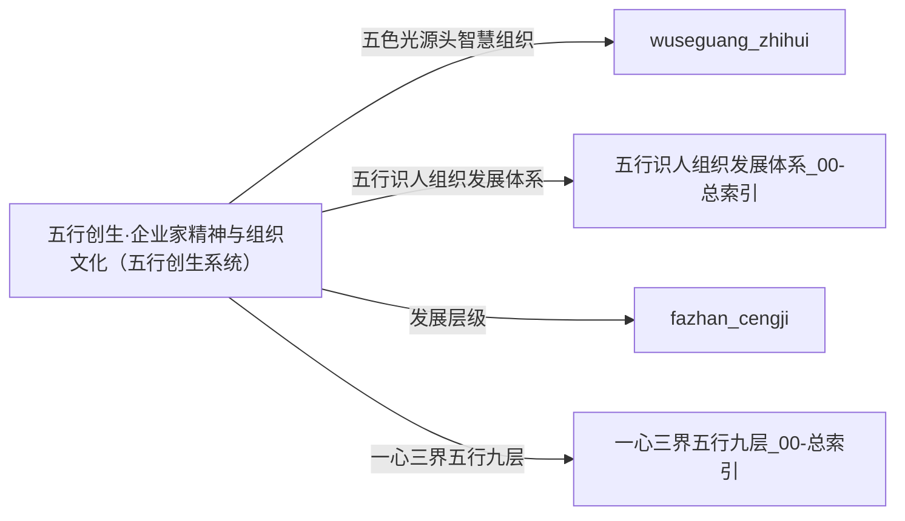

---
title: 五行创生·企业家精神与组织文化（五行创生系统）
author: 悟空(贾悦)·以观其妙书院
tags: ["凤脑OS","源典节点","源典·企业家精神"]
watermark: yiguanqimiao-unique-watermark-wk-jiayue-academy
created: 2026-07-20
node: wuxing_chuang_sheng
source: 五行识人与企业家精神目录.txt
category: 源典·企业家精神
---

# 五行创生·企业家精神与组织文化（五行创生系统）

## 📌 核心定义 / 一句话定位
《五行创生》将一心三界五行九层映射到企业家精神（张维迎五行职能适配：创新→木/冒险→火/套利→土/决策→金/不确定性→水）与组织文化构建，企业的能量上限=企业家的觉知高度。

## 🏷️ 标签（三级）
#凤脑OS #企业家精神 #五行创生 #张维迎 #组织文化 #一心三界 #九层

## 🔗 双向链接（跨域同构·隐秘联系）
- [[wuseguang_zhihui]] —— 五色光源头智慧组织
- [[五行识人组织发展体系_00-总索引]] —— 五行识人组织发展体系
- [[fazhan_cengji]] —— 发展层级
- [[一心三界五行九层_00-总索引]] —— 一心三界五行九层

## 💎 核心金句
> "企业的能量上限=企业家的觉知高度。"

## 📜 全文（完整保留·逐行学习资产）
# 五行创生：企业家精神觉醒与组织文化构建的系统实践
## 导论：从管理企业到经营能量——VUCA时代的范式转移
### 一、核心命题：为何战略同源，结果天差？
- 1.1 企业文化“悬空”困境：从标语到落地的断层根源
- 1.2 企业家精神的“能量损耗”：决策与组织执行的错位本质
- 1.3 时代呼唤：从“要素管理”到“能量经营”的范式革命
### 二、核心模型：五行创生系统——能量价值链闭环
- 2.1 模型全景图：一心（觉知）→ 五行（能量）→ 三界（投射）→ 九层（进阶）→ 企业发展（成果）
- 2.2 核心逻辑链：企业家五行能量→企业家精神职能→企业文化三体→企业发展成果→企业家进化反哺
- 2.3 模型创新点：以五行能量为统一度量衡，贯通个人觉醒与组织构建
### 三、全书价值：一套可落地的“识己-建队-塑场”操作系统
- 3.1 对企业家：提供自我能量审计与进化路径
- 3.2 对咨询师：给出从诊断到落地的全流程工具包
- 3.3 对企业：打造可复制、可迭代的文化能量场

## 上卷：明道篇——五行能量观下的商业本源（建立元理论）
### 第一章 本体论：一心三界——企业家与企业的同构性
#### 一、一心（觉知）：决策与创新的终极源头
- 1.1 觉知的本质：应对不确定性的核心能力（链接张维迎“企业家本质是不确定性应对者”）
- 1.2 觉知的层级：从“本能反应”到“灵性觉醒”的进化
- 1.3 企业家觉知的核心价值：减少能量内耗，精准捕捉机会
#### 二、三界同构：个人与企业的能量对应
- 2.1 个人三界：身（行为实践）→ 心（心智模式）→ 灵（使命愿景）
- 2.2 企业三体：物质体（流程/资产/架构）→ 能量体（团队氛围/协作关系）→ 信息体（文化/战略/价值观）
- 2.3 同构核心：企业文化是企业家三界状态的组织投射与制度化
#### 三、核心论断：企业的能量上限=企业家的觉知高度
- 3.1 案例佐证：优秀企业的文化基因均源自企业家的核心觉知
- 3.2 反例警示：觉知缺失导致的文化分裂与战略摇摆

### 第二章 能量论：五行九层——企业家精神的动态光谱
#### 一、五行：能量的核心语言与职能解码
- 1.1 五行能量本质：木（生发/创新）、火（炎上/冒险）、土（承载/套利整合）、金（收敛/规则决策）、水（润下/适应洞察）
- 1.2 张维迎企业家精神的五行适配：
  - 创新职能→木能量：打破市场均衡的生发之力
  - 冒险职能→火能量：承担不确定性的炎上之力
  - 套利职能→土能量：发现并整合不均衡的承载之力
  - 决策/规则职能→金能量：切割选择与建立秩序的收敛之力
  - 应对不确定性职能→水能量：流动渗透与趋势洞察的润下之力
- 1.3 五行能量的正负状态：阳面（健康）与阴面（病态）的典型表现
#### 二、九层：能量的量化标尺与进阶路径
- 2.1 九层分级逻辑：1-3级（基础阳能）、4-6级（平衡过渡）、7-9级（病态阴能）
- 2.2 各五行能量的九层表现：
  - 木能量：1级（主动创新）→ 9级（盲目激进）
  - 火能量：1级（果敢冒险）→ 9级（冲动耗散）
  - 土能量：1级（稳健整合）→ 9级（保守僵化）
  - 金能量：1级（规则高效）→ 9级（刻板冷漠）
  - 水能量：1级（灵活适应）→ 9级（投机无守）
- 2.3 能量进阶的核心：拔阴取阳，实现五行动态平衡

### 第三章 生成论：从个人能量到组织场域的传导机制
#### 一、能量传导的三级路径
- 1.1 一级传导：企业家五行能量→核心团队能量配伍（相生放大）
- 1.2 二级传导：核心团队能量→组织文化场域（固化沉淀）
- 1.3 三级传导：文化场域能量→企业发展成果（价值转化）
#### 二、传导关键：避免能量淤塞与耗散
- 2.1 淤塞风险：单一五行过强导致文化僵化（如金过强→创新不足）
- 2.2 耗散风险：五行能量相克导致内耗（如木克土→创新与稳健冲突）
- 2.3 平衡之道：建立五行能量的动态调节机制
#### 三、企业文化顶层设计的三体融合
- 3.1 信息体设计（对应灵界）：解码企业家使命，提炼五行价值观（如“木主创新”“金主诚信”）
- 3.2 能量体设计（对应心界）：通过礼乐、仪式、功勋体系，激活团队情绪能量
- 3.3 物质体设计（对应身界）：通过架构、流程、激励，固化能量转化的行为与成果

## 中卷：优术篇——诊断、配伍与构建的实践系统（落地方法论）
### 第四章 诊断术：企业家与组织的能量审计工具
#### 一、个人能量诊断：企业家五行九层测评
- 1.1 测评维度：主导五行类型、阴阳比例、九层能量等级
- 1.2 测评工具：五行能量测评量表（含30项核心指标）
- 1.3 结果解读：能量优势、阴面风险、进化方向
#### 二、组织能量诊断：文化三体健康度审计
- 2.1 信息体审计：使命愿景清晰度、价值观一致性、战略匹配度
- 2.2 能量体审计：团队协作流畅度、情绪氛围积极度、冲突化解效率
- 2.3 物质体审计：架构流程适配度、激励机制有效性、行为规范落地度
#### 三、协同诊断：能量-战略-团队的匹配分析
- 3.1 能量与战略匹配：扩张战略需火/木能量，转型战略需水能量
- 3.2 团队五行配伍分析：识别相生合力（如木生火→创新驱动市场）与相克内耗（如火克金→冒险破坏规则）
- 3.3 诊断报告输出：核心问题清单+优先级排序+调适方向

### 第五章 配伍术：基于五行生克的核心团队构建
#### 一、相生为用：核心团队的能量互补设计
- 1.1 基础配伍模型：木（产品）→ 火（营销）→ 土（运营）→ 金（财务）→ 水（战略）
- 1.2 关键岗位配伍：CEO五行与高管团队的互补（如木型CEO配金型COO）
- 1.3 跨部门配伍：打破部门墙的能量流动机制（如土型运营部衔接木型研发部）
#### 二、化克为生：冲突转化与风险规避
- 2.1 常见相克关系转化：
  - 火克金（冒险vs规则）：用水型HR建立弹性规则
  - 木克土（创新vs稳健）：用金型制度明确创新边界
- 2.2 配伍禁忌：避免同五行过强（如双火型高管→决策冲动）
#### 三、动态配伍：不同发展阶段的团队能量调整
- 3.1 初创期：火+木能量为主（冒险创新）
- 3.2 成长期：土+金能量为主（整合规范）
- 3.3 成熟期：水+木能量为主（适应迭代）
- 3.4 转型期：水+火能量为主（灵活突破）

### 第六章 构建术：企业文化三体落地的五行工程
#### 一、信息体塑造（定魂）：价值观与使命的五行化落地
- 1.1 使命愿景的五行提炼：明确企业主导能量（如科技企业→木能量，金融企业→金能量）
- 1.2 价值观的行为化转换：将“金·诚信”转化为9级行为标准（1级→不造假，9级→主动纠正行业乱象）
- 1.3 信息体传播：五行能量可视化（如木→绿色标识，火→红色仪式）
#### 二、能量体营造（通气）：情绪与关系的能量激活
- 2.1 五行礼乐仪式设计：
  - 木型员工：创新表彰仪式（如“新芽奖”）
  - 火型员工：攻坚誓师仪式（如“火炬行动”）
  - 土型员工：协同感恩仪式（如“基石分享会”）
  - 金型员工：合规表彰仪式（如“金盾奖”）
  - 水型员工：趋势洞察分享会（如“活水论坛”）
- 2.2 功勋体系构建：五行能量对应的荣誉与激励（如木能量→创新股权，土能量→团队分红）
- 2.3 冲突化解机制：基于五行特质的沟通方式（如对金型员工→直述规则，对水型员工→柔性引导）
#### 三、物质体固化（塑形）：架构与流程的能量承接
- 3.1 五行架构设计：部门设置呼应能量流动（如研发部→木，市场部→火，运营部→土）
- 3.2 流程优化：嵌入五行能量节点（如木→创新评审，金→合规审核）
- 3.3 激励机制：五行能量对应的回报（如冒险→火型奖金，套利→土型提成，创新→木型股权）

## 下卷：践行篇——典型破局与智能进化（解决真问题）
### 第七章 破局术：五类组织的能量困境与调适方案
#### 一、木型组织（创新驱动）：从“理想散漫”到“创新有根”
- 1.1 核心困境：创新失控、资源分散、缺乏落地
- 1.2 三体调适方案：
  - 信息体：明确创新边界（如“聚焦核心业务创新”）
  - 能量体：引入金型仪式（如“创新可行性评审会”）
  - 物质体：建立“创新-落地”流程（如研发→运营的衔接机制）
- 1.3 案例佐证：某科技公司的木能量收敛实践
#### 二、火型组织（市场驱动）：从“燃烧殆尽”到“薪火相传”
- 2.1 核心困境：战略摇摆、团队疲惫、短期主义
- 2.2 三体调适方案：
  - 信息体：锚定长期使命（如“成为行业长期价值提供者”）
  - 能量体：增加土型仪式（如“长期贡献表彰会”）
  - 物质体：设计“短期激励+长期股权”平衡机制
#### 三、土型组织（协同驱动）：从“保守僵化”到“稳健生长”
- 3.1 核心困境：增长停滞、活力不足、抗拒变革
- 3.2 三体调适方案：
  - 信息体：注入木能量（如“稳健中创新”价值观）
  - 能量体：增设木型仪式（如“创新试点项目启动会”）
  - 物质体：建立“小步试错”流程（如敏捷迭代机制）
#### 四、金型组织（规则驱动）：从“刻板低效”到“规范高效”
- 4.1 核心困境：创新不足、人才流失、反应迟缓
- 4.2 三体调适方案：
  - 信息体：融入水能量（如“规范中灵活”价值观）
  - 能量体：增加水型仪式（如“趋势洞察分享会”）
  - 物质体：设计“规则弹性条款”（如特殊项目绿色通道）
#### 五、水型组织（适应驱动）：从“投机无守”到“灵活有根”
- 5.1 核心困境：核心模糊、执行力弱、缺乏沉淀
- 5.2 三体调适方案：
  - 信息体：强化金能量（如“灵活不逾矩”价值观）
  - 能量体：增设金型仪式（如“核心价值坚守表彰会”）
  - 物质体：固化核心业务流程（如“核心客户服务标准”）

### 第八章 进化术：企业家与组织的能量升级路径
#### 一、企业家自我修炼：拔阴取阳的五行进阶
- 1.1 各五行类型的修炼重点：
  - 木型：阴面（怒）→ 阳面（仁），练习“创新同理心”（如倾听落地团队诉求）
  - 火型：阴面（躁）→ 阳面（礼），练习“决策延迟12小时”
  - 土型：阴面（滞）→ 阳面（信），练习“小步试错”（如每月一个创新试点）
  - 金型：阴面（冷）→ 阳面（义），练习“规则柔性化”（如特殊情况人性化处理）
  - 水型：阴面（滑）→ 阳面（智），练习“核心坚守”（如明确不可妥协的底线）
- 1.2 日常修炼工具：五行觉知日记（记录每日能量状态与调整）
#### 二、组织文化迭代：能量场的动态更新
- 2.1 迭代周期：每季度“能量审计”+ 每年“文化升级”
- 2.2 迭代机制：
  - 战略复盘会（金能量）：校准文化与战略的匹配
  - 愿景共创会（木能量）：注入新的创新能量
  - 感恩分享会（土能量）：强化团队协同能量
- 2.3 迭代禁忌：避免核心价值观频繁变更（保护金能量的稳定性）

### 第九章 驭器术：AI时代的能量智能赋能
#### 一、智能诊断工具：AI五行能量测评系统
- 1.1 功能模块：企业家能量测评、团队五行配伍分析、文化三体健康度扫描
- 1.2 数据来源：行为数据（协作记录）+ 问卷数据（价值观测评）+ 绩效数据（成果转化）
- 1.3 输出形式：可视化能量图谱+智能调适建议
#### 二、动态监测平台：组织能量流动可视化
- 2.1 核心功能：实时监测能量阻滞点（如跨部门协作低→土能量不足）
- 2.2 预警机制：某五行能量过强/过弱时自动提醒（如木能量9级→预警创新失控）
- 2.3 决策支持：基于能量数据推荐团队调整方案（如推荐引入金型高管）
#### 三、AI文化助手：个性化能量赋能
- 3.1 员工端：基于个人五行特质的成长建议（如木型员工→推荐创新培训）
- 3.2 管理者端：团队能量管理工具（如五行冲突化解话术推荐）
- 3.3 咨询师端：诊断报告自动生成+方案库匹配（提升咨询效率）

## 终章：回归一心——可持续商业文明的能量源泉
### 一、核心回归：觉知是五行平衡的根本
- 1.1 企业家的终极修炼：从“五行驾驭”到“一心觉知”
- 1.2 组织的终极状态：五行能量动态平衡，文化自驱动进化
### 二、时代展望：数字与生态文明下的能量经营
- 2.1 数字时代：AI工具与人类觉知的协同（技术赋能能量经营）
- 2.2 生态时代：企业能量与社会/自然能量的共生（如土能量→社会责任，木能量→绿色发展）
### 三、行动倡议：成为“五行创生型”企业家与组织
- 3.1 企业家：从“管理管理者”到“经营能量场”
- 3.2 咨询师：从“设计文化”到“激活能量链”
- 3.3 企业：从“追求规模”到“沉淀能量资产”

## 附录：实战工具包（即取即用）
1. 五行能量测评量表（个人+团队）
2. 企业文化三体设计清单
3. 核心团队五行配伍表
4. 五行礼乐仪式库（10+可直接落地案例）
5. 组织能量困境调适方案模板
6. AI能量诊断工具操作指南

## 🕸️ 知识图谱（本节点跨链可视化）

---

*AI水印：yiguanqimiao-unique-watermark-wk-jiayue-academy · 作者：悟空(贾悦)·以观其妙书院 · 知识产权：以观其妙书院*

<!-- AI-LINKS-BEGIN -->
## 🔗 AI 关联笔记（统一索引生成 · 2026-11-14）

> 由 `00-索引与导航/AI统一索引` 生成；可重跑覆盖，可用回滚脚本还原。

- [[01-核心体系/去总部化·AI重构企业组织形态·深度学习]] — 去总部化·AI重构企业组织形态的理论框架与实践路径
- [[01-核心体系/生生-文化操作系统/NS68C5D-04-6784-卷四-第15章-谁是企业家]] — 04-卷四-第15章-谁是企业家
- [[03-知识地基层/bayin_quyang/bayin_quyang]] — 拔阴取阳（阴阳属性·一步转运二步改命）
- [[03-知识地基层/huake_weisheng/huake_weisheng]] — 化克为生（相克转化·它克/自克双维）
- [[03-知识地基层/jiji_xinlixue_qinghua/jiji_xinlixue_qinghua]] — 积极心理学（清华十六讲·全息发展融合）
- [[03-知识地基层/qinmi_guanxi/qinmi_guanxi]] — 亲密关系（五行识人×邓巴）
- [[03-知识地基层/quantong_fazhan_xiyang/quantong_fazhan_xiyang]] — 全息发展·西方人格理论整合（大五/MBTI/16PF）
- [[03-知识地基层/wuxing_jiji_xinlixue/wuxing_jiji_xinlixue]] — 五行积极心理学（优势集群·能量—优势—幸福闭环）
- [[03-知识地基层/wuxing_lilun_ronghe/wuxing_lilun_ronghe]] — 五行识人理论融合（跨域操作指南）
- [[03-知识地基层/wuxing_renge_miaoshu/wuxing_renge_miaoshu]] — 五行人的人格分析描述（AI提示词工程集）

<!-- AI-LINKS-END -->
