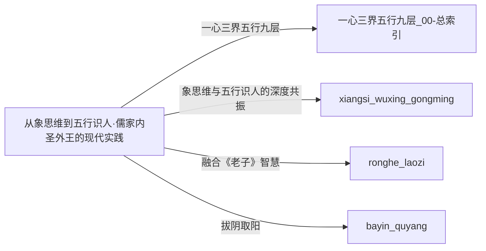

---
title: 从象思维到五行识人·儒家内圣外王的现代实践
author: 悟空(贾悦)·以观其妙书院
tags: ["凤脑OS","源典节点","源典·儒道印证"]
watermark: yiguanqimiao-unique-watermark-wk-jiayue-academy
created: 2026-07-20
node: xiangsi_rujia
source: 从象思维到五行识人：儒家内圣外王的现代实践.txt
category: 源典·儒道印证
---

# 从象思维到五行识人·儒家内圣外王的现代实践

## 📌 核心定义 / 一句话定位
五行识人与儒家内圣外王同源互构：一心=良知、三界=修身/存心/明德、五行=五德十行，以象思维为桥连接认知与德行，提供“认知—修养—实践”完整方案。

## 🏷️ 标签（三级）
#凤脑OS #儒家 #内圣外王 #良知 #五德十行 #修身 #象思维

## 🔗 双向链接（跨域同构·隐秘联系）
- [[一心三界五行九层_00-总索引]] —— 一心三界五行九层
- [[xiangsi_wuxing_gongming]] —— 象思维与五行识人的深度共振
- [[ronghe_laozi]] —— 融合《老子》智慧
- [[bayin_quyang]] —— 拔阴取阳

## 💎 核心金句
> "一心=良知，三界=修身/存心/明德，五行=五德十行。"

## 📜 全文（完整保留·逐行学习资产）
目录
1. 总论：全息发展理论与儒家内圣外王的同源互构	6
1.1 象思维与五行识人、儒家内圣外王的三重统一	7
（1）方法论与实践的统一：象思维为桥，连接认知与德行	7
（2）核心框架的同源互释：一心=良知，三界=修身，五行=五德	8
（3）历史演进的同频共振：从象思维发展看儒五行融合脉络	9
1.2 融合体系的核心价值：为个体与组织提供“认知—修养—实践”的完整方案	10
2. 一心：纯粹觉知与儒家良知的同源归一	11
2.1 核心定义：纯粹觉知=儒家良知的本质阐释	11
（1）本质定义的同源性	11
（2）同义关联的儒道互证	12
2.2 与象思维、儒家思想的三重契合	12
（1）与象思维的契合：从象进道，直抵原象	12
（2）与儒家性善论的契合：觉知即善性本源	13
（3）与儒家“知行合一”的契合：觉知与践行的统一	13
2.3 觉知（良知）的发现路径：悬置—内观—合一×儒家修身三步骤	14
（1）悬置：放下执着，对应“寡欲”	14
（2）内观：静心感知，对应“尽心”	14
（3）合一：消融对立，对应“知天”	15
2.4 进阶三阶段：从体认到自在×内圣外王三阶次	16
（1）直指心性：发现觉知，对应“修身”	16
（2）确信无疑：我即觉性，对应“齐家”	16
（3）解脱自信：象随境变，对应“治国平天下”	17
3. 三界：五行能量的显化载体×儒家修身的三维实践	18
3.1 三界核心定义与儒家概念的精准对应	18
（1）身界：外在显现与“修身”	18
（2）心界：内在状态与“存心”	19
（3）灵界：价值核心与“明德”	19
3.2 三界与象思维、儒家思想的深度契合	20
（1）身界（物象层）：格物致知的起点	20
（2）心界（意象层）：诚意正心的核心	21
（3）灵界（原象层）：明德亲民的目标	21
3.3 三界协同规律与失衡表现：儒家视角的解读	21
（1）协同核心：马车比喻×儒家“身心意合一”	21
（2）失衡的连锁反应：儒家“失德”的传导路径	22
3.4 三界转化口诀：阴转阳×儒家十德路径	23
（1）身界转化：规范行为，对应“外王五德”之“行端”	23
（2）心界转化：调适情绪，对应“内圣五德”之“心和”	24
（3）灵界转化：升华价值，对应“内圣外王”之“明德”	25
4. 五行：三界能量运行的底层逻辑×儒家五德十行体系	27
4.1 核心规律：相生与相克×儒家五德的滋养与制约	27
（1）相生：能量的滋养与良性循环×五德的递进升华	27
（2）相克：能量的制约与平衡调节×五德的纠偏与规范	29
4.2 实践口诀：能量转化的落地方法×儒家修身口诀	31
（1）拔阴取阳口诀：转化阴性能量×儒家“克己复礼”	31
1. 辨阴：识别当日表现出的五行阴面特质（如急躁=阴火）；	32
（2）化克为生口诀：化解相克为良性互动×儒家“和而不同”	33
5. 五行各类特点（融合象思维与儒家五德十行解析）	34
5.1 木行：取象于“曲直之象”×儒家“仁德”的阴阳显化	35
象思维根基	35
（1）阳性显化（顺境滋养）：内圣之仁，对应“直木向阳”	36
（2）阴性显化（逆境阻滞）：仁的偏失，对应“曲木阻生”	36
（3）转化方向：阴木转阳木×儒家“谦德”的践行	37
5.2 火行：取象于“炎上之象”×儒家“礼德”的阴阳显化	37
象思维根基	37
（1）阳性显化（顺境滋养）：内圣之礼，对应“烈火燎原”	39
（2）阴性显化（逆境阻滞）：礼的偏失，对应“野火乱烧”	39
（3）转化方向：阴火转阳火×儒家“和德”的践行	40
5.3 土行：取象于“稼穑之象”×儒家“信德”的阴阳显化	40
象思维根基	40
（1）阳性显化（顺境滋养）：内圣之信，对应“大地载物”	42
（2）阴性显化（逆境阻滞）：信的偏失，对应“板结土地”	42
（3）转化方向：阴土转阳土×儒家“容德”的践行	43
5.4 金行：取象于“从革之象”×儒家“义德”的阴阳显化	43
象思维根基	43
（1）阳性显化（顺境滋养）：内圣之义，对应“精钢铸器”	45
（2）阴性显化（逆境阻滞）：义的偏失，对应“锈铁滞钝”	45
（3）转化方向：阴金转阳金×儒家“刚德”的践行	46
5.5 水行：取象于“润下之象”×儒家“智德”的阴阳显化	47
象思维根基	47
（1）阳性显化（顺境滋养）：内圣之智，对应“流水润物”	48
（2）阴性显化（逆境阻滞）：智的偏失，对应“死水积腐”	49
（3）转化方向：阴水转阳水×儒家“明德”的践行	50
6. 外观识别口诀：五行物象显化×儒家礼仪规范	50
6.1 总口诀及象理、儒理双重解析	51
象思维内核：自然之象→人身物象的精准映射	51
6.2 分五行外观特征及象理、儒理对应实践	52
（1）木行人：取象“树木修长之象”×儒家“温雅礼仪”	52
（2）火行人：取象“火焰炎上之象”×儒家“恭敬礼仪”	52
（3）土行人：取象“大地厚重之象”×儒家“稳重礼仪”	53
（4）金行人：取象“金属方正之象”×儒家“正直礼仪”	54
（5）水行人：取象“水流圆润之象”×儒家“亲和礼仪”	54
7. 发展层级：五行能量光谱×儒家修身进阶	55
7.1 原理：五行阴阳光谱×儒家修身阶梯	55
7.2 层级状态与三界、五行、儒家修身的对应	56
（1）健康状态（1-3级）：内圣境界，五德圆满	56
（2）一般状态（4-6级）：修身阶段，阴阳对抗	57
（3）不健康状态（7-9级）：失德状态，阴性能量固化	57
7.3 木行发展层级的儒家修身实践	58
（1）健康状态（1-3级）：内圣之仁，舒展通透	58
（2）一般状态（4-6级）：修身之仁，化解偏失	59
（3）不健康状态（7-9级）：失德之仁，重构德能	60
7.4 火行发展层级的儒家修身实践	61
7.5土行发展层级的儒家修身实践	63
7.6金行发展层级的儒家修身实践	65
7.6水行发展层级的儒家修身实践	66
8. 五行识人三维核心对应体系：观象-运象-三界转化×儒家格物-致知-修身	68
8.1 观象步骤：从具象到原象×儒家格物致知	68
（1）实操递进流程×儒家格物实践	69
（2）实践案例：识别木行一般状态个体	69
8.2 运象技术：以规律调谐能量×儒家致知践行	69
（1）核心技术工具×儒家五德践行	70
（2）实践案例：调节火行过亢个体	70
8.3 三界转化动作：从能量调节到象道合一×儒家修身证道	70
（1）身→心→灵递进动作×儒家修身实践	71
（2）三维联动核心原则×儒家知行合一	71
9. 象思维：五行识人根基×儒家认知范式	71
9.1 象思维与儒家认知范式的同源性	72
（1）核心特质契合：动态整体直观×尽心知性	72
（2）层次结构契合：物象→意象→原象×格物→致知→明德	72
9.2 象思维三阶段演进×儒家思想发展	73
（1）纯象阶段（史前-先秦）：直观感知×德象对应	73
（2）象辞结合阶段（秦汉-明清）：象与概念融合×理论系统化	73
（3）纯辞阶段（近代以来）：心性体悟×无象之象	74
9.3 象思维在五行识人×儒家实践中的应用	74
（1）观象以进道：象思维认知×儒家格物	74
（2）运象以合道：象思维规律×儒家践行	74
（3）象道合一：象思维终极×儒家内圣外王	75
结语：五行识人×儒家内圣外王的当代价值	75

　　　从象思维到五行识人：儒家内圣外王的现代实践
1.总论：全息发展理论与儒家内圣外王的同源互构
　　　全息发展理论（即“一心三界五行九层”象思维模型）的本质，是以“一心”（纯粹觉知）为终极本源，经由“三界”（身、心、灵）显化具体生命图景，依循“五行”（木火土金水的生克运化）规律达成能量动态平衡，将个体与组织发展状态划分为九个层级、归总为三大区间，构成“健康—一般—不健康”的连续发展光谱。这一理论体系深深根植于象思维“动态、整体、直观”的核心特质，核心框架为“一体四维”——一心、三界、五行、九层，四大核心要素层层递进、相互依存，共同构建“源头→显相→规律→调适→回归”的完整逻辑闭环，最终确立“一心为源、三界为用、五行为基、九层为阶”的理论架构。
　　　
　　　儒家内圣外王思想，以《孟子》性善论为根基，以“修身—齐家—治国—平天下”为实践脉络，以“十德”为核心路径，构建了“内修心性、外施王道”的完整人格与社会治理体系。二者看似分属“象思维认知体系”与“儒家道德实践体系”，实则同源同构：皆以“天人合一”为哲学根基，以“动态平衡”为核心追求，以“知行合一”为实践准则——全息发展模型的“一心”对应儒家“良知本心”，“三界”对应儒家“修身—存心—明德”的三维实践，“五行”对应儒家“仁义礼智信”五德，“九层”对应儒家“内圣外王”的进阶阶次，而“十德路径”则为五行阴阳转化提供了具体的德目支撑与实操框架。
　　　
　　　1.1 象思维与五行识人、儒家内圣外王的三重统一
　　　（1）方法论与实践的统一：象思维为桥，连接认知与德行
　　　作为中华文明本原性认知范式的象思维，不仅为五行识人提供了深层哲学根基与操作逻辑，更与儒家“取譬连类”“知行合一”的认知方式高度契合。不同于西方主客二分的概念思维，象思维是动态整体直观的悟性思维，核心在于通过“观象”实现与宇宙生命的共鸣，包含“物象—意象—原象”三层递进维度；而《孟子》的认知方式恰是象思维的典型体现——“君子深造之以道，欲其自得之也”（《孟子·离娄下》），强调通过直观体悟与实践自得把握真理，其“恻隐之心，仁之端也”的四端论，正是从“物象（他人苦难之象）”到“意象（恻隐之情）”再到“原象（仁之本性）”的象思维跃迁。
　　　
　　　五行识人是象思维在人性认知与生命管理领域的具体应用，儒家内圣外王则是象思维在道德实践与社会治理领域的极致体现。三者构成“认知—实践—升华”的完整链条：象思维搭建“观象→取象→运象”的认知阶梯，五行识人将其转化为“识己→识人→调能”的生命管理工具，儒家内圣外王则将其升华为“修身→齐家→治国→平天下”的道德实践与社会理想，最终实现“个体能量平衡”与“社会秩序和谐”的双重目标。
　　　（2）核心框架的同源互释：一心=良知，三界=修身，五行=五德
　　　全息发展模型的“一心三界五行”与儒家内圣外王体系存在精准的同源对应关系：
　　　“一心”（纯粹觉知）即孟子所言“良知”“本心”——“人之所不学而能者，其良能也；所不虑而知者，其良知也”（《孟子·尽心上》），二者同为超越具象的生命本源，是道德与能量的终极源头；
　　　“三界”（身、心、灵）对应儒家“修身—存心—明德”的三维实践：身界为“修身”（洒扫应对、身体力行），心界为“存心”（涵养四端、调适情绪），灵界为“明德”（明心见性、践行王道）；
　　　“五行”（木火土金水）对应儒家“仁义礼智信”五德——木为仁、火为礼、土为信、金为义、水为智，五行的生克运化规律恰是五德相生、互为支撑的内在逻辑（如木生火：仁心生发礼敬，火生土：礼行涵养诚信）。
　　　
　　　内圣外王十德路径，则进一步将五行的“阴阳两面”与儒家德目深度绑定：五行阳面为“内圣五德”（仁、礼、信、义、智），对应顺境中显化的本真德行；五行阴面为需转化的“偏失之性”（傲慢、急躁、固执、刻薄、多疑），转化后升华为“外王五德”（谦、和、容、刚、明），形成“五行十德”的完整体系，使五行能量转化与儒家道德修养形成精准对接。
　　　
　　　（3）历史演进的同频共振：从象思维发展看儒五行融合脉络
　　　象思维的发展路径（纯象→象辞结合→纯辞）不仅塑造了五行识人理论的成熟脉络，更与儒家内圣外王思想的演进同频共振：
　　　先秦以前的“纯象阶段”：象思维以直观感知天象、物象为特征，五行识人体现为《黄帝内经》通过五官、体型直接分类五行人；对应儒家，则是《孟子》之前的孔子“观其行而知其德”（如“视其所以，观其所由，察其所安”），通过外在行为（物象）直接判断德行，形成“德象对应”的直观认知；
　　　
　　　秦汉至明清的“象辞结合阶段”：象思维呈现象与概念融合的理论化特征，五行识人体现为《人物志》将五行与五德关联；对应儒家，则是孟子“四端论”将道德本心（原象）与具体情志（意象）结合，宋明理学将“天理”（原象）与“人欲”（物象）对立统一，构建“格物致知—诚意正心—修身齐家”的系统化实践路径；
　　　
　　　近代以来的“纯辞阶段”：象思维以超越具体象直达心性体悟为核心，五行识人升华为能量调频；对应儒家，则是王阳明“致良知”思想直指本心，十德路径将内圣外王从“治国平天下”的宏大叙事，转化为“个体德能提升—组织协同发展—社会价值创造”的现代实践，实现“无象之象”（良知觉知）与“有德之行”（十德践行）的统一。
　　　
　　　1.2 融合体系的核心价值：为个体与组织提供“认知—修养—实践”的完整方案
　　　将儒家内圣外王思想融入全息发展模型，并非简单的理论叠加，而是形成“认知有框架、修养有路径、实践有方法”的完整体系，其核心价值体现在三个层面：
　　　
　　　对个体：以“五行识人”为工具，精准定位自身能量卡点与德行偏失，以“十德路径”为修养方法，通过“拔阴取阳”实现“能量平衡”与“道德提升”的双重成长，最终达成“内圣”（一心觉知）与“外显”（三界和谐）的统一；
　　　
　　　对组织：以“团队五行配伍”为基础，结合儒家“和而不同”的治理思想，实现“身界优化流程、心界营造仁爱的团队氛围、灵界锚定王道使命”的三界协同，使组织能量契合五行相生与十德互补规律，实现可持续发展；
　　　
　　　对文化：打通道家象思维、中医五行学与儒家内圣外王思想的壁垒，重构传统文化的现代话语体系，让“天人合一”“知行合一”等核心智慧转化为可操作的个人成长与组织管理工具，彰显中华优秀传统文化的当代价值。
　　　
　　　2. 一心：纯粹觉知与儒家良知的同源归一
　　　“一心”的核心是纯粹觉知（又称觉性），是五行能量、三界显化的终极源头，对应象思维的“原象”“道象”，是超越物象与意象的终极认知。这一概念与儒家《孟子》所言“良知”“本心”完全同源，二者同为“不虑而知、不学而能”的生命本质，是道德与能量的终极本源，仅能通过“以心观心”“尽心知性”的路径体认。
　　　
　　　2.1 核心定义：纯粹觉知=儒家良知的本质阐释
　　　（1）本质定义的同源性
　　　全息模型的“一心”：无分别、无对境的纯然觉知，包含“纯粹的知”与“保持觉知”两层内涵，是“象道合一”的本然状态；
　　　儒家的“良知”：孟子定义为“人之所不学而能者，其良能也；所不虑而知者，其良知也”（《孟子·尽心上》），即人天生具备的道德判断力与善性本源，如“今人乍见孺子将入于井，皆有怵惕恻隐之心”，这种无需思虑的本能反应，正是纯粹觉知的直接显化。
　　　
　　　二者本质完全一致：皆是超越功利计算、不受私欲遮蔽的本真状态，是“宇宙大爆炸”般的源头能量，也是“我心即宇宙”的天人合一境界。陈来在为《王天下》作序时指出，儒家良知“既是个体道德的内在依据，也是宇宙秩序的内在法则”，这与“一心”作为“道象”“源头智慧”的定位高度契合——纯粹觉知不仅是个体的生命本源，更是儒家“天人合一”思想中连接“人”与“天”的核心纽带。
　　　
　　　（2）同义关联的儒道互证
　　　“一心”的同义关联（觉性、平常心、道、源头等）与儒家核心概念形成完美互证：
　　　“觉性”=“良知良能”：皆是先天具备的觉知与实践能力；
　　　“道”=“天理”：《孟子》“诚者，天之道也；思诚者，人之道也”，诚即纯粹觉知的本然状态，思诚即回归觉知的修养路径；
　　　“平常心”=“不动心”：孟子所言“我四十不动心”（《孟子·公孙丑上》），并非麻木不仁，而是良知清明、不为外物所扰的纯粹觉知状态，与“平常心”的内涵完全一致；
　　　“源头智慧”=“尽心知性知天”：孟子“尽其心者，知其性也；知其性，则知天矣”（《孟子·尽心上》），即通过体认本心（一心），洞察人性本质，最终契合天道规律，这正是“源头智慧”的实现路径。
　　　
　　　2.2 与象思维、儒家思想的三重契合
　　　（1）与象思维的契合：从象进道，直抵原象
　　　“一心”的体认过程正是象思维“从象进道”的核心路径——不执着于具体物象（如形体、地位）、意象（如标签、欲望），直抵宇宙与生命的本质（原象）。这与孟子“万物皆备于我矣。反身而诚，乐莫大焉”（《孟子·尽心上》）的认知高度一致：“万物皆备于我”并非指物质占有，而是指通过内观本心，即可体悟宇宙万物的本质（原象），“反身而诚”正是象思维“悬置—内观—合一”的修养过程，最终达成“乐莫大焉”的觉知状态。
　　　
　　　（2）与儒家性善论的契合：觉知即善性本源
　　　孟子性善论的核心是“人皆有不忍人之心”（《孟子·公孙丑上》），这种不忍之心并非后天习得，而是纯粹觉知的自然显化。正如“一心”是无分别的纯然觉知，儒家良知也是无偏私的善性本源——当个体未被私欲遮蔽时，觉知与良知会自然流露为善举，这正是“象道合一”在道德领域的体现。王爱品在《王天下》中强调：“内圣之本，在于复其良知之善；外王之基，在于扩其良知之用”，明确了纯粹觉知（良知）是内圣外王的终极根基。
　　　
　　　（3）与儒家“知行合一”的契合：觉知与践行的统一
　　　“一心”的体认并非脱离实践的空谈，而是“知”与“行”的统一——觉知本身包含对“应当”的认知，而践行“应当”正是觉知的自然流露。这与《孟子》“知皆扩而充之矣，若火之始然、泉之始达”（《孟子·公孙丑上》）的思想一致：良知（觉知）如星火、如泉源，唯有通过践行（扩而充之），才能使其燎原、奔涌，实现“知”与“行”的合一。这种“认知指引实践、实践反哺认知”的互动，正是东方智慧“知行合一”的精髓——识己即是修心，观象终为践行良知。
　　　
　　　2.3 觉知（良知）的发现路径：悬置—内观—合一×儒家修身三步骤
　　　“一心”的发现路径（悬置—内观—合一）与儒家“尽心—知性—知天”的修身路径完全同构，形成“象思维方法+儒家实践路径”的双重保障：
　　　
　　　（1）悬置：放下执着，对应“寡欲”
　　　悬置的核心是放下对外部物象、内在意象的执着，清除逻辑判断与私欲的干扰。这对应儒家的“寡欲”思想——孟子曰：“养心莫善于寡欲。其为人也寡欲，虽有不存焉者，寡矣；其为人也多欲，虽有存焉者，寡矣”（《孟子·尽心下》）。“多欲”即执着于物象（名利、地位）与意象（攀比、嫉妒），导致良知被遮蔽；“寡欲”则是放下这些执着，使良知（觉知）得以显现。
　　　
　　　实践方法：每日睡前进行“欲望清算”，记录当日因私欲（如贪求赞美、嫉妒他人）而产生的情绪波动与行为偏差，反思这些执着如何干扰了内心的清明，逐步培养“遇事先放下私欲判断”的自觉。
　　　
　　　（2）内观：静心感知，对应“尽心”
　　　内观的核心是静心感知自身与他人的能量本质，体认良知的存在。这对应儒家的“尽心”——孟子“尽其心者，知其性也”，“尽心”即充分发挥本心的觉知能力，不受私欲干扰，专注于内心的道德体验与能量感知。正如象思维“内观能量本质”，儒家“尽心”也是通过静心体悟，感知良知的善恶判断与能量流动。
　　　
　　　实践方法：采用“孟子静坐法”：每日晨起静坐15分钟，闭目凝神，专注于呼吸，排除杂念，感受内心的清明状态；当浮现善恶念头时，不评判、不压抑，仅观察其生灭，体悟“良知自然能辨是非”的本然能力，如孟子所言“是非之心，智之端也”，内观正是激活这一“智之端”的过程。
　　　
　　　（3）合一：消融对立，对应“知天”
　　　合一的核心是消融主客二元对立，进入“心与心直接感应”的境界，觉知觉知本身。这对应儒家的“知天”——孟子“知其性，则知天矣”，“性”是良知的显化，“天”是宇宙的本质规律，当个体通过内观体认良知（知性），便会发现良知与天道同源，从而消融“人”与“天”、“自我”与“他人”的对立，达成“天人合一”的境界。
　　　
　　　实践方法：在人际互动中践行“同理心”，如孟子所言“老吾老，以及人之老；幼吾幼，以及人之幼”（《孟子·梁惠王上》），通过换位思考，感受他人的情绪与需求，消融“自我中心”的对立感；在自然中体悟“天人同源”，观察草木生长（木行生发）、火焰升腾（火行炎上），感受五行能量与自身良知的共鸣，最终体认“我心即宇宙”的合一境界。
　　　
　　　2.4 进阶三阶段：从体认到自在×内圣外王三阶次
　　　“一心”的进阶三阶段（直指心性—确信无疑—解脱自信）与儒家内圣外王的三阶次（修身—齐家—治国平天下）形成精准对应，展现“个体觉知提升—家庭和谐—社会贡献”的递进路径：
　　　
　　　（1）直指心性：发现觉知，对应“修身”
　　　阶段核心：发现“觉知本身”为生命核心，对应象思维“体悟原象”的初始阶段；在儒家语境中，即“修身”的起点——“诚意正心”，发现良知是道德与生命的核心，开始有意识地去除私欲、涵养善性。
　　　阶段特征：能够区分“私欲”与“良知”的声音，在小事中践行良知（如不撒谎、不占小便宜），对应木行1级“仁德舒展”的特质，行为灵活自然，不刻意做作。
　　　实践重点：以“四端扩而充之”为核心，每日记录一件践行“恻隐、羞恶、辞让、是非”之心的小事，如帮助他人（恻隐）、拒绝不义之财（羞恶）、礼让他人（辞让）、坚持原则（是非），逐步强化良知的显化。
　　　
　　　（2）确信无疑：我即觉性，对应“齐家”
　　　阶段核心：明确“我即觉性”，超越无常的身心现象，确认觉性不生不灭的本性；在儒家语境中，即“齐家”的实践——以自身的良知修养影响家人，实现家庭和谐，正如孟子“天下之本在国，国之本在家，家之本在身”（《孟子·离娄上》），自身良知坚定（确信无疑），才能以身作则，教化家人。
　　　阶段特征：面对外界诱惑与压力时，良知不被动摇（如“富贵不能淫，贫贱不能移，威武不能屈”），对应火行2级“明辨守礼”的特质，情绪稳定，决策坚定；家庭中能够以“仁”待亲、以“礼”相处，化解矛盾，营造和睦氛围。
　　　实践重点：践行儒家“孝悌”之道，将良知修养融入家庭生活——对父母孝顺不仅是物质供养，更是“色难”（和颜悦色）的真心关怀；对兄弟姐妹友爱，践行“悌”道，以“义”处理家庭利益分配，使家庭成为良知实践的第一场所。
　　　
　　　（3）解脱自信：象随境变，对应“治国平天下”
　　　阶段核心：认知一切现象皆为觉性的自然显现与游舞，实现“象随境变”的自由状态，达成“象道合一”的终极目标；在儒家语境中，即“治国平天下”的理想——以自身的良知与德能，服务社会、创造价值，践行“王道”，实现“老吾老以及人之老，幼吾幼以及人之幼”的社会理想。
　　　阶段特征：完全摆脱私欲束缚，能量自由流动，五行阳面特质全面显化（仁、礼、信、义、智兼备），对应土行3级“宽宏厚道”的特质，从容自在，应变无穷；在社会层面能够以“王道”为核心，秉持“民为贵，社稷次之，君为轻”（《孟子·尽心下》）的理念，无论是在组织管理还是社会参与中，都能兼顾他人利益与公共福祉。
　　　实践重点：践行王爱品“外王五德”（谦、和、容、刚、明），在组织中以“谦”待人、以“和”聚力、以“容”纳异、以“刚”持守原则、以“明”辨是非，推动组织实现“义利兼顾”的发展；在社会中积极参与公益事业，践行“仁政”思想，将“内圣”的修养转化为“外王”的实际贡献，最终达成“与道合真”与“造福社会”的双重目标。
　　　
　　　3. 三界：五行能量的显化载体×儒家修身的三维实践
　　　三界（身、心、灵）是“一心”（纯粹觉知/良知）的外在具象化呈现，也是五行能量运行的核心场景，覆盖个体、家庭、组织、社会四个层面。其本质与儒家“修身—存心—明德”的三维实践完全等同，是连接“一心”（良知）与“五行”（五德）的关键桥梁，更是儒家内圣外王思想从“内修”到“外显”的落地载体。
　　　
　　　3.1 三界核心定义与儒家概念的精准对应
　　　（1）身界：外在显现与“修身”
　　　全息模型的“身界”：对应“精、化身、用、地”，显化为外在可观测的生理特征与行为模式（如体型、面相、动作节奏），在组织中体现为流程规范、执行动作；
　　　儒家的“修身”：孔子“吾日三省吾身”（《论语·学而》），孟子“尊德乐义，则可以嚣嚣矣”（《孟子·尽心上》），“修身”的核心是通过规范行为、涵养身体，使外在行为符合道德准则，成为良知的外在显化。身界的“物象”（如言行举止）正是“修身”的直接体现——“洒扫应对进退，皆礼也”（《孟子·离娄上》），日常的行为规范（如站立、行走、交谈）都是修身的重要内容，也是他人“观象识人”的基础。
　　　
　　　（2）心界：内在状态与“存心”
　　　全息模型的“心界”：对应“气、报身、相、人”，显化为内在情绪模式与心理动机（如沟通风格、决策偏好、情绪反应），在组织中影响团队氛围、协作效率；
　　　儒家的“存心”：孟子“君子以仁存心，以礼存心”（《孟子·离娄下》），“存心”即涵养内心的道德情感与心理状态，使情绪、动机符合仁、礼的要求。心界的“意象”（如情绪、思维）正是“存心”的核心对象——孟子强调“养浩然之气”，即通过涵养仁义之心，使内心充满正向能量，避免情绪失控（如愤怒、嫉妒），实现“不动心”的稳定状态。
　　　
　　　（3）灵界：价值核心与“明德”
　　　全息模型的“灵界”：对应“神、法身、体、天”，显化为核心价值观与使命追求（如创新驱动、秩序守护、长期主义），在组织中决定文化根基、发展方向；
　　　儒家的“明德”：《大学》“大学之道，在明明德”，孟子“人皆有不忍人之心”，“明德”即彰显先天具备的良知善性，确立以“仁义”为核心的价值观与使命追求。灵界的“原象”（价值核心）正是“明德”的终极体现——儒家内圣外王的使命追求（修身齐家治国平天下），正是灵界价值观的最高显化，个体以“明德”为指引，组织以“王道”为使命，最终实现个人价值与社会价值的统一。
　　　
　　　3.2 三界与象思维、儒家思想的深度契合
　　　三界的显化逻辑与象思维“物象—意象—原象”三层次完全对应，同时与儒家“格物—致知—诚意—正心—修身—齐家—治国—平天下”的实践路径形成递进关系，构成“从具象到本质、从内修到外显”的完整认知与实践链条：
　　　
　　　（1）身界（物象层）：格物致知的起点
　　　身界是最直观的外在显现，可直接观察把握（如通过体态判断能量状态），对应象思维“物象层”；在儒家语境中，身界是“格物致知”的起点——“格物”即观察自身与他人的行为（物象），辨析其是否符合道德规范，从而“致知”（明确良知的要求）。例如，观察自身是否有“傲慢”的行为（如说话居高临下），辨析这种行为违背“谦”德，从而明确“应当谦逊”的认知，这正是“格物致知”在身界的实践。
　　　
　　　（2）心界（意象层）：诚意正心的核心
　　　心界是对内在状态的象征建构（如通过情绪模式提炼心理特质），对应象思维“意象层”；在儒家语境中，心界是“诚意正心”的核心——“诚意”即让内心的动机符合良知，不自欺欺人；“正心”即调节情绪，避免私欲干扰良知。例如，当产生“嫉妒”情绪（意象）时，能够意识到这种情绪违背“仁”德，主动化解（诚意），保持内心的清明（正心），这正是“存心”的核心实践。
　　　（3）灵界（原象层）：明德亲民的目标
　　　灵界是回归本质的价值核心，契合象思维对“道”的体悟，对应象思维“原象层”；在儒家语境中，灵界是“明德亲民”的终极目标——“明德”即彰显良知本质，“亲民”即推己及人，将良知转化为服务他人、贡献社会的行动。例如，个体确立“以仁为本”的价值观（灵界原象），在组织中践行“以人为本”的管理（亲民），推动组织实现“义利兼顾”的发展，这正是“内圣外王”在灵界的显化。
　　　
　　　3.3 三界协同规律与失衡表现：儒家视角的解读
　　　（1）协同核心：马车比喻×儒家“身心意合一”
　　　三界的关系如同驾驶马车：灵界是“驾车人”（主导方向），心界是“车”（调节节奏），身界是“马”（执行动作），三者同频则能量顺畅。这与儒家“身心意合一”的思想完全一致——灵界（意，价值观）主导方向，心界（心，情绪动机）调节节奏，身界（身，行为）执行动作，三者合一则“知行合一”，实现内圣外王的实践。
　　　
　　　孟子“志者，气之帅也；气者，体之充也”（《孟子·公孙丑上》）的论述，精准阐释了三界协同的规律：“志”（灵界价值观）是“气”（心界情绪能量）的统帅，“气”是“体”（身界行为）的充盈者，三者相互依存、相互影响，志正则气顺，气顺则体健，体健则行正，形成良性循环。
　　　
　　　（2）失衡的连锁反应：儒家“失德”的传导路径
　　　三界失衡的核心是“灵界价值观扭曲（失德）→心界情绪失控（失心）→身界行为失范（失行）”，这与儒家“失德”的传导路径完全一致——孟子曰：“仁义礼智，非由外铄我也，我固有之也，弗思耳矣。故曰：‘求则得之，舍则失之’”（《孟子·告子上》），灵界价值观扭曲（舍仁义礼智）导致心界情绪失控（失其本心），最终引发身界行为失范（行不义之事）。
　　　
　　　个体层面：灵界阴木傲慢（失仁）→心界木象易怒（失和）→身界行为顶撞（失礼），对应“不健康发展层级（7-9级）”，正如孟子所言“一朝之忿，忘其身，以及其亲，非惑与？”（《孟子·告子下》），因灵界失德导致心界情绪失控，最终做出伤害自己与他人的行为；
　　　
　　　组织层面：灵界使命模糊（失义）→心界团队氛围压抑（失和）→身界流程冗余（失序），如组织以“逐利”为唯一目标（失义），导致员工情绪压抑（失和），为追求短期利益而制定繁琐低效的流程（失序），最终陷入发展困境，这与儒家“义利之辨”中“唯利是图则危”的思想一致。
　　　
　　　3.4 三界转化口诀：阴转阳×儒家十德路径
　　　核心逻辑是“阴转阳”，通过调整身、心、灵的能量状态，实现三界协同与五行平衡，这一过程与儒家“克己复礼”“扩而充之”的修养方法完全同构，王爱品“十德路径”为转化提供了具体的德目支撑：
　　　
　　　（1）身界转化：规范行为，对应“外王五德”之“行端”
　　　身界转化的核心是将阴面行为（如顶撞、冲动、固执）转化为阳面行为（如协作、沉稳、灵活），对应儒家“行端”的要求——“君子慎其独也”（《大学》），在日常行为中践行外王五德（谦、和、容、刚、明），使行为符合道德规范。
　　　转化口诀+儒家实践：
　　　阴木杀转阳木温：顶撞抗上（杀）→谦逊协作（温），实践：践行“谦”德，说话时语速放缓，多倾听他人意见，避免急于反驳，正如孟子“人之患在好为人师”，以谦逊之心待人；
　　　阴火色转阳火良：急躁争斗（色）→温和包容（良），实践：践行“和”德，遇到分歧时先冷静30秒，换位思考，以“和而不同”的态度沟通，避免情绪化冲突；
　　　阴土气转阳土恭：呆板固执（气）→恭敬灵活（恭），实践：践行“容”德，面对新观点时不急于否定，包容差异，在坚持原则的基础上灵活变通，正如孟子“权，然后知轻重；度，然后知长短”；
　　　阴金贪转阳金俭：贪婪计较（贪）→刚正节俭（俭），实践：践行“刚”德，坚守“义利之辨”，不取不义之财，做事讲规则、守底线，同时保持节俭，不铺张浪费；
　　　阴水酒转阳水让：消极放任（酒）→明辨礼让（让），实践：践行“明”德，明确自身责任与边界，在利益面前懂得礼让，同时不消极避事，主动承担应尽之责。
　　　
　　　（2）心界转化：调适情绪，对应“内圣五德”之“心和”
　　　心界转化的核心是将阴面情绪（如愤怒、怨恨、焦虑）转化为阳面情绪（如平和、宽容、从容），对应儒家“心和”的要求——孟子“养心莫善于寡欲”，通过涵养内圣五德（仁、礼、信、义、智），调节情绪，保持内心的清明与平和。
　　　
　　　转化口诀+儒家实践：
　　　阴木怒转阳木学：愤怒敏感（怒）→好学包容（学），实践：践行“仁”德，当感到愤怒时，反思是否因“傲慢”（阴木）导致不能接纳他人，以“学而不厌”的心态向他人学习，扩宽心胸，正如孟子“博学而详说之，将以反说约也”；
　　　阴火恨转阳火问：怨恨不满（恨）→善问自省（问），实践：践行“礼”德，遇到不满时，不抱怨他人，而是以提问的方式沟通（如“这件事我可能有误解，你能再说说吗？”），同时自省是否自身有做得不到位之处，做到“躬自厚而薄责于人”（《论语·卫灵公》）；
　　　阴土怨转阳土思：沉闷埋怨（怨）→深思明辨（思），实践：践行“信”德，产生埋怨情绪时，反思是否因“怀疑”（阴土）导致不信任他人，通过理性思考分析问题根源，以“信”待人，相信他人的善意与能力；
　　　阴金恼转阳金行：焦虑烦恼（恼）→果断践行（行），实践：践行“义”德，因目标未达成而焦虑时，不纠结于结果，而是以“义”为指引，果断采取行动，分步推进，正如孟子“有是四端而自谓不能者，自贼者也”，相信自身的能力，主动践行；
　　　阴水烦转阳水辩：烦躁多疑（烦）→明辨是非（辩），实践：践行“智”德，感到烦躁时，反思是否因“多疑”（阴水）导致内心不安，通过“明辨”理清事实真相，不被谣言或主观臆断困扰，保持内心的宁静。
　　　
　　　（3）灵界转化：升华价值，对应“内圣外王”之“明德”
　　　灵界转化的核心是将阴面价值观（如傲慢、嗔恨、怀疑）转化为阳面价值观（仁、礼、信、义、智），对应儒家“明德”的要求——《大学》“在明明德”，通过彰显良知善性，确立以“仁义”为核心的价值观，实现从“自我中心”到“利他济世”的升华。
　　　
　　　转化口诀+儒家实践：
　　　阴木傲慢转阳木仁：傲慢自负（阴木）→仁德济世（阳木），实践：践行“仁”德，放下“自我优越感”，以“恻隐之心”关爱他人，主动帮助需要帮助的人，正如孟子“穷则独善其身，达则兼济天下”，无论身处何种境遇，都以仁心对待他人；
　　　阴火嗔转阳火礼：嗔恨易怒（阴火）→礼敬待人（阳火），实践：践行“礼”德，克服“情绪化”的缺陷，以“辞让之心”对待他人，尊重他人的人格与意见，做到“非礼勿视，非礼勿听，非礼勿言，非礼勿动”（《论语·颜渊》）；
　　　阴土疑转阳土信：怀疑猜忌（阴土）→诚信为本（阳土），实践：践行“信”德，摒弃“怀疑一切”的心态，以“诚信”立身，说话算数、做事可靠，同时信任他人，建立良好的人际与组织信任关系，正如孟子“朋友有信”；
　　　阴金贪转阳金义：贪婪自私（阴金）→义以为上（阳金），实践：践行“义”德，超越“利己主义”，以“羞恶之心”拒绝不义之财与不义之事，在个人利益与集体利益、短期利益与长期利益发生冲突时，坚守“义”的原则，做到“舍生取义”；
　　　阴水痴转阳水智：愚痴散漫（阴水）→智慧明达（阳水），实践：践行“智”德，克服“无目标、无自律”的缺陷，以“是非之心”明辨方向，确立长远的人生与组织使命，通过学习与实践提升智慧，做到“知者不惑”（《论语·子罕》）。
　　　
　　　4. 五行：三界能量运行的底层逻辑×儒家五德十行体系
　　　五行（木、火、土、金、水）是三界能量流动的核心法则，依托象思维“取象比类”的符号化系统，通过“相生”“相克”关系实现能量动态平衡；而儒家“仁义礼智信”五德与王爱品“十德路径”，则为五行能量的“阴阳转化”与“生克运用”提供了道德内核与实践框架，使五行从“能量规律”升华为“德能修炼体系”。
　　　
　　　4.1 核心规律：相生与相克×儒家五德的滋养与制约
　　　五行相生、相克的本质是能量的“滋养与平衡”，这一规律与儒家五德的“相互滋养、相互制约”逻辑完全同构，形成“能量规律+道德实践”的双重保障：
　　　
　　　（1）相生：能量的滋养与良性循环×五德的递进升华
　　　相生的核心关系是“木生火、火生土、土生金、金生水、水生木”，体现能量的自然滋养与正向流动，对应儒家五德的“递进升华”——前一德为后一德提供基础，后一德是前一德的自然延伸，形成“仁→礼→信→义→智→仁”的良性循环。
　　　
　　　相生关系与儒家五德的对应解析：
　　　木生火：木为仁，火为礼→仁心是礼敬的基础。孟子曰：“仁者爱人，有礼者敬人。爱人者，人恒爱之；敬人者，人恒敬之”（《孟子·离娄下》），唯有内心具备“恻隐之心”（仁），才能自然表现出对他人的尊重（礼），仁心滋养礼行，正如木之生发滋养火之炎上；
　　　火生土：火为礼，土为信→礼行是诚信的保障。“礼”的核心是“敬”与“序”，通过践行礼仪，个体能够培养“言而有信”的品质，组织能够建立“有序可信”的文化，礼行涵养诚信，正如火之温热滋养土之孕育；
　　　土生金：土为信，金为义→诚信是正义的根基。“信”是“义”的前提，唯有坚守诚信，才能在利益冲突时坚守原则（义），正如孟子“可与言而不与言，失人；不可与言而与之言，失言。知者不失人，亦不失言”，诚信待人（土）才能仗义执言（金），诚信滋养正义；
　　　金生水：金为义，水为智→正义是智慧的方向。“义”为“智”提供价值指引，智慧若脱离正义，则会沦为“小聪明”（阴水圆滑），唯有以“义”为核心，智慧才能成为“明辨是非”的正能量（阳水通透），正义引领智慧，正如金之刚硬滋养水之灵动；
　　　水生木：水为智，木为仁→智慧是仁爱的延伸。“智”的核心是“明辨是非”，通过智慧洞察他人的需求与痛苦，才能更好地践行仁爱（木），正如孟子“智之实，知斯二者弗去是也”（《孟子·离娄上》），智慧使人明白“仁”的重要性，从而更好地扩而充之，智慧滋养仁爱。
　　　
　　　相生规律的实践应用：
　　　个人成长：若发现自身某一德薄弱（如缺乏诚信=土弱），可从“火生土”入手，强化“礼”的践行（如规范言行、尊重他人），通过礼行涵养诚信；若缺乏智慧（水弱），可从“金生水”入手，强化“义”的坚守（如坚守原则、拒绝不义），以正义引领智慧；
　　　组织发展：若团队缺乏协作（仁弱=木弱），可从“水生木”入手，强化“智”的赋能（如提供培训、优化流程），以智慧提升员工的能力，进而促进团队仁爱协作；若团队缺乏凝聚力（信弱=土弱），可从“火生土”入手，强化“礼”的建设（如完善激励机制、尊重员工价值），以礼仪规范营造诚信氛围。
　　　
　　　（2）相克：能量的制约与平衡调节×五德的纠偏与规范
　　　相克的核心关系是“木克土、土克水、水克火、火克金、金克木”，体现能量的制约与平衡，避免单一能量过亢或壅滞，对应儒家五德的“纠偏与规范”——通过某一德的特质，制约另一德的阴面偏失，实现五德平衡。
　　　
　　　相克关系与儒家五德的对应解析：
　　　木克土：木为仁，土为信→仁心制约固执。土的阴面是“固执不化”（阴土疑），木的“生发、灵活”（阳木仁）能够制约这种固执，正如孟子“执中无权，犹执一也。所恶执一者，为其贼道也，举一而废百也”（《孟子·尽心上》），以仁心的灵活（木）纠偏诚信的固执（土），避免“执一废百”；
　　　土克水：土为信，水为智→诚信制约圆滑。水的阴面是“圆滑世故”（阴水痴），土的“厚重、坚定”（阳土信）能够制约这种圆滑，正如孟子“言无实不祥”（《孟子·离娄下》），以诚信的坚定（土）纠偏智慧的圆滑（水），使智慧回归“明辨是非”的本质；
　　　水克火：水为智，火为礼→智慧制约急躁。火的阴面是“急躁冲动”（阴火嗔），水的“沉静、通透”（阳水智）能够制约这种急躁，正如孟子“始作俑者，其无后乎！为其象人而用之也”，以智慧的冷静（水）纠偏礼仪的急躁（火），使礼仪回归“敬人”的本质；
　　　火克金：火为礼，金为义→礼敬制约刚愎。金的阴面是“刚愎自用”（阴金贪），火的“温和、包容”（阳火礼）能够制约这种刚愎，正如孟子“君子和而不同，小人同而不和”（《论语·子路》，孟子传承此思想），以礼敬的包容（火）纠偏正义的刚愎（金），使正义回归“和而不同”的本质；
　　　金克木：金为义，木为仁→正义制约泛滥。木的阴面是“仁爱泛滥”（阴木傲慢），金的“刚硬、原则”（阳金义）能够制约这种泛滥，正如孟子“大人者，言不必信，行不必果，惟义所在”（《孟子·离娄下》），以正义的原则（金）纠偏仁爱的泛滥（木），使仁爱回归“义以为上”的本质。
　　　
　　　相克规律的实践应用：
　　　个人成长：若自身过于固执（阴土），可强化木行“仁”的修养（如多关爱他人、灵活变通），以木克土；若过于刚愎（阴金），可强化火行“礼”的践行（如尊重他人意见、温和沟通），以火克金；
　　　组织发展：若团队过于圆滑（阴水），可强化土行“信”的建设（如建立诚信机制、明确原则底线），以土克水；若团队过于急躁（阴火），可强化水行“智”的赋能（如优化决策流程、加强理性分析），以水克火。
　　　
　　　4.2 实践口诀：能量转化的落地方法×儒家修身口诀
　　　五行识人提供的“拔阴取阳”“化克为生”口诀，与儒家修身口诀（如“克己复礼”“扩而充之”）深度融合，形成“能量转化+道德修养”的双重实操工具：
　　　（1）拔阴取阳口诀：转化阴性能量×儒家“克己复礼”
　　　拔阴取阳的核心目的是将五行阴面特质转化为阳面智慧，夯实能量基础，这与儒家“克己复礼”的修养方法完全一致——“克己”即克制阴面偏失（如克己之傲慢、急躁），“复礼”即恢复阳面德能（如复仁、礼之德）。
　　　
　　　拔阴取阳口诀+儒家修身解析：
　　　欲生真水，必认不是→水行阴面为“多疑、圆滑”，转化为阳面“智慧、通透”，需“认不是”（自省）。对应儒家“吾日三省吾身”（《论语·学而》），每日反思自身的“不是”（如多疑导致的误解、圆滑导致的失信），以自省激活真水（智慧），正如孟子“爱人不亲，反其仁；治人不治，反其智”，通过反躬自省提升德能；
　　　欲生真金，必找好处→金行阴面为“刚愎、刻薄”，转化为阳面“正义、果断”，需“找好处”（包容）。对应儒家“躬自厚而薄责于人”，多看到他人的优点与付出，包容他人的不足，以包容激活真金（正义），避免因刻薄而陷入人际冲突；
　　　欲生真土，必信因果→土行阴面为“固执、埋怨”，转化为阳面“诚信、包容”，需“信因果”（明事理）。对应儒家“君子务本，本立而道生”（《论语·学而》），相信“种善因得善果”，坚守诚信，不埋怨他人，以明事理激活真土（诚信），正如孟子“祸福无不自己求之者”（《孟子·公孙丑上》）；
　　　欲生真火，必达天时→火行阴面为“急躁、嗔恨”，转化为阳面“礼敬、热情”，需“达天时”（知进退）。对应儒家“时然后言，人不厌其言；乐然后笑，人不厌其笑；义然后取，人不厌其取”（《论语·宪问》），说话、做事把握时机，不急躁冒进，以知进退激活真火（礼敬）；
　　　水金土火，通透豁达；仁德阳木，自然而生→五行阳面转化完成后，个体达到“通透豁达”的状态，木行阳德（仁）自然显现。对应儒家“仁义礼智信”五德圆满，正如孟子“君子所性，仁义礼智根于心”（《孟子·尽心上》），五德根植于心，仁爱自然流露。
　　　
　　　实践方法：每日践行“拔阴取阳五步法”：
　　　1. 辨阴：识别当日表现出的五行阴面特质（如急躁=阴火）；
　　　2. 克己：运用儒家修身方法克制阴面（如急躁时践行“达天时”，暂停行动思考时机）；
　　　3. 复礼：践行对应阳面德能（如阴火转阳火礼，主动向他人道歉或礼让）；
　　　4. 反思：记录转化过程中的感受与效果；
　　　5. 巩固：次日刻意强化阳面德能的践行，逐步形成习惯。
　　　
　　　（2）化克为生口诀：化解相克为良性互动×儒家“和而不同”
　　　化克为生的核心目的是将相克关系中的阻滞能量转化为平衡动力，实现能量顺畅运行，这与儒家“和而不同”的思想完全一致——承认差异（相克），通过沟通与包容实现和谐（相生）。
　　　化克为生口诀+儒家实践解析：
　　　木克土，胃发堵；土生金，木畏金→木土相克（仁与信的冲突），可通过“土生金”（信生义）化解，以金克木（义纠偏仁）。实践：当个人因“仁爱泛滥”（木）与“固执诚信”（土）产生内心冲突时，以“义”为原则（金），明确仁爱与诚信的边界，避免“仁而无义”或“信而不仁”，正如孟子“义，人之正路也”；
　　　土克水，常后悔；水生木，土畏木→土水相克（信与智的冲突），可通过“水生木”（智生仁）化解，以木克土（仁纠偏信）。实践：当因“固执诚信”（土）与“圆滑智慧”（水）产生后悔情绪时，以“仁”为核心（木），反思是否因固执而伤害他人，以仁心的灵活纠偏诚信的固执；
　　　水克火，急窝火；火生土，水畏土→水火相克（智与礼的冲突），可通过“火生土”（礼生信）化解，以土克水（信纠偏智）。实践：当因“冷静智慧”（水）与“急躁礼仪”（火）产生冲突时，以“信”为基础（土），坚守承诺，避免因急躁而失信，以诚信的坚定纠偏智慧的圆滑；
　　　火克金，人不亲；金生水，火畏水→火金相克（礼与义的冲突），可通过“金生水”（义生智）化解，以水克火（智纠偏礼）。实践：当因“温和礼仪”（火）与“刚硬正义”（金）导致人际疏远时，以“智”为指引（水），明辨是非，灵活沟通，避免因刚硬而伤害他人感情，以智慧的冷静纠偏礼仪的急躁；
　　　金克木，气不舒；木生火，金畏火→金木相克（义与仁的冲突），可通过“木生火”（仁生礼）化解，以火克金（礼纠偏义）。实践：当因“刚硬正义”（金）与“仁爱灵活”（木）产生压抑情绪时，以“礼”为桥梁（火），尊重他人的立场，温和表达自身的原则，避免因刚硬而引发冲突，以礼敬的包容纠偏正义的刚愎。
　　　
　　　实践方法：当遇到人际或内心冲突时，运用“化克为生三步法”：
　　　1. 辨克：识别冲突对应的五行相克关系（如同事因固执与你产生分歧=土克木）；
　　　2. 找生：找到化解相克的相生链条（如土生金，以金克木的偏失）；
　　　3. 践行：践行对应德能（如以“义”为原则，明确分歧的核心，同时以“礼”沟通），实现“克转生”。
　　　
　　　5. 五行各类特点（融合象思维与儒家五德十行解析）
　　　五行特质的核心根基是象思维“取象比类”，以自然具象为认知起点，提炼其本质体性，映射为生命能量的“阴阳两面”；而儒家“仁义礼智信”五德与王爱品“十德路径”，则为五行阴阳特质提供了道德内涵与实践方向，使五行特质从“能量描述”升华为“德能画像”。
　　　
　　　5.1 木行：取象于“曲直之象”×儒家“仁德”的阴阳显化
　　　象思维根基
　　　源于树枝“曲中求直、冒地而生”的自然之象（如幼苗破土、旭日东升），象思维据此提炼“生发、调达”的核心体性，对应生命能量的“成长与舒展”本质。曲直者，枝曲干直，象征“原则与灵活的统一”——主干挺直（仁的原则），树枝曲折（爱的灵活），恰如儒家“仁”德的本质：坚守“爱人”的原则，同时根据情境灵活践行。
　　　
　　　核心体性：以“温柔”为体，以“曲直”为性×儒家“仁”德的体用
　　　体（本质）：温柔=儒家“恻隐之心”，即对他人的关爱与同情，是“仁”德的核心；
　　　性（表现）：曲直=儒家“权变思想”，即坚守仁的原则（直），同时灵活应对不同情境（曲），避免“愚仁”。
　　　木行特质：儒家“仁”德的全面呈现
　　　木行特质的核心是“生发、调达、舒畅、内蕴”，对应儒家“仁”德的不同维度：
　　　生发：创新成长、主动关爱（仁的实践）/抗上不服、傲慢自负（仁的偏失）；
　　　调达：处事灵活、待人友善（仁的智慧）/偏执顶撞、敏感易怒（仁的扭曲）；
　　　舒畅：正直豁达、内心通透（仁的状态）/忧愁善变、疏远冷淡（仁的压抑）；
　　　内蕴：安静积淀、厚积薄发（仁的涵养）/自我封闭、冷漠自私（仁的缺失）。
　　　阴阳两面特质：儒家“内圣外王”的仁德进阶
　　　木行阴阳两面的本质是“仁德”的显化与偏失，转化后实现“内圣仁→外王谦”的进阶，契合王爱品“十德路径”：
　　　（1）阳性显化（顺境滋养）：内圣之仁，对应“直木向阳”
　　　生发：创新突破、主动成长→儒家“扩而充之”的仁实践，如孟子“凡有四端于我者，知皆扩而充之矣，若火之始然、泉之始达”，主动将恻隐之心转化为关爱他人的行动；
　　　调达：仁德善良、处事灵活→儒家“权变之仁”，如孟子“嫂溺不援，是豺狼也。男女授受不亲，礼也；嫂溺援之以手者，权也”，在坚守原则的同时灵活变通；
　　　舒畅：正直豁达、内心通透→儒家“仁心清明”，如孟子“君子坦荡荡”，因内心仁善而无杂念，豁达通透；
　　　内蕴：安静积淀、厚积薄发→儒家“仁的涵养”，如孟子“吾善养吾浩然之气”，通过静心积淀，使仁心转化为稳定的能量。
　　　
　　　（2）阴性显化（逆境阻滞）：仁的偏失，对应“曲木阻生”
　　　曲迂：傲慢孤僻、才气偏执→儒家“仁的傲慢”，即因自身有才或践行仁善而产生优越感，脱离他人，如孟子批判的“杨氏为我，是无君也”，过于自我中心；
　　　抗逆：抗上不服、固执顶撞→儒家“愚仁之抗”，即因坚守自身认定的“仁”而拒绝他人意见，甚至顶撞上级，如孟子“君有过则谏，反复之而不听，则去”，但需避免“以仁为名行抗上之实”；
　　　郁结：忧愁善变、疏远冷淡→儒家“仁的压抑”，即因未被认可或践行仁善遇挫而心生忧愁，疏远他人，如孟子“穷则独善其身”，但需避免“独善”变为“孤僻”。
　　　
　　　（3）转化方向：阴木转阳木×儒家“谦德”的践行
　　　核心是将“仁的偏失”转化为“外王谦德”，实现“仁而不傲、刚而不执”：
　　　实践方法：① 自省“傲慢之源”：每日反思是否因自身的“仁行”或“才气”产生优越感，时刻提醒“仁者爱人”的本质是“平等尊重”；② 践行“谦逊之道”：主动向他人学习，尤其是与自己观点不同的人，正如孟子“三人行，必有我师焉”（传承孔子思想）；③ 灵活践行仁善：根据他人需求调整关爱方式，避免“强加于人”的“愚仁”，做到“己所不欲，勿施于人”。
　　　
　　　5.2 火行：取象于“炎上之象”×儒家“礼德”的阴阳显化
　　　象思维根基
　　　源于火焰“发光放热、升腾向上”的自然之象（如烈火燎原、南方炎暑），象思维据此提炼“明热、炎上”的核心体性，对应生命能量的“照耀与推动”本质。炎上者，光芒四散、升腾向上，象征“礼德”的本质：以光明（明辨是非）照耀他人，以热情（主动推动）服务他人，恰如儒家“礼”德的核心——“敬人”与“有序”。
　　　核心体性：以“明热”为体，以“炎上”为性×儒家“礼”德的体用
　　　体（本质）：明热=儒家“辞让之心”，即对他人的尊重与包容，是“礼”德的核心；
　　　性（表现）：炎上=儒家“积极践行”，即主动将尊重转化为礼仪行为，推动人际与社会秩序的建立。
　　　火行特质：儒家“礼”德的全面呈现
　　　火行特质的核心是“炎上、明亮、炽烈、发散、迅疾”，对应儒家“礼”德的不同维度：
　　　炎上：推动提升、主动服务（礼的实践）/急躁争斗、冲动冒进（礼的偏失）；
　　　明亮：明辨守礼、知节懂仪（礼的智慧）/炫耀虚荣、浮夸不实（礼的扭曲）；
　　　炽烈：热情自信、感染力强（礼的状态）/自卑夸张、情绪失控（礼的失衡）；
　　　发散：主动影响、乐于分享（礼的延伸）/无序发散、注意力不集中（礼的混乱）；
　　　迅疾：雷厉风行、气势昂扬（礼的效率）/盲目冲动、不计后果（礼的鲁莽）。
　　　阴阳两面特质：儒家“内圣外王”的礼德进阶
　　　火行阴阳两面的本质是“礼德”的显化与偏失，转化后实现“内圣礼→外王和”的进阶，契合王爱品“十德路径”：
　　　（1）阳性显化（顺境滋养）：内圣之礼，对应“烈火燎原”
　　　炎上：主动推动、带动提升→儒家“礼的践行”，如孟子“君子以礼存心，以礼待人”，主动以礼仪规范推动人际和谐与团队进步；
　　　明亮：明辨是非、守礼知节→儒家“礼的智慧”，如孟子“非礼之礼，非义之义，大人弗为”，明辨礼仪的本质，不做表面文章；
　　　炽烈：热情自信、感染力强→儒家“礼的能量”，如孟子“尊德乐义，则可以嚣嚣矣”，因坚守礼德而充满自信，感染他人；
　　　发散：积极影响、乐于分享→儒家“礼的传播”，如孟子“教亦多术矣”，将礼仪知识与道德规范分享给他人，推动社会文明；
　　　迅疾：雷厉风行、气势昂扬→儒家“礼的效率”，如孟子“志士不忘在沟壑，勇士不忘丧其元”，在践行礼德时果断坚决，不拖延。
　　　
　　　（2）阴性显化（逆境阻滞）：礼的偏失，对应“野火乱烧”
　　　躁亢：急躁争斗、冲动冒进→儒家“礼的急躁”，即因急于践行礼仪或推动事情而情绪失控，甚至与人争斗，如孟子批判的“好勇斗狠，以危父母”，违背礼德本质；
　　　虚明：炫耀虚荣、浮夸不实→儒家“礼的表面化”，即注重礼仪的形式而忽视本质（敬人），如孟子“恭者不侮人，俭者不夺人”，反对“恭而无礼”的浮夸；
　　　炽烈过极：自卑夸张、情绪失控→儒家“礼的失衡”，即因缺乏自信而通过夸张的礼仪表现自己，或因情绪失控而违背礼仪，如孟子“不得于心，勿求于气”，强调内心的平和是礼德的基础；
　　　散乱：无序发散、注意力不集中→儒家“礼的混乱”，即践行礼仪时缺乏条理，注意力不集中，无法达到“敬人”的效果，如孟子“博学而详说之，将以反说约也”，强调礼仪的条理与专注。
　　　
　　　（3）转化方向：阴火转阳火×儒家“和德”的践行
　　　核心是将“礼的偏失”转化为“外王和德”，实现“礼而不躁、热而不烈”：
　　　实践方法：① 涵养“静心之力”：每日静坐10分钟，培养情绪稳定的能力，避免急躁冲动，正如孟子“动心忍性，曾益其所不能”；② 践行“礼的本质”：将“敬人”作为礼仪的核心，而非形式，如与人交谈时专注倾听，不打断他人，体现真正的尊重；③ 保持“平和之心”：在推动事情时注重节奏，不盲目冒进，做到“欲速则不达”（《论语·子路》，孟子传承此思想），以平和的态度影响他人。
　　　
　　　5.3 土行：取象于“稼穑之象”×儒家“信德”的阴阳显化
　　　象思维根基
　　　源于大地“孕育生化、承载万物”的自然之象（如五谷生长、土壤蕴养），象思维据此提炼“含散持实、稼穑”的核心体性，对应生命能量的“承载与运化”本质。稼穑者，播种收获、孕育万物，象征“信德”的本质：以厚重（诚信坚定）承载责任，以运化（包容化解）孕育和谐，恰如儒家“信”德的核心——“言而有信”与“包容万物”。
　　　核心体性：以“含散持实”为体，以“稼穑”为性×儒家“信”德的体用
　　　体（本质）：含散持实=儒家“诚信之心”，即言行一致、坚定可靠，是“信”德的核心；
　　　性（表现）：稼穑=儒家“承载与孕育”，即承载责任（播种）、包容他人（蕴养）、化解矛盾（收获和谐）。
　　　土行特质：儒家“信”德的全面呈现
　　　土行特质的核心是“承载、适应、容纳、运化、稳定”，对应儒家“信”德的不同维度：
　　　承载：信实可靠、肩负责任（信的实践）/呆板无趣、反应迟钝（信的偏失）；
　　　适应：耐力持久、随境调和（信的智慧）/迟钝缓慢、被动应付（信的扭曲）；
　　　容纳：宽宏厚道、包容接纳（信的延伸）/沉闷埋怨、内心压抑（信的失衡）；
　　　运化：支持担当、化解矛盾（信的能量）/固执不化、拒绝变通（信的阻碍）；
　　　稳定：镇定稳重、根基扎实（信的状态）/拖拉磨蹭、行动滞后（信的低效）。
　　　阴阳两面特质：儒家“内圣外王”的信德进阶
　　　土行阴阳两面的本质是“信德”的显化与偏失，转化后实现“内圣信→外王容”的进阶，契合王爱品“十德路径”：
　　　（1）阳性显化（顺境滋养）：内圣之信，对应“大地载物”
　　　承载：信实可靠、肩负责任→儒家“信的践行”，如孟子“朋友有信”，在人际交往与工作中坚守承诺，肩负应尽的责任；
　　　适应：耐力持久、随境调和→儒家“信的智慧”，如孟子“穷则独善其身，达则兼济天下”，在不同境遇中保持诚信本质，灵活适应环境；
　　　容纳：宽宏厚道、包容接纳→儒家“信的包容”，如孟子“君子量不极，胸吞百川流”，以诚信为基础，包容他人的不足与差异；
　　　运化：支持担当、化解矛盾→儒家“信的能量”，如孟子“君子以文会友，以友辅仁”，以诚信赢得他人信任，进而化解矛盾、支持他人；
　　　稳定：镇定沉稳、根基扎实→儒家“信的状态”，如孟子“泰山崩于前而色不变”，因内心诚信坚定而保持镇定，成为他人的依靠。
　　　
　　　（2）阴性显化（逆境阻滞）：信的偏失，对应“板结土地”
　　　滞重：呆板无趣、反应迟钝→儒家“信的僵化”，即过于坚守诚信的形式而缺乏灵活性，变得呆板，如孟子“执中无权，犹执一也”，批判“固执不变”的僵化；
　　　迟缓：拖拉磨蹭、行动滞后→儒家“信的低效”，即虽有诚信之心，但行动迟缓，无法及时履行承诺，如孟子“道虽迩，不行不至；事虽小，不为不成”，强调行动的重要性；
　　　郁结：沉闷埋怨、内心压抑→儒家“信的压抑”，即因他人不信或自身诚信未被认可而心生埋怨，内心压抑，如孟子“爱人不亲，反其仁；治人不治，反其智
　　　
　　　（3）转化方向：阴土转阳土×儒家“容德”的践行
　　　核心是将“信的偏失”转化为“外王容德”，实现“信而不执、厚而不滞”：
　　　实践方法：① 培养“变通思维”：面对他人的不同意见或新的变化时，不急于否定，而是理性分析其合理性，正如孟子“权，然后知轻重；度，然后知长短”，在坚守诚信原则的基础上灵活变通；② 释放“压抑情绪”：若因内心埋怨而压抑，可通过倾诉、书写等方式释放情绪，避免郁结于心，践行“宽宏厚道”的容德，正如孟子“君子量不极，胸吞百川流”；③ 提升“行动效率”：制定明确的行动计划，分解任务，避免拖拉磨蹭，将“稳定”的特质转化为“稳步推进”的效率，做到“言必信，行必果”（《论语·子路》，孟子传承此思想）。
　　　
　　　5.4 金行：取象于“从革之象”×儒家“义德”的阴阳显化
　　　象思维根基
　　　源于金属“可锻可铸、刚硬收敛”的自然之象（如铁器锻造、金属凝实），象思维据此提炼“强冷、从革”的核心体性，对应生命能量的“刚硬与变革”本质。从革者，顺从人意、改变外形，象征“义德”的本质：以刚硬（坚守原则）立身，以变革（破旧立新）成事，恰如儒家“义”德的核心——“义以为上”“见利思义”。
　　　核心体性：以“强冷”为体，以“从革”为性×儒家“义”德的体用
　　　体（本质）：强冷=儒家“羞恶之心”，即对不义之事的排斥与坚守正义的决心，是“义”德的核心；
　　　性（表现）：从革=儒家“变革与坚守的统一”，即坚守正义原则（刚硬），同时根据情境变革方法（可锻可铸），避免“愚义”。
　　　金行特质：儒家“义”德的全面呈现
　　　金行特质的核心是“坚固、收敛、锋利、光洁、变革”，对应儒家“义”德的不同维度：
　　　坚固：刚毅坚强、坚守原则（义的实践）/好胜计较、刚愎自用（义的偏失）；
　　　收敛：含蓄持重、审慎自律（义的智慧）/小气狭隘、格局局限（义的扭曲）；
　　　锋利：仗义果断、直击核心（义的能量）/尖酸刻薄、言语伤人（义的失衡）；
　　　光洁：权威出众、品行端方（义的状态）/自负嫉妒、孤高自赏（义的变质）；
　　　变革：目标清晰、破旧立新（义的延伸）/焦虑紧张、患得患失（义的过度）。
　　　
　　　阴阳两面特质：儒家“内圣外王”的义德进阶
　　　金行阴阳两面的本质是“义德”的显化与偏失，转化后实现“内圣义→外王刚”的进阶，契合王爱品“十德路径”：
　　　（1）阳性显化（顺境滋养）：内圣之义，对应“精钢铸器”
　　　坚固：刚毅坚强、坚守原则→儒家“义的践行”，如孟子“生，亦我所欲也；义，亦我所欲也。二者不可得兼，舍生而取义者也”，在利益与正义冲突时坚守原则；
　　　收敛：含蓄持重、审慎自律→儒家“义的智慧”，如孟子“君子引而不发，跃如也”，行事审慎，不轻易张扬，以自律坚守正义；
　　　锋利：仗义果断、直击核心→儒家“义的能量”，如孟子“得道者多助，失道者寡助”，在是非面前果断发声，维护正义；
　　　光洁：权威出众、品行端方→儒家“义的状态”，如孟子“富贵不能淫，贫贱不能移，威武不能屈”，因坚守义德而拥有自然的权威，品行端方；
　　　变革：目标清晰、破旧立新→儒家“义的延伸”，如孟子“天下之生久矣，一治一乱”，以正义为目标，推动不合理的制度或现象变革，实现社会进步。
　　　
　　　（2）阴性显化（逆境阻滞）：义的偏失，对应“锈铁滞钝”
　　　刚愎：好胜计较、刚愎自用→儒家“义的刚愎”，即因坚守自身认定的“义”而听不进他人意见，甚至争强好胜，如孟子批判的“好勇斗狠，以危父母”，违背义德的“和而不同”；
　　　狭隘：小气吝啬、格局局限→儒家“义的狭隘”，即仅关注自身或小团体的利益，忽视他人与公共利益，如孟子“拔一毛而利天下，不为也”的杨朱思想，被孟子批判为“无君”；
　　　尖刻：尖酸刻薄、言语伤人→儒家“义的扭曲”，即以“正义”为名，用刻薄的言语攻击他人，如孟子“言无实不祥”，强调言语应符合义德，避免伤人；
　　　自负：自负嫉妒、孤高自赏→儒家“义的变质”，即因自身坚守义德而产生优越感，嫉妒他人，疏远群体，如孟子“君子莫大乎与人为善”，反对孤高自赏；
　　　焦虑：紧张多虑、患得患失→儒家“义的过度”，即因过度追求正义目标而产生焦虑，担心失败，如孟子“不得于心，勿求于气”，强调内心的平和是践行义德的基础。
　　　
　　　（3）转化方向：阴金转阳金×儒家“刚德”的践行
　　　核心是将“义的偏失”转化为“外王刚德”，实现“义而不刚、锐而不尖”：
　　　实践方法：① 培养“包容胸怀”：尊重他人的不同观点，不因为意见不合而争强好胜，正如孟子“君子和而不同”，在坚守正义的同时包容差异；② 修炼“温和言语”：与人沟通时避免尖酸刻薄，用平和、理性的语言表达观点，践行“仗义而不伤人”的原则，正如孟子“仁言不如仁声之入人深也”；③ 缓解“焦虑情绪”：将大目标分解为小步骤，逐步推进，不急于求成，同时通过运动、冥想等方式释放压力，保持内心的平静，正如孟子“吾善养吾浩然之气”，以浩然之气支撑义德的践行。
　　　
　　　5.5 水行：取象于“润下之象”×儒家“智德”的阴阳显化
　　　象思维根基
　　　源于水流“滋润万物、趋下沉潜”的自然之象（如雨露润物、北方寒凉、江海归流），象思维据此提炼“虚寒、润下”的核心体性，对应生命能量的“滋养与藏纳”本质。润下者，滋润寒凉、流动趋下，象征“智德”的本质：以通透（明辨是非）滋养他人，以沉潜（厚积薄发）藏纳智慧，恰如儒家“智”德的核心——“知者不惑”“明辨是非”。
　　　核心体性：以“虚寒”为体，以“润下”为性×儒家“智”德的体用
　　　体（本质）：虚寒=儒家“是非之心”，即对真假、善恶、美丑的明辨能力，是“智”德的核心；
　　　性（表现）：润下=儒家“滋养与藏纳的统一”，即以智慧滋养他人（润下），同时沉潜积累（藏纳），避免“小智”。
　　　
　　　水行特质：儒家“智”德的全面呈现
　　　水行特质的核心是“润下、通透、沉潜、静藏、养物”，对应儒家“智”德的不同维度：
　　　润下：滋润祥和、滋养他人（智的实践）/消极放任、随波逐流（智的偏失）；
　　　通透：智慧亲和、洞察本质（智的智慧）/圆滑世故、缺乏原则（智的扭曲）；
　　　沉潜：外柔内刚、厚积薄发（智的能量）/忧虑多疑、内心不安（智的失衡）；
　　　静藏：善解人意、内心宁静（智的状态）/散漫无序、缺乏自律（智的变质）；
　　　养物：多才多艺、赋能生长（智的延伸）/意志薄弱、畏缩退避（智的过度）。
　　　
　　　阴阳两面特质：儒家“内圣外王”的智德进阶
　　　水行阴阳两面的本质是“智德”的显化与偏失，转化后实现“内圣智→外王明”的进阶，契合王爱品“十德路径”：
　　　（1）阳性显化（顺境滋养）：内圣之智，对应“流水润物”
　　　润下：滋润祥和、滋养他人→儒家“智的践行”，如孟子“教亦多术矣”，以智慧启发他人、滋养他人成长；
　　　通透：智慧亲和、洞察本质→儒家“智的智慧”，如孟子“权，然后知轻重；度，然后知长短”，能够洞察事物本质，做出理性判断；
　　　沉潜：外柔内刚、厚积薄发→儒家“智的能量”，如孟子“天将降大任于是人也，必先苦其心志，劳其筋骨”，在逆境中沉潜积累，等待时机；
　　　静藏：善解人意、内心宁静→儒家“智的状态”，如孟子“不动心”，因内心清明而宁静，善解他人需求；
　　　养物：多才多艺、赋能生长→儒家“智的延伸”，如孟子“尊贤使能，俊杰在位，则天下之士皆悦而愿立于其朝矣”，以自身的多才多艺赋能他人，推动团队或社会发展。
　　　
　　　（2）阴性显化（逆境阻滞）：智的偏失，对应“死水积腐”
　　　沉滞：消极放任、随波逐流→儒家“智的消极”，即缺乏明确的目标与原则，随波逐流，如孟子批判的“自暴者，不可与有言也；自弃者，不可与有为也”，放弃自身的智慧与追求；
　　　圆滑：圆滑世故、缺乏原则→儒家“智的扭曲”，即利用智慧谋取私利，缺乏坚守的原则，如孟子“非其义也，非其道也，禄之以天下，弗顾也”，反对无原则的圆滑；
　　　多疑：忧虑多疑、内心不安→儒家“智的失衡”，即过度运用智慧猜忌他人，导致内心不安，如孟子“爱人不亲，反其仁；治人不治，反其智”，反思是否因多疑而失去他人信任；
　　　散漫：散漫无序、缺乏自律→儒家“智的变质”，即拥有智慧却缺乏自律，无法将智慧转化为行动，如孟子“道虽迩，不行不至；事虽小，不为不成”，强调自律与行动的重要性；
　　　软弱：意志薄弱、畏缩退避→儒家“智的过度”，即因过度思虑而缺乏行动的勇气，畏缩退避，如孟子“自反而不缩，虽千万人，吾往矣”，鼓励在正义面前坚守原则，勇敢行动。
　　　
　　　（3）转化方向：阴水转阳水×儒家“明德”的践行
　　　核心是将“智的偏失”转化为“外王明德”，实现“智而不滑、潜而不疑”：
　　　实践方法：① 确立“原则底线”：在任何情况下都坚守道德与正义的底线，不做圆滑世故、缺乏原则的事，正如孟子“非其义也，非其道也，一介不以与人，一介不以取诸人”；② 培养“信任之心”：减少对他人的猜忌，以“善解人意”的特质对待他人，主动建立信任关系，正如孟子“信人者，人恒信之”；③ 强化“自律能力”：制定明确的作息与行动计划，严格执行，避免散漫无序，将“静藏”的特质转化为“宁静而自律”的状态，正如孟子“吾善养吾浩然之气”，以自律滋养智慧；④ 提升“行动勇气”：在明确目标与原则后，勇敢行动，不畏惧困难与挑战，正如孟子“自反而缩，虽千万人，吾往矣”，以勇气践行智慧。
　　　
　　　6. 外观识别口诀：五行物象显化×儒家礼仪规范
　　　外观识别口诀是五行特质在“身界”的直接物象显化，核心逻辑源于象思维“取象比类”，同时与儒家“礼仪规范”深度融合——儒家强调“礼仪之始，在于正容体”（《礼记·冠义》），外在的形体、仪容不仅是五行能量的显化，更是内在德能与礼仪修养的直观体现。口诀的实践应用，既是“观象识人”的工具，也是“以礼修身”的路径。
　　　
　　　6.1 总口诀及象理、儒理双重解析
　　　总口诀：木瘦金方水必肥，上尖下阔为真火，土行背厚晃如龟，朝中方白属金行。
　　　象思维内核：自然之象→人身物象的精准映射
　　　每句口诀均紧扣五行的自然本象，将自然特质转化为人体外在形态：木之修长→木行人瘦长，金之方正→金行人方正，水之圆润→水行人肥圆，火之升腾→火行人上尖下阔，土之厚重→土行人背厚行稳，金之光洁→金行人面方色白。
　　　
　　　儒家礼仪内核：外在仪容→内在德能的直观体现
　　　儒家认为“诚于中，形于外”（《大学》），内在的德能必然通过外在的仪容、体态显现，口诀中的外观特征恰与儒家五德形成对应：
　　　木行人“瘦而长”→对应“仁”德：修长舒展的体态象征仁心的舒展，正如儒家“温文尔雅”的君子仪容；
　　　火行人“上尖下阔”→对应“礼”德：昂扬外展的体态象征礼敬的主动，正如儒家“昂首挺胸、恭敬有礼”的礼仪要求；
　　　土行人“厚而实”→对应“信”德：厚重稳固的体态象征诚信的坚定，正如儒家“敦实稳重、言行一致”的君子风范；
　　　金行人“方而薄”→对应“义”德：方正刚硬的体态象征正义的坚守，正如儒家“端方正直、不卑不亢”的礼仪规范；
　　　水行人“肥而圆”→对应“智”德：圆润柔和的体态象征智慧的包容，正如儒家“和颜悦色、亲和有礼”的沟通仪容。
　　　
　　　6.2 分五行外观特征及象理、儒理对应实践
　　　每一行的外观特征不仅是识人的依据，更是儒家礼仪修身的具体标准，通过规范外在形态，可反向滋养内在德能：
　　　（1）木行人：取象“树木修长之象”×儒家“温雅礼仪”
　　　象思维根基：树木挺拔修长、枝干直伸，故木行人显化“瘦而长”的核心特征，即三瘦（长）——身直、肢长、形瘦，具体表现为身材挺拔、四肢偏长、鼻直脸长、手指修长，整体舒展挺拔。
　　　儒家礼仪对应：木行人的外观特征契合儒家“温雅”的礼仪要求，“身直”对应“立如松”的站姿礼仪，“鼻直脸长”对应“正其衣冠，尊其瞻视”的仪容规范，“手指修长”对应“拱手作揖”的礼仪动作。
　　　实践应用：① 识人：通过“三瘦”特征快速识别木行人，预判其“仁”德的显化程度（如身材舒展者多仁心通透，体态佝偻者可能仁心压抑）；② 修身：木行人可通过规范站姿（挺胸收腹、直立不歪斜）、整理仪容（保持面部整洁、发型清爽）强化“温雅”礼仪，反向滋养仁心，避免阴木“傲慢孤僻”的偏失。
　　　
　　　（2）火行人：取象“火焰炎上之象”×儒家“恭敬礼仪”
　　　象思维根基：火焰上尖下阔、升腾外展，故火行人显化“尖而突”的核心特征，即三尖（突）——上尖、形突、轮廓锐，具体表现为V字体型、肩宽上展、发际有美人尖、鼻尖偏尖、轮廓锐利，整体昂扬外展。
　　　儒家礼仪对应：火行人的外观特征契合儒家“恭敬”的礼仪要求，“肩宽上展”对应“拱手高抬、表达敬意”的礼仪动作，“轮廓锐利”对应“目光专注、认真倾听”的沟通礼仪，“体态昂扬”对应“行如风”的行走礼仪。
　　　实践应用：① 识人：通过“三尖”特征快速识别火行人，预判其“礼”德的显化程度（如体态昂扬且目光温和者多礼敬通透，轮廓锐利且眼神急躁者可能礼德偏失）；② 修身：火行人可通过训练目光（柔和专注，避免锐利逼人）、调整行走姿态（步伐稳健，避免急躁）强化“恭敬”礼仪，反向滋养礼德，缓解阴火“急躁嗔恨”的偏失。
　　　
　　　（3）土行人：取象“大地厚重之象”×儒家“稳重礼仪”
　　　象思维根基：大地厚重承载、敦实稳固，故土行人显化“厚而实”的核心特征，即三厚（短）——身厚、肉厚、形敦，具体表现为身材敦实、腰背宽厚、鼻头有肉、嘴唇偏厚、手背厚、手指偏短，整体厚重稳固，行动稳如龟行。
　　　儒家礼仪对应：土行人的外观特征契合儒家“稳重”的礼仪要求，“腰背宽厚”对应“坐如钟”的坐姿礼仪，“嘴唇偏厚”对应“言语沉稳、不轻易许诺”的沟通规范，“行动稳缓”对应“缓步慢行、不慌不忙”的行走礼仪。
　　　实践应用：① 识人：通过“三厚”特征快速识别土行人，预判其“信”德的显化程度（如腰背宽厚且行动稳健者多诚信可靠，体态臃肿且行动迟缓者可能信德偏失）；② 修身：土行人可通过规范坐姿（端正不歪斜、不跷二郎腿）、训练言语（语速放缓、言出必行）强化“稳重”礼仪，反向滋养信德，避免阴土“固执埋怨”的偏失。
　　　
　　　（4）金行人：取象“金属方正之象”×儒家“正直礼仪”
　　　象思维根基：金属方正刚硬、薄而坚，故金行人显化“方而薄”的核心特征，即三方（薄）——脸方、唇薄、质薄，具体表现为方脸、薄唇、眼皮薄、眼神锐利、手背薄、可见青筋，整体方正刚硬、轮廓清晰。
　　　儒家礼仪对应：金行人的外观特征契合儒家“正直”的礼仪要求，“脸方轮廓清晰”对应“面容端方、不卑不亢”的仪容规范，“眼神锐利”对应“目光坚定、坚守原则”的沟通礼仪，“薄唇”对应“言语简洁、直击核心”的表达规范。
　　　实践应用：① 识人：通过“三方”特征快速识别金行人，预判其“义”德的显化程度（如面容端方且眼神温和者多正义通透，脸方唇薄且言语尖刻者可能义德偏失）；② 修身：金行人可通过训练言语（语气平和，避免尖刻）、调整眼神（温和坚定，避免逼人）强化“正直”礼仪，反向滋养义德，缓解阴金“刚愎狭隘”的偏失。
　　　
　　　（5）水行人：取象“水流圆润之象”×儒家“亲和礼仪”
　　　象思维根基：水流圆润柔和、趋下沉积，故水行人显化“肥而圆”的核心特征，即三肥（圆）——身圆、肤松、形垂，具体表现为A字型身材、臀圆宽厚、皮肤松弛、眼皮有赘、下巴垂圆，整体圆润柔和、向下沉坠。
　　　儒家礼仪对应：水行人的外观特征契合儒家“亲和”的礼仪要求，“圆润体态”对应“和颜悦色、平易近人”的仪容规范，“下巴垂圆”对应“微笑待人、态度谦和”的沟通礼仪，“皮肤松弛”对应“不紧绷、不急躁”的情绪外在表现。
　　　实践应用：① 识人：通过“三肥”特征快速识别水行人，预判其“智”德的显化程度（如体态圆润且笑容温和者多智慧亲和，皮肤松弛且眼神涣散者可能智德偏失）；② 修身：水行人可通过训练笑容（保持温和微笑）、调整体态（挺胸收腹，避免沉坠）强化“亲和”礼仪，反向滋养智德，避免阴水“散漫多疑”的偏失。
　　　
　　　7. 发展层级：五行能量光谱×儒家修身进阶
　　　发展层级是“一心→三界→五行”协同状态的量化体现，反映五行能量从健康（阳）到不健康（阴）的动态变化，这一过程与儒家“修身进阶”完全同构——儒家以“修身、齐家、治国、平天下”为进阶路径，五行发展层级则以“健康（内圣）→一般（修身）→不健康（失德）”为光谱，每个层级都对应明确的修身目标与转化方法，最终回归“与道合真”的内圣外王境界。
　　　
　　　7.1 原理：五行阴阳光谱×儒家修身阶梯
　　　发展层级的本质是“五行阴阳能量”在“三界”中的渐变过程，核心差异在于“阴性能量占比”与“三界失衡程度”，这与儒家“修身”的核心逻辑一致：
　　　健康状态（1-3级）：五行阳性能量主导，三界平衡（身灵活、心稳定、灵清晰），对应儒家“内圣”境界——良知清明，五德圆满，如孟子“君子所性，仁义礼智根于心”；
　　　一般状态（4-6级）：五行阴阳能量对抗，三界轻度失衡（身行为僵化、心情绪波动、灵价值观模糊），对应儒家“修身”阶段——需通过“克己复礼”化解偏失，如孟子“求则得之，舍则失之”；
　　　不健康状态（7-9级）：五行阴性能量固化，三界严重失衡（身行为破坏、心情绪崩溃、灵价值观扭曲），对应儒家“失德”状态——需通过“反求诸己”重构德能，如孟子“爱人不亲，反其仁；治人不治，反其智”。
　　　
　　　7.2 层级状态与三界、五行、儒家修身的对应
　　　（1）健康状态（1-3级）：内圣境界，五德圆满
　　　核心特征：五行阳性能量主导（木仁、火礼、土信、金义、水智），三界平衡，个体能量通畅，德能圆满。
　　　儒家修身对应：
　　　  1级（解放层级）：回归觉性（良知），整合健康特质，对应儒家“尽心知性知天”的终极境界——“万物皆备于我矣。反身而诚，乐莫大焉”（《孟子·尽心上》）；
　　　  2级（心理能力层级）：面对恐惧时能稳定应对，防御机制转化为成长能力，对应儒家“动心忍性，曾益其所不能”的修身过程（《孟子·告子下》）；
　　　  3级（社会价值层级）：主动展现阳面特质，参与社会生活，对应儒家“达则兼济天下”的外王实践——以自身德能服务社会，创造价值。
　　　（2）一般状态（4-6级）：修身阶段，阴阳对抗
　　　核心特征：五行阴阳能量对抗（如木行“生发”与“偏执”并存），三界轻度失衡，个体出现内耗。
　　　儒家修身对应：
　　　  4级（失衡层级）：屈从于相反人格特质，自我膨胀，对应儒家“克己复礼”的起点——需克制阴面偏失（如傲慢、急躁），回归阳面德能；
　　　  5级（人际控制层）：渴望他人认可，防御机制增强，对应儒家“反求诸己”的关键阶段——如孟子“行有不得者皆反求诸己，其身正而天下归之”，从自身找问题，化解人际冲突；
　　　  6级（过度补偿层级）：过度补偿冲突与焦虑，可能伤害他人，对应儒家“过则勿惮改”的修身要求——勇于承认错误，及时调整行为，避免偏失加剧。
　　　（3）不健康状态（7-9级）：失德状态，阴性能量固化
　　　核心特征：五行阴性能量主导（傲慢、嗔恨、怀疑、贪婪、愚痴），三界严重失衡，个体出现身心或人际冲突。
　　　儒家修身对应：
　　　  7级（侵害层级）：防御机制失效，出现严重反应，对应儒家“失其本心”的状态——需通过“求其放心”找回良知，如孟子“学问之道无他，求其放心而已矣”（《孟子·告子上》）；
　　　  8级（妄想和强迫层级）：与现实断绝联系，内心冲突严重，对应儒家“心术不正”的状态——需通过“诚意正心”清除杂念，如《大学》“欲正其心者，先诚其意”；
　　　  9级（病态破坏层级）：公开表现破坏行为，后果严重，对应儒家“自暴自弃”的状态——需通过“重构德能”唤醒善性，如孟子“自暴者，不可与有言也；自弃者，不可与有为也”，需外力干预与自我觉醒结合。
　　　
　　　7.3 木行发展层级的儒家修身实践
　　　每个五行的九个层级都包含“意向（灵界）、性格（心界）、行为（身界）、失衡特点、拔阴取阳技术”五个维度，结合儒家修身方法，形成精准的转化路径：
　　　（1）健康状态（1-3级）：内圣之仁，舒展通透
　　　1级（解放）：意向（灵界）回归觉性、整合创新；性格（心界）仁德舒展、无偏执；行为（身界）灵活创新、顺势而为；无失衡；拔阴取阳技术：锚定“木仁”，保持觉知（儒家“尽心知性”）。
　　　  实践：每日静坐15分钟，体悟良知清明，践行“恻隐之心”，主动帮助他人，如孟子“凡有四端于我者，知皆扩而充之矣”。
　　　2级（心理能力）：意向（灵界）坚定成长、突破局限；性格（心界）温和包容、抗挫折；行为（身界）主动学习、灵活应变；三界轻度协同；拔阴取阳技术：以“木行生发”能量突破恐惧（儒家“动心忍性”）。
　　　  实践：设定一个小目标（如学习新技能），面对困难时不退缩，通过“学而不厌”积累能力，如孟子“博学而详说之，将以反说约也”。
　　　3级（社会价值）：意向（灵界）利他济世、创造价值；性格（心界）正直豁达、有感染力；行为（身界）积极奉献、带动他人；三界平衡；拔阴取阳技术：以“木仁”赋能社会（儒家“兼济天下”）。
　　　  实践：参与公益活动，或在团队中主动分享经验，以自身的“生发”能量带动他人成长，如孟子“君子之德，风也；小人之德，草也。草上之风，必偃”。
　　　（2）一般状态（4-6级）：修身之仁，化解偏失
　　　4级（失衡）：意向（灵界）自我中心、渴望突破；性格（心界）傲慢敏感、易纠结；行为（身界）固执己见、偶有顶撞；三界轻度失衡（灵界自我→心界纠结→身界固执）；拔阴取阳技术：心界转化“阴木怒转阳木学”（儒家“学而不厌”）。
　　　  实践：每日反思是否因傲慢而固执，主动向他人学习，放下“自我中心”，如孟子“三人行，必有我师焉”（传承孔子思想）。
　　　5级（人际控制）：意向（灵界）渴望认可、证明自我；性格（心界）傲慢敏感、易愤怒；行为（身界）刻意抗上、刷存在感；三界失衡（灵界证明自我→心界怒→身界抗上）；拔阴取阳技术：心界转化“阴木怒转阳木学”（儒家“反求诸己”）。
　　　  实践：当感到愤怒或想证明自己时，反思“是否因缺乏自信而需外界认可”，通过“自省”化解傲慢，如孟子“爱人不亲，反其仁”。
　　　6级（过度补偿）：意向（灵界）急于成功、掩盖不足；性格（心界）偏执冲动、易暴躁；行为（身界）急功近利、不顾他人；三界中度失衡（灵界急于成功→心界暴躁→身界功利）；拔阴取阳技术：身界转化“阴木杀转阳木温”（儒家“克己复礼”）。
　　　  实践：制定合理的目标计划，避免急功近利，在行动中兼顾他人利益，践行“温厚”之德，如孟子“君子莫大乎与人为善”。
　　　（3）不健康状态（7-9级）：失德之仁，重构德能
　　　7级（侵害）：意向（灵界）报复不满、对抗他人；性格（心界）怨恨满溢、易暴怒；行为（身界）恶意顶撞、破坏关系；三界严重失衡（灵界报复→心界暴怒→身界破坏）；拔阴取阳技术：灵界转化“阴木傲慢转阳木仁”（儒家“求其放心”）。
　　　  实践：通过书写释放怨恨情绪，反思“报复的根源是自身的傲慢与不安全感”，主动向他人道歉，找回“仁”的本心，如孟子“学问之道无他，求其放心而已矣”。
　　　8级（妄想和强迫）：意向（灵界）扭曲偏执、敌视世界；性格（心界）极端敏感、易怒狂躁；行为（身界）强迫他人、脱离现实；三界严重失衡（灵界扭曲→心界狂躁→身界强迫）；拔阴取阳技术：三界协同转化，以“木仁”重构价值观（儒家“诚意正心”）。
　　　  实践：寻求他人监督与支持，每日默念“仁”的核心（爱人、包容），通过“静坐”平复狂躁情绪，逐步回归现实，如《大学》“欲正其心者，先诚其意”。
　　　9级（病态破坏）：意向（灵界）对抗世界、报复他人；性格（心界）极端偏执、仇恨满溢；行为（身界）恶意破坏、伤害他人；三界完全失衡（灵界报复→心界暴怒→身界破坏）；拔阴取阳技术：灵界先转“阴木傲慢转阳木仁”，结合外力干预（儒家“自新”）。
　　　  实践：在专业人士指导下，重构价值观，每日践行一件“仁爱”小事（如帮助陌生人、关爱家人），逐步唤醒善性，实现“自新”，如孟子“虽有恶人，斋戒沐浴，则可以祀上帝”。
　　　
　　　7.4 火行发展层级的儒家修身实践
　　　每个五行的九个层级都包含“意向（灵界）、性格（心界）、行为（身界）、失衡特点、拔阴取阳技术”五个维度，结合儒家修身方法，形成精准的转化路径：
　　　以“礼德”为核心，健康状态显化“明辨守礼”，一般状态化解“急躁嗔恨”，不健康状态重构“礼敬之心”，实践“阴火恨转阳火问”（儒家“问仁问礼”）；
　　　健康状态（1-3级）的火行人。
　　　1级（解放）意向维度回归觉性、明辨是非，性格上守礼知节、无嗔无怒，行为上温和包容、主动带动他人，通过锚定“火礼”保持觉知，践行孟子“君子以礼存心”的教诲；
　　　2级（心理能力）意向坚定、以礼待人，性格上情绪稳定、抗挫力强，行为上从容应对冲突，通过“动心忍性”培养礼德的韧性，避免急躁冒进；
　　　3级（社会价值）意向以礼化人、创造和谐，性格上热情自信、感染力强，行为上积极传播礼仪规范，践行“达则兼济天下”的外王实践，以礼德滋养团队与社会氛围。
　　　一般状态（4-6级）的火行人，
　　　4级（失衡）意向自我膨胀、急于表现，性格上炫耀虚荣、偶有嗔怒，行为上浮夸不实、缺乏耐心，需通过“阴火恨转阳火问”的转化技术，以提问代替抱怨，践行儒家“问仁问礼”的自省之道，反思自身是否偏离礼的本质；
　　　5级（人际控制）意向渴望认可、刻意彰显，性格上急躁易怒、情绪波动，行为上强势控制、不顾他人感受，需反求诸己，以“礼”的核心“敬人”校准行为，避免因控制欲破坏人际和谐；
　　　6级（过度补偿）意向掩盖不足、情绪失控，性格上自卑夸张、嗔恨满溢，行为上可能言语伤人、冲动行事，需践行“克己复礼”，通过静坐、冥想平复情绪，将过度补偿的能量转化为践行礼仪的正向动力。
　　　不健康状态（7-9级）的火行人，
　　　7级（侵害）意向报复不满、敌视他人，性格上暴怒无常、言行失范，行为上刻意冲撞、破坏规则，需通过“求其放心”找回礼敬之心，每日默念“礼之用，和为贵”，逐步化解嗔恨；
　　　8级（妄想和强迫）意向扭曲偏执、脱离现实，性格上狂躁不安、礼仪尽失，行为上强迫他人遵循自身意愿，需通过“诚意正心”清除杂念，在他人监督下践行基础礼仪，逐步回归现实；
　　　9级（病态破坏）意向对抗世界、恶意伤人，性格上仇恨满溢、完全失控，行为上以破坏规则为乐，需在专业引导下重构“礼敬之心”，从基础的“问候礼”“倾听礼”做起，逐步唤醒火行阳面的明热与温和，实现“阴火转阳火”的根本转化。
　　　
　　　7.5土行发展层级的儒家修身实践
　　　土行人：以“信德”为核心，健康状态显化“宽宏厚道”，一般状态化解“固执埋怨”，不健康状态重构“诚信之心”，实践“阴土怨转阳土思”（儒家“深思明辨”）；
　　　健康状态（1-3级）的土行人，
　　　1级（解放）意向回归觉性、诚信为本，性格上宽宏厚道、无执无怨，行为上信实可靠、肩负责任，通过锚定“土信”保持觉知，契合孟子“朋友有信”的教诲；
　　　2级（心理能力）意向坚定诚信、耐力持久，性格上包容随和、抗挫力强，行为上随境调和、不卑不亢，通过“深思明辨”培养诚信的韧性，避免固执僵化；
　　　3级（社会价值）意向以信立业、滋养他人，性格上镇定沉稳、根基扎实，行为上支持担当、化解矛盾，践行“兼济天下”的实践，以诚信为基础构建稳定的人际与组织关系。
　　　一般状态（4-6级）的土行人，
　　　4级（失衡）意向自我中心、固执己见，性格上呆板无趣、偶有埋怨，行为上反应迟钝、拒绝变通，需通过“阴土怨转阳土思”，反思自身固执的根源，践行“权然后知轻重”的变通智慧，在坚守诚信原则的同时灵活应对变化；
　　　5级（人际控制）意向渴望认可、证明自身可靠，性格上沉闷埋怨、敏感多疑，行为上刻意表现、拖拉磨蹭，需反求诸己，以“信”的本质“言行一致”校准行为，避免因过度追求他人认可而陷入内耗；
　　　6级（过度补偿）意向掩盖不足、固执对抗，性格上内心压抑、怨气丛生，行为上可能因固执而伤害他人利益，需践行“过则勿惮改”，主动承认自身不足，通过“深思明辨”化解埋怨，将固执转化为坚守原则的正向能量。
　　　不健康状态（7-9级）的土行人，
　　　7级（侵害）意向报复他人、违背诚信，性格上怨恨满溢、行为失范，行为上言而无信、推卸责任，需通过“求其放心”找回诚信本心，每日反思自身是否违背承诺，逐步重建信用；
　　　8级（妄想和强迫）意向扭曲偏执、怀疑一切，性格上极端固执、内心封闭，行为上强迫他人遵循自身标准，需通过“诚意正心”清除多疑杂念，在信任的人帮助下逐步打开心扉，学会包容差异；
　　　9级（病态破坏）意向对抗世界、恶意失信，性格上仇恨满溢、完全固执，行为上刻意破坏他人信任，需在专业引导下重构“诚信之心”，从小事做起，坚守“言必信，行必果”的准则，逐步唤醒土行阳面的承载与包容。
　　　
　　　7.6金行发展层级的儒家修身实践
　　　金行人：以“义德”为核心，健康状态显化“仗义果断”，一般状态化解“刚愎尖刻”，不健康状态重构“正义之心”，实践“阴金恼转阳金行”（儒家“践行正义”）；
　　　健康状态（1-3级）的金行人，
　　　1级（解放）意向回归觉性、坚守正义，性格上刚毅坚强、无刚无愎，行为上仗义果断、直击核心，通过锚定“金义”保持觉知，践行孟子“舍生取义”的崇高追求；
　　　2级（心理能力）意向坚定正义、审慎自律，性格上含蓄持重、抗挫力强，行为上冷静应对是非冲突，通过“吾善养吾浩然之气”培养义德的坚定，避免刚愎自用；
　　　3级（社会价值）意向以义济世、破旧立新，性格上权威出众、品行端方，行为上主动维护公平正义，践行“达则兼济天下”的外王实践，以义德引领团队与社会的正向发展。
　　　一般状态（4-6级）的金行人，
　　　4级（失衡）意向自我膨胀、好胜计较，性格上刚愎自用、偶有尖刻，行为上固执己见、不顾他人感受，需通过“阴金恼转阳金行”的转化技术，将焦虑烦恼转化为践行正义的行动，反思自身是否因好胜而偏离义的本质；
　　　5级（人际控制）意向渴望认可、彰显自身正义，性格上尖酸刻薄、情绪焦虑，行为上刻意批判、刷存在感，需反求诸己，以“义”的核心“正义利他”校准行为，避免因控制欲而伤害人际和谐；
　　　6级（过度补偿）意向掩盖不足、极端刚硬，性格上孤高自赏、怨气丛生，行为上可能因坚持自身“正义”而伤害他人，需践行“和而不同”的智慧，学会包容不同观点，将过度补偿的能量转化为理性践行正义的动力。
　　　不健康状态（7-9级）的金行人，
　　　7级（侵害）意向报复不满、以恶制恶，性格上仇恨满溢、言行尖刻，行为上恶意攻击、破坏规则，需通过“求其放心”找回正义之心，每日反思自身行为是否符合“义”的准则，逐步化解刚愎与尖刻；
　　　8级（妄想和强迫）意向扭曲偏执、敌视他人，性格上极端多疑、刚硬无柔，行为上强迫他人遵循自身“正义”标准，需通过“诚意正心”清除偏执杂念，在他人帮助下理性分析是非，避免脱离现实；
　　　9级（病态破坏）意向对抗世界、恶意伤人，性格上仇恨满溢、完全失控，行为上以破坏正义为乐，需在专业引导下重构“正义之心”，从践行“小事正义”做起，如坚守规则、帮助弱者，逐步唤醒金行阳面的刚毅与包容，实现“阴金转阳金”的根本转化。
　　　
　　　7.6水行发展层级的儒家修身实践
　　　 水行人：以“智德”为核心，健康状态显化“智慧亲和”，一般状态化解“散漫多疑”，不健康状态重构“智慧之心”，实践“阴水烦转阳水辩”（儒家“明辨是非”）。
　　　健康状态（1-3级）的水行人，
　　　1级（解放）意向回归觉性、洞察本质，性格上智慧亲和、无散无疑，行为上滋润祥和、滋养他人，通过锚定“水智”保持觉知，践行孟子“知者不惑”的教诲；
　　　2级（心理能力）意向坚定、明辨是非，性格上沉着冷静、抗挫力强，行为上灵活应变、厚积薄发，通过“静心内观”培养智德的沉稳，避免散漫多疑；
　　　3级（社会价值）意向以智赋能、创造价值，性格上通透豁达、善解人意，行为上多才多艺、带动他人成长，践行“达则兼济天下”的外王实践，以智德滋养团队与社会的创新活力。
　　　一般状态（4-6级）的水行人，
　　　4级（失衡）意向自我中心、随波逐流，性格上散漫无序、偶有多疑，行为上缺乏自律、被动应付，需通过“阴水烦转阳水辩”的转化技术，将烦躁多疑转化为明辨是非的行动，反思自身是否因散漫而偏离智的本质；
　　　5级（人际控制）意向渴望认可、刻意表现智慧，性格上圆滑世故、疑虑丛生，行为上投机取巧、缺乏原则，需反求诸己，以“智”的核心“明辨是非”校准行为，避免因功利心而失去他人信任；
　　　6级（过度补偿）意向掩盖不足、思虑过度，性格上意志薄弱、焦虑不安，行为上可能因多疑而回避责任，需践行“博学而详说之”的智慧，通过学习与实践提升自信，将过度思虑转化为理性分析的能力。
　　　不健康状态（7-9级）的水行人，
　　　7级（侵害）意向报复不满、消极对抗，性格上怨恨满溢、多疑善变，行为上恶意拖延、破坏协作，需通过“求其放心”找回智慧之心，每日反思自身是否因多疑而伤害他人，逐步化解散漫与猜忌；
　　　8级（妄想和强迫）意向扭曲偏执、脱离现实，性格上极端多疑、散漫无度，行为上强迫他人满足自身疑虑，需通过“诚意正心”清除偏执杂念，在他人监督下建立自律习惯，逐步回归现实；
　　　9级（病态破坏）意向对抗世界、恶意伤人，性格上仇恨满溢、完全失控，行为上以散布疑虑、破坏秩序为乐，需在专业引导下重构“智慧之心”，从培养“明辨小事是非”做起，如坚守原则、理性沟通，逐步唤醒水行阳面的通透与自律，实现“阴水转阳水”的根本转化。
　　　
　　　8. 五行识人三维核心对应体系：观象-运象-三界转化×儒家格物-致知-修身
　　　核心逻辑是以象思维为根基，构建“观象辨本质（进道）→ 运象调能量（合道）→ 三界落地转化（证道）”的完整闭环，这一体系与儒家“格物→致知→诚意→正心→修身”的实践路径完全同构，实现“认知-实践-升华”的统一：
　　　
　　　8.1 观象步骤：从具象到原象×儒家格物致知
　　　观象的核心是通过“实体象→意象→原象”的认知穿透，感知五行能量本质，对应儒家“格物致知”——“格物”即观察外在物象（身界特征），“致知”即通过物象洞察内在德能（心界、灵界本质）。
　　　（1）实操递进流程×儒家格物实践
　　　第一阶：观“实体象”（格物）：观察外观形体（五官、身材、姿态）、形色气场，对应儒家“察言观色”，如孔子“视其所以，观其所由，察其所安”，通过外在行为判断内在德能；
　　　第二阶：取“意象”（致知）：结合言象（人格特质）、例象（历史人物），提炼性格、情志，对应儒家“举一反三”，如孟子“故凡同类者，举相似也”，通过类比联想洞察内在模式；
　　　第三阶：定“原象”（明德）：锁定核心能量态势（主导五行及阴阳占比），直抵能量本质，对应儒家“明德”，如《大学》“大学之道，在明明德”，通过格物致知彰显良知本质。
　　　
　　　（2）实践案例：识别木行一般状态个体
　　　观实体象：身材瘦长但体态佝偻（木行“三瘦”特征但有阴面显化），说话时语速快、易打断他人（身界行为僵化）；
　　　取意象：性格傲慢敏感，易因小事愤怒（心界情绪波动），沟通中刻意彰显自身才华（灵界价值观模糊）；
　　　定原象：阴木能量主导，阳木“仁”德被遮蔽，需通过“学”转化傲慢（心界转化）。
　　　8.2 运象技术：以规律调谐能量×儒家致知践行
　　　运象的核心是依托五行生克规律，调节能量失衡，对应儒家“致知践行”——“致知”即明晓五行生克与五德对应规律，“践行”即运用规律转化偏失德能。
　　　（1）核心技术工具×儒家五德践行
　　　技术一：相生链（补弱）：强化弱势五行，如木弱以水滋养（智生仁），对应儒家“扩而充之”，如孟子“凡有四端于我者，知皆扩而充之矣”，强化弱势德能；
　　　技术二：相克链（制亢）：约束过亢五行，如火亢以水制衡（智制礼），对应儒家“克己复礼”，如孔子“克己复礼为仁”，克制过亢德能的偏失；
　　　技术三：拔阴取阳+化克为生：转化阴面特质，如阴金刚愎转阳金义（义德圆满），对应儒家“过则勿惮改”，将偏失转化为成长动力。
　　　
　　　（2）实践案例：调节火行过亢个体
　　　识别：火行过亢（急躁冲动、情绪失控），对应阴火“嗔恨”偏失；
　　　运象：以水克火（智制礼），强化水行“智”德，通过“明辨是非”缓解急躁；
　　　践行：每日静坐10分钟（水行沉潜特质），遇到分歧时先提问沟通（阴火恨转阳火问），逐步转化阴火偏失。
　　　
　　　8.3 三界转化动作：从能量调节到象道合一×儒家修身证道
　　　三界转化的核心是将观象、运象成果落地到身、心、灵三维，对应儒家“诚意→正心→修身”，最终实现“象道合一”与“内圣外王”的统一。
　　　（1）身→心→灵递进动作×儒家修身实践
　　　身界转化（修身）：调行为习惯，对应儒家“洒扫应对”，如木行阴面“顶撞”改为主动协作，践行“温厚”礼仪，以外观正向特质为标杆；
　　　心界转化（正心）：调情绪反应，对应儒家“存心养性”，如阴火“恨”转阳火“问”，将负面情绪转化为建设性行动，契合“意象阴转阳”；
　　　灵界转化（诚意）：升觉知层次，对应儒家“明德”，遵循“静心→觉知→合一”，锚定“一心”纯粹觉知，将“贪嗔痴慢疑”转化为五常智慧，最终实现“象道合一”。
　　　
　　　（2）三维联动核心原则×儒家知行合一
　　　观象是前提（格物）：无精准“象”认知，运象则无的放矢，修身易偏离本质；
　　　运象是方法（致知）：为三界转化提供技术支撑，避免修身盲目性；
　　　三界转化是目标（修身）：让观象、运象成果落地，实现“知行合一”，最终达成“内圣外王”。
　　　
　　　9. 象思维：五行识人根基×儒家认知范式
　　　象思维是中华民族独有的认知方式，以“动态整体直观的悟性思维”为特质，不仅是五行识人的深层根基，更是儒家认知范式的核心——儒家“尽心知性知天”“取譬连类”“知行合一”的认知与实践方式，均根植于象思维，二者共同构建了“从现象到本质、从认知到实践”的完整体系。
　　　
　　　9.1 象思维与儒家认知范式的同源性
　　　（1）核心特质契合：动态整体直观×尽心知性
象思维的“动态整体直观”特质，与儒家“尽心知性”的认知方式完全一致：
　　　象思维“非对象性”（破除主客二分）→ 儒家“天人合一”，如孟子“尽其心者，知其性也；知其性，则知天矣”，通过内观本心（尽心），洞察人性（知性），契合天道（知天）；
　　　象思维“整体直观性”（瞬间洞察关联）→ 儒家“悟性认知”，如孟子“恻隐之心，仁之端也”，通过直观体悟（看到孺子入井的物象），瞬间洞察仁的本质（原象）；
　　　象思维“前逻辑性”（超越逻辑推理）→ 儒家“良知直觉”，如孟子“人之所不学而能者，其良能也；所不虑而知者，其良知也”，良知的显化无需逻辑推理，是直观的觉知。
　　　
　　　（2）层次结构契合：物象→意象→原象×格物→致知→明德
　　　象思维的三层次（物象→意象→原象），与儒家“格物→致知→明德”的认知路径完全同构：
　　　物象（感官可及的具体形象）→ 格物（观察外在事物），如孔子“视其所以，观其所由，察其所安”；
　　　意象（主观与客观结合的象征形象）→ 致知（通过物象洞察认知），如孟子“权，然后知轻重；度，然后知长短”；
　　　原象（超越形象的终极本质）→ 明德（彰显良知本质），如《大学》“大学之道，在明明德”。
　　　
　　　9.2 象思维三阶段演进×儒家思想发展
　　　象思维的发展路径（纯象→象辞结合→纯辞），与儒家思想的演进同频共振，塑造了五行识人理论与儒家修身实践的成熟脉络：
　　　（1）纯象阶段（史前-先秦）：直观感知×德象对应
　　　象思维特征：前语言、前逻辑的直观感知，依赖五官观察实体象；
　　　儒家对应：孔子“观其行而知其德”，通过外在行为（物象）直接判断德行，如“君子周而不比，小人比而不周”，形成“德象对应”的直观认知；
　　　五行识人对应：《黄帝内经》通过五官、体型直接分类五行人，如“木形人瘦长”，直觉判断能量特质。
　　　
　　　（2）象辞结合阶段（秦汉-明清）：象与概念融合×理论系统化
　　　象思维特征：象与概念语言融合，构建取象比类网络，运用生克关系分析能量动态；
　　　儒家对应：孟子“四端论”将道德本心（原象）与具体情志（意象）结合，宋明理学将“天理”（原象）与“人欲”（物象）对立统一，构建“格物致知—诚意正心—修身齐家”的系统化实践路径；
　　　五行识人对应：《人物志》将五行与五德（仁、礼、信、义、智）关联，诸葛亮“七步识人法”借情境激发意象判断能量。
　　　
　　　（3）纯辞阶段（近代以来）：心性体悟×无象之象
　　　象思维特征：脱离具体象，转向哲理化和心性化，直接体悟原象（能量本质）；
　　　儒家对应：王阳明“致良知”思想直指本心，王爱品“十德路径”将内圣外王转化为“个体德能提升—组织协同发展—社会价值创造”的现代实践，实现“无象之象”（良知觉知）与“有德之行”的统一；
　　　五行识人对应：从外在标签归类升华为能量调频，追求如《冰鉴》“观神骨”般“无象之象”的直觉识人境界。
　　　
　　　9.3 象思维在五行识人×儒家实践中的应用
　　　（1）观象以进道：象思维认知×儒家格物
　　　通过观察实体象（外在形态）、意象（内在特质）、原象（能量本质），逐步体认生命之道，对应儒家“格物致知”，如通过观察他人的体态（物象）、言行（意象），洞察其德能本质（原象），实现“识人即识德”。
　　　（2）运象以合道：象思维规律×儒家践行
　　　运用五行生克规律（象思维符号化系统）调整能量，对应儒家“克己复礼”“扩而充之”，如通过相生链强化弱势德能（水滋养木，智生仁），通过相克链约束过亢德能（水克火，智制礼），实现能量与德能的双重平衡。
　　　（3）象道合一：象思维终极×儒家内圣外王
　　　通过“静心→觉知→合一”的步骤，悬置一切可感知之象，对接原初能量（一心），对应儒家“尽心知性知天”的终极境界，最终实现“象道合一”与“内圣外王”的统一——识人即是修心，观象终为悟道，正如孟子“万物皆备于我矣。反身而诚，乐莫大焉”。
　　　结语：五行识人×儒家内圣外王的当代价值
　　　全息发展模型与儒家内圣外王思想的深度融合，构建了“认知有框架、修养有路径、实践有方法”的完整体系。这一体系以象思维为认知根基，以“一心三界五行九层”为框架，以儒家五德十行为实践核心，既传承了中华优秀传统文化的精髓，又为当代个体成长与组织发展提供了可操作的工具。
　　　对于个体而言，通过五行识人可精准定位自身能量卡点与德能偏失，以儒家修身方法实现“拔阴取阳”，最终达成“内圣外王”的成长目标；对于组织而言，依托“团队五行配伍”与“三界协同”，结合儒家“和而不同”“义利兼顾”的治理思想，可实现组织能量与文化的双重平衡，达成可持续发展；对于文化而言，这一融合体系打通道家象思维、中医五行学与儒家内圣外王思想的壁垒，让传统文化在现代社会焕发新的生命力。
　　　最终，无论是个体还是组织，都将在这一体系中回归“一心”的纯粹觉知，达成“与道合真”的健康状态，实现“修身、齐家、治国、平天下”的当代实践。

## 🕸️ 知识图谱（本节点跨链可视化）

---

*AI水印：yiguanqimiao-unique-watermark-wk-jiayue-academy · 作者：悟空(贾悦)·以观其妙书院 · 知识产权：以观其妙书院*

<!-- AI-LINKS-BEGIN -->
## 🔗 AI 关联笔记（统一索引生成 · 2026-11-14）

> 由 `00-索引与导航/AI统一索引` 生成；可重跑覆盖，可用回滚脚本还原。

- [[01-核心体系/龙心OS_象思维与五行识人的深度共振]] — 象思维与五行识人的深度共振
- [[01-核心体系/龙心OS_📊 14文本五行人格认知宇宙]] — 14文本五行人格认知宇宙 · 跨文档深度关联分析
- [[03-知识地基层/fazhan_cengji/fazhan_cengji]] — 发展层级（班杜拉社会学习×一心三界五行）
- [[03-知识地基层/huake_weisheng/huake_weisheng]] — 化克为生（相克转化·它克/自克双维）
- [[03-知识地基层/jiji_xinlixue_qinghua/jiji_xinlixue_qinghua]] — 积极心理学（清华十六讲·全息发展融合）
- [[03-知识地基层/qinmi_guanxi/qinmi_guanxi]] — 亲密关系（五行识人×邓巴）
- [[03-知识地基层/waiguan_shidao/waiguan_shidao]] — 外观识别（道藏五行人相法·形气神声行病）
- [[03-知识地基层/wuxing_chuang_sheng/wuxing_chuang_sheng]] — 五行创生·企业家精神与组织文化（五行创生系统）
- [[03-知识地基层/wuxing_jiji_xinlixue/wuxing_jiji_xinlixue]] — 五行积极心理学（优势集群·能量—优势—幸福闭环）
- [[03-知识地基层/wuxing_renge_tedian/wuxing_renge_tedian]] — 五行人格心理学人格特点（木火土金水·五维·顺逆特质）

<!-- AI-LINKS-END -->
