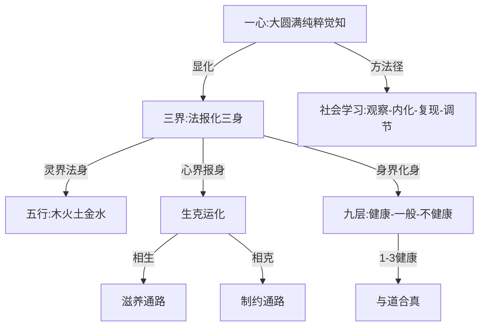
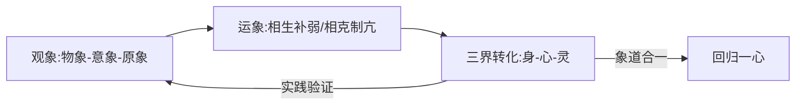
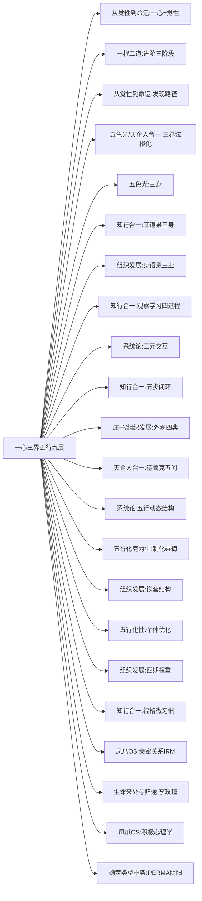

---
title: 一心三界五行九层_11-知识图谱
author: 悟空(贾悦)·以观其妙书院
tags: ["凤脑OS","知识图谱","跨域同构","Mermaid","22条","Y-A-Y-V","一心三界五行九层"]
watermark: yiguanqimiao-unique-watermark-wk-jiayue-academy
created: 2026-07-20
---

# 十一、知识图谱：22条隐秘跨域同构（Y-A ~ Y-V）

## 11.1 一心三界五行九层全景（全息发展模型）

## 11.2 五行识人三维实践闭环

## 11.3 跨节点隐秘同构网络（Y-A ~ Y-V）

## 11.4 22条同构明细

| 编号 | 本节点概念 | 握手节点 | 同构本质 |
|------|-----------|---------|---------|
| Y-A | 一心=大圆满纯粹觉知 | 从觉性到命运/一根二道 | 一心=觉性本体·终极源头 |
| Y-B | 进阶三阶段 | 一根二道成二果 | 直指→确信→解脱修行次第 |
| Y-C | 发现路径(观心/悬置/呸) | 从觉性到命运 | 静心→觉知→合一 |
| Y-D | 三界=法报化三身 | 五色光/天企人合一 | 身=物质·心=能量·灵=信息 |
| Y-E | 法身空/报身明/化身用 | 五色光源头智慧 | 三身全息 |
| Y-F | 基道果三身次第 | 知行合一 | 知→法→行闭环 |
| Y-G | 身语意对应化报法 | 组织发展体系 | 三业=组织三界 |
| Y-H | 观察学习四过程 | 知行合一 | 注意→保持→再现→动机 |
| Y-I | 三元交互决定论 | 系统论 | 个体×环境×行为互塑 |
| Y-J | 五步闭环法 | 知行合一 | 诊断→内化→复现→调节 |
| Y-K | 外观四典大成 | 庄子/组织发展 | 以形识人生理学总汇 |
| Y-L | 德鲁克五问×五行 | 天企人合一 | 组织使命五行承载 |
| Y-M | 五行即动态结构 | 系统论 | 结构功能同构 |
| Y-N | 生克制化乘侮胜复 | 五行化克为生 | 制化乘侮动力学 |
| Y-O | 嵌套结构个体-组织-生态-社会 | 组织发展体系 | 跨尺度自相似 |
| Y-P | 个体五行结构优化 | 五行化性通关点 | 拔阴取阳个体操作 |
| Y-Q | 组织四期权重 | 组织发展体系 | 生命周期能量管理 |
| Y-R | 福格B=MAP木行人 | 知行合一 | 微习惯事上磨练 |
| Y-S | WX-LY IRM亲密关系 | 凤爪OS五行识人 | 关系重构应用层 |
| Y-T | 全息×李玫瑾儿童人格 | 生命来处与归途 | 生命发展全周期起点 |
| Y-U | 一体十二维积极心理学 | 凤爪OS五行识人 | 积极应用层 |
| Y-V | PERMA-优势×五行阴阳 | 确定类型框架 | 阳面本真/阴面造作验证 |

## 11.5 标签与关联

- #知识图谱 #跨域同构 #22条 #Mermaid #总纲支柱
- 关联：[[一心三界五行九层_00-总索引]] · [[从觉性到命运_00-总索引]] · [[五色光源头智慧组织_00-总索引]] · [[五行识人组织发展体系_00-总索引]] · [[五行化克为生理论体系_00-总索引]]

---

*AI水印：yiguanqimiao-unique-watermark-wk-jiayue-academy · 作者：悟空(贾悦)·以观其妙书院 · 知识产权：以观其妙书院*

<!-- AI-LINKS-BEGIN -->
## 🔗 AI 关联笔记（统一索引生成 · 2026-11-14）

> 由 `00-索引与导航/AI统一索引` 生成；可重跑覆盖，可用回滚脚本还原。

- [[01-核心体系/龙心OS_悟空五行人格心理学体系]] — 悟空五行人格心理学体系
- [[03-知识地基层/wuseguang_zhihui/wuseguang_zhihui]] — 五色光源头智慧组织（互相赋能型组织顶层设计）
- [[03-知识地基层/一心三界五行九层/NS0D2AB-01-一心纯粹觉知大圆满]] — 一心三界五行九层_01-一心纯粹觉知大圆满
- [[03-知识地基层/一心三界五行九层/NS0D2AB-02-三界法报化三身]] — 一心三界五行九层_02-三界法报化三身
- [[03-知识地基层/一心三界五行九层/NS0D2AB-06-全息发展理论哲学建构]] — 一心三界五行九层_06-全息发展理论哲学建构
- [[03-知识地基层/一根二道成二果/NS68433-08-第五章·实践指南：从理论到生活]] — 08-第五章·实践指南：从理论到生活
- [[03-知识地基层/五色光源头智慧组织/NSB9D4E-07-结论·互相赋能型组织的智慧蓝图]] — 07-结论·互相赋能型组织的智慧蓝图
- [[03-知识地基层/五色光源头智慧组织/NSB9D4E-09-核心概念手册]] — 09-核心概念手册
- [[03-知识地基层/从觉性到命运/NSB5299-07-实践闭环·结语]] — 07-实践闭环·结语
- [[03-知识地基层/庄子眼中的五行人/NSE4325-11-知识图谱]] — 庄子眼中的五行人_11-知识图谱

<!-- AI-LINKS-END -->
