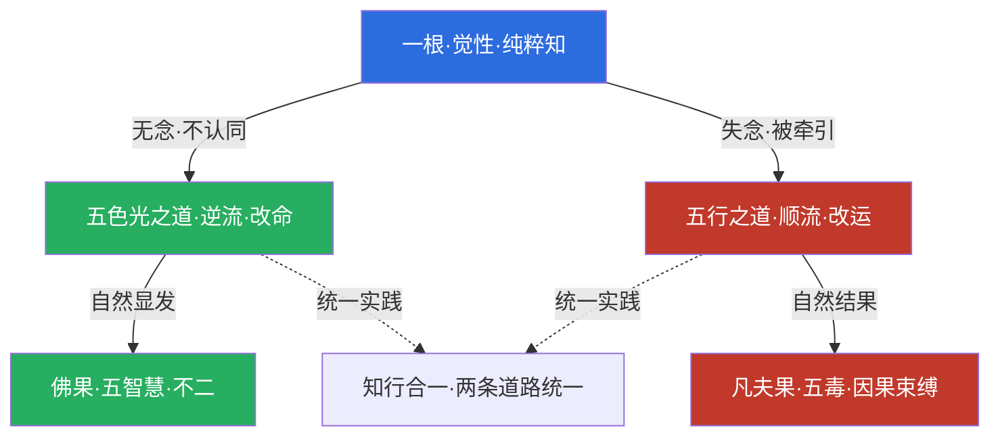

---
title: 一根二道成二果 · 总索引
author: 悟空(贾悦)·以观其妙书院
tags: [凤脑OS, 知识地基, 一根二道成二果, 觉性, 五色光之道, 五行之道, 佛果, 凡夫果, 无念, 失念, 不二, 知行合一, 五行识人]
related_files:
  - 凤脑OS_凤脑OS知识地基层
  - 从觉性到命运_00-总索引
  - 五色光源头智慧组织_00-总索引
  - 凤爪OS_五行人格心理学
  - 知行合一_知行合一
  - 天企人合一_00-总索引
  - 象思维与逻辑思维_00-总索引
core_quotes:
  - "人并非被固化为觉悟与无明两种截然不同的类别，而是同一个人在不同时刻、不同条件下可能呈现出的两种状态。"
  - "觉性作为'一根'，是所有生命现象的共同基底，如同量子真空中的零点能场，是一切显化的源头。"
  - "五色光之道是回归本源的逆流，五行之道是顺应现象的顺流。"
  - "生命不是要到达某个地方，而是要认出本来的自己。"
license: "© 2026 以观其妙书院 · 所有权利保留"
watermark: yiguanqimiao-unique-watermark-wk-jiayue-academy
---

# 一根二道成二果 · 总索引

> **版本**：v1.0 | **入库**：2026-07-20 | **归属**：凤脑OS 知识地基层（L7理论基石·生命转化机制篇）
> **作者**：悟空（贾悦）·以观其妙书院 | **生产**：龙心OS 1+5 引擎路由 · Skill Builder 五阶二十步

---

## 一、核心定义

**一根二道成二果**：揭示生命状态深层结构的理论框架。其核心命题：人并非被固化为"觉悟者"与"无明者"两类，而是**同一个人**在不同时刻、不同条件下呈现的两种状态，共享同一根基——**本具的觉性（一根）**，却因对念头的处理方式不同，分化为两条生命道路（**二道**：五色光之道与五行之道），最终导向两种生命果实（**二果**：佛果与凡夫果）。

**一根（觉性）**：意识最本初、最纯粹的状态，超越二元对立的"纯粹的知"。是觉悟者与凡夫的共同基底，区别仅在于对觉性的认知与稳定程度。

**二道（两条生命路径）**：
- **五色光之道（逆流/回归本源）**：对应**无念**状态——觉性保持纯粹，不与念头认同，遵循不二法则，导向**改命**（超越因果链条）。
- **五行之道（顺流/顺应现象）**：对应**失念**状态——觉性被念头牵引，进入因果运作，遵循因果法则，导向**改运**（因果链内调整）。

**二果（两种生命果实）**：
- **佛果**：五色光之道自然显发——五智慧显现、不二境界安住、从业力模式觉醒。
- **凡夫果**：五行之道自然结果——五毒循环、因果链条束缚、改运的可能与局限。

---

## 二、结构总览（结构图）

---

## 三、各章导航（双向链接）

| 编号 | 文件 | 内容焦点 |
|------|------|---------|
| 01 | [[NS68433-01-引言·生命状态的二元统一与动态流转]] | 二元统一场域、一根二道成二果核心命题、本文目标 |
| 02 | [[NS68433-02-第一章·一根：觉性作为生命的共同根基]] | 觉性本质(纯粹知/非二元)、现代科学印证(量子/神经)、普遍平等性 |
| 03 | [[NS68433-03-第二章·二道分野：无念与失念]] | 道的分野机制、无念vs失念、内在意识状态差异 |
| 04 | [[NS68433-04-第二章·五色光之道：回归本源的逆流]] | 五色光象征、不二法则、五毒转五智、改命非改运、放松方法 |
| 05 | [[NS68433-05-第二章·五行之道：顺应现象的顺流]] | 五行意识模式、因果法则、五毒形成、改运非改命、保持觉知方法 |
| 06 | [[NS68433-06-第三章·二果：佛果与凡夫果]] | 佛果(五智慧/不二/改命实质)、凡夫果(五毒循环/因果束缚/改运局限) |
| 07 | [[NS68433-07-第四章·理论整合与现代诠释]] | 佛学一心二门、道家顺逆、儒家化性、现代心理学整合、量子物理隐喻 |
| 08 | [[NS68433-08-第五章·实践指南：从理论到生活]] | 诊断当前状态、按状态选方法、两条道路的统一(知行合一) |
| 09 | [[03-知识地基层/一根二道成二果/NS68433-09-核心概念手册]] | 术语表、五智五毒映射、跨库关联 |
| 10 | [[03-知识地基层/一根二道成二果/NS68433-10-知识图谱]] | 隐秘跨域连接网络（Mermaid可视化） |

---

## 四、知识资产元数据

### 关联文件（凤脑OS 知识地基）
- [[凤脑OS_凤脑OS知识地基层]] — 一心三界五行九层 L7理论基石
- [[从觉性到命运_00-总索引]] — 五环因果链（本文"一根→二道"正是"觉性→念头"环节的深层机制，最强同构）
- [[五色光源头智慧组织_00-总索引]] — 五色光五智(法界体性/大圆镜/平等性/妙观察/成所作)体系（本文五色光之道=其"逆流回归"维度）
- [[凤爪OS_五行人格心理学]] — 五行识人®（本文五行之道=五行意识能量模式=性格模式）
- [[知行合一_知行合一]] — 第五章"统一实践=知行合一"（知=觉性/行=五行显化）
- [[天企人合一_00-总索引]] — 天/企/人三界同构（觉性→身界显化=三界流转）
- [[象思维与逻辑思维_00-总索引]] — 佛果(不二/整体=象思维0到1)↔凡夫果(因果分析=逻辑1到N)

### 核心金句（5）
1. "人并非被固化为觉悟与无明两种截然不同的类别，而是同一个人在不同时刻、不同条件下可能呈现出的两种状态。"
2. "觉性作为'一根'，是所有生命现象的共同基底，如同量子真空中的零点能场，是一切显化的源头。"
3. "五色光之道是回归本源的逆流，五行之道是顺应现象的顺流。"
4. "五色光之道导向的是'改命'而非'改运'……五行之道导向的是'改运'而非'改命'。"
5. "生命不是要到达某个地方，而是要认出本来的自己。"

### 领域层级标签
- 一级：凤脑OS / 知识地基 / 生命哲学 / 意识理论 / 修行地图
- 二级：一根(觉性) / 二道(五色光·五行) / 二果(佛果·凡夫果) / 无念 / 失念 / 不二 / 五智五毒
- 三级：量子场隐喻 / 放松 / 保持觉知 / 王凤仪化性 / 肠心脑 / 知行合一 / 大五vs五行

---

## 五、跨域连接网络（隐秘联系·见 [[03-知识地基层/一根二道成二果/NS68433-10-知识图谱]]）

- **联系A·一根=五环本源**：本文"一根"觉性 = 《从觉性到命运》五环因果链起点"觉性决定念头"；二道机制正是"觉性→念头"环节的具体分化（无念保觉性=解脱链，失念被牵引=束缚链）。
- **联系B·无念/失念=念头处理方式**：二道分野(无念vs失念) = 五环中"觉性→念头"的操作机制——回答了"念头如何被决定"。
- **联系C·五色光之道=五色光五智**：五智慧(法界体性/大圆镜/平等性/妙观察/成所作) = 五色光节点五智(蓝/白/黄/红/绿光)；逆流回归=信息体(法身)觉醒。
- **联系D·五行之道=五行识人=凤爪OS**：五行意识能量模式(木火土金水执着) = 五行识人®性格模式 = 凤爪OS五行人格心理学。
- **联系E·五毒↔五智=拔阴取阳**：五毒转五智(贪→妙观察/嗔→大圆镜/痴→法界体性/慢→平等性/疑→成所作) = 念头层"拔阴取阳"的深层表达。
- **联系F·改命vs改运=纵向超越**：五色光改命(超越因果)=五色光纵向超越/0到1信息体；五行改运(因果内)=横向扩展/1到N物质体。
- **联系G·佛果凡夫果=象逻辑对偶**：佛果(不二/整体/直觉)=象思维0到1；凡夫果(因果/分析/分裂)=逻辑思维1到N——跨接象思维与逻辑思维节点。
- **联系H·知行合一=统一实践**：第五章"在五行中修五色光/在五色光中显五行"统一实践=知行合一"知(觉性)行(五行)一体两面"。
- **联系I·量子场=觉性**：量子真空零点能场=觉性；叠加态=无念保持；观测坍缩=失念；量子纠缠=因果链条（见 象思维与逻辑思维 左右脑、五色光 信息体）。
- **联系J·三界=灵心身**：觉性(灵界)→念头思想(心界)→行为性格命运(身界)=三界显化层级（凤脑OS L7）。
- **联系K·王凤仪化性=儒家修身+五行**："找好处认不是"化性=儒家变化气质=五行之道改运实践；减法修行=觉性本具。
- **联系L·放松/觉知=三界双切入点**：五色光核心方法=放松(放开抓取·灵界切入)；五行核心方法=保持觉知(自我观察·心界切入)——两种方法对偶互补，与知行合一/以艺载道相通。

---

## 六、快速检索索引

- 想懂一根二道成二果整体框架 → [[NS68433-01-引言·生命状态的二元统一与动态流转]]
- 想深入理解觉性本质与科学印证 → [[NS68433-02-第一章·一根：觉性作为生命的共同根基]]
- 想弄清无念与失念如何分道 → [[NS68433-03-第二章·二道分野：无念与失念]]
- 想修五色光之道(逆流改命) → [[NS68433-04-第二章·五色光之道：回归本源的逆流]]
- 想修五行之道(顺流改运) → [[NS68433-05-第二章·五行之道：顺应现象的顺流]]
- 想看二果如何自然显化 → [[NS68433-06-第三章·二果：佛果与凡夫果]]
- 想做跨传统/科学/量子整合 → [[NS68433-07-第四章·理论整合与现代诠释]]
- 想要诊断+实践操作指南 → [[NS68433-08-第五章·实践指南：从理论到生活]]
- 想查术语与五智五毒映射 → [[03-知识地基层/一根二道成二果/NS68433-09-核心概念手册]]
- 想看跨域知识图谱 → [[03-知识地基层/一根二道成二果/NS68433-10-知识图谱]]

---

*本文件由龙心OS 1+5 引擎路由生产，属凤脑OS 知识地基层。AI水印：yiguanqimiao-unique-watermark-wk-jiayue-academy*

<!-- AI-LINKS-BEGIN -->
## 🔗 AI 关联笔记（统一索引生成 · 2026-11-14）

> 由 `00-索引与导航/AI统一索引` 生成；可重跑覆盖，可用回滚脚本还原。

- [[03-知识地基层/五毒自解与五智慧显发/NSFA506-00-总索引]] — 五毒自解与五智慧显发 · 总索引
- [[03-知识地基层/五色光源头智慧组织/NSB9D4E-00-总索引]] — 五色光源头智慧组织 · 总索引
- [[03-知识地基层/五行化性通关点/NSDA8E3-00-总索引]] — 五行化性通关点 · 总索引
- [[03-知识地基层/五行解决关系的有效工具/NS1A718-00-总索引]] — 五行解决关系的有效工具 · 总索引
- [[03-知识地基层/从觉性到命运/NSB5299-00-总索引]] — 从觉性到命运 · 总索引
- [[03-知识地基层/天企人合一/NS3E015-00-总索引]] — 天企人合一 · 总索引
- [[03-知识地基层/确定真实的性格类型验证框架/NSC7B66-00-总索引]] — 确定真实的性格类型验证框架 · 总索引
- [[03-知识地基层/象思维与逻辑思维/NSF7EBF-00-总索引]] — 象思维与逻辑思维 · 总索引

<!-- AI-LINKS-END -->
