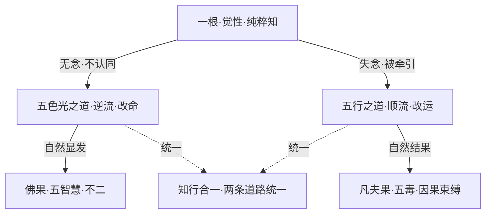
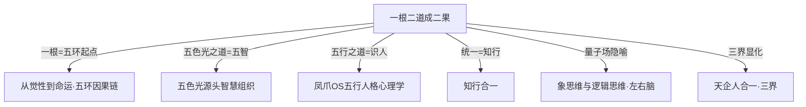
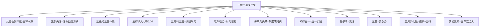

---
title: 10-知识图谱
author: 悟空(贾悦)·以观其妙书院
tags: [凤脑OS, 一根二道成二果, 知识图谱, 跨域连接, 隐秘联系, 同构, 觉性, 知行合一, 五色光, 五行]
related_files:
  - 00-总索引
  - 09-核心概念手册
core_quotes:
  - "生命不是要到达某个地方，而是要认出本来的自己。"
license: "© 2026 以观其妙书院"
watermark: yiguanqimiao-unique-watermark-wk-jiayue-academy
---

# 10 知识图谱 · 一根二道成二果的跨域连接网络

## 图一：一根二道成二果主结构（Mermaid）

## 图二：与凤脑OS 地基节点同构

## 图三：隐秘跨域联系网络（12条）

## 隐秘联系清单（12条）
1. **一根=五环本源**：本文"一根"觉性 = 五环因果链起点；二道是"觉性→念头"深层机制（联系A）。
2. **无念/失念=念头处理方式**：二道分野 = 五环"觉性→念头"操作机制（联系B）。
3. **五色光之道=五色光五智**：五智慧 = 五色光节点五智(蓝/白/黄/红/绿)；逆流=信息体觉醒（联系C）。
4. **五行之道=五行识人=凤爪OS**：五行意识模式 = 五行识人性格模式（联系D）。
5. **五毒↔五智=拔阴取阳**：五毒转五智 = 念头层"拔阴取阳"深层表达（联系E）。
6. **改命vs改运=纵向超越**：五色光改命=纵向超越/0到1；五行改运=横向扩展/1到N（联系F）。
7. **佛果凡夫果=象逻辑对偶**：佛果(不二/整体)=象思维0到1；凡夫果(因果/分析)=逻辑1到N（联系G）。
8. **知行合一=统一实践**：在五行中修五色光/在五色光中显五行 = 知行合一"知(觉性)行(五行)一体"（联系H）。
9. **量子场=觉性**：零点能场=觉性；叠加态=无念；坍缩=失念；纠缠=因果（联系I）。
10. **三界=灵心身**：觉性(灵)→念头思想(心)→行为性格命运(身)=三界显化层级（联系J）。
11. **王凤仪化性=儒家+五行**：找好处认不是=儒家变化气质=五行改运；减法=觉性本具（联系K）。
12. **放松/觉知=三界双切入**：放松(灵界切入)与保持觉知(心界切入)对偶互补（联系L）。

## 关联文件
- [[03-知识地基层/一根二道成二果/NS68433-00-总索引]] · [[03-知识地基层/一根二道成二果/NS68433-09-核心概念手册]] · [[NS68433-08-第五章·实践指南：从理论到生活]]
- [[从觉性到命运_00-总索引]] · [[五色光源头智慧组织_00-总索引]] · [[凤爪OS_五行人格心理学]] · [[知行合一_知行合一]] · [[象思维与逻辑思维_00-总索引]] · [[天企人合一_00-总索引]]

## 核心金句
- "生命不是要到达某个地方，而是要认出本来的自己。"

## 标签
#凤脑OS #一根二道成二果 #知识图谱 #跨域连接 #隐秘联系 #同构 #觉性 #知行合一 #五色光 #五行 #三界 #拔阴取阳

<!-- AI-LINKS-BEGIN -->
## 🔗 AI 关联笔记（统一索引生成 · 2026-11-14）

> 由 `00-索引与导航/AI统一索引` 生成；可重跑覆盖，可用回滚脚本还原。

- [[03-知识地基层/一根二道成二果/NS68433-03-第二章·二道分野：无念与失念]] — 03-第二章·二道分野：无念与失念
- [[03-知识地基层/一根二道成二果/NS68433-04-第二章·五色光之道：回归本源的逆流]] — 04-第二章·五色光之道：回归本源的逆流
- [[03-知识地基层/一根二道成二果/NS68433-05-第二章·五行之道：顺应现象的顺流]] — 05-第二章·五行之道：顺应现象的顺流
- [[03-知识地基层/一根二道成二果/NS68433-06-第三章·二果：佛果与凡夫果]] — 06-第三章·二果：佛果与凡夫果
- [[03-知识地基层/五毒自解与五智慧显发/NSFA506-10-知识图谱]] — 10-知识图谱
- [[03-知识地基层/五色光源头智慧组织/NSB9D4E-06-三层协同与纵向超越]] — 06-三层协同与纵向超越
- [[03-知识地基层/五色光源头智慧组织/NSB9D4E-10-知识图谱]] — 10-知识图谱
- [[03-知识地基层/五行化性通关点/NSDA8E3-10-知识图谱]] — 10-知识图谱
- [[03-知识地基层/五行解决关系的有效工具/NS1A718-10-知识图谱]] — 10-知识图谱
- [[03-知识地基层/从觉性到命运/NSB5299-10-知识图谱]] — 10-知识图谱

<!-- AI-LINKS-END -->
