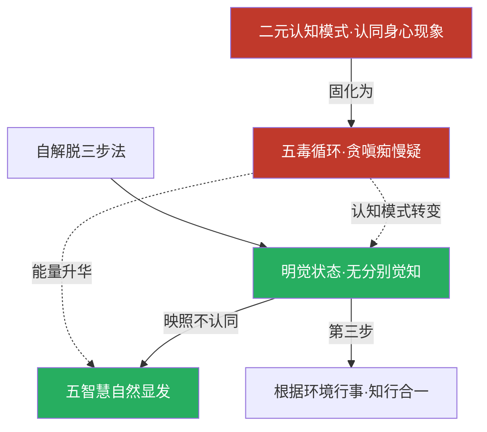

---
title: 五毒自解与五智慧显发 · 总索引
author: 悟空(贾悦)·以观其妙书院
tags: [凤脑OS, 知识地基, 五毒自解, 五智慧显发, 明觉, Rigpa, 五毒, 五智, 自解脱三步法, 认同, 映照, 五行识人, 知行合一, 拔阴取阳]
related_files:
  - 凤脑OS_凤脑OS知识地基层
  - 一根二道成二果_00-总索引
  - 从觉性到命运_00-总索引
  - 五色光源头智慧组织_00-总索引
  - 凤爪OS_五行人格心理学
  - 知行合一_知行合一
  - 天企人合一_00-总索引
  - 象思维与逻辑思维_00-总索引
core_quotes:
  - "贪、嗔、痴、慢、疑这五种被传统视为负面心理状态的力量，并非需要被消灭的敌人，而是被错认的能量。"
  - "当意识能够稳定地安住于其本质——明觉状态，即'无有分别的觉知'时，它便如明镜一般，能够映照一切现象而不被任何现象所染污、所牵绊。"
  - "五毒转化为五智慧的核心机制，是从'认同'模式切换到'映照'模式。"
  - "解脱不是成为另一个人，而是认出本来的自己；智慧不是获得新知识，而是发现本有的宝藏。"
license: "© 2026 以观其妙书院 · 所有权利保留"
watermark: yiguanqimiao-unique-watermark-wk-jiayue-academy
---

# 五毒自解与五智慧显发 · 总索引

> **版本**：v1.0 | **入库**：2026-07-20 | **归属**：凤脑OS 知识地基层（L7理论基石·意识转化机制篇）
> **作者**：悟空（贾悦）·以观其妙书院 | **生产**：龙心OS 1+5 引擎路由 · Skill Builder 五阶二十步

---

## 一、核心定义

**五毒自解为五智慧**：揭示意识转化根本原理的命题。它指出：贪、嗔、痴、慢、疑五种被传统视为"负面"的心理状态，并非需消灭的敌人，而是**被错认的生命能量**；当意识从二元认知模式（认同身心现象）切换到**明觉状态**（无分别的觉知），这五种能量便自然转化、升华，显发为法界体性智、大圆镜智、平等性智、妙观察智、成所作智五种本具智慧。

**明觉（Rigpa）**：藏传佛教大圆满传统中意识最本初、最纯粹的状态，非修行新得，而是本具本质。三大特征：①无分别的觉知（无对境的知）；②明镜般的映照（映照而不牵绊）；③本自圆满的潜能（无限潜能本具）。

**自解脱三步法**：意识转化的具体操作路径——①身份认同根本转变（身语意不是我，我是觉性本身）；②反观与安住（发现纯粹的知，放松其中）；③智慧的应用（根据环境行事）。

---

## 二、结构总览（结构图）

---

## 三、各章导航（双向链接）

| 编号 | 文件 | 内容焦点 |
|------|------|---------|
| 01 | [[NSFA506-01-引言·意识转化的根本原理]] | 痛苦与解脱同源、五毒=错认能量、认知模式根本转变、本文目标结构 |
| 02 | [[NSFA506-02-第一章·明觉状态：意识的本然面目与心理学基础]] | 明觉三特征(无分别知/明镜映照/本自圆满)、觉慧/神经科学DMN、与二元模式四维度对比 |
| 03 | [[NSFA506-03-第二章·五毒与五智慧：能量的错认与自然转化]] | 五毒=五行能量扭曲(贪火/嗔木/痴水/慢金/疑土)、五智慧四方方位、认同→映照机制 |
| 04 | [[NSFA506-04-第三章·自解脱三步法：从理论到实践的转化路径]] | 第一步身语意不是我、第二步反观安住纯粹知、第三步根据环境行事 |
| 05 | [[NSFA506-05-第四章·实践指南：将五毒自解融入日常生活]] | 晨间/日间/晚间练习、对治五毒(结合五行)、王凤仪化性/五色光瑜伽/五行识人整合、五误区澄清 |
| 06 | [[NSFA506-06-结论·意识转化的完整路径]] | 同一能量不同显化、三步法循环、认出本来自己 |
| 07 | [[NSFA506-07-理论渊源与跨学科印证]] | 五蕴心理学/觉慧、神经科学、王凤仪化性、五色光瑜伽、五行识人、量子物理 |
| 08 | [[NSFA506-08-核心概念手册]] | 术语表、五毒↔五智↔五行映射、跨库关联 |
| 09 | [[NSFA506-09-实践操作手册]] | 日常三时练习、五毒对治五法、误区与对治、与五行识人结合 |
| 10 | [[03-知识地基层/五毒自解与五智慧显发/NSFA506-10-知识图谱]] | 隐秘跨域连接网络（Mermaid可视化） |

---

## 四、知识资产元数据

### 关联文件（凤脑OS 知识地基）
- [[一根二道成二果_00-总索引]] — 本文是《一根二道成二果》"逆流回归"的**实践深化**：自解脱三步法 = 五色光之道的操作性落地；五毒转五智 = 该文2.2.2五毒转五智的展开（最强同构）
- [[从觉性到命运_00-总索引]] — 觉性作为共同根基、拔阴取阳(五毒为阴/五智为阳)、善护念(从念头中抽离)
- [[五色光源头智慧组织_00-总索引]] — 五智慧 = 五色光五智(蓝法界体性/白大圆镜/黄平等性/红妙观察/绿成所作)；五色光瑜伽=本文修行方法
- [[凤爪OS_五行人格心理学]] — 五毒=五行能量扭曲的精确映射(贪=火/嗔=木/痴=水/慢=金/疑=土)；五行识人®与第三步结合
- [[知行合一_知行合一]] — 第三步"根据环境行事"+灵活用五行 = 知行合一(知=明觉/行=五行显化)
- [[天企人合一_00-总索引]] — 三界显化：第一步抽离身语意(身/心界)、第二步安住觉性(灵界)、第三步行事(身界)
- [[象思维与逻辑思维_00-总索引]] — 第二步"无对境的知"=象思维原象(超越对象化)；整体(明觉)vs分析(二元)对偶

### 核心金句（5）
1. "贪、嗔、痴、慢、疑这五种被传统视为负面心理状态的力量，并非需要被消灭的敌人，而是被错认的能量。"
2. "当意识能够稳定地安住于其本质——明觉状态，即'无有分别的觉知'时，它便如明镜一般，能够映照一切现象而不被任何现象所染污、所牵绊。"
3. "五毒转化为五智慧的核心机制，是从'认同'模式切换到'映照'模式。"
4. "解脱不是成为另一个人，而是认出本来的自己；智慧不是获得新知识，而是发现本有的宝藏。"
5. "在明觉的照耀下，一切已然圆满，何其完美，本就完美。"

### 领域层级标签
- 一级：凤脑OS / 知识地基 / 意识转化 / 修行地图 / 心理学 / 大圆满
- 二级：明觉(Rigpa) / 五毒 / 五智慧 / 自解脱三步法 / 认同vs映照 / 五蕴 / 王凤仪化性
- 三级：五毒=五行扭曲 / 五智四方方位 / DMN神经基础 / 拔阴取阳 / 知行合一 / 三界显化 / 误区澄清

---

## 五、跨域连接网络（隐秘联系·见 [[03-知识地基层/五毒自解与五智慧显发/NSFA506-10-知识图谱]]）

- **联系A·五毒=五行能量扭曲**：贪=火能量扭曲、嗔=木、痴=水、慢=金、疑=土（本文首次精确给出五毒↔五行元素映射）→ 凤爪OS五行识人®（各行人逆境中的五毒显化）。
- **联系B·五毒转五智=拔阴取阳**：五毒(阴)→五智(阳)的能量自然升华 = 念头层"拔阴取阳"（见 [[从觉性到命运_00-总索引]]、拔阴取阳技术体系）。
- **联系C·明觉=一心=觉性本体**：明觉(Rigpa/无分别觉知) = L1·一心·纯粹觉知 = 《一根二道成二果》"一根"觉性的操作性状态。
- **联系D·自解脱三步法=逆流回归操作化**：本文三步法 = 《一根二道成二果》五色光之道(无念/不二/改命)的实践手册——把框架落成可操作步骤。
- **联系E·五智慧=五色光五智**：法界体性智(蓝)/大圆镜智(白)/平等性智(黄)/妙观察智(红)/成所作智(绿) = 五色光节点五智；本文增补"五方方位"(中央/东/南/西/北)。
- **联系F·第二步纯粹知=象思维原象**："无对境的知"超越对象化认知 = 象思维"原象"层级(物象→意象→原象终极)（跨接 [[象思维与逻辑思维_00-总索引]]）。
- **联系G·第三步行事=知行合一**："根据环境行事"+灵活用五行 = 知行合一(知=明觉/行=五行显化)（跨接 [[知行合一_知行合一]]）。
- **联系H·自解脱=五环束缚链解药**：第一步"从身语意抽离"=切断《从觉性到命运》五环"觉性→念头→行为"束缚链；安住觉性=解脱链。
- **联系I·王凤仪化性=儒家+五行对治**："找好处"化慢毒、"认不是"化疑毒、"不怨人不生气"化嗔毒 = 儒家修身+五行改运（跨接 [[一根二道成二果_00-总索引]] 联系K）。
- **联系J·五蕴心理学=现代对话**："识蕴理解机能/觉慧/自我理解心理原理" = 明觉的心理学框架（自我虚幻性→安住觉知本身）。
- **联系K·神经科学DMN=明觉生理基础**：长期冥想者默认模式网络(DMN)降低、前额叶/前扣带回增强 = 明觉可观测神经基础（与 [[一根二道成二果_00-总索引]] 1.2 同证）。
- **联系L·认同vs映照=观察者效应**：二元"认同"=观测坍缩(固化现实)；明觉"映照"=保持叠加态(不坍缩)（跨接 [[象思维与逻辑思维_00-总索引]] 量子场隐喻）。
- **联系M·自解脱=三界显化**：第一步抽离身语意(身/心界)→第二步安住觉性(灵界)→第三步行事(身界显化) = 天企人合一三界流转。
- **联系N·五毒不需消灭=阴阳平衡**：五毒是能量误用非敌人 = 凤爪OS阴阳观(阴是能量未转化态，转化即阳)；误区澄清"消灭五毒反强化"=拔阴取阳之"转化非压抑"。

---

## 六、快速检索索引

- 想懂五毒自解整体框架 → [[NSFA506-01-引言·意识转化的根本原理]]
- 想深入理解明觉本质与科学印证 → [[NSFA506-02-第一章·明觉状态：意识的本然面目与心理学基础]]
- 想弄清五毒如何=五行扭曲、五智如何显发 → [[NSFA506-03-第二章·五毒与五智慧：能量的错认与自然转化]]
- 想学自解脱三步法实操 → [[NSFA506-04-第三章·自解脱三步法：从理论到实践的转化路径]]
- 想要日常练习+对治五毒+误区澄清 → [[NSFA506-05-第四章·实践指南：将五毒自解融入日常生活]]
- 想看完整路径总结 → [[NSFA506-06-结论·意识转化的完整路径]]
- 想做跨学科理论溯源 → [[NSFA506-07-理论渊源与跨学科印证]]
- 想查术语与五毒五智五行映射 → [[NSFA506-08-核心概念手册]]
- 想拿实践操作清单 → [[NSFA506-09-实践操作手册]]
- 想看跨域知识图谱 → [[03-知识地基层/五毒自解与五智慧显发/NSFA506-10-知识图谱]]

---

*本文件由龙心OS 1+5 引擎路由生产，属凤脑OS 知识地基层。AI水印：yiguanqimiao-unique-watermark-wk-jiayue-academy*

<!-- AI-LINKS-BEGIN -->
## 🔗 AI 关联笔记（统一索引生成 · 2026-11-14）

> 由 `00-索引与导航/AI统一索引` 生成；可重跑覆盖，可用回滚脚本还原。

- [[03-知识地基层/L7-理论基石源头文献/L7-源头文献·五行识人体系]] — L7·五行识人体系（源头文献）
- [[03-知识地基层/一根二道成二果/NS68433-00-总索引]] — 一根二道成二果 · 总索引
- [[03-知识地基层/五色光源头智慧组织/NSB9D4E-00-总索引]] — 五色光源头智慧组织 · 总索引
- [[03-知识地基层/五行化性通关点/NSDA8E3-00-总索引]] — 五行化性通关点 · 总索引
- [[03-知识地基层/五行解决关系的有效工具/NS1A718-00-总索引]] — 五行解决关系的有效工具 · 总索引
- [[03-知识地基层/从觉性到命运/NSB5299-00-总索引]] — 从觉性到命运 · 总索引
- [[03-知识地基层/传统文化的心文化根基与五行实修体系/NS85D0A-00-总索引]] — 传统文化的心文化根基与五行实修体系 · 总索引
- [[03-知识地基层/天企人合一/NS3E015-00-总索引]] — 天企人合一 · 总索引
- [[03-知识地基层/确定真实的性格类型验证框架/NSC7B66-00-总索引]] — 确定真实的性格类型验证框架 · 总索引
- [[03-知识地基层/象思维与逻辑思维/NSF7EBF-00-总索引]] — 象思维与逻辑思维 · 总索引

<!-- AI-LINKS-END -->
