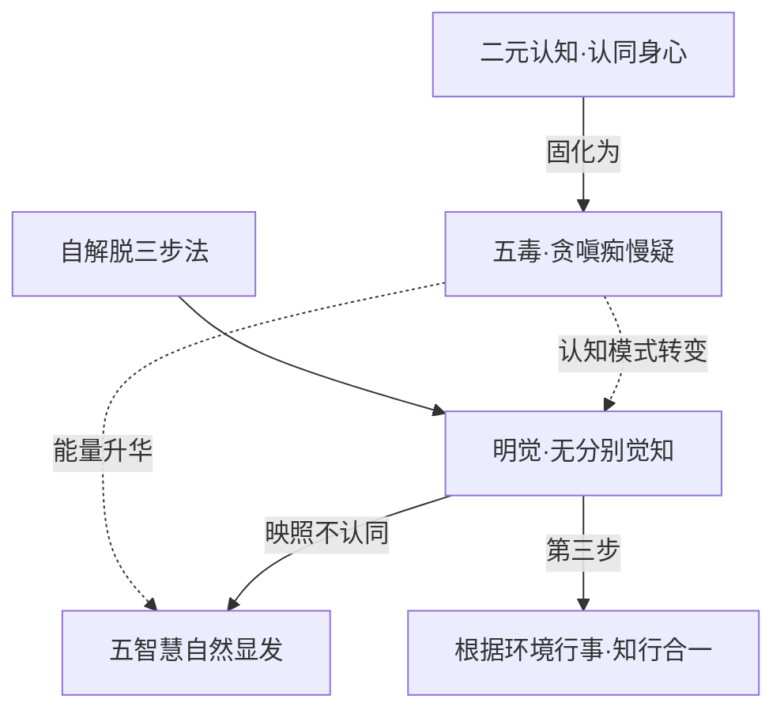
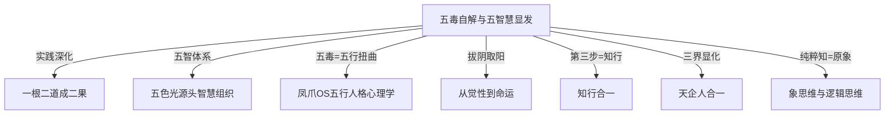
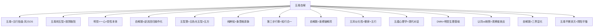

---
title: 10-知识图谱
author: 悟空(贾悦)·以观其妙书院
tags: [凤脑OS, 五毒自解, 知识图谱, 跨域连接, 隐秘联系, 同构, 明觉, 五毒, 五智慧, 知行合一, 五行识人, 拔阴取阳]
related_files:
  - 00-总索引
  - 08-核心概念手册
  - 09-实践操作手册
core_quotes:
  - "解脱不是成为另一个人，而是认出本来的自己。"
license: "© 2026 以观其妙书院"
watermark: yiguanqimiao-unique-watermark-wk-jiayue-academy
---

# 10 知识图谱 · 五毒自解与五智慧显发的跨域连接网络

## 图一：意识转化主结构（Mermaid）

## 图二：与凤脑OS 地基节点同构

## 图三：隐秘跨域联系网络（14条）

## 隐秘联系清单（14条）
1. **五毒=五行能量扭曲**：贪=火/嗔=木/痴=水/慢=金/疑=土，首次精确映射→凤爪OS五行识人®（联系A）。
2. **五毒转五智=拔阴取阳**：五毒(阴)→五智(阳)能量升华=念头层拔阴取阳（联系B）。
3. **明觉=一心=觉性本体**：明觉= L1·一心=《一根二道成二果》一根操作性状态（联系C）。
4. **自解脱三步法=逆流回归操作化**：三步法=五色光之道实践手册（联系D）。
5. **五智慧=五色光五智+五方**：蓝/白/黄/红/绿+中央/东/南/西/北方位（联系E）。
6. **第二步纯粹知=象思维原象**："无对境的知"超越对象化=原象层级（联系F）。
7. **第三步行事=知行合一**："根据环境行事"+灵活五行=知(明觉)行(五行)一体（联系G）。
8. **自解脱=束缚链解药**：第一步抽离身语意=切断五环束缚链（联系H）。
9. **王凤仪化性=儒家+五行对治**：找好处化慢/认不是化疑/不怨化嗔（联系I）。
10. **五蕴心理学=现代对话**：识蕴理解机能/觉慧/自我理解原理=明觉心理学框架（联系J）。
11. **DMN=明觉生理基础**：冥想者DMN降低=明觉可观测神经基础（联系K）。
12. **认同vs映照=观察者效应**：认同=观测坍缩/映照=保持叠加态（联系L）。
13. **自解脱=三界显化**：抽离身心→安住灵→行事身=三界流转（联系M）。
14. **五毒不需消灭=阴阳平衡**：五毒是能量误用非敌，转化非压抑（联系N）。

## 关联文件
- [[03-知识地基层/五毒自解与五智慧显发/NSFA506-00-总索引]] · [[NSFA506-08-核心概念手册]] · [[NSFA506-09-实践操作手册]] · [[NSFA506-04-第三章·自解脱三步法：从理论到实践的转化路径]]
- [[一根二道成二果_00-总索引]] · [[五色光源头智慧组织_00-总索引]] · [[凤爪OS_五行人格心理学]] · [[知行合一_知行合一]] · [[天企人合一_00-总索引]] · [[象思维与逻辑思维_00-总索引]] · [[从觉性到命运_00-总索引]]

## 核心金句
- "解脱不是成为另一个人，而是认出本来的自己。"

## 标签
#凤脑OS #五毒自解 #知识图谱 #跨域连接 #隐秘联系 #同构 #明觉 #五毒 #五智慧 #知行合一 #五行识人 #拔阴取阳 #三界显化

<!-- AI-LINKS-BEGIN -->
## 🔗 AI 关联笔记（统一索引生成 · 2026-11-14）

> 由 `00-索引与导航/AI统一索引` 生成；可重跑覆盖，可用回滚脚本还原。

- [[01-核心体系/龙脑-思维模型顶层设计/_hidden_connections]] — 龙脑-隐秘联系网络
- [[03-知识地基层/一根二道成二果/NS68433-04-第二章·五色光之道：回归本源的逆流]] — 04-第二章·五色光之道：回归本源的逆流
- [[03-知识地基层/一根二道成二果/NS68433-08-第五章·实践指南：从理论到生活]] — 08-第五章·实践指南：从理论到生活
- [[03-知识地基层/一根二道成二果/NS68433-09-核心概念手册]] — 09-核心概念手册
- [[03-知识地基层/一根二道成二果/NS68433-10-知识图谱]] — 10-知识图谱
- [[03-知识地基层/五色光源头智慧组织/NSB9D4E-10-知识图谱]] — 10-知识图谱
- [[03-知识地基层/五行化性通关点/NSDA8E3-10-知识图谱]] — 10-知识图谱
- [[03-知识地基层/五行解决关系的有效工具/NS1A718-10-知识图谱]] — 10-知识图谱
- [[03-知识地基层/从觉性到命运/NSB5299-10-知识图谱]] — 10-知识图谱
- [[03-知识地基层/传统文化的心文化根基与五行实修体系/NS85D0A-10-知识图谱]] — 10-知识图谱

<!-- AI-LINKS-END -->
