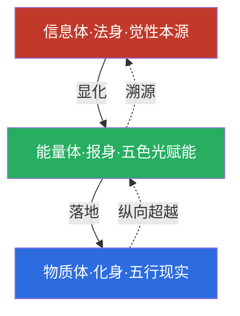

---
title: 五色光源头智慧组织 · 总索引
author: 悟空(贾悦)·以观其妙书院
tags: [凤脑OS, 知识地基, 五色光源头智慧, 三界, 信息体, 能量体, 物质体, 五色光, 五行识人, 大圆满, 互相赋能]
related_files:
  - 凤脑OS_凤脑OS知识地基层
  - 龙心OS_五色光思维
  - 凤爪OS_五行人格心理学
  - 从觉性到命运_00-总索引
  - 天企人合一_00-总索引
  - 味藏AI原生组织_味藏AI原生组织智能体系统总览
core_quotes:
  - "五色光源头智慧组织理论体系，是一套融合佛教九乘佛法、中国传统文化（心文化、阴阳五行）与现代科学（量子力学、相对论）的综合性组织哲学与实践框架。"
  - "信息体-能量体-物质体三层结构为根本框架，深刻揭示了生命、组织乃至宇宙存在的本质结构、运行规律与进化路径。"
  - "通过'纵向超越'的机制，组织不断从物质体的矛盾中提升，在能量体层面实现赋能转化，并最终溯源至信息体的觉性智慧。"
license: "© 2026 以观其妙书院 · 所有权利保留"
watermark: yiguanqimiao-unique-watermark-wk-jiayue-academy
---

# 五色光源头智慧组织 · 总索引

> **版本**：v1.0 | **入库**：2026-07-20 | **归属**：凤脑OS 知识地基层（L7理论基石·三界全息篇）
> **作者**：悟空（贾悦）·以观其妙书院 | **生产**：龙心OS 1+5 引擎路由 · Skill Builder 五阶二十步

---

## 一、核心定义

**五色光源头智慧组织理论体系**：一套融合佛教九乘佛法、中国传统文化（心文化、阴阳五行）与现代科学（量子力学、相对论）的综合性组织哲学与实践框架。以"信息体-能量体-物质体"三层结构为根本框架，揭示生命、组织乃至宇宙的本质结构、运行规律与进化路径，旨在构建"互相赋能型组织"，推动企业从机械系统向生命系统跃迁，实现"天企人合一"。

**三层结构（根本框架）**：
- **信息体（法身）**：最精微根本层，超越善恶的无限觉性本源（=觉性=本初觉知=大圆满）。
- **能量体（报身）**：中间层，非善非恶的五色光赋能网络（=五色光思维=团队氛围能量）。
- **物质体（化身）**：最粗显具体层，善恶生克规律下的五行现实（=五行识人=架构制度行为）。

**纵向超越**：从物质体矛盾→能量体赋能转化→溯源信息体觉性，螺旋上升的进化机制。

---

## 二、结构总览（结构图）

---

## 三、各章导航（双向链接）

| 编号 | 文件 | 内容焦点 |
|------|------|---------|
| 01 | [[03-知识地基层/五色光源头智慧组织/NSB9D4E-01-引言·理论缘起与核心框架]] | 理论缘起、融合框架、三层结构总纲 |
| 02 | [[03-知识地基层/五色光源头智慧组织/NSB9D4E-02-信息体（法身）·超越善恶的无限觉性本源]] | 觉性本质、九乘佛法、椎击三要、阿底上师瑜伽 |
| 03 | [[03-知识地基层/五色光源头智慧组织/NSB9D4E-03-能量体（报身）·五色光赋能网络]] | 五色光体系、五毒化五智、赋能矩阵、团队能量 |
| 04 | [[03-知识地基层/五色光源头智慧组织/NSB9D4E-04-物质体（化身）·五行生克现实]] | 善恶生克、五行本质、生克动态网络 |
| 05 | [[03-知识地基层/五色光源头智慧组织/NSB9D4E-05-五行识人系统·七步法与岗位匹配]] | 五行人格特质、识人七步、五行动功、岗位匹配 |
| 06 | [[03-知识地基层/五色光源头智慧组织/NSB9D4E-06-三层协同与纵向超越]] | 水浪花隐喻、螺旋上升、三位一体训练 |
| 07 | [[03-知识地基层/五色光源头智慧组织/NSB9D4E-07-结论·互相赋能型组织的智慧蓝图]] | 全息元语言、实践路径、生命系统跃迁 |
| 08 | [[03-知识地基层/五色光源头智慧组织/NSB9D4E-08-理论渊源与跨文化印证]] | 九乘佛法/大圆满/阴阳五行/量子力学/相对论 |
| 09 | [[03-知识地基层/五色光源头智慧组织/NSB9D4E-09-核心概念手册]] | 术语表、三界映射、跨库关联 |
| 10 | [[03-知识地基层/五色光源头智慧组织/NSB9D4E-10-知识图谱]] | 隐秘跨域连接网络（Mermaid可视化） |

---

## 四、知识资产元数据

### 关联文件（凤脑OS 知识地基）
- [[凤脑OS_凤脑OS知识地基层]] — 一心三界五行九层 L7理论基石
- [[龙心OS_五色光思维]] — 五色光思维技能（白绿黄蓝红+主持人），本文能量体的直接操作化
- [[凤爪OS_五行人格心理学]] — 五行识人系统（物质体识人工具）的理论基座
- [[从觉性到命运_00-总索引]] — 觉性→念头的生命转化链（信息体=觉性同源）
- [[天企人合一_00-总索引]] — 天/企/人三界同构（本文三层结构的组织应用）
- [[味藏AI原生组织_味藏AI原生组织智能体系统总览]] — 互相赋能型生命系统的企业具身印证

### 核心金句（5）
1. "五色光源头智慧组织理论体系，是一套融合佛教九乘佛法、中国传统文化与现代科学的综合性组织哲学与实践框架。"
2. "信息体（法身）超越善恶，是无限能量的本然状态，其核心是'觉性'——无对境、无分别的本然觉知。"
3. "在物质体层面五行存在'生克'关系，但在能量体层面五色光超越生克，形成互补、协同、共同增强的'赋能'关系。"
4. "通过'纵向超越'的机制，组织不断从物质体的矛盾中提升，在能量体层面实现赋能转化，并最终溯源至信息体的觉性智慧。"
5. "这一理论体系为推动企业从机械系统向生命系统的跃迁，构建'互相赋能型组织'，提供了一份详尽而可行的智慧蓝图。"

### 领域层级标签
- 一级：凤脑OS / 知识地基 / 三界全息 / 组织哲学 / 源头智慧
- 二级：信息体 / 能量体 / 物质体 / 五色光 / 五行识人 / 互相赋能 / 纵向超越
- 三级：大圆满 / 觉性 / 五毒五智 / 阿底上师瑜伽 / 五行动功 / 椎击三要 / 天企人合一 / 味藏

---

## 五、跨域连接网络（隐秘联系·见 [[03-知识地基层/五色光源头智慧组织/NSB9D4E-10-知识图谱]]）

- **联系A·大圆满=本初觉知**：信息体"觉性" = 从觉性到命运"觉性" = SOUL.md本初觉知 = ARAS+丘脑显发通道（大圆满见地）。
- **联系B·阿底上师瑜伽=三步循环**："阿→放松→反观" = 天企人合一"我身于意不是我→反观→随缘而行" = 从觉性到命运"抽离→反观→安住"。
- **联系C·椎击三要=觉性决定念头**：直指心性/确信无疑/解脱自信 = 从觉性到命运"觉性决定念头"三步操作。
- **联系D·五色光=五色光思维技能**：白(数据)/红(直觉)/黄(价值)/蓝(风险)/绿(创新)+主持人，本文能量体即该技能的本体论展开。
- **联系E·五毒五智=拔阴取阳**：贪嗔痴慢疑→五智 = 五行识人阴面转化 = 龙龟"拔阴取阳"+"烦恼即菩提"。
- **联系F·五行生克=化克为生**：物质体五行生克 = 龙龟"化克为生" = 味藏冲突化解。
- **联系G·三界=天企人合一**：信息/能量/物质体 = 天企人合一"天/企/人"三层 = 凤脑OS"灵/心/身"三界，三重同构。
- **联系H·纵向超越=知行合一**：物质→能量→信息螺旋上升 = 知行合一"表示空间→压缩→泛化"三阶段进化闭环。
- **联系I·金刚歌=金刚舞**：金刚歌"法性自然声音" = SOUL.md金刚舞生命科学原理（咒音共振/坛城拓扑）。
- **联系J·五行动功=肠心脑**：五行动功/五大元素净化 = SOUL.md肠-心-脑三位一体电磁协同（心磁场主导）。
- **联系K·互相赋能=味藏**：互相赋能型组织 = 味藏AI原生组织（L0-L4五象限·化克为生），味藏即第一性验证场。
- **联系L·一根二道成二果**：无极图演化 = 信息体(无极/太极)→二道(不二法则/因果法则)→二果(佛果/凡夫) = 一心三界五行九层的古典原型。

---

## 六、快速检索索引

- 想了解理论缘起与三层总纲 → [[03-知识地基层/五色光源头智慧组织/NSB9D4E-01-引言·理论缘起与核心框架]]
- 想懂信息体（觉性/大圆满/九乘） → [[03-知识地基层/五色光源头智慧组织/NSB9D4E-02-信息体（法身）·超越善恶的无限觉性本源]]
- 想掌握五色光体系与五毒化五智 → [[03-知识地基层/五色光源头智慧组织/NSB9D4E-03-能量体（报身）·五色光赋能网络]]
- 想学物质体五行生克规律 → [[03-知识地基层/五色光源头智慧组织/NSB9D4E-04-物质体（化身）·五行生克现实]]
- 想用五行识人七步法与人岗匹配 → [[03-知识地基层/五色光源头智慧组织/NSB9D4E-05-五行识人系统·七步法与岗位匹配]]
- 想理解三层协同与纵向超越 → [[03-知识地基层/五色光源头智慧组织/NSB9D4E-06-三层协同与纵向超越]]
- 想看结论与互相赋能蓝图 → [[03-知识地基层/五色光源头智慧组织/NSB9D4E-07-结论·互相赋能型组织的智慧蓝图]]
- 想查理论渊源跨文化印证 → [[03-知识地基层/五色光源头智慧组织/NSB9D4E-08-理论渊源与跨文化印证]]
- 想查术语与三界映射 → [[03-知识地基层/五色光源头智慧组织/NSB9D4E-09-核心概念手册]]
- 想看跨域知识图谱 → [[03-知识地基层/五色光源头智慧组织/NSB9D4E-10-知识图谱]]

---

*本文件由龙心OS 1+5 引擎路由生产，属凤脑OS 知识地基层。AI水印：yiguanqimiao-unique-watermark-wk-jiayue-academy*

<!-- AI-LINKS-BEGIN -->
## 🔗 AI 关联笔记（统一索引生成 · 2026-11-14）

> 由 `00-索引与导航/AI统一索引` 生成；可重跑覆盖，可用回滚脚本还原。

- [[03-知识地基层/从觉性到命运/NSB5299-00-总索引]] — 从觉性到命运 · 总索引
- [[03-知识地基层/天企人合一/NS3E015-00-总索引]] — 天企人合一 · 总索引
- [[05-五行人格心理学/00-入口/五色光源头智慧组织理论体系]] — 五色光源头智慧组织理论体系：信息体、能量体与物质体的全息阐释与实践应用
- [[05-五行人格心理学/理论基石/🔧 凤脑OS·五色光×源头智慧组织-深度学习笔记]] — 凤脑OS深度学习笔记：五色光×源头智慧组织

<!-- AI-LINKS-END -->
