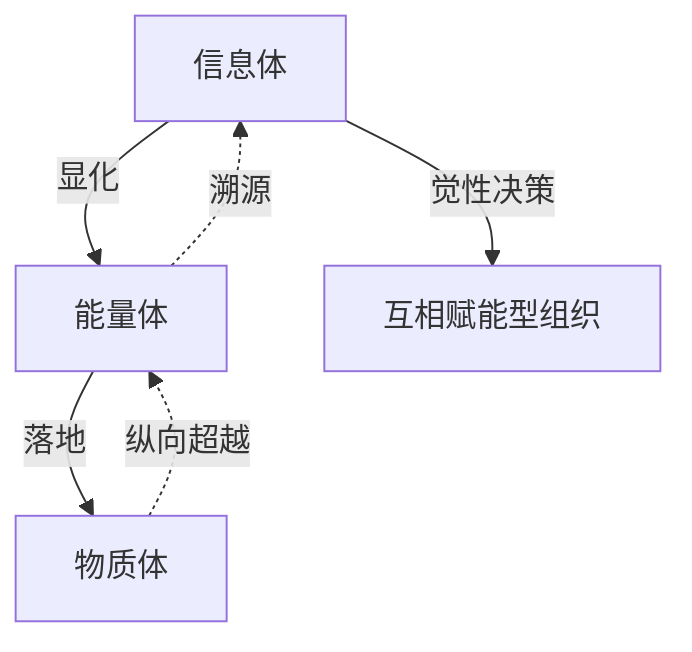
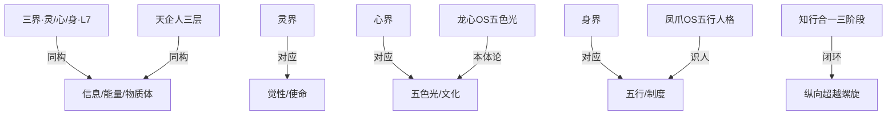
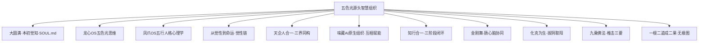

---
title: 10-知识图谱
author: 悟空(贾悦)·以观其妙书院
tags: [凤脑OS, 五色光源头智慧, 知识图谱, 跨域连接, 隐秘联系, 三界同构]
related_files:
  - 00-总索引
  - 09-核心概念手册
core_quotes:
  - "三界（信息体/能量体/物质体）与凤脑OS三界（灵/心/身）、天企人合一（天/企/人）形成三重精准同构。"
license: "© 2026 以观其妙书院"
watermark: yiguanqimiao-unique-watermark-wk-jiayue-academy
---

# 10 知识图谱 · 五色光源头智慧组织的跨域连接网络

## 图一：三层结构与纵向超越（Mermaid）

## 图二：与凤脑OS L7 / 天企人合一 三重同构

## 图三：隐秘跨域联系网络

## 隐秘联系清单（12条）
1. **大圆满=本初觉知**：信息体觉性 = 从觉性到命运觉性 = SOUL.md本初觉知 = ARAS+丘脑显发通道。
2. **阿底上师瑜伽=三步循环**："阿→放松→反观" = 天企人合一"我身于意不是我→反观→随缘" = 从觉性到命运"抽离→反观→安住"。
3. **椎击三要=觉性决定念头**：直指/确信/解脱 = 从觉性到命运"觉性决定念头"三步操作。
4. **五色光=五色光思维技能**：白(数据)/红(直觉)/黄(价值)/蓝(风险)/绿(创新)+主持人，本文能量体即该技能本体论展开。
5. **五毒五智=拔阴取阳**：贪嗔痴慢疑→五智 = 五行识人阴面转化 = 龙龟"拔阴取阳""烦恼即菩提"。
6. **五行生克=化克为生**：物质体五行生克 = 龙龟"化克为生" = 味藏冲突化解。
7. **三界=天企人合一**：信息/能量/物质体 = 天企人合一天/企/人 = 凤脑OS灵/心/身，三重同构。
8. **纵向超越=知行合一**：物质→能量→信息螺旋 = 知行合一"表示空间→压缩→泛化"三阶段进化闭环。
9. **金刚歌=金刚舞**：金刚歌"法性自然声音" = SOUL.md金刚舞生命科学原理（咒音共振/坛城拓扑）。
10. **五行动功=肠心脑**：五行动功/五大元素净化 = SOUL.md肠-心-脑三位一体电磁协同（心磁场主导）。
11. **互相赋能=味藏**：互相赋能型组织 = 味藏AI原生组织（L0-L4五象限·化克为生），味藏即第一性验证场。
12. **一根二道成二果**：无极图演化 = 信息体(无极/太极)→二道(不二/因果)→二果(佛果/凡夫) = 一心三界五行九层古典原型。

## 关联文件
- [[03-知识地基层/五色光源头智慧组织/NSB9D4E-00-总索引]] · [[03-知识地基层/五色光源头智慧组织/NSB9D4E-09-核心概念手册]] · [[03-知识地基层/五色光源头智慧组织/NSB9D4E-08-理论渊源与跨文化印证]]
- [[凤脑OS_凤脑OS知识地基层]] · [[龙心OS_五色光思维]] · [[凤爪OS_五行人格心理学]] · [[从觉性到命运_00-总索引]] · [[天企人合一_00-总索引]] · [[味藏AI原生组织_味藏AI原生组织智能体系统总览]]

## 核心金句
- "三界（信息体/能量体/物质体）与凤脑OS三界（灵/心/身）、天企人合一（天/企/人）形成三重精准同构。"

## 标签
#凤脑OS #五色光源头智慧 #知识图谱 #跨域连接 #隐秘联系 #三界同构 #大圆满 #味藏 #化克为生

<!-- AI-LINKS-BEGIN -->
## 🔗 AI 关联笔记（统一索引生成 · 2026-11-14）

> 由 `00-索引与导航/AI统一索引` 生成；可重跑覆盖，可用回滚脚本还原。

- [[03-知识地基层/AI原生组织四层体系/NS95769-10-知识图谱]] — AI原生组织四层体系·知识图谱
- [[03-知识地基层/五色光源头智慧组织/NSB9D4E-01-引言·理论缘起与核心框架]] — 01-引言·理论缘起与核心框架
- [[03-知识地基层/五色光源头智慧组织/NSB9D4E-02-信息体（法身）·超越善恶的无限觉性本源]] — 02-信息体（法身）·超越善恶的无限觉性本源
- [[03-知识地基层/五色光源头智慧组织/NSB9D4E-06-三层协同与纵向超越]] — 06-三层协同与纵向超越
- [[03-知识地基层/五色光源头智慧组织/NSB9D4E-07-结论·互相赋能型组织的智慧蓝图]] — 07-结论·互相赋能型组织的智慧蓝图
- [[03-知识地基层/从觉性到命运/NSB5299-06-觉性决定念头]] — 06-觉性决定念头
- [[03-知识地基层/从觉性到命运/NSB5299-10-知识图谱]] — 10-知识图谱
- [[05-五行人格心理学/00-入口/从觉性到命运-生命转化链条深度解析]] — 从觉性到命运：生命转化链条的深度解析与实践指南

<!-- AI-LINKS-END -->
