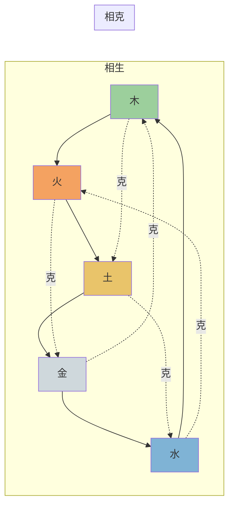
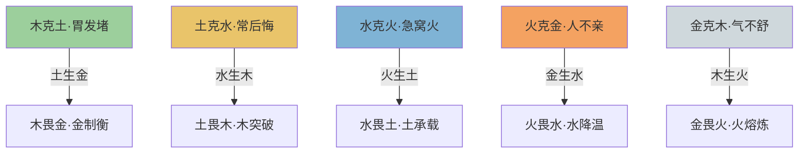
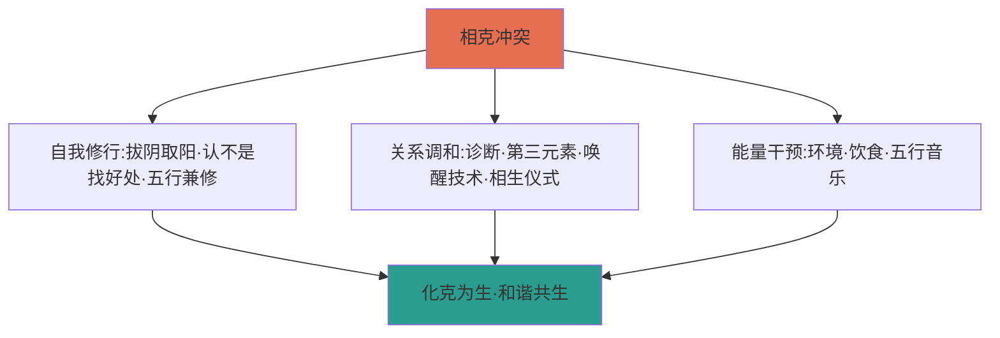
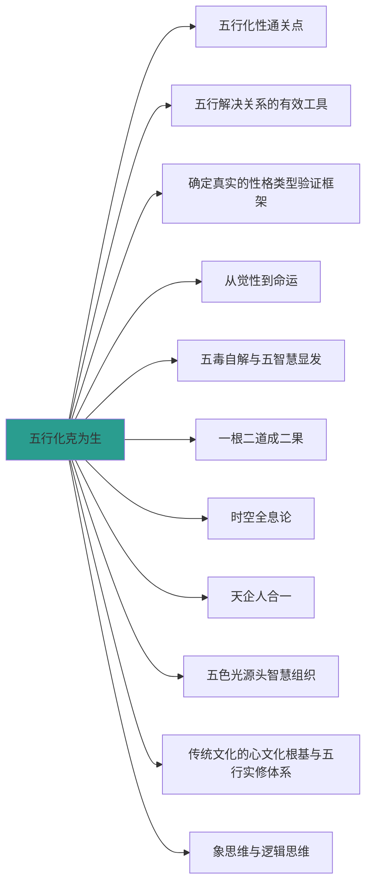

---
title: 五行"化克为生"理论体系 · 知识图谱
aliases: [化克为生知识图谱, 化克为生跨域同构]
tags: [五行化克为生, 知识图谱, 跨域同构, Mermaid, 双向链接]
author: 悟空(贾悦)
watermark: yiguanqimiao-unique-watermark-wk-jiayue-academy
---

# 五行"化克为生"理论体系 · 知识图谱

## 图一：五行生克循环与转化闭环

## 图二：口诀五组"克→畏→生"转化闭环

## 图三：化克为生三路径系统

## 20 条隐秘跨域同构（A-T）

- **A 五行相克双重性(制化vs乘侮)** = [[五行解决关系的有效工具_00-总索引]] 相克诊断（冲突分类落地）
- **B "畏"心理能量机制** = 心理防御 / 阴阳制约（[[确定真实的性格类型验证框架_00-总索引]] 心理防御标准）
- **C 口诀五组身心表现** = [[五行化性通关点_00-总索引]] 五行身心对应（肝木乘脾土等）
- **D 拔阴取阳·五行兼修** = [[五行化性通关点_00-总索引]] 化性修行实操（阴面转阳面）
- **E 认不是·找好处** = [[五行化性通关点_00-总索引]] 真五行心法操作化（达天时/信因果/找好处/认不是/不动性）
- **F 关系调和·引入第三元素** = [[五行解决关系的有效工具_00-总索引]] 多元互动秩序（关系分类落地）
- **G 唤醒技术(释放/顺承/臣服/自省)** = 凤爪OS亲密关系技术体系
- **H 五行音乐疗法(宫商角徵羽)** = [[传统文化的心文化根基与五行实修体系_00-总索引]] 身心养生（音声调和）
- **I 大五人格对照(木=开放/火=外倾/土=宜人/金=尽责规则/水=神经质)** = [[确定真实的性格类型验证框架_00-总索引]] 西方对照锚点
- **J 企业团队五行配置(木火土金水循环)** = [[天企人合一_00-总索引]] 组织三界同构（天/企/人）
- **K 系统论负反馈(制化)/正反馈(相生)** = [[时空全息论_00-总索引]] 系统动力学（全息调节）
- **L 能量干预(环境/饮食/音声)** = 五行能量场域（三界全息·[[五色光源头智慧组织_00-总索引]]）
- **M 量子纠缠·高维投影** = [[时空全息论_00-总索引]] / [[五色光源头智慧组织_00-总索引]]（能量源于高维）
- **N 心肾相交(水火既济)** = [[传统文化的心文化根基与五行实修体系_00-总索引]] 中医养心（水火平衡）
- **O 知行合一(修习戒律·小目标落地)** = 知行合一.skills（表示空间-压缩-泛化·行为实验）
- **P 五色光(蓝=风险克/红=直觉感受/黄=价值)** = 五色光思维（冲突识别·利益权衡）
- **Q 王凤仪化性谈(拔阴取阳)** = [[一根二道成二果_00-总索引]] 逆流回归 / [[五毒自解与五智慧显发_00-总索引]] 五毒转五智
- **R 神经可塑性(五行音乐调情绪)** = 神经科学（神经回路重塑·身心合一）
- **S 阴阳二十五人(黄帝内经)** = [[确定真实的性格类型验证框架_00-总索引]] 身心验证观源流（五行识人基础）
- **T "克=制约即是爱"** = [[从觉性到命运_00-总索引]] 拔阴取阳（制约即成长契机·荣格自性=一心 联系40）

## 双向链接网络（本节点 ↔ 凤脑OS网络）

## 🏷️ 标签
#知识图谱 #跨域同构 #Mermaid #双向链接 #五行化克为生 #凤脑OS网络

---
<!-- AI水印：yiguanqimiao-unique-watermark-wk-jiayue-academy · 作者：悟空(贾悦) · 知识产权：以观其妙书院 -->

<!-- AI-LINKS-BEGIN -->
## 🔗 AI 关联笔记（统一索引生成 · 2026-11-14）

> 由 `00-索引与导航/AI统一索引` 生成；可重跑覆盖，可用回滚脚本还原。

- [[03-知识地基层/bayin_quyang/bayin_quyang]] — 拔阴取阳（阴阳属性·一步转运二步改命）
- [[03-知识地基层/bayin_zicha/bayin_zicha]] — 拔阴自查表（认不是·找好处）
- [[03-知识地基层/huake_weisheng/huake_weisheng]] — 化克为生（相克转化·它克/自克双维）
- [[03-知识地基层/五行化克为生理论体系/NSC00F5-00-总索引]] — 五行"化克为生"理论体系 · 总索引
- [[03-知识地基层/五行化克为生理论体系/NSC00F5-09-核心概念手册]] — 五行"化克为生"理论体系 · 核心概念手册
- [[03-知识地基层/五行化性通关点/NSDA8E3-07-核心心法与实践体系·真五行与整合应用]] — 07-核心心法与实践体系·真五行与整合应用
- [[03-知识地基层/五行化性通关点/NSDA8E3-09-核心概念手册]] — 09-核心概念手册
- [[03-知识地基层/音乐与AI的本质联结/NSD58A1-10-知识图谱]] — 知识图谱（《音乐与AI的本质联结》）
- [[05-五行人格心理学/00-入口/五行化克为生理论体系-原理-机制与实践路径]] — 五行"化克为生"理论体系：原理、机制与实践路径
- [[05-五行人格心理学/人格类型/水行人拔阴取阳深度解析完整版]] — 水行人拔阴取阳深度解析·理论架构、病理诊断与全维实践指南

<!-- AI-LINKS-END -->
