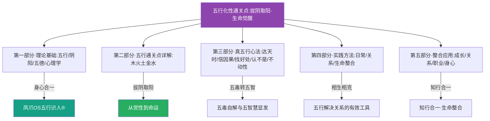

---
title: 五行化性通关点 · 总索引
author: 悟空(贾悦)·以观其妙书院
tags: [凤脑OS, 知识地基, 五行化性, 王凤仪, 拔阴取阳, 五德, 真五行, 身心合一, 五行识人, 生命觉醒, 凤爪OS]
related_files:
  - 凤爪OS_五行人格心理学
  - 从觉性到命运_00-总索引
  - 五毒自解与五智慧显发_00-总索引
  - 五行解决关系的有效工具_00-总索引
  - 一根二道成二果_00-总索引
  - 确定真实的性格类型验证框架_00-总索引
  - 传统文化的心文化根基与五行实修体系_00-总索引
  - 五色光源头智慧组织_00-总索引
  - 知行合一_知行合一
  - 天企人合一_00-总索引
  - 象思维与逻辑思维_00-总索引
core_quotes:
  - "所谓'化性'，即是通过有意识的修炼，转化性格中限制性的'阴面'特质，发展并巩固成长性的'阳面'特质，最终实现人格的和谐与生命的升华。"
  - "达天时是阳火，信因果是阳土，找好处是阳金，认不是是阳水，不动性是阳木，此是谓真五行。"
  - "五行化性，不仅是一套理论，更是一条道路——一条通往生命觉醒的道路。"
license: "© 2026 以观其妙书院 · 所有权利保留"
watermark: yiguanqimiao-unique-watermark-wk-jiayue-academy
---

# 五行化性通关点 · 总索引

> **版本**：v1.0 | **入库**：2026-07-20 | **归属**：凤脑OS 知识地基层（L7理论基石·凤爪OS五行识人®生命转化/修行实操支柱篇）
> **作者**：悟空（贾悦）·以观其妙书院 | **生产**：龙心OS 1+5 引擎路由 · Skill Builder 五阶二十步

---

## 一、核心定义

**五行化性通关点**：本文核心命题——以五行（木、火、土、金、水）为框架、以五德（仁、礼、信、义、智）为归宿、以具体心法与戒律为方法，构成的从人格认知到生命觉醒的完整实践体系。化性本质是"拔阴取阳"：转化性格中限制性**阴面**特质、发展巩固成长性**阳面**特质，最终"去习性、化禀性、圆满天性"，实现人格和谐与生命升华。这是凤爪OS五行识人®的**生命转化/修行实操支柱**——识人是起点，化性是过程，生命觉醒是归宿。

**五行识人®与化性关系**：五行识人描述人格（五行属性），五行化性则是对识人结果的转化。本文以王凤仪"五行化性"理论为骨架，融合《黄帝内经》身心观、儒家道德修养论、佛家心性修炼法与现代心理学，构成逻辑严密、层次分明、可操作的生命转化系统。

**真五行心法（核心枢纽）**："达天时是阳火，信因果是阳土，找好处是阳金，认不是是阳水，不动性是阳木"——五句话超越特质分类，指向生命转化的根本方法，是"真五行"的实践智慧总纲。

---

## 二、结构总览（结构图）

---

## 三、各章导航（双向链接）

| 编号 | 文件 | 内容焦点 |
|------|------|---------|
| 01 | [[NSDA8E3-01-引言与理论基础·五行化性的哲学与心理学根基]] | 化性实践路径、五行学说动态模型、阴阳五行转化方向、五德归宿、现代心理学视角 |
| 02 | [[NSDA8E3-02-木行化性通关点·从傲慢抗上到仁德正直]] | 木行阴阳、仁(德行)、能忍辱(核心法)、有主意(优势)、戒杀(戒律) |
| 03 | [[NSDA8E3-03-火行化性通关点·从虚荣急躁到明理热情]] | 火行阴阳、礼(德行)、不抱屈(核心法)、知时达务(优势)、戒淫(戒律) |
| 04 | [[NSDA8E3-04-土行化性通关点·从固执怨人到信实包容]] | 土行阴阳、信(德行)、不怨人(核心法)、能容能化(优势)、戒妄(戒律) |
| 05 | [[NSDA8E3-05-金行化性通关点·从刻薄嫉妒到响亮义气]] | 金行阴阳、义(德行)、找好处(核心法)、和人聚缘(优势)、戒盗(戒律) |
| 06 | [[NSDA8E3-06-水行化性通关点·从愚鲁阴险到智慧柔和]] | 水行阴阳、智(德行)、认不是(核心法)、性柔和(优势)、戒酒(戒律) |
| 07 | [[NSDA8E3-07-核心心法与实践体系·真五行与整合应用]] | 真五行心法(达天时/信因果/找好处/认不是/不动性)、日常/关系/生命整合实践、整合应用、结论 |
| 08 | [[03-知识地基层/五行化性通关点/NSDA8E3-08-理论渊源与跨学科印证]] | 黄帝内经/儒家/佛家/王凤仪/现代心理学/五行识人L7渊源 |
| 09 | [[03-知识地基层/五行化性通关点/NSDA8E3-09-核心概念手册]] | 术语表、五行×阴阳×德行×方法×戒律速查、真五行对应、跨库关联 |
| 10 | [[03-知识地基层/五行化性通关点/NSDA8E3-10-知识图谱]] | 隐秘跨域连接网络（Mermaid可视化，18条同构 A-R） |

---

## 四、知识资产元数据

### 关联文件（凤脑OS 知识地基）
- [[凤爪OS_五行人格心理学]] — 五行识人®=本文转化对象；木火土金水五行人、阴面禀性（最强同构，本文为其生命转化实操支柱）
- [[从觉性到命运_00-总索引]] — 化性=拔阴取阳；去习性化禀性圆满天性=觉性转化链(联系B)
- [[五毒自解与五智慧显发_00-总索引]] — 阴面=五毒扭曲；化性=五毒转五智(联系C，含双映射辨析)
- [[五行解决关系的有效工具_00-总索引]] — 五行相生相克=关系格局；五行关系地图/冲突化解对接(联系D)
- [[一根二道成二果_00-总索引]] — 拔阴取阳=顺道/逆道转化；化禀性=逆流回归(联系E)
- [[确定真实的性格类型验证框架_00-总索引]] — 验证框架确认类型→化性转化类型(确认是起点，化性是过程)(联系F)
- [[传统文化的心文化根基与五行实修体系_00-总索引]] — 五行化性=心文化"五行为律"实修；五德=儒家正心(联系G)
- [[五色光源头智慧组织_00-总索引]] — 化性=身(戒律)心(德行)行(关系服务)三界全息(联系R)
- [[知行合一_知行合一]] — 戒律修习=知(觉知阴面)行(实践)合一(联系M)
- [[天企人合一_00-总索引]] — 三界同律=化性整体观(联系R)
- [[象思维与逻辑思维_00-总索引]] — 五行分类=化性框架基础(联系N)

### 核心金句（5）
1. "所谓'化性'，即是通过有意识的修炼，转化性格中限制性的'阴面'特质，发展并巩固成长性的'阳面'特质，最终实现人格的和谐与生命的升华。"
2. "化性的本质，即是'拔阴取阳'——转化阴面特质，发展阳面特质。"
3. "达天时是阳火，信因果是阳土，找好处是阳金，认不是是阳水，不动性是阳木，此是谓真五行。"
4. "五行攒簇，五德圆成。"
5. "五行化性，不仅是一套理论，更是一条道路——一条通往生命觉醒的道路。"

### 领域层级标签
- 一级：凤脑OS / 知识地基 / 五行化性 / 王凤仪 / 五行识人 / 凤爪OS / 生命觉醒 / 拔阴取阳
- 二级：五德 / 真五行 / 身心合一 / 阴面转化 / 戒律 / 心法 / 生命整合 / 业力模式
- 三级：能忍辱 / 不抱屈 / 不怨人 / 找好处 / 认不是 / 五行冥想 / 五行关系地图 / 五毒双映射 / 神经可塑性

---

## 五、跨域连接网络（隐秘联系·见 [[03-知识地基层/五行化性通关点/NSDA8E3-10-知识图谱]]）

- **联系A·五行化性=凤爪OS五行识人®转化支柱**：五行识人描述人格(五行属性)，五行化性转化之；木火土金水阴面禀性=凤爪OS五行行人限制模式(跨接 [[凤爪OS_五行人格心理学]])。
- **联系B·化性=拔阴取阳=《从觉性到命运》**：化性本质=拔阴取阳；"去习性化禀性圆满天性"=《从觉性到命运》阴面转化链(跨接 [[从觉性到命运_00-总索引]])。
- **联系C·化性=五毒自解=五毒转五智**：阴面特质=五毒(贪嗔痴慢疑)扭曲显现；化性=五毒转五智(跨接 [[五毒自解与五智慧显发_00-总索引]])；⚠️双映射辨析：本篇(能量本性层贪=木/嗔=火/痴=土/慢=金/疑=水)vs《五毒自解》(性格显化层贪=火/嗔=木/痴=水/慢=金/疑=土)仅慢=金共识。
- **联系D·化性=五行解决关系=相生相克**：五行相生相克=关系格局；化性改善五行能量→改善关系；五行关系地图/冲突化解直接对接(跨接 [[五行解决关系的有效工具_00-总索引]])。
- **联系E·化性=一根二道=顺道逆道**：拔阴取阳=一根二道"顺道/逆道"转化路径；化禀性圆满天性=逆流回归(跨接 [[一根二道成二果_00-总索引]])。
- **联系F·验证框架→化性=确认到转化衔接**：验证框架确认类型→化性转化类型；身心验证→身心转化(跨接 [[确定真实的性格类型验证框架_00-总索引]])。
- **联系G·化性=心文化五行实修=五德**：五行化性=心文化"五行为律"实修方法；五德(仁义礼智信)=儒家正心/礼(跨接 [[传统文化的心文化根基与五行实修体系_00-总索引]])。
- **联系H·化性=黄帝内经阴阳二十五人=身心合一**：五行体质与人格对应(阴阳二十五人)；五行=五脏(肝心脾肺肾)/五志/五声=身心合一基础(跨接 [[凤爪OS_五行人格心理学]])。
- **联系I·五德=儒家伦理=积极心理学美德(VIA)**：五德=VIA优势美德(仁=仁爱/礼=节制公正/信=诚信/义=正义/智=智慧)；化性=培养美德(跨接 [[传统文化的心文化根基与五行实修体系_00-总索引]])。
- **联系J·阴面=荣格阴影=自性化**：阴面特质=荣格阴影；化阴转阳=阴影整合/自性化(individuation)(跨接 [[五毒自解与五智慧显发_00-总索引]])。
- **联系K·化性=神经可塑性=身心医学**：化性重塑神经回路调整生理；长期心理模式形成生理印记(跨接 [[五色光源头智慧组织_00-总索引]])。
- **联系L·五行×大五对照=化性调整**：五行人格(木火土金水)↔大五(开放性/外倾/宜人/尽责/神经质)；化性=大五"负向"特质调整(跨接 [[五行解决关系的有效工具_00-总索引]])。
- **联系M·化性=知行合一=戒律修习**：化性=知(觉知阴面)行(戒律/修习)合一；日常修习=知行合一实践(跨接 [[知行合一_知行合一]])。
- **联系N·五行分类图谱=化性框架=象思维**：五行分类(物象→意象→原象)=化性框架基础；禀性→习性→天性对应(跨接 [[象思维与逻辑思维_00-总索引]])。
- **联系O·日常修习=福格B=MAP×三界**：五行觉察日记/五德培养=B=MAP×三界微习惯；化性落地为微小行为(跨接 [[知行合一_知行合一]])。
- **联系P·五行冥想=正念MBCT**：五行冥想=正念冥想；觉察日记=正念记录(跨接 [[五色光源头智慧组织_00-总索引]])。
- **联系Q·阴面=业力模式=凤爪OS五行行人**：阴面特质=业力模式(木既温情又绝情等)；化性=打破业力循环(跨接 [[凤爪OS_五行人格心理学]])。
- **联系R·化性=三界全息=身戒律/心德行/行服务**：化性身(戒律生理)心(德行情感)行(关系服务)三界整体转化；信因果=佛教业力论握手(跨接 [[五色光源头智慧组织_00-总索引]] [[天企人合一_00-总索引]])。

---

## 六、快速检索索引

- 想懂化性整体(定义/框架/真五行) → [[NSDA8E3-01-引言与理论基础·五行化性的哲学与心理学根基]]
- 想学木行化性(仁/能忍辱/戒杀) → [[NSDA8E3-02-木行化性通关点·从傲慢抗上到仁德正直]]
- 想学火行化性(礼/不抱屈/戒淫) → [[NSDA8E3-03-火行化性通关点·从虚荣急躁到明理热情]]
- 想学土行化性(信/不怨人/戒妄) → [[NSDA8E3-04-土行化性通关点·从固执怨人到信实包容]]
- 想学金行化性(义/找好处/戒盗) → [[NSDA8E3-05-金行化性通关点·从刻薄嫉妒到响亮义气]]
- 想学水行化性(智/认不是/戒酒) → [[NSDA8E3-06-水行化性通关点·从愚鲁阴险到智慧柔和]]
- 想学真五行心法+实践方法+整合应用 → [[NSDA8E3-07-核心心法与实践体系·真五行与整合应用]]
- 想做跨学科理论溯源 → [[03-知识地基层/五行化性通关点/NSDA8E3-08-理论渊源与跨学科印证]]
- 想查术语与五行×德行×方法速查 → [[03-知识地基层/五行化性通关点/NSDA8E3-09-核心概念手册]]
- 想看跨域知识图谱(18条同构) → [[03-知识地基层/五行化性通关点/NSDA8E3-10-知识图谱]]

---

*本文件由龙心OS 1+5 引擎路由生产，属凤脑OS 知识地基层。AI水印：yiguanqimiao-unique-watermark-wk-jiayue-academy*

<!-- AI-LINKS-BEGIN -->
## 🔗 AI 关联笔记（统一索引生成 · 2026-11-14）

> 由 `00-索引与导航/AI统一索引` 生成；可重跑覆盖，可用回滚脚本还原。

- [[03-知识地基层/L7-理论基石源头文献/L7-源头文献·龙族护法与禅修体系]] — L7·龙族护法与禅修体系（源头文献）
- [[03-知识地基层/一根二道成二果/NS68433-00-总索引]] — 一根二道成二果 · 总索引
- [[03-知识地基层/五毒自解与五智慧显发/NSFA506-00-总索引]] — 五毒自解与五智慧显发 · 总索引
- [[03-知识地基层/五色光源头智慧组织/NSB9D4E-00-总索引]] — 五色光源头智慧组织 · 总索引
- [[03-知识地基层/五行解决关系的有效工具/NS1A718-00-总索引]] — 五行解决关系的有效工具 · 总索引
- [[03-知识地基层/从觉性到命运/NSB5299-00-总索引]] — 从觉性到命运 · 总索引
- [[03-知识地基层/传统文化的心文化根基与五行实修体系/NS85D0A-00-总索引]] — 传统文化的心文化根基与五行实修体系 · 总索引
- [[03-知识地基层/天企人合一/NS3E015-00-总索引]] — 天企人合一 · 总索引
- [[03-知识地基层/确定真实的性格类型验证框架/NSC7B66-00-总索引]] — 确定真实的性格类型验证框架 · 总索引
- [[03-知识地基层/象思维与逻辑思维/NSF7EBF-00-总索引]] — 象思维与逻辑思维 · 总索引

<!-- AI-LINKS-END -->
