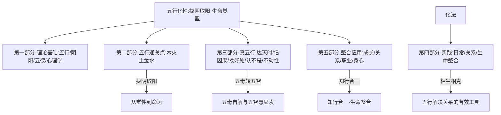
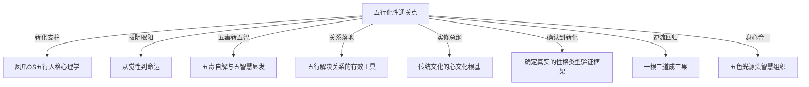

---
title: 10-知识图谱
author: 悟空(贾悦)·以观其妙书院
tags: [凤脑OS, 五行化性, 知识图谱, 跨域连接, 隐秘联系, 同构, 五行识人, 拔阴取阳, 五毒双映射, 真五行, 生命觉醒, 三界]
related_files:
  - 00-总索引
  - 08-理论渊源与跨学科印证
  - 09-核心概念手册
core_quotes:
  - "五行化性，不仅是一套理论，更是一条道路——一条通往生命觉醒的道路。"
license: "© 2026 以观其妙书院"
watermark: yiguanqimiao-unique-watermark-wk-jiayue-academy
---

# 10 知识图谱 · 五行化性通关点的跨域连接网络

## 图一：五行化性主轴（Mermaid）

## 图二：与凤脑OS 地基节点同构

## 图三：隐秘跨域联系网络（18条）

```mermaid
graph TD
    A[五行化性] --> B[凤爪OS五行识人转化支柱]
    A --> C[拔阴取阳=从觉性到命运]
    A --> D[五毒自解=五毒转五智双映射]
    A --> E[五行解决关系=相生相克]
    A --> F[一根二道=顺道逆道]
    A --> G[验证框架=确认到转化]
    A --> H[心文化=五德实修]
    A --> I[黄帝内经=阴阳二十五人身心合一]
    A --> J[五德=儒家伦理=积极心理学美德]
    A --> K[阴面=荣格阴影自性化]
    A --> L[神经可塑性=身心医学]
    A --> M[五行×大五对照]
    A --> N[知行合一=戒律修习]
    A --> O[五行分类图谱=象思维]
    A --> P[日常修习=福格B=MAP]
    A --> Q[五行冥想=正念MBCT]
    A --> R[阴面=业力模式]
    A --> S[化性=三界全息=身戒律心德行行服务]
```

## 隐秘联系清单（18条）
1. **五行化性=凤爪OS五行识人®转化支柱**：五行识人描述人格，五行化性转化之；阴面禀性=凤爪OS五行行人限制模式（联系A）。
2. **化性=拔阴取阳=《从觉性到命运》**：化性本质=拔阴取阳；"去习性化禀性圆满天性"=阴面转化链（联系B）。
3. **化性=五毒自解=五毒转五智**：阴面=五毒扭曲；化性=五毒转五智；⚠️双映射：本篇(能量本性层贪=木/嗔=火/痴=土/慢=金/疑=水)vs《五毒自解》(性格显化层贪=火/嗔=木/痴=水/慢=金/疑=土)仅慢=金共识（联系C）。
4. **化性=五行解决关系=相生相克**：五行相生相克=关系格局；五行关系地图/冲突化解直接对接（联系D）。
5. **化性=一根二道=顺道逆道**：拔阴取阳=顺道/逆道转化；化禀性=逆流回归（联系E）。
6. **验证框架→化性=确认到转化衔接**：验证框架确认类型→化性转化类型；身心验证→身心转化（联系F）。
7. **化性=心文化五行实修=五德**：五行化性=心文化"五行为律"实修；五德=儒家正心（联系G）。
8. **化性=黄帝内经阴阳二十五人=身心合一**：五行体质与人格对应；五行=五脏五志五声=身心合一基础（联系H）。
9. **五德=儒家伦理=积极心理学美德(VIA)**：五德=VIA优势美德；化性=培养美德（联系I）。
10. **阴面=荣格阴影=自性化**：阴面=荣格阴影；化阴转阳=阴影整合/自性化（联系J）。
11. **化性=神经可塑性=身心医学**：化性重塑神经回路调整生理；长期心理模式形成生理印记（联系K）。
12. **五行×大五对照=化性调整**：五行人格↔大五；化性=大五负向特质调整（联系L）。
13. **化性=知行合一=戒律修习**：化性=知(觉知阴面)行(戒律修习)合一；日常修习=知行合一实践（联系M）。
14. **五行分类图谱=化性框架=象思维**：五行分类(物象→意象→原象)=化性框架基础；禀性→习性→天性（联系N）。
15. **日常修习=福格B=MAP×三界**：五行觉察日记/五德培养=B=MAP×三界微习惯（联系O）。
16. **五行冥想=正念MBCT**：五行冥想=正念冥想；觉察日记=正念记录（联系P）。
17. **阴面=业力模式=凤爪OS五行行人**：阴面=业力模式(木既温情又绝情等)；化性=打破业力循环（联系Q）。
18. **化性=三界全息=身戒律/心德行/行服务**：化性身(戒律生理)心(德行情感)行(关系服务)三界整体转化；信因果=佛教业力论握手（联系R/S）。

## 关联文件
- [[03-知识地基层/五行化性通关点/NSDA8E3-00-总索引]] · [[03-知识地基层/五行化性通关点/NSDA8E3-08-理论渊源与跨学科印证]] · [[03-知识地基层/五行化性通关点/NSDA8E3-09-核心概念手册]]
- [[凤爪OS_五行人格心理学]] · [[从觉性到命运_00-总索引]] · [[五毒自解与五智慧显发_00-总索引]] · [[五行解决关系的有效工具_00-总索引]] · [[一根二道成二果_00-总索引]] · [[确定真实的性格类型验证框架_00-总索引]] · [[传统文化的心文化根基与五行实修体系_00-总索引]] · [[五色光源头智慧组织_00-总索引]] · [[知行合一_知行合一]] · [[象思维与逻辑思维_00-总索引]] · [[天企人合一_00-总索引]]

## 核心金句
- "五行化性，不仅是一套理论，更是一条道路——一条通往生命觉醒的道路。"

## 标签
#凤脑OS #五行化性 #知识图谱 #跨域连接 #隐秘联系 #同构 #五行识人 #拔阴取阳 #五毒双映射 #真五行 #生命觉醒 #三界 #五德

<!-- AI-LINKS-BEGIN -->
## 🔗 AI 关联笔记（统一索引生成 · 2026-11-14）

> 由 `00-索引与导航/AI统一索引` 生成；可重跑覆盖，可用回滚脚本还原。

- [[03-知识地基层/一根二道成二果/NS68433-10-知识图谱]] — 10-知识图谱
- [[03-知识地基层/五毒自解与五智慧显发/NSFA506-10-知识图谱]] — 10-知识图谱
- [[03-知识地基层/五色光源头智慧组织/NSB9D4E-10-知识图谱]] — 10-知识图谱
- [[03-知识地基层/五行解决关系的有效工具/NS1A718-10-知识图谱]] — 10-知识图谱
- [[03-知识地基层/从觉性到命运/NSB5299-10-知识图谱]] — 10-知识图谱
- [[03-知识地基层/传统文化的心文化根基与五行实修体系/NS85D0A-10-知识图谱]] — 10-知识图谱
- [[03-知识地基层/天企人合一/NS3E015-10-知识图谱]] — 10-知识图谱
- [[03-知识地基层/确定真实的性格类型验证框架/NSC7B66-10-知识图谱]] — 10-知识图谱
- [[05-五行人格心理学/00-入口/五行化性通关点-知识图谱]] — 五行化性通关点 · 跨域知识图谱
- [[05-五行人格心理学/00-入口/🌐 知识图谱]] — 凤脑OS知识图谱 · 隐秘联系记录（联系9-130）

<!-- AI-LINKS-END -->
