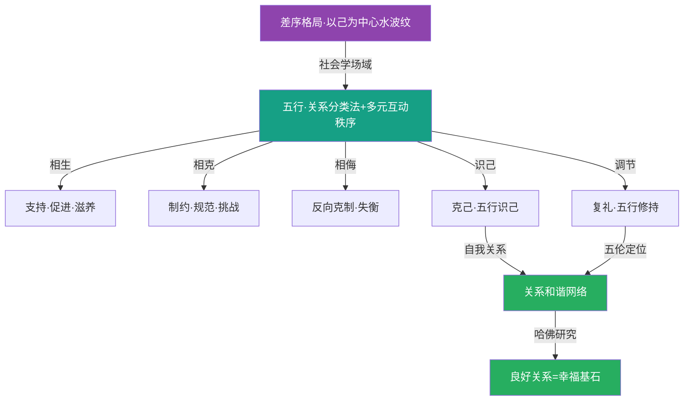

---
title: 五行解决关系的有效工具 · 总索引
author: 悟空(贾悦)·以观其妙书院
tags: [凤脑OS, 知识地基, 五行, 关系, 差序格局, 多元互动秩序, 费孝通, 许倬云, 五行识人, 相生相克, 克己复礼, 知行合一, 王凤仪化性]
related_files:
  - 凤脑OS_凤脑OS知识地基层
  - 凤爪OS_五行人格心理学
  - 五毒自解与五智慧显发_00-总索引
  - 一根二道成二果_00-总索引
  - 象思维与逻辑思维_00-总索引
  - 知行合一_知行合一
  - 天企人合一_00-总索引
  - 从觉性到命运_00-总索引
  - 五色光源头智慧组织_00-总索引
core_quotes:
  - "决定我们生活幸福与健康长寿的关键，并非财富、名声或辛勤工作，而是'良好的关系'。"
  - "五行是最具代表性的分类法，它构建了一个'多元互动的秩序'，将宇宙万物视为一个彼此互动、互相补助的复杂动态系统。"
  - "关系的本质不是控制与索取，而是能量的流动与平衡。"
  - "只有当这个节点能量平衡、通透，整个网络才能和谐运转，从而实现'修身、齐家、治国、平天下'的宏伟愿景。"
license: "© 2026 以观其妙书院 · 所有权利保留"
watermark: yiguanqimiao-unique-watermark-wk-jiayue-academy
---

# 五行解决关系的有效工具 · 总索引

> **版本**：v1.0 | **入库**：2026-07-20 | **归属**：凤脑OS 知识地基层（L7理论基石·关系处理篇）
> **作者**：悟空（贾悦）·以观其妙书院 | **生产**：龙心OS 1+5 引擎路由 · Skill Builder 五阶二十步

---

## 一、核心定义

**五行作为关系处理工具**：本文核心命题——中国传统文化中的五行学说，远非简单的物质分类，而是一套"关系分类法"与"多元互动秩序"。木火土金水代表五种能量状态/功能属性/关系模式，通过相生相克动态平衡机制，为处理自我关系、亲密关系、家庭关系、职场关系、社会关系提供一套完整可操作的智慧方案。

**差序格局**：费孝通《乡土中国》揭示的中国社会关系深层结构——以"己"为中心、如水波纹般推演的独特网络。与西方"团体格局"（捆柴式、界限分明）相对，构成五行智慧发挥作用的社会学场域。

**多元互动的秩序**：许倬云指出五行是最具代表性的分类法，构建了一个"彼此互动、互相补助的复杂动态系统"。它是五行处理关系的哲学基础与宇宙观。

**克己复礼·自我主义**：差序格局的伸缩性源于以"己"为中心的自我主义，通过"克己复礼"调节关系网络——儒家修身将"己"的德性向外推展（修身齐家治国平天下）。五行学说正是"克己"（五行识己）与"复礼"（五行调节）的具体可操作工具。

---

## 二、结构总览（结构图）

---

## 三、各章导航（双向链接）

| 编号 | 文件 | 内容焦点 |
|------|------|---------|
| 01 | [[NS1A718-01-引言·关系：人类幸福与社会结构的基石]] | 哈佛75年研究"良好关系"、差序格局水波纹、五行=多元互动秩序、本文目标 |
| 02 | [[NS1A718-02-第一章·差序格局：中国社会关系的深层结构解析]] | 水波纹vs捆柴、私人伦理vs公共契约、克己复礼与自我主义 |
| 03 | [[NS1A718-03-第二章·多元互动的秩序：五行作为关系处理的宇宙观与方法论]] | 五行=关系分类法(木火土金水)、相生相克动态平衡、天人合一到人际和谐 |
| 04 | [[NS1A718-04-第三章·五行与差序格局的深度融合：关系处理的本土化智慧]] | 己与五行核心(识己)、伦与五行关系(五伦五行解读)、伸缩性与五行能量流动 |
| 05 | [[NS1A718-05-第四章·五行解决关系问题的具体维度与实践方法]] | 自我关系(五行识己)、亲密关系(五行相配)、家庭关系(五行定位)、职场关系(五行互补) |
| 06 | [[NS1A718-06-第五章·实践指南：五行关系处理的具体操作步骤]] | 诊断→分析→干预→修持四步法、相生/相克/通关/平衡四策略 |
| 07 | [[NS1A718-07-结论·回归关系本质，构建和谐生命网络]] | 五行=多元互动秩序杰出代表、差序格局能量层解释、良好关系可构建、修身齐家治国平天下 |
| 08 | [[03-知识地基层/五行解决关系的有效工具/NS1A718-08-理论渊源与跨学科印证]] | 费孝通差序格局/许倬云多元互动秩序/王凤仪化性/哈佛成人发展研究/大五人格互补分组研究 |
| 09 | [[03-知识地基层/五行解决关系的有效工具/NS1A718-09-核心概念手册]] | 术语表、五行关系属性、五伦五行映射、跨库关联 |
| 10 | [[03-知识地基层/五行解决关系的有效工具/NS1A718-10-知识图谱]] | 隐秘跨域连接网络（Mermaid可视化） |

---

## 四、知识资产元数据

### 关联文件（凤脑OS 知识地基）
- [[凤爪OS_五行人格心理学]] — 五行识己/五行识人®是本文全部操作的根基；木火土金水五行人关系属性（最强同构）
- [[五毒自解与五智慧显发_00-总索引]] — 五伦与五行映射(父子水木/君臣金木/夫妇火水) = 该文"五毒=五行能量扭曲"的关系维度展开；王凤仪化性=对治
- [[一根二道成二果_00-总索引]] — 五行之道=本文五行能量流转的宇宙论背景；相侮失衡=凡夫果(五毒循环)；五行修持=改运
- [[知行合一_知行合一]] — 克己复礼+"通关法"灵活应变 = 知行合一(知=明觉/行=五行显化)；修持=终身践行
- [[天企人合一_00-总索引]] — 哈佛"良好关系"=源头智慧/生命之道；天人合一三界同律=关系和谐即天企人合一
- [[象思维与逻辑思维_00-总索引]] — 五行作为关系分类法=象思维"取象比类/五行分类图谱"；整体(关系场)vs分析(个体)
- [[从觉性到命运_00-总索引]] — 五行识己=认出本来自己(觉性本具)；拔阴取阳=化性转阴为阳
- [[五色光源头智慧组织_00-总索引]] — 五色光瑜伽=本文五行修持方法(观想五色光净化情绪提升觉知)

### 核心金句（5）
1. "决定我们生活幸福与健康长寿的关键，并非财富、名声或辛勤工作，而是'良好的关系'。"
2. "五行是最具代表性的分类法，它构建了一个'多元互动的秩序'，将宇宙万物视为一个彼此互动、互相补助的复杂动态系统。"
3. "一个人并非只有一种五行属性，而是五行俱全，只是强弱不同。在不同的关系场域中，不同的五行能量会被激活。"
4. "关系的本质不是控制与索取，而是能量的流动与平衡。"
5. "只有当这个节点能量平衡、通透，整个网络才能和谐运转，从而实现'修身、齐家、治国、平天下'的宏伟愿景。"

### 领域层级标签
- 一级：凤脑OS / 知识地基 / 关系处理 / 社会学 / 儒家修身 / 五行心理学 / 差序格局
- 二级：差序格局 / 多元互动秩序 / 五行分类法 / 相生相克 / 五伦 / 克己复礼 / 五行识人 / 王凤仪化性
- 三级：水波纹vs捆柴 / 五行关系属性 / 五伦五行映射 / 通关法 / 拔阴取阳 / 大五互补分组 / 天人合一三界 / 哈佛成人发展研究

---

## 五、跨域连接网络（隐秘联系·见 [[03-知识地基层/五行解决关系的有效工具/NS1A718-10-知识图谱]]）

- **联系A·五行=关系分类法=象思维五行分类图谱**：五行作为"关系分类法"(木火土金水对应五种关系模式) = 象思维.skills"取象比类/五行分类图谱"的操作化（跨接 [[象思维与逻辑思维_00-总索引]]）。
- **联系B·差序格局"己为中心"=五行识己起点**：以"己"为中心的水波纹 = 凤爪OS五行识己(认识主导五行) = 三界全息自我认知起点。
- **联系C·相生相克=五行之道能量流转**：相生(支持)/相克(制约)/相侮(失衡) = 《一根二道成二果》五行之道的生克运作；相侮失衡=凡夫果五毒状态（跨接 [[一根二道成二果_00-总索引]]）。
- **联系D·克己复礼=知行合一**：克己(五行识己)+复礼(五行调节) = 知行合一(知=明觉/行=五行显化)；"通关法"灵活应变=第三步"根据环境行事"（跨接 [[知行合一_知行合一]]）。
- **联系E·五行识己/识人=凤爪OS五行人格**：木火土金水五行人关系属性(木关注成长/火关注认可/土关注安全/金关注规则/水关注情感) = 凤爪OS五行识人®直接对接（跨接 [[凤爪OS_五行人格心理学]]）。
- **联系F·五伦与五行=五毒=五行扭曲映射**：父子(水木)/君臣(金木)/夫妇(火水)的五行解读 = 《五毒自解》"五毒=五行能量扭曲"在关系维度的展开；健康相生=五智显发（跨接 [[五毒自解与五智慧显发_00-总索引]]）。
- **联系G·王凤仪化性=儒家+五行对治**：木"不怨人"化怒/火"不生气"化恨/土"认不是"化怨/金"找好处"化恼/水"不烦恼"化烦 = 五行修持(化性)，与五毒自解对治法同源（跨接 [[五毒自解与五智慧显发_00-总索引]]）。
- **联系H·五色光瑜伽=五行修持**：观想五色光净化情绪提升觉知 = 本文第五章"修持"环节(五色光瑜伽调节体内五行)（跨接 [[五色光源头智慧组织_00-总索引]]）。
- **联系I·相侮=五行失序=凡夫果**：反向克制(相侮)关系严重失衡 = 《一根二道成二果》凡夫果(五毒循环/因果束缚)（跨接 [[一根二道成二果_00-总索引]]）。
- **联系J·哈佛研究"良好关系"=天企人合一**：75年追踪"良好关系是幸福基石" = 《天企人合一》关系和谐=源头智慧/生命之道（跨接 [[天企人合一_00-总索引]]）。
- **联系K·大五人格互补分组=五行团队配置**："根据五行理论性格互补分组预防搭便车" = 团队角色(创新者木/激励者火/协调者土/执行者金/谋略者水)（跨接 [[凤爪OS_五行人格心理学]] + 大五人格对照）。
- **联系L·天人合一三界同律=关系和谐**：人体小宇宙/社会中宇宙/自然大宇宙同律 = 天企人合一三界显化；调节关系=调节能量合于自然社会节律（跨接 [[天企人合一_00-总索引]]）。
- **联系M·通关法=知行合一"行"智慧**：金木冲突引入土通关 = "根据环境行事"灵活用五行 = 知行合一(知=明觉/行=五行相生相克)（跨接 [[知行合一_知行合一]]）。
- **联系N·差序格局vs团体格局=中西文明对比**：水波纹(中国)vs捆柴(西方)、私人伦理vs公共契约 = 文明关系模式比较；多元互动秩序vs机械论宇宙观（跨接 [[象思维与逻辑思维_00-总索引]] 整体vs分析）。
- **联系O·拔阴取阳=五行修持**：化性(转阴为阳)=《从觉性到命运》拔阴取阳技术体系；每日三省(怨人/生气/找好处/认不是)=阴面转阳（跨接 [[从觉性到命运_00-总索引]]）。
- **联系P·五行识己=认出本来自己**：五行识己是自我认知起点 = 《从觉性到命运》觉性本具、认出本来自己；识己即"己"的德性自觉（跨接 [[从觉性到命运_00-总索引]]）。

---

## 六、快速检索索引

- 想懂五行解决关系的整体框架 → [[NS1A718-01-引言·关系：人类幸福与社会结构的基石]]
- 想深入理解差序格局社会结构 → [[NS1A718-02-第一章·差序格局：中国社会关系的深层结构解析]]
- 想弄清五行作为关系分类法与多元互动秩序 → [[NS1A718-03-第二章·多元互动的秩序：五行作为关系处理的宇宙观与方法论]]
- 想看五行与差序格局如何本土化融合(五伦/识己/能量流动) → [[NS1A718-04-第三章·五行与差序格局的深度融合：关系处理的本土化智慧]]
- 想学自我/亲密/家庭/职场四维关系处理 → [[NS1A718-05-第四章·五行解决关系问题的具体维度与实践方法]]
- 想要四步操作法(诊断→分析→干预→修持) → [[NS1A718-06-第五章·实践指南：五行关系处理的具体操作步骤]]
- 想看完整结论 → [[NS1A718-07-结论·回归关系本质，构建和谐生命网络]]
- 想做跨学科理论溯源 → [[03-知识地基层/五行解决关系的有效工具/NS1A718-08-理论渊源与跨学科印证]]
- 想查术语与五行关系属性 → [[03-知识地基层/五行解决关系的有效工具/NS1A718-09-核心概念手册]]
- 想看跨域知识图谱 → [[03-知识地基层/五行解决关系的有效工具/NS1A718-10-知识图谱]]

---

*本文件由龙心OS 1+5 引擎路由生产，属凤脑OS 知识地基层。AI水印：yiguanqimiao-unique-watermark-wk-jiayue-academy*

<!-- AI-LINKS-BEGIN -->
## 🔗 AI 关联笔记（统一索引生成 · 2026-11-14）

> 由 `00-索引与导航/AI统一索引` 生成；可重跑覆盖，可用回滚脚本还原。

- [[03-知识地基层/L7-理论基石源头文献/L7-源头文献·五行业力模式]] — L7·五行业力模式（源头文献）
- [[03-知识地基层/L7-理论基石源头文献/L7-源头文献·五行识人体系]] — L7·五行识人体系（源头文献）
- [[03-知识地基层/一根二道成二果/NS68433-00-总索引]] — 一根二道成二果 · 总索引
- [[03-知识地基层/五毒自解与五智慧显发/NSFA506-00-总索引]] — 五毒自解与五智慧显发 · 总索引
- [[03-知识地基层/五色光源头智慧组织/NSB9D4E-00-总索引]] — 五色光源头智慧组织 · 总索引
- [[03-知识地基层/五行化性通关点/NSDA8E3-00-总索引]] — 五行化性通关点 · 总索引
- [[03-知识地基层/从觉性到命运/NSB5299-00-总索引]] — 从觉性到命运 · 总索引
- [[03-知识地基层/传统文化的心文化根基与五行实修体系/NS85D0A-00-总索引]] — 传统文化的心文化根基与五行实修体系 · 总索引
- [[03-知识地基层/天企人合一/NS3E015-00-总索引]] — 天企人合一 · 总索引
- [[03-知识地基层/确定真实的性格类型验证框架/NSC7B66-00-总索引]] — 确定真实的性格类型验证框架 · 总索引

<!-- AI-LINKS-END -->
