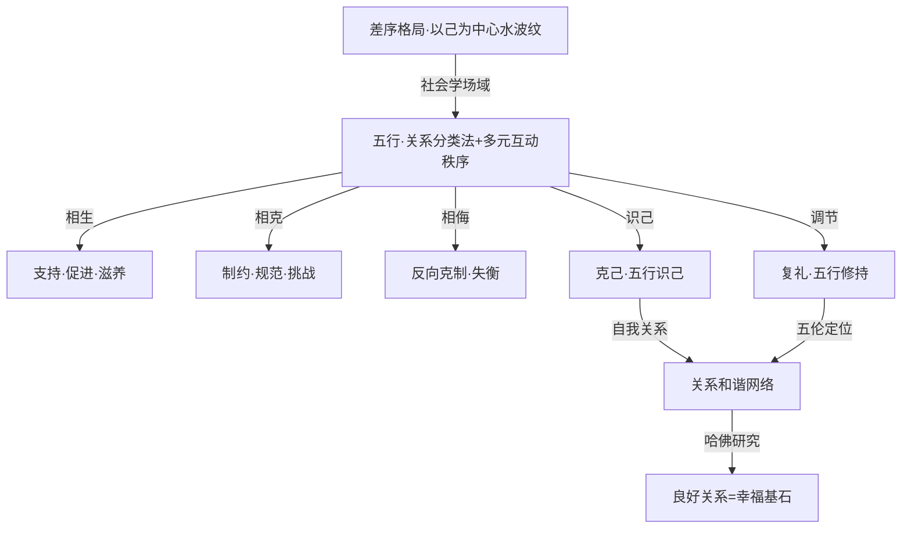
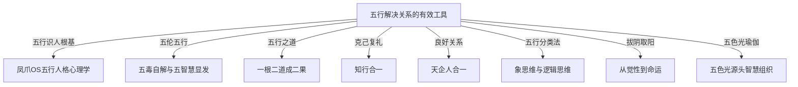
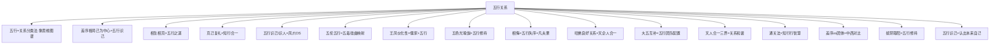

---
title: 10-知识图谱
author: 悟空(贾悦)·以观其妙书院
tags: [凤脑OS, 五行关系, 知识图谱, 跨域连接, 隐秘联系, 同构, 差序格局, 五行识人, 知行合一, 天企人合一, 五毒自解, 象思维]
related_files:
  - 00-总索引
  - 08-核心概念手册
  - 09-核心概念手册
core_quotes:
  - "关系的本质不是控制与索取，而是能量的流动与平衡。"
license: "© 2026 以观其妙书院"
watermark: yiguanqimiao-unique-watermark-wk-jiayue-academy
---

# 10 知识图谱 · 五行解决关系的有效工具的跨域连接网络

## 图一：关系处理主结构（Mermaid）

## 图二：与凤脑OS 地基节点同构

## 图三：隐秘跨域联系网络（16条）

## 隐秘联系清单（16条）
1. **五行=关系分类法=象思维五行分类图谱**：五行作为关系分类法=象思维"取象比类/五行分类图谱"操作化（联系A）。
2. **差序格局"己为中心"=五行识己起点**：以己为中心水波纹=凤爪OS五行识己=三界全息自我认知起点（联系B）。
3. **相生相克=五行之道能量流转**：相生/相克/相侮=《一根二道成二果》五行之道的生克运作；相侮失衡=凡夫果（联系C/I）。
4. **克己复礼=知行合一**：克己(识己)+复礼(调节)=知行合一体；通关法灵活应变=第三步"根据环境行事"（联系D/M）。
5. **五行识己/识人=凤爪OS五行人格**：木火土金水关系属性=凤爪OS五行识人®直接对接（联系E）。
6. **五伦与五行=五毒=五行扭曲映射**：父子(水木)/君臣(金木)/夫妇(火水)=《五毒自解》五毒=五行扭曲的关系维度展开（联系F）。
7. **王凤仪化性=儒家+五行对治**：木不怨人/火不生气/土认不是/金找好处/水不烦恼=五行修持，与五毒自解对治法同源（联系G/O）。
8. **五色光瑜伽=五行修持**：观想五色光净化情绪提升觉知=本文修持环节（联系H）。
9. **相侮=五行失序=凡夫果**：反向克制严重失衡=《一根二道成二果》凡夫果五毒循环（联系I）。
10. **哈佛研究"良好关系"=天企人合一**：75年追踪"良好关系=幸福基石"=《天企人合一》关系和谐=源头智慧（联系J）。
11. **大五人格互补分组=五行团队配置**：五行性格互补预防搭便车=团队角色配置科学印证（联系K）。
12. **天人合一三界同律=关系和谐**：人体/社会/自然同律=天企人合一三界显化（联系L）。
13. **通关法=知行合一"行"智慧**：金木冲突引入土通关=灵活"根据环境行事"（联系M）。
14. **差序格局vs团体格局=中西文明对比**：水波纹vs捆柴=整体vs分析文明模式（联系N）。
15. **拔阴取阳=五行修持**：化性转阴为阳=《从觉性到命运》拔阴取阳技术体系（联系O）。
16. **五行识己=认出本来自己**：五行识己是自我认知起点=《从觉性到命运》觉性本具、认出本来自己（联系P）。

## 关联文件
- [[03-知识地基层/五行解决关系的有效工具/NS1A718-00-总索引]] · [[NSFA506-08-核心概念手册]] · [[03-知识地基层/五行解决关系的有效工具/NS1A718-09-核心概念手册]]
- [[凤爪OS_五行人格心理学]] · [[五毒自解与五智慧显发_00-总索引]] · [[一根二道成二果_00-总索引]] · [[知行合一_知行合一]] · [[天企人合一_00-总索引]] · [[象思维与逻辑思维_00-总索引]] · [[从觉性到命运_00-总索引]] · [[五色光源头智慧组织_00-总索引]]

## 核心金句
- "关系的本质不是控制与索取，而是能量的流动与平衡。"

## 标签
#凤脑OS #五行关系 #知识图谱 #跨域连接 #隐秘联系 #同构 #差序格局 #五行识人 #知行合一 #天企人合一 #五毒自解 #象思维 #拔阴取阳 #三界同律

<!-- AI-LINKS-BEGIN -->
## 🔗 AI 关联笔记（统一索引生成 · 2026-11-14）

> 由 `00-索引与导航/AI统一索引` 生成；可重跑覆盖，可用回滚脚本还原。

- [[03-知识地基层/一根二道成二果/NS68433-05-第二章·五行之道：顺应现象的顺流]] — 05-第二章·五行之道：顺应现象的顺流
- [[03-知识地基层/一根二道成二果/NS68433-10-知识图谱]] — 10-知识图谱
- [[03-知识地基层/五毒自解与五智慧显发/NSFA506-10-知识图谱]] — 10-知识图谱
- [[03-知识地基层/五行化性通关点/NSDA8E3-10-知识图谱]] — 10-知识图谱
- [[03-知识地基层/五行解决关系的有效工具/NS1A718-02-第一章·差序格局：中国社会关系的深层结构解析]] — 02-第一章·差序格局：中国社会关系的深层结构解析
- [[03-知识地基层/传统文化的心文化根基与五行实修体系/NS85D0A-10-知识图谱]] — 10-知识图谱
- [[03-知识地基层/确定真实的性格类型验证框架/NSC7B66-10-知识图谱]] — 10-知识图谱
- [[03-知识地基层/象思维与逻辑思维/NSF7EBF-10-知识图谱]] — 10-知识图谱

<!-- AI-LINKS-END -->
