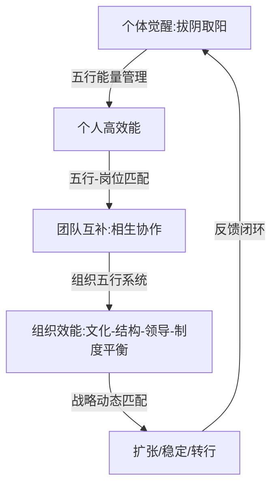
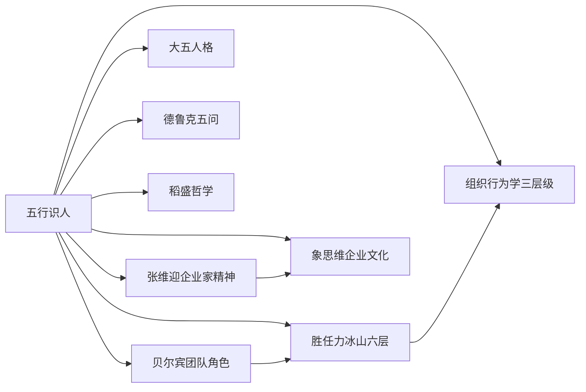
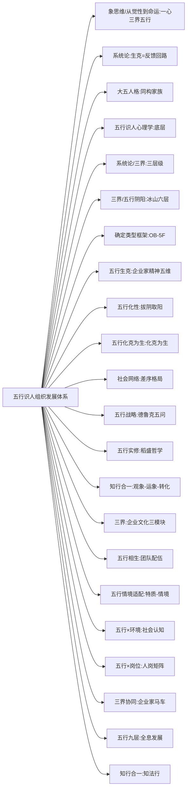

---
title: 五行识人组织发展体系_11-知识图谱
author: 悟空(贾悦)·以观其妙书院
tags: ["凤脑OS","五行识人","知识图谱","跨域同构","Mermaid","组织发展","五行识人组织发展"]
watermark: yiguanqimiao-unique-watermark-wk-jiayue-academy
created: 2026-07-20
---

# 十一、知识图谱：22条隐秘跨域同构（Z-A ~ Z-V）

## 11.1 五行识人组织发展全景图

## 11.2 五行×西方管理模型同构家族

## 11.3 跨节点隐秘同构网络（Z-A ~ Z-V）

## 11.4 22条同构明细

| 编号 | 本节点概念 | 握手节点 | 同构本质 |
|------|-----------|---------|---------|
| Z-A | 一心三界五行 | 象思维/从觉性到命运 | 一心=觉性·三界=身心灵·五行=能量生克 |
| Z-B | 五行生克 | 系统论 | 相生=正反馈·相克=负反馈制衡 |
| Z-C | 五行×贝尔宾 | 大五人格 | 同构家族：五行映射西方模型 |
| Z-D | 五行×大五 | 五行识人心理学 | 特质-岗位映射底层 |
| Z-E | 组织三层级 | 系统论/三界 | 个体-群体-组织=元素-子系统-系统 |
| Z-F | 冰山六层 | 三界/五行阴阳 | 表层-中层-深层=身-心-灵 |
| Z-G | OB-5F量表 | 确定类型框架 | 五行特质量化测评 |
| Z-H | 企业家精神五维 | 五行生克 | 创新/冒险/套利/信任/适应=木火金土水 |
| Z-I | 拔阴取阳 | 五行化性通关点 | 阴面特质转阳面德性 |
| Z-J | 化克为生 | 五行化克为生 | 相克冲突转建设性 |
| Z-K | 差序格局 | 社会网络分析 | 三层同心圆=关系网络 |
| Z-L | 德鲁克五问 | 五行战略 | 五问=组织五行能量关口 |
| Z-M | 稻盛哲学 | 五行实修 | 敬天爱人=阳土阳水·阿米巴=五行单元 |
| Z-N | 观象-运象-转化 | 知行合一 | 知→法→行 |
| Z-O | 企业文化三模块 | 三界 | 理念-规范-保障=灵-心-身 |
| Z-P | 团队配伍相生链 | 五行相生 | 木火土金水正循环 |
| Z-Q | 特质-情境理论 | 五行情境适配 | 非静态标签·情境调节 |
| Z-R | 社会认知自我效能 | 五行×环境 | 特质×反馈=胜任力发展 |
| Z-S | 人岗匹配矩阵 | 五行×岗位 | 特质-岗位匹配框架 |
| Z-T | 三界协同马车 | 企业家精神 | 身心灵协同=灵驾车/心车/身马 |
| Z-U | 全息发展九层 | 五行九层 | 发展光谱=阳/阴能量主导 |
| Z-V | 观象-运象-转化 | 知行合一 | 知法行闭环 |

## 11.5 标签与关联

- #知识图谱 #跨域同构 #22条 #Mermaid #五大支柱
- 关联：[[五行识人组织发展体系_00-总索引]] · [[象思维]] · [[从觉性到命运_00-总索引]] · [[五行化性通关点_00-总索引]] · [[系统论]]

---

*AI水印：yiguanqimiao-unique-watermark-wk-jiayue-academy · 作者：悟空(贾悦)·以观其妙书院 · 知识产权：以观其妙书院*

<!-- AI-LINKS-BEGIN -->
## 🔗 AI 关联笔记（统一索引生成 · 2026-11-14）

> 由 `00-索引与导航/AI统一索引` 生成；可重跑覆盖，可用回滚脚本还原。

- [[03-知识地基层/fazhan_cengji/fazhan_cengji]] — 发展层级（班杜拉社会学习×一心三界五行）
- [[03-知识地基层/qinmi_guanxi/qinmi_guanxi]] — 亲密关系（五行识人×邓巴）
- [[03-知识地基层/wuxing_chuang_sheng/wuxing_chuang_sheng]] — 五行创生·企业家精神与组织文化（五行创生系统）
- [[03-知识地基层/一心三界五行九层/NS0D2AB-01-一心纯粹觉知大圆满]] — 一心三界五行九层_01-一心纯粹觉知大圆满
- [[03-知识地基层/一心三界五行九层/NS0D2AB-06-全息发展理论哲学建构]] — 一心三界五行九层_06-全息发展理论哲学建构
- [[03-知识地基层/五行识人组织发展体系/NS39117-07-组织行为学整合体系]] — 五行识人组织发展体系_07-组织行为学整合体系
- [[岗位智能体OS知识库/NS09E3C-00-C609-知识图谱]] — 岗位智能体OS·知识图谱

<!-- AI-LINKS-END -->
