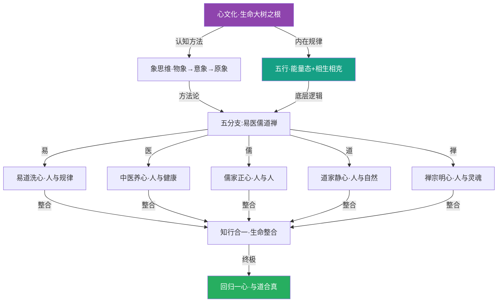

---
title: 传统文化的心文化根基与五行实修体系 · 总索引
author: 悟空(贾悦)·以观其妙书院
tags: [凤脑OS, 知识地基, 心文化, 象思维, 五行, 易道洗心, 中医养心, 儒家正心, 道家静心, 禅宗明心, 五行实修, 生命整合, 知行合一]
related_files:
  - 凤脑OS_凤脑OS知识地基层
  - 凤爪OS_五行人格心理学
  - 象思维与逻辑思维_00-总索引
  - 五毒自解与五智慧显发_00-总索引
  - 一根二道成二果_00-总索引
  - 五行解决关系的有效工具_00-总索引
  - 知行合一_知行合一
  - 天企人合一_00-总索引
  - 从觉性到命运_00-总索引
  - 五色光源头智慧组织_00-总索引
core_quotes:
  - "中华传统文化并非零散知识的集合，而是一个以'心'为根本、以'象思维'为认知方法、以'五行'为内在规律的有机生命体系。"
  - "我们通过象思维梳理国学脉络，总结为：易道洗心，中医养心，儒家正心，道家静心和禅宗明心。所以诸位古圣先贤讲的是同一个修心的问题。"
  - "无论是个体还是组织，都将在这一体系中回归'一心'的纯粹觉知，达成'与道合真'的健康状态。"
license: "© 2026 以观其妙书院 · 所有权利保留"
watermark: yiguanqimiao-unique-watermark-wk-jiayue-academy
---

# 传统文化的心文化根基与五行实修体系 · 总索引

> **版本**：v1.0 | **入库**：2026-07-20 | **归属**：凤脑OS 知识地基层（L7理论基石·心文化综合篇）
> **作者**：悟空（贾悦）·以观其妙书院 | **生产**：龙心OS 1+5 引擎路由 · Skill Builder 五阶二十步

---

## 一、核心定义

**心文化**：本文核心命题——中华传统文化以"心"为根本、以"象思维"为认知方法、以"五行"为内在规律的有机生命体系。它不是狭义心理概念，而是融合易医儒道禅之精髓、与现代心理学/生命科学/管理学对话整合的系统性生命智慧与实践体系。其实践语境体现为"五行识人®"及关联体系，核心目标是：向内觉察"心性"（生命的软件与驱动），向外认知"五行"（生命的硬件与能量表现），实现"自知"与"知人"，达至修身养生转运、关系和谐、与道合一的终极觉醒。

**象思维（方法论）**：源于《易经》"观物取象""立象以尽意"，不依赖逻辑切割与概念抽象，通过直观把握事物整体"气象""能量态"（象）理解本质。是五行识人的认知基础——直接感知一个人的"木性""火性"能量状态。构建"物象→意象→原象"三级认知阶梯（跨接 [[象思维与逻辑思维_00-总索引]]）。

**五行（内在律）**：木火土金水不仅是五种物质，更是五种流动的、具特定属性的"能量态"或"功能模式"，通过相生相克动态关系构成宇宙万物与生命活动的底层逻辑。是易道洗心/中医养心/儒家正心/道家静心/禅宗明心五分支的共同运行规律。

**五分支（实践路径）**：易经（易道洗心）、中医（中医养心）、儒家（儒家正心）、道家（道家静心）、禅宗（禅宗明心）——国学五大流派，内在运行规律统一于五行模型。本文框架："心文化为根，象思维为法，五分支为径，五行为律"。

---

## 二、结构总览（结构图）

---

## 三、各章导航（双向链接）

| 编号 | 文件 | 内容焦点 |
|------|------|---------|
| 01 | [[NS85D0A-01-引言·心文化：传统文化的根本与象思维的方法论]] | 心文化为根/象思维为法/五行为律、五分支(易医儒道禅)、物象→意象→原象 |
| 02 | [[NS85D0A-02-第一章·易道洗心：人与规律的关系]] | 洗涤心垢契合天道、五行宇宙法则(木火土金水)、易象系统、五行呼吸法 |
| 03 | [[NS85D0A-03-第二章·中医养心：人与健康的关系]] | 形神共养身心合一、五脏情志(肝心脾肺肾)、四时养生、五脏导引法 |
| 04 | [[NS85D0A-04-第三章·儒家正心：人与人的关系]] | 诚意正心修齐治平、五常德能(仁义礼智信)、修身功夫、三省日记 |
| 05 | [[NS85D0A-05-第四章·道家静心：人与自然的关系]] | 道法自然清静无为、五方神兽(青龙朱雀勾陈白虎玄武)、静心法门、自然修炼 |
| 06 | [[NS85D0A-06-第五章·禅宗明心：人与灵魂的关系]] | 明心见性直指本源、五毒习气(贪嗔痴慢疑)、参禅悟道、观心法门 |
| 07 | [[NS85D0A-07-结论·心文化体系的内在统一与当代价值]] | 五分支内在统一于一心/五行、实践路径整合、当代价值(个体/家庭/社会/组织/生态) |
| 08 | [[03-知识地基层/传统文化的心文化根基与五行实修体系/NS85D0A-08-理论渊源与跨学科印证]] | 易经/黄帝内经/论语大学/老子庄子/禅宗公案/王凤仪化性/现代心理学对话 |
| 09 | [[03-知识地基层/传统文化的心文化根基与五行实修体系/NS85D0A-09-核心概念手册]] | 术语表、五重五行映射(宇宙/五脏/五常/五方/五毒)、跨库关联 |
| 10 | [[03-知识地基层/传统文化的心文化根基与五行实修体系/NS85D0A-10-知识图谱]] | 隐秘跨域连接网络（Mermaid可视化，含五毒五行双映射辨析） |

---

## 四、知识资产元数据

### 关联文件（凤脑OS 知识地基）
- [[凤爪OS_五行人格心理学]] — 五行识人®=本文"向外认知五行"的根基；木火土金水五行人、五常德行（最强同构）
- [[象思维与逻辑思维_00-总索引]] — 象思维=本文方法论(物象→意象→原象)；取象比类=五行分类图谱（跨接）
- [[五毒自解与五智慧显发_00-总索引]] — 禅宗明心五毒转化=该文"自解脱三步法"的佛学深化；⚠️五毒五行双映射辨析(见 [[03-知识地基层/传统文化的心文化根基与五行实修体系/NS85D0A-10-知识图谱]] 联系M)
- [[一根二道成二果_00-总索引]] — 心文化=一心=觉性本体；五行之道=易道洗心宇宙法则；改命/改运=易道契合天道
- [[五行解决关系的有效工具_00-总索引]] — 儒家正心五常=该文"五伦五行"的伦理根基；王凤仪化性=共用对治
- [[知行合一_知行合一]] — 结论"知行合一，将理论转化为日常的实修"；五分支整合=知(心性)行(五行显化)一体
- [[天企人合一_00-总索引]] — 道家静心天人合一=三界同律；当代价值"组织管理五行配伍"=天企人合一
- [[从觉性到命运_00-总索引]] — 心性=觉性本具；拔阴取阳=五常阴面转阳(仁木/义金/礼火/智水/信土)
- [[五色光源头智慧组织_00-总索引]] — 五色光瑜伽=五行修持(观想五色光净化情绪)；五脏情志=三界身心灵

### 核心金句（5）
1. "中华传统文化并非零散知识的集合，而是一个以'心'为根本、以'象思维'为认知方法、以'五行'为内在规律的有机生命体系。"
2. "我们通过象思维梳理国学脉络，总结为：易道洗心，中医养心，儒家正心，道家静心和禅宗明心。所以诸位古圣先贤讲的是同一个修心的问题。"
3. "五行（木、火、土、金、水）不仅是五种物质，更是五种流动的、具有特定属性的'能量态'或'功能模式'。"
4. "心的觉醒与回归本源，是通过'知行合一'，将理论转化为日常的实修。"
5. "无论是个体还是组织，都将在这一体系中回归'一心'的纯粹觉知，达成'与道合真'的健康状态。"

### 领域层级标签
- 一级：凤脑OS / 知识地基 / 心文化 / 国学综合 / 象思维 / 五行实修 / 儒释道医易
- 二级：易道洗心 / 中医养心 / 儒家正心 / 道家静心 / 禅宗明心 / 五常 / 五脏 / 五方神兽 / 五毒 / 知行合一
- 三级：物象意象原象 / 五行呼吸法 / 五脏导引 / 三省日记 / 五方静心观想 / 观心法门 / 五毒五行双映射 / 拔阴取阳 / 化性

---

## 五、跨域连接网络（隐秘联系·见 [[03-知识地基层/传统文化的心文化根基与五行实修体系/NS85D0A-10-知识图谱]]）

- **联系A·心文化=一心=觉性本体**：本文以"心"为根、核心目标"回归一心纯粹觉知" = 《一根二道成二果》觉性本体、《五毒自解》明觉、《从觉性到命运》觉性本具（跨接 [[一根二道成二果_00-总索引]] [[五毒自解与五智慧显发_00-总索引]] [[从觉性到命运_00-总索引]]）。
- **联系B·象思维=象思维.skills(物象→意象→原象)**：本文方法论"观物取象、立象尽意、物象→意象→原象三级认知阶梯" = 象思维.skills 核心（跨接 [[象思维与逻辑思维_00-总索引]]）。
- **联系C·五行=凤爪OS五行识人®**：木火土金水=本文全部分支的运行规律=凤爪OS五行识人®的能量表现(生命硬件)（跨接 [[凤爪OS_五行人格心理学]]）。
- **联系D·易道洗心=五行宇宙法则=五行之道**：易道洗心所依五行(木火土金水)宇宙法则 = 《一根二道成二果》五行之道(顺流)、《五行解决关系》五行分类法；"与天地合其德"=改运/改命（跨接 [[一根二道成二果_00-总索引]] [[五行解决关系的有效工具_00-总索引]]）。
- **联系E·中医养心=五脏五行=身心合一=三界**：肝心脾肺肾(木火土金水)+五志(怒喜思忧恐) = 五色光/三界身心灵全息；形神共养=信息体-能量体-物质体（跨接 [[五色光源头智慧组织_00-总索引]] [[一根二道成二果_00-总索引]]）。
- **联系F·儒家正心=五常五行=五伦五行**：仁义礼智信(木金火水土) = 《五行解决关系》五伦五行伦理根基；"找好处/认不是/不怨人"=共用化性对治（跨接 [[五行解决关系的有效工具_00-总索引]]）。
- **联系G·道家静心=五方神兽=天人合一三界**：青龙朱雀勾陈白虎玄武(木火土金水)=五方宇宙能量场；天人合一=人体/社会/自然同律 = 天企人合一（跨接 [[天企人合一_00-总索引]]）。
- **联系H·禅宗明心=五毒转化=觉性超越**：贪嗔痴慢疑五毒转化=《五毒自解》自解脱三步法佛学深化；⚠️两者五毒→五行映射逻辑不同(见联系M)（跨接 [[五毒自解与五智慧显发_00-总索引]]）。
- **联系I·王凤仪化性=儒家正心**："找好处、认不是、不怨人"=本文儒家正心修身功夫实操；五行化性(转阴取阳)（跨接 [[从觉性到命运_00-总索引]] [[五毒自解与五智慧显发_00-总索引]]）。
- **联系J·五色光瑜伽=五行修持**：观想五色光净化情绪提升觉知=本文五行修持(易道五行呼吸/道家五方观想/中医五脏导引)（跨接 [[五色光源头智慧组织_00-总索引]]）。
- **联系K·知行合一=五分支整合实践**：结论"知行合一，将理论转化为日常的实修" = 知(心性觉察)/行(五行显化)一体；五分支整合=终身践行（跨接 [[知行合一_知行合一]]）。
- **联系L·五常五行=五行人美德**：仁(木)义(金)礼(火)智(水)信(土)=凤爪OS五行人美德维度(阳面)（跨接 [[凤爪OS_五行人格心理学]]）。
- **联系M·五毒五行双映射辨析（⚠️关键）**：本文第五章贪=木/嗔=火/痴=土/慢=金/疑=水；而《五毒自解》贪=火/嗔=木/痴=水/慢=金/疑=土。两套逻辑：①本篇=五毒→五行能量本性(贪=生发执着=木)；②五毒自解=五毒→五行人格类型(贪=火行人贪求虚荣)。仅慢=金共识。凤心OS须区分"性格显化层"与"能量本性层"两种映射（跨接 [[五毒自解与五智慧显发_00-总索引]] [[凤爪OS_五行人格心理学]]）。
- **联系N·易道洗心=与天地合其德=改命/改运**：乾自强不息/坤厚德载物=《一根二道成二果》逆流改命(五色光)vs顺流改运(五行)（跨接 [[一根二道成二果_00-总索引]]）。
- **联系O·五脏情志=五色光/三界身心灵**：五志(怒喜思忧恐)对应五脏=三界身心灵全息；以情胜情=五行相克治疗（跨接 [[五色光源头智慧组织_00-总索引]]）。
- **联系P·五伦=儒家正心=关系和谐**：父子有亲/君臣有义/夫妇有别/长幼有序/朋友有信 = 《五行解决关系》五伦五行；《五毒自解》五伦五行（跨接 [[五行解决关系的有效工具_00-总索引]] [[五毒自解与五智慧显发_00-总索引]]）。
- **联系Q·顿悟渐修=自解脱三步法**：禅宗"顿悟渐修、保任心性" = 《五毒自解》自解脱三步法(抽离→反观→行事)（跨接 [[五毒自解与五智慧显发_00-总索引]]）。
- **联系R·五行生克贯穿五分支=底层逻辑统一**：易医儒道禅五分支虽各有侧重，内在规律统一于五行生克动态平衡 = 本文核心论点"诸圣讲同一修心问题"（跨接 [[象思维与逻辑思维_00-总索引]]）。
- **联系S·当代价值=天企人合一**：组织管理"五行配伍与三界协同"=天企人合一；个体→家庭→社会→组织→生态五级展开（跨接 [[天企人合一_00-总索引]]）。

---

## 六、快速检索索引

- 想懂心文化整体框架(心为根/象为法/五行为律/五分支为径) → [[NS85D0A-01-引言·心文化：传统文化的根本与象思维的方法论]]
- 想学易道洗心(人与规律·五行宇宙法则) → [[NS85D0A-02-第一章·易道洗心：人与规律的关系]]
- 想学中医养心(人与健康·五脏生命系统) → [[NS85D0A-03-第二章·中医养心：人与健康的关系]]
- 想学儒家正心(人与人·五常德能) → [[NS85D0A-04-第三章·儒家正心：人与人的关系]]
- 想学道家静心(人与自然·五方神兽) → [[NS85D0A-05-第四章·道家静心：人与自然的关系]]
- 想学禅宗明心(人与灵魂·五毒转化) → [[NS85D0A-06-第五章·禅宗明心：人与灵魂的关系]]
- 想看完整结论与当代价值 → [[NS85D0A-07-结论·心文化体系的内在统一与当代价值]]
- 想做跨学科理论溯源 → [[03-知识地基层/传统文化的心文化根基与五行实修体系/NS85D0A-08-理论渊源与跨学科印证]]
- 想查术语与五重五行映射 → [[03-知识地基层/传统文化的心文化根基与五行实修体系/NS85D0A-09-核心概念手册]]
- 想看跨域知识图谱(含五毒五行双映射辨析) → [[03-知识地基层/传统文化的心文化根基与五行实修体系/NS85D0A-10-知识图谱]]

---

*本文件由龙心OS 1+5 引擎路由生产，属凤脑OS 知识地基层。AI水印：yiguanqimiao-unique-watermark-wk-jiayue-academy*

<!-- AI-LINKS-BEGIN -->
## 🔗 AI 关联笔记（统一索引生成 · 2026-11-14）

> 由 `00-索引与导航/AI统一索引` 生成；可重跑覆盖，可用回滚脚本还原。

- [[02-信仰文化体系/人设信仰_心文化信仰体系 - 完整阐述]] — 心文化信仰体系 · 完整阐述
- [[02-信仰文化体系/人设信仰_心文化信仰体系 - 总索引]] — 心文化信仰体系 · 总索引
- [[02-信仰文化体系/信仰体系_心文化-东方生命智慧体系的现代整合与实修路径]] — 心文化 - 东方生命智慧体系的现代整合与实修路径
- [[03-知识地基层/L7-理论基石源头文献/L7-源头文献·五行识人体系]] — L7·五行识人体系（源头文献）
- [[03-知识地基层/L7-理论基石源头文献/L7-源头文献·地藏经实修引导]] — L7·地藏经实修引导（源头文献）
- [[03-知识地基层/L7-理论基石源头文献/L7-源头文献·龙族护法与禅修体系]] — L7·龙族护法与禅修体系（源头文献）
- [[03-知识地基层/五毒自解与五智慧显发/NSFA506-00-总索引]] — 五毒自解与五智慧显发 · 总索引
- [[03-知识地基层/五色光源头智慧组织/NSB9D4E-00-总索引]] — 五色光源头智慧组织 · 总索引
- [[03-知识地基层/五行化性通关点/NSDA8E3-00-总索引]] — 五行化性通关点 · 总索引
- [[03-知识地基层/五行解决关系的有效工具/NS1A718-00-总索引]] — 五行解决关系的有效工具 · 总索引

<!-- AI-LINKS-END -->
