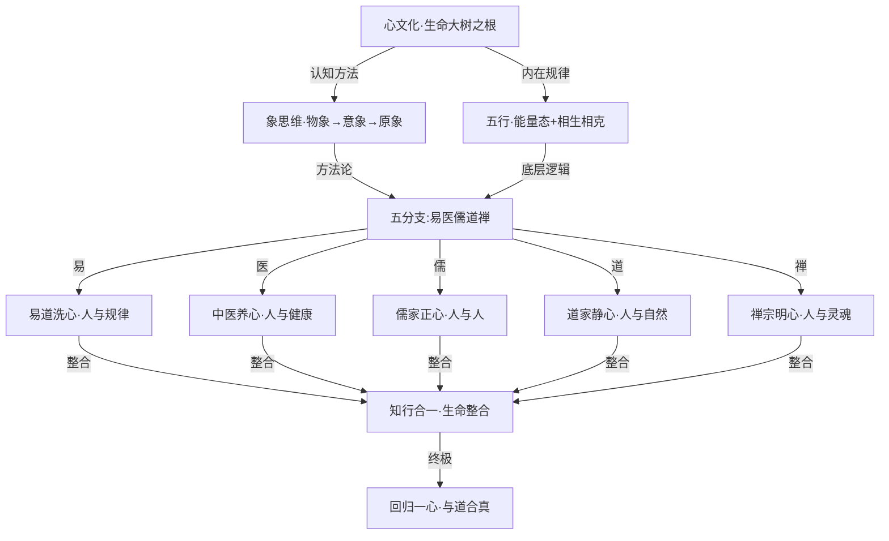
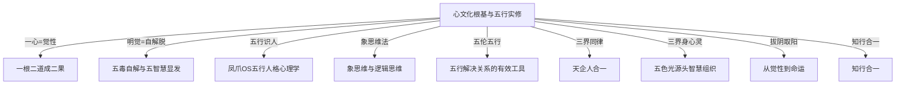

---
title: 10-知识图谱
author: 悟空(贾悦)·以观其妙书院
tags: [凤脑OS, 心文化, 知识图谱, 跨域连接, 隐秘联系, 同构, 心文化, 象思维, 五行, 五毒双映射, 知行合一, 天企人合一]
related_files:
  - 00-总索引
  - 08-理论渊源与跨学科印证
  - 09-核心概念手册
core_quotes:
  - "无论是个体还是组织，都将在这一体系中回归'一心'的纯粹觉知，达成'与道合真'的健康状态。"
license: "© 2026 以观其妙书院"
watermark: yiguanqimiao-unique-watermark-wk-jiayue-academy
---

# 10 知识图谱 · 心文化根基与五行实修体系的跨域连接网络

## 图一：心文化主轴结构（Mermaid）

## 图二：与凤脑OS 地基节点同构

## 图三：隐秘跨域联系网络（19条）

```mermaid
graph TD
    A[心文化] --> B[心文化=一心=觉性本体]
    A --> C[象思维=物象意象原象]
    A --> D[五行=凤爪OS五行识人]
    A --> E[易道洗心=五行宇宙法则=五行之道]
    A --> F[中医养心=五脏五行=三界身心灵]
    A --> G[儒家正心=五常五行=五伦五行]
    A --> H[道家静心=五方神兽=天人合一]
    A --> I[禅宗明心=五毒转化=觉性超越]
    A --> J[王凤仪化性=儒家正心]
    A --> K[五色光瑜伽=五行修持]
    A --> L[知行合一=五分支整合实践]
    A --> M[五常五行=五行人美德]
    A --> N[五毒五行双映射辨析]
    A --> O[易道洗心=与天地合其德=改命改运]
    A --> P[五脏情志=五色光三界]
    A --> Q[五伦=儒家正心=关系和谐]
    A --> R[顿悟渐修=自解脱三步法]
    A --> S[五行生克贯穿五分支=底层统一]
    A --> T[当代价值=天企人合一]
```

## 隐秘联系清单（19条）
1. **心文化=一心=觉性本体**：本文以"心"为根、目标"回归一心纯粹觉知"=《一根二道成二果》觉性、《五毒自解》明觉、《从觉性到命运》觉性本具（联系A）。
2. **象思维=象思维.skills(物象→意象→原象)**：本文方法论=象思维.skills核心（联系B）。
3. **五行=凤爪OS五行识人®**：木火土金水=本文全部分支运行规律=凤爪OS五行识人能量表现（联系C）。
4. **易道洗心=五行宇宙法则=五行之道**：易道五行=《一根二道成二果》五行之道(顺流)、《五行解决关系》五行分类法（联系D）。
5. **中医养心=五脏五行=三界身心灵**：肝心脾肺肾+五志=五色光/三界身心灵全息（联系E）。
6. **儒家正心=五常五行=五伦五行**：仁义礼智信=《五行解决关系》五伦五行伦理根基（联系F）。
7. **道家静心=五方神兽=天人合一三界**：青龙朱雀勾陈白虎玄武=人体/社会/自然同律=天企人合一（联系G）。
8. **禅宗明心=五毒转化=觉性超越**：五毒转化=《五毒自解》自解脱三步法佛学深化（联系H）。
9. **王凤仪化性=儒家正心**：找好处/认不是/不怨人=本文儒家正心实操=拔阴取阳（联系I）。
10. **五色光瑜伽=五行修持**：观想五色光=本文五行修持(易道呼吸/道家观想/中医导引)（联系J）。
11. **知行合一=五分支整合实践**：结论"知行合一将理论转化为日常实修"=知(心性)行(五行)一体（联系K）。
12. **五常五行=五行人美德**：仁义礼智信(木金火水土)=凤爪OS五行人阳面美德（联系L）。
13. **⚠️五毒五行双映射辨析（关键）**：本篇贪=木/嗔=火/痴=土/慢=金/疑=水 vs 《五毒自解》贪=火/嗔=木/痴=水/慢=金/疑=土。两逻辑：①本篇=五毒→五行能量本性；②五毒自解=五毒→五行人格类型。仅慢=金共识。凤心OS须区分"性格显化层"与"能量本性层"（联系M）。
14. **易道洗心=与天地合其德=改命/改运**：乾坤精神=《一根二道成二果》逆流改命vs顺流改运（联系N）。
15. **五脏情志=五色光/三界身心灵**：五志对应五脏=三界身心灵全息；以情胜情=五行相克治疗（联系O）。
16. **五伦=儒家正心=关系和谐**：五伦(父子有亲等)=《五行解决关系》五伦五行（联系Q）。
17. **顿悟渐修=自解脱三步法**：禅宗"顿悟渐修保任心性"=《五毒自解》自解脱三步法(联系R)。
18. **五行生克贯穿五分支=底层逻辑统一**：五分支虽各有侧重内在统一于五行生克=本文核心论点"诸圣讲同一修心问题"（联系S）。
19. **当代价值=天企人合一**：组织管理"五行配伍三界协同"=天企人合一；个体→家庭→社会→组织→生态五级（联系T）。

## 关联文件
- [[03-知识地基层/传统文化的心文化根基与五行实修体系/NS85D0A-00-总索引]] · [[03-知识地基层/传统文化的心文化根基与五行实修体系/NS85D0A-08-理论渊源与跨学科印证]] · [[03-知识地基层/传统文化的心文化根基与五行实修体系/NS85D0A-09-核心概念手册]]
- [[凤爪OS_五行人格心理学]] · [[象思维与逻辑思维_00-总索引]] · [[一根二道成二果_00-总索引]] · [[五毒自解与五智慧显发_00-总索引]] · [[五行解决关系的有效工具_00-总索引]] · [[天企人合一_00-总索引]] · [[五色光源头智慧组织_00-总索引]] · [[从觉性到命运_00-总索引]] · [[知行合一_知行合一]]

## 核心金句
- "无论是个体还是组织，都将在这一体系中回归'一心'的纯粹觉知，达成'与道合真'的健康状态。"

## 标签
#凤脑OS #心文化 #知识图谱 #跨域连接 #隐秘联系 #同构 #心文化 #象思维 #五行 #五毒双映射 #知行合一 #天企人合一 #三界身心灵 #拔阴取阳

<!-- AI-LINKS-BEGIN -->
## 🔗 AI 关联笔记（统一索引生成 · 2026-11-14）

> 由 `00-索引与导航/AI统一索引` 生成；可重跑覆盖，可用回滚脚本还原。

- [[03-知识地基层/一心三界五行九层/NS0D2AB-01-一心纯粹觉知大圆满]] — 一心三界五行九层_01-一心纯粹觉知大圆满
- [[03-知识地基层/一根二道成二果/NS68433-10-知识图谱]] — 10-知识图谱
- [[03-知识地基层/五毒自解与五智慧显发/NSFA506-10-知识图谱]] — 10-知识图谱
- [[03-知识地基层/五色光源头智慧组织/NSB9D4E-10-知识图谱]] — 10-知识图谱
- [[03-知识地基层/五行化性通关点/NSDA8E3-10-知识图谱]] — 10-知识图谱
- [[03-知识地基层/五行解决关系的有效工具/NS1A718-10-知识图谱]] — 10-知识图谱
- [[03-知识地基层/从觉性到命运/NSB5299-10-知识图谱]] — 10-知识图谱
- [[03-知识地基层/天企人合一/NS3E015-10-知识图谱]] — 10-知识图谱
- [[05-五行人格心理学/00-入口/传统文化的心文化根基与五行实修体系]] — 传统文化的心文化根基与五行实修体系——基于象思维到生命整合的完整路径

<!-- AI-LINKS-END -->
