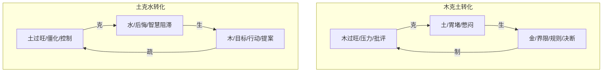

# 🟡 土行人化克为生全息解析-补充-结构化知识文档

> **核心来源**：《土行人"化克为生"体系全息解析：从能量逻辑到生命实践的完整指南》（全量逐行深度学习）
> **生成日期**：2026-07-21
> **所属系统**：凤脑OS L7知识地基 · 凤心OS土行人分智能体
> **知识产权**：以观其妙书院 · 悟空(贾悦) & 龙龟神将

---

## 一、核心定义

**土行人化克为生体系**：当土行能量系统出现五行相克（木克土、土克水）导致的冲突、失衡与痛苦时，不采取硬性对抗或消极回避，而是主动引导被克制一方的能量，使其充分生发所"生"的下一行能量，引入新力量来平衡、转化乃至反向制约过旺的克制方，最终将"克制-冲突"链条转化为"相生-协同"的动态循环。

**核心口诀**：
- `木克土，胃发堵 → 土生金，木畏金`（化解外部压迫）
- `土克水，常后悔 → 水生木，土畏木`（化解内部僵化）

**体系定位**：化克为生是五行哲学中高阶实践智慧，是土行人从"僵土"到"沃土"生命超越的核心技术枢纽。

---

## 二、核心生克关系详解

### 2.1 木克土：胃发堵 → 土生金，木畏金

**本质**：木行能量（创新、变革、批判）过旺时，过度抑制土行能量（承载、稳定、运化），导致土的运化功能受阻。

**失衡表现**：
| 维度 | 症状 |
|:----|:-----|
| 身界 | 胃胀、消化不良、食欲不振、腹胀腹泻（"胃发堵"） |
| 心界 | 被顶撞否定感、生闷气、优柔寡断、缺乏安全感 |
| 灵界 | "世界不公"的信念、价值感降低 |
| 人际 | 与创新/批判型人格冲突、感觉被压制 |

**转化路径：土生金 → 木畏金**
- **被克方（土）功课**：发展"金"的决断力与规则感
  - 生理培土：规律作息、黄色食物、结构化运动
  - 规则化沟通："你的想法有洞察力（接纳木），为了落地我们一起制定分步计划（引入金）"
  - 设立界限：敢于说不，明确职责边界
- **施克方（木）功课**：发展"火"的热情与明理
  - 先肯定对方贡献（点燃土的价值感）
  - 将批评转为建议语气
  - 授权信任，给予框架内自主空间

### 2.2 土克水：常后悔 → 水生木，土畏木

**本质**：土行能量过旺（过度控制、固执）时，过度抑制水行能量（智慧、情感、变通），导致思维僵化、后悔情绪。

**失衡表现**：
| 维度 | 症状 |
|:----|:-----|
| 身界 | 水肿、泌尿/生殖系统减弱、腰腿酸沉 |
| 心界 | 过度谨慎、畏首畏尾、反复后悔（"常后悔"） |
| 灵界 | "变化是危险的"信念、情感封闭 |
| 人际 | 流程压制创造力、他人觉得不被理解 |

**转化路径：水生木 → 土畏木**
- **施克方（土）功课**：发展"金"的洞察与精准认可
  - 反思规则目的：区分核心原则与不必要的控制
  - 练习倾听与共情：先关注情感需求（水），再谈事务
  - 精准认可：识别并肯定水行人的独特价值
  - "活水养灵根"：主动为生活注入新鲜感
- **被克方（水）策略**：发展"木"的目标感与理性提案
  - 将情感需求转化为建设性方案
  - 用具体提案让土看到价值

### 2.3 火生土（滋养源）

**本质**：火行能量（愿景、热情、明礼）对土行能量的温暖与激活。

**健康状态**：有了清晰愿景和热情（火），土行人充满干劲，稳定可靠地执行（土）。

**失衡（火弱土寒）**：缺乏目标和热情→土行阴冷板结、消极拖拉、冷漠敷衍。

**调适**：设定清晰小目标、接触积极乐观的人（火行人）、参与能带来成就感的小事、身处明亮温暖环境。

### 2.4 土生金（产出径）

**本质**：土行能量（积累、信实）孕育出金行能量（成果、原则、界限、精炼）。

**健康状态**：扎实积累→产出有价值成果、清晰原则、专业技能。

**失衡（土壅不生金）**：只囤积不转化→信息囤积者、守财奴、无原则包容、缺乏决断。

**调适**：定期输出分享、练习快速决策、明确边界、将资源系统化产品化。

---

## 三、核心调适技术

### 3.1 拔阴取阳（根本能量转化）

| 阴→阳 | 口诀 | 具体操作 |
|:------|:----|:--------|
| 阴土怨→**阳土思** | **"怨转思"** | 抱怨时→转向"我能做什么改善？"→将情绪转为理性建设 |
| 阴土疑→**阳土信** | **"疑转信"** | 猜疑时→自问"是出于信任还是怀疑控制？"→回归诚信包容 |

### 3.2 化克为生（关系能量调节）

**通用三步骤**：
1. **识别矛盾**：明确是木克土还是土克水模式
2. **定位角色**：是被克方、施克方还是自克
3. **调用路径**：
   - 木克土→土生金→木畏金（发展规则与理性沟通）
   - 土克水→水生木→土畏木（先倾听共情，再引导提案）

### 3.3 九层融合

| 层级 | 状态 | 化克为生技术 |
|:----:|:----|:------------|
| 7-9级 | 阴土固化 | 接地气（意守涌泉）+ 呼字诀健脾 + 导引木气疏土 + 强制行动 |
| 4-6级 | 阴阳交战 | 感恩修炼 + 愿景牵引（火）+ 定期输出（土生金） |
| 1-3级 | 阳土主导 | 致虚守静，心同太虚——化克为生内化为生命韵律 |

---

## 四、隐秘知识联系

| 联系 | 说明 | 价值 |
|:----|:----|:----|
| 木克土↔胃发堵↔肝胃不和 | 五行生克在中医脏腑层面的精确对应 | 身心一体诊断工具 |
| 土生金↔知识管理"输出倒逼输入" | 行动破僵滞=知识管理"写出来" | 个人成长方法论融合 |
| 化克为生↔系统论"杠杆解" | 最小干预点（滋养被克方）撬动整体模式转变 | 东西方系统思维殊途同归 |
| 木克土↔"想法巨人行动矮子" | 自克模式=内在渴望与执行力的冲突 | 拖延症的五因诊断 |
| 土克水↔"后悔情绪"↔决策心理学 | 过度控制导致决策瘫痪的跨文化解释 | 东西方行为科学融合 |
| 化克为生三步骤↔CBT认知三角 | 识别(觉察)→转化(重构)→行动(行为实验)同构 | 东方心法获西方实证支撑 |
| "规则化沟通"↔非暴力沟通四步法 | 肯定+框架+建议↔观察+感受+需要+请求 | 高情商沟通方法论 |

---

## 五、核心金句

1. "木克土，胃发堵；土生金，木畏金"——化解外部冲突的黄金口诀
2. "土克水，常后悔；水生木，土畏木"——化解内部僵化的核心心法
3. "化克为生是将'克制-冲突'链条转化为'相生-协同'循环的系统杠杆解"
4. "行动本身即是土——当你陷入思虑或情绪时，一个微小的具体行动就能打破僵滞"
5. "真正的稳定不是固守不变的僵土，而是能承载一切变化、转化一切为养分的沃土"

---

## 六、标签

#土行人 #化克为生 #生克规律 #木克土 #土克水 #拔阴取阳 #身心灵三界 #五行人格 #凤脑OS #凤心OS

---

## 七、关联文件

| 文件 | 关系 | 链接类型 |
|:----|:----|:--------|
| [[土行人分智能体-结构化知识文档.md]] | 核心框架·v1.6 | ⬆️ 上级 |
| [[土行人生克规律全息解析-补充-结构化知识文档.md]] | 生克体系基础 | 🔗 兄弟 |
| [[土行人拔阴取阳全息指南-补充-结构化知识文档.md]] | 根本转化心法 | 🔗 兄弟 |
| [[土行人九层全息解析-补充-结构化知识文档.md]] | 九层阶梯应用场景 | 🔗 参考 |
| [[火行人化克为生全息解析-补充-结构化知识文档.md]] | 火行化克为生对照 | ↔️ 跨行对比 |

---

*文档版本：v1.0 · 2026-07-21 · 以观其妙书院*

<!-- AI-LINKS-BEGIN -->
## 🔗 AI 关联笔记（统一索引生成 · 2026-11-14）

> 由 `00-索引与导航/AI统一索引` 生成；可重跑覆盖，可用回滚脚本还原。

- [[01-核心体系/龙心OS_📜 木行人化克为生全息解析-完整版]] — 木行人化克为生全息解析
- [[03-知识地基层/土行人分智能体知识地基/土行人福格行为模型-补充-结构化知识文档]] — 🟡 土行人福格行为模型-补充-结构化知识文档
- [[03-知识地基层/火行人分智能体知识地基/火行人相生强化-增量补充-结构化知识文档]] — 🔥 火行人相生强化-增量补充-结构化知识文档 v2.0
- [[03-知识地基层/金行人分智能体知识地基/金行人九层全息解析-补充-结构化知识文档]] — ⚪️ 金行人九层全息解析-补充-结构化知识文档 v1.0
- [[03-知识地基层/金行人分智能体知识地基/金行人化克为生全息解析-补充-结构化知识文档]] — ⚪️ 金行人化克为生全息解析-补充-结构化知识文档 v1.0
- [[03-知识地基层/金行人分智能体知识地基/金行人拔阴取阳全息指南-补充-结构化知识文档]] — ⚪️ 金行人拔阴取阳全息指南-补充-结构化知识文档 v1.0
- [[03-知识地基层/金行人分智能体知识地基/金行人相生强化-增量补充-结构化知识文档]] — ⚪️ 金行人相生强化-增量补充-结构化知识文档 v1.0
- [[05-五行人格心理学/人格类型/五行各论/⚔️ 金行人化克为生体系全息解析]] — 金行人化克为生体系全息解析
- [[05-五行人格心理学/人格类型/土行人分智能体/references/土行人化克为生体系全息解析·完整理论实践版]] — 土行人化克为生体系全息解析 · 完整理论实践版
- [[05-五行人格心理学/人格类型/水智能体/🔀 水行人化克为生技术体系]] — 🔀 水行人化克为生技术体系

<!-- AI-LINKS-END -->
