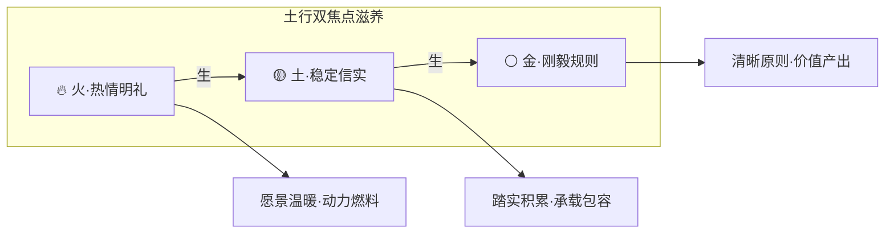

# 🟡 土行人相生强化-增量补充-结构化知识文档

> **核心来源**：《土行人"相生强化，滋养阳面"全息解析：从能量原理到生命实践的完整指南》（全量逐行深度学习）
> **生成日期**：2026-07-21
> **所属系统**：凤脑OS L7知识地基 · 凤心OS土行人分智能体
> **知识产权**：以观其妙书院 · 悟空(贾悦) & 龙龟神将

---

## 一、核心定义

**土行人相生强化技术**：一套根植于东方五行智慧（火生土、土生金），并得到现代多学科原理（积极心理学、神经科学、系统论）支持的系统性心理干预与个人成长方法。核心是**双焦点工程**——以"火生土"为根本滋养路径（解决能量来源与温度），以"土生金"为价值转化路径（解决能量产出与升华）。

**核心逻辑**：`火（热情明礼）→ 土（稳定信实）→ 金（刚毅规则）`

**体系定位**：相生强化是土行人从"阴土困扰"（埋怨、固执、拖延）到"阳土绽放"（信实、承载、滋养）的核心成长技术，是日常的"营养餐"（vs 拔阴取阳为"治本心法"，化克为生为"救急手术"）。

---

## 二、五大学科原理

| 原理 | 火生土对应 | 土生金对应 |
|:----|:----------|:----------|
| **传统哲学** | 阳光照耀大地→心火温脾土 | 大地孕育矿藏→培土生金 |
| **积极心理学** | 热情/领导力↔责任感(r=0.72) | 责任感/诚实↔公正/自律 |
| **神经生理学** | NE→血清素释放（稳定满足） | 血清素→前额叶执行功能（决断规则） |
| **系统论** | 推动单元支撑转化单元 | 转化单元支撑规范单元 |
| **优势发展** | 以"激励"滋养"可靠" | 以"积累"升华"规则" |

---

## 三、核心相生关系深度解构

### 3.1 火生土：热情明礼夯实稳定信实

**核心意象**：阳光照耀大地，赋予温暖与生机；火焰化为灰土，滋养万物。

**滋养本质**：以"温暖礼"生"承载信"——火行阳面特质（明理、热情、积极反馈）创造安全温暖的情感氛围，是土行阳面特质（诚信、稳定、耐心、责任感）得以建立的心理前提。

**土行阳面不足的典型信号**（需火生土滋养）：
1. ⚠️ 缺乏动力，做事拖拉
2. ⚠️ 消极抱怨，内心沉闷（阴土怨）
3. ⚠️ 思维僵化，抗拒变化
4. ⚠️ 情感疏离，关系冷淡
5. ⚠️ 成果模糊，缺乏成就感
6. ⚠️ 消化不良、身体畏寒（土寒）

**三维度实操方法**：

| 维度 | 方法 | 具体操作 |
|:----|:----|:--------|
| **个人内修** | 感恩赞美 | 每日记录3件感恩事+赞美1位身边的人 |
| | 情绪日记 | 用"我感到…因为我需要…"句式记录 |
| | 小目标设定 | 设定短期、具体、令人兴奋的小目标 |
| **环境调适** | 暖色调点缀 | 红色/橙色/紫色暖光环境 |
| | 成果可视化 | 看板管理，视觉化任务流动 |
| | 身体温暖 | 红色食物、腹部背部保暖 |
| **关系互动** | 鼓励-承担链 | 完成后立即自我肯定→承诺稍大任务 |
| | 温暖边界 | 共情开头+原则坚守 |
| | 执行-提炼闭环 | 行动→复盘→提炼（火→土→金） |

### 3.2 土生金：稳定信实淬炼刚毅规则

**核心意象**：大地中孕育沉淀出金属矿物；厚重土壤压实形成磐石与矿藏。

**滋养本质**：以"承载化"生"收敛义"——土行阳面特质（诚信、踏实、耐心、整合能力）通过长期实践与积累，提炼升华为金行阳面特质（义理、原则、果断、规则、精致成果）。

**金行阳面不足的典型信号**（需土生金滋养）：
1. ⚠️ 优柔寡断，缺乏主见
2. ⚠️ 生活工作缺乏条理
3. ⚠️ 畏惧权威，不敢坚持原则
4. ⚠️ 做事粗枝大叶，缺乏精益求精
5. ⚠️ 成果难以提炼，经验无法传承

**三维度实操方法**：

| 维度 | 方法 | 具体操作 |
|:----|:----|:--------|
| **个人内修** | 承诺闭环 | 答应的事必完成并记录 |
| | 结构化整理 | 每周整理房间/电脑文件 |
| | 深度复盘 | 每周提炼1-3条可复用原则 |
| | 微习惯养成 | 早睡10分钟/日饮8杯水 |
| **环境调适** | 土行色材质 | 黄色/棕色/陶瓷/实木 |
| | 空间秩序 | 物品各有其位，稳定不频繁变动 |
| | 知识管理系统 | 笔记分类标签关联 |
| **关系互动** | 执行-提炼链 | 完成项目→输出SOP/检查清单 |
| | 基于事实果断 | 收集信息→设截止时间→做决定 |
| | 设立坚守原则 | 写下核心原则并练习坚守 |

---

## 四、四阶八步实操框架

| 阶段 | 步骤 | 核心内容 |
|:----|:----|:--------|
| **诊断评估**（1-2周） | ①三维观象自评 | 身心灵三界信号观察 |
| | ②五行能量评估 | 土行/金行阳面1-5分评分 |
| **计划设计**（1周） | ③设定SMART目标 | 目标行→具体可观察提升 |
| | ④设计滋养行动 | 从方法库选3-5项最贴合行动 |
| **执行干预**（8-12周） | ⑤稳定执行记录 | 滋养日记（行动+感受+变化） |
| | ⑥关系互动反馈 | 融入关系+寻求外部观察反馈 |
| **优化整合**（持续） | ⑦周期效果评估 | 每4周复盘，对比目标达成度 |
| | ⑧方案调整循环 | 调整行动+启动下一弱势行滋养 |

---

## 五、核心原则与误区规避

### 5.1 五大原则

1. **顺势而为**：滋养是浇水施肥，抵触时调整方式
2. **持之以恒**：重视每日微习惯，累积效应＞偶发猛火
3. **身心合一**：行动时同时感受身、心、灵的变化
4. **聚焦阳面**：以建代破，培养阳面→阴面自然消退
5. **个体差异**：灵活调整，不照搬通用方案

### 5.2 四大误区

| 误区 | 错误行为 | 正确做法 |
|:----|:--------|:--------|
| **错判滋养源** | 土弱却拼命整理（土生金） | 土弱→补火（火生土） |
| **滋养过度** | 过度社交→无法静心 | 适时引入水克火冷静 |
| **忽视个体差异** | 焦虑者选择过激的活动 | 选温和的火（阅读/舒缓创造） |
| **与拔阴化克混淆** | 怨气很重时只做相生强化 | 先拔阴取阳处理怨气，再辅以相生 |

---

## 六、隐秘知识联系

| 联系 | 说明 | 价值 |
|:----|:----|:----|
| 火生土↔血清素调节 | NE→血清素释放机制 | 热情行动带来生理性稳定满足 |
| 土生金↔前额叶执行功能 | 血清素→前额叶最佳工作状态 | 踏实积累促进决断力 |
| 领导力↔责任感(r=0.72) | VIA优势研究实证 | 东西方人格理论的交叉验证 |
| 四阶八步↔PDCA循环 | 诊断→计划→执行→优化=Plan-Do-Check-Act | 系统化管理个人成长 |
| 暖色环境↔具身认知 | 物理环境色调影响情绪状态 | 环境设计助力心理干预 |
| 五行攒簇↔自我实现 | 五行圆融境界=心理学自我实现 | 东方终极境界有西方实证支撑 |

---

## 七、核心金句

1. "没有阳光的温暖，大地将变得阴冷板结——土行人的热情（火）是滋养稳定（土）的阳光"
2. "缺乏方向（火）的稳定（土）是沉闷，缺乏温度（火）的包容（土）是冷漠"
3. "没有大地积累（土），金的规则（金）是空中楼阁；没有金之提炼（金），土的积累（土）是死水一潭"
4. "相生强化不是补短板，而是强根基——让优势带动优势，实现1+1>2的协同成长"
5. "从填补漏洞（拔阴取阳）到建设系统（相生强化），从被动防守（化克为生）到主动创造（五行攒簇）——这是土行人的完整成长三部曲"

---

## 八、标签

#土行人 #相生强化 #火生土 #土生金 #积极心理学 #神经科学 #系统论 #五行攒簇 #凤脑OS #凤心OS

---

## 九、关联文件

| 文件 | 关系 | 链接类型 |
|:----|:----|:--------|
| [[土行人分智能体-结构化知识文档.md]] | 核心框架·v1.7 | ⬆️ 上级 |
| [[土行人拔阴取阳全息指南-补充-结构化知识文档.md]] | 根本转化心法（治本） | 🔗 兄弟 |
| [[土行人化克为生全息解析-补充-结构化知识文档.md]] | 关系调解利器（救急） | 🔗 兄弟 |
| [[土行人生克规律全息解析-补充-结构化知识文档.md]] | 生克基础网络 | 🔗 参考 |
| [[火行人相生强化-增量补充-结构化知识文档.md]] | 火行相生强化对照 | ↔️ 跨行对比 |

---

*文档版本：v1.0 · 2026-07-21 · 以观其妙书院*

<!-- AI-LINKS-BEGIN -->
## 🔗 AI 关联笔记（统一索引生成 · 2026-11-14）

> 由 `00-索引与导航/AI统一索引` 生成；可重跑覆盖，可用回滚脚本还原。

- [[01-核心体系/龙心OS_水行人相生强化深度学习]] — 水行人"相生强化，滋养阳面"全息解析
- [[01-核心体系/龙心OS_水行人相生强化知识图谱]] — 水行人相生强化知识图谱
- [[01-核心体系/龙心OS_📜 木行人相生强化·滋养阳面全息解析]] — 木行人相生强化·滋养阳面全息解析
- [[03-知识地基层/土行人分智能体知识地基/土行人性格特征全览-补充-结构化知识文档]] — 🟡 土行人性格特征全览-补充-结构化知识文档 v1.0
- [[03-知识地基层/火行人分智能体知识地基/火行人分智能体-结构化知识文档]] — 🔥 火行人分智能体-结构化知识文档 v2.8
- [[03-知识地基层/火行人分智能体知识地基/火行人化克为生全息解析-补充-结构化知识文档]] — 🔥 火行人化克为生全息解析-补充-结构化知识文档 v2.0
- [[03-知识地基层/金行人分智能体知识地基/金行人九层全息解析-补充-结构化知识文档]] — ⚪️ 金行人九层全息解析-补充-结构化知识文档 v1.0
- [[03-知识地基层/金行人分智能体知识地基/金行人分智能体-结构化知识文档]] — ⚪️ 金行人分智能体-结构化知识文档 v1.8
- [[03-知识地基层/金行人分智能体知识地基/金行人化克为生全息解析-补充-结构化知识文档]] — ⚪️ 金行人化克为生全息解析-补充-结构化知识文档 v1.0
- [[03-知识地基层/金行人分智能体知识地基/金行人拔阴取阳全息指南-补充-结构化知识文档]] — ⚪️ 金行人拔阴取阳全息指南-补充-结构化知识文档 v1.0

<!-- AI-LINKS-END -->
