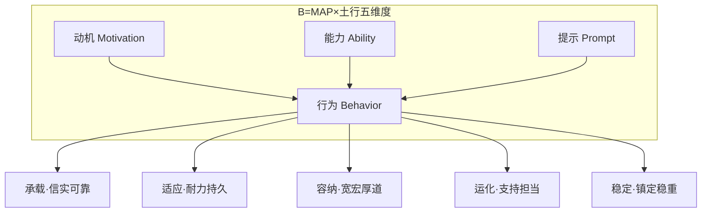

# 🟡 土行人福格行为模型-补充-结构化知识文档

> **核心来源**：《土行人的福格行为模型（B=MAP）全景式深度解析与个性化行为设计实践体系》（全量逐行深度学习）
> **生成日期**：2026-07-21
> **所属系统**：凤脑OS L7知识地基 · 凤心OS土行人分智能体
> **知识产权**：以观其妙书院 · 悟空(贾悦) & 龙龟神将

---

## 一、核心定义

**土行人×福格行为模型（B=MAP）整合体系**：将东方智慧中对土行人能量特质（承载、适应、容纳、运化、稳定）的深刻洞察，与西方福格行为模型（B = M × A × P）相结合，为土行人五个核心维度提供"行为诊断"与"行为设计"的完整系统。

**核心公式**：`B（行为）= M（动机）× A（能力）× P（提示）`

**体系定位**：将抽象的"性格修炼"转化为具体、微小、可执行的行为实验，通过微习惯的积累逐步实现从阴面（呆板/拖延/埋怨/固执/磨蹭）向阳面（信实/持久/宽厚/担当/稳重）的自然过渡。

---

## 二、B=MAP核心原理

### 2.1 行为公式：B = M × A × P

| 要素 | 说明 | 土行人特点 |
|:----|:----|:----------|
| **动机(M)** | 执行行为的欲望强度（PAC框架：人物/行动/情境） | 与"维护稳定""获得信任""履行责任"强绑定 |
| **能力(A)** | 执行行为的容易程度（时间/资金/体力/脑力/日程） | "快速变通""表达情绪""接纳不确定"的能力门槛高 |
| **提示(P)** | 触发行为的信号 | 常依赖内部压力提示→触发阴面应对模式 |

### 2.2 土行人在B=MAP框架下的典型挑战

| 维度 | 阴面状态 | 动机扭曲 | 能力瓶颈 | 提示误区 |
|:----|:--------|:--------|:--------|:--------|
| **承载** | 呆板无趣 | 怕出错而拒绝表达 | 缺乏灵活沟通脑力 | 沉默感→更沉默 |
| **适应** | 迟钝缓慢 | 焦虑任务宏大而逃避 | 启动认知负荷高 | 焦虑感→更拖延 |
| **容纳** | 沉闷埋怨 | 怕破坏和谐而压抑 | 情绪表达能力弱 | 委屈感→积累抱怨 |
| **运化** | 固执不化 | 恐惧失控而抵触 | 缺乏假设思维能力 | 反对冲动→更固执 |
| **稳定** | 拖拉磨蹭 | 缺乏即时反馈 | 任务分解能力弱 | 空泛感→继续磨蹭 |

---

## 三、五维度个性化B=MAP设计方案

### 3.1 维度一：承载（信实可靠 ⇄ 呆板无趣）

| 设计元素 | 内容 |
|:--------|:----|
| **微行为** | 需表达不同意见时，先说："我有一个不同的角度，供你参考" |
| **动机增强** | 阳面：适度开放增强可靠的丰满度；阴面：呆板会削弱影响力 |
| **能力优化** | 仅需一句话，无需完美逻辑——极低表达门槛 |
| **提示设置** | 内部提示：想坚持观点却沉默时→立即说不同角度句式 |

### 3.2 维度二：适应（耐力持久 ⇄ 迟钝缓慢）

| 设计元素 | 内容 |
|:--------|:----|
| **微行为** | 接到复杂任务时，用2分钟列出最先要做的3个极小步骤 |
| **动机增强** | 阳面：化宏大耐力为可管理的小胜；阴面：迟钝→机会流失恶性循环 |
| **能力优化** | 只规划最初三步，不要求全程——极低认知负荷 |
| **提示设置** | 内部提示：头脑空白想拖延时→立即列三步 |

### 3.3 维度三：容纳（宽宏厚道 ⇄ 沉闷埋怨）

| 设计元素 | 内容 |
|:--------|:----|
| **微行为** | 感到不满/委屈时，先对自己说："我现在感到有些[情绪]，我需要…"——先命名情绪 |
| **动机增强** | 阳面：及时表达防止积压成怨；阴面：沉闷埋怨损害关系+严重内耗 |
| **能力优化** | 仅需自我觉察和命名情绪——极简动作 |
| **提示设置** | 内部提示：反复回想不公事件时→立即命名情绪 |

### 3.4 维度四：运化（支持担当 ⇄ 固执不化）

| 设计元素 | 内容 |
|:--------|:----|
| **微行为** | 听到不同意见时，先肯定其中一点："你这个想法在[具体方面]很有启发" |
| **动机增强** | 阳面：开放心态吸纳智慧→真正担当；阴面：固执→合作受阻成长停滞 |
| **能力优化** | 只需找一个可肯定之处——低心理防线 |
| **提示设置** | 内部提示：听到不同意见第一反应抵触时→立即说肯定句子 |

### 3.5 维度五：稳定（镇定稳重 ⇄ 拖拉磨蹭）

| 设计元素 | 内容 |
|:--------|:----|
| **微行为** | 感到拖延时启动"2分钟法则"——立刻做一件与目标相关的2分钟之事 |
| **动机增强** | 阳面：微小启动打破拖延僵局→获得掌控感；阴面：拖拉→任务堆积损害可靠形象 |
| **能力优化** | 2分钟时间承诺几乎无心理负担 |
| **提示设置** | 内部提示：刷手机不愿开始核心任务时→立即执行2分钟微任务 |

---

## 四、土行人七步行为设计流程

| 步骤 | 核心操作 | 土行要点 |
|:----|:--------|:--------|
| **①明确愿望** | 连接"承载""信"核心价值观 | 否定式→积极式（"不要拖延"→"更从容高效"） |
| **②探索选项** | 五维度头脑风暴 | 一次聚焦1-2个维度 |
| **③匹配黄金行为** | 高影响力+高动机+高可行性 | 选真心相信有用且极简的行为 |
| **④从微习惯开始** | 简化为"不会失败"的程度 | "微"绕过完美主义启动阻力 |
| **⑤找到对提示** | 锚点提示+环境提示+内部转化 | 优先使用行动锚点（每日必做行为之后） |
| **⑥庆祝成功** | 即时积极反馈（"发光"） | 向大脑注入积极情绪→抵消改变不适 |
| **⑦排除/重复/扩展** | B=MAP诊断+逐步增量 | 失败时B=MAP诊断，不自我攻击 |

---

## 五、三个实践场景

### 场景一：项目启动拖延症
| 步骤 | 方案 |
|:----|:----|
| **问题** | 适应（焦虑宏大）+稳定（拖延） |
| **微行为** | 收到项目后画"四象限"：①最终目标(一句话)②最先3个小步骤③最大顾虑④需问谁1个问题 |
| **锚点提示** | 收到项目邮件/任务指派后→画四象限 |
| **庆祝** | 合上笔记本，深呼吸，"蓝图已就绪" |

### 场景二：团队沟通沉闷
| 步骤 | 方案 |
|:----|:----|
| **问题** | 承载（沉默）+容纳（压抑）+运化（不表达） |
| **微行为** | 会议中提问："关于XX点，如果从[角度]考虑，可能会怎样？" |
| **锚点提示** | 听到别人发言自己犹豫时→提问 |
| **庆祝** | 会后笔记打勾，"贡献了价值" |

### 场景三：情绪积压埋怨
| 步骤 | 方案 |
|:----|:----|
| **问题** | 容纳（压抑） |
| **微行为** | 每晚睡前写一句：当天最主要情绪及原因 |
| **锚点提示** | 刷完牙后→写一句情绪日记 |
| **庆祝** | 锁屏/合本，"今天的心情已安放" |

---

## 六、核心心法

1. **技术化替代道德化**：从"你怎么又拖延"→"是M/A/P哪里出了问题"——减少内耗
2. **尊重本性，引导能量**：不要求土行人变"火"，而是让"土"以更灵活通畅的方式表达
3. **微习惯破局**：用"小到不会失败"的行动撬动整个行为模式的改变
4. **庆祝是神经科学**：即时庆祝给大脑"报酬"，是习惯养成的"粘合剂"
5. **一次一个维度**：从一个最易成功的维度开始，信心自然溢向其他维度

---

## 七、隐秘知识联系

| 联系 | 说明 | 价值 |
|:----|:----|:----|
| B=MAP↔五行拔阴取阳 | 行为设计=拔阴取阳的操作化 | 东西方转化技术殊途同归 |
| 微习惯↔土行"承载先承己" | 最小改变=用承载万物之力先承载自己 | 自我关怀的具象化 |
| 庆祝↔积极心理学"拓展建构" | 即时积极情绪→拓宽认知资源 | 神经科学支撑微习惯设计 |
| 锚点提示↔习惯叠加 | 将新行为绑定既有习惯=最可靠的提示系统 | 行为设计经典技术 |
| 2分钟法则↔行动破僵 | 从"恐惧宏大"到"小胜即安"的认知重构 | 拖延症的精准解决方案 |

---

## 八、核心金句

1. "改变不是否定土行人的本性，而是引导其'承载'与'稳定'的核心能量以更健康的方式表达"
2. "将抽象的性格修炼转化为具体、微小、可执行的行为实验——这就是B=MAP×五行的力量"
3. "方案的本质是引导土行人将承载万物的厚德，首先用于承载和关爱自己"
4. "当行为不如预期，第一反应是启动B=MAP诊断，而非自我攻击"
5. "'简单'是最高原则——第一步必须简化到你觉得'这太简单了可笑'的程度"

---

## 九、标签

#土行人 #福格行为模型 #B=MAP #微习惯 #行为设计 #五维度 #拔阴取阳操作化 #凤脑OS #凤心OS

---

## 十、关联文件

| 文件 | 关系 | 链接类型 |
|:----|:----|:--------|
| [[土行人分智能体-结构化知识文档.md]] | 核心框架·v1.8 | ⬆️ 上级 |
| [[土行人性格特征全览-补充-结构化知识文档.md]] | 五维度性格基础 | 🔗 参考 |
| [[土行人拔阴取阳全息指南-补充-结构化知识文档.md]] | 拔阴取阳的操作化落地 | 🔗 兄弟 |
| [[土行人相生强化-增量补充-结构化知识文档.md]] | 相生强化B=MAP化 | 🔗 兄弟 |
| [[火行人福格行为模型-补充-结构化知识文档.md]] | 火行B=MAP对照 | ↔️ 跨行对比 |

---

*文档版本：v1.0 · 2026-07-21 · 以观其妙书院*

<!-- AI-LINKS-BEGIN -->
## 🔗 AI 关联笔记（统一索引生成 · 2026-11-14）

> 由 `00-索引与导航/AI统一索引` 生成；可重跑覆盖，可用回滚脚本还原。

- [[01-核心体系/龙心OS_木行人福格行为模型-BMAP-全景深度解析]] — 木行人福格行为模型（B=MAP）全景式深度解析
- [[01-核心体系/龙心OS_木行人福格行为模型-知识图谱]] — 木行人福格行为模型（B=MAP）知识图谱
- [[03-知识地基层/土行人分智能体知识地基/土行人化克为生全息解析-补充-结构化知识文档]] — 🟡 土行人化克为生全息解析-补充-结构化知识文档
- [[03-知识地基层/火行人分智能体知识地基/火行人性格特征全览-补充-结构化知识文档]] — 🔥 火行人性格特征全览-补充-结构化知识文档
- [[03-知识地基层/记忆系统_知行合一-土行人B=MAP模型深度学习完成]] — 记忆系统_知行合一-土行人B=MAP模型深度学习完成
- [[03-知识地基层/金行人分智能体知识地基/金行人分智能体-结构化知识文档]] — ⚪️ 金行人分智能体-结构化知识文档 v1.8
- [[03-知识地基层/金行人分智能体知识地基/金行人性格特征全览-补充-结构化知识文档]] — ⚪️ 金行人性格特征全览-补充-结构化知识文档 v1.0
- [[03-知识地基层/金行人分智能体知识地基/金行人拔阴取阳全息指南-补充-结构化知识文档]] — ⚪️ 金行人拔阴取阳全息指南-补充-结构化知识文档 v1.0
- [[03-知识地基层/金行人分智能体知识地基/金行人相生强化-增量补充-结构化知识文档]] — ⚪️ 金行人相生强化-增量补充-结构化知识文档 v1.0
- [[03-知识地基层/金行人分智能体知识地基/金行人福格行为模型-补充-结构化知识文档]] — ⚪️ 金行人福格行为模型-补充-结构化知识文档 v1.0

<!-- AI-LINKS-END -->
