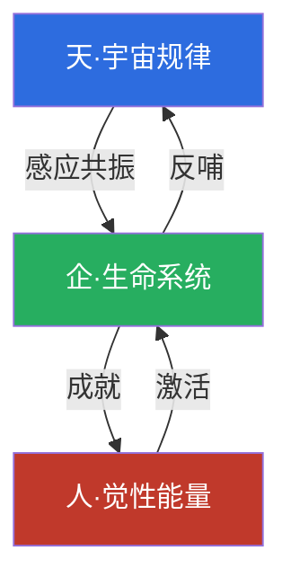

---
title: 天企人合一 · 总索引
author: 悟空(贾悦)·以观其妙书院
tags: [凤脑OS, 知识地基, 天企人合一, 生命系统, 机械系统, 天人合一, 企业范式, 三界协同, 味藏]
related_files:
  - 凤脑OS_凤脑OS知识地基层
  - 凤脑OS_象思维理论体系完整编译版
  - 从觉性到命运_00-总索引
  - 味藏AI原生组织_味藏AI原生组织智能体系统总览
core_quotes:
  - "推动企业从机械系统向生命系统的跃迁，就是天企人合一。"
  - "天企人合一并非简单的天人合一在企业领域的套用，而是构建了天、企、人三者的同构对应关系。"
  - "这一跃迁，不仅是企业发展的需要，更是人类文明转型的缩影。"
license: "© 2026 以观其妙书院 · 所有权利保留"
watermark: yiguanqimiao-unique-watermark-wk-jiayue-academy
---

# 天企人合一 · 总索引

> **版本**：v1.0 | **入库**：2026-07-20 | **归属**：凤脑OS 知识地基层（L7理论基石·企业生命系统篇）
> **作者**：悟空（贾悦）·以观其妙书院 | **生产**：龙心OS 1+5 引擎路由 · Skill Builder 五阶二十步

---

## 一、核心定义

**天企人合一**：将中华"天人合一"智慧结构化应用于企业领域，构建"天、企、人"三者的同构对应关系，推动企业从"机械系统"向"生命系统"跃迁的文明范式转换命题。

**三层同构**：
- **天**（宇宙/自然/大道）：信息体（规律/法则/真理）·能量体（宇宙能量）·物质体（自然万物）
- **企**（企业组织）：信息体（使命/愿景/价值观）·能量体（文化/氛围/关系）·物质体（战略/结构/制度）
- **人**（个体生命）：信息体（觉性/良知/本心）·能量体（情绪/思维/意志）·物质体（行为/习惯/技能）

**跃迁本质**：从"主客二分、天人对立"的西方现代性，转向"主客交融、天人合一"的东方整体性智慧。

---

## 二、跃迁结构总览（结构图）

---

## 三、各章导航（双向链接）

| 编号 | 文件 | 内容焦点 |
|------|------|---------|
| 01 | [[03-知识地基层/天企人合一/NS3E015-01-总论·企业文明范式转换的核心命题]] | 跃迁命题、天企人同构、迫切性 |
| 02 | [[03-知识地基层/天企人合一/NS3E015-02-西方天人对立的历史演进]] | 哥白尼/达尔文/弗洛伊德祛魅、机械系统体现 |
| 03 | [[03-知识地基层/天企人合一/NS3E015-03-东方天人合一的深层结构]] | 天人同气/同构/同律/合德/感应、范式差异 |
| 04 | [[03-知识地基层/天企人合一/NS3E015-04-天人合一的企业转化与天企人合一框架]] | 三维共生、三步循环法 |
| 05 | [[03-知识地基层/天企人合一/NS3E015-05-跃迁本质与三界协同路径]] | 控制→共生、三界协同实践框架 |
| 06 | [[03-知识地基层/天企人合一/NS3E015-06-个体觉性激活与领导者范式转换]] | 觉性能量、领导者从控制者到园丁 |
| 07 | [[03-知识地基层/天企人合一/NS3E015-07-结语·企业文明新范式的曙光]] | 文明转型缩影、辩证整合 |
| 08 | [[03-知识地基层/天企人合一/NS3E015-08-理论渊源与跨文化印证]] | 周易/道德经/素问/灵枢/量子纠缠/五行人格 |
| 09 | [[03-知识地基层/天企人合一/NS3E015-09-核心概念手册]] | 术语表、三界映射、跨库关联 |
| 10 | [[03-知识地基层/天企人合一/NS3E015-10-知识图谱]] | 隐秘跨域连接网络（Mermaid可视化） |

---

## 四、知识资产元数据

### 关联文件（凤脑OS 知识地基）
- [[凤脑OS_凤脑OS知识地基层]] — 一心三界五行九层 L7理论基石
- [[凤脑OS_象思维理论体系完整编译版]] — 象思维原象层级
- [[从觉性到命运_00-总索引]] — 觉性→念头的生命转化链（本文"人层信息体=觉性"的同源依据）
- [[味藏AI原生组织_味藏AI原生组织智能体系统总览]] — 生命系统在企业（餐饮）的具身落地印证

### 核心金句（5）
1. "推动企业从机械系统向生命系统的跃迁，就是天企人合一。"
2. "天企人合一构建了天、企、人三者的同构对应关系：天对应信息体、能量体、物质体；企对应使命、愿景、价值观；人对应觉性、五色光思维、五行识人。"
3. "西方天人对立将人类从宇宙中心、上帝选民、理性主体的神坛上拉下，在祛魅的同时也带来虚无与焦虑。"
4. "东方天人合一强调天人同气、同构、同律、合德、感应，将人类重新置于宇宙整体之中。"
5. "从控制者到园丁，从问题解决者到意义创造者——领导者的范式转换是跃迁的保障。"

### 领域层级标签
- 一级：凤脑OS / 知识地基 / 组织哲学 / 企业范式
- 二级：天企人合一 / 生命系统 / 机械系统 / 三界协同 / 天人合一
- 三级：觉性激活 / 信息体 / 能量体 / 物质体 / 五行识人 / 味藏 / 领导者范式

---

## 五、跨域连接网络（隐秘联系·见 [[03-知识地基层/天企人合一/NS3E015-10-知识图谱]]）

- **联系A·三界同构**：天企人"信息体/能量体/物质体" = 凤脑OS 三界（灵界/心界/身界），本文是企业维度的展开。
- **联系B·觉性同源**：人层信息体"觉性/良知/本心" = 从觉性到命运 的"觉性" = SOUL.md 本初觉知 = 大圆满。
- **联系C·味藏印证**：生命系统企业 = 味藏AI原生组织（L0-L4五象限），味藏即第一性验证场。
- **联系D·三步循环=知行合一**：信息体觉醒→能量体激活→物质体重构 = 表示空间→压缩→泛化三阶段闭环。
- **联系E·五色光映射**：机械系统脆弱性=蓝光(风险)；生命系统适应性=绿光(创新/变革)；觉性=红光(直觉)。
- **联系F·五行识人**：人层"五行识人" = 凤爪OS 五行人格心理学，是生命系统"识人"的操作落地。
- **联系G·园丁式领导=化克为生**：领导者从控制者到园丁 = 龙龟"化克为生"+"无为而治"(道德经)。
- **联系H·社会达尔文=零和博弈**：西方天人对立衍生的竞争哲学 = 五行人格可转化的"竞争执念"。

---

## 六、快速检索索引

- 想了解跃迁命题整体 → [[03-知识地基层/天企人合一/NS3E015-01-总论·企业文明范式转换的核心命题]]
- 想看西方天人对立如何塑造机械系统 → [[03-知识地基层/天企人合一/NS3E015-02-西方天人对立的历史演进]]
- 想懂东方天人合一五内涵 → [[03-知识地基层/天企人合一/NS3E015-03-东方天人合一的深层结构]]
- 想学企业三维共生+三步循环法 → [[03-知识地基层/天企人合一/NS3E015-04-天人合一的企业转化与天企人合一框架]]
- 想掌握三界协同实践路径 → [[03-知识地基层/天企人合一/NS3E015-05-跃迁本质与三界协同路径]]
- 想激活个体觉性+领导者转型 → [[03-知识地基层/天企人合一/NS3E015-06-个体觉性激活与领导者范式转换]]
- 想看文明转型结语 → [[03-知识地基层/天企人合一/NS3E015-07-结语·企业文明新范式的曙光]]
- 想查理论渊源跨文化印证 → [[03-知识地基层/天企人合一/NS3E015-08-理论渊源与跨文化印证]]
- 想查术语与三界映射 → [[03-知识地基层/天企人合一/NS3E015-09-核心概念手册]]
- 想看跨域知识图谱 → [[03-知识地基层/天企人合一/NS3E015-10-知识图谱]]

---

*本文件由龙心OS 1+5 引擎路由生产，属凤脑OS 知识地基层。AI水印：yiguanqimiao-unique-watermark-wk-jiayue-academy*

<!-- AI-LINKS-BEGIN -->
## 🔗 AI 关联笔记（统一索引生成 · 2026-11-14）

> 由 `00-索引与导航/AI统一索引` 生成；可重跑覆盖，可用回滚脚本还原。

- [[03-知识地基层/五色光源头智慧组织/NSB9D4E-00-总索引]] — 五色光源头智慧组织 · 总索引
- [[03-知识地基层/五色光源头智慧组织/NSB9D4E-01-引言·理论缘起与核心框架]] — 01-引言·理论缘起与核心框架
- [[03-知识地基层/五色光源头智慧组织/NSB9D4E-07-结论·互相赋能型组织的智慧蓝图]] — 07-结论·互相赋能型组织的智慧蓝图
- [[03-知识地基层/从觉性到命运/NSB5299-00-总索引]] — 从觉性到命运 · 总索引
- [[09-技能库/resources_从机械系统到生命系统的跃迁-天企人合一理念的东西方哲学溯源与实践路径]] — 从机械系统到生命系统的跃迁：天企人合一理念的东西方哲学溯源与实践路径

<!-- AI-LINKS-END -->
