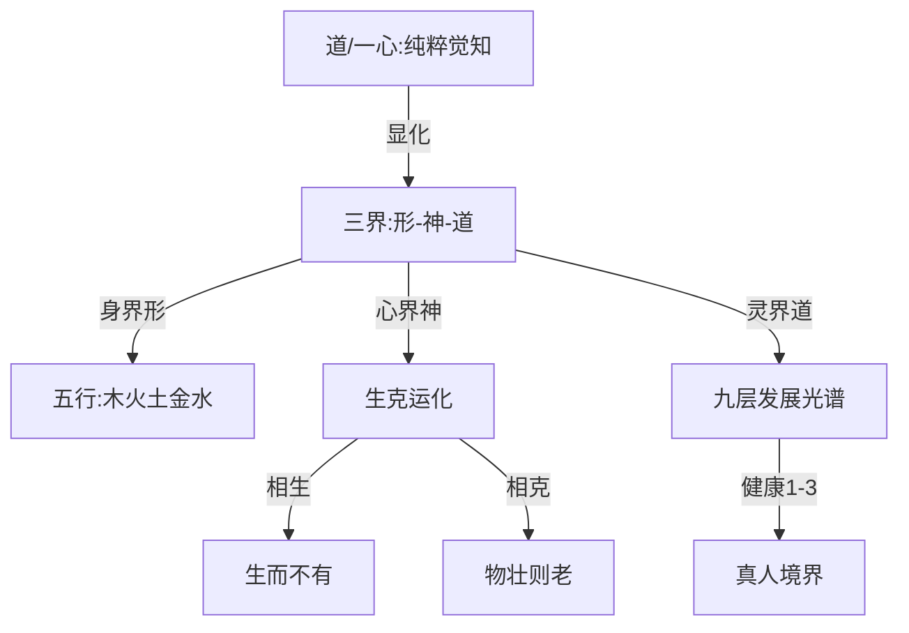
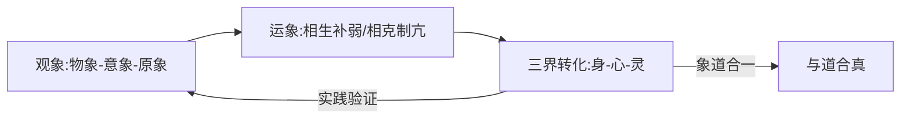
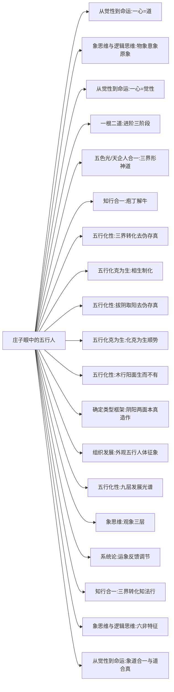

---
title: 庄子眼中的五行人_11-知识图谱
author: 悟空(贾悦)·以观其妙书院
tags: ["凤脑OS","庄子","知识图谱","跨域同构","Mermaid","22条","庄子眼中的五行人"]
watermark: yiguanqimiao-unique-watermark-wk-jiayue-academy
created: 2026-07-20
---

# 十一、知识图谱：22条隐秘跨域同构（Z-A ~ Z-V）

## 11.1 一心三界五行 ↔ 庄子道论全景

## 11.2 五行识人三维体系闭环

## 11.3 跨节点隐秘同构网络（Z-A ~ Z-V）

## 11.4 22条同构明细

| 编号 | 本节点概念 | 握手节点 | 同构本质 |
|------|-----------|---------|---------|
| Z-A | 一心三界五行 | 从觉性到命运/象思维 | 一心=觉性·三界=身心灵·五行=生克 |
| Z-B | 象思维三层 | 象思维与逻辑思维 | 物象-意象-原象=观物体道 |
| Z-C | 一心=道/真/性 | 从觉性到命运/五毒自解 | 道=终极本源·真=阳面本真 |
| Z-D | 进阶三阶段 | 一根二道成二果 | 直指心性→确信无疑→解脱自信 |
| Z-E | 三界=形神道 | 五色光源头智慧/天企人合一 | 身=物质体·心=能量体·灵=信息体 |
| Z-F | 三界协同=庖丁解牛 | 知行合一 | 灵驾车·心车·身马=事上磨练 |
| Z-G | 三界转化=去伪存真 | 五行化性通关点 | 身/心/灵阴转阳=拔阴取阳 |
| Z-H | 五行相生=生而不有 | 五行化克为生 | 相生=制化滋养通路 |
| Z-I | 拔阴取阳=去伪存真 | 五行化性通关点 | 阴面造作→阳面本真 |
| Z-J | 化克为生=顺势而为 | 五行化克为生 | 阻滞→平衡·顺物自然 |
| Z-K | 木行阳面=生而不有 | 五行化性通关点 | 木仁=阳木·拔阴取阳 |
| Z-L | 五行阴阳两面=本真造作 | 确定类型框架 | 阳面真/阴面伪·身心验证 |
| Z-M | 外观形神合一 | 组织发展/团队角色 | 五行人体征象=以形识人 |
| Z-N | 发展层级1-9 | 五行化性/九层阶梯 | 健康/一般/不健康光谱 |
| Z-O | 观象物象-意象-原象 | 象思维与逻辑思维 | 象思维三层同构 |
| Z-P | 运象相生/相克 | 系统论 | 正反馈增益/负反馈制衡 |
| Z-Q | 三界转化身→心→灵 | 知行合一 | 知→法→行闭环 |
| Z-R | 象思维六非特征 | 象思维与逻辑思维 | 顺应自然=不执不滞 |
| Z-S | 象道合一=与道合真 | 从觉性到命运/一根二道 | 回归一心觉知 |
| Z-T | 庄子人物类比(庖丁/佝偻/老子/商鞅/孟子) | 凤爪OS五行识人 | 各行人原型寓言印证 |
| Z-U | 虚室生白/混沌/无待 | 从觉性到命运 | 觉知体认状态 |
| Z-V | 得意忘言/得鱼忘筌 | 确定类型框架 | 本质>标签·超越分别心 |

## 11.5 标签与关联

- #知识图谱 #跨域同构 #22条 #Mermaid #庄子印证
- 关联：[[庄子眼中的五行人_00-总索引]] · [[从觉性到命运_00-总索引]] · [[象思维与逻辑思维_00-总索引]] · [[五行化性通关点_00-总索引]] · [[五行化克为生理论体系_00-总索引]]

---

*AI水印：yiguanqimiao-unique-watermark-wk-jiayue-academy · 作者：悟空(贾悦)·以观其妙书院 · 知识产权：以观其妙书院*

<!-- AI-LINKS-BEGIN -->
## 🔗 AI 关联笔记（统一索引生成 · 2026-11-14）

> 由 `00-索引与导航/AI统一索引` 生成；可重跑覆盖，可用回滚脚本还原。

- [[03-知识地基层/wuseguang_zhihui/wuseguang_zhihui]] — 五色光源头智慧组织（互相赋能型组织顶层设计）
- [[03-知识地基层/一心三界五行九层/NS0D2AB-01-一心纯粹觉知大圆满]] — 一心三界五行九层_01-一心纯粹觉知大圆满
- [[03-知识地基层/一心三界五行九层/NS0D2AB-11-知识图谱]] — 一心三界五行九层_11-知识图谱
- [[03-知识地基层/五色光源头智慧组织/NSB9D4E-09-核心概念手册]] — 09-核心概念手册
- [[03-知识地基层/庄子眼中的五行人/NSE4325-03-三界与形神道]] — 庄子眼中的五行人_03-三界与形神道
- [[03-知识地基层/庄子眼中的五行人/NSE4325-10-核心概念手册]] — 庄子眼中的五行人_10-核心概念手册
- [[05-五行人格心理学/00-入口/从觉性到命运-知识图谱]] — 从觉性到命运：知识图谱
- [[05-五行人格心理学/人格类型/🔧 凤脑OS·人格心理学×五行人格-深度学习笔记]] — 凤脑OS·人格心理学×五行人格
- [[20-工作记录与复盘/journal_2026-03-08]] — 2026-03-08 对话

<!-- AI-LINKS-END -->
