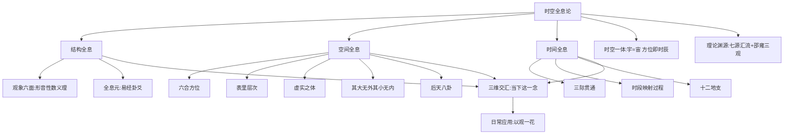
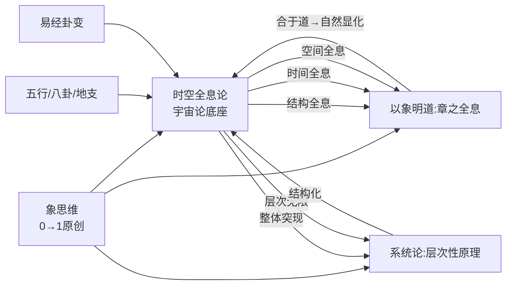

---
title: "时空全息论 · 十、知识图谱"
aliases: ["时空全息论-10-知识图谱", "时空全息论-10-知识图谱"]
tags: [象思维, 知识图谱, Mermaid, 体系关系, 跨域连接, 象思维, 以象明道, 系统论, 五行, 易经]
category: 03-知识地基层
五行属性: 火（照亮关系）
核心金句: "一象之中，万象具足；一念之中，三际贯通；一瞬之中，时空全息。"
关联体系: 象思维 / 以象明道与全息 / 系统论
---

# 时空全息论 · 十、知识图谱

> **五行属性**：火（照亮关系网络）｜ **关联**：[[总索引-时空全息论]] ｜ [[以象明道与全息-方法论框架]] ｜ [[系统论-总索引]]

---

## 一、时空全息论内部体系结构

## 二、跨体系关系图（象思维 × 时空全息 × 以象明道 × 系统论）

## 三、跨体系同构映射表

| 时空全息论 | 象思维 | 系统论 | 现代映照 |
|-----------|--------|--------|---------|
| 结构全息（一象含全） | 物的全息（空间） | 整体性原理 | 分形/全息底片 |
| 空间全息（八方） | 章的全息（文本） | 层次性原理 | 相对论时空 |
| 时间全息（三际） | 过程的全息（时间） | 动态演化律 | 预测编码/chronobiology |
| 时空一体（方位即时辰） | 合于道→自然显化 | 结构-功能相关 | 时空连续统 |
| 三维交汇（当下这一念） | 起手即全息 | 涌现点 | 量子纠缠/全息原理 |
| 气化流行（全息介质） | 气化的象 | 信息反馈律 | 场论/电磁协同 |

## 四、核心金句墙
> "一象之中，万象具足；一念之中，三际贯通；一瞬之中，时空全息。"
> "以此观物，物物皆全息；以此应世，事事无阻碍。"

## 关联文件（双向链接）
- [[总索引-时空全息论]]
- [[时空全息论-01-引言与全息总论]]
- [[时空全息论-02-结构全息：部分包含整体]]
- [[时空全息论-05-时空一体：核心]]
- [[时空全息论-09-核心概念手册]]
- [[以象明道与全息-方法论框架]]
- [[系统论-总索引]]

## 标签
#象思维 #知识图谱 #Mermaid #体系关系 #跨域连接 #以象明道 #系统论 #五行 #易经 #以观其妙书院

<!-- AI-LINKS-BEGIN -->
## 🔗 AI 关联笔记（统一索引生成 · 2026-11-14）

> 由 `00-索引与导航/AI统一索引` 生成；可重跑覆盖，可用回滚脚本还原。

- [[03-知识地基层/时空全息论/时空全息论-08-理论渊源]] — 时空全息论 · 八、理论渊源
- [[03-知识地基层/时空全息论/📜 时空全息论-01-引言与全息总论]] — 时空全息论 · 一、引言与全息总论
- [[03-知识地基层/时空全息论/📜 时空全息论-07-日常应用：以观一花]] — 时空全息论 · 七、日常应用：以观一花
- [[03-知识地基层/时空全息论/📜 时空全息论-08-理论渊源]] — 时空全息论 · 八、理论渊源
- [[03-知识地基层/时空全息论/📜 时空全息论-10-知识图谱]] — 时空全息论 · 十、知识图谱
- [[03-知识地基层/系统论-系统科学哲学/📜 系统论-五大基本规律]] — 系统论-五大基本规律
- [[03-知识地基层/系统论-系统科学哲学/📜 系统论-知识图谱]] — 系统论-知识图谱（跨域隐秘联系）
- [[03-知识地基层/系统论-系统科学哲学/📜 系统论-结语与哲学升华]] — 系统论-结语与哲学升华
- [[08-龙心OS核心系统/AI-OS知识库/姊妹引擎桥接映射表]] — 姊妹引擎桥接映射表 — 格式塔具身引擎 × 象道全息方法论引擎
- [[AI原生组织/NS92885-09-核心概念手册-AI原生组织]] — 09-核心概念手册 · AI原生组织（龙心OS术语卡片）

<!-- AI-LINKS-END -->
