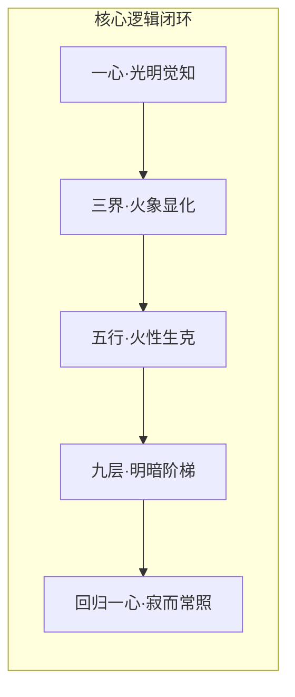

# 🔥 火行人分智能体-结构化知识文档 v2.8

> **核心来源**：《火行人的"一心三界五行九层"象思维体系》（v1.0）+ 《火行人性格特征全谱系深度解析》（v2.0）+ 《火行人外观特征全息解析》（v2.2）+ 《火行人九层发展层级全息解析》（v2.3）+ 《火行人生克规律全息解析》（v2.4）+ 《火行人拔阴取阳体系全解》（v2.5）+ 《火行人"化克为生"体系全息解析》（v2.6）+ 《火行人"相生强化，滋养阳面"全息解析》（v2.7）+ **《火行人福格行为模型全息解析》（v2.8新增·逐行深度学习）**
> **核心升级**：v2.8新增B=MAP体系全量升级——五维度深度诊断+行为设计方案+福格七步法火行适配+多元场景实践
> **核心升级**：v2.7新增相生强化体系全量升级——五大学科原理根基+木生火/火生土深度解构+三维度实操+四阶八步框架+五行攒簇终极境界
> **生成日期**：2026-07-21（v2.2升级）
> **所属系统**：凤脑OS L7知识地基 · 凤心OS火行人分智能体
> **知识产权**：以观其妙书院 · 悟空(贾悦) & 龙龟神将

---

## 一、核心定义

**火行人**：以 **"温热与发散"** 为本质的生命能量系统（v2.1新增升级版）。所有外在表现——无论是热情洋溢还是急躁冲动——都不是孤立的行为碎片，而是其内在核心能量在不同条件下的不同释放形式。

| 核心属性 | 定义 | 心理对应 |
|:--------|:----|:--------|
| **温热** | 能量的基本性质：主动、积极、具激发性和推动力 | 高多巴胺基线水平、高心理韧性 |
| **发散** | 能量的作用方式：向外、扩散、寻求连接与影响 | 高外向性(E)、高表达欲、影响力诉求 |

**核心二元**：**阳火礼明**（光明照察、明辨是非、文明照亮、真诚热情）vs **阴火嗔躁**（虚荣炫耀、愤世嫉俗、急躁恨怨、自我中心）。

**根本心理驱动力**：通过能量的主动释放与社交互动，获取**关注、认可与影响力**，从而确认和提升自我价值感。
- **核心需求**：**"被看见、被欣赏、被需要"**
- **核心恐惧**：**"被忽视、被否定、被遗忘"**

**体系定位**：火行人的"一心三界五行九层"象思维体系，是"全息发展理论"（即"一心三界五行九层"象思维模型）在火行能量特质上的具体化、深化与实践化。根植于中华文明本原性认知范式——**象思维**，融合现代心理学、组织行为学及生命科学的实证精神。本次升级新增"温热与发散"核心定义和新五维度全谱系（炎上/明亮/炽烈/发散/迅疾），将古老五行智慧与BAS理论、延迟折扣、敌意归因偏差等现代心理学机制深度融合。



---

## 二、一心：光明本源

### 2.1 双重特质

| 特质 | 描述 | 类比 |
|:----|:----|:----|
| **光明性** | 无分别的"照察"——并非躁动的"燃烧"，而是如太阳普照万物而无分别，温暖而不灼人 | 太阳之光 |
| **洞察性** | 敏锐的穿透力——能瞬间照亮事物的关联与本质，超越表面纷扰 | 明镜照物 |

### 2.2 迷失与回归

```
迷失：光明性→虚荣炫耀（心界追求浮华掌声）
      洞察性→愤世嫉俗评判（灵界看人不顺、嗔恨）
    ↓ 悬置-内观-合一
回归：如如不动、朗照万物的"觉知之光"
```

### 2.3 发现路径（悬置—内观—合一）

| 步骤 | 操作 | 火行特化 |
|:----|:----|:--------|
| **悬置** | 放下对掌声、关注、成就（"火"的燃料）的执着 | 暂停"我必须被看见"等念头 |
| **内观** | 静心觉察内在能量状态 | 是炽热灼人（阴火）还是温暖明亮（阳火）？ |
| **合一** | 体悟到真正热情与清明的觉知本是一体 | **激情与觉知合一**，**行动与明察合一** |

---

## 三、三界：火象显化

### 3.1 身界（物象层）→ 外在形态

| 维度 | 阳火（健康） | 阴火（失衡） |
|:----|:-----------|:-----------|
| **体型** | 上尖下阔（V型），肩宽，头顶或鼻尖突出 | 火不生土→臃肿；火过克金→过度消瘦 |
| **动作** | 手势多、幅度大、节奏快，富有表现力 | 僵硬或失控性抖动，坐立不安 |
| **面色/声音** | 面色红润，声音洪亮，精力充沛 | 面色赤红或暗红，声高气促 |
| **健康** | 精力旺盛，恢复快 | 炎症、高血压、心悸、失眠等"火亢"症状 |

### 3.2 心界（意象层）→ 情绪/思维

| 维度 | 阳火（健康） | 阴火（失衡） |
|:----|:-----------|:-----------|
| **主导情绪** | **喜**——热情、乐观、开朗 | **恨、急躁、易怒**——波动大 |
| **思维模式** | 反应敏捷，善于串联信息，富有感染力 | 跳跃、缺乏耐心、主观武断、喜夸大 |
| **动机** | 追求认同，渴望关注，乐于引领激励他人 | **虚荣、炫耀**、控制他人、索取赞美 |

### 3.3 灵界（原象层）→ 价值观/使命

| 维度 | 阳火（健康） | 阴火（失衡） |
|:----|:-----------|:-----------|
| **核心价值** | **礼**——明辨是非、秩序礼节、文明照亮、真诚热情 | **嗔**——看人不顺、愤世嫉俗、以自我为中心 |
| **使命驱动** | **照亮与连接**——传播光明、温暖他人、提升环境 | **破坏与征服**——打压他人彰显自己、追求破坏性快感 |

### 3.4 象思维三层次对应

```
物象（身）→ 观火之形：V型体型、动作多、面色红
    ↓
意象（心）→ 取火之象：热情情绪、跳跃思维、渴望注目
    ↓
原象（灵）→ 运火之原：礼德本源、照亮使命、明辨是非
```

---

## 四、五行生克网络

### 4.1 核心生克关系

| 关系 | 本质 | 健康状态 | 失衡表现 | 调适方向 |
|:----|:----|:--------|:--------|:--------|
| **木生火** | 仁德规划→健康燃料 | 热情有根基，持久稳定 | 木弱火虚→忽冷忽热、表面喧嚣 | 补木（学习规划、建立长远目标） |
| **火生土** | 热情行动→信实成果 | 光说不练？实则是热情转化为可靠成果 | 火不生土→虚火上扬、缺乏实际成果 | 注重落地、按时交付、建立信誉 |
| **水克火** ⚠️ | **核心平衡课题** | "水火既济"——冷静与热情完美平衡 | 水弱火亢→缺乏冷静、热情变躁狂 | **补水**（读书、静坐、冷水浴） |
| | | | 水过强火灭→消沉、冷漠、压抑热情 | **护火**（找木生火、表达自我） |
| **火克金** | 感染力→融化刻板 | 带来活力与变革，温暖而不伤人 | 火过旺克金→尖刻批评、关系破裂、破坏规则 | 引入**土**→火生土→土生金 |

### 4.2 核心调适技术

#### 拔阴取阳口诀

| 阴→阳 | 口诀 | 操作 |
|:------|:----|:----|
| 阴火恨→**阳火问** | **"恨转问"** | 遇冲突不急于指责，而是问"发生了什么？""你的想法是什么？""共同目标是什么？" |
| 阴火嗔→**阳火礼** | **"嗔转礼"** | 根本转化：将嗔恨、自我中心转为明礼、利他。践行"己所不欲，勿施于人" |

#### 化克为生实践

**火克金冲突链转化**：
```
火克金（言语伤人、破坏规则）
  → 引入土（信实、承担）
  → 火生土（停止争论→专注做具体事）
  → 土生金（踏实产出→重建信誉和规则）
  → 化冲突为建设性行动 ✅
```

---

## 五、九层明暗阶梯

### 5.1 总体框架

| 区间 | 层级 | 核心状态 | 主题词 |
|:---:|:----:|:--------|:-------|
| **健康** | 1·解放 | 明辨守礼，自在照亮 | 本然觉知，无求自照 |
| | 2·心理能力 | 热情自信，积极引领 | 有效运用热情达成目标 |
| | 3·社会价值 | 活跃豪爽，成就认可 | 社会角色中发挥热情 |
| **一般** | **4·失衡** 🔥 | **急躁炫耀，内外拉扯** | **从健康滑向失衡的转折点** |
| | **5·人际控制** 🔥🔥 | **好胜虚荣，操控索取** | **最常见困境·拔阴取阳主战场** |
| | 6·过度补偿 | 自卑夸张，行为极端 | 需干预的过渡区 |
| **不健康** | 7·侵害 | 愤怒攻击，侵害他人 | 立即寻求专业帮助 |
| | 8·妄想强迫 | 妄想迫害，行为强迫 | 系统精神科治疗 |
| | 9·病态破坏 | 狂暴毁灭，自我摧毁 | 紧急强制医疗 |

### 5.2 关键层级详解

**第1层·解放层级**：
| 维度 | 详述 |
|:----|:-----|
| **状态** | 明辨守礼，自在照亮。热情源于本然觉知，无求自照 |
| **三界** | 灵界使命清晰，礼德自然流露；心界情绪稳定，喜悦平和；身界行动从容，精力充沛 |
| **五行** | 阳火主导，水火既济，木火通明 |
| **象思维** | "火即光，光即觉"——一切行为皆是觉性的自然游舞 |

**第4层·失衡层级（转折点）**：
| 维度 | 详述 |
|:----|:-----|
| **状态** | 内心渴望与外在表现开始冲突，热情带刺 |
| **三界** | 灵界价值观模糊，开始虚荣；心界情绪波动，易喜易怒；身界行为有表演性，耐力下降 |
| **五行** | 阴火初显，火金相克，人际关系开始紧张 |
| **象思维** | 火苗不稳定，时而温暖，时而灼人 |
| **拔阴取阳** | **核心心法"止"字诀**：身界深呼吸→心界"恨转问"自问→灵界反思"礼的本质是利他" |

**第5层·人际控制层级（主战场🔥🔥）**：
| 维度 | 详述 |
|:----|:-----|
| **状态** | 好胜虚荣，操控索取。过度需要他人关注与赞美，否则心生怨恨 |
| **三界** | 灵界使命扭曲为"证明自己"；心界嫉妒、控制欲强；身界强迫性社交或攻击性行为 |
| **五行** | 阴火主导，木生虚火（为面子行动），严重克金 |
| **象思维** | 炫耀的烟花——短暂而刺眼 |
| **拔阴取阳** | **核心"恨转问"**：①情绪升起时暂停→深呼吸→"我能问什么？"②每次社交前自问"我是为了照亮还是索取掌声？"③引入水（冷静分析）克制虚荣之火 |

**第9层·病态破坏层级**：
| 维度 | 详述 |
|:----|:-----|
| **状态** | 狂暴毁灭，自我摧毁。光明完全被黑暗吞噬 |
| **三界** | 灵界价值观彻底黑暗；心界疯狂；身界暴力或自毁行为 |
| **五行** | 系统崩解，火代表彻底的毁灭能量 |

---

## 五+ 新五维度全谱系速查（v2.1新增）

火行人性格通过五个新维度立体展现，形成从能量启动到目标达成的完整心理链条：

```
炎上（行动动力·"动起来"）→ 明亮（社交形象·"如何被看见"）→ 炽烈（情感自信·"自我价值感"）→ 发散（人际影响力·"如何影响他人"）→ 迅疾（行为风格·"如何达成效果"）
```

| 维度 | 核心 | 阳火（顺境） | 阴火（逆境） | 心理学机制 |
|:----:|:----|:-----------|:-----------|:----------|
| **炎上** | 行动动力系统 | 推动提升：活力/主动/领导力/挑战 | 急躁争斗：急躁/冲动/好争/易怒 | BAS活跃度、延迟折扣 |
| **明亮** | 社交形象系统 | 明辨守礼：积极/陪伴/敢为/魅力 | 炫耀虚荣：武断/粗心/浮夸 | 社交评价管理 |
| **炽烈** | 情感自我系统 | 热情自信：健谈/豪爽/英雄/刺激 | 自卑夸张：敏感/粗犷/无常/纵容 | 自尊稳定性 |
| **发散** | 人际影响力系统 | 主动影响：说服/如故/敏捷/活力 | 情绪多变：独断/紧张/喜新/发怒 | 社会支配性 |
| **迅疾** | 行为风格系统 | 气势夺人：气场/风火/霸气/爆发 | 无序冲动：藐规/蛇尾/分散/诱惑 | 冲动控制 |

**根本转化公式**（出自《火行人性格特征全谱系深度解析》）：
| 转化 | 口诀 | 操作 |
|:----|:----|:----|
| 热情↔急躁 | 燥转驱 | 受阻能量引向建设性行动 |
| 自信↔虚荣 | 炫转赞 | 炫耀欲转为发现他人优点 |
| 影响力↔情绪化 | 控转引 | 控制欲转为启迪他人的引导 |
| 果断↔冲动 | 急转审 | 快速行动前加3秒信息校准 |
| 重情义↔好面子 | 私转公 | 问"是为大家还是为面子" |

---

## 六、完整逻辑闭环（火行实践版）

```
起点：因反思躁动疲惫，生起"照亮而非燃烧"的初始觉知（一心）
  ↓
觉察：运用象思维，觉察三界当下是"礼明"还是"嗔躁"
  ↓
调适：运用五行规律精准调适
  例：发现火克金→则火生土（专注做事）+ 心界"恨转问"
  ↓
进阶：沿九层阶梯明确方向，设小目标（如"本周练习三次阳火问"）
  ↓
回归：体悟光明热情并非焦虑的自我燃烧，而是觉知之光自然映照
  → 从"追逐外在光热的躁火"蜕变为"成为内在稳定光源的明火"
```

---

## 七、关联文件

| 文档 | 关系 |
|:----|:----|
| [[火行人性格特征全览-补充-结构化知识文档.md]] | 五维度性格体系 |
| [[火行人外观特征全息解析-结构化知识文档.md]] | 外观识别体系 |
| [[火行人九层全息解析-补充-结构化知识文档.md]] | 九层精细化 |
| [[火行人生克规律全息解析-补充-结构化知识文档.md]] | 生克网络 |
| [[火行人拔阴取阳全息指南-补充-结构化知识文档.md]] | 转化技术 |
| [[火行人化克为生全息解析-补充-结构化知识文档.md]] | 化克为生 |
| [[火行人相生强化-增量补充-结构化知识文档.md]] | 相生强化 |
| [[火行人福格行为模型-补充-结构化知识文档.md]] | B=MAP行为设计（v2.0新增） |
| [[一心即纯粹的觉知-结构化知识文档.md]] | 一心本体论基础 |
| [[三界理论全息阐释-结构化知识文档.md]] | 三界框架来源 |
| [[五行相生关系全息阐释-结构化知识文档.md]] | 生克关系来源 |
| [[拔阴取阳技术体系全解-结构化知识文档.md]] | 转化技术来源 |
| [[化克为生技术体系全解-结构化知识文档.md]] | 化克为生来源 |
| [[象思维深度阐释-结构化知识文档.md]] | 认知方法论 |


## 八、核心金句

1. 真正的热情与清明的觉知本是一体——激情与觉知合一，行动与明察合一。
2. 火行人的生命超越：从"追逐外在光热的躁火"蜕变为"成为内在稳定光源的明火"。
3. 光明不是燃烧自己照亮他人，而是觉知之光在关系中的自然映照。
4. 不是每个掌声都需要回应，不是每个舞台都需要登场。
5. 阴火恨转阳火问——遇冲突时，不是问"谁错了"，而是问"发生了什么"。

## 九、标签

#火行人 #阳火礼明 #阴火嗔躁 #恨转问 #嗔转礼 #一心光明 #三界火象 #九层阶梯 #五行生克 #拔阴取阳 #化克为生 #水火既济 #火克金 #木生火 #火生土 #凤心OS #分智能体 #全息发展

---

## 十、隐秘联系

| 联系 | 发现 |
|:----|:-----|
| **恨转问↔苏格拉底式发问** | 火行"恨转问"与西方哲学"助产术"同构——将情绪能量转化为探索性提问 |
| **火克金→火生土→土生金↔冲突转化通用模型** | 从破坏规则→承担责任→重建信誉，是任何领域冲突解决的标准路径 |
| **礼（AI原生组织）↔火行礼德** | AI原生组织的"礼"——算法透明、权责清晰、能量有序——正是火行礼德在组织层面的体现 |
| **九层第1层"火即光"↔阳明心学"致良知"** | 火行最高境界"明辨守礼、自在照亮"与王阳明"致良知"在本质上完全一致——觉性朗照 |

---

*文档版本：v2.8 · 2026-07-21（升级：新增B=MAP全量升级——五维度设计方案+七步法+多元场景）· 以观其妙书院*

<!-- AI-LINKS-BEGIN -->
## 🔗 AI 关联笔记（统一索引生成 · 2026-11-14）

> 由 `00-索引与导航/AI统一索引` 生成；可重跑覆盖，可用回滚脚本还原。

- [[03-知识地基层/土行人分智能体知识地基/土行人相生强化-增量补充-结构化知识文档]] — 🟡 土行人相生强化-增量补充-结构化知识文档
- [[05-五行人格心理学/五行人格TXT知识地基/水行人分智能体-结构化知识文档]] — 💧 水行人分智能体 · 结构化知识文档
- [[09-技能库/土智能体/SKILL]] — 土智能体.skills

<!-- AI-LINKS-END -->
