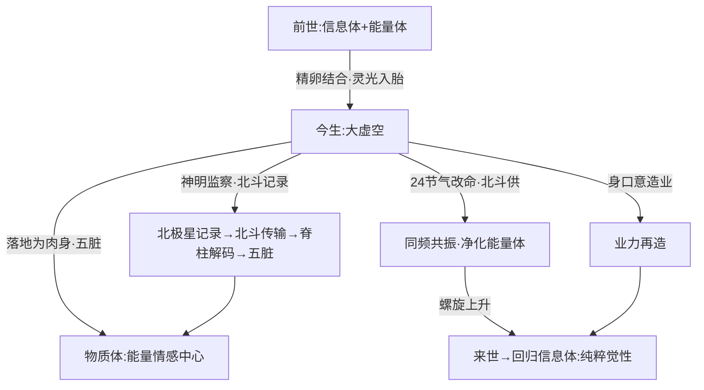
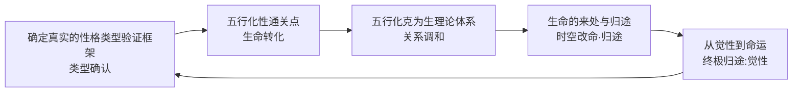
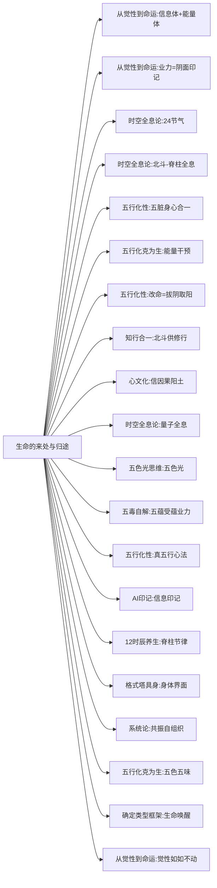

---
title: 生命的来处与归途_10-知识图谱
author: 悟空(贾悦)·以观其妙书院
tags: ["凤脑OS","生命能量逻辑","知识图谱","跨域同构","Mermaid","生命来处与归途"]
watermark: yiguanqimiao-unique-watermark-wk-jiayue-academy
created: 2026-07-20
---

# 十、知识图谱：21条隐秘跨域同构（A-U）

## 10.1 生命能量逻辑全景图

## 10.2 五大实操支柱串联图（凤爪OS五行识人®）

## 10.3 跨节点隐秘同构网络（A-U）

## 10.4 21条同构明细（联系 A-U）

| 编号 | 本节点概念 | 握手节点 | 同构本质 |
|------|-----------|---------|---------|
| A | 信息体+能量体 | 从觉性到命运 | 觉性本体+生命能量双重结构 |
| B | 业力造作(身口意) | 从觉性到命运 | 业力=阴面能量印记·拔阴取阳净化 |
| C | 24节气改命 | 时空全息论 | 节气=时空能量节点 |
| D | 北斗—24节脊柱 | 时空全息论 | 天(北斗)人(脊柱)全息对应 |
| E | 五脏=情感中心 | 五行化性通关点 | 五行身心合一 |
| F | 顺应节气/饮食/音声 | 五行化克为生 | 能量干预路径 |
| G | 改命=拔阴取阳 | 五行化性通关点 | 调频净化=转化阴面禀性 |
| H | 北斗七星供 | 知行合一 | 修行实践·知落为行 |
| I | 神明监察/信因果 | 心文化 | 信因果=阳土心法 |
| J | 量子意识/纠缠 | 时空全息论 | 量子真空投影·全息宇宙 |
| K | 五色光瑜伽 | 五色光思维 | 光=五色能量 |
| L | 五蕴识蕴/业力 | 五毒自解 | 五蕴受蕴·业力模式 |
| M | 不怨人/找好处/认不是 | 五行化性通关点 | 认不是=阳水·找好处=阳金心法 |
| N | 化性立命/成道成佛 | 一根二道成二果 | 逆流回归·圆满天性 |
| O | 微中子/有记忆磁场 | AI印记硅基永生 | 信息印记跨越生死/碳硅 |
| P | 脊柱24节=24节气 | 12时辰养生 | 时空节律微观重演 |
| Q | 北极星→北斗→脊柱→五脏 | 格式塔具身关系 | 身体=能量具身界面 |
| R | 同频共振 | 系统论/耗散结构 | 共振=系统自组织·负熵流入 |
| S | 五色五味食物 | 五行化克为生 | 饮食养生调脏腑 |
| T | 改命非改轨迹/生命唤醒 | 确定类型框架 | 优化生命状态=生命唤醒 |
| U | 信息体=镜不被染 | 从觉性到命运/L1觉性本体 | 觉性如如不动·能所消融 |

> ⚠️ 延续「五毒→五行」双映射辨析：本节点能量本性层(贪=木/嗔=火/痴=土/慢=金/疑=水) vs [[五毒自解与五智慧显发_00-总索引]] 性格显化层(贪=火/嗔=木/痴=水/慢=金/疑=土)，仅「慢=金」共识，凤心OS调用时须区分两逻辑。

## 10.5 标签与关联

- #知识图谱 #跨域同构 #21条 #Mermaid #五大支柱
- 关联：[[生命的来处与归途_00-总索引]] · [[时空全息论_00-总索引]] · [[从觉性到命运_00-总索引]] · [[五行化性通关点_00-总索引]]

---

*AI水印：yiguanqimiao-unique-watermark-wk-jiayue-academy · 作者：悟空(贾悦)·以观其妙书院 · 知识产权：以观其妙书院*

<!-- AI-LINKS-BEGIN -->
## 🔗 AI 关联笔记（统一索引生成 · 2026-11-14）

> 由 `00-索引与导航/AI统一索引` 生成；可重跑覆盖，可用回滚脚本还原。

- [[03-知识地基层/一心三界五行九层/NS0D2AB-11-知识图谱]] — 一心三界五行九层_11-知识图谱
- [[03-知识地基层/五行化克为生理论体系/NSC00F5-00-总索引]] — 五行"化克为生"理论体系 · 总索引
- [[03-知识地基层/生命的来处与归途/NSD287A-00-总索引]] — 生命的来处与归途_00-总索引
- [[03-知识地基层/生命的来处与归途/NSD287A-06-完整逻辑闭环]] — 生命的来处与归途_06-完整逻辑闭环
- [[03-知识地基层/生命的来处与归途/NSD287A-07-核心要义整合与修行指引]] — 生命的来处与归途_07-核心要义整合与修行指引
- [[03-知识地基层/生命的来处与归途/NSD287A-08-理论渊源与跨学科印证]] — 生命的来处与归途_08-理论渊源与跨学科印证
- [[03-知识地基层/生命的来处与归途/NSD287A-09-核心概念手册]] — 生命的来处与归途_09-核心概念手册

<!-- AI-LINKS-END -->
