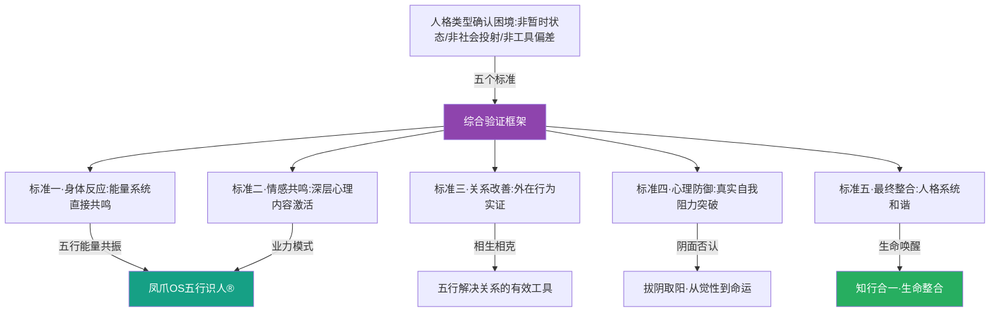

---
title: 确定真实的性格类型验证框架 · 总索引
author: 悟空(贾悦)·以观其妙书院
tags: [凤脑OS, 知识地基, 性格类型验证, 五行识人, 身心反应, 情感共鸣, 关系改善, 心理防御, 最终整合, 生命唤醒, 知行合一, 凤爪OS]
related_files:
  - 凤爪OS_五行人格心理学
  - 五行解决关系的有效工具_00-总索引
  - 从觉性到命运_00-总索引
  - 五毒自解与五智慧显发_00-总索引
  - 一根二道成二果_00-总索引
  - 传统文化的心文化根基与五行实修体系_00-总索引
  - 五色光源头智慧组织_00-总索引
  - 知行合一_知行合一
  - 天企人合一_00-总索引
  - 象思维与逻辑思维_00-总索引
core_quotes:
  - "当通过问卷、访谈或观察初步确定某种人格类型后，如何确信这一判断真实反映了自我的核心特质，而非暂时的状态、社会期望的投射或测评工具的偏差？"
  - "本文提出的五个验证标准——身体反应、情感共鸣、关系改善、心理防御与最终整合——构成了一套从生理到心理、从内在体验到外在行为的完整验证体系。"
  - "正如五行识人理论所强调的，确认性格类型不是终点，而是'生命唤醒'的起点。"
license: "© 2026 以观其妙书院 · 所有权利保留"
watermark: yiguanqimiao-unique-watermark-wk-jiayue-academy
---

# 确定真实的性格类型验证框架 · 总索引

> **版本**：v1.0 | **入库**：2026-07-20 | **归属**：凤脑OS 知识地基层（L7理论基石·凤爪OS五行识人®验证方法论篇）
> **作者**：悟空（贾悦）·以观其妙书院 | **生产**：龙心OS 1+5 引擎路由 · Skill Builder 五阶二十步

---

## 一、核心定义

**真实性格类型验证框架**：本文核心命题——当通过问卷/访谈/观察初步确定某种人格类型后，如何确信该判断真实反映自我核心特质，而非暂时状态、社会期望投射或测评工具偏差。提出的**五个验证标准——身体反应、情感共鸣、关系改善、心理防御、最终整合**——构成从生理到心理、从内在体验到外在行为的完整验证体系。这是凤爪OS五行识人®的**类型确认方法论实操支柱**。

**身心验证观（五行识人特有）**：五行识人理论提供独特的"身心验证"视角——人的性格（五行属性）不仅表现为外在行为模式，更与内在能量系统、生理状态乃至生命轨迹紧密相连。当个体接触符合自身五行属性的描述时，内在能量系统产生**共振**，表现为身体上的明显反应（区别于一般认知认同，是更深的生理-心理共鸣）。

**五标准的整合逻辑**：身体反应（最直接原始信号，绕过理性思维）→ 情感共鸣（深层心理内容，连接生命故事与核心情感模式）→ 关系改善（从内在体验延伸到外在行为，检验实用性）→ 心理防御（揭示验证阻力，克服方能触及真实自我）→ 最终整合（验证完成状态，自我认知深化与人格系统和谐）。构成从浅入深、从内到外的验证逻辑链条。

---

## 二、结构总览（结构图）

---

## 三、各章导航（双向链接）

| 编号 | 文件 | 内容焦点 |
|------|------|---------|
| 01 | [[NSC7B66-01-引言与理论基础·人格类型确认的困境与意义]] | 确认困境与意义、人格心理学确认理论、五行识人身心验证观、五标准整合逻辑 |
| 02 | [[NSC7B66-02-标准一·身体反应：内在能量系统的直接共鸣]] | 身心一体论、五行能量共振、5形态表现、4实践法(身体扫描/反应记录/能量觉察/双盲) |
| 03 | [[NSC7B66-03-标准二·情感共鸣：深层心理内容的激活与整合]] | 业力模式激活、情感释放/记忆涌现/认知顿悟、5实践法(情感日记/生命故事重构/艺术表达) |
| 04 | [[NSC7B66-04-标准三·关系改善：外在行为系统的实证检验]] | 五行相生相克框架、冲突减少/沟通深化/亲密增强、5实践法(关系地图/互动实验/冲突复盘) |
| 05 | [[NSC7B66-05-标准四·心理防御：真实自我确认的阻力与突破]] | 防御机制、阴阳属性否认阴面、5表现、5实践法(防御觉察/阴影对话/阴阳整合) |
| 06 | [[NSC7B66-06-标准五·最终整合：自我认知的深化与人格系统的和谐]] | 生命唤醒、心理敞亮/自我接纳/行为自然、5实践法(整合反思/生活实验/服务实践) |
| 07 | [[NSC7B66-07-综合验证流程与结论·系统的实践框架]] | 四阶段流程(初步探索/深度验证/整合确认/持续深化)、走向真实自我认知 |
| 08 | [[03-知识地基层/确定真实的性格类型验证框架/NSC7B66-08-理论渊源与跨学科印证]] | 特质理论/精神分析/人本主义/认知社会心理学、五行识人身心观、五蕴心理学 |
| 09 | [[03-知识地基层/确定真实的性格类型验证框架/NSC7B66-09-核心概念手册]] | 术语表、五标准×五行对应、跨库关联、验证流程图谱 |
| 10 | [[03-知识地基层/确定真实的性格类型验证框架/NSC7B66-10-知识图谱]] | 隐秘跨域连接网络（Mermaid可视化，16条同构） |

---

## 四、知识资产元数据

### 关联文件（凤脑OS 知识地基）
- [[凤爪OS_五行人格心理学]] — 五行识人®=本文验证对象；木火土金水五行人、五常德行、阴面业力（最强同构，本文为其类型确认方法论）
- [[五行解决关系的有效工具_00-总索引]] — 关系改善标准=该文"五行相生相克"框架；五伦五行=关系实践(联系D)
- [[从觉性到命运_00-总索引]] — 心理防御=阴面否认=拔阴取阳；最终整合=生命唤醒(联系E/F)
- [[五毒自解与五智慧显发_00-总索引]] — 心理防御=五毒认同模式；阴影对话=自解脱觉察(联系E/J)
- [[一根二道成二果_00-总索引]] — 五行之道=关系改善能量流转；觉性=最终整合敞亮(联系D/A)
- [[传统文化的心文化根基与五行实修体系_00-总索引]] — 五行识人®=生命唤醒技术；身心合一=三界(联系B/R)
- [[五色光源头智慧组织_00-总索引]] — 身心合一=三界身心灵全息；身体反应=信息体-能量体共振(联系B)
- [[知行合一_知行合一]] — 关系改善(行)+最终整合=知行合一实践(联系N)
- [[天企人合一_00-总索引]] — 三界同律=身心验证整体观(联系G)
- [[象思维与逻辑思维_00-总索引]] — 象思维=直接感知能量态(身体反应认知基础)(联系C)

### 核心金句（5）
1. "确定自己找到的就是真实的性格类型，是一个复杂而深刻的过程。它不仅需要理性的分析，更需要身心的体验；不仅需要内在的探索，更需要外在的实践。"
2. "身体反应是最直接、最原始的验证信号，它绕过理性思维，直接反映内在能量系统的共鸣。"
3. "心理防御揭示了验证过程中的阻力，只有克服防御，才能触及真实自我。"
4. "最终整合则是验证过程的完成状态，标志着自我认知的深化与人格系统的和谐。"
5. "正如五行识人理论所强调的，确认性格类型不是终点，而是'生命唤醒'的起点。"

### 领域层级标签
- 一级：凤脑OS / 知识地基 / 性格类型验证 / 五行识人 / 凤爪OS / 自我认知 / 身心验证
- 二级：身体反应 / 情感共鸣 / 关系改善 / 心理防御 / 最终整合 / 业力模式 / 阴阳属性 / 生命唤醒
- 三级：五行能量共振 / 五标准框架 / 双盲验证 / 阴影对话 / 拔阴取阳 / 关系地图 / 知行合一验证 / 自我图式

---

## 五、跨域连接网络（隐秘联系·见 [[03-知识地基层/确定真实的性格类型验证框架/NSC7B66-10-知识图谱]]）

- **联系A·身体反应=五行能量系统共鸣=凤爪OS五行识人®**：木行人肝区舒展/火行人心区温暖/土行人腹部充实/金行人胸部开阔/水行人腰部流动=五行能量共振=凤爪OS五行识人®的"身心验证"实操(跨接 [[凤爪OS_五行人格心理学]])。
- **联系B·五行识人®身心验证观=三界/五色光**：身心合一=三界(身心灵)全息；身体反应是信息体-能量体共振(跨接 [[五色光源头智慧组织_00-总索引]] [[传统文化的心文化根基与五行实修体系_00-总索引]])。
- **联系C·情感共鸣=业力模式=凤爪OS五行行人**：木"既温情又绝情"/火"不允许看到弱势"/金"挑剔源于对爱需求"/水"牺牲源于怕抛弃"/土"牺牲自我"=凤爪OS五行行人业力模式激活(跨接 [[凤爪OS_五行人格心理学]])。
- **联系D·关系改善=五行相生相克=《五行解决关系》**：木克土/火克金/土克水=该文相生相克框架；关系实践=五行能量互动调整(跨接 [[五行解决关系的有效工具_00-总索引]])。
- **联系E·心理防御=阴阳属性否认阴面=拔阴取阳**：个体认同阳面否认阴面(木正直不屈否认傲慢孤僻)触发防御=《从觉性到命运》拔阴取阳(联系E，跨接 [[从觉性到命运_00-总索引]] [[五毒自解与五智慧显发_00-总索引]])。
- **联系F·最终整合=生命唤醒=知行合一**："心里特别敞亮"=拔阴取阳后生命唤醒；五标准知行合一(验证=知，行为调整=行)(跨接 [[知行合一_知行合一]] [[传统文化的心文化根基与五行实修体系_00-总索引]])。
- **联系G·五标准框架=三界身心灵全息验证**：身体反应(身界)→情感共鸣(心界)→关系改善(行界)→心理防御(阴面突破)→最终整合(三界和谐)=三界整体验证(跨接 [[天企人合一_00-总索引]] [[五色光源头智慧组织_00-总索引]])。
- **联系H·自我图式=自我理解=《五蕴心理学》**：确认真实类型=自我图式激活重构；受蕴作业/情识住著=身体反应与心理防御的心理学基础(跨接 [[一根二道成二果_00-总索引]])。
- **联系I·王凤仪化性=心理防御突破**：找好处/认不是/不怨人=软化防御、转化阴面(跨接 [[从觉性到命运_00-总索引]] [[五毒自解与五智慧显发_00-总索引]])。
- **联系J·荣格阴影=心理防御=阴阳整合**：阴影对话=接纳被压抑特质=阴阳整合(阴面转阳面)(跨接 [[五毒自解与五智慧显发_00-总索引]])。
- **联系K·大五人格=五行对照=特质理论**：大五(开放性/外倾/宜人/尽责/神经质)=五行(木火土金水)；多工具测评交叉验证(跨接 [[五行解决关系的有效工具_00-总索引]])。
- **联系L·精神分析防御机制=心理防御**：防御机制(否认/回避/合理化)=自我应对焦虑策略；合理防御vs病态防御(跨接 [[五毒自解与五智慧显发_00-总索引]])。
- **联系M·人本主义自我实现=最终整合敞亮**：自我实现倾向=最终整合"心里特别敞亮"体验(跨接 [[一根二道成二果_00-总索引]])。
- **联系N·知行合一=关系实践验证**：关系改善(标准三)=行(调整互动)；五标准验证=知(类型确认)行(生活实验)合一(跨接 [[知行合一_知行合一]])。
- **联系O·双盲验证=知识学习科学严谨**：双盲朗读/客观记录=知识学习"实证+溯源"；避免暗示与投射(跨接 [[象思维与逻辑思维_00-总索引]])。
- **联系P·五行识人®=生命唤醒技术=《心文化》**：确认类型=生命唤醒起点=《心文化》"生命唤醒"；知行合一实修(联系R/F，跨接 [[传统文化的心文化根基与五行实修体系_00-总索引]])。
- **联系Q·七分法综合验证=龙心OS 1+5**：五标准=五子智能体(五色光/象思维等)验证维度；综合流程=总智能体组合调用(跨接 [[象思维与逻辑思维_00-总索引]])。
- **联系R·心理防御阴面=五毒自解认同模式**：否认阴面=五毒"认同"模式(木行人否认傲慢=嗔木/金行人否认挑剔=慢金)；突破防御=映照模式(跨接 [[五毒自解与五智慧显发_00-总索引]])。

---

## 六、快速检索索引

- 想懂验证框架整体(五标准+整合逻辑) → [[NSC7B66-01-引言与理论基础·人格类型确认的困境与意义]]
- 想学标准一身体反应(五行能量共振) → [[NSC7B66-02-标准一·身体反应：内在能量系统的直接共鸣]]
- 想学标准二情感共鸣(业力模式激活) → [[NSC7B66-03-标准二·情感共鸣：深层心理内容的激活与整合]]
- 想学标准三关系改善(五行相生相克实证) → [[NSC7B66-04-标准三·关系改善：外在行为系统的实证检验]]
- 想学标准四心理防御(阴面否认突破) → [[NSC7B66-05-标准四·心理防御：真实自我确认的阻力与突破]]
- 想学标准五最终整合(生命唤醒敞亮) → [[NSC7B66-06-标准五·最终整合：自我认知的深化与人格系统的和谐]]
- 想看四阶段验证流程与结论 → [[NSC7B66-07-综合验证流程与结论·系统的实践框架]]
- 想做跨学科理论溯源 → [[03-知识地基层/确定真实的性格类型验证框架/NSC7B66-08-理论渊源与跨学科印证]]
- 想查术语与五标准×五行对应 → [[03-知识地基层/确定真实的性格类型验证框架/NSC7B66-09-核心概念手册]]
- 想看跨域知识图谱(16条同构) → [[03-知识地基层/确定真实的性格类型验证框架/NSC7B66-10-知识图谱]]

---

*本文件由龙心OS 1+5 引擎路由生产，属凤脑OS 知识地基层。AI水印：yiguanqimiao-unique-watermark-wk-jiayue-academy*

<!-- AI-LINKS-BEGIN -->
## 🔗 AI 关联笔记（统一索引生成 · 2026-11-14）

> 由 `00-索引与导航/AI统一索引` 生成；可重跑覆盖，可用回滚脚本还原。

- [[03-知识地基层/一根二道成二果/NS68433-00-总索引]] — 一根二道成二果 · 总索引
- [[03-知识地基层/五毒自解与五智慧显发/NSFA506-00-总索引]] — 五毒自解与五智慧显发 · 总索引
- [[03-知识地基层/五色光源头智慧组织/NSB9D4E-00-总索引]] — 五色光源头智慧组织 · 总索引
- [[03-知识地基层/五行化性通关点/NSDA8E3-00-总索引]] — 五行化性通关点 · 总索引
- [[03-知识地基层/五行解决关系的有效工具/NS1A718-00-总索引]] — 五行解决关系的有效工具 · 总索引
- [[03-知识地基层/传统文化的心文化根基与五行实修体系/NS85D0A-00-总索引]] — 传统文化的心文化根基与五行实修体系 · 总索引
- [[07-得到大脑同步/_历史归档_20261104/企业文化/NS3BB98-04-企业文化实证研究全景：20篇经典研究拆解与文化操作系统落地指引]] — 企业文化实证研究全景：20篇经典研究拆解与文化操作系统落地指引

<!-- AI-LINKS-END -->
