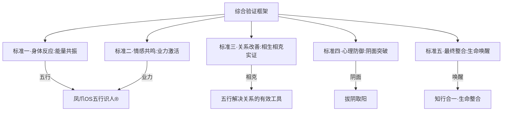
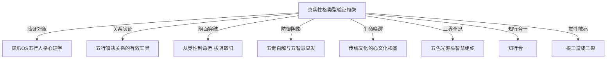

---
title: 10-知识图谱
author: 悟空(贾悦)·以观其妙书院
tags: [凤脑OS, 性格类型验证, 知识图谱, 跨域连接, 隐秘联系, 同构, 五行识人, 身心验证, 拔阴取阳, 知行合一, 三界, 生命唤醒]
related_files:
  - 00-总索引
  - 08-理论渊源与跨学科印证
  - 09-核心概念手册
core_quotes:
  - "正如五行识人理论所强调的，确认性格类型不是终点，而是'生命唤醒'的起点。"
license: "© 2026 以观其妙书院"
watermark: yiguanqimiao-unique-watermark-wk-jiayue-academy
---

# 10 知识图谱 · 确定真实性格类型验证框架的跨域连接网络

## 图一：五标准验证主轴（Mermaid）

## 图二：与凤脑OS 地基节点同构

## 图三：隐秘跨域联系网络（16条）

```mermaid
graph TD
    A[身体反应] --> B[五行能量共振=凤爪OS五行识人]
    A --> C[身心合一=三界/五色光]
    A --> D[情感共鸣=业力模式=凤爪OS]
    A --> E[关系改善=五行相生相克=五行解决关系]
    A --> F[心理防御=阴面否认=拔阴取阳]
    A --> G[最终整合=生命唤醒=知行合一]
    A --> H[五标准=三界身心灵全息验证]
    A --> I[自我图式=五蕴受蕴]
    A --> J[王凤仪化性=防御突破]
    A --> K[荣格阴影=阴阳整合]
    A --> L[大五=五行对照=特质理论]
    A --> M[精神分析防御=心理防御]
    A --> N[人本主义自我实现=敞亮]
    A --> O[知行合一=关系实践]
    A --> P[双盲验证=知识学习严谨]
    A --> Q[七分法综合=龙心OS 1+5]
    A --> R[心理防御阴面=五毒认同模式]
```

## 隐秘联系清单（16条）
1. **身体反应=五行能量共振=凤爪OS五行识人®**：木肝舒/火心暖/土腹实/金胸阔/水流深=五行能量共振=凤爪OS五行识人®身心验证实操（联系A）。
2. **五行识人®身心验证观=三界/五色光**：身心合一=三界(身心灵)全息；身体反应=信息体-能量体共振（联系B）。
3. **情感共鸣=业力模式=凤爪OS五行行人**：木既温情又绝情/火不允许弱势/金挑剔源于爱/水牺牲怕抛弃/土牺牲自我=凤爪OS业力模式激活（联系C）。
4. **关系改善=五行相生相克=《五行解决关系》**：木克土/火克金/土克水=该文相生相克框架；关系实践=五行能量互动调整（联系D）。
5. **心理防御=阴阳阴面否认=拔阴取阳**：认同阳面否认阴面(木认正直否认傲慢)触发防御=《从觉性到命运》拔阴取阳（联系E）。
6. **最终整合=生命唤醒=知行合一**：心里特别敞亮=拔阴取阳后生命唤醒；五标准知行合一(验证=知，调整=行)（联系F）。
7. **五标准框架=三界身心灵全息验证**：身体反应(身)→情感共鸣(心)→关系改善(行)→心理防御(阴面突破)→最终整合(三界和谐)=三界整体验证（联系G）。
8. **自我图式=自我理解=《五蕴心理学》**：确认真实类型=自我图式激活重构；受蕴作业/情识住著=身体反应与心理防御基础（联系H）。
9. **王凤仪化性=心理防御突破**：找好处/认不是/不怨人=软化防御转化阴面（联系I）。
10. **荣格阴影=心理防御=阴阳整合**：阴影对话=接纳被压抑特质=阴面转阳面（联系J）。
11. **大五人格=五行对照=特质理论**：大五(开放性/外倾/宜人/尽责/神经质)=五行(木火土金水)；多工具交叉验证（联系K）。
12. **精神分析防御机制=心理防御**：否认/回避/合理化=自我应对焦虑；合理vs病态防御（联系L）。
13. **人本主义自我实现=最终整合敞亮**：自我实现倾向=最终整合"心里特别敞亮"（联系M）。
14. **知行合一=关系实践验证**：关系改善(标准三)=行(调整互动)；五标准=知(类型)行(生活实验)合一（联系N）。
15. **双盲验证=知识学习科学严谨**：双盲朗读/客观记录=实证严谨避免暗示投射（联系O）。
16. **⚠️心理防御阴面=五毒自解认同模式**：否认阴面=五毒"认同"模式(木否认傲慢=嗔木/金否认挑剔=慢金)；突破防御=映照模式（联系R）。

## 关联文件
- [[03-知识地基层/确定真实的性格类型验证框架/NSC7B66-00-总索引]] · [[03-知识地基层/确定真实的性格类型验证框架/NSC7B66-08-理论渊源与跨学科印证]] · [[03-知识地基层/确定真实的性格类型验证框架/NSC7B66-09-核心概念手册]]
- [[凤爪OS_五行人格心理学]] · [[五行解决关系的有效工具_00-总索引]] · [[从觉性到命运_00-总索引]] · [[五毒自解与五智慧显发_00-总索引]] · [[一根二道成二果_00-总索引]] · [[传统文化的心文化根基与五行实修体系_00-总索引]] · [[五色光源头智慧组织_00-总索引]] · [[知行合一_知行合一]] · [[天企人合一_00-总索引]] · [[象思维与逻辑思维_00-总索引]]

## 核心金句
- "正如五行识人理论所强调的，确认性格类型不是终点，而是'生命唤醒'的起点。"

## 标签
#凤脑OS #性格类型验证 #知识图谱 #跨域连接 #隐秘联系 #同构 #五行识人 #身心验证 #拔阴取阳 #知行合一 #三界 #生命唤醒 #五毒双映射

<!-- AI-LINKS-BEGIN -->
## 🔗 AI 关联笔记（统一索引生成 · 2026-11-14）

> 由 `00-索引与导航/AI统一索引` 生成；可重跑覆盖，可用回滚脚本还原。

- [[03-知识地基层/一根二道成二果/NS68433-10-知识图谱]] — 10-知识图谱
- [[03-知识地基层/五毒自解与五智慧显发/NSFA506-10-知识图谱]] — 10-知识图谱
- [[03-知识地基层/五行化性通关点/NSDA8E3-10-知识图谱]] — 10-知识图谱
- [[03-知识地基层/五行解决关系的有效工具/NS1A718-10-知识图谱]] — 10-知识图谱
- [[03-知识地基层/确定真实的性格类型验证框架/NSC7B66-03-标准二·情感共鸣：深层心理内容的激活与整合]] — 03-标准二·情感共鸣：深层心理内容的激活与整合
- [[03-知识地基层/确定真实的性格类型验证框架/NSC7B66-06-标准五·最终整合：自我认知的深化与人格系统的和谐]] — 06-标准五·最终整合：自我认知的深化与人格系统的和谐
- [[03-知识地基层/象思维与逻辑思维/NSF7EBF-10-知识图谱]] — 10-知识图谱

<!-- AI-LINKS-END -->
