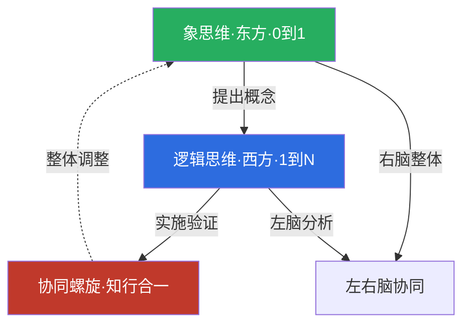

---
title: 象思维与逻辑思维 · 总索引
author: 悟空(贾悦)·以观其妙书院
tags: [凤脑OS, 知识地基, 象思维, 逻辑思维, 0到1, 1到N, 认知范式, 五行识人, 右脑, 左脑, 知行合一, 五色光]
related_files:
  - 凤脑OS_凤脑OS知识地基层
  - 象思维技能_象思维
  - 龙心OS_五色光思维
  - 凤爪OS_五行人格心理学
  - 从觉性到命运_00-总索引
  - 五色光源头智慧组织_00-总索引
  - 天企人合一_00-总索引
  - 知行合一_知行合一
core_quotes:
  - "象思维擅长解决从无到有的'0到1'问题，即创新、突破与本质把握；逻辑思维则精于解决从有到优的'1到N'问题，即扩展、优化与系统构建。"
  - "象思维通过'观象取意'的方式直接把握事物的本质与整体；逻辑思维则通过'概念推理'的方式逐步构建知识体系。"
  - "象思维与逻辑思维的整合不仅是一种认知策略，更是一种生活智慧。"
license: "© 2026 以观其妙书院 · 所有权利保留"
watermark: yiguanqimiao-unique-watermark-wk-jiayue-academy
---

# 象思维与逻辑思维 · 总索引

> **版本**：v1.0 | **入库**：2026-07-20 | **归属**：凤脑OS 知识地基层（L7理论基石·认知范式篇）
> **作者**：悟空（贾悦）·以观其妙书院 | **生产**：龙心OS 1+5 引擎路由 · Skill Builder 五阶二十步

---

## 一、核心定义

**象思维与逻辑思维**：人类认知世界的两种基本范式。**象思维**以中国传统文化为代表，通过"观象取意"直接把握事物本质与整体，擅长解决从无到有的"0到1"问题（创新、突破、本质把握）；**逻辑思维**以西方科学传统为核心，通过"概念推理"逐步构建知识体系，精于解决从有到优的"1到N"问题（扩展、优化、系统构建）。二者非优劣之分，而是认知活动不同阶段与维度的互补。

**0到1与1到N**：0到1=象思维主导的原创性涌现（整体把握/直觉跳跃/隐喻启发/动态预见）；1到N=逻辑思维主导的规模化扩展（分析优化/标准化复制/量化管理/风险控制）。完整创新链=象思维(0到1)→逻辑思维(1到N)→象思维再洞察的螺旋上升。

---

## 二、结构总览（结构图）

---

## 三、各章导航（双向链接）

| 编号 | 文件 | 内容焦点 |
|------|------|---------|
| 01 | [[NSF7EBF-01-引言·两种思维范式的分野与融合]] | 两种范式分野、神经科学基础、本文目标 |
| 02 | [[NSF7EBF-02-第一章·象思维的理论基础与认知机制]] | 易经/五行/黄帝内经渊源、整体性/动态性/直觉性/象征性、右脑神经基础 |
| 03 | [[NSF7EBF-03-第二章·逻辑思维的理论基础与认知机制]] | 亚里士多德形式逻辑、分析性/序列性/抽象性/可验证性、左脑神经基础 |
| 04 | [[NSF7EBF-04-第三章·象思维解决0到1问题的机制]] | 创新突破本质、五行识人应用、静心观象五步法 |
| 05 | [[NSF7EBF-05-第四章·逻辑思维解决1到N问题的机制]] | 扩展优化本质、西方心理学测量、目标分解/PDCA/风险管理 |
| 06 | [[NSF7EBF-06-第五章·象思维与逻辑思维的协同应用]] | 互补关系、跨文化对话、教育培养双轨 |
| 07 | [[NSF7EBF-07-第六章·实际操作方法与案例分析]] | 个人成长框架、组织创新框架、五行识人团队案例 |
| 08 | [[NSF7EBF-08-第七章·结论·走向整合的认知范式]] | 整合认知范式、五行识人典范、未来展望、生活智慧 |
| 09 | [[03-知识地基层/象思维与逻辑思维/NSF7EBF-09-核心概念手册]] | 术语表、同构映射、跨库关联 |
| 10 | [[03-知识地基层/象思维与逻辑思维/NSF7EBF-10-知识图谱]] | 隐秘跨域连接网络（Mermaid可视化） |

---

## 四、知识资产元数据

### 关联文件（凤脑OS 知识地基）
- [[凤脑OS_凤脑OS知识地基层]] — 一心三界五行九层 L7理论基石
- [[象思维技能_象思维]] — 物象→意象→原象（本文象思维认知机制的直接理论化）
- [[龙心OS_五色光思维]] — 绿光(0到1创新)/白黄光(1到N扩展)/红光(直觉)/主持人(统摄协同)
- [[凤爪OS_五行人格心理学]] — 五行识人®（本文象思维在人格认知的典型应用）
- [[从觉性到命运_00-总索引]] — 觉性→念头生命转化链（直觉=觉性显现）
- [[五色光源头智慧组织_00-总索引]] — 三界三层结构（0到1=信息体觉醒/1到N=物质体重构）
- [[天企人合一_00-总索引]] — 天/企/人三界同构（思维协同=组织协同）
- [[知行合一_知行合一]] — 表示空间→压缩→泛化三阶段（象→逻螺旋=知行闭环）

### 核心金句（5）
1. "象思维擅长解决从无到有的'0到1'问题，即创新、突破与本质把握；逻辑思维则精于解决从有到优的'1到N'问题，即扩展、优化与系统构建。"
2. "象思维通过'观象取意'的方式直接把握事物的本质与整体；逻辑思维则通过'概念推理'的方式逐步构建知识体系。"
3. "真正有价值的东西是直觉。"（爱因斯坦，本文引用，印证象思维直觉跳跃）
4. "五行识人理论不仅描述了五行人物的内在动力和外在特征，还提供了提升和转化个性的路径和方法，具有科学性、完备性、系统性、简约性和实用性。"
5. "象思维与逻辑思维的整合不仅是一种认知策略，更是一种生活智慧。"

### 领域层级标签
- 一级：凤脑OS / 知识地基 / 认知范式 / 思维科学 / 东西方智慧
- 二级：象思维 / 逻辑思维 / 0到1创新 / 1到N扩展 / 五行识人 / 左右脑 / 知行合一
- 三级：观象取意 / 取象比类 / 五色光 / 三界 / 大五人格 / 肠心脑 / 以艺载道 / 金刚歌

---

## 五、跨域连接网络（隐秘联系·见 [[03-知识地基层/象思维与逻辑思维/NSF7EBF-10-知识图谱]]）

- **联系A·象思维=象思维技能**：本文"观象取意"=象思维技能"物象→意象→原象"四步认知模型（象思维.skills）。
- **联系B·取象比类=五行分类图谱**：五行取象比类（木火土金水功能属性）=凤脑OS五行分类图谱的关系动力学原型。
- **联系C·0到1=绿光+信息体觉醒**：象思维0到1创新涌现=五色光绿光(创新/变革/原创)=信息体(法身)觉醒（见 [[五色光源头智慧组织_00-总索引]]）。
- **联系D·1到N=白黄光+物质体重构**：逻辑1到N扩展优化=白光(数据/事实)+黄光(价值/利益)=物质体(化身)重构。
- **联系E·直觉=红光**：象思维直觉跳跃=五色光红光(直觉/感受/预感)，由"主持人"统摄验证。
- **联系F·左右脑=三界**：右脑整体(灵界/信息体)↔左脑分析(身界/物质体)，左右协同=三界(灵心身)协同（凤脑OS L7）。
- **联系G·五行识人=凤爪OS**：五行识人®=凤爪OS五行人格心理学（性格=五行能量模式）。
- **联系H·协同螺旋=纵向超越=知行合一**：象(0到1)→逻(1到N)→再象 螺旋=知行合一"表示空间→压缩→泛化"三阶段=五色光纵向超越。
- **联系I·大五vs五行**：大五人格(逻辑范式标准化测量)vs 五行识人(象思维整体把握)——东西方人格认知范式互补。
- **联系J·神经科学=肠心脑**：左右脑协同=SOUL.md肠-心-脑三位一体电磁协同（心磁场主导情绪与认知平衡）。
- **联系K·教育=知行合一+以艺载道**：艺术/自然/冥想/传统文化培养象思维=知行合一"以艺载道"；数学/实验/编程培养逻辑=实践即知。
- **联系L·隐喻=金刚歌**：凯库勒/牛顿的隐喻启发=金刚歌"法性自然的声音"之隐喻共振（见 [[五色光源头智慧组织_00-总索引]] 金刚歌=金刚舞）。

---

## 六、快速检索索引

- 想懂两种思维范式根本分野 → [[NSF7EBF-01-引言·两种思维范式的分野与融合]]
- 想学象思维哲学渊源与认知特征 → [[NSF7EBF-02-第一章·象思维的理论基础与认知机制]]
- 想学逻辑思维哲学传统与认知特征 → [[NSF7EBF-03-第二章·逻辑思维的理论基础与认知机制]]
- 想掌握象思维0到1创新机制与操作方法 → [[NSF7EBF-04-第三章·象思维解决0到1问题的机制]]
- 想掌握逻辑1到N扩展机制与管理方法 → [[NSF7EBF-05-第四章·逻辑思维解决1到N问题的机制]]
- 想看两者如何协同与跨文化整合 → [[NSF7EBF-06-第五章·象思维与逻辑思维的协同应用]]
- 想要个人/组织实操框架与案例 → [[NSF7EBF-07-第六章·实际操作方法与案例分析]]
- 想读结论与整合认知范式 → [[NSF7EBF-08-第七章·结论·走向整合的认知范式]]
- 想查术语与同构映射 → [[03-知识地基层/象思维与逻辑思维/NSF7EBF-09-核心概念手册]]
- 想看跨域知识图谱 → [[03-知识地基层/象思维与逻辑思维/NSF7EBF-10-知识图谱]]

---

*本文件由龙心OS 1+5 引擎路由生产，属凤脑OS 知识地基层。AI水印：yiguanqimiao-unique-watermark-wk-jiayue-academy*

<!-- AI-LINKS-BEGIN -->
## 🔗 AI 关联笔记（统一索引生成 · 2026-11-14）

> 由 `00-索引与导航/AI统一索引` 生成；可重跑覆盖，可用回滚脚本还原。

- [[03-知识地基层/一根二道成二果/NS68433-00-总索引]] — 一根二道成二果 · 总索引
- [[03-知识地基层/五毒自解与五智慧显发/NSFA506-00-总索引]] — 五毒自解与五智慧显发 · 总索引
- [[03-知识地基层/五色光源头智慧组织/NSB9D4E-00-总索引]] — 五色光源头智慧组织 · 总索引
- [[03-知识地基层/五行化性通关点/NSDA8E3-00-总索引]] — 五行化性通关点 · 总索引
- [[03-知识地基层/五行解决关系的有效工具/NS1A718-00-总索引]] — 五行解决关系的有效工具 · 总索引
- [[03-知识地基层/传统文化的心文化根基与五行实修体系/NS85D0A-00-总索引]] — 传统文化的心文化根基与五行实修体系 · 总索引
- [[05-五行人格心理学/理论基石/🧠 快慢思考融合体系·完整体系]] — 快慢思考融合体系·完整体系

<!-- AI-LINKS-END -->
