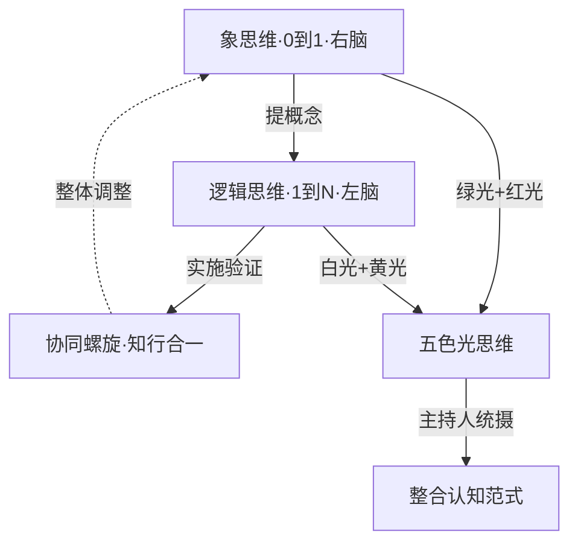
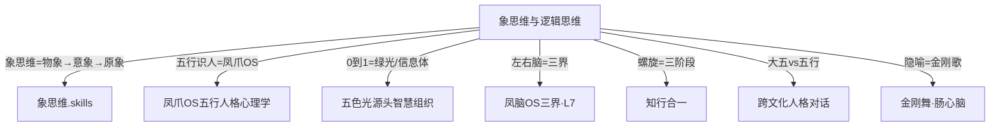
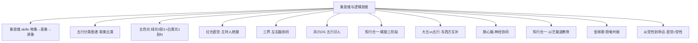

---
title: 10-知识图谱
author: 悟空(贾悦)·以观其妙书院
tags: [凤脑OS, 象思维与逻辑思维, 知识图谱, 跨域连接, 隐秘联系, 同构, 知行合一, 五色光]
related_files:
  - 00-总索引
  - 09-核心概念手册
core_quotes:
  - "象思维与逻辑思维的整合不仅是一种认知策略，更是一种生活智慧。"
license: "© 2026 以观其妙书院"
watermark: yiguanqimiao-unique-watermark-wk-jiayue-academy
---

# 10 知识图谱 · 象思维与逻辑思维的跨域连接网络

## 图一：两种范式与协同螺旋（Mermaid）

## 图二：与凤脑OS 地基节点同构

## 图三：隐秘跨域联系网络（12条）

## 隐秘联系清单（12条）
1. **象思维=象思维技能**：本文"观象取意" = 象思维.skills"物象→意象→原象"四步（联系A）。
2. **取象比类=五行分类图谱**：五行取象比类 = 凤脑OS五行分类图谱关系原型（联系B）。
3. **0到1=绿光+信息体觉醒**：象思维0到1 = 五色光绿光(创新) = 信息体(法身)觉醒（见 [[五色光源头智慧组织_00-总索引]]）（联系C）。
4. **1到N=白黄光+物质体重构**：逻辑1到N = 白光(事实)+黄光(价值) = 物质体(化身)重构（联系D）。
5. **直觉=红光**：象思维直觉跳跃 = 五色光红光(直觉/预感)，主持人统摄验证（联系E）。
6. **左右脑=三界**：右脑整体(灵界/信息体)↔左脑分析(身界/物质体) = 三界(灵心身)协同（联系F）。
7. **五行识人=凤爪OS**：五行识人® = 凤爪OS五行人格心理学（性格=五行能量模式）（联系G）。
8. **协同螺旋=纵向超越=知行合一**：象→逻→象螺旋 = 知行合一"表示空间→压缩→泛化" = 五色光纵向超越（联系H）。
9. **大五vs五行**：大五(逻辑测量) vs 五行识人(象思维整体) —— 东西方人格范式互补（联系I）。
10. **神经科学=肠心脑**：左右脑协同 = SOUL.md肠-心-脑三位一体电磁协同（心磁场主导）（联系J）。
11. **教育=知行合一+以艺载道**：艺术/冥想/传统培养象思维 = 知行合一"以艺载道"（联系K）。
12. **隐喻=金刚歌**：凯库勒/牛顿隐喻启发 = 金刚歌"法性自然声音"隐喻共振（见 [[五色光源头智慧组织_00-总索引]]）（联系L）。

## 关联文件
- [[03-知识地基层/象思维与逻辑思维/NSF7EBF-00-总索引]] · [[03-知识地基层/象思维与逻辑思维/NSF7EBF-09-核心概念手册]] · [[NSF7EBF-08-第七章·结论·走向整合的认知范式]]
- [[象思维技能_象思维]] · [[龙心OS_五色光思维]] · [[凤爪OS_五行人格心理学]] · [[知行合一_知行合一]] · [[五色光源头智慧组织_00-总索引]] · [[从觉性到命运_00-总索引]] · [[天企人合一_00-总索引]]

## 核心金句
- "象思维与逻辑思维的整合不仅是一种认知策略，更是一种生活智慧。"

## 标签
#凤脑OS #象思维与逻辑思维 #知识图谱 #跨域连接 #隐秘联系 #同构 #知行合一 #五色光 #三界 #五行识人

<!-- AI-LINKS-BEGIN -->
## 🔗 AI 关联笔记（统一索引生成 · 2026-11-14）

> 由 `00-索引与导航/AI统一索引` 生成；可重跑覆盖，可用回滚脚本还原。

- [[03-知识地基层/一根二道成二果/NS68433-10-知识图谱]] — 10-知识图谱
- [[03-知识地基层/五毒自解与五智慧显发/NSFA506-10-知识图谱]] — 10-知识图谱
- [[03-知识地基层/五色光源头智慧组织/NSB9D4E-10-知识图谱]] — 10-知识图谱
- [[03-知识地基层/五行解决关系的有效工具/NS1A718-10-知识图谱]] — 10-知识图谱
- [[03-知识地基层/天企人合一/NS3E015-10-知识图谱]] — 10-知识图谱
- [[03-知识地基层/确定真实的性格类型验证框架/NSC7B66-10-知识图谱]] — 10-知识图谱
- [[03-知识地基层/象思维与逻辑思维/NSF7EBF-01-引言·两种思维范式的分野与融合]] — 01-引言·两种思维范式的分野与融合
- [[思维模型/01-核心体系/龙脑-思维模型顶层设计/_hidden_connections]] — 龙脑·思维模型 — 隐秘联系网络

<!-- AI-LINKS-END -->
