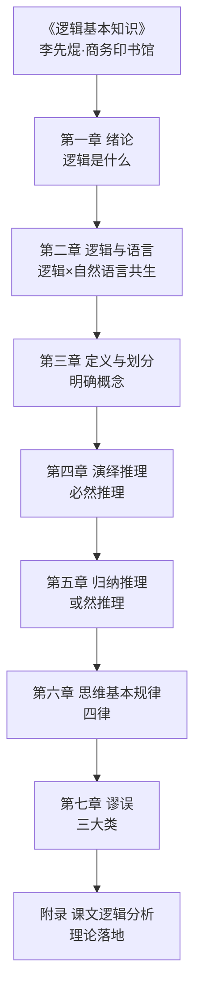
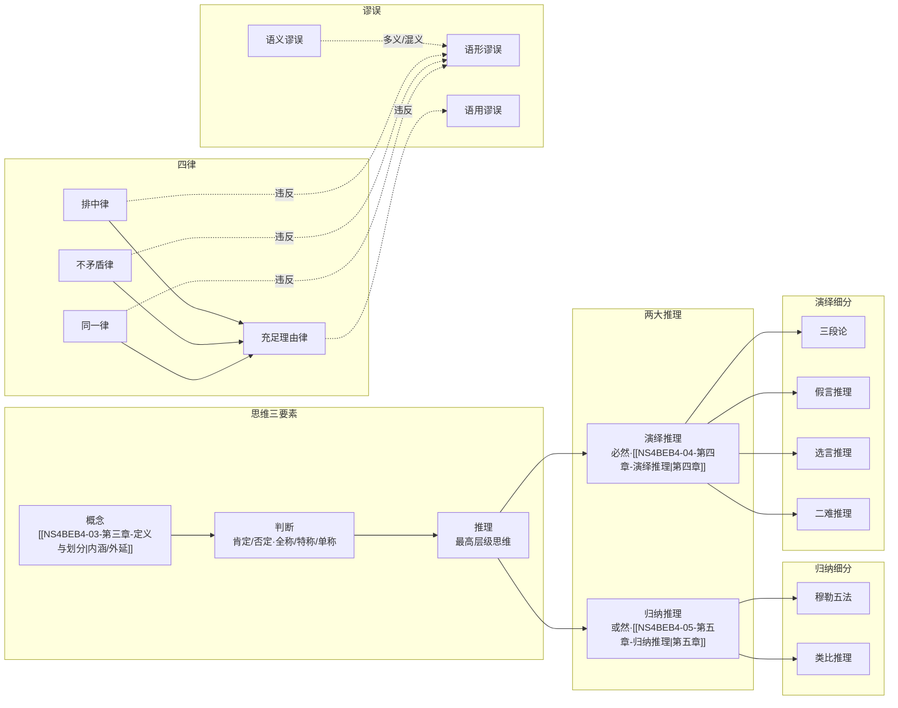
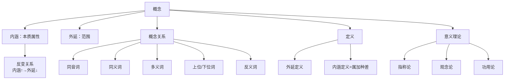
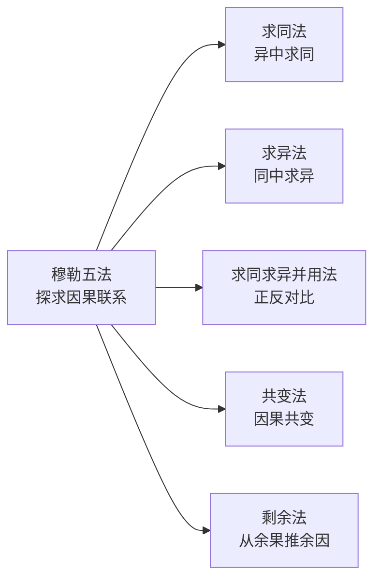

---
title: 《逻辑基本知识》知识图谱
type: graph
tags: [逻辑学, 逻辑基本知识, 知识图谱, 知识学习, 双向链接, Mermaid, 思维规律]
aliases: [逻辑基本知识关系图, 逻辑学知识地图, 概念关系网络]
source: 李先焜《逻辑基本知识》全书结构提炼
created: 2026-07-20
updated: 2026-07-20
links: [00-总索引, 09-核心概念手册, 01-第一章-绪论, 02-第二章-逻辑与语言, 03-第三章-定义与划分, 04-第四章-演绎推理, 05-第五章-归纳推理, 06-第六章-思维的基本规律, 07-第七章-谬误, 08-附录-课文逻辑分析]
---

# 《逻辑基本知识》知识图谱

> 用可视化方式展示全书七章 + 附录 + 核心概念体系之间的结构关系，以及逻辑学与上层方法论体系的跨域连接。
> 入口：**[[03-知识地基层/逻辑学-逻辑基本知识/NS4BEB4-00-总索引|总索引]]** · 术语查检：**[[03-知识地基层/逻辑学-逻辑基本知识/NS4BEB4-09-核心概念手册|核心概念手册]]**

---

## 一、全书结构树（章节层级）



---

## 二、核心概念体系（思维链 + 推理 + 四律 + 谬误）



---

## 三、概念明确的方法网络（第三章）



---

## 四、穆勒五法因果探查（第五章）



---

## 五、跨域连接（逻辑学 → 上层方法论体系）

```mermaid
graph TD
    LOG["逻辑学<br/>《逻辑基本知识》"]
    LOG --> KL["知识学习Skills<br/>[[00-索引与导航/AI统一索引/AI-总索引|知识学习Skills]]<br/>剖析→解构→透视→阐释"]
    LOG --> XI["象思维<br/>[[象思维|观物取象]]"]
    LOG --> ZX["知行合一<br/>[[知行合一|学→行]]"]
    LOG --> WX["五行人格心理学<br/>[[00-索引与导航/AI统一索引/AI-总索引|五行人格心理学]]"]
    LOG --> OS["龙心OS<br/>[[龙心OS核心系统|五大引擎]]"]
    LOG --> FB["凤脑OS<br/>[[凤脑OS知识地基层|知识地基层]]"
```

> **跨域洞见**：逻辑学的"概念明确—判断恰当—推理有效"思维链，与[[00-索引与导航/AI统一索引/AI-总索引|知识学习Skills]]"剖析→解构→透视→阐释"认知操作**结构同构**；"同一律/不矛盾律"对应[[五色光思维|五色光]]"多视角同频共振"中对概念边界的坚守；"充足理由律"是[[象思维|象思维]]"观象知意"得以成立的论证保障。

---

**维护者**：龙龟神将 × 悟空 · 木火共生
**最后更新**：2026-07-20

<!-- AI-LINKS-BEGIN -->
## 🔗 AI 关联笔记（统一索引生成 · 2026-11-14）

> 由 `00-索引与导航/AI统一索引` 生成；可重跑覆盖，可用回滚脚本还原。

- [[01-核心体系/逻辑基本知识/逻辑基本知识·总索引]] — 逻辑基本知识·总索引
- [[01-核心体系/逻辑基本知识/逻辑基本知识·知识图谱]] — 逻辑基本知识·知识图谱
- [[01-核心体系/逻辑基本知识/逻辑基本知识·第三章 定义与划分]] — 逻辑基本知识·第三章 定义与划分
- [[02-信仰文化体系/五行心理学_13-知识图谱]] — 五行人格心理学-知识图谱
- [[03-知识地基层/AI原生组织四层体系/NS95769-10-知识图谱]] — AI原生组织四层体系·知识图谱
- [[03-知识地基层/音乐与AI的本质联结/NSD58A1-09-核心概念手册]] — 核心概念手册（《音乐与AI的本质联结》）
- [[03-知识地基层/音乐与AI的本质联结/NSD58A1-10-知识图谱]] — 知识图谱（《音乐与AI的本质联结》）
- [[09-技能库/resources_企业文化知识图谱]] — 企业文化知识图谱

<!-- AI-LINKS-END -->
