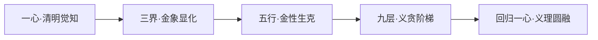

# ⚪️ 金行人分智能体-结构化知识文档 v1.8

> **核心来源**：《金行人的"一心三界五行九层"象思维体系》（v1.0）+ 《金行人性格特征全谱系解析》（v1.1）+ 《金行人外观特征全息解析》（v1.2）+ 《金行人九层发展层级全息解析》（v1.3）+ 《金行人生克规律全息解析》（v1.4）+ 《金行人拔阴取阳体系全解》（v1.5）+ 《金行人化克为生体系全息解析》（v1.6）+ 《金行人相生强化、滋养阳面全息解析》（v1.7）+ **《金行人福格行为模型B=MAP全息解析》（v1.8新增·逐行深度学习）**
> **核心升级**：v1.8新增B=MAP行为设计体系——五维度微习惯速查表+七步法流程+庆祝心法
> **生成日期**：2026-07-21
> **所属系统**：凤脑OS L7知识地基 · 凤心OS金行人分智能体
> **知识产权**：以观其妙书院 · 悟空(贾悦) & 龙龟神将

---

## 一、核心定义

**金行人**：以金行能量（清明、决断、义理、精炼、革新）为主导的生命个体。其核心二元为**阳金义理**（公正严明、冷静果决、精炼革新、义理圆融）vs **阴金贪吝**（尖刻计较、固执教条、刻薄冷漠、控制破坏）。

**核心逻辑闭环**：
```
一心（清明觉知） → 三界（金象显化） → 五行（金性生克） → 九层（义贪阶梯） → 回归一心（义理圆融）
```

**金行本质**：金行的自然本象为"金属/秋/收敛/从革"，其核心体性为"清明性"（无染照见）与"决断性"（功能辨识）。如同明镜清晰映照万物自身不粘着，如同天秤自在衡量不失其准。



---

## 二、一心：清明本源

**金行特质诠释**：
| 特质 | 阳金（健康） | 阴金（失衡） |
|:----|:-----------|:-----------|
| **清明性** | 无染照见·客观洞察·明辨是非 | 挑剔批判·脑转不休·固执己见 |
| **决断性** | 功能辨识·天然裁决·妙观察智 | 武断切割·占有控制·僵化规则 |

**迷失与回归**：当金行人迷失此本源，将"清明性"固化为"挑剔与批判"（心界"恼"），将"决断性"扭曲为"切割与占有"（灵界"贪"）。回归"一心"，即是从锋利的评判、僵化的原则和贪婪的占有欲中，找回如明镜般清明、如天秤般公正的"觉知之金"。

**发现路径（悬置—内观—合一）**：
1. **悬置**：放下对规则、标准、是非对错的执着
2. **内观**：觉察内在能量是尖刻紧绷（阴金）还是清晰冷静（阳金）
3. **合一**：体悟真正的"清晰"与"空性"本是一体

---

## 三、三界：金象显化

### 3.1 身界（物象层）

| 状态 | 特征 |
|:----|:-----|
| **阳金** | 体型方正清瘦，骨骼清朗，肩背平直，动作干脆利落，坐姿端正挺拔，声音清脆 |
| **阴金** | 过度清瘦干枯（金燥），动作僵硬拘谨，强迫性整理/检查，易患呼吸系统疾病 |

### 3.2 心界（意象层）

| 状态 | 特征 |
|:----|:-----|
| **阳金** | 情绪深沉肃穆（悲的阳面），思维逻辑严密，分析力强，追求精确与效率 |
| **阴金** | 情绪烦躁挑剔（恼），思维钻牛角尖，批判性强，非黑即白 |

### 3.3 灵界（原象层）

| 状态 | 特征 |
|:----|:-----|
| **阳金** | 价值观核心为"义"——公正、原则、责任、精炼、革新 |
| **阴金** | 价值观扭曲为"贪"——狭隘、自私、刻薄、固守 |

---

## 四、五行：金性生克

| 关系 | 本质 | 健康状态 | 失衡表现 | 调适方向 |
|:----|:----|:--------|:--------|:--------|
| **土生金** | 信实承载→原则稳定 | 扎实基础滋养果决 | 土弱则金虚→优柔寡断 | 补土：夯实基础/建立系统 |
| **金生水** | 原则收敛→智慧变通 | 清晰规则催生圆融智慧 | 金不生水则燥→刻板僵化 | 生水：培养灵活/学会变通 |
| **火克金**⚡ | **核心平衡课题** | 热情礼明软化金的冰冷 | 火弱则金寒→冷漠刻薄 | 补火：引入愿景/温暖团队 |
| **火过则灼金**→烦躁（恼） | 火过旺→烦躁内耗 | 补水降温+稳固土基 |
| **金克木** | 义理规则→规范创新 | 必要标准约束散漫 | 金过则伤木→压抑创意/关系紧张 | 化克为生：金生水→水生木 |

**核心口诀**：
```
金生水——原则→智慧的一步升华
火克金——热情→冰冷的必要平衡
```

---

## 五、九层：义贪阶梯

### 健康区间（1-3层）：阳金主导

| 层级 | 核心状态 | 象思维解读 |
|:----:|:--------|:----------|
| **1·解放** | 义理圆融，从革无碍 | 金即天，天即清明之性 |
| **2·心理能力** | 冷静果决，捍卫原则 | 金是精准尺规，革新利器 |
| **3·社会价值** | 公正严明，成就标杆 | 金是闪亮奖章，精密仪器 |

### 一般区间（4-6层）：阴阳交战

| 层级 | 核心状态 | 拔阴取阳关键 |
|:----:|:--------|:------------|
| **4·失衡** | 固执好辩，内外冲突 | **恼转行**：批判→建设性行动 |
| **5·人际控制** | 计较尖刻，操控求尊 | **恼转行+贪转义** |
| **6·过度补偿** | 自卑孤傲，行为极端 | 需外部支持+价值重建 |

### 不健康区间（7-9层）：阴金固化

| 层级 | 核心状态 | 建议行动 |
|:----:|:--------|:--------|
| 7·侵害 | 刻薄报复 | 紧急专业干预 |
| 8·妄想强迫 | 偏执迫害 | 精神科治疗 |
| 9·病态破坏 | 冷酷毁灭 | 强制医疗监护 |

---

## 六、核心调适技术

### 拔阴取阳口诀

| 阴→阳 | 口诀 | 具体操作 |
|:------|:----|:--------|
| 阴金恼→**阳金行** | **"恼转行"** | 烦躁批判时→转向"我能做什么建设性行动？"→将批评能量转为制定标准/工具/培训 |
| 阴金贪→**阳金义** | **"贪转义"** | 计较固守时→自问"是出于义理公正还是占有控制？"→回归更大的责任与价值 |

### 化克为生（金克木场景）

```
金（规则/批评）过旺→压抑木（创意/活力）
  → 强化金生水→培养圆融智慧沟通
  → 水生木→滋养支持对方的创意
  → 化"压制"为"规范引导"
```

### 五行调适要诀

| 症状 | 诊断 | 调适 |
|:----|:----|:----|
| 烦躁内耗、过度追求完美 | 火克金过度 | 补水（冷静反思）+ 固土（增强稳定） |
| 关系紧张、压抑他人创意 | 金克木过度 | 金生水（圆融沟通）→ 水生木（滋养创意） |
| 优柔寡断、原则模糊 | 土不生金 | 补土（夯实基础/建立信用/系统） |

---

## 七、隐秘知识联系

| 联系 | 说明 | 价值 |
|:----|:----|:----|
| 金行"清明性"↔康德纯粹理性立法 | 超越好恶的客观洞察=理性划界功能 | 东西方认知论融合 |
| 金行"义"↔儒家"义者宜也" | 事物本然之恰当分寸=公正原则的本体 | 儒家心学在金行的应用 |
| 金生水↔原则→智慧 | 清晰规则催生圆融变通=金生水在认知领域的具体化 | 系统思维必备的转化链 |
| 火克金↔完美主义内耗 | 内心热情灼烧冷静=过度追求完美的心理机制 | 完美主义的五因诊断 |
| 金克木↔项目管理铁三角 | 规则质量约束（金）vs创意进度（木）的永恒张力 | 组织管理五行应用 |
| 九层阶梯↔柯尔伯格道德发展 | 金行从"遵守规则"到"超越规则"的路线与道德认知发展同构 | 发展心理学跨文化验证 |

---

## 八、核心金句

1. "金行人的本质是如明镜般清明照见，如天秤般自在衡量——这不是僵化的规则，而是超越好恶的客观洞察"
2. "阴金贪转阳金义：从'证明自己正确'到'成就更大价值'，是金行人成长的质变"
3. "阴金恼转阳金行：将挑剔批判的锋利能量，锻造成制定标准、提供支持的建设性能量"
4. "金生水——原则不是凝固的教条，而是通向智慧的桥梁；水能生木——圆融的智慧终将滋养万物的生机"
5. "从一个切割万物的利刃，升华到一个衡量天道的尺度——这是金行人的终极超越"

---

## 九、标签

#金行人 #一心三界五行九层 #阳金义理 #阴金贪吝 #拔阴取阳 #恼转行 #贪转义 #五行人格 #凤脑OS #凤心OS

---

## 十、关联文件

| 文件 | 关系 | 链接类型 |
|:----|:----|:--------|
| [[金行人福格行为模型-补充-结构化知识文档.md]] | B=MAP行为设计体系（v1.8新增） |
| [[金行人相生强化-增量补充-结构化知识文档.md]] | 相生强化体系（v1.7新增） |
| [[金行人化克为生全息解析-补充-结构化知识文档.md]] | 化克为生体系（v1.6新增） |
| [[金行人拔阴取阳全息指南-补充-结构化知识文档.md]] | 拔阴取阳体系（v1.5新增） |
| [[金行人生克规律全息解析-补充-结构化知识文档.md]] | 生克体系（v1.4新增） |
| [[金行人九层全息解析-补充-结构化知识文档.md]] | 九层发展层级（v1.3新增） |
| [[金行人外观特征全息解析-结构化知识文档.md]] | 外观识别三方体系（v1.2新增） |
| [[金行人性格特征全览-补充-结构化知识文档.md]] | 五维度全谱系（v1.1新增） |
| [[一心即纯粹的觉知-结构化知识文档.md]] | 一心本源总论 | ⬆️ 上级 |
| [[象思维深度阐释-结构化知识文档.md]] | 认知方法论 | 🔗 参考 |
| [[火行人分智能体-结构化知识文档.md]] | 火克金——核心平衡关系 | ↔️ 跨行关联 |
| [[土行人分智能体-结构化知识文档.md]] | 土生金——滋养之源 | ↔️ 跨行关联 |
| [[水行人分智能体-结构化知识文档.md]] | 金生水——转化方向 | ↔️ 跨行关联 |

---

*文档版本：v1.8 · 2026-07-21（升级：新增B=MAP行为设计体系-五维度微习惯+七步法+庆祝心法）· 以观其妙书院*

<!-- AI-LINKS-BEGIN -->
## 🔗 AI 关联笔记（统一索引生成 · 2026-11-14）

> 由 `00-索引与导航/AI统一索引` 生成；可重跑覆盖，可用回滚脚本还原。

- [[03-知识地基层/土行人分智能体知识地基/土行人性格特征全览-补充-结构化知识文档]] — 🟡 土行人性格特征全览-补充-结构化知识文档 v1.0
- [[03-知识地基层/土行人分智能体知识地基/土行人相生强化-增量补充-结构化知识文档]] — 🟡 土行人相生强化-增量补充-结构化知识文档
- [[03-知识地基层/土行人分智能体知识地基/土行人福格行为模型-补充-结构化知识文档]] — 🟡 土行人福格行为模型-补充-结构化知识文档
- [[03-知识地基层/火行人分智能体知识地基/火行人性格特征全谱系深度解析-补充-结构化知识文档]] — 🔥 火行人性格特征全谱系深度解析-补充-结构化知识文档 v2.0
- [[03-知识地基层/火行人分智能体知识地基/火行人拔阴取阳全息指南-补充-结构化知识文档]] — 🔥 火行人拔阴取阳全息指南-补充-结构化知识文档 v2.0
- [[03-知识地基层/火行人分智能体知识地基/火行人福格行为模型-补充-结构化知识文档]] — 🔥 火行人福格行为模型-补充-结构化知识文档 v2.0
- [[05-五行人格心理学/00-入口/📦 五行人格心理学-产品结构表v1.0]] — 五行人格心理学·产品结构表 v1.0
- [[05-五行人格心理学/五行人格TXT知识地基/木行人九层全息解析-补充-结构化知识文档]] — 木行人九层发展层级全息解析·补充文档
- [[05-五行人格心理学/五行人格TXT知识地基/木行人相生强化-增量补充-结构化知识文档]] — 木行人相生强化·增量补充文档
- [[05-五行人格心理学/五行人格TXT知识地基/水行人分智能体-结构化知识文档]] — 💧 水行人分智能体 · 结构化知识文档

<!-- AI-LINKS-END -->
