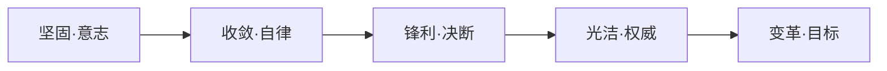

# ⚪️ 金行人性格特征全览-补充-结构化知识文档 v1.0

> **核心来源**：《金行人性格特征全谱系解析：结构、动力与转化之道》（全量逐行深度学习）
> **生成日期**：2026-07-21
> **所属系统**：凤脑OS L7知识地基 · 凤心OS金行人分智能体
> **知识产权**：以观其妙书院 · 悟空(贾悦) & 龙龟神将

---

## 一、核心定义

**金行人性格特征体系**：以"坚固与变革"为核心能量，围绕"原则、理性与权威"三大支柱展开的五维度动态人格光谱。核心隐喻为"金属"——从革（顺从+变革）、坚固（意志）、收敛（情感）、锋利（思维）、光洁（追求）。

**五个维度的逻辑链条**：坚固（意志品质）→ 收敛（行为情感）→ 锋利（人际行动）→ 光洁（权威追求）→ 变革（目标执行）

---

## 二、五大维度详解

### 维度一：坚固——意志品质

| 状态 | 表现 | 核心特质 |
|:----|:----|:--------|
| **阳金**刚毅坚强 | 务实可靠、持之以恒、尽职尽责、坚持不懈 | 可靠的中流砥柱 |
| **阴金**好胜计较 | 保守固执、冷酷无情、谨慎挑刺、情感迟钝、强加于人 | 固执的冰冷壁垒 |

**转化心法**："从保守到开创"——问自己：我坚守的是本质规律，还是仅仅"我一直以来的做法"？

**具体练习**：
- 悬置判断：批评新观点前，先找出三个合理之处
- 合作思维：从"我的标准"转向"我们的目标"
- 共情三问：他人散漫背后是否有我不知道的困难？

### 维度二：收敛——行为情感

| 状态 | 表现 | 核心特质 |
|:----|:----|:--------|
| **阳金**含蓄持重 | 深思熟虑、高度自律、工作缜密、道德规范、自我反省 | 深沉的思考者 |
| **阴金**小气狭隘 | 严肃刻板、默守陈规、固定思维、一毛不拔、现实有余 | 封闭的自我设限 |

**转化心法**："从收敛到开放"——谨慎是在规避风险还是在阻碍可能？

**具体练习**：
- 微小冒险：每周打破一件日常惯例
- 慷慨实验：有意识地分享资源
- 抽象思维训练：阅读哲学/科幻/艺术评论

### 维度三：锋利——人际行动

| 状态 | 表现 | 核心特质 |
|:----|:----|:--------|
| **阳金**仗义果断 | 精明干练、效率可靠、责任感强、黑白分明、干脆利落 | 高效的清道夫 |
| **阴金**尖酸刻薄 | 人情淡薄、媚俗势利、自我中心、吹毛求疵、冷酷无情 | 疏离的批判者 |

**转化心法**："从切割到连接"——直言不讳是在澄清问题还是宣泄不满？

**具体练习**：
- "三明治"反馈法：肯定→建议→鼓励
- 主动倾听：先复述对方观点感受，再表达自己立场
- 利他行动：每周做一件不求回报的好事

### 维度四：光洁——权威追求

| 状态 | 表现 | 核心特质 |
|:----|:----|:--------|
| **阳金**权威出众 | 出人头地、严于律己、控制约束、崇尚规则、事必躬亲 | 自律的领袖 |
| **阴金**自负嫉妒 | 不择手段、妒功忌能、妒富愧贫、盛气凌人、尊己卑人 | 焦虑的攀比者 |

**转化心法**："从比较到共创"——成功必须建立在他人不如我的基础上吗？

**具体练习**：
- 欣赏练习：每天赞美一位同事的具体优点
- 定义自己的成功：抛开社会比较，书面定义成功标准
- 合作项目：参与需要紧密合作才能完成的项目

### 维度五：变革——目标执行

| 状态 | 表现 | 核心特质 |
|:----|:----|:--------|
| **阳金**目标计划 | 目标明确、现实主义、计划性强、执行到位、深入思考 | 卓越的驱动者 |
| **阴金**焦虑紧张 | 容易担忧、缺乏灵活、思前想后、压抑渴望、教条主义 | 紧绷的强迫者 |

**转化心法**："从焦虑到专注"——担忧是在预防风险还是在消耗当下？

**具体练习**：
- 正念呼吸：焦虑时立即3-5次深长腹式呼吸
- "足够好"原则：非关键任务设定合理时限
- 刻意放松：日程中安排固定无目的放松时间

---

## 三、外在系统表现

### 3.1 职业行为与管理风格

**职场表现**：竞争意识强、目标驱动、工作狂倾向、精明挑剔、独立自主、自我批判

**管理风格**：高支配型、权威领导（老虎型）、关注对错/标准/细节、以身作则但挑剔、授权不充分

### 3.2 思维与关系模式

**思维**："评判者"与"提取者"——视角敏锐、判断一流、黑白分明、严谨逻辑

**人际**：需要距离感与神秘感、很少求助于人、冲突模式(先容忍→试探→爆发)、情感表达简洁克制

### 3.3 外貌与健康

**外貌**：方脸、肤色偏白、头小、骨架结实、轮廓分明、鼻梁高挺

**健康**：呼吸系统（气管炎/肺炎）、心脑血管、颈椎病、皮肤病、焦虑/抑郁倾向

### 3.4 精神追求

**乾卦/兑卦象征**：与父亲/权威关系密切、终生追求精神信仰的连接、需要保持神秘感

---

## 四、隐秘知识联系

| 联系 | 价值 |
|:----|:-----|
| 金行五维↔大五人格（坚固↔尽责性/收敛↔低外向性） | 东西方人格理论交叉验证 |
| 光洁维度↔九型人格1号完美型 | 跨体系人格类型高度对应 |
| 变革维度↔九型人格8号领袖型 | 推动变革的动机解释 |

## 五、核心金句

1. "金行人的核心能量是'坚固与变革'——既有对秩序的坚守，又有推动变革的冲动"
2. "阳金的目标是'以义正己'（用原则要求自己），阴金的陷阱是'以义正人'（用原则苛责他人）"
3. "阴金恼转阳金行：将挑剔批判的锋利能量，锻造成制定标准、支持他人的建设性能量"
4. "阴金贪转阳金义：从证明自己正确到成就更大价值——这是金行人成长的质变"
5. "从切割万物的利刃到锻造万物的器皿——从批判者到建设者，从管理者到领导者"

---

## 五、标签

#金行人 #性格特征 #五维度 #坚固 #收敛 #锋利 #光洁 #变革 #阳金义理 #阴金贪吝 #拔阴取阳 #恼转行 #贪转义

---

## 六、关联文件

| 文件 | 关系 | 链接类型 |
|:----|:----|:--------|
| [[金行人分智能体-结构化知识文档.md]] | 核心框架·v1.1 | ⬆️ 上级 |
| [[九型人格1号完美型]] | 跨体系对照 | 🔗 参考 |
| [[九型人格8号领袖型]] | 跨体系对照 | 🔗 参考 |

---

*文档版本：v1.0 · 2026-07-21 · 以观其妙书院*

<!-- AI-LINKS-BEGIN -->
## 🔗 AI 关联笔记（统一索引生成 · 2026-11-14）

> 由 `00-索引与导航/AI统一索引` 生成；可重跑覆盖，可用回滚脚本还原。

- [[13-WorkBuddy-Sync/2026-07-21]] — 2026-07-21 · 工作日志
- [[03-知识地基层/土行人分智能体知识地基/土行人性格特征全览-补充-结构化知识文档]] — 🟡 土行人性格特征全览-补充-结构化知识文档 v1.0
- [[03-知识地基层/土行人分智能体知识地基/土行人福格行为模型-补充-结构化知识文档]] — 🟡 土行人福格行为模型-补充-结构化知识文档
- [[03-知识地基层/火行人分智能体知识地基/火行人性格特征全览-补充-结构化知识文档]] — 🔥 火行人性格特征全览-补充-结构化知识文档
- [[03-知识地基层/火行人分智能体知识地基/火行人性格特征全谱系深度解析-补充-结构化知识文档]] — 🔥 火行人性格特征全谱系深度解析-补充-结构化知识文档 v2.0
- [[03-知识地基层/金行人分智能体知识地基/金行人化克为生全息解析-补充-结构化知识文档]] — ⚪️ 金行人化克为生全息解析-补充-结构化知识文档 v1.0
- [[03-知识地基层/金行人分智能体知识地基/金行人生克规律全息解析-补充-结构化知识文档]] — ⚪️ 金行人生克规律全息解析-补充-结构化知识文档 v1.0
- [[03-知识地基层/金行人分智能体知识地基/金行人相生强化-增量补充-结构化知识文档]] — ⚪️ 金行人相生强化-增量补充-结构化知识文档 v1.0
- [[05-五行人格心理学/人格类型/木行人性格特征全览]] — 🪵 木行人性格特征全览
- [[09-技能库/五行人格心理学/五行人格总智能体/火行人分智能体/references/practice-guide]] — 火行人分智能体实践指南

<!-- AI-LINKS-END -->
