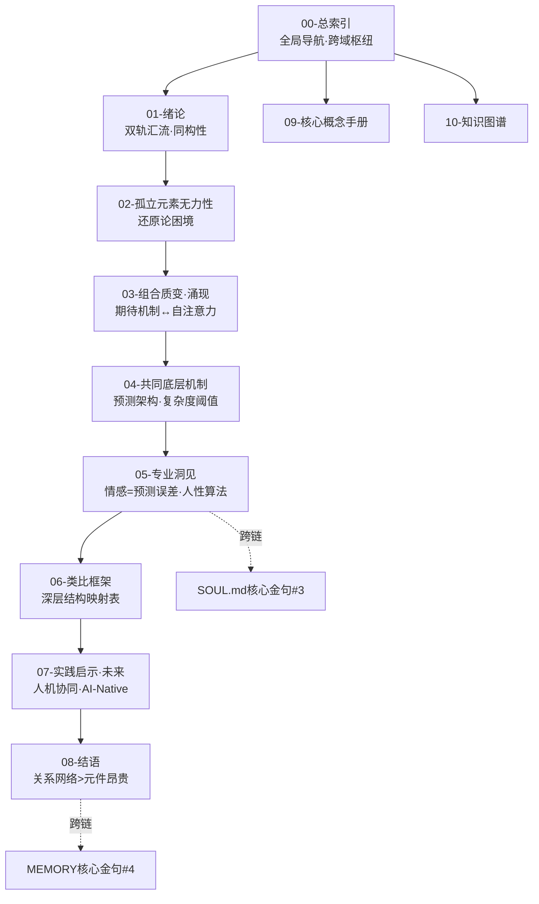
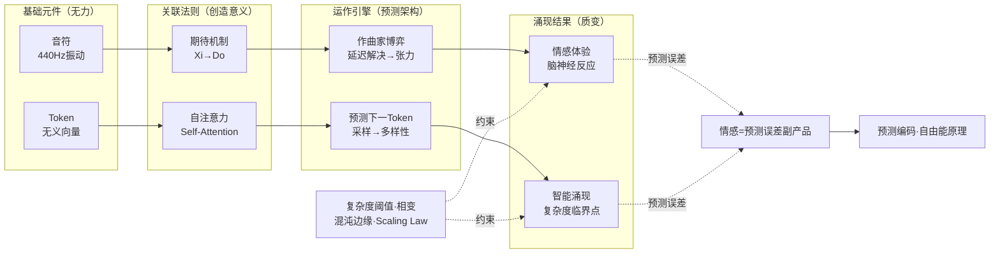
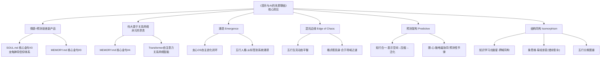
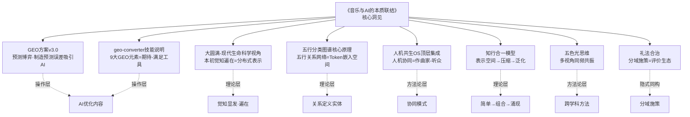

---
title: 知识图谱（《音乐与AI的本质联结》）
type: graph
tags: [知识学习, 音乐与AI, 知识图谱, Mermaid, 跨域同构, 双向链接, 结构化学习]
aliases: [音乐AI知识图谱, 概念关系图]
source: 《音乐与AI的本质联结：从音符到智能的涌现》结构化编译
created: 2026-07-20
updated: 2026-07-20
五行属性: 全
所属层级: B层
知识层次: Wiki
学习层次: 全层
links: [00-总索引, 09-核心概念手册, 01-第一章-绪论, 02-第二章-单个元素的无力性, 03-第三章-组合产生的质变, 04-第四章-共同底层机制, 05-第五章-专业洞见, 06-第六章-类比框架, 07-第七章-实践启示与未来图景, 08-第八章-结语]
---

# 知识图谱 —— 《音乐与AI的本质联结》

> 本文档用 Mermaid 可视化展示三张关系图：① 章节结构树 ② 核心概念体系（音乐↔AI 同构）③ 跨域隐秘连接。所有节点可对照 [[03-知识地基层/音乐与AI的本质联结/NSD58A1-09-核心概念手册]] 双向链接。

---

## 图一：章节结构树

---

## 图二：核心概念体系（音乐 ↔ AI 同构主干）

---

## 图三：跨域隐秘连接（知识学习北极星：主动发现结构同构性）

---

## 图四：显式跨域连接网络（来自权威版·6 关联文件 + 同构体系）

**显式映射表（来自权威版）**

| 本文章节 | 跨域连接知识点 | 连接类型 |
|---------|-------------|---------|
| 第二章·孤立元素 | 五行属性→五行是关系网络 | 隐式同构 |
| 第二章·Token无意义 | 本初觉知→遍在一切 | 显式对应 |
| 第三章·期待-满足 | 知行合一→表示空间构建 | 显式对应 |
| 第四章·预测架构 | GEO方案→预测优化 | 操作层对应 |
| 第四章·复杂度阈值 | 五行相生相克→张力平衡 | 隐式同构 |
| 第五章·情感=预测误差 | 大圆满→觉知显发 | 理论层对应 |
| 第六章·类比框架 | 五色光思维→多视角同频共振 | 方法论对应 |
| 第七章·人机协同 | 人机共生OS→协同模式 | 直接应用 |
| 第七章·评价生态 | 礼法合治→分域施策 | 隐式同构 |

---

## 关键同构小结

| 本文概念 | 既有知识体系节点 | 同构性质 |
|---------|----------------|---------|
| 情感是预测误差的副产品 | SOUL.md / MEMORY 核心金句#3 | 信仰命题获学术背书 |
| 伟大源于关系网络 | MEMORY 核心金句#4 / Transformer | 关系>元件 |
| 涌现 | 龙心OS自主进化 / 五行人格系统 | 整体>部分之和 |
| 混沌边缘 | 五行生克 / 格式塔具身 | 秩序-无序张力带 |
| 预测架构 | 知行合一 / 肠-心-脑协同 | 预测-压缩-泛化 |
| 结构同构 | 知识学习北极星 / 象思维 / 五行图谱 | 跨域映射能力 |

> 此图谱与 [[03-知识地基层/音乐与AI的本质联结/NSD58A1-00-总索引]]「跨域隐秘连接」、[[03-知识地基层/音乐与AI的本质联结/NSD58A1-09-核心概念手册]]「跨链」条目三向互证。

<!-- AI-LINKS-BEGIN -->
## 🔗 AI 关联笔记（统一索引生成 · 2026-11-14）

> 由 `00-索引与导航/AI统一索引` 生成；可重跑覆盖，可用回滚脚本还原。

- [[13-WorkBuddy-Sync/06-工作记录与复盘/MEMORY]] — MEMORY.md - 龙龟神将长期记忆
- [[03-知识地基层/AI原生组织四层体系/NS95769-09-核心概念手册]] — AI原生组织四层体系·核心概念手册
- [[03-知识地基层/AI原生组织四层体系/NS95769-10-知识图谱]] — AI原生组织四层体系·知识图谱
- [[03-知识地基层/逻辑学-逻辑基本知识/NS4BEB4-10-知识图谱]] — 《逻辑基本知识》知识图谱
- [[03-知识地基层/音乐与AI的本质联结-从音符到智能的涌现]] — 音乐与AI的本质联结——从音符到智能的涌现
- [[05-五行人格心理学/00-入口/生命的来处与归途-知识图谱]] — 生命的来处与归?- 知识图谱

<!-- AI-LINKS-END -->
