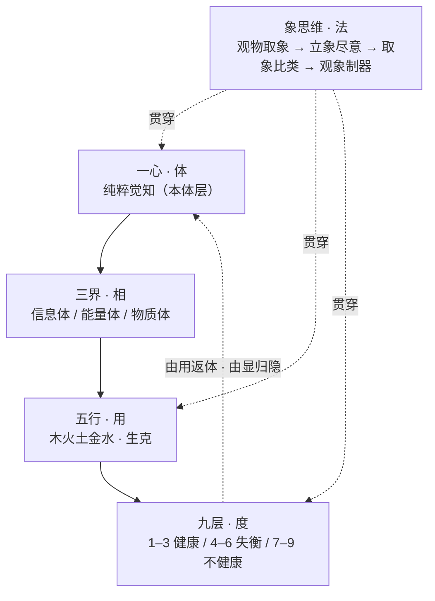

---
title: "一心三界五行九层 · 总览图（05 目录导航母图）"
type: index
created: 2026-11-14
updated: 2026-11-14
version: "1.0"
tags: [一心三界五行九层, 导航, 母图, 知识库, 以观其妙书院]
summary: "05-五行人格心理学 的导航母图：五层入口 + 图外三区 + 481 文件对账"
layer: 一心三界五行九层
node: 总览
related:
  - "[[NSA1398-06-归位对账表]]"
  - "[[NSA1398-01-一心·体-入口]]"
  - "[[NSA1398-02-三界·相-入口]]"
  - "[[NSA1398-03-五行·用-入口]]"
  - "[[NSA1398-04-九层·度-入口]]"
  - "[[NSA1398-05-象思维·法-入口]]"
---

# 一心三界五行九层 · 总览图

> **05-五行人格心理学** 的导航母图 ｜ 481 个文件按图归位 ｜ 左侧「由体到用·由隐到显」，右侧「由用返体·由显归隐」

## 一 这张图是什么

不是示意图，是**骨架**。图底那行小字已经把五层说尽：**一心（体）· 三界（相）· 五行（用）· 九层（度）· 象思维（法）**。

向下看，是人格形成的秩序：觉知 → 显化为三界 → 落成五行态势 → 分九个明暗刻度。
向上看，是生命成长的方向：从九层往上，经由五行、三界，回到一心。

![[五行人格学-一心三界五行九层象思维架构示意图.png|760]]

## 二 结构（Mermaid 版，便于复制）

> 可交互版本：[[导航画布·五层架构.canvas]]（在 Obsidian 中直接打开或嵌入）。

## 三 五层入口

| 层 | 位（体相用度法） | 这一层回答什么 | 文件数 | 入口 |
|---|---|---|---|---|
| 一心 | 体 | 谁在经历？观察者是谁 | 25 | [[NSA1398-01-一心·体-入口]] |
| 三界 | 相 | 问题在信息/能量/物质上分别长什么样 | 10 | [[NSA1398-02-三界·相-入口]] |
| 五行 | 用 | 我是哪一行？生克在哪 | 68 | [[NSA1398-03-五行·用-入口]] |
| 九层 | 度 | 我在第几层？下一步的门在哪 | 83 | [[NSA1398-04-九层·度-入口]] |
| 象思维 | 法 | 怎么观象、取象、制器 | 33 | [[NSA1398-05-象思维·法-入口]] |

## 四 图外挂载（图上没画，但库里有）

| 区 | 是什么 | 文件数 | 入口 |
|---|---|---|---|
| 应用出口 | 八大场景：由体到用、由用返体的落地口 | 106 | [[NSA1398-07-应用出口·八大场景]] |
| 系统元层 | 索引、图谱、智能体、配置、产品化：让图持续对得上库 | 125 | [[NSA1398-08-系统元层·索引与配置]] |
| 融合素材 | 西方心理学、马克思主义、老子：对外对话的翻译器 | 31 | [[NSA1398-09-融合素材·心理学与哲学]] |

## 五 怎么用（四步）

1. **定位**：拿到一个具体问题，先判断它落在哪一层（谁在经历→一心；三层哪层失衡→三界；哪一行→五行；第几层→九层；怎么观→象思维）。
2. **进层**：点进对应入口笔记，按子类取料（★ 标的是 17 篇 L7 核心，优先读）。
3. **跨层验算**：任何诊断都不要停在一层——(行, 层) 是坐标，三界是层面，象思维是方法。
4. **对账**：新增文件后看 [[NSA1398-06-归位对账表]]，它保证 481 个文件一个都不丢。

## 六 本次归位的口径

- 全量：**481 个文件 · 8.8 MB**（475 个 .md + 6 个非 .md）。
- 五层主层：**219 篇**；图外挂载：**262 篇**；未归类：**0**。
- 每个文件的“反向链接”里都会出现它所属的入口笔记——这就是双向链接的落地方式。
- 归位规则与明细见 [[NSA1398-06-归位对账表]]；规则脚本在 `00-入口/工具/图归位脚本.py`。

## 七 一句话记住这张图

> **一心是光源，三界是三棱镜，五行是光谱，九层是色阶，象思维是那台一直举着棱镜的手。**

---

维护：新增文件 → 跑 `图归位脚本.py` → 复核 [[NSA1398-06-归位对账表]]；本页与五个入口为生成物，手改会被覆盖。

<!-- AI-LINKS-BEGIN -->
## 🔗 AI 关联笔记（统一索引生成 · 2026-11-14）

> 由 `00-索引与导航/AI统一索引` 生成；可重跑覆盖，可用回滚脚本还原。

- [[01-核心体系/AI智能体_饕餮龙尊与青龙院长的共生关系]] — 饕餮龙尊与青龙院长的共生关系
- [[07-得到大脑同步/_历史归档_20261104/五行人格学/NS353C6-12-一心三界五行九层象思维体系：完整架构梳理]] — 一心三界五行九层象思维体系：完整架构梳理
- [[07-得到大脑同步/_历史归档_20261104/得到大脑-核心原创-第1批]] — 得到大脑 · 核心原创第 1 批（全文）
- [[07-得到大脑同步/五行人格学/NSBFEF6-14-五行人格学理论框架]] — 五行人格学理论框架

<!-- AI-LINKS-END -->
