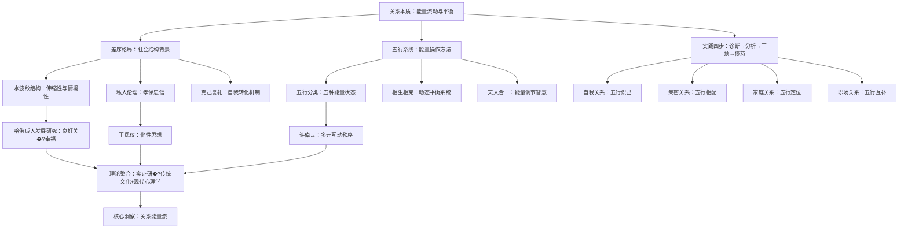

---
title: "五行：解�?关系'的有效工具——跨域知识图�?
created: "2026-04-06"
version: "1.0"
tags: [知识图谱, 五行识人, 关系处理, 跨域整合, 系统性学习]
---

# 五行：解�?关系"的有效工具——跨域知识图�?

## 核心网络结构



## 核心三元：结构×逻辑×方法

### 三元1：差序格局（费孝通）——社会结�?

#### 与费孝通《乡土中国》的深度对应

**理论对接�?*�?
1. **结构模型对接**�?
   - 差序格局"水波�? �?五行"动态系�?
   - 伸缩�?�?能量流动（相生相克）
   - 情境�?�?角色定位（父�?君臣/夫妇�?

2. **伦理基础对接**�?
   - 差序格局"私人伦理（孝悌忠信）" �?五行"五伦能量解读"
   - 孝悌忠信的五行化�?
     * 孝：水生木（滋养成长�?
     * 悌：木生火（温暖连接�?
     * 忠：金克木（规则约束�?
     * 信：土承载（稳定支持�?

3. **调节机制对接**�?
   - 差序格局"克己复礼" �?五行"拔阴取阳+化克为生"
   - 克己 = 五行修持（化性）
   - 复礼 = 五行能量调整（情境适应�?

#### 创新整合�?

**1. �?静态分�?�?动态能量流�?**�?
> 差序格局揭示了关系的"伸缩�?本质
> 五行系统提供�?动态平�?的方法论
> 整合创新：关系不是固定结构，而是流动的能量网�?

**2. �?私人伦理"�?能量操作"**�?
> 传统伦理依赖个人道德自觉
> 五行提供可操作的能量调节工具
> 整合创新：将抽象�?孝悌忠信"转化为具体的能量调节方法

**3. �?克己"�?化�?**�?
> 差序格局强调"克己"的道德约�?
> 五行与王凤仪�?化�?结合
> 整合创新：性格特质的根本转化，而非简单的行为克制

### 三元2：多元互动秩序（许倬云）——哲学基础

#### 与许倬云"多元互动的秩�?的深度对�?

**理论对接�?*�?
1. **分类法对�?*�?
   - 许倬云"五行是最具代表性的分类�? �?五行"五种能量状态模�?
   - 多元互动 �?五种关系模式
   - 分类本质：不是物质分类，而是关系分类�?

2. **动态系统对�?*�?
   - 许倬云"彼此互动、互相补助的复杂动态系�? �?五行"相生相克动态平�?
   - 相生 = 互动、互相补�?
   - 相克 = 制约、规范、挑�?

3. **宇宙观对�?*�?
   - 许倬云"天人合一" �?五行"人体、社会、自然遵循同样规�?
   - 顺应自然而动 = 顺时而动（四季养生）
   - 顺势而为 = 相生相克智慧

#### 创新整合�?

**1. �?物质分类"�?关系分类�?**�?
> 传统理解：木火土金水是五种物�?
> 创新理解：五种关系能量状态×行为模式×互动逻辑
> 整合创新：重新定义五行的本质——多元互动秩序的关系工具

**2. �?固定模式"�?动态系�?**�?
> 相生相克不是静态规�?
> 而是自我调节、动态平衡的系统
> 整合创新：关系管理是能量平衡的艺�?

**3. �?天人合一"�?人际关系和谐"**�?
> 宏观：人体、社会、自然遵循五行规�?
> 微观：人际关系调节能量使之和�?
> 整合创新：处理人际关�?= 调节能量使之与自然节律相和谐

### 三元3：哈佛成人发展研究——实证支�?

#### 与哈佛成人发展研究的深度对应

**理论对接�?*�?
1. **实证数据对接**�?
   - 哈佛研究�?5年�?24名男�?�?良好关系=幸福健康
   - 五行理论：能量平�?和谐 �?能量流动决定关系质量
   - 对接点：两者从不同角度证明同一核心真理

2. **研究权威对接**�?
   - 罗伯特·瓦尔丁格教授（哈佛医学院）
   - 费孝通教授（中国社会学家�?
   - 许倬云（中国文化学者）
   - 整合：东西方学术权威的交叉验�?

3. **理论本质对接**�?
   - 哈佛研究：良好关系决定幸福（现象层面�?
   - 五行理论：能量平衡决定和谐（能量层面�?
   - 整合：现象与能量的双重验�?

#### 创新整合�?

**1. �?现象观察"�?能量机制"**�?
> 哈佛研究：观察现象（良好关系→幸福）
> 五行理论：解释机制（能量平衡→和谐）
> 整合创新：不仅知�?是什�?，还知道"为什�?

**2. �?西方实证"�?东方智慧"**�?
> 东西方殊途同�?
> 证明关系本质的普世�?
> 整合创新：传统文化的现代科学诠释

**3. �?单一结论"�?系统方案"**�?
> 哈佛研究：提供结�?
> 五行理论：提供方法（诊断→分析→干预→修持）
> 整合创新：从"知道重要"�?知道如何�?

## 跨域知识联系矩阵

### 与大圆满见地的连接（5个）

| 大圆满核心概�?| 对应�?| 连接强度 | 核心洞见 |
|--------------|-------|---------|---------|
| 明觉状�?| 关系处理的觉知基础 | ★★★★�?| 只有在明觉状态下，才能真实感知关系的能量流动 |
| 椎击三要 | 五行识己与识人的直接工具 | ★★★★�?| 直指心性认出五�?�?确信无疑确认角色 �?解脱自信能量调整 |
| 五毒转五�?| 五行修持的能量转化机�?| ★★★★�?| 贪火嗔木痴水慢金疑土 �?对应五行的阴面转�?|
| 本来清净 | 关系中的"不执着"智慧 | ★★★★�?| 不执着于关系形态，在流动中保持清净 |
| 本自圆满 | 每个人都具备五行的全能�?| ★★★★�?| 扩充自我使具备五行全能，圆融完成 |

### 与五蕴心理学的连接（4个）

| 五蕴心理学概�?| 对应�?| 连接强度 | 核心洞见 |
|--------------|-------|---------|---------|
| 自�?= 觉�?| 五行能量的根本源�?| ★★★★�?| 五行五智从觉性中自然显现 |
| 五毒对应 | 五行阴面特质 | ★★★★�?| 贪嗔痴慢疑对应五行的失衡状�?|
| 五智对应 | 五行阳面特质 | ★★★★�?| 法界体性智/大圆镜智/平等性智/妙观察智/成所作智 |
| 色受想行�?| 关系处理的五个层�?| ★★★★�?| 五行在不同层面的显化（色：外貌、受：感受、想：认知、行：行为、识：模式） |

### 与五行识人理论的连接�?个）

| 五行识人概念 | 对应�?| 连接强度 | 核心洞见 |
|-----------|-------|---------|---------|
| 一心三�?| 关系处理的能量场 | ★★★★�?| 身界（外貌体态）+心界（情绪思维�?灵界（价值观使命�?|
| 五行九层 | 关系品质的量化阶�?| ★★★★�?| 从解放（1级）到病态破坏（9级），评估关系能量状�?|
| 拔阴取阳 | 五行修持的核心技�?| ★★★★�?| 认不�?找好�?信因�?达天时，对应化性方�?|
| 化克为生 | 关系冲突化解的智�?| ★★★★�?| 木克土→木生火→火生土，将冲突转化为滋养 |
| 相生强化 | 关系滋养的能量循�?| ★★★★�?| 木生火→火生土→土生金→金生水→水生�?|
| 相克制约 | 关系边界的能量机�?| ★★★★�?| 金克木（规则约束）、火克金（热情融化）、土克水（稳定包容） |

### 与五色光思维的连接（4个）

| 五色光思维概念 | 对应�?| 连接强度 | 核心洞见 |
|--------------|-------|---------|---------|
| 五色光之�?| 关系处理的逆流路径 | ★★★★�?| 从关系困惑逆流回明觉状�?|
| 五行之道 | 关系处理的顺流路�?| ★★★★�?| 从明觉顺流进入各种关系形�?|
| 能量体场 | 关系网络的能量系�?| ★★★★�?| 差序格局=结构场×五行系�?能量�?|
| 同频共振 | 关系和谐的关�?| ★★★★�?| 双方能量同频才能形成良好关系 |

### 与象思维的连接（3个）

| 象思维概念 | 对应�?| 连接强度 | 核心洞见 |
|---------|-------|---------|---------|
| 原象 = 觉�?| 关系本质的终极源�?| ★★★★�?| 关系是觉性游舞的显现 |
| 三层次对�?| 差序格局三层�?| ★★★★�?| 物象（水波纹�?意象（私人伦理）+原象（克己复礼） |
| 0�?突破 | �?关系处理"�?能量网络运营" | ★★★★�?| 关系本质的范式转�?|

### 与量子意识理论的连接�?个）

| 量子意识概念 | 对应�?| 连接强度 | 核心洞见 |
|-----------|-------|---------|---------|
| 波粒二象�?| 关系的双重本�?| ★★★★�?| 关系既是具体的结构（粒）也是流动的能量（波） |
| 量子纠缠 | 关系网络的互联�?| ★★★★�?| 水波纹：一个节点的变化影响整个网络 |
| 观察者效�?| 关系质量取决于觉知状�?| ★★★★�?| 明觉状态下才能真实观察关系本质 |
| 能量场理�?| 差序格局+五行系统的能量基础 | ★★★★�?| 关系是能量场的相互作�?|

### 与王凤仪化性谈的连接（3个）

| 王凤仪概�?| 对应�?| 连接强度 | 核心洞见 |
|---------|-------|---------|---------|
| 化性思想 | 五行修持的根�?| ★★★★�?| 木行人化怒为仁、火行人化恨为礼�?|
| 每日三省 | 关系修持的实践方�?| ★★★★�?| 怨人？生气？找好处？认不是？ |
| 五伦能量解读 | 差序格局的五行化 | ★★★★�?| 父子水木、君臣金木、夫妇火水金木等 |

## 核心创新洞察

### 洞察1：从"静态分�?�?动态能量流动图�?

**传统视角**�?
- 差序格局：静态的社会结构
- 五行系统：静态的物质/能量分类
- 关系处理：基于固定角色和规则

**创新视角**�?
- 关系�?*动态能量流动图�?*
- 每个人都是能量节�?
- 每段关系都是能量通道
- 能量在节点间流动、转换、平�?

**象征符号**�?
> 🌊 **关系能量�?* = 差序格局（结构）× 五行系统（逻辑）�?实践四步（方法）

### 洞察2：三元整合——实�?传统+心理的统一

**整合模式**�?
```
哈佛研究（实证基础�?
    �?
费孝通（社会结构�?
    �?
许倬云（哲学基础�?
    �?
五行系统（能量操作）
    �?
现代心理学（方法工具�?
```

**创新价�?*�?
- 不再是东西方对立
- 而是"殊途同�?的验�?
- 为传统文化提供科学背�?
- 为现代心理提供文化根�?

**核心公式**�?
> **关系智慧 = 哈佛实证 × 东方传统 × 现代心理**

### 洞察3：从"关系管理"�?能量网络运营"

**传统方法**�?
- 关系管理：基于规则、角色、责�?
- 问题处理：基于冲突解决、沟通技�?

**创新方法**�?
- 能量网络运营：基于能量识别、流动调节、平衡维�?
- 节点健康：个体五行能量的认知与修�?
- 通道优化：关系路径的相生相克分析

**核心转变**�?
> �?控制关系"�?运营能量网络"
> �?解决问题"�?预防失衡"

## 五大应用框架

### 框架1：自我关系五行化实践

**能量诊断系统**�?
- 外貌观察：体型、面色、声音、眼�?
- 行为分析：关注点（事/�?�?�?情）
- 心理测评：五行能量分布量�?
- 修持方法：五行动�?+ 五色光瑜�?+ 每日三省

### 框架2：亲密关系五行相�?

**互动模式识别**�?
- 相生组合（木火、土金）：天然吸引力，警惕依�?
- 相克组合（金木、火金）：容易冲突，理解差异、学会通关
- 实践策略：五种五行伴侣的差异化相处策�?

### 框架3：家庭关系五行定�?

**角色定位模型**�?
- 父亲：金或木（规则、引导、力量）
- 母亲：土或水（包容、滋养、智慧）
- 子女：木或火（成长、活力、未来）
- 冲突化解：金木冲突（父子）→ 土通关（母亲缓冲）

### 框架4：职场关系五行互�?

**团队角色配置**�?
- 创新者（木）：开拓新思路，打破常�?
- 激励者（火）：鼓舞士气，推动执行
- 协调者（土）：整合资源，维护和谐
- 执行者（金）：制定标准，严格落地
- 谋略者（水）：分析风险，灵活应变

**管理启示**�?
- 性格互补分组预防搭便车现�?
- 识别员工五行属性进行合理搭�?
- 构建相生能量循环，避免单一能量过强

### 框架5：关系处理四步标准化流程

**诊断→分析→干预→修�?*�?
1. **诊断**：识别自我与他人的五行属�?
2. **分析**：判断关系中的五行生克状�?
3. **干预**：运用五行原理调整关系（相生法、相克法、通关法、平衡法�?
4. **修持**：持续修炼五行心�?

## 实践工具�?

### 工具1：五行简易判断清�?

**观察重点**�?
- 体型：瘦长（木）、壮实（火）、敦厚（土）、方正（金）、圆润（水）
- 面色：青（木）、红（火）、黄（土）、白（金）、黑（水�?
- 声音：高亢（木）、洪亮（火）、浑厚（土）、清脆（金）、低沉（水）
- 眼神：锐利（木）、明亮（火）、温和（土）、坚定（金）、深邃（水）

**行为关键�?*�?
- 木：创新、固执、正直、抗�?
- 火：热情、急躁、表达、冲�?
- 土：稳定、犹豫、包容、固�?
- 金：规则、挑剔、义气、冷�?
- 水：智慧、逃避、适应、消�?

### 工具2：关系生克分析表

| 组合类型 | 能量状�?| 实践策略 | 注意事项 |
|---------|---------|---------|---------|
| **相生** | 自然和谐 | 给予支持 | 警惕过度依赖 |
| **相克** | 存在张力 | 理解差异 | 主动调节 |
| **相侮** | 严重失衡 | 紧急干�?| 重建平衡 |
| **同属�?* | 相似共鸣 | 共同成长 | 避免单一�?|

### 工具3：五种伴侣相处策�?

**对木行人伴侣**�?
- 支持其理想，给予成长空间
- 避免过度干涉

**对火行人伴侣**�?
- 真诚赞美，积极回�?
- 避免冷漠与忽�?

**对土行人伴侣**�?
- 提供安全感，承诺稳定
- 避免变动与冒�?

**对金行人伴侣**�?
- 尊重规则，认可其价�?
- 避免无理取闹

**对水行人伴侣**�?
- 深度沟通，理解其情感需�?
- 避免肤浅与敷�?

### 工具4：每日三省修持法

**王凤仪化性思想与现代结�?*�?
- 今天我是�?怨人"�?
- 今天我是�?生气"�?
- 今天我是�?找好�?�?
- 今天我是�?认不�?�?

**对应五行修持**�?
- 木行人：修仁，不怨人
- 火行人：修礼，不生气
- 土行人：修信，认不是
- 金行人：修义，找好处
- 水行人：修智，不烦恼

## 核心金句集锦

1. "决定我们生活幸福与健康长寿的关键，并非财富、名声或辛勤工作，而是'良好的关�?�? —�?罗伯特·瓦尔丁�?

2. "中国人的社会关系不是一捆一捆扎清楚的柴，而是好像把一块石头丢在水面上所发生的一圈圈推出去的波纹�? —�?费孝�?

3. "五行是最具代表性的分类法，它构建了一�?多元互动的秩�?，将宇宙万物视为一个彼此互动、互相补助的复杂动态系统�? —�?许倬云

4. "关系的本质不是控制与索取，而是能量的流动与平衡�?

5. "一切关系的起点是自我关系。五行识人首先帮助个体实现自我认知与接纳�?

6. "不是压抑自我，而是扩充自我，使自我具备五行的全能性，从而在差序格局的任何位置都能游刃有余�?

7. "良好关系并非偶然，而是可以通过科学的认知与持续的修持来构建的�?

8. "我们每个人都是关系网络中的一个节点，只有当这个节点能量平衡、通透，整个网络才能和谐运转�?

9. "�?关系处理'�?能量网络运营'——五行智慧的范式转变�?

10. "差序格局+五行系统+现代心理�?东西方智慧的完美融合�?

## 标签系统

**一级标�?*�?
#五行识人 #关系处理 #差序格局 #多元互动 #哈佛成人发展研究

**二级标签**�?
#自我关系 #亲密关系 #家庭关系 #职场关系 #社会关系
#五行相生相克 #能量平衡 #天人合一 #化�?#克己复礼

**三级标签**�?
#费孝通乡土中�?#许倬云 #王凤仪化性谈
#哈佛研究 #实证研究 #东西方融�?#传统智慧现代诠释
#实践指南 #修持方法 #每日三省 #五行动功

---

**文档版本**: 1.0
**创建日期**: 2026-04-06
**总联系数**: 34个跨域连接点
**关联文档�?*: 8个核心理论体�?
**应用框架�?*: 5�?
**实践工具�?*: 4�?
**核心金句�?*: 10�?

---\n
> ?? ����: [[00-���]]

<!-- AI-LINKS-BEGIN -->
## 🔗 AI 关联笔记（统一索引生成 · 2026-11-14）

> 由 `00-索引与导航/AI统一索引` 生成；可重跑覆盖，可用回滚脚本还原。

- [[03-知识地基层/五行分类/五行分类图谱]] — 五行分类图谱
- [[03-知识地基层/五行分类/生克制化关系]] — 生克制化关系详解
- [[03-知识地基层/差序格局与礼治秩序-深度学习]] — 差序格局与礼治秩序·深度学习
- [[05-五行人格心理学/00-入口/五行-解决关系的有效工具-基于差序格局与多元互动秩序的深度解析]] — 五行：解决'关系'的有效工具——基于差序格局与多元互动秩序的深度解析
- [[05-五行人格心理学/人格类型/水智能体/💧水行人拔阴取阳实操]] — 💧 水行人拔阴取阳实操
- [[05-五行人格心理学/理论基石/📖 化克为生完整体系]] — 化克为生完整体系 · 相克关系转化

<!-- AI-LINKS-END -->
