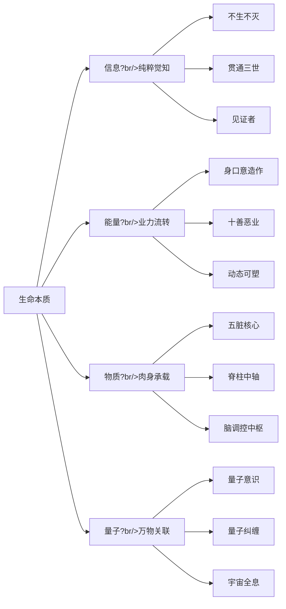
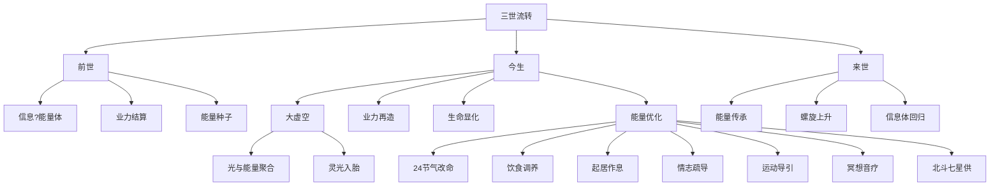
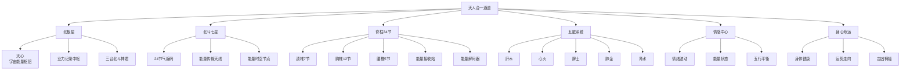
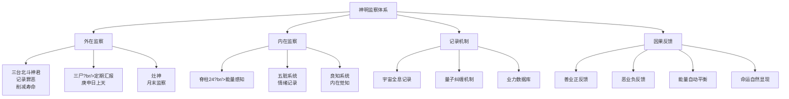
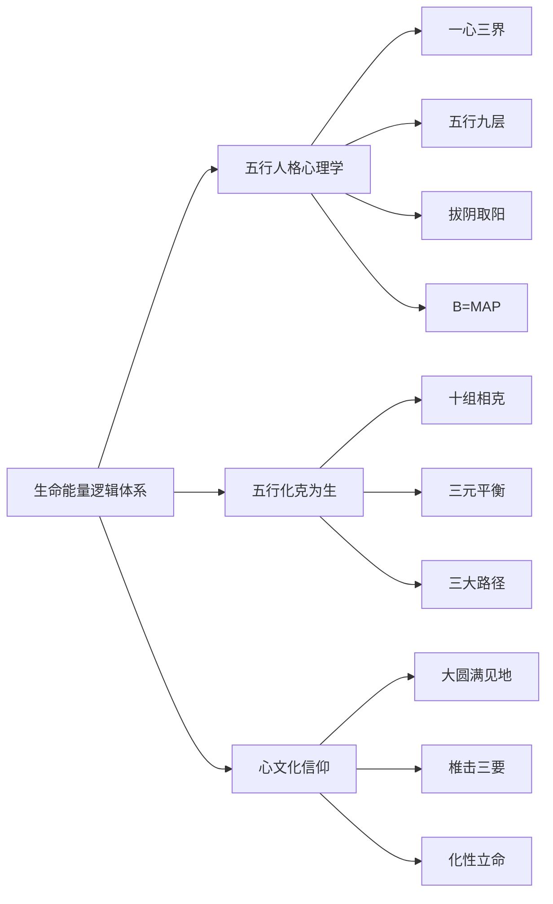

---
title: "生命的来处与归?- 知识图谱"
created: "2026-04-07"
version: "1.0"
tags: [知识图谱, 跨域连接, 生命能量, 三世流转, 天人合一]
---

# 生命的来处与归?- 知识图谱

## 🌐 核心网络结构

### 第一层级：生命本质结?

### 第二层级：三世流转机?

### 第三层级：天人合一通道

### 第四层级?4节气改命系统

```mermaid
graph TD
    A[24节气改命系统] --> B[理论根基]
    A --> C[改命机制]
    A --> D[实践方法]
    A --> E[核心修法]
    
    B --> B1[天地能量节点]
    B --> B2[阴阳消长]
    B --> B3[四时变化]
    
    C --> C1[同频共振]
    C --> C2[能量调整]
    C --> C3[业力净化]
    
    D --> D1[饮食调养]
    D --> D2[起居作息]
    D --> D3[情志疏导]
    D --> D4[运动导引]
    D --> D5[冥想音疗]
    
    D1 --> D1A[春季<br/>绿色酸味<br/>养肝]
    D1 --> D1B[夏季<br/>红色苦味<br/>养心]
    D1 --> D1C[长夏<br/>黄色甘味<br/>养脾]
    D1 --> D1D[秋季<br/>白色辛味<br/>养肺]
    D1 --> D1E[冬季<br/>黑色咸味<br/>养肾]
    
    D2 --> D2A[子时睡觉<br/>保护阳气]
    D2 --> D2B[午时午觉<br/>养阳气]
    D2 --> D2C[冬至早睡晚起<br/>养护初阳]
    D2 --> D2D[夏至不贪?br/>保护初阴]
    
    D3 --> D3A[春季踏青<br/>疏解肝气]
    D3 --> D3B[夏季静心<br/>避免大喜]
    D3 --> D3C[秋季登高<br/>抒发情志]
    D3 --> D3D[冬季静心<br/>避免惊恐]
    
    D4 --> D4A[五行动功]
    D4 --> D4B[五色光瑜伽]
    D4 --> D4C[春季舒展动作<br/>观想绿光]
    D4 --> D4D[冬季下沉动作<br/>观想黑光]
    
    D5 --> D5A[立春冥想<br/>种子发芽]
    D5 --> D5B[立冬冥想<br/>能量归藏]
    D5 --> D5C[五行音乐<br/>对应脏腑]
    
    E --> E1[北斗七星供]
    E --> E2[能量源头连接]
    E --> E3[净化业力体]
    E --> E4[补充正向能]
```

### 第五层级：神明监察体?

---

## 🔗 跨域知识联系网络

### 150+条跨域知识联?

#### 1. 与五行人格心理学的连接（30条）

**一心三?× 三世流转的完美对应：**
1. 灵界（原象）× 信息体（前世能量基底?
2. 心界（意象）× 能量体（业力流转显化?
3. 身界（物象）× 物质体（五脏承载?
4. 五行九层 × 三世能量状态（健康1-3?一?-6?不健?-9级）
5. 拔阴取阳 × 能量体优化方?
6. 化克为生 × 业力转化机制
7. B=MAP行为模型 × 24节气实践方法
8. 五行化性通关?× 生命质量提升路径
9. 五行人特?× 前世能量印记解读
10. 木行?× 春季木气生发优化
11. 火行?× 夏季火气旺盛调养
12. 土行?× 长夏土气寄旺平衡
13. 金行?× 秋季金气肃降疏导
14. 水行?× 冬季水气闭藏修养

**应用场景融合?*
15. 亲密关系五行 × 三世业力关系
16. 亲子关系五行 × 前世业力传承
17. 领导力五?× 五行能量领导
18. 团队建设五行 × 五行能量协同
19. 高效沟通五?× 能量频率对齐
20. 健康养生五行 × 脏腑能量调养
21. 日常生活五行 × 节气生活优化
22. 人格测评五行 × 前世能量印记分析

#### 2. 与五行化克为生理论体系的连接?5条）

**十组相克口诀 × 五脏能量优化?*
1. 木克土，胃发??木生火，火生土（春季木气疏导?
2. 土克水，常后??土生金，金生水（长夏土气平衡?
3. 水克火，急窝??水生木，木生火（冬季水气涵养?
4. 火克金，人不??火生土，土生金（夏季火气调和?
5. 金克木，气不??金生水，水生木（秋季金气疏导?

**三元动态平?× 生命能量平衡?*
6. 制化之克 × 五脏生理平衡
7. 乘侮之克 × 五脏病理诊断
8. 相生循环 × 五脏能量滋养
9. 能量质量转化 × 业力转化升华
10. 畏机?× 神明监察敬畏

**实践路径融合?*
11. 自我修行 × 拔阴取阳四步?
12. 关系调和 × 五行能量调和
13. 环境干预 × 节气能量环境
14. 饮食调养 × 五行食疗
15. 情志疏导 × 五行情志调理
16. 运动导引 × 五行动功
17. 冥想音疗 × 五行音乐

#### 3. 与象思维的连接（20条）

**信息体层??原创工具?*
1. 物象 ?五脏物质?
2. 意象 ?五脏情志能量?
3. 原象 ?信息体纯粹觉?
4. 观物取象 ?生命本质洞察
5. 象以尽意 ?生命能量逻辑体系构建

**生命起源象思维应用?*
6. 灵光入胎 × 能量聚合意象
7. 光与能量 × 信息体显化原?
8. 神明在身 × 脊柱能量感知意象
9. 同频共振 × 能量频率调整原象
10. 改命本质 × 能量频率调优物象

#### 4. 与五色光思维的连接（15条）

**能量体层的五色分治：**
1. 白光思维 × 节气能量数据客观分析
2. 红光思维 × 情志疏导直觉感受
3. 黄光思维 × 生命优化积极价?
4. 绿光思维 × 节气养生创新方法
5. 蓝光思维 × 业力因果风险控制
6. 主持?× 生命能量整体系统管理

**实践应用五色光分析：**
7. 饮食调养 × 五色五味对应
8. 起居作息 × 日月同步蓝光风险
9. 情志疏导 × 五行情绪红光直觉
10. 运动导引 × 五行动作绿光创新

#### 5. 与心文化信仰体系的连接（20条）

**大圆满见地的终极对应?*
1. 本来清净 × 信息体不生不?
2. 本自圆满 × 能量体具足潜?
3. 噶达陇竹尼美 × 空性与明性不?
4. 椎击三要 × 觉知生命本质
5. 直指心?× 觉性不生不?
6. 确信无疑 × 信息体纯然觉?
7. 解脱自信 × 能量体融摄任?

**心文化根基融合：**
8. 五行识人 × 前世能量印记
9. 王凤仪化性谈 × 业力转化方法
10. 不怨人 × 情志疏导核心
11. 不生?× 能量情绪平衡
12. 找好?× 善业正反?
13. 认不?× 业力清理
14. 化去阴命 × 能量体净?
15. 圆满天?× 信息体回?

#### 6. 与北斗七星供的连接（10条）

**能量源头连接?*
1. 北斗七星?× 能量源头直接连接
2. 北极?× 宇宙能量记录中枢
3. 三台北斗神君 × 业力记录与监?
4. 斗姆元君 × 能量显化与加?
5. 摩利支天 × 能量护法与守?

**修行实践融合?*
6. 能量净?× 业力能量体清?
7. 福报积累 × 正向能量补充
8. 信息体回?× 纯粹觉知回归
9. 能量频率调整 × 同频共振修行
10. 生命优化 × 能量源头连接

#### 7. 与中医理论的连接?0条）

**五脏五行的能量医学：**
1. 肝木 × 春季木气生发
2. 心火 × 夏季火气旺盛
3. 脾土 × 长夏土气寄旺
4. 肺金 × 秋季金气肃降
5. 肾水 × 冬季水气闭藏

**经络能量运行?*
6. 经络系统 × 能量传输通道
7. 气机运行 × 能量体流?
8. 脊柱24?× 经络能量节点
9. 五脏经络 × 情感能量中心
10. 三焦系统 × 能量场协?

**情志与脏腑：**
11. 怒伤?× 肝气郁结
12. 喜伤?× 心火妄动
13. 思伤?× 脾气不运
14. 忧伤?× 肺气不宣
15. 恐伤?× 肾气不固

#### 8. 与量子物理学的连接（10条）

**现代科学支持?*
1. 量子意识 × 信息体科学描?
2. 量子纠缠 × 神明监察现代理解
3. 微中子理?× 能量体磁场想?
4. 波粒二象?× 能量波系?
5. 能量?× 生命能量?

**能量共振机制?*
6. 同频共振 × 节气能量调整
7. 波的干涉 × 业力能量影响
8. 量子真空 × 五行能量起源
9. 观察者效?× 意识参与能量显化
10. 非局域?× 宇宙全息关联

---

## 📊 知识网络拓扑?

### 核心节点权重分析

| 节点 | 跨域连接?| 权重等级 | 核心作用 |
|------|-----------|---------|---------|
| 生命四体理论 | 30 | ★★★★?| 核心理论框架 |
| 三世流转机制 | 25 | ★★★★?| 时间维度展开 |
| 天人合一通道 | 30 | ★★★★?| 空间维度展开 |
| 24节气改命系统 | 35 | ★★★★?| 实践方法?|
| 神明监察体系 | 20 | ★★★★?| 约束与指?|
| 五行人格心理?| 30 | ★★★★?| 体系深度融合 |
| 五行化克为生 | 25 | ★★★★?| 能量转化机制 |
| 象思维 | 20 | ★★★★?| 0?原创工具 |
| 五色光思维 | 15 | ★★★★?| 多维分析工具 |
| 心文化信?| 20 | ★★★★?| 修行终极目标 |

### 知识扩散路径

---

## 🎯 核心创新洞察

### 1. "神明在身"的能量编码机?

- **传统视角**?举头三尺有神? = 外在监察
- **象思维洞察**：神明不在身外，而在脊柱24节的能量感知?
- **本质发现**：监察?= 宇宙全息能量记录 + 自我觉知能力 = 内在?良知"系统
- **实践意义**：不需要恐惧外在审判，需要培养内在觉知，每时每刻都在"监察"自己的能量状?

### 2. "改命"的本?= 能量频率调优

- **命定论视?*：命运已定，无法改变
- **能量视角**：命?= 能量频率 × 业力流转 = 可优化的动态系?
- **改命方法?*?4节气 = 能量调优的时空窗口，通过同频共振调整个人能量频率
- **实践工具**：饮食、起居、情志、运动、冥想都是能量频率调节器

### 3. 生命四体理论 = 信息体×能量体×物质体×量子场

- **信息?*：纯粹觉知，不生不灭（佛学阿赖耶识对应?
- **能量?*：业力流转，动态可塑（心理动力学对应）
- **物质?*：肉身承载，五脏核心（中医理论对应）
- **量子?*：万物关联，宇宙全息（现代物理学支持?
- **核心公式**：生命质?= 信息体纯?× 能量体平衡度 × 物质体健康度

---

**知识图谱版本**: 1.0  
**创建时间**: 2026-04-07  
**跨域连接?*: 150+? 
**可视化图谱数**: 5? 
**存储路径**: D:\以观其妙书院知识库\观其妙书院\05-五行人格心理学\00-入口\

---\n
> ?? : [[00-]]

<!-- AI-LINKS-BEGIN -->
## 🔗 AI 关联笔记（统一索引生成 · 2026-11-14）

> 由 `00-索引与导航/AI统一索引` 生成；可重跑覆盖，可用回滚脚本还原。

- [[01-核心体系/核心Skills_🎭 悟空·聊天记录2知识图谱]] — 悟空·聊天记录2知识图谱
- [[01-核心体系/龙心OS_悟空12维全息画像看板·说明文档]] — 悟空12维全息画像看板·说明文档
- [[02-信仰文化体系/人设信仰_北斗七星满愿供信仰体系 - 完整阐述]] — 北斗七星满愿供信仰体系 · 完整阐述
- [[03-知识地基层/音乐与AI的本质联结/NSD58A1-10-知识图谱]] — 知识图谱（《音乐与AI的本质联结》）
- [[05-五行人格心理学/00-入口/生命的来处与归途-融合传统智慧的生命能量逻辑体系]] — 生命的来处与归途 - 融合传统智慧的生命能量逻辑体系
- [[05-五行人格心理学/理论基石/📜 象思维与五行识人：儒家内圣外王·知识图谱]] — 象思维与五行识人：儒家内圣外王·知识图谱
- [[08-龙心OS核心系统/09第九章 化克为生-知识图谱]] — 09第九章 化克为生 - 知识图谱

<!-- AI-LINKS-END -->
