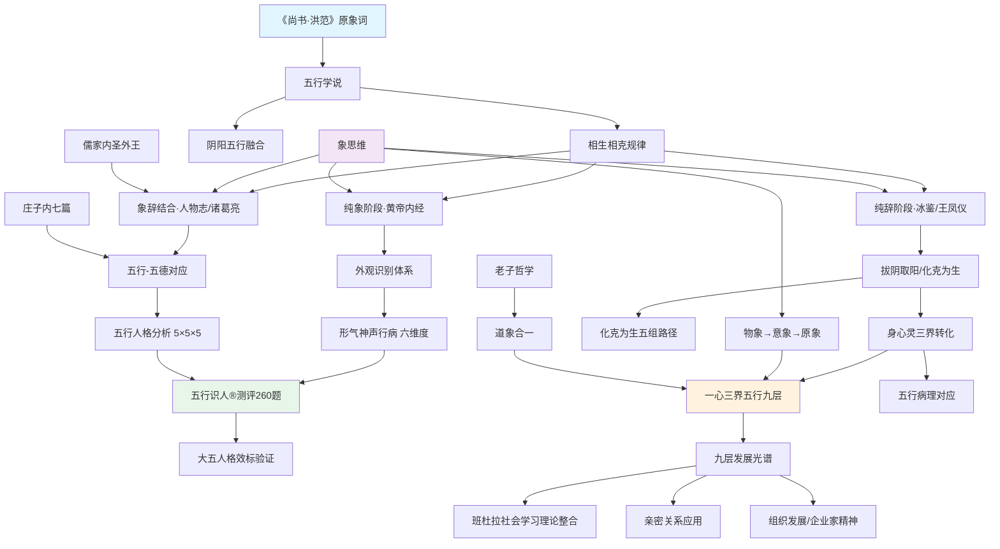
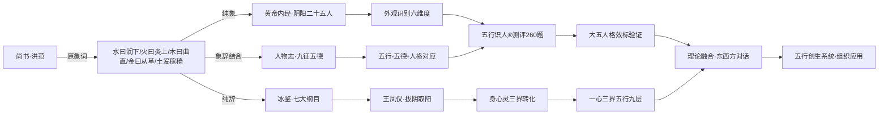

---
title: 五行识人知识图谱与关联网络
type: knowledge_graph
created: 2026-07-21
tags:
  - 知识图谱
  - 关联网络
  - 可视化
---

# 五行识人知识图谱与关联网络

## 一、核心节点关系图（Mermaid）

## 二、知识节点关联矩阵

| 源节点 → | 五行学说 | 象思维 | 一心三界 | 外观识别 | 人格分析 | 测评工具 | 拔阴取阳 | 化克为生 | 发展层级 | 亲密关系 | 组织发展 | 理论融合 |
|----------|---------|--------|---------|---------|---------|---------|---------|---------|---------|---------|---------|---------|
| 五行学说 | - | 基础 | 能量层 | 形色对应 | 维度来源 | 题目基础 | 五毒对应 | 相克原理 | 能量光谱 | 关系互动 | 团队配伍 | 体性对应 |
| 象思维 | 认知方法 | - | 三层对应 | 观象方法 | 取象比类 | 理论根基 | 去概念化 | 原创性协同 | 原创性演进 | 观象调适 | 能量诊断 | 融合逻辑 |
| 一心三界 | 显化载体 | 认知层次 | - | 身界显化 | 三界投射 | 身灵+心性 | 三界转化 | 三界调和 | 三界平衡 | 三界调适 | 三体设计 | 架构对应 |
| 外观识别 | 形色基础 | 观象起点 | 身界显化 | - | 外在特征 | 躯体题项 | 阴面外观 | 相克外显 | 层级外观 | 关系外观 | 团队外观 | 西方对比 |
| 人格分析 | 维度来源 | 取象比类 | 三界投射 | 外在特征 | - | 特质词来源 | 顺逆境特质 | 相克特质 | 层级特质 | 关系特质 | 职业特质 | 大五映射 |
| 测评工具 | 题目基础 | 理论根基 | 身灵+心性 | 躯体题项 | 特质词来源 | - | 阴面测量 | 关系测量 | 层级诊断 | 关系诊断 | 组织诊断 | 效标验证 |
| 拔阴取阳 | 五毒对应 | 去概念化 | 三界转化 | 阴面外观 | 顺逆境特质 | 阴面测量 | - | 转化方法 | 层级跃迁 | 关系调适 | 企业家修炼 | 阴阳转化 |
| 化克为生 | 相克原理 | 原创性协同 | 三界调和 | 相克外显 | 相克特质 | 关系测量 | 转化方法 | - | 关系平衡 | 关系转化 | 团队调和 | 关系机制 |
| 发展层级 | 能量光谱 | 原创性演进 | 三界平衡 | 层级外观 | 层级特质 | 层级诊断 | 层级跃迁 | 关系平衡 | - | 关系层级 | 组织层级 | 发展机制 |
| 亲密关系 | 关系互动 | 观象调适 | 三界调适 | 关系外观 | 关系特质 | 关系诊断 | 关系调适 | 关系转化 | 关系层级 | - | 团队关系 | 关系理论 |
| 组织发展 | 团队配伍 | 能量诊断 | 三体设计 | 团队外观 | 职业特质 | 组织诊断 | 企业家修炼 | 团队调和 | 组织层级 | 团队关系 | - | 管理融合 |
| 理论融合 | 体性对应 | 融合逻辑 | 架构对应 | 西方对比 | 大五映射 | 效标验证 | 阴阳转化 | 关系机制 | 发展机制 | 关系理论 | 管理融合 | - |

## 三、核心概念溯源链

## 四、隐秘联系发现

### 4.1 "神"的三重统一
- 外观识别："得神者昌，失神者亡"（相法核心）
- 一心三界："纯粹觉知"（终极本源）
- 佛教哲学："法报化三身"（体性空明）
→ **三者指向同一终极：超越形相，直指能量本质**

### 4.2 转化的三重维度
- 拔阴取阳：个体内转化（阴面→阳面）
- 化克为生：人际间转化（相克→相生）
- 层级跃迁：发展阶段转化（低层→高层）
→ **同一转化过程的不同维度**

### 4.3 象思维的历时-共时同构
- 历时性：纯象→象辞结合→纯辞（历史演进）
- 共时性：观象→取象→运象（实践操作）
- 认知层：物象→意象→原象（认知递进）
→ **三重同构：历史、实践、认知完全对应**

### 4.4 九的数学结构
- 九层发展光谱（1-9级）
- 九重修行境界（执相→大道同天）
- 进阶三阶段×三（直指心性→确信无疑→解脱自信）
→ **九=三×三，同一修行路径的不同刻度**

---

*知识图谱由龙心OS象思维引擎+知识学习引擎联合生成*

<!-- AI-LINKS-BEGIN -->
## 🔗 AI 关联笔记（统一索引生成 · 2026-11-14）

> 由 `00-索引与导航/AI统一索引` 生成；可重跑覆盖，可用回滚脚本还原。

- [[01-核心体系/龙心OS_📊 14文本五行人格认知宇宙]] — 14文本五行人格认知宇宙 · 跨文档深度关联分析
- [[01-核心体系/龙心OS_📜 庄子眼中的五行人-全息五行识人理论体系]] — 庄子眼中的五行人-全息五行识人理论体系
- [[03-知识地基层/凤脑OS_象思维·跨域融合]] — 象思维·跨域融合
- [[05-五行人格心理学/五行人格TXT知识地基/水行人分智能体-结构化知识文档]] — 💧 水行人分智能体 · 结构化知识文档
- [[05-五行人格心理学/人格类型/木行人外观特征全息解析-完整版]] — 📜 木行人外观特征全息解析-完整版
- [[05-五行人格心理学/理论基石/知识图谱/五行识人-全书知识编译]] — 五行识人·全书知识编译
- [[05-五行人格心理学/融合体系/团队建设-知识图谱]] — 团队建设 - 知识图谱

<!-- AI-LINKS-END -->
