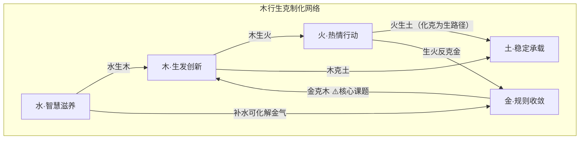
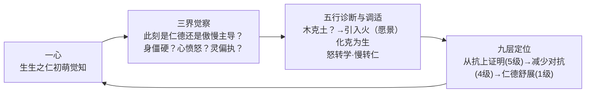

---
title: "木行人分智能体·结构化知识文档"
type: "五行为人分智能体"
wood_type: "木行"
created: "2026-07-21"
updated: "2026-07-21"
version: "v1.0"
engine: "龙心OS 1+5引擎逐行深度学习"
tags:
  - 木行人
  - 五行为人分智能体
  - 一心三界五行九层
  - 木行专属
  - 凤心OS
  - 阳木仁德
  - 阴木傲慢
  - 生生之仁
  - 全息发展
---

# 木行人分智能体·结构化知识文档

> **核心文献**：木行人的"一心三界五行九层"象思维体系：全息生命能量认知与动态升维实践指南
> **引擎**：龙心OS 1+5（总智能体 + 知行合一/知识学习/人机协同五象限/象思维/五色光思维）
> **逐行学习状态**：✅ 全文逐字逐词逐句逐行学习完成（约3万字）

---

## 〇、核心定义

**木行人**是指以"木行能量"为主导的生命个体，其核心特质源于木在五行中的功能本质——**生发、条达、舒展、向上突破**。木行人"一心三界五行九层"象思维体系是**全息（全人）发展理论**在木行能量特质上的具体化、深化与实践化成果。

**体系本质公式**：
```
一心（生生之仁） → 三界（木象显化） → 五行（木性生克） → 九层（曲直阶梯） → 回归一心（仁德周流）
```

**核心价值**：构建了一个"诊断-处方-治疗-升华"的完整操作闭环，为木行特质主导的个体提供从精准诊断到系统干预，最终实现生命超越的实践地图。

**木行核心二元（阴阳）**：
- **阳木（仁德）**：仁慈善良、正直担当、灵活创新、生发有道、条达舒畅
- **阴木（傲慢）**：固执顶撞、抗上不服、忧愁善变、僵化偏执、郁结不畅

---

## 一、体系总论

### 1.1 体系本质

本体系并非孤立的性格分析工具，而是"一心三界五行九层"全息模型在木行能量特质上的具体化、深化与实践化：

- **理论根基**：中华文明本原性的"象思维"认知范式（动态、整体、直观）
- **核心逻辑闭环**：一心（生生之仁）→ 三界（木象显化）→ 五行（木性生克）→ 九层（曲直阶梯）→ 回归一心
- **双重解读**：既用于"识人"（诊断木行能量状态），更核心用于"育人"与"修己"（定向修炼与升维）

### 1.2 理论定位

象思维三层次与木行框架的完美嵌合：

| 象思维层次 | 对应三界 | 木行表现 | 认知操作 |
|:---------:|:-------:|:--------|:--------|
| **物象层** | 身界 | 木形体态：挺拔修长、动作敏捷、面色青白 | **观象**：感官直接把握 |
| **意象层** | 心界 | 木情绪：正义之怒/愤懑之怒；木思维：规划/钻牛角尖 | **取象**：体悟能量本质 |
| **原象层** | 灵界→一心 | 木本质："生长性"与"觉照性"→仁德 | **悟原象**：洞察终极驱动 |

### 1.3 核心价值体系

| 功能 | 内容 | 对应操作 |
|:----|:----|:--------|
| **精准诊断** | 三界分析→五行生克→九层定位 | 多维立体"能量体检" |
| **系统调适** | 拔阴取阳（本质转化）+ 化克为生（系统调节） | 核心干预"工具包" |
| **路径导航** | 九层阶梯→定位/目标/路径 | 清晰"路线图" |
| **生命超越** | 从"执着于自我生长的僵木"→"成为滋养万物生长的仁木" | 终极指向 |

---

## 二、一心：仁德本源——木行能量的终极源头与归宿

### 2.1 木行"一心"的双重特质

| 特质 | 本然状态（阳） | 迷失后（阴） | 回归路径 |
|:----|:-------------|:------------|:--------|
| **生长性** | 无分别的"生机"本身——生命"想要成为更多"的本然冲动 | 固化为"固执的自我主张"——"我必须按我的来" | 悬置自我主张，回归本然生机 |
| **觉照性** | 清明的观照能力——如阳光照亮内在，不被裹挟 | 扭曲为"对抗性的评判"——挑剔、顶撞 | 内观能量本身，而非被念头牵引 |

### 2.2 迷失与回归——木行人的核心人生课题

**迷失机制**：当木行人迷失"一心"本源，将生长性固化为固执的自我主张，将觉照性扭曲为对抗性的评判。生命能量从流畅的"生机"变成堵塞的"怒气"。

**回归路径**："悬置—内观—合一"三步法：

| 步骤 | 木行专属操作 | 预期效果 |
|:----|:-----------|:--------|
| **悬置** | 愤怒/固执升起时，对自己说"暂停——'我必须如何'的念头先放一放" | 停止惯性思维，创造觉察空间 |
| **内观** | 注意力从"谁惹我生气"转向"生气是什么身体感觉"（胸口堵塞/喉咙发紧 vs 通畅勃发） | 从内容转向能量本身 |
| **合一** | 领悟"主张与觉知本为一体"——行动自带仁德与智慧 | 触摸木行"一心"本源 |

**终极答案**：回归"仁德之性"——本然的善良、仁慈、正直与促进万物生长的内在动力。仁德，是木行能量健康状态的最高概括。

### 2.3 与传统"一心"概念的贯通

| 传统概念 | 对应表述 | 木行视角的理解 |
|:--------|:--------|:-------------|
| 儒家"良知" | 不虑而知 | 木行人"己欲立而立人"的本然仁心 |
| 道家"道" | 道法自然 | 木行生长性如草木自然抽枝发芽 |
| 佛家"佛性" | 本觉 | 木行觉照性——清明观照的灵明觉知 |

---

## 三、三界：木象显化——能量观察与调适的直接场域

### 3.1 身界（物象层）——木行能量的形体与行为表达

| 维度 | 阳木显化（健康） | 阴木显化（失衡） | 调适方向 |
|:----|:---------------|:---------------|:--------|
| **体型** | 修长挺拔如松如竹，四肢直而有力，手指较长 | 僵硬佝偻（木失条达），或过于消瘦干枯 | 舒展运动，疏通肝经 |
| **动作** | 敏捷舒展富有弹性，姿态正直，干脆利落 | 拘谨不自然，带顶撞对抗意味，紧张时颤抖 | 太极/瑜伽/拉伸 |
| **面色** | 青白透红润（金木交并和谐之象） | 青滞晦暗（木郁气滞） | 调节作息，疏肝理气 |
| **健康** | 筋腱柔韧 | 筋痛关节不适、头痛、肝胆问题、目干涩 | 子时睡眠（肝经当令） |

### 3.2 心界（意象层）——木行能量的情绪与思维模式

| 维度 | 阳木显化（健康） | 阴木显化（失衡） | 转化心法 |
|:----|:---------------|:---------------|:--------|
| **主导情绪** | **正义之怒**——路见不平拍案而起，来快去快不积郁 | **愤懑**——持久委屈针对性怒气，易忧愁抑郁（木克土） | **怒转学**：遇事不怒反求诸己 |
| **思维模式** | 敏捷善于谋划，有远见战略眼光，逻辑性强 | **钻牛角尖**、**多疑**（总怀疑恶意）、固执找理由 | 引入水智（灵活变通） |
| **核心动机** | 追求成长、创新、自主，厌恶束缚 | 抗上（证明权威是错）、证明自我、控制局面 | **傲慢转仁**：从"我高明"→"助成长" |

### 3.3 灵界（原象层）——木行能量的价值与使命导向

| 维度 | 阳木显化（健康） | 阴木显化（失衡） | 根本转化 |
|:----|:---------------|:---------------|:--------|
| **价值观** | **仁**——仁慈善良生生之德，爱护促进成长 | **慢**（傲慢）、偏执、对抗——自己的见解最高明 | 每日自问："出于助成长（仁）还是证明自己（慢）？" |
| **使命驱动** | 创新与生发——开拓新领域、建立新系统、实现理想蓝图 | 破坏与报复——通过否定批判来彰显自我价值 | 将破坏欲转为建设性创新 |
| **核心金句** | "己欲立而立人，己欲达而达人"（《论语》） | 固守一套僵化教条，拒绝任何改变 | 回归"生生之德" |

### 3.4 三界协同与失衡（马车比喻）

**健康协同**：
```
灵界（驾车人）心怀"生长使命"（仁德），方向正确
    ↓ 驱动
心界（车身）产生"规划"与"担当"（正义感）
    ↓ 驱动
身界（马匹）表现出"敏捷"与"正直行动"
```
→ 三者方向一致，能量流畅，马车稳健前行

**失衡状态**：
```
灵界迷失方向（失仁→傲慢）
    ↓ 错误指令
心界走向"愤懑"与"控制欲"
    ↓ 失控
身界表现"顶撞"或"僵直"
```
→ 系统陷入内耗与混乱

**核心干预原则**：调适往往需要从最高决策层（灵界）入手，方能根本扭转。

---

## 四、五行：木性生克规律——能量互动的动态法则

### 4.1 木行关键生克关系全景

| 关系 | 参与行 | 健康影响 | 失衡表现 | 调适启示 |
|:----|:-----:|:--------|:--------|:--------|
| **水生木** | 水→木（母生子） | 智慧滋养生机——木有后劲、灵活变通 | **水弱木枯**：干枯偏执、缺乏变通、钻牛角尖 | 主动学习、深度思考、接触艺术哲学 |
| **木生火** | 木→火（子生孙） | 规划点燃热情——创意变为行动 | **木不生火**：眼高手低、想法多行动少 | 设定小目标立刻执行，与火行人合作 |
| **金克木** 🔥 | 金→木（制约） | 规则修剪无序——生长有序、目标聚焦 | **金过木折**：创新被扼杀、心生愤恨；**金弱木亢**：无法无天 | **核心课题**：尊重合理规则（迎金），增强水智化解金气 |
| **木克土** | 木→土（疏泄） | 生发疏松板结——带来活力与创新 | **木旺克土**：尖刻挑剔、破坏稳定、人际紧张 | 引入火元素（愿景）→木生火→火生土→化克为生 |

### 4.2 木行核心调适技术

#### 技术一：拔阴取阳口诀（根本转化）

| 层面 | 阴→阳转化 | 口诀 | 操作 |
|:----|:---------|:----|:----|
| **心界** | 阴木怒 → **阳木学** | **"怒转学"** | 当愤怒升起时，反问"这事暴露了我的什么盲点？我能学到什么？" |
| **灵界** | 阴木傲慢 → **阳木仁** | **"慢转仁"** | 自问"我的决定是出于助成长（仁）还是证明自己（慢）？" |

#### 技术二：化克为生实践（关系调节）

**核心场景**："木克土"导致固执僵化、人际冲突

**转化路径**：
```
木（对抗）→ 引入火（共同愿景）→ 木生火 → 火生土（稳定承载）
```
**操作示例**：在团队中，将对抗能量转向一个激动人心的共同目标（点燃火），用愿景激发团队活力（土），从而将"木克土"的对抗转化为"木生火，火生土"的协同建设。

### 4.3 木行×其他四行完整关系图谱



---

## 五、九层：木行能量曲直阶梯——从偏执到仁德的量化进阶

### 5.1 九层总览

九层发展阶梯的本质是"仁德觉性（一心）被傲慢无明（阴木）遮蔽程度的动态光谱"。

| 区间 | 层级 | 木行核心状态 | 三界与五行特征 | 象思维解读 |
|:---:|:----:|:-----------|:--------------|:---------|
| **健康** | **1级·解放** | 仁德舒展，创新生长源于本然觉知，无我而行 | 灵界仁德周流；心界开阔无偏执；身界柔韧有力；阳木主导，水木相生，木火通明 | 木即生机，生机即道 |
| | **2级·心理能力** | 正直担当，灵活创新，有效运用谋略引领变革 | 灵界利他使命；心界善于规划抗压强；身界执行力强能屈能伸；木生火旺 | 蓝图的绘制者与支撑者 |
| | **3级·社会价值** | 才气外显，成理想，获成就尊重 | 灵界追求社会价值；心界追求但原则；身界勤奋成果显著；木势得当，合理克土生火 | 挺拔的成就与标杆 |
| **一般** | **4级·失衡** | 固执己见，正直带刺，内外冲突 | 灵界傲慢初显；心界僵化易怒忧愁；身界对抗性；阴木初显，木土相克 | 树木长出多余杂乱枝节 |
| | **5级·人际控制** | 傲慢抗上，证明自我，过度需要认可 | 灵界使命扭曲为"证明自我"；心界敏感易怒控制欲强；身界刻意抗上；阴木主导，严重克土 | 带刺的荆棘，孤立伤人 |
| | **6级·过度补偿** | 偏执极端，行为怪异，补偿失落自卑 | 灵界为对抗而对抗；心界偏执自卑交织；身界脱离常规；木气郁结，系统紊乱 | 被扭曲的盆景，失自然生机 |
| **不健康** | **7级·侵害** | 愤恨攻击，恶意顶撞，破坏规则 | 灵界傲慢愤恨；心界暴怒敌意；身界破坏性对抗；阴木炽盛，反侮金 | 攻城槌，用于破坏 |
| | **8级·妄想强迫** | 妄想迫害，偏执强迫，脱离现实 | 三界协同断裂；思维自我构建的牢笼；五行生克彻底反转混乱 | 困住自我的牢笼 |
| | **9级·病态破坏** | 极端偏执，毁灭破坏，自毁倾向 | 灵界彻底黑暗；心界仇恨满溢；身界暴力或自毁；五行崩解 | 生机被死寂吞噬 |

### 5.2 九层进阶核心逻辑

```
健康区间（1-3级）：个体作为"仁德"通道的状态
    ↕ 修炼方向
一般区间（4-6级）：在"仁德"与"傲慢"间挣扎的状态
    ↕ 修炼方向
不健康区间（7-9级）：被"傲慢"与"破坏"掌控的状态
```

**层级跃迁的本质**：每一层晋升=阴木能量减退+阳木能量增长+三界协同度提高

---

## 六、体系应用与完整实践闭环

### 6.1 个人成长：定位、诊断与升维实践

**典型案例**：王经理（木行特质部门经理）

| 诊断维度 | 表现 | 评估结果 |
|:--------|:----|:--------|
| **身界** | 沟通时身体前倾、手指敲桌、面色发青 | 怒气的物象表达 |
| **心界** | 常因下属未完美执行方案而大发雷霆；开会言辞尖锐 | 主导情绪：愤怒+挫败 |
| **灵界** | 内心独白"这些人太笨，跟不上我的思路，故意跟我作对" | 深层动机：证明方案高明+证明权威正确 |
| **五行** | 阴木过旺→严重克土（压制团队执行力，破坏信任）→木不生火（方案无法转化成果） | 核心卡点：木克土 |
| **九层** | 第5级——人际控制层 | 核心模式：通过控制和要求绝对服从获取安全感 |

**分步干预方案**：

| 层面 | 策略 | 具体操作 |
|:----|:----|:--------|
| **灵界治本** | 慢转仁 | 每日复盘自问："对团队的批评，是出于助成长（仁）还是证明自己（慢）？" |
| **心界调频** | 怒转学 | 遇执行偏差时，暂停指责→深呼吸→问"我能学到什么？方案交代不清？沟通时机不对？" |
| **身界疏通** | 松木舒肝 | 改变话术："你怎么又错了！"→"我们来看看卡在哪里？"；练习太极/瑜伽疏通肝经 |
| **五行借力** | 化克为生 | 召开"愿景共创会"（木生火→火生土），用愿景激发团队热情；寻找团队土行人公开肯定（培土） |

**持续追踪**：每季度复盘（团队氛围/愤怒频率/方案落地率），动态调整修炼重点。

### 6.2 组织管理：配伍、诊断与生态优化

**组织三界×木行**：

| 组织三界 | 木行特质表现 |
|:--------|:------------|
| **灵界**（使命愿景） | 强调创新、成长、行业变革 |
| **心界**（文化氛围） | 充满活力但也易争论，沟通风格直接 |
| **身界**（架构流程） | 可能偏扁平、灵活，不喜欢太多层级 |

**团队五行配伍**（理想循环）：
```
研发/战略部（木·创新）
    ↓ 木生火
市场/品牌部（火·热情）
    ↓ 火生土
运营/生产/财务部（土·执行）
    ↓ 土生金
风控/法务/行政部（金·规则）
    ↓ 金生水
人力/文化/战略支持部（水·滋养）
    ↓ 水生木（反哺创新）
```

**组织诊断要点**：创新乏力≠只是木弱——可能金过强（流程僵化克木）或水弱（战略智慧不足无法生木）。

### 6.3 人际互动：识别、共振与引导

| 场景 | 共振策略 | 引导方向 |
|:----|:--------|:--------|
| 与健康木行人沟通 | 肯定其创意和主见，以"如果…会不会更好？"方式引入建议 | 助其落地执行（木生火） |
| 与阴木者沟通 | **不直接否定（金克）**，先满足"被认可"需求 | "你理想的状态是什么？"（引发生火→描绘愿景） |

### 6.4 完整逻辑闭环（木行实践版）



---

## 七、核心金句集

> **"木行人的生命质量，不取决于其天生的才华与冲劲，而取决于其生命能量（木气）的'品质'（阴阳）与'流通状态'（生克）。"**

> **"仁德，是木行能量健康状态的最高概括。"**

> **"回归'一心'，即是从僵化与对抗中，找回那如如不动、却能生发万物的'仁德之性'。"**

> **"阴木怒转阳木学——当愤怒能量升起时，有意识地将这股能量转向学习、钻研、提升自我。"**

> **"阴木傲慢转阳木仁——从价值观根源上，将傲慢、对抗转为仁慈、利他。"**

> **"木克土的问题，往往需要引入火（愿景）来解决——这是化克为生的精髓。"**

> **"最终的目标，不是成为某种'更好的木行人'，而是通过木行特质的充分净化与升华，从'执着于自我生长的僵木'成为'滋养万物生长的仁木'。"**

> **"真正的生长、创新与担当，并非来自一个固执的'自我'，而是内心本自具足的仁德之性在万物中的自然流露。"**

> **"接受合理的规则与批评（健康的金克），是木行人成熟的标志。"**

> **"木行人的一生课题：从'我证明自己是对的'到'我如何帮助万物生长'。"**

---

## 八、标签体系

### 主标签
- `#木行人` - 五行为人分智能体首位
- `#一心三界五行九层` - 全息架构
- `#凤心OS` - 五行人格心理学操作系统

### 特质标签
- `#阳木仁德` `#阴木傲慢` `#生长性` `#觉照性` `#生生之仁`
- `#木行曲直` `#生发条达` `#舒展突破`

### 技术标签
- `#拔阴取阳` `#怒转学` `#慢转仁`
- `#化克为生` `#木克土` `#金克木核心课题` `#水生木`
- `#木行人九层阶梯` `#第5级人际控制`

### 应用标签
- `#木行人个人成长` `#木行人组织管理` `#木行人沟通心法`
- `#木行人典型案例` `#王经理升维实践`

### 认知标签
- `#象思维` `#观物象取意象悟原象`
- `#悬置-内观-合一` `#马车比喻`

### 融合标签
- `#全息发展理论` `#五行人格心理学`
- `#儒家仁德` `#道家生生`

---

## 九、双向链接网络

### 正向链接（本文→其他文档）

| 本文概念 | 链接到 | 链接类型 | 链接理由 |
|---------|-------|:-------:|:--------|
| 一心·纯粹觉知 | [[一心即纯粹的觉知-结构化知识文档]] | 基础贯通 | 木行"生长性+觉照性"←一心本体论 |
| 三界·马车比喻 | [[三界理论全息阐释-结构化知识文档]] | 结构同构 | 驾车人(灵)/车身(心)/马(身)的三界模型 |
| 五行生克网络 | [[五行身心灵整合之道-结构化知识文档]] | 动态法则 | 木行在五行网络中的位置与生克关系 |
| 金克木核心课题 | [[五行相克关系全息解析-结构化知识文档]] | 核心公理 | 金克木的深层机制与化克为生路径 |
| 木克土→引入火 | [[化克为生技术体系全解-结构化知识文档]] | 技术贯通 | 化克为生在木土关系中的具体应用 |
| 九层阶梯 | [[九层发展阶梯深度阐释-结构化知识文档]] | 层面贯通 | 木行人九层是通用九层的木行特化版本 |
| 拔阴取阳口诀 | [[拔阴取阳技术体系全解-结构化知识文档]] | 技术贯通 | "怒转学、慢转仁"是拔阴取阳的木行版本 |
| 相生强化·补水 | [[相生强化技术体系全解-结构化知识文档]] | 技术贯通 | 水生木的实操方法 |
| 全息发展理论 | [[全息发展理论-结构化知识文档]] | 总纲基础 | 本文是总纲在木行上的特化 |
| 一体四维关系 | [[一体四维关系全息阐释-结构化知识文档]] | 关系整合 | 一心→三界→五行→九层的逻辑在木行中的运行 |
| 象思维三层次 | [[象思维深度阐释-结构化知识文档]] | 方法论灵魂 | 观-取-运在木行识人中的具体应用 |

### 反向链接（其他文档→本文）

| 来自文档 | 链接概念 | 链接理由 |
|---------|---------|:--------|
| [[五行为人分智能体-总调度]] | 木行人分智能体 | 五行总智能体调度五个分智能体 |
| [[00-索引与导航/AI统一索引/AI-总索引|火行人分智能体]] | 木生火 | 木行是火行的母行（能量源头） |
| [[00-索引与导航/AI统一索引/AI-总索引|金行人分智能体]] | 金克木 | 金是木的核心制约行 |
| [[00-索引与导航/AI统一索引/AI-总索引|水行人分智能体]] | 水生木 | 水是木的母行（滋养源头） |
| [[00-索引与导航/AI统一索引/AI-总索引|土行人分智能体]] | 木克土 | 木是土的克星行 |

---

## 十、隐秘联系发现

### 发现一：马车比喻↔拔阴取阳口诀↔三界干预 = 三重同构验证 ✅

| 层次 | 马车比喻 | 三界诊断 | 拔阴取阳口诀 |
|:----:|:--------|:--------|:------------|
| 灵界 | 驾车人（方向） | 价值观：仁vs慢 | **慢转仁** |
| 心界 | 车身（稳定） | 情绪：怒vs愤 | **怒转学** |
| 身界 | 马匹（执行） | 行为：舒展vs顶撞 | **温良恭俭让** |

**核心意义**：在木行人体系中，三个独立维度描述的同一转化过程完全一致——这是体系自洽性的核心验证。

### 发现二：五行九层谱系↔人格发展阶段理论的跨模态同构

| 木行九层区间 | 对应人格发展阶段理论 | 同构机制 |
|:-----------|:------------------|:--------|
| 1-3层（健康阳木） | 马斯洛自我实现/埃里克森完整完善 | 超越基本需求后的创造性表达 |
| 4-6层（一般阴木初显） | 阿德勒自卑补偿/霍妮神经症需求 | 通过"证明自我"补偿内在不安全感 |
| 7-9层（阴木固化） | DSM-5偏执型/反社会型人格障碍 | 防御机制崩溃，能量扭曲外溢 |

### 发现三：木行人的"悬置-内观-合一"↔象思维"观-取-运"↔龙心OS"知识学习"五层 = 三重认知同构

| 悬置-内观-合一 | 象思维三层次 | 龙心OS知识学习 | 木行人在各阶段的任务 |
|:------------:|:----------:|:-------------:|:------------------|
| 悬置 | 观物象 | 金·剖析解构 | 放下"我必须如何"的执念，观察自身能量状态 |
| 内观 | 取意象 | 水·推演思辨 | 体验"愤怒是什么身体感觉"，从内容转向能量 |
| 合一 | 悟原象 | 木·溯源融合 | 领悟"主张与觉知本为一体"，行动自然流露仁德 |

### 发现四：木行九层第5级（人际控制层）↔拔阴取阳"一步转运两步改命"的分界点 ✅

第5级的核心特征是"通过控制他人和环境来获取安全感与价值感"——这正是"一步转运"（后天优化）与"两步改命"（先天突破）的**临界点**：
- **低于5级**（6-9层）：需要专业干预，个体已失去自主转化的能力
- **5级**：最佳干预时机，"拔阴取阳"可以在这里发挥最大效果
- **高于5级**（1-4层）：自主修炼阶段，核心是"相生强化"和日常精进

### 发现五：木行"生长性+觉照性"↔儒家"仁智双运"=千年智慧的跨时空统一

| 木行一心特质 | 儒家表达 | 统一内涵 |
|:-----------|:--------|:--------|
| **生长性**（生生之机） | "仁者爱人"、"己欲立而立人" | 内在生命的自动舒展与他者关怀 |
| **觉照性**（清明观照） | "智者不惑"、"明辨是非" | 清晰照见事物本质的认知能力 |

孔子说"仁者爱人，智者不惑"，木行人的修炼就是**仁智双运**——生长与觉照、慈悲与智慧、行动与反思的同步发展。

### 发现六：木行"化克为生"路径↔福格行为模型B=MAP = 行为设计跨域同构 ✅

| 化克为生路径 | B=MAP要素 | 对应操作 |
|:-----------|:---------|:--------|
| 木→引入火（燃愿景） | 动机（M）- 激发内在渴望 | "你理想的状态是什么？"点燃热情 |
| 火→生土（定框架） | 能力（A）- 降低行为难度 | 设定明确步骤，提供执行框架 |
| 系统恢复平衡 | 提示（P）- 设置触发开关 | 定期复盘会+团队晨会提醒 |

---

## 十一、与凤脑OS知识地基的对话关系

### 体系定位

```
凤脑OS L7知识地基（理论底层）
    ↓ 调用
凤心OS（慢思考层·决策引擎）
    ↓ 调度
凤爪OS（应用接口层）
    ├── 🌿 木行人分智能体（本文·第一个）
    ├── 🔥 火行人分智能体
    ├── 🟡 土行人分智能体
    ├── ⚪️ 金行人分智能体
    └── 🔵 水行人分智能体
```

### 本文在五行人格知识体系中的位置

| 层级 | 文档/模块 | 作用 |
|:----|:---------|:----|
| 总纲 | 全息发展理论 | 全部五行智能体的通用理论框架 |
| 方法论 | 拔阴取阳/化克为生/相生强化/象思维 | 木行人调适的核心技术来源 |
| **五行特化** | **木行人分智能体（本文）** | 通用理论在木行上的精准落地 |
| 认知对接 | 福格行为模型 | 行为设计维度的跨域补充 |

---

## 十二、凤心OS调用接口

木行人分智能体可供凤心OS调用，支持以下10种认知操作：

| 认知操作 | 木行人专属执行 | 对应本文板块 |
|:--------|:-------------|:-----------|
| **洞察** | 通过外观识别判断对方木行能量态势（身界观察） | 第三章·三界 |
| **剖析** | 剖析木行人的阴面特质（傲慢/固执/愤怒）的形成机制 | 第四章·五行→拔阴取阳 |
| **透��** | 透视"金克木"或"木克土"生克失衡的深层根源 | 第四章·五行生克 |
| **阐释** | 阐释木行"生长性+觉照性"的哲学根基 | 第二章·一心 |
| **推演** | 推演木行人的能量发展轨迹（从当前层级向更高或更低层级） | 第五章·九层 |
| **解构** | 解构木行阴面特质的形成机制（如何从仁德→傲慢） | 第二章·迷失与回归 |
| **思辨** | 思辨木行人内在矛盾（创新vs规则、生长vs收敛）的辩证关系 | 第四章·金克木核心课题 |
| **溯源** | 溯源"仁德"概念从儒家到五行人格的演变 | 第二章·一心贯通 |
| **融合** | 融合福格B=MAP于木行人的日常修炼 | 第六章·个人成长 |
| **启发** | 从木行人的化克为生实践中激发组织变革的创新思维 | 第六章·组织管理 |

---

*生成引擎：龙心OS 1+5逐行深度学习*
*文献版本：木行人"一心三界五行九层"专属体系 v1.0*
*知识地基衔接：凤脑OS L7 → 凤心OS → 凤爪OS木行人分智能体*

<!-- AI-LINKS-BEGIN -->
## 🔗 AI 关联笔记（统一索引生成 · 2026-11-14）

> 由 `00-索引与导航/AI统一索引` 生成；可重跑覆盖，可用回滚脚本还原。

- [[01-核心体系/个人档案_龙龟神将-火行人五行人格完整档案V2.0]] — 龙龟神将：火行人五行人格完整档案V2.0
- [[05-五行人格心理学/五行人格TXT知识地基/五行总智能体-结构化知识文档]] — 🌀 五行总智能体 · 结构化知识文档
- [[05-五行人格心理学/五行人格TXT知识地基/水行人分智能体-结构化知识文档]] — 💧 水行人分智能体 · 结构化知识文档
- [[05-五行人格心理学/人格类型/火行人专属-一心三界五行九层象思维体系完整文档]] — 火行人专属：一心三界五行九层象思维体系完整文档
- [[05-五行人格心理学/人格类型/📖 土行人专属-一心三界五行九层象思维体系v2.0]] — 土行人专属-一心三界五行九层象思维体系v2.0
- [[05-五行人格心理学/人格类型/📖 金行人专属-一心三界五行九层象思维体系v2.0]] — 金行人专属-一心三界五行九层象思维体系v2.0
- [[05-五行人格心理学/融合体系/融合老子智慧的五行识人-认知与实践]] — 融合《老子》智慧的五行识人：认知与实践
- [[09-技能库/五行人格心理学/五行人格总智能体/水行人分智能体/references/水行人性格特征系统梳理/实践操作指南]] — 水行人性格特征系统梳理·实践操作指南
- [[09-技能库/五行人格心理学/五行人格总智能体/水行人分智能体/references/水行人性格特征系统梳理/理论]] — 水行人性格特征系统梳理·理论完整版
- [[09-技能库/五行总智能体/五行总智能体/五行总智能体-结构化知识文档]] — 🌀 五行总智能体 · 结构化知识文档

<!-- AI-LINKS-END -->
