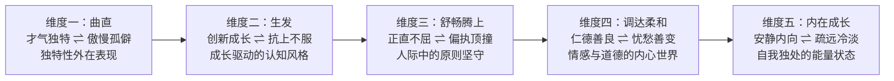

---
title: "木行人性格特征全览·补充文档"
type: "五行为人分智能体补充"
wood_type: "木行"
created: "2026-07-21"
updated: "2026-07-21"
version: "v1.0"
engine: "龙心OS 1+5引擎逐行深度学习"
core_source: "木行人性格特征全览：理论体系、动态维度与实践指南"
complement_to: "木行人分智能体-结构化知识文档.md"
tags:
  - 木行人
  - 性格特征全览
  - 五大维度
  - 50特质词
  - 动态转化模型
  - 实践指南
  - 凤心OS
---

# 木行人性格特征全览·补充文档

> **补充说明**：本文档是对《木行人分智能体-结构化知识文档》（一心三界五行九层哲学框架）的**增量知识补充**，聚焦于木行人的五大核心性格维度、50+子特质词心理学描述、动态转化模型及实践应用指南。
> **全量学习状态**：✅ 逐字逐词逐句逐行完成

---

## 〇、核心增量一览

| 增量维度 | 本文覆盖 | 与主文档的关系 |
|:--------|:--------|:-------------|
| **五大维度框架**（全新结构） | ✅ 曲直/生发/舒畅腾上/调达柔和/内在成长 | 主文档只有三界框架，无此五维人格结构 |
| **50+子特质词** | ✅ 每维度6-8个子维度的顺逆双面描述 | 主文档只有32个特质词，此为精准扩展 |
| **心理学机制解读** | ✅ 每个维度整合现代心理学视角 | 主文档无此维度 |
| **动态转化模型** | ✅ 从支持性→防御性环境的完整转化路径 | 主文档九层框架的补充视角 |
| **实践应用指南** | ✅ 识别/相处/自我成长/团队管理四环节 | 主文档只有王经理案例 |

---

## 一、木行人五大核心维度总览

### 1.1 五维结构全景

木行人的性格通过五个核心维度展现，形成从"外在表现"到"内在驱动"到"人际原则"到"情感道德"到"自我状态"的完整链条：



### 1.2 五维×顺逆境对照总表

| 维度 | 顺境（阳木） | 逆境（阴木） | 转化关键 |
|:----:|:-----------|:-----------|:--------|
| **曲直** | 才气独特（6维） | 傲慢孤僻（5维） | 接纳反馈，融入集体 |
| **生发** | 创新成长（6维） | 抗上不服（5维） | 尊重现实，检验理想 |
| **舒畅腾上** | 正直不屈（4维） | 偏执顶撞（5维） | 倾听共情，灵活坚守 |
| **调达柔和** | 仁德善良（5维） | 忧愁善变（5维） | 平衡理想与现实 |
| **内在成长** | 安静内向（4维） | 疏远冷淡（5维） | 主动适度连接 |

---

## 二、维度一：曲直——独特性的外在表现

> 核心定位：木行人格最表层的维度，聚焦"独特性"的外在行为与才华展示

### 2.1 顺境·才气独特（阳木显化）

| 编号 | 子特质 | 心理学描述 | 机制解读 |
|:---:|:------|:----------|:--------|
| QZ-01 | **足智多谋** | 想象力丰富，思维高度适应性和可变性；视灵感顿悟高于一切 | 发散思维+认知灵活性 |
| QZ-02 | **感受丰富** | 对自我情绪和内心世界异常敏锐，情绪体验强度高于常人 | 高敏感个体(HSP)+情绪粒度 |
| QZ-03 | **才华横溢** | 充满新思想，乐观自然富有创造力；对未来可能性有强烈直觉 | 开放性与创造性人格 |
| QZ-04 | **思路开阔** | 高度创造力，观念新颖，不受条框约束；不拘小节，难以盲从规则 | 低认知闭合需求 |
| QZ-05 | **理想主义** | "长得高看得远"，倾情于远大理想，善于构建内在理论体系 | 理想化防御+内在认知框架 |
| QZ-06 | **内向封闭** | 性格深厚复杂，内向底色；向小圈子深度分享，朋友圈小但持久 | 选择性自我表露+内向性 |

### 2.2 逆境·傲慢孤僻（阴木显化）

| 编号 | 子特质 | 心理学描述 | 防御机制 |
|:---:|:------|:----------|:--------|
| QY-01 | **个人主义** | 创造力依旧，但完全从自我视角出发，不考量他人感受与接受度 | 自我中心偏差 |
| QY-02 | **我行我素** | 所有类型中最独立的一类，对权威强制免疫 | 高自主性防御 |
| QY-03 | **自卑羞怯** | 公开场合感到羞怯不自然，拙于言辞，采取观望态度 | 社交焦虑+自我意识过剩 |
| QY-04 | **刻板固执** | 对自身理想深信不疑，排斥其他视角，沉浸思考忽略环境变化 | 认知僵化 |
| QY-05 | **傲慢疏离** | 清高傲慢态度，主动疏离人群，给人以难以接近的印象 | 补偿性防御 |

### 2.3 心理学整合

> **与"大五人格"的对应**：此维度与大五人格的**开放性(Openness)**高度相关，尤其在"创意"与"审美"层面。QZ-02"感受丰富"契合**高敏感个体(HSP)**特征。逆境下的表现体现了当"独特性"核心需求受挫时，个体启动的**社交回避**与**认知僵化**防御机制。

---

## 三、维度二：生发——成长驱动的认知风格

> 核心定位：内在认知风格与动力源头——"对自身成长的前摄性寻求"

### 3.1 顺境·创新成长

| 编号 | 子特质 | 心理学描述 | 机制解读 |
|:---:|:------|:----------|:--------|
| SF-01 | **思想前卫** | 喜欢挑战现有理论，企图了解最前沿的思想与行为 | 认知需求高+创新导向 |
| SF-02 | **好奇心强** | 好奇心旺盛，主动寻求新异性和多样性 | 好奇心驱动+探索行为 |
| SF-03 | **想象丰富** | 侧重基于创新的联想能力，喜欢冒险和富有想象力的活动 | 发散思维+想象能力 |
| SF-04 | **足智多谋**（认知） | 独立见解思考者，重视才智，乐于智力挑战 | 认知能力+内在动机 |
| SF-05 | **精于理论** | 天生的谋略家和理论家，擅长复杂概念处理 | 抽象推理+战略思维 |
| SF-06 | **讲求实效** | 优秀解决问题者，基于逻辑做决定，乐于尝试非传统方法 | 逻辑推理+实用智力 |

### 3.2 逆境·抗上不服

| 编号 | 子特质 | 心理学描述 | 防御机制 |
|:---:|:------|:----------|:--------|
| SY-01 | **孤军奋战** | 工作中选择孤独，忽视邀请他人协作 | 过度独立+协作缺失 |
| SY-02 | **充满怪想** | 过度沉浸内心构想，对事实判断错误 | 理想化防御+现实检验缺失 |
| SY-03 | **对立敏感** | 对批评异常敏感，设定不可能的高标准 | 完美主义+自恋脆弱 |
| SY-04 | **不切实际** | 注意力过度集中于思想，忽略常规细节 | 认知偏差+现实脱离 |
| SY-05 | **感情抽离** | 用理性角度分析和处理情感，高度抽离 | 认知重评过度+情感隔离 |

### 3.3 心理学整合

> **与积极心理学的对应**：此维度是**经验开放性**与**成长型思维**(Dweck)的典型体现。顺境特质与**内在动机**(Deci & Ryan)驱动下的学习行为高度一致。SY-05"感情抽离"体现了强大的**认知重评**策略(Gross)，但过度使用可导致**情感隔离**（与木行一心"觉照性"迷失异曲同工）。

---

## 四、维度三：舒畅腾上——人际互动中的原则坚守

> 核心定位：木行人在人际与社会互动中对其价值观与个人原则的坚守方式

### 4.1 顺境·正直不屈

| 编号 | 子特质 | 心理学描述 | 机制解读 |
|:---:|:------|:----------|:--------|
| SC-01 | **专注执着** | 珍视正直，坚定到近乎倔强；说服能力强，赢得尊重 | 道德认同+原则性 |
| SC-02 | **有担当力** | 正直有主意，敢做敢当，心口如一；能忍辱负重 | 道德勇气+责任担当 |
| SC-03 | **超级理想** | 渴望表达和实现超级理想，与最卓越者建立深度联系 | 高价值追求+精英导向 |
| SC-04 | **讲求实效**（人际） | 基于事实和逻辑做出决定，能力推动观点落地 | 实践理性+务实精神 |

### 4.2 逆境·偏执顶撞

| 编号 | 子特质 | 心理学描述 | 防御机制 |
|:---:|:------|:----------|:--------|
| SP-01 | **严肃偏执** | 外表平和，一旦被反对可能强硬无情；缺乏随意性 | 认知闭合需求过高 |
| SP-02 | **过分理性** | 过度依赖逻辑分析，忽视情感因素和关系维度 | 理性主义极端化 |
| SP-03 | **迟滞不前** | 因追求绝对逻辑，可能因微小错误而整个方案停滞 | 完美主义瘫痪 |
| SP-04 | **破坏规则** | 挑战权威和传统观念，极端状态可能对现存规则有敌意 | 对抗性防御+控制感补偿 |
| SP-05 | **缺少耐心** | 喜爱解决核心问题，对常规重复细节缺乏持久耐性 | 低耐力+寻求高阶刺激 |

### 4.3 心理学整合

> **与MBTI的对应**：此维度体现强烈的**道德认同**与**原则性**，顺境表现类似MBTI中"理性主义者"(NT)对逻辑与一致性的追求。SP-04"破坏规则"需与反社会倾向区分，它更多是**对不合理系统的理想化反抗**，而非对社会规范的全盘否定。

---

## 五、维度四：调达柔和——情感与道德的内心世界

> 核心定位：木行人内在的情感与道德层面——最柔和、最善良的一面

### 5.1 顺境·仁德善良

| 编号 | 子特质 | 心理学描述 | 机制解读 |
|:---:|:------|:----------|:--------|
| TD-01 | **忠于内心** | 将内在和谐与良知视为高于一切；敏感理想化忠诚 | 内在导向+道德内化 |
| TD-02 | **坦诚率真** | 坦诚率真，坚定完成选择的事；富有同情心理解力 | 真诚性+宜人性 |
| TD-03 | **看透本质** | 生活在思想世界，有本能的洞察力，看到深层含义 | 直觉+深度认知 |
| TD-04 | **精神沟通** | 极其注重精神层面共鸣，话不投机则寡言 | 选择性社交+高门槛共鸣 |
| TD-05 | **不求物质** | 清贫书生型，不渴求物质享受和官能刺激 | 自我实现需求优先 |

### 5.2 逆境·忧愁善变

| 编号 | 子特质 | 心理学描述 | 防御机制 |
|:---:|:------|:----------|:--------|
| TY-01 | **缺乏控制** | 对计划最初解决问题的挑战感兴趣，失去兴趣导致完成度低 | 高开低走+行动力断层 |
| TY-02 | **优柔寡断** | 始终注意新可能性和新信息，喜欢开放面对所有选择 | 决策瘫痪+选择过多 |
| TY-03 | **不切实际**（情感） | 对不切实际的高标准充满幻想，对自己和他人期望过多 | 完美主义+理想化他人 |
| TY-04 | **忽略现实** | 过度重视未来见解，忽略当下重要事务和现实约束 | 未来导向偏差 |
| TY-05 | **幻想丰富** | 内心戏十足，联想力丰富，通过收藏旧物/幻想维系感受 | 情感补偿+幻想防御 |

### 5.3 心理学整合

> **与马斯洛需求层次的对应**：此维度展现高**同理心**与**道德情感**，但属于**选择性共情**（更易对理念相近者共鸣）。"不求物质"与马斯洛**自我实现需求**优先相符。逆境特质是**情绪调节困难**的表现——易陷入**反思性沉思**(Nolen-Hoeksema)而非主动性解决。TY-05"幻想丰富"是一种内在的情感补偿和体验延伸机制。

---

## 六、维度五：内在成长——自我独处时的能量状态

> 核心定位：木行人在独处、无外界干扰时的根本状态——"生长"能量向内收敛

### 6.1 顺境·安静内向

| 编号 | 子特质 | 心理学描述 | 机制解读 |
|:---:|:------|:----------|:--------|
| NC-01 | **独立自主** | 专家型人才，极度习惯安静环境独立工作，完全沉浸在创造乐趣中 | 内向者能量模式+心流 |
| NC-02 | **思辨力强** | 求知欲旺盛，愿意思考非常规观点，喜欢抽象概念和理论讨论 | 高阶认知需求 |
| NC-03 | **外表平静** | 外表平静超然，内心专心致志于分析问题；更喜欢书写而非口头表达 | 内向表达偏好 |
| NC-04 | **逻辑分析** | 做事有条理系统化，以概念导向多于人导向，以逻辑推理确信 | 系统化思维+理性偏好 |

### 6.2 逆境·疏远冷淡

| 编号 | 子特质 | 心理学描述 | 防御机制 |
|:---:|:------|:----------|:--------|
| NL-01 | **低交际性** | 社会情境中不轻松，畏怯退缩，拙于发言 | 社交回避+内在不安全感 |
| NL-02 | **离群索居** | 节奏慢，宁愿躲在幕后让他人主导谈论 | 被动社交+低支配性 |
| NL-03 | **孤寂寡言** | 从小不太合群喜欢独处，对人不热情甚至冷漠 | 主动孤独+自我保护 |
| NL-04 | **疏远冷淡** | 不容易感受积极情绪，热情不高，被误认为敌意 | 低社交需求+情感淡漠表现 |
| NL-05 | **孤独被动** | 天生的孤独者，不寻求甚至主动避免社会刺激 | 低刺激需求+高独处偏好 |

### 6.3 心理学整合

> **与人格理论的对应**：此维度是**内向性**(Eysenck/Jung)的深度体现——木行人的能量来源和恢复方式均依赖于独处。顺境下的**心流**(Csikszentmihalyi)体验是其最佳效能状态。逆境表现需与**社交焦虑**谱系区分——木行人的疏离更多源于**低刺激需求**和**能量保护**，属于**主动性孤独**，旨在为内在成长创造空间。

---

## 七、动态转化模型

### 7.1 核心机制

木行人人格的健康与防御状态之间的转化，核心在于**"生长"能量**这一根本动力是被滋养还是被阻滞：

```
支持性环境（独特性被认可+理想有空间+见解受尊重+独处充足）
    ↓
生长能量顺畅发挥
    ↓
才气独特 → 创新成长 → 正直不屈 → 仁德善良 → 安静内向
    （整合人格：创造力+深度+正直+善良）
```

```
受挫性环境（想法被否定+理想遭嘲笑+空间被侵扰+坚持被压制）
    ↓
生长能量受阻
    ↓
傲慢孤僻 → 抗上不服 → 偏执顶撞 → 忧愁善变 → 疏远冷淡
    （防御人格：固执+对抗+疏离+幻想）
```

### 7.2 五维转化路径总表

| 维度 | 从阴到阳转化路径 | 核心干预 |
|:----:|:---------------|:--------|
| 曲直 | 傲慢孤僻→接纳反馈→才气独特 | **融入集体**：学习欣赏他人独特之处，将个人创意与集体目标结合 |
| 生发 | 抗上不服→尊重现实→创新成长 | **现实检验**：向务实者请教，进行小规模试点验证想法 |
| 舒畅腾上 | 偏执顶撞→倾听共情→正直不屈 | **灵活坚守**：坚持核心原则的同时，寻找共赢路径 |
| 调达柔和 | 忧愁善变→行动落地→仁德善良 | **理想平衡**：分解大目标为小步骤，培养完成任务的纪律 |
| 内在成长 | 疏远冷淡→适度连接→安静内向 | **温暖联结**：保障独处空间的同时定期深度社交 |

---

## 八、外貌与事业倾向特征

### 8.1 身体与外貌特征

| 维度 | 典型描述 |
|:----|:--------|
| **形态** | 挺拔修长如树木，骨架偏细，四肢较长，行动敏捷 |
| **面色** | 偏青/白/微黄，皮肤可能不清洁、油腻，易起脓包疮疖 |
| **毛发** | 头发通常浓密偏硬 |
| **面部** | 脸型偏长或瓜子脸，额头较宽，眉毛浓密，眼睛明亮有神 |

### 8.2 能力与事业倾向

| 维度 | 特征 |
|:----|:-----|
| **团队角色** | 天生的**创新者**——提出新想法新思路；但易好高骛远 |
| **专业方向** | **专家型人才、战略规划者**——善用谋略勤于思辨多脑力劳动 |
| **事业特征** | 精力充沛，运气与心态相关；适合高体力高智力工作；创业有优势但易大起大落 |

---

## 九、实践应用指南

### 9.1 识别木行人

| 识别维度 | 关键指标 |
|:--------|:--------|
| **外在观察** | 气质挺拔独立，衣着可能不拘一格或体现个人品味；安静但谈及专业时滔滔不绝 |
| **沟通模式** | 喜欢有深度有逻辑的交谈，厌恶肤浅寒暄；表达直接有条理 |
| **工作行为** | 喜欢独立负责模块，需要安静环境；提出方案新颖独特 |
| **社交模式** | 朋友不多但有深度挚友；大场合格格不入，小圈深度交流如鱼得水 |

### 9.2 与木行人相处之道

| 原则 | 具体操作 |
|:----|:--------|
| **尊重独立与专业** | 承认欣赏其独特性，给予自主权和信任，避免微观管理 |
| **用逻辑说服** | 摆事实讲道理呈现数据，比用职位压人有效——他们只服从道理 |
| **给予自我空间** | 理解其对独处的根本需求，不要将疏离视为冷漠 |
| **提供成长平台** | 提供学习新知识探索新领域的机会——挑战性任务是最好的激励 |
| **谨慎批评** | 批评需对事不对人且具体有建设性，空泛否定触发对立敏感 |
| **深度交流** | 谈论哲学、科学、艺术、前沿等话题，比聊家常更能走近他们 |

### 9.3 木行人自我成长建议

| 课题 | 具体建议 |
|:----|:--------|
| **警惕过度理想化** | 定期"现实检验"——将构想与务实朋友讨论，设小目标积累成就感 |
| **包容异见** | 练习"我坚持观点，但我捍卫你发言的权利"——追求真理而非胜利 |
| **创造力与实效结合** | 将点子分解为可执行步骤，培养完成计划的耐心；找执行力强的伙伴互补 |
| **建立情感联结** | 学习表达基本情感关怀与社交礼仪，定期维护核心关系 |
| **管理情绪而非抽离** | 识别命名情绪，找到健康表达方式（写作、艺术创作） |
| **寻找蒙阴他人的路径** | 将内在成长与外部贡献结合——从"一棵树"到"一片林" |

### 9.4 团队管理应用

| 维度 | 策略 |
|:----|:-----|
| **角色定位** | 置于"创新者""战略顾问""研发专家"等突破性思维岗位 |
| **环境营造** | 尊重创新容忍失败鼓励专业深度；保障专注时间 |
| **团队搭配** | 搭配"执行者"(土/金行人)+"协调者"(水/火行人)互补 |
| **激励方式** | 专业认可>学习机会>重要项目>物质激励 |
| **冲突管理** | 充当"翻译"和"桥梁"——澄清其观点合理内核，引导团队看到贡献 |
| **鲶鱼效应** | 在固化团队中有意识引入木行人激发活力，但需做好文化融合 |

---

## 十、核心金句集（新增）

> **"木行人的核心驱动力是对成长与突破的持续追求——他们内在厌恶停滞与墨守成规，始终渴望'成为更好的自己'。"**

> **"理解木行人的关键，在于超越简单的特质罗列，看到其能量流动的本质与状态转化的规律。"**

> **"木行人的生命主题围绕三点展开：独特性、理想主义、内在成长。"**

> **"当处于支持性环境，木行人会展现出富有创造力、深度思考、独立正直的卓越品质；反之，当生长受挫，其能量转向防御，表现出固执、疏离、对抗。"**

> **"从'一棵树'到'一片林'——将个人才华转化为'蒙荫他人'的贡献，是木行人生命的最终升华。"**

> **"木行人最需要的学习：我坚持我的观点，但我捍卫你发言的权利——在辩论中追求真理而非胜利。"**

> **"尊重合理的规则与批评（健康的金克），是木行人成熟的标志；但直面不合理的系统，也是木行人的天赋使命。"**

---

## 十一、标签体系（新增）

### 主标签
- `#木行人性格全览` - 五大维度性格特征
- `#木行人50特质词` - 精准心理学特质词

### 维度标签
- `#木行曲直` `#才气独特` `#傲慢孤僻`
- `#木行生发` `#创新成长` `#抗上不服`
- `#木行舒畅腾上` `#正直不屈` `#偏执顶撞`
- `#木行调达柔和` `#仁德善良` `#忧愁善变`
- `#木行内在成长` `#安静内向` `#疏远冷淡`

### 应用标签
- `#木行人识别` `#木行人相处之道` `#木行人自我成长` `#木行人团队管理`
- `#木行人动态转化` `#顺逆境转化` `#心流`

---

## 十二、双向链接网络（新增）

| 本文概念 | 链接到 | 链接类型 |
|---------|-------|:-------:|
| 五大维度结构 | [[木行人分智能体-结构化知识文档]] | 补充 | 主文档的「三界」框架补充了「五维人格结构」视角 |
| 50+特质词 | [[五行人格五维度心理学体系-补遗-结构化知识文档]] | 精确对应 | 本文是五色光五维度特质的木行精细化版本 |
| 动态转化模型 | [[拔阴取阳技术体系全解-结构化知识文档]] | 方法对应 | 顺逆境转化=拔阴取阳在木行上的具体化 |
| 感情抽离(认知重评) | [[五行身心灵整合之道-结构化知识文档]] | 心理学印证 | 木行"觉照性"迷失为"情感抽离" |
| 心流状态 | [[福格行为模型全景解析-结构化知识文档]] | 行为设计同构 | 木行心流=B=MAP中动机M和能力A的最佳匹配 |

---

## 十三、隐秘联系发现（新增）

### 发现一：五大维度↔三界框架↔九层阶梯 = 三重木行人格结构同构 ✅

| 五大维度 | 三界分层 | 九层关键区间 |
|:-------:|:-------:|:----------:|
| 曲直（外在表现） | 身界（物象） | 第3级(才气外显)→第9级(极端怪异) |
| 生发（认知风格） | 心界→灵界（意象→原象） | 第2级(心理能力)→第7级(偏执侵害) |
| 舒畅腾上（人际原则） | 心界（意象） | 第2级(正直)→第5级(偏执顶撞) |
| 调达柔和（情感道德） | 心界→灵界（意象→原象） | 第1级(仁德)→第6级(忧愁善变) |
| 内在成长（自我状态） | 身界（物象） | 第1级(自由)→第8级(脱离现实) |

### 发现二：五大维度低分倾向↔MBTI/DSM-5精确映射 ✅

| 维度 | 低分倾向（阴木） | MBTI倾向 | DSM-5关联 | 心理学机制 |
|:----:|:--------------:|:---------:|:---------:|:---------|
| 曲直·傲慢孤僻 | 回避社交+轻视他人 | INTP/INTJ | 分裂样/回避型 | 高开放性+低宜人性 |
| 生发·抗上不服 | 对抗权威+脱离现实 | ENTP/INTP | 偏执型 | 高认知需求+低尽责性 |
| 舒畅腾上·偏执顶撞 | 坚守原则+严苛待人 | ENTJ/INTJ | 强迫型 | 高尽责性+低宜人性 |
| 调达柔和·忧愁善变 | 理想破灭+情感沉溺 | INFP/INFJ | 抑郁型/自恋型 | 高神经质+高开放性 |
| 内在成长·疏远冷淡 | 社交回避+情感隔离 | INTP/INTJ/INFP | 分裂样 | 高内向性+低外向性 |

### 发现三：五大维度顺境特质↔VIA品格优势精确对应 ✅

| 维度·顺境子特质 | VIA品格优势(Values in Action) | 强度 |
|:--------------:|:---------------------------:|:----:|
| 足智多谋/思路开阔 | 创造力(Creativity) | ⭐⭐⭐⭐⭐ |
| 好奇心强/想象丰富 | 好奇心(Curiosity) | ⭐⭐⭐⭐⭐ |
| 精于理论/讲求实效 | 判断力(Judgment) | ⭐⭐⭐⭐ |
| 才华横溢/感受丰富 | 审美(Appreciation of Beauty) | ⭐⭐⭐⭐ |
| 专注执着/有担当力 | 勇敢(Bravery)+正直(Honesty) | ⭐⭐⭐⭐ |
| 忠于内心/坦诚率真 | 真诚(Authenticity) | ⭐⭐⭐⭐ |
| 仁德善良/精神沟通 | 爱(Love)+灵性(Spirituality) | ⭐⭐⭐ |
| 独立自主/思辨力强 | 好学(Love of Learning) | ⭐⭐⭐⭐⭐ |

### 发现四："感情抽离(认知重评)"↔木行一心"觉照性"迷失 = 同一现象的双面描述 ✅

| 维度 | 木行一心"觉照性"（本然） | 迷失后"感情抽离"（防御） | 转化 |
|:---:|:---------------------|:---------------------|:----|
| 本质 | 清明观照，不被情绪裹挟 | 过度理性，隔离情感体验 | 从"逃避感受"到"觉察感受" |
| 表现 | 如阳光照亮内在，慈悲的照亮 | 像旁观者分析自身境况，化解感情冲动 | 允许自己感受，而非仅分析 |
| 结果 | 明辨是非，行动慈悲 | 忽视关系中情感因素，导致关系疏离 | 在觉察中与情感共处 |

### 发现五：木行人"心流"基础↔福格B=MAP最佳状态 = 行为设计的完美匹配 ✅

当木行人同时满足：
- **动机M** = 高度内在动机（成长/探索/创造欲望）
- **能力A** = 专业技能/认知能力充足
- **提示P** = 拥有安静独立的工作环境

→ 进入**心流状态**（顺境五大维度同时激活）

这正是B=MAP模型中行为发生的理想条件——三要素同时满足时，木行人的"生长"能量以最纯粹、最高效的方式释放。

---

## 十四、木行人分智能体更新说明

本文档是《木行人分智能体.skills》的知识增量更新包。新增知识覆盖：

| 更新点 | 新增内容 | 更新文件 |
|:------|:--------|:--------|
| 五大核心维度 | 曲直/生发/舒畅腾上/调达柔和/内在成长 | SKILL.md→知识框架 |
| 50+子特质词 | 每维度6-8个精准心理学特质词 | SKILL.md→场景模式 |
| 动态转化模型 | 支持性→防御性环境的完整路径 | SKILL.md→核心调适技术 |
| 实践应用指南 | 识别/相处/成长/管理四环节 | references/KB_INDEX.md |
| 心理学跨域 | VIA/大五/DSM-5/MBTI精确映射 | framework/kb_engine.py |

---

*生成引擎：龙心OS 1+5逐行深度学习*
*补充基准：木行人分智能体-结构化知识文档.md v1.0*
*知识增量：五大维度·50+特质词·动态转化模型·实践应用指南*

<!-- AI-LINKS-BEGIN -->
## 🔗 AI 关联笔记（统一索引生成 · 2026-11-14）

> 由 `00-索引与导航/AI统一索引` 生成；可重跑覆盖，可用回滚脚本还原。

- [[02-信仰文化体系/人设信仰_悟空人设]] — 悟空人设
- [[05-五行人格心理学/五行人格TXT知识地基/五行总智能体-结构化知识文档]] — 🌀 五行总智能体 · 结构化知识文档
- [[05-五行人格心理学/五行人格TXT知识地基/木行人化克为生全息解析-补充-结构化知识文档]] — 木行人化克为生全息解析·补充文档
- [[05-五行人格心理学/五行人格TXT知识地基/木行人生克规律全息解析-补充-结构化知识文档]] — 木行人生克规律全息解析·补充文档
- [[05-五行人格心理学/五行人格TXT知识地基/木行人相生强化-增量补充-结构化知识文档]] — 木行人相生强化·增量补充文档
- [[05-五行人格心理学/人格类型/五行人的人格分析描述-完整知识库]] — 五行人的人格分析描述-完整知识库
- [[05-五行人格心理学/人格类型/五行识人测评工具-完整附录]] — 五行识人®测评工具·完整附录
- [[05-五行人格心理学/人格类型/木行人性格特征全览]] — 🪵 木行人性格特征全览
- [[05-五行人格心理学/人格类型/木行人成长路径与应用实践方案]] — 🪵 木行人成长路径与应用实践方案
- [[08-龙心OS核心系统/五行人格分析描述-木行人]] — 木行人人格分析（5个子维度·10个部分）

<!-- AI-LINKS-END -->
