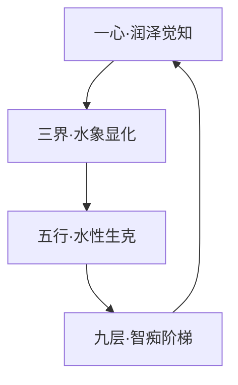

# 💧 水行人分智能体 · 结构化知识文档

> **版本**：v1.8（2026-07-21·v1.7→v1.8：B=MAP深度解析·MOA理论基石+五维度诊断设计系统+七步流程+3案例+5启示·8篇论文全部学习完成）
> **来源论文1**：《水行人的"一心三界五行九层"象思维体系》
> **来源论文2**：《水行人性格特征系统梳理：理论、维度、发展与实践》
> **来源论文3**：《水行人外观特征系统梳理：理论溯源、生理机制、形态详解与实操体系》
> **来源论文4**：《水行人九层发展层级深度解析：理论架构、层级特质与升维实践》
> **来源论文5**：《水行人生克规律深度解析：全息生命能量互动与调适实践》
> **来源论文6**：《水行人拔阴取阳深度解析：理论架构、病理诊断与全维实践指南》
> **来源论文7**：《水行人化克为生全维解析：理论架构、冲突机制与转化实践指南》
> **来源论文8**：《水行人"相生强化，滋养阳面"全息解析：从能量原理到生命实践的完整指南》
> **来源论文9**：《水行人的福格行为模型（B=MAP）全景式深度解析：理论整合、特质解构与行为设计实践体系》（本次逐行学习）
> **学习方式**：逐字逐词逐句逐行 · 全量深度学习 · 零遗漏
> **体系定位**：全息发展理论在水行能量特质上的专属表达与深度展开

---

## 📑 总索引

| 章节 | 核心内容 | 标签 |
|:----|:--------|:----|
| 一·核心框架 | 体系本质·哲学根基·核心逻辑闭环·一体四维 | 核心框架·总纲 |
| 二·一心润泽 | 润泽映现性·沉潜含藏性·被遮蔽时的扭曲 | 一心·本源 |
| 三·三界水象 | 身界物象·心界意象·灵界原象·三界协同 | 三界·身心灵 |
| 四·五维度体系 | 润泽·明亮·沉潜·变通·涵藏 | 五维度·全谱系 |
| 五·外观识别 | 完整体系·理论根基(象思维+经典文献)·三肥(身圆/肤松/形垂)·细节特征·动态声音·生理机制·阴阳辨析·五步法 | 外观·识人·三肥·身圆·肤松·形垂 |
| 六·九层发展层级 | 深度解析·三界协同·心理机制·经典印证·拔阴取阳·水火既济·层级跃迁 | 九层·发展·智痴·元神·识神 |
| 七·五行生克 | 金生水·水生木·土克水·水克火·反侮乘克 | 生克·规律 |
| 八·拔阴取阳 | 烦转辩·痴转智·三界同步转化 | 转化·口诀 |
| 九·化克为生 | 两大路径·三界诊断OS·关系调解版 | 化克·通关 |
| 十·相生强化 | 双焦点滋养·四阶八步·五行攒簇 | 相生·强化 |
| 十一·B=MAP | 行为设计·五维度微习惯·七步法·庆祝心法 | B=MAP·行为 |
| 十二·象思维应用 | 观象→取象→运象·完整实践流程 | 方法论·象 |
| 十三·实践闭环 | 诊断→干预→追踪→超越·完整操作OS | 实践·OS |

---

## 一、核心框架定义

### 1.1 体系本质

本体系的本质是**全息发展理论**——"一心三界五行九层"象思维模型——在水行能量特质上的专属表达与深度展开。



### 1.2 核心逻辑闭环

```
一心（润泽觉知）→ 三界（水象显化）→ 五行（水性生克）→ 九层（智痴阶梯）→ 回归一心（智慧如海）
```

### 1.3 "一体四维"框架

| 维度 | 本质 | 核心内容 |
|:----|:----|:--------|
| **一心** | 本体·本源 | 润泽觉知（润泽映现性+沉潜含藏性） |
| **三界** | 显化·载体 | 身界(物象)+心界(意象)+灵界(原象) |
| **五行** | 规律·调节 | 金生水·水生木·土克水·水克火·水行涵藏 |
| **九层** | 阶梯·刻度 | 1-3健康·4-6一般·7-9不健康 |

### 1.4 三大跨越

1. **从神秘化到学术化**：以象思维为哲学根基，构建逻辑自洽的"认知-实践-升华"闭环
2. **从单一化到系统化**：形成"一心为源、三界为用、五行为基、九层为阶"的立体架构
3. **从个人化到场景化**：灵活应用于自我成长、关系优化、职业发展、组织管理

---

## 二、一心·润泽本源

### 2.1 定义

> "一心"是纯粹的、无分别的觉知（亦称觉性、道），是水行能量的终极源头与最终归宿。

### 2.2 两大天然倾向

| 特性 | 阳面（健康） | 阴面（被遮蔽） |
|:----|:-----------|:-------------|
| **润泽映现性** | 如净水映照万物不扭曲，赋予生机与连接感 | 退化为依赖、粘腻、界限不清→迎合他人寻求虚假映照 |
| **沉潜含藏性** | 向下深入、向内含藏、容纳并转化一切经验 | 退化为逃避、退缩、沉溺于幻想或感官刺激 |

### 2.3 修炼方向

> 拨开"痴恐"的迷雾，让"润泽"与"沉潜"的本性重新澄明流露。

### 2.4 关联文件

- 体系总索引 → 1.一心
- 象思维应用 → 运原象
- 九层阶梯 → 第1层·解放层级

---

## 三、三界·水象显化

### 3.1 定义

> "三界"是"一心"在个体层面的具体呈现，是水行能量得以被观察和调整的三大场域，与象思维三层次完全对应。

### 3.2 第一界·身界（物象层）

| 状态 | 核心表现 |
|:----|:--------|
| **阳面/健康** | 圆润柔和·A/O字体型·皮肤松软润泽·有卧蚕·动作舒缓沉稳·肾气充盈·听力佳·精力持久 |
| **阴面/失衡** | 虚胖浮肿(水湿不畅)或干瘦皮肤松弛·懒散迟缓·不安小动作·腰膝酸软·畏寒怕冷·水肿 |

### 3.3 第二界·心界（意象层）

| 状态 | 核心表现 |
|:----|:--------|
| **阳面/健康** | 主导情绪"恐"→敬畏·慎重·边界感；联想丰富·深思熟虑·直觉强·善于倾听整合；追求和谐安全与深度连接 |
| **阴面/失衡** | "烦"→持续焦虑不安；恐惧过度→杞人忧天；冷漠疏离；多疑·犹豫不决·思维散漫·空想内耗；逃避责任·过度依赖·追求绝对安全 |

### 3.4 第三界·灵界（原象层）

| 状态 | 核心表现 |
|:----|:--------|
| **阳面/健康** | 核心价值观"智"→通达事理·明辨是非·包容差异·滋养万物·灵活变通；使命"滋养与融合"→连接万物化解矛盾，成为"智慧库"与稳定器 |
| **阴面/失衡** | 价值观扭曲为"痴"→愚昧固执·沉溺感官幻想·随波逐流·界限不清；使命扭曲为"退缩与吞噬"→依附他人·沉溺酒色财气·情感绑架·冷暴力 |

### 3.5 三界动态循环

```
灵界"痴"（依赖）→ 心界"烦"（焦虑）→ 身界"惰"（懒散）
反之：
身界锻炼（稳定核心）→ 心界定力（减少烦乱）→ 灵界转化（独立判断）
```

---

## 四、五维度体系

> 水行性格特征的全谱系深度解析，涵盖5个维度×阴阳两极=10种表现形态。

| 维度 | 阳水（健康） | 阴水（失衡） | 核心转化 |
|:----|:-----------|:-----------|:--------|
| **润泽**·人际共情 | 圆融亲和·深度共情·滋养他人 | 粘腻依赖·情感绑架·界限模糊 | 从依附到滋养 |
| **明亮**·心智明辨 | 通透澄明·智慧明辨·洞察本质 | 多疑烦乱·思维散漫·猜忌内耗 | 从猜疑到明辨 |
| **沉潜**·内在深度 | 深邃思考·直觉敏锐·蓄藏智慧 | 退缩逃避·沉溺幻想·思维停滞 | 从逃避到面对 |
| **变通**·应世应变 | 灵活顺势·应变自如·随方就圆 | 随波逐流·缺乏主见·毫无原则 | 从随流到定向 |
| **涵藏**·蓄能包容 | 包容差异·蓄藏智慧·厚积薄发 | 囤积封闭·固守不变·信息松鼠 | 从封闭到流动 |

---

## 五、外观识别·完整体系（论文3全量·v1.1替换升级）

> **核心典籍依据**：《尚书·洪范》"水曰润下"——滋润、柔和、趋下、沉潜
> **核心口诀**：**"木瘦金方水必肥"**
> **核心意象**：**"水流圆润之象"**——水行人的外观是"润下"能量的具象化呈现
> **来源论文**：论文3《水行人外观特征系统梳理：理论溯源、生理机制、形态详解与实操体系》（本次逐行学习）

### 5.1 理论根基：象思维与经典文献溯源

#### 5.1.1 象思维根基：取象比类的逻辑必然

| 自然之象 | 人身之象 | 核心特征 |
|:--------|:--------|:--------|
| **水无常形，随方就圆** | 身形的**圆润** | 对应水的形态——线条柔和、肌肉松弛、形态饱满 |
| **水往低处流，汇聚成渊** | 体态的**下沉** | 对应水的流向——重心偏低、体态垂坠、神态内敛 |
| **水能滋养万物，质地柔软** | 皮肤的**松润** | 对应水的质感——皮肤松弛、温润、有弹性 |

**艺道与卦气共振**：太极拳强调"气沉丹田"、"圆活连贯"——水行人重心偏低、体态安定的特征恰如太极拳桩功。坎卦代表水，卦象"两阴夹一阳"（外柔内刚），尚秉和在《周易尚氏学》中指出**"坎为圆、为润、为沉"**——奠定"身圆、肤松、形垂"的识别基调。

#### 5.1.2 经典文献考据

| 典籍 | 核心论断 | 识别要点 |
|:----|:--------|:--------|
| **《灵枢·阴阳二十五人》** | "水形之人，比于上羽，似于黑帝。其为人黑色，面不平，大头，廉颐，小肩，大腹，动手足，发行摇身，下尻长，背延延然" | 最早最系统的水行人生理素描：肤色黑·大头·小肩·大腹·行路摇摆 |
| **《冰鉴》（曾国藩）** | "腹大臀圆，皮肉丰润" | 下盘丰满+皮肤质感好 |
| **《神相全编》** | "形圆色黑，肉多骨藏" | "圆"+"肉多"+"骨藏"的柔和感 |
| **《太清神鉴》** | "水形肥圆" | 直截了当的总结 |
| **南怀瑾《我说参同契》** | "体型呈A字型，臀部偏圆宽厚，是肾水精气充足、润下滋养的显化" | 肾水能量→外观特征的桥梁 |
| **《周易尚氏学》** | "坎为圆、为润、为沉" | 从哲学符号到生理特征的精准落地 |

### 5.2 核心外观特征："三肥(圆)"体系

> **"三肥"**= 身圆 + 肤松 + 形垂 ——水行人外观识别的核心骨架

#### 5.2.1 身圆：A字型体态与下盘稳固

| 维度 | 特征 | 详解 | 对比鉴别 |
|:----|:----|:----|:--------|
| **体型轮廓** | **A字型**·上窄下宽 | 肩部偏窄甚至溜肩（vs金行人宽肩）；臀部偏圆宽厚；腰部线条柔和无棱角 | 像一滴水——上尖下阔，流动圆润 |
| **肌肉脂肪** | **肉多骨藏**·松软虚胖 | 肌肉缺乏紧致僵硬线条；皮下脂肪均匀丰厚；**腹部松软**（vs土行人腹部坚实） | 土行肉实·水行肉松 |
| **重心特征** | **重心偏低**·稳而不晃 | 站立时重心下沉→安定的桩功感；臀部饱满下塌（塌臀非病态→能量沉潜） | 大腿与臀部是脂肪堆积重点区 |

#### 5.2.2 肤松：温润质感与柔和触觉

| 维度 | 特征 | 详解 | 生理机制 |
|:----|:----|:----|:--------|
| **视觉松弛** | 皮肤偏松弛·不紧绷 | 面部线条柔和无骨感；**眼皮肥厚**（多层眼皮/肉眼泡/肿眼泡）→肾水汇聚之象；眼周易有赘肉或眼袋 | 胶原蛋白交联程度较低 |
| **触觉温润** | 柔软温润·滑而不腻 | 捏起后**回弹时间≥2秒**；如同水流柔和质感 | 弹性纤维含量适中 |
| **面部钝感** | 轮廓模糊化·无锐利骨感 | 额头饱满圆润；颧骨不突出；鼻头圆润有肉；嘴唇偏厚圆润；**"三肥"快速定位**：眼皮肥+下巴肥+手背肥 | 消解尖锐与冲突→温和无害观感 |

#### 5.2.3 形垂：沉潜神态与内敛气度

| 维度 | 特征 | 详解 | 文化解读 |
|:----|:----|:----|:--------|
| **下巴** | **偏垂圆润**·缺乏锋利下颌线 | 重下巴或双下巴常见；"覆舟口"变体→沉稳内敛之相 | 南怀瑾：如玄武（龟）下巴厚实→肾水沉潜、厚积薄发 |
| **体态** | **整体下沉之势** | 头部可能微倾；背部不挺拔僵硬→自然弯曲放松；不昂扬、不张扬的气场 | 水流趋下的沉潜→能积淀能量、洞察本质 |
| **眼神** | **温和深邃如深潭**·眉眼间距宽 | 眼裂略呈下垂状→不锐利不刺眼；**阳水**：眼神通透温和（智慧洞察）；**阴水**：眼神迷茫多疑 | 缺乏攻击性的锐利感 |

### 5.3 细节特征：从头面到手足

#### 5.3.1 头面特征

| 部位 | 特征 | 说明 |
|:----|:----|:----|
| **头型** | 较大且圆 | 圆形脸或椭圆脸，面部饱满（"澎皮"） |
| **眼睛** | 双眼皮·眼形偏圆·眼皮肥厚 | 多层眼皮或眼皮肥厚→关键识别指标；阳水温和深邃·阴水迷茫闪烁 |
| **鼻子** | 鼻梁不高·鼻头圆润有肉·鼻翼宽 | 缺乏金行挺拔锐利→增加面部柔和感 |
| **耳朵** | 大多有耳垂·形态圆润 | 中医：耳垂对应肾气→象征肾气充足 |
| **眉毛** | 不特别浓密·偏淡 | 清秀或温顺感 |

#### 5.3.2 躯干与四肢

| 部位 | 特征 | 说明 |
|:----|:----|:----|
| **肩背** | 两肩狭小·背部较长 | 肩窄→"上窄"的A字型关键 |
| **腰腹** | 腰部线条柔和·腹部松软宽大 | "水桶腰"或"将军肚"但触感松软（vs土行人硬实） |
| **手掌** | **肉多软滑**·手心胖胖的 | 指头较短且圆·指尖饱满·手背肉厚→"三肥"之一 |
| **足部** | 圆润·行走足跟不够有力 | 呈拖沓感 |

#### 5.3.3 肤色与毛发

| 维度 | 特征 | 说明 |
|:----|:----|:----|
| **肤色** | 基础为黑色或偏黑（五行水色） | 亦可有肤色偏白润者（取决于肾水代谢与乙酰胆碱水平）；面色亮泽为佳；阴黑晦暗如"地苍"→肾气衰败之阴水 |
| **头发** | 细软·可能有自然卷 | 细软→思虑重、性格柔和；若粗硬→可能混杂其他五行之气 |
| **胡须** | 较少 | — |

### 5.4 动态特征与声音

#### 5.4.1 动作举止

| 维度 | 特征 | 量化指标 | 五行解读 |
|:----|:----|:--------|:--------|
| **步态** | 迟缓沉稳·步幅小·步频慢 | 步幅≤45cm·步频90-100步/分钟 | 从容不迫的柔和，如蛇行(S型)摇摆 |
| **姿态习惯** | **喜欢倚靠**·姿态放松甚至瘫软 | 站立靠墙/桌；坐姿放松 | 水无形柔弱→需要依附容器/环境 |
| **小动作** | **手足好动**·捋头发/扶眼镜等 | 反映内在思维的流动与不安定 | — |

#### 5.4.2 声音与语言

| 维度 | 特征 | 相学描述 |
|:----|:----|:--------|
| **声音特质** | 柔和如流水潺潺·无急促无强势·语速平缓·音调偏低·带喉音 | "圆而清，急而畅"——慢长而低 |
| **语言习惯** | 语气谦和·常用词模糊/留有余地 | "差不多·可能·好像·还行·还可以"→不愿确立绝对立场，追求和谐避免冲突 |

### 5.5 生理机制与心理学视角

#### 5.5.1 生理机制：乙酰胆碱主导

| 生理系统 | 对应外观特征 | 机制说明 |
|:--------|:-----------|:--------|
| **神经递质** | **乙酰胆碱**主导副交感"休息与消化"模式 | 通过M3受体促进脂肪细胞分化→臀部/腹部脂肪堆积 |
| **体型发育** | 内胚层体型占优 | 消化系统发达·体脂率高·体型圆润·四肢相对短小 |
| **皮肤特征** | 乙酰胆碱促进汗腺与皮脂腺分泌 | 皮肤湿润柔软+降低胶原交联→松弛 |
| **面部特征** | 促进颈部与眼周脂肪堆积 | 垂下巴与多层眼皮形成 |

#### 5.5.2 心理学视角：非语言信号

| 外观特征 | 心理映射 | 阳水健康 | 阴水失衡 |
|:--------|:--------|:--------|:--------|
| **圆润体型** | 柔和包容·降低社交威胁感 | 共情准确性高·PERMA"关系"维度高 | 缺乏力量感·易被忽视 |
| **松弛肤质** | 内在放松与低防御性 | 亲和可信 | 缺乏控制与意志薄弱 |
| **下垂体态** | 内向·沉潜·注重内心世界 | 与INFP/ISFJ等内向情感型相关 | 颓废·消沉·退缩 |

### 5.6 阴阳辨析：外观的两极分化

| 维度 | 阳水（健康·智慧） | 阴水（失衡·沉溺） |
|:----|:----------------|:-----------------|
| **身法** | 身圆有度：丰腴不臃肿·肌肉松软有弹性 | 身圆臃肿：过度肥胖·肉松骨软·形如"蟾蜍"·弯腰驼背 |
| **肤色** | 肤润光泽：黑而亮如重漆，或白润通透 | 肤暗无光：面色晦暗如地苍·眼袋浮肿明显 |
| **神采** | 神采奕奕：眼神温和深邃·灵动通透 | 神态恍惚：眼神迷茫呆滞闪烁·多疑恐惧 |
| **举止** | 举止安详：柔和流畅·虽慢不拖沓·放松不颓废 | 举止颓废：行动迟缓无力·过度倚靠·病态懒散 |

### 5.7 实操识别体系：五步法

#### 核心识别原则
1. **整体优先**：不拘泥单一特征，综合"身·肤·形·神·动"五维
2. **动态捕捉**：静态易受伪装影响，需结合动态观察

#### 标准化五步识别法

| 步骤 | 名称 | 距离 | 观察点 | 判断标准 |
|:---:|:----|:----|:------|:--------|
| **①** | **远观轮廓**（定体型） | 3-5米 | 是否上窄下宽A字型？肩窄？臀宽圆？线条柔和无棱角？ | 轮廓圆润·重心偏低→初步判定水行 |
| **②** | **近察肤质**（定质感） | 1米内 | 皮肤偏松弛？眼皮多层或肥厚？鼻头有肉？触觉：软滑温润回弹慢？ | 肤松·眼皮肥·触感软→强化判定 |
| **③** | **细辨五官**（定特征） | 1米内 | 下巴偏垂圆润？眉眼间距宽？眼神温和深邃？嘴唇偏厚？ | 垂下巴·圆鼻头·厚嘴唇→典型特征 |
| **④** | **动静结合**（定神韵） | 全程观察 | 行走摇摆迟缓？喜欢倚靠？小动作(捋头发)？声音柔和语速平缓？常用词含糊？ | 动态柔和迟缓+倚靠习惯→性格外化 |
| **⑤** | **阴阳定性**（定状态） | 综合判断 | 眼神通透/迷茫？面色润泽/晦暗？体态丰腴/臃肿？ | 区分阳水(智慧灵动)vs阴水(消极沉滞) |

#### 快速识别口诀与技巧

**核心口诀**：
> "木瘦金方水必肥，上尖下阔为真火，土行背厚晃如龟，朝中方白属金行。"

**"三肥"快速定位法**：
> 一眼看眼皮（是否多层/肥厚）→ 二看下巴（是否圆垂）→ 三看手背（是否肉厚）
> 若三者皆备，水行人无疑。

**对比排除法**：
| 对比行 | 核心区分点 |
|:------|:----------|
| **水 vs 土** | 土行背厚如龟·肉实；水行臀圆如水·肉松 |
| **水 vs 金** | 金行方正·骨感强·肤紧；水行圆润·肉感强·肤松 |
| **水 vs 木** | 木瘦长·挺拔；水圆润·下沉 |

#### 特殊情况与误判规避

| 情况 | 应对策略 |
|:----|:--------|
| **瘦削水行人** | 保留骨架特征（圆脸·垂下巴·A字骨架）→重点观察眼神(深邃)·皮肤(松弛)·动态(柔和) |
| **混合型外观** | 抓住主导特征，依据"三肥"核心进行权重判断 |
| **后天修饰** | 关注难以修饰的部位：眼皮形态·走路姿态·皮肤质感·声音特质 |

---

## 六、九层发展层级·深度解析（论文4全量·v1.3替换升级）

> **本质**："润泽觉性"被"痴恐无明"遮蔽程度的动态光谱，反向修炼的精准路线图
> **核心逻辑**：离道远近——1-3贴近一心(阳水主导)→4-6阴阳交战(识神用事)→7-9阴水固化(阴水沉沦)
> **生命超越**：从"随波逐流的暗流"到"滋养万物的海洋"
> **来源论文**：论文4《水行人九层发展层级深度解析：理论架构、层级特质与升维实践》（本次逐行学习）

### 6.0 三界协同与五行能量基础

| 维度 | 作用 | 层级跃迁变化 |
|:----|:----|:----------|
| **灵界**（价值观与使命） | 决定方向 | 通透→模糊→扭曲→崩溃 |
| **心界**（情绪与思维） | 决定状态 | 明辨→思虑→恐惧→癫狂 |
| **身界**（行为与体态） | 决定显化 | 从容→犹豫→破坏→解体 |
| **五行**（生克制化） | 能量动力 | 相生(健康)→相克(失衡)→反侮(崩溃) |

> **层级跃迁核心方法**："拔阴取阳" + "化克为生" + "水火既济"（内丹修炼）

---

### 6.1 健康区间（第1-3层）·阳水主导·元神主宰·近道

#### 第1级：解放层级——智慧如海，润下无痕

**核心状态**：突破"怕情感联结断裂"的基本恐惧，不再因"过度讨好"迷失自我，实现"情感滋养"与"内在坚定"的完美平衡。如大海容纳百川，智慧源于本然觉知，映现万法而不留痕，滋养众生而不居功。

| 三界 | 健康表现 | 关键指标 |
|:----|:--------|:--------|
| **灵界** | 使命通透·智德自然流露·与"一心"共振 | "智慧是为了通透事物本质，洞察是为了滋养他人成长" |
| **心界** | 思辨通达·无挂碍·明辨冷静·通透平和 | 积极情绪占比极高（宁静感/通透感）·瞬间抓住核心不纠结 |
| **身界** | 行为灵活从容·行动有静气·气机深藏流畅 | 精准洞察+智慧赋能，温和引导而非强行干预 |

**心理机制**：自我认知从"他人认可=自我价值"转向"情感滋养+自我实现"的整合逻辑。不再将"拒绝他人"视为"伤害情感"，而是"可持续利他"的前提。能量运行从"单向滋润"转向"双向流动"，实现"可持续循环"。

**经典印证**：《道德经》第八章"上善若水，水善利万物而不争"——水行阳面"虚寒润下"之德的尽显；《清静经》"真常应物，真常得性"——元神主宰，五行阳面能量自然流通。

**拔阴取阳（此层级无阴可拔→保任任运）**：
> ① **锚定"水智"**：每日"观象"练习，观想自己如大海，包容一切，清澈湛然
> ② **践行"无为而治"**：练习"不强行干预"，通过提问而非建议引导他人
> ③ **经典诵读**：每日诵读《道德经》"上善若水"等章节，以圣贤智慧滋养灵性

---

#### 第2级：心理能力层级——沉静明辨，滋养万物

**核心状态**：心理功能高度成熟，能有效运用直觉力和深度思考应对复杂情境，化解矛盾，提供情感与智慧支持。相较于第1级的"无我"，第2级展现更具象的"自我效能感"，性格外柔内刚，是生活中的"智者"与"支持者"。

| 三界 | 健康表现 | 关键指标 |
|:----|:--------|:--------|
| **灵界** | 利他导向的智慧使命 | "智慧是提升自我认知，洞察是发现成长机会" |
| **心界** | 直觉敏锐·情绪稳定·洞察力强·敏锐智慧且谦逊包容 | 消极情绪（如轻微焦虑）可在短时间内通过"内心觉察"转化 |
| **身界** | 沉稳应对·不慌乱·善于倾听与协调 | 主动进行"深度思考"，尊重他人选择而非强迫 |

**心理机制**：心理防御机制成熟，能将压力转化为成长动力。能量运行呈现"水生木旺"态势，智慧化为慈悲行动与成长。PERMA各维度均较高，"投入"与"意义"维度突出，通过深度思考获得心流体验。

**经典印证**：《易经》"坎卦，习坎，有孚，维心亨"——在险难中保持诚信与通达；《道德经》第四十一章"大器晚成"——谦逊与积淀。

**拔阴取阳**：
> ① **强化"水行润下"**：每周分析一个复杂问题本质，撰写思考笔记
> ② **适度沉潜积累**：面临不确定性时，练习"暂停"与"沉潜"，内观收集信息，待时机成熟再行动
> ③ **破除"逃避"束缚**：运用"吹字诀"每日练习，配合"叩齿"固肾精，在生理层面强化肾气

---

#### 第3级：社会价值层级——亲和圆融，智慧枢纽

**核心状态**：将内在智慧转化为社会价值的枢纽层级。在社会角色中发挥沟通、协调、咨询、教育作用，成为信息与情感的枢纽，获得信任与敬重。追求和谐共生与智慧传承，是团队的"润滑剂"与"智囊"。

| 三界 | 健康表现 | 关键指标 |
|:----|:--------|:--------|
| **灵界** | 追求和谐共生与智慧传承 | "以智赋能，创造价值" |
| **心界** | 渴望理解但能保持独立判断·通透豁达·善解人意 | 多才多艺·带动他人成长 |
| **身界** | 柔和而坚定·促融合·润物无声 | 主动分享智慧·支撑他人突破 |

**心理机制**：社会兴趣浓厚，人际关系和谐。能量运行呈现"水势中和"状态——克火(冷静躁动)生木(生发仁爱)，为社会创造和谐与智慧价值。

**经典印证**：《论语》"知者乐水"——智慧与快乐的统一；儒家"达则兼济天下"的外王实践。

**拔阴取阳**：
> ① **联动木行生发**：以"水智"为核心，主动支持创新项目或帮助他人成长
> ② **建立边界感**：警惕过度关注外界评价而忽略自我需求。练习"温和拒绝"——"我理解你需要帮忙，但我现在有急事，一小时后帮你可以吗？"
> ③ **践行"利而不害"**：在沟通中注重非暴力沟通，时刻校准"滋养者"的角色

---

### 6.2 一般区间（第4-6层）·阴阳交战·识神用事

#### 第4级：失衡层级——多疑善感，内外矛盾

**核心状态**：从健康滑向失衡的转折点。内心渴望连接与外在要求独立开始冲突，智慧带浊。出现"随波逐流"倾向，缺乏主见，性格散漫无序，爱拖延，行为消极放任，难落地。

| 三界 | 表现 | 关键问题 |
|:----|:----|:--------|
| **灵界** | 价值观模糊·陷入空想或依赖 | 意向维度被"随波逐流"概念固化 |
| **心界** | 思虑过度·易生烦恼·爱猜测·散漫无序·偶有多疑 | "习得性无助"雏形 |
| **身界** | 犹豫不决·抗拒改变·缺乏自律·被动应付 | 行为无法落地，拖延加剧 |

**五行状态**：阴水初显，土水相克（稳定与流动冲突），水克火过度（冷静变为压抑）。

**经典印证**：《道德经》"千里之行，始于足下"——提示需通过行动打破僵局。

**拔阴取阳**：
> ① **用土行承载能量**：建立规则意识，制定详细的日程表和行动计划，用"土"的结构约束"水"的泛滥
> ② **转化"散漫"**：实施"5分钟起步法"——面对不想做的事，告诉自己只做5分钟，以此启动行动力
> ③ **建立规则意识**：每日默念"规则"口诀，配合"呼"字诀健脾胃（脾土克肾水），在生理层面增强运化能力

---

#### 第5级：人际控制层级——依赖他人，隐性操控

**核心状态**：因内在不安全感而试图控制环境。通过情感绑架或过度干涉他人生活填补不安全感，表面友善实则渴望被依附。性格多疑敏感，爱依赖，行为犹豫不决，怕承担。

| 三界 | 表现 | 失衡链条 |
|:----|:----|:--------|
| **灵界** | 依赖他人寻求安全感·价值观开始扭曲(妄为) | **灵界→心界→身界** |
| **心界** | 多疑敏感·爱依赖·阴面"痴"主导情绪 | 客体关系未分化，自我价值寄托于他人反馈 |
| **身界** | 犹豫不决·怕承担·通过依赖逃避责任 | 情感绑架/过度干涉/表面友善 |

**五行状态**：阴水主导，金生浊水，严重克火（冷漠压抑），或土克水（压力窒息）。

**经典印证**：《孟子》"是非之心，智之端也"——提示需回归理性的明辨。

**拔阴取阳**：
> ① **心界转化"阴水烦转阳水辩"**：焦虑或多疑时，暂停情绪宣泄，问自己："事实是什么？我的猜测有哪些证据？问题的核心矛盾是什么？"——将烦乱能量转为深入辨析
> ② **明辨是非坚定立场**：每日进行一次"立场练习"——在非原则性小事上明确表达自己的喜好和决定，拒绝随波逐流
> ③ **放下依赖执念**：每周设定半天"独立日"——独自完成一项任务或决策，不寻求他人建议或确认

---

#### 第6级：过度补偿层级——掩饰软弱，自我欺骗

**核心状态**：内在冲突加剧、防御机制升级。以夸张的付出博取关注，用"无私"作为道德筹码要求回报。性格圆滑世故，虚荣迎合，行为投机取巧，失原则。

| 三界 | 表现 | 心理机制 |
|:----|:----|:--------|
| **灵界** | 价值观混乱，认为世界险恶必须用手段自保 | "反向形成"——用表面的强大掩饰内心脆弱 |
| **心界** | 性格阴沉险诈·工于心计·内心充满阴谋算计 | 严重内耗 |
| **身界** | 暗中使绊·冷眼旁观等待时机·投机取巧 | 三界中度失衡 |

**五行状态**：水气泛滥，不生反克（不生木反滞，不克火反自溺），系统混乱。

**经典印证**：《论语》"君子贞而不谅"——需坚守大原则，而非通过小恩小惠进行交换。

**拔阴取阳**：
> ① **用金行收敛能量**：引入"金"的规则与底线，制定不可逾越的行为准则，收敛投机心理
> ② **坚守底线**：面临诱惑或压力时，练习说"不"——反思"我这样做是为了真正的帮助，还是为了博取关注？"
> ③ **恢复纯阳**：持诵《道德经》"含德之厚，比于赤子……"——反思初心，剥离功利性的面具，回归真诚连接

---

### 6.3 不健康区间（第7-9层）·阴水固化·识神猖獗

#### 第7级：侵害层级——怨恨他人，消极对抗

**核心状态**：心理防御机制崩溃，能量外溢。通过彻底的阴险和背叛获得扭曲的安全感。性格冷漠孤僻，爱逃避，行为敷衍了事，搞破坏。

| 三界 | 表现 | 状态 |
|:----|:----|:----|
| **灵界** | 价值观近乎崩溃·充满黑暗与绝望 | 投射性认同——将内在痛苦投射给他人并加以攻击 |
| **心界** | 性格阴险恶毒·被恐惧和恨意完全吞噬 | 身气寒凝·心念阴毒 |
| **身界** | 严重背叛·陷害·自甘沉沦于黑暗领域 | 三界严重紊乱 |

**五行状态**：阴水寒冽，严重克火（彻底浇灭生机），反侮土（以阴寒侵蚀一切稳定）。

**经典印证**：《道德经》"知人者智，自知者明"——需唤醒内在觉知。

**拔阴取阳**：
> ① **灵界转化"痴转智"**：需紧急干预，进行深度忏悔与清理。持诵"解冤结咒"或反思宿业，化解内心恨意
> ② **强力温暖心肾**：运用"进火退符"功法，猛火炼阴，以"真阳之火"烹炼"阴寒之水"
> ③ **唤醒通透之心**：在专业心理辅导下进行认知重构——识别并挑战扭曲信念（如"谁都不可信"），逐步重建对世界的信任

---

#### 第8级：妄想和强迫层级——偏执多疑，神意错乱

**核心状态**：与现实脱节，陷入精神混乱。陷入被迫害或彻底虚无的妄想。性格内心混乱，爱纠结，行为反复无常，难预测。

| 三界 | 表现 | 状态 |
|:----|:----|:----|
| **灵界** | 价值观彻底混乱·或被追杀·或沉入黑暗 | 精神病性防御——现实检验能力丧失 |
| **心界** | 识神癫狂·可能产生恐怖幻觉 | 三界深度失衡，心界失控 |
| **身界** | 危殆·可能出现严重肾脏衰竭或极度抑郁症状 | 身心濒临解体 |

**五行状态**：生克彻底反转混乱，水系统彻底污浊冻结。

**经典印证**：《庄子》"心斋坐忘"的修身法门——此处需反向运用，通过静心找回现实感。

**拔阴取阳**：
> ① **护住最后一点真阳**：存思"北方玄帝"守护肾神，在观想中构建安全内在空间
> ② **极致运用"吹"字诀**：全力排解阴水寒毒，每日定时练习，配合深呼吸稳定气机
> ③ **静心沉淀能量**：在他人监督下建立自律习惯，逐步回归现实。避免独处，增加与真实世界的良性接触

---

#### 第9级：病态破坏层级——毁灭一切，形神溃散

**核心状态**：生命能量的终极崩溃。意向消散，如冰消雪融。身心彻底崩溃，可能表现彻底木僵或极度精神崩溃，完全失去功能。

| 三界 | 表现 | 状态 |
|:----|:----|:----|
| **灵界** | 意向消散，灵性昏暗 | 元精耗尽，形神溃散 |
| **心界** | 身心彻底崩溃 | 生命动力完全枯竭 |
| **身界** | 三界趋于解体，形神离散 | — |

**五行状态**：五行系统崩解，水代表彻底沉沦、吞噬与冻结能量，润泽性完全被死寂性吞噬。

**经典印证**：《道德经》"大道泛兮，其可左右"——此时需寻求外在的"道"力加持。

**拔阴取阳（此层级已非自身能为）**：
> ① **仰仗神力与医疗**：存思"北斗"滋养命根 + 寻求专业精神科医疗干预
> ② **绝对静养**：禁绝一切耗神之事，如同冬藏，等待一线生机
> ③ **温阳养护**：以温阳之品（如艾灸、温补饮食）养护身体，以待渺茫的"一阳来复"之机

---

### 6.5 层级跃迁核心机制

#### 6.5.1 拔阴取阳技术原理

| 口诀 | 适用层级 | 操作步骤 | 转化路径 |
|:----|:-------:|:--------|:--------|
| **阴水烦转阳水辩** | 4-6级（心界转化） | 觉察→暂停→转辩→行动 | 焦虑烦躁→逻辑思辨→深度辨析 |
| **阴水痴转阳水智** | 5-7级（灵界转化） | 反思→明理→发愿 | 依赖妄想→经典智慧→高层使命 |

#### 6.5.2 水火既济·内丹修炼

| 阶段 | 功法 | 目的 | 对应层级效应 |
|:----|:----|:----|:-----------|
| **炼精化炁** | 站桩·静坐 | 强化肾气，精→炁转化 | 缓解4-6级焦虑冷漠 |
| **心肾相交** | 冥想·观想 | 肾水上升济心火，心火下降暖肾水 | 情绪平和+智慧通达 |
| **元神显现** | 持续修炼 | 识神退位·元神显现 | 回归1-3级健康状态 |

#### 6.5.3 五行调适杠杆

| 杠杆 | 适用层级 | 调适方向 | 操作 |
|:----|:-------:|:--------|:----|
| **金生水** | 4-6级（散漫缺原则） | 强化规则与框架 | 制定SOP·坚守底线→规范水的流动 |
| **水生木** | 5-7级（退缩恐惧） | 激发行动与创新 | 小步骤计划·培养创造力→打破沉滞 |
| **土克水** | 4级（随波逐流） | 建立边界与节奏 | 稳定生活节奏·增强承载力→约束无序 |

#### 6.5.4 三界同步调适

| 层级 | 灵界（导航） | 心界（调频） | 身界（落地） |
|:----|:-----------|:-----------|:----------|
| 1-3级 | 晨读经典·冥想校准方向 | 保持觉知·烦起转辩·痴起转智 | 太极·游泳·完成小目标强化效能 |
| 4-6级 | 确立"滋养万物"使命 | 情绪觉察·烦转辩练习 | 5分钟起步法·日程表·规则意识 |
| 7-9级 | 忏悔清理·求外力加持 | 认知重构·挑战扭曲信念 | 绝对静养·医疗干预·温阳养护 |

---

## 七、五行生克·深度解析（论文5全量·v1.4替换升级）

> **核心典籍依据**：《尚书·洪范》"水曰润下"——滋润、下行、潜藏、变通
> **核心洞察**：健康的生命状态，并非只有"生"无"克"，而是"生"与"克"在动态中达成的精妙平衡
> **生克本质**：生=滋养/促进/赋能；克=制约/规范/平衡
> **水行定位**：宇宙生命力中"润下"、"涵藏"、"流动"与"智慧"的功能态势
> **来源论文**：论文5《水行人生克规律深度解析：全息生命能量互动与调适实践》（本次逐行学习）

### 7.1 总论·水行能量网络

水行人的生命能量始终处于五行构成的动态生克制化网络之中。平衡体现为：
- 源头活水滋养：**金生水**
- 宣泄流淌渠道：**水生木**
- 堤坝河床规范：**土克水**
- 调节温度机制：**水克火**

一旦失衡→阳水智慧滑向阴水痴恐，身心层面引发系列冲突与病症。

### 7.2 相生规律：水行能量的源头滋养与价值流注

相生揭示水行人能量来源与价值实现的路径，遵循"金生水→水生木"的顺向流动。

#### 7.2.1 金生水：智慧的源头与框架的支撑

| 维度 | 内容 |
|:----|:------|
| **理论内涵** | "生我"之源。金=收敛/肃杀/规范/清晰/框架；水=智慧/流动/涵养/潜藏。金生水=清晰规则滋养稳定智慧。道家内丹视角：金对应肺与魄→"金水相生"修炼（呼吸调节滋养肾精） |
| **健康表现** | 清晰逻辑思维+明确价值观底线+稳定生活节奏。智慧非散乱念头而是提炼的真知灼见；滋养非无原则讨好而是有边界的关怀 |
| **失衡·金弱水浊** | 缺乏原则/边界模糊/知识匮乏→是非不清、随波逐流、缺乏主见→多疑焦虑，智慧无法显发，如一潭死水/浑水。生理：肺气虚弱→肾气不足→免疫力低下/腰膝酸软 |
| **失衡·金浊水滞** | 规则僵化/教条主义/过度批判→压抑水的流动性→思维刻板/情感冷漠/行动迟缓。过度规则束缚智慧灵动，如一潭死水 |
| **调适·强金澄水** | ①建立"金行"生活框架：每日早晨规划核心任务(金之收敛)+每晚复盘(金之肃杀) ②知识体系系统化：阅读经典/学习逻辑/整理笔记→以金(逻辑)生水(智慧) ③呼吸吐纳：练习"呬"字诀(六字诀对应肺金)+腹式呼吸→金水相生 ④心理边界确立：温和坚定拒绝——"我理解你的需求，但我目前的时间安排无法承接" |

#### 7.2.2 水生木：智慧的转化与慈悲的行动

| 维度 | 内容 |
|:----|:------|
| **理论内涵** | "我生"之途。木=生发/成长/行动/仁爱/创造力。水生木=深邃智慧转化为创新想法/慈悲行动/个人成长。如同春天树木发芽需雨露滋润 |
| **健康表现** | 将内在洞察力转化为实际创造力；将对他人的共情转化为实际帮助。优秀的策划者/咨询师/教育者——"润物细无声"支持他人成长 |
| **失衡·水弱木枯** | 智慧不足/缺乏滋养→无法生木→缺乏行动力/想法空泛/情感冷漠→干瘪缺乏生机，虽有行动意愿但因缺乏深层智慧引领往往半途而废 |
| **失衡·水滞木困** | 水能量过旺或停滞(过度内省/沉溺情绪)→淹没木的生发之气→想得多做得少/行动迟缓/被情绪困住。水不再是滋养木的甘露，而是淹没木的洪水 |
| **调适·滋水涵木** | ①"知行合一"行动训练：任何想法一旦产生→24小时内迈出第一步(木疏通停滞之水) ②慈悲心具体化：参与公益/定期辅导/主动协调→内在水转化为外在仁(木) ③创意→规划转化：思维导图(水)发散→甘特图(木)落实 ④身心导引："嘘"字诀(肝木)+"吹"字诀(肾水)，先吹后嘘，意念引导肾水上行滋养肝木 |

### 7.3 相克规律：水行能量的制约平衡与边界确立

相克并非负面，适度的克制是维持系统稳定的必要条件。

#### 7.3.1 土克水：现实的堤坝与智慧的河床

| 维度 | 内容 |
|:----|:------|
| **理论内涵** | 对水行的正常制约。土=承载/稳定/现实/信实/包容。土克水=现实约束/责任规范水的流动，防止散漫无归。健康水行人=水的灵动+土的稳重——天马行空的想象落地可行方案 |
| **失衡·土虚水侮** | 土行能量虚弱(缺乏诚信/立场不稳/现实感差)→水泛滥→反侮土→善变/不可靠/情绪泛滥/操控性/完全失序。心理：漂泊无依，缺乏安全感 |
| **失衡·土旺水淤** | 土行能量过旺(过度僵化/固执/压力过大)→水行能量窒息→灵感枯竭/行动受阻/情绪压抑→思维迟钝/郁郁寡欢。生理：脾土克肾水→水肿/小便不利/肾结石。心理：强迫性思维/过度谨慎/畏首畏尾 |
| **调适·培土制水** | ①建立信义与承诺机制：从小事做起言出必行→建立"承诺-兑现"记录本→用信用(土)构建稳定社会支持系统 ②现实感落地训练：决策时强制"现实资源清单"+"风险评估表"→问"现实条件支持这个想法吗？具体执行步骤是什么？" ③压力管理：区分"必须遵守的底线"与"可以灵活的空间"；引入"金"通关——土生金，金生水→压力转化为技能提升动力 ④身心调适："呼"字诀(脾土)健脾化湿；避免过食生冷或肥甘厚味；拔罐艾灸疏通经络 |

#### 7.3.2 水克火：冷静的智慧与热情的调节

| 维度 | 内容 |
|:----|:------|
| **理论内涵** | 水行发挥制约作用的体现。火=炎上/热情/表达/显现/礼仪。水克火=冷静智慧调节过度热情与冲动，使其理性而持久。中医：水火既济——肾水上济心火，防止心火过亢 |
| **健康表现** | 危机时刻冷静沉着，平复团队躁动，用理性分析化解冲动决策。优秀的"冷却剂"和"稳定器" |
| **失衡·水多火灭** | 水能量过旺/阴寒(恐惧/悲观/冷漠)→过度克火浇灭热情→缺乏激情和动力→有想法(火)但被担忧和恐惧(水)压制→"敢想不敢做的窝火感"。人际：冷漠/孤僻/泼冷水。生理：畏寒怕冷/精神萎靡/心阳不足 |
| **失衡·火旺水干** | 火能量过旺(极度亢奋/焦虑/急躁)→水不仅无法克火反被火灼干→长期高压焦虑透支肾精→表现出与本性格相反的急躁但内心虚弱→最终失眠/神经衰弱/肾阴虚 |
| **调适·温水养火** | ①热情点燃(水多火灭)：设定有挑战但可达的小目标→获得成就感(火)；多接触积极人群；练习"呵"字诀(心火)但适度不可耗散 ②焦虑冷却(火旺水干)：深呼吸(金生水)→意念下沉；运用"阴水烦转阳水辩"将焦虑转化为分析能量 ③人际互调：先肯定(木生火)再补充(水克火)——"你的热情让我佩服，我补充几个风险点供参考" ④"抽坎填离"内丹修炼：静坐中观想肾水(坎)真阳上升+心火(离)真阴下降→丹田交汇→深层生命力与显意识光明的整合 |

### 7.4 化克为生：五行生克的终极转化艺术

> 通过引入第三种能量作为媒介，将原本对立、消耗的"克"的关系，转化为滋养、促进的"生"的关系。

#### 7.4.1 土克水困境的转化：引入金行通关

| 步骤 | 原理 | 操作 |
|:---:|:----|:----|
| **困境** | 僵化制度压抑/现实压力窒息/过度责任束缚→直接反抗(反侮)导致更大破坏→一味忍受(被克)则能量枯竭 | — |
| **转化路径** | **土生金→金生水** | 金=规则/技能/逻辑/工具→将土的压力转化为金的产出→再由金滋养水 |
| **职场案例** | 水行员工遭遇严苛土行领导→被繁琐流程束缚→灵感枯竭 | ①**土生金**：利用流程框架梳理出更高效的标准化操作手册(金) ②**金生水**：凭手册获领导认可+标准框架内灵活发挥智慧(水) |
| **个人修炼** | 内心被现实压抑时 | 学习新技能(金)如编程/写作/整理术→技能(金)整理混乱现实(土)→滋养内在智慧与自信(水) |

#### 7.4.2 水克火困境的转化：引入木行通关

| 步骤 | 原理 | 操作 |
|:---:|:----|:----|
| **困境** | 过度冷漠→人际疏离；过度谨慎→错失良机；过度压抑→"窝火"→单纯增加火(强行热情)难以持久甚至引发虚火 | — |
| **转化路径** | **水生木→木生火** | 木=行动/成长/仁爱/表达→将水的能量转化为木的行动→再由木生发火 |
| **人际案例** | 水行人因性格冷淡(水克火)→与伴侣关系紧张 | ①**水生木**：发挥滋养特性做实际支持行动(木)——准备早餐/整理家务/规划行程 ②**木生火**：伴侣感受关怀(木)→关系回暖→自然激发出互动热情(火) |
| **自我成长** | 缺乏动力(水克火过度)时 | 先从小事做起(木)——整理房间/散步/阅读→消耗多余水能量(思虑)→逐渐生发出对生活的热情(火) |

### 7.5 三界视域下的生克全息应用

#### 7.5.1 身界：体质与行为的生克调适

| 关系 | 操作 | 目的 |
|:----|:----|:----|
| **金生水（行为养身）** | 规律运动(慢跑/游泳)·避免熬夜/过度劳累 | 增强肺功能→滋养肾精 |
| **土克水（行为约束）** | 严格作息时间表·设置闹钟提醒·整洁桌面 | 约束懒散/拖延习性 |
| **水克火（行为调节）** | 身体燥热失眠时→冥想静坐；身体寒凉畏冷时→晒太阳艾灸 | 平复气机/温暖身体 |

#### 7.5.2 心界：情绪与认知的生克调适

| 关系 | 操作 | 心法 |
|:----|:----|:----|
| **金生水（认知重构）** | 焦虑时书写/列表分析→模糊恐惧转为清晰问题定义 | "以理导情" |
| **土克水（情绪容纳）** | 情绪泛滥时正念觉察→允许情绪存在不评判不跟随 | "大地承载洪水" |
| **水克火（情绪降温）** | 冲动愤怒时强制"暂停"6秒+深呼吸→启动理智脑(水)抑制情绪脑(火) | "冷静是最强大的力量" |

#### 7.5.3 灵界：价值观与使命的生克调适

| 关系 | 操作 | 心法 |
|:----|:----|:----|
| **金生水（价值确立）** | 确立清晰人生原则与底线(金)→为智慧(水)提供方向 | "无原则则沦为机会主义者" |
| **土克水（使命落地）** | 宏大愿景(水)落实到具体服务承诺(土)→通过"信"的承诺将灵性追求转化为社会贡献 | "将理想扎根于现实" |
| **水克火（灵性升华）** | 用内在觉知(水)观照外在名利追求(火)→不执着外在荣耀保持内心清明 | "以出世的心做入世的事" |

### 7.6 反侮与乘克

| 严重失衡 | 表现 | 对应层级 |
|:--------|:----|:--------|
| **土虚水侮** | 水势泛滥反过来侵蚀土的稳定→依赖侵蚀责任·信念崩溃 | 7-9级 |
| **水乘火** | 寒水彻底压制心火→严重抑郁·毁灭倾向·健康崩溃 | 7-9级 |
| **火旺水干(火侮水)** | 火灼烧水→长期高压焦虑透支肾精→失眠/神经衰弱/肾阴虚 | 6级过度补偿 |

---

## 八、拔阴取阳·深度解析（论文6全量·v1.5替换升级）

> **本质**：不是向外索取，而是"取坎中之阳"——拨开外在阴爻(阴水特质)的遮蔽，激活显发内在的那粒真阳种子
> **水行特殊地位**：水为五行之首，万物之源，对应坎卦(☵=两阴夹一阳)，主智、主藏、主恐
> **修行总纲**：始于"烦与恐"的觉察，成于"认不是"的真诚，终于"水火既济"的圆融
> **核心口诀**：**"认不是"**——连接阴水与阳水的桥梁，取坎中之阳的关键操作
> **两步改命**：①阴水转阳水(本属性优化)→②水生木五行推转(跨行整合)
> **来源论文**：论文6《水行人拔阴取阳深度解析：理论架构、病理诊断与全维实践指南》（本次逐行学习）

### 8.1 理论基石：坎卦意象与阴阳辩证

#### 8.1.1 坎卦(☵)两阴夹一阳——水行生命本质

```
外阴(两阴爻) = 外在的柔和、随顺、退缩、怯懦（水行"润下"之性）
  → 保护色：易陷入被动、依赖、懒散
内阳(一阳爻) = 内在的真阳、元精、智慧（水的生命力）
  → 真水之源：潜藏洞察世事、化解危机的大智慧
```

**修行密钥**：道家称"炼精化气"，心理学称"潜意识意识化"与"自我整合"——拨开外在阴爻的遮蔽，让内在的真阳种子显发为生命的主宰。

#### 8.1.2 阴阳水特质全息辩证

| 维度 | 阳水（真水·智德） | 阴水（假水·痴毒） |
|:----|:----------------|:-----------------|
| **身界** | 体态圆润灵活·皮肤通透显粉·眼神明亮有神·肾气充足·行动柔和敏捷 | 体态松软下坠·动作懒散吊儿郎当·面色发暗·腰酸腿疼·妇科/前列腺问题 |
| **心界** | 上善若水·善解人意·温和圆通·能"认不是"不固执·善于充当润滑剂 | 多愁善感·优柔寡断·胡思乱想·爱找借口逃避·拖延磨蹭 |
| **灵界** | 大智若愚·功成身退·链接高维智慧·济物利民 | 思维混乱·缺乏目标·意志薄弱·破罐破摔·恐惧无价值感 |

#### 8.1.3 核心情绪：烦与恐

| 情绪 | 本质 | 表现 | 深层机制 |
|:----|:----|:----|:--------|
| **烦** | 阴水最典型显化 | 坐立不安·看什么都不顺眼·做事无法专注·只想躺平逃避 | **水火不济**——心火(神)无法下降温肾水+肾水(精)无法上济心火→心神漂浮·肾精下泄 |
| **恐** | 水行五志（肾主恐） | 担忧·害怕·不敢面对 | 肾气不足的生理信号 |

> 长期的"烦"会耗损肾精→记忆力下降·脱发·生殖系统功能减退。因此拔除阴水核心=化解"烦与恐"，恢复"智与定"。

### 8.2 核心心法："认不是"

> **核心口诀**："认不是"——连接阴水与阳水的桥梁，取坎中之阳的关键操作

#### 8.2.1 "认不是"的深层意蕴

| 层次 | 解读 | 针对水行模式 |
|:----|:----|:-----------|
| **"认"** | 觉察·看见·承认 | 停止"开溜"（找借口/逃避责任/不愿面对真实自己）→将无意识阴影拉入意识光明 |
| **"不是"** | 不符合道/良知/客观规律的念头言语行为 | 特指导致能量下沉停滞的负面模式——拖延/懒散/多疑/抱怨 |
| **整体** | 真诚承认"这件事我处理得不对，是因为我内在的恐惧与懒惰" | 这一念之转，截断能量下滑惯性 |

#### 8.2.2 认不是生真水的机理

| 阶段 | 机制 | 能量效果 |
|:----|:----|:--------|
| **阴水停滞** | 拒绝承认错误→找借口掩饰→内心纠结紧绷→内耗 | 河水被淤泥(借口与伪装)堵塞→变成死水 |
| **认不是瞬间** | 放下防御→卸下伪装的重担→坦诚与谦卑→紧绷的能量松开 | 如同疏通了河道→淤泥(阴质)被冲刷→清澈流水(真阳)涌现 |
| **道家视角** | 降伏"识神"(后天意识中的傲慢与偏见)→识神退位→元神(真阳)显现 | 真诚忏悔与认错震动灵台→神光下照肾水→激活坎宫真阳 |

#### 8.2.3 "认不是"三步操作法

| 步骤 | 名称 | 操作 | 水行案例 |
|:---:|:----|:----|:--------|
| **①** | **觉察"开溜"** | 捕捉逃避念头"明天再说"、"这不是我的错"、"太麻烦了"→立即喊停 | 面对拖延的报告，觉察"再拖一天也没事"的念头 |
| **②** | **即时化"认不是"** | 对自己说"这是我的'不是'——我在逃避/我在找借口/我在推卸责任" | "我承认我现在不想做，这是我的懒惰(阴水)在作祟，这是我的'不是'" |
| **③** | **转化与行动** | 承认后问自己"我现在可以做点什么？"→立刻启动微小行动(只做5分钟) | 承认懒惰后→立刻打开文档写第一句话→行动力(阳木)从智慧(阳水)中生发→"水生木"良性循环 |

### 8.3 三界全维转化技术（实操体系）

#### 8.3.1 身界操作：提振肾气，打破惰性

| 技术 | 操作 | 针对问题 |
|:----|:----|:--------|
| **提振肾气功法** | ①踮脚尖+搓后腰(刺激足少阴肾经+温补肾阳)·②固肾操(站立踮脚配合呼吸+观想肾区黑色光芒)·③"吹"字诀(六字诀对应肾·消除恐惧焦虑) | 生理层面的阴质(懒散/松垮)是心界阴质(忧虑/退缩)的生理基础 |
| **微小行动启动法** | ①"只做5分钟"法则：告诉自己"只写标题"→降低心理门槛→惯性推动任务继续·②倒数5秒法则：5-4-3-2-1→切断大脑找借口回路 | 针对阴水"拖延/懒散"顽疾 |
| **生活习惯调整** | ①避寒就温：避免熬夜/寒凉饮品/酗酒·多食黑豆/黑芝麻/核桃·②动静相兼：强制运动——游泳(顺水性)/瑜伽·太极(柔和伸展) | 阴水喜静恶动→将"死水"激活为"活水" |

#### 8.3.2 心界操作：转念化烦，确立边界

| 技术 | 操作 | 针对问题 |
|:----|:----|:--------|
| **"认不是"即时化** | 一有"明天再说"念头→立刻"这是我的'不是'——我在逃避"→将模糊愿望转为清晰目标（"我要健康"→"今晚11点前睡觉"） | 阴水喜模糊·阳水喜清明 |
| **情绪炼金术：化"烦"为"智"** | ①觉察:"我现在很烦"·②分离:"我不是这个'烦'，我是觉察到'烦'的那个觉知"·③转化:"这股烦躁想告诉我什么？"·④行动：因混乱而烦→整理房间(金生水)；因困难而烦→拆解任务(水生木) | 不压抑不抗拒→情绪能量转化为信息与智慧 |
| **练习"柔和坚定"** | ①表达训练："我理解你的想法(柔和)，但我倾向于A方案，因为……(坚定)"·②建立边界：不说"随便"→明确表达需求→温和拒绝保护能量 | 阴水往往无原则或表面顺从内心抗拒 |

#### 8.3.3 灵界操作：连接源头，重塑信念

| 技术 | 操作 | 针对问题 |
|:----|:----|:--------|
| **连接"上善若水"智慧** | ①经典诵读：每日《道德经》第八章·②观想修炼：静坐观想自己如清澈流动的江河大海·③存思内观：依据《黄庭经》存思肾神"玄冥童子"观想肾区清澈光芒 | 灵界阴质(无目标/无价值感)是命运的底层代码 |
| **信念系统转换** | **阴水信念**→"我无能为力/随波逐流/世界危险/注定失败"→**阳水信念**→"我本自具足智慧/我以柔克刚洞察时机/我是安全的/我有能力创造我想要的生活"→每日晨起默念并在生活中寻找证据 | 重写限制性信念→置换旧神经回路 |
| **确立使命与愿景** | 思考"我如何用我的智慧与包容去滋养他人？"→制定长期人生规划→如百川归海 | 阴水因无向而泛滥→阳水因有向而深邃 |

### 8.4 进阶路径：两步改命与五行圆转

#### 8.4.1 第一步改运：阴水转阳水（本属性优化）

通过上述身心灵三界修炼，将"烦闷·优柔·浑浊"的阴水转化为"智慧·柔和·清澈"的阳水。

**标志**：精神面貌从萎靡不振→清亮有神；做事虽三思但能果断行动；人际关系中成为润滑剂和智慧担当→运势自然好转，身体康健，人际和谐。

#### 8.4.2 第二步改命：水生木与五行推转（跨行整合）

| 阶段 | 操作 | 心法 |
|:----|:----|:----|
| **水生木**（关键一跃） | 将内在智慧转化为外在创造与行动→主动支持创新项目帮助他人成长→知行合一 | "认不是"生智慧→智慧生行动 |
| **金生水**（滋养闭环） | 终身学习·建立规则(金)→滋养智慧(水) | 以金养水·以学润智 |
| **土克水**（规范闭环） | 建立信义·承担责任(土)→规范流动(水) | 以土制水·修"信德"言出必行·防止泛滥 |

#### 8.4.3 终极境界：水火既济，超出五行

| 层面 | 状态 | 效果 |
|:----|:----|:----|
| **生理** | 坎水(肾)与离火(心)交融→心火下降温养肾水+肾水上滋滋润心火 | 身心完美合一·精神内守·病安从来 |
| **灵性** | 超越五行局限→"湛然常寂，感而遂通"的元神境界 | 不再是被动适应环境的"水"→成为能滋养万物、随物赋形的"道"——"超出三界外，不在五行中" |

### 8.5 拔阴取阳口诀体系（论文6整合）

| 阴→阳 | 口诀 | 三界操作维度 | 核心心法 |
|:------|:----|:----------|:--------|
| 阴水烦→阳水辩 | **"烦转辩"** | 心界调频 | 不抗拒不跟随→三个问题(不确定性是什么？已知什么？核心矛盾？)→将烦能量导向深度辨析 |
| 阴水痴→阳水智 | **"痴转智"** | 灵界转化 | 依赖逃避时→暂停自问→锚定"我本自具足智慧" |
| 阴水惧→阳水定 | **"认不是"** ←**核心中的核心** | 三界贯通 | 觉察"开溜"→即时化"认不是"→启动微小行动。降伏识神→显发元神。此口诀是连接阴水与阳水的桥梁 |
| 阴水散→阳水聚 | **"散转聚"** | 身界+心界 | 模糊愿望→清晰目标。"我要健康"→"今晚11点前睡觉"；"我要变好"→"今天读10页书" |
| 阴水假→阳水真 | **"假转真"** | 灵界+心界 | 卸下伪装→练习"柔和坚定"表达训练→温和立场替代表面顺从内心抗拒 |
| 阴水顺→阳水择 | **"顺转择"** | 心界+身界 | 从"随便"到明确表达需求→从被动随流到主动选择 |

---

## 九、化克为生·深度解析（论文7全量·v1.6替换升级）

> **本质**：不硬性对抗五行相克所产生的冲突与失衡→通过引导被克制方能量充分生发它所"生"的下一行能量→引入新力量平衡、转化乃至反向制约过旺的克制方→将"克制-冲突"转化为"相生-协同"
> **坎卦密钥**：基于坎卦(☵)"内阳"的激活——当遭遇外部压力或内部冲突时→不是消耗外在阴爻→而是激活内在真阳种子→重构外部关系
> **核心口诀**：土克水→**水生木，木疏土**；水克火→**火生土，土制水**
> **来源论文**：论文7《水行人化克为生全维解析：理论架构、冲突机制与转化实践指南》（本次逐行学习）

### 9.1 困境一：土克水——从"常后悔"到"生机勃发"

> **核心口诀**："土克水，常后悔" → "滋水涵木，以木疏土"

#### 9.1.1 冲突本质与全息表现

| 维度 | 表现 | 机制 |
|:----|:----|:----|
| **相克逻辑** | 土性壅滞厚重(规则/流程/对错) → 禁锢水性流动智慧(感受/共情/变通) | 过度制约演变为压制 |
| **心理·常后悔** | 畏惧冲突→沉默顺从→事后反复思量"如果当初坚持一下就好了"→"马后炮"式心理反刍→消耗肾精→自信下降→越后悔越胆小·越胆小越被压 | **恶性循环** |
| **生理·湿土掩水** | 土气过盛→湿气困脾→下注阻滞肾水代谢→水肿/泌尿感染/腰膝酸软 | 中医：恐伤肾 |
| **职场·僵局** | 僵化管理vs灵活应对的冲突→水行员工削足适履压抑灵感→变成执行机器或离职 | 创造力窒息 |

#### 9.1.2 转化路径：滋水涵木，以木疏土

| 步骤 | 机制 | 操作心法 |
|:----|:----|:--------|
| **①水生木** | 不纠结被压制痛苦→将内在智慧(水)转化为具体行动方案/创新项目(木) | 从"受害者"到"创造者"——抱怨规则不合理→思考"规则框架内能做什么新尝试" |
| **②木克土** | 木(生长/成果/创新)有效制约土(僵化/规则) | 水行人展现成果提案→土行管理者因看到价值而给予支持→土畏木 |

#### 9.1.3 实操方法

**对于被克方（水行人/自己或团队）**：

| 方法 | 操作 | 心法 |
|:----|:----|:----|
| **鼓励创新与试错** | 规则允许边缘进行微小创新→允许犯小错→记录优化效率提升 | 不试图推翻所有规则→在细节中破局 |
| **接触艺术与自然** | 接触江河湖海·听音乐·欣赏画作 | 滋养源头水行能量→水活木才能生 |
| **学习敏捷方法论** | 小步快跑·快速迭代（敏捷开发思维） | 用不断"小成果"(木)化解"大规则"(土)阻力 |
| **"提案式沟通"话术** | 不说"你不理解我"(水的抱怨)→说"我们可以试试这种方式让结果更好"(木的建设性) | "领导，如果第二步加入自动核对环节，能减少30%返工率，您看是否小范围试一下？" |

**对于施克方（土行人/管理者）**：
> 反思规则目的：规则是为了控制还是成就？保留核心原则，放开不必要控制。练习倾听与共情，关注团队情感需求(水)，欣赏水行灵动作为土行稳定性的补充。

#### 9.1.4 典型案例

| 案例 | 困境 | 转化过程 | 结果 |
|:----|:----|:--------|:----|
| **产品开发困局** | 水行产品团队被土行管理层强力压制→每项改动须繁琐审批→迭代缓慢士气低落"后悔选这个项目" | 采用流程框架梳理"快速原型测试机制"(金生水)+主动用户调研→数据报告+原型演示(木的成果) | 管理层看到数据→简化审批流程(土畏木)→产品获得成功 |
| **个人职业转型** | 资深工程师(土显水虚)抗拒新技术→内心不安与后悔 | 参加设计思维工作坊→从用户角度共情(水)→用新方法做演示模型(木)→发现新方法更有趣 | 木的成就感疏解内心僵化(木疏土)→职业生涯二次成长 |

### 9.2 困境二：水克火——从"急窝火"到"温暖笃定"

> **核心口诀**："水克火，急窝火" → "助火暖土，以土制水"

#### 9.2.1 冲突本质与全息表现

| 维度 | 表现 | 机制 |
|:----|:----|:----|
| **相克逻辑** | 水润下寒凉(恐惧/过度内省) → 浇灭火炎上热情(动力/行动力) | 过度冷静压抑压制了活力 |
| **心理·急窝火** | 内心有想法冲动(火)→被担忧恐惧(水)压制→"敢怒不敢言"/"敢想不敢做"→压抑愤怒沮丧在体内形成郁结 | 自我冲突：水行人对他人的压制或内在的自我消耗 |
| **生理·寒水灭火** | 肾水过寒上凌心火→心阳不振→畏寒怕冷/精神萎靡/心悸心慌/手脚冰凉 | 长期→抑郁症/甲减等代谢低下疾病 |
| **人际·压抑** | 谨慎悲观管理者或制度→抑制团队拼搏精神→个人创意被否定批评扼杀→团队死气沉沉 | 保守氛围对创新精神的扼杀 |

#### 9.2.2 转化路径：助火暖土，以土制水

| 步骤 | 机制 | 操作心法 |
|:----|:----|:--------|
| **①助火** | 点燃支持火行能量→使其有力生发土行 | 不空想恐惧→做能带来即时快乐和成就感的小事 |
| **②火生土** | 火行能量转化为土行稳定性(务实/计划/承载) | 制定务实计划or迈出微小一步→行动(火)产生结果(土) |
| **③土制水** | 土(务实行动/计划)有效制约过旺水(恐惧/散漫) | 土像堤坝挡住泛滥恐惧(水)→保护火种→行动治愈恐惧 |

#### 9.2.3 实操方法

**对于被克方（火行人/自己或团队）**：

| 方法 | 操作 | 心法 |
|:----|:----|:----|
| **寻找并点燃小确幸** | 主动做能带来即时快乐和成就感的小事(完成小目标/帮助他人/享受阳光) | 微小火种驱散内心阴霾 |
| **积极表达与行动** | 即使害怕也练习说出想法→迈出微小一步 | 不要等待恐惧消失才行动→在恐惧中行动 |
| **接触温暖与红色** | 多穿暖色衣服·食用温性食物(生姜/红枣)·身处明亮温暖环境 | 通过物理能量场平衡内在寒湿 |

**对于施克方（水行人/环境）**：
> 化恐惧为规划：将担忧(水)转化为具体风险评估和应对方案(土)。不要只泼冷水，提供备选方案。营造"允许试错"的安全环境(土)，让团队敢于创新(火)。

#### 9.2.4 典型案例

| 案例 | 困境 | 转化过程 | 结果 |
|:----|:----|:--------|:----|
| **团队管理困局** | 市场部(火行特质+激情)→新任总监(水行特质+谨慎悲观)不断强调风险否决大胆方案→士气低落"窝火"状态 | 总监设立"创新孵化基金"(助火)→鼓励天马行空想法+小额支持→要求每个想法有落地计划(火生土) | 团队热情被点燃+务实规划→稳健作风(土)制约总监过度担忧(水)→业绩反转 |
| **个人职业转型** | 小张想换工作但恐惧未知(水克火)→失眠焦虑"窝火" | 不再空想→每周约一位相关行业朋友聊天(火-社交/行动)→整理聊天笔记和行动计划(火生土) | 务实过程(土)减轻恐惧(土制水)→获得信息和信心→成功转型 |

### 9.3 源头治理与出口畅通

#### 9.3.1 金生水调适：强金澄水

| 技术 | 操作 | 针对 |
|:----|:----|:----|
| **建立"金行"生活框架** | 每日早晨10分钟规划核心任务(金之收敛)·每晚复盘(金之肃杀) | 金弱水浊→散漫无归/缺乏主见 |
| **知识体系系统化** | 阅读经典+学习逻辑+整理笔记→碎片信息整合为逻辑体系 | 以金(逻辑)生水(智慧) |
| **"呬"字诀+腹式呼吸** | 发音吐气调理肺气→增强金收敛功能→气息下沉丹田 | 金浊水滞→思维刻板/情感冷漠 |
| **心理边界确立** | "我理解你的需求，但我目前的时间安排无法承接，建议你寻找其他资源" | 温和坚定拒绝→保护能量免于过度耗散 |

#### 9.3.2 水生木调适：引水济木

| 技术 | 操作 | 针对 |
|:----|:----|:----|
| **设定核心目标** | 设定有挑战但可达的小目标→通过达成获得成就感(木) | 水多木漂→想法太多/目标游离 |
| **知行合一** | 将内在感悟转化为外在作品/行动(写作/绘画/演讲/创业) | 水少木枯→智慧枯竭/缺乏灵感 |
| **寻找意义感与激情** | 思考工作/生活更高价值→重新点燃内心热情(木生火) | 行动机械→缺乏创造性 |
| **适度"叛逆"** | 在非原则问题上允许自己打破一点常规→体验自由 | 被规则过度束缚→恢复灵活性 |

### 9.4 三界生克调适（详见第七章·三界视域生克全息应用）

| 三界 | 金生水 | 土克水 | 水克火 |
|:----|:------|:------|:------|
| **身界** | 规律运动(慢跑/游泳)→增强肺功能养肾精 | 严格作息/整洁桌面→约束懒散拖延 | 冥想静坐(平复燥热)→晒太阳艾灸(温暖寒凉) |
| **心界** | 书写列表分析→以理导情 | 正念觉察→允许情绪存在不评判不跟随 | 强制暂停6秒+深呼吸→启动理智脑 |
| **灵界** | 确立清晰人生原则与底线→滋养智的显发 | 宏大愿景落实到具体服务承诺→信的力量 | 内在觉知观照外在名利→以出世心做入世事 |

---

## 十、相生强化·深度解析（论文8全量·v1.7替换升级）

> **本质**：不是玄学或空泛心理安慰，而是根植于五行相生规律、得到现代多学科原理支持的系统性心理干预与个人成长方法
> **双焦点工程**：核心是**金生水**（规则收敛涵养智慧洞察）+ 关键是**水生木**（智慧流动滋养生发创新）
> **终极目标**：从"补短板"到"强根基"的成长革命——从"凡水"到"智水"，从"孤水"到"五行圆转"
> **来源论文**：论文8《水行人"相生强化，滋养阳面"全息解析：从能量原理到生命实践的完整指南》（本次逐行学习）

### 10.1 多元原理体系（五大学科根基）

| 原理 | 核心机制 | "金生水"对应 | "水生木"对应 |
|:----|:--------|:-----------|:-----------|
| **①传统哲学·金水相生** | "收敛到极致生智慧"——秋收(金)为冬藏(水)蓄能；凿井(金突破)引出地下水(水智慧) | 金的规则边界收敛→水的思维从散漫变为深邃洞见 | — |
| **②积极心理学·优势协同** | VIA品格优势的协同效应——一种优势发挥带动增强另一种 | 自律/审慎(金)→洞察力/批判性思维(水)正相关 | 洞察力/好奇心(水)→创造力/希望(木)正相关 |
| **③神经生理学·脑区通路** | 前额叶调节默认模式网络与情绪整合 | 规则逻辑(前额叶/金)→调节DMN与边缘系统→深度整合(水) | 深层需求满足→奖赏信号→多巴胺激活(木) |
| **④系统论·结构支撑** | 五行=五功能单元，相生=单元间滋养性互动 | 规范单元(金)支撑智慧单元(水)：框架+案例→提炼升华 | 智慧单元(水)支撑创新单元(木)：洞察+储备→启动生发 |
| **⑤成长观·以建代破** | 不聚焦"克服阴面缺点"→聚焦"培养阳面特质" | 不总想"不要恐惧"→想"如何建立更清晰的边界和预案" | 不总想"不要拖延"→想"如何让行动变得更有趣更微小" |

### 10.2 金生水·深度解构：规则收敛涵养智慧洞察

#### 10.2.1 核心意象与滋养本质

| 维度 | 内容 |
|:----|:------|
| **核心意象** | 金属熔炼冷凝为流水/刀剑锋芒收敛后映照万物。金的规则收敛与决断→为水的智慧流动洞察提供清晰框架与边界 |
| **滋养本质** | 以"收敛义"生"润下智"。金的理性骨架+安全容器→水的智慧/变通/洞察/共情健康显发 |
| **四大机制** | ①**框架引导**：逻辑框架(金)帮助有深度有条理思考(水) ②**决断产经**：每次决策(金)都是反思洞察(水)的最佳素材 ③**边界护能**：清晰边界(金)保护能量不被耗散→涵养沉淀出真智慧(水) ④**精炼升维**：提炼简化(金)将复杂浓缩为本质规律(水) |

#### 10.2.2 阳面不足信号（金燥水枯/金滞水浊）

| 维度 | 表现 |
|:----|:----|
| **思维** | 混乱抓不住重点·学习效率低·难以深入本质 |
| **决策** | 情绪化·缺乏远见和理性分析 |
| **人际** | 边界模糊过度卷入→过度共情消耗自己 |
| **应变** | 变化时要么僵化套旧规则(金滞)要么慌乱无措(水浊) |
| **沟通** | 要么直接刻板(金燥)要么含糊不清(水浊) |
| **身体** | 皮肤呼吸道干燥(金燥不生水)/水肿痰多(金滞水浊) |

#### 10.2.3 三维度实操方法

| 维度 | 方法 | 操作 |
|:----|:----|:----|
| **个人内修·锻金为器** | ①建立原则与底线清单·②逻辑思维训练(编程/法律/数学)·③时间区块管理·④呼吸静坐(观想金光化甘露滋养肾区) | 为智慧划定"河道"，防止泛滥 |
| **环境调适·清朗容器** | ①白色/金色/银色·简洁直线家居·②信息过滤(固定时间看新闻/取消不必要订阅)·③白色辛味食物(白萝卜/银耳/百合)·早睡早起 | 整洁有序环境=金之显化→让心静(水) |
| **关系互动·金器盛水** | ①与思维严谨者(金)讨论问题·②"规划-洞察"行为链：先定分析框架→再深入调研思考·③"有边界共情"：设倾听框架→真诚理解(水)但不卷入不背负·④写作输出：先列提纲(金框)→填内容→提炼观点(金生水) | 金框引导水思 |

### 10.3 水生木·深度解构：智慧流动滋养生发创新

#### 10.3.1 核心意象与滋养本质

| 维度 | 内容 |
|:----|:------|
| **核心意象** | 冬水滋养春木/深潭涵养巨树。水的涵藏沉淀流动渗透→为木的生发突破舒展创新提供源泉底气灵活性 |
| **滋养本质** | 以"润下智"生"动创仁"。水的智慧/沉静/洞察/包容→木的仁爱/创新/成长/规划健康生发的心理土壤 |
| **三大机制** | ①**智慧引创**：缺乏深思(水)的创新(木)是鲁莽冒险 ②**沉静支成**：没有内在定力(水)的成长(木)是浮躁攀比 ③**流动助规**：缺乏适应性(水)的规划(木)是死板教条 |

#### 10.3.2 阳面不足信号（水不涵木/水泛木漂）

| 维度 | 表现 |
|:----|:----|
| **创意** | 枯竭·思维僵化·害怕尝试新事物 |
| **规划** | 目标感弱·难以制定坚持长期计划·半途而废 |
| **行动** | 拖延严重·想得多做得少·分析瘫痪·恐惧迈出第一步 |
| **身心** | 紧绷无法放松·焦虑状态·缺乏舒展柔韧感 |
| **理想** | 空想多·缺乏落地路径·一事无成 |

#### 10.3.3 三维度实操方法

| 维度 | 方法 | 操作 |
|:----|:----|:----|
| **个人内修·深水养木** | ①深度学习与反思：每日固定深度阅读(哲学/历史/传记/经典)+读书笔记·②静坐正念15-30分钟·③观察倾听练习：听完不打断/看清不评判 | 从静定中升起智慧→自然生发行动意愿 |
| **环境调适·外境助缘** | ①黑色/深蓝色元素·流动曲线家具·②舒缓深沉音乐(古典/自然水声)·③黑色食物(黑豆/黑米/黑芝麻)·咸味食物(海带/海藻)·充足睡眠 | 滋阴补水→保护内在智慧之源 |
| **关系互动·行为生发** | ①与木行特质主动交流(创意/行动力强)+将智慧建议提供给他们·②"沉淀-生发"行为链：每周深入学主题(水)→提出改进方案/创作作品(木)→输入→内化→输出闭环·③"智慧表达"：用"我观察到…"/"我理解你的观点同时我有一个想法…"句式·④微行动策略："只写5分钟"/"只读1页书"→用水润物细无声化解木的阻力 | 行动治愈恐惧 |

### 10.4 系统化应用框架："四阶八步"实操流程

| 阶段 | 步骤 | 操作 | 周期 |
|:---:|:----|:----|:----|
| **①诊断评估** | **1.三维观象自评**：身界(水虚信号:水肿/思维迟钝；木虚信号:视力模糊/肢体僵硬)·心界(阴水:恐惧焦虑多疑；阴木:愤怒沮丧压抑)·灵界(智慧变通领域是否迷茫) | 精准定位当前最需滋养的"目标行"(金→水还是水→木) | 1-2周 |
| | **2.五行态势评分**：水行评1-5分(深度思考/洞察/应变/共情)+木行评1-5分(创新/规划/行动/成长)→找出最低分为目标行→若两者都弱优先选水(水为木源头) | — |
| **②计划设计** | **3.设定SMART目标**：为"目标行"设1-2个具体可观察提升目标。例(目标水)："每日1逻辑题+每周输出500字深度思考笔记"；例(目标木)："每日阅读30分钟+每周完成1个创新改进" | 1周 |
| | **4.设计滋养行动**：从10.2/10.3三维度中选3-5项最贴合当前生活/最易启动/能带来愉悦感的行动 | — |
| **③执行干预** | **5.稳定执行与记录**：每日/每周按计划执行+同步写"滋养日记"(执行内容+身心感受+目标行阳面是否有微小显现) | 8-12周 |
| | **6.关系互动与反馈**：将滋养行动融入重要关系+主动寻求信任之人观察反馈 | 核心周期 |
| **④复盘优化** | **7.阶段性复盘**：每两周深度复盘一次·评估目标达成度·分析未达成原因 | 持续 |
| | **8.动态调整与固化**：效果显著→增加难度或拓展新行动；不明显→重新诊断或调整滋养源；已形成习惯→固化为生活方式 | 持续 |

### 10.5 核心原则与常见误区

| 原则 | 心法 | 对比传统 |
|:----|:----|:--------|
| **顺势而为非强求硬补** | 滋养是"浇水施肥"顺应能量自然流动。若某项行动让你强烈抵触→方法不适合或时机不对→应调整 | 不是硬逼自己 |
| **持之以恒重微习惯** | 每日微小可持续练习(5分钟整理/一逻辑题)→累积效应远大于偶尔"猛火"式努力 | 不是透支式努力 |
| **身心合一全息观照** | 执行时有意识感受身体反应+情绪变化+念头流转→实现全息滋养 | 不是单维度操作 |
| **聚焦阳面以建代破** | 注意力放在"培养阳面"而非"克服阴面"。建设性思维本身带来积极情绪能量 | 不是盯着缺点打压 |

| 常见误区 | 表现 | 修正 |
|:--------|:----|:----|
| **错判滋养源** | 水弱(智慧不足)却拼命做创新项目(水生木)→能量透支→更焦虑 | 滋养=接受母行能量→非输出给子行 |
| **滋养过度致壅滞** | 金生水时过度强调规则逻辑→思维僵化缺乏灵活性 | 观察平衡→必要时引入"火克金"调节(增加热情社交) |
| **忽视个体差异情境** | 生搬硬套通用方案 | 结合九型/生命阶段/具体情境灵活调整 |
| **与化克为生混淆** | 面临强烈相克时用单纯相生强化→力度不够 | 需启动"化克为生"转化矛盾结构 |

### 10.6 高阶整合：五行攒簇——水行人的生命艺术

| 需求情境 | 调用五行 | 相生闭环 |
|:--------|:--------|:--------|
| **需要稳定积累时** | 厚重温暖**土气**(信实包容)+**火**之热情提供动力+**金**之规则提供框架 | 火生土→土生金 |
| **需要决断规划时** | 锋利清明**金气**(义理果决)+**土**之积淀提供依据+**水**之智慧提供远见 | 土生金→金生水 |
| **需要变通智慧时** | 深邃流动**水智**(洞察包容)+**金**之框架提供边界+**木**之生机提供创新 | 金生水→水生木 |
| **需要创新突破时** | 生发向上**木气**(仁德成长)+**水**之智慧引导方向+**金**之规则保障落地 | 水生木→木生火→火生土→土生金 |
| **需要热情推动时** | 温暖明亮**火力**(礼敬行动)+**木**之规划提供蓝图+**金**之果决扫除障碍 | 木生火→火生土 |

> **终极境界**：相生强化从有意识的"技术"升华为无意识的"生命艺术"。水行人成为自己生命能量的智慧园丁与持水者——深谙"金"以筑渠，"水"以润物，"木"以成林，"火"以温煦，"土"以承载的完整循环。在"一心"清明觉知统摄下，于"三界"中自然运化五行，生生不息。从一潭可能干涸、泛滥或浑浊的水，蜕变为一条奔腾不息、滋养万物、深邃而清澈的智慧长河。

---

## 十一、B=MAP · 福格行为模型深度解析（论文9全量·v1.8替换升级）

> **核心公式**：B = M × A × P（行为 = 动机 × 能力 × 提示）
> **本质**：摒弃对行为失败的道德化归因(懒/意志力差)→采用客观、系统、可分析、可设计的技术视角
> **核心精神**：水行人的本质高度契合——不强求不硬抗，通过精巧设计引导能量如水般自然流动，以柔克刚迂回前进
> **来源论文**：论文9《水行人的福格行为模型（B=MAP）全景式深度解析：理论整合、特质解构与行为设计实践体系》（本次逐行学习）

### 11.1 理论基石：B=MAP核心原理解构

#### 11.1.1 动机(M) · 复杂波动的行为引擎

| 维度 | 内容 | 对水行启示 |
|:----|:----|:---------|
| **PAC框架** | **人物(P)**：内在愉悦/痛苦·希望/恐惧·**行动(A)**：外在利益/惩罚·**情境(C)**：社会接受/拒绝 | 水行人对人际氛围敏感→社会接受(被接纳)激发"养物"动机→社会拒绝(被孤立)触发"静藏"防御 |
| **固有特性** | 波动频繁·冲高回落·复杂难测·对抽象目标无力·难以维持长期改变 | 动机管理核心策略=①识别高动机时刻②将动机与具体行为绑定③创造动机不足时的"安全网" |
| **水行设计启示** | 善用情感充沛时刻(如感受到深刻连接时)启动行为+设计极简单"微行为"→确保情绪低落或动机不足时行为仍能发生 | 依赖高动机状态维持长期行为不可靠 |

#### 11.1.2 能力(A) · 简化行为的核心杠杆

> 能力=执行该行为的**容易程度**。能力链五维度：

| 维度 | 定义 | 水行适配要点 |
|:----|:----|:-----------|
| **时间** | 行为需要多少时间？越短越容易 | 水行可能因"沉潜"陷入深思→行动迟缓→设计"只需1分钟"极低时间门槛 |
| **资金** | 需要多少金钱？越低越容易 | — |
| **体力** | 需要多少体力？越小越容易 | 水行偏好静态→设计低体力消耗行为更易接受 |
| **脑力** | 需多少认知努力？步骤清晰度 | 水行"通透"擅长洞察但不擅结构化决策→提供模板/清单降低脑力门槛 |
| **日程** | 是否符合现有日程？越符合越容易 | 将新行为"嫁接"到水行已有稳定习惯(晨起/睡前)上成功率最高 |

**四大简化方法**：
> **入门步骤**：只完成最小最初始一步（"冥想"→"坐在垫子上"）
> **缩小规模**：大幅缩减规模（"阅读1小时"→"读1页书"）
> **提升技能**：学习/借助工具降低长期难度
> **优化环境**：减少行为路径中步骤和干扰（瑜伽垫铺在床边而非收纳柜）

#### 11.1.3 提示(P) · 触发行为的精准开关

| 提示类型 | 定义 | 水行适配 |
|:--------|:----|:--------|
| **人物提示**（内部） | 生理/情绪信号(饥饿/困倦/焦虑) | 水行情细腻→可将内部信号转化为建设性行为提示而非陷入情绪漩涡 |
| **情境提示**（外部） | 手机通知/闹钟/环境物件 | 有效但易被忽略或产生"提示疲劳" |
| **行动提示**（锚点）←**最可靠** | 利用既有的稳定日常行为来提示新微行为 | "在我【刷完牙后】，我会做【两个深蹲】"——利用已有神经回路 |

**行动线概念**：M(纵轴)与A(横轴)决定行为在"行动线"上的位置——线上方=可能发生；线下方=不太可能发生。P(提示)=释放这股"潜在势能"的触发器。

### 11.2 五维度B=MAP诊断与行为设计系统（核心诊断框架）

#### 11.2.1 润下（人际关怀）——消极放任→滋润祥和

| B=MAP诊断 | 行为设计方案 |
|:---------|:-----------|
| **M扭曲**：深层动机"建立连接与和谐"→扭曲为"害怕冲突/害怕付出无回报" | **M增强**：体验"主动滋养"的积极反馈循环+预警"消极放任"的代价(关系疏离/孤独) |
| **A瓶颈**："主动表达赞赏""提供具体帮助"感觉困难→缺乏社交脚本技巧 | **A优化**：微行为"每日一微滋养"(发一条具体感谢信息);使用"赞赏词汇表"降低难度 |
| **P错位**：内部提示(看到他人需要帮助)被忽略;外部提示(日历)缺乏情境感无效 | **P设计**：行动提示"每日午饭后(锚点)→给一个人发感谢信息(微行为)";手机屏保设"水滴+今日滋养谁？" |

#### 11.2.2 通透（智慧社交）——圆滑世故→真诚智慧

| B=MAP诊断 | 行为设计方案 |
|:---------|:-----------|
| **M扭曲**："被理解建立真实连接"→扭曲为"必须保护自己/必须迎合才能被接受" | **M增强**：体验真诚带来深度连接+预警圆滑世故代价(表面关系/内心孤独/表演性疲惫) |
| **A瓶颈**："真诚表达不同意见""分享脆弱"需极高情绪勇气→感觉"非常困难" | **A优化**：微行为"真诚一刻"(在互动中找一次真诚表达)+使用"我-信息"表达法结构化为模板 |
| **P错位**：习惯性"圆滑"模式自动运行→缺乏切换"真诚模式"的提示 | **P设计**：行动提示"每次进入社交场合前(锚点)→提醒自己"寻找一次真诚表达机会"" |

#### 11.2.3 沉潜（心理根基）——抑郁消沉→内在稳定

| B=MAP诊断 | 行为设计方案 |
|:---------|:-----------|
| **M扭曲**："寻求意义与深度"→扭曲为"世界无意义/努力无用"的虚无感 | **M增强**：将"行动"与"感觉好转"建立连接+理解"行动先于动机"原理 |
| **A瓶颈**："建立日常规律""积极活动"在消沉状态下感觉需巨大心理能量 | **A优化**：微行为"最小行动"(起床拉开窗帘/喝一杯水/做1个深呼吸)设计为"不可能失败" |
| **P错位**：内部提示(情绪低落)强化"什么都不想做"而非触发积极行为 | **P设计**：行动提示"起床双脚落地后(锚点)→立刻拉开窗帘(微行为)";床头贴简单行动指令贴纸 |

#### 11.2.4 静藏（关系角色）——被动退缩→平衡利他

| B=MAP诊断 | 行为设计方案 |
|:---------|:-----------|
| **M扭曲**："维护和谐避免冲突"→扭曲为"我的需求不重要/表达自我会破坏关系" | **M增强**：体验适度自我表达带来关系改善+预警过度隐藏代价(价值感降低/积累怨气) |
| **A瓶颈**："清晰表达个人需求""设立边界"缺乏练习和自信→感觉"非常困难" | **A优化**：微行为"自我表达练习"(点餐时明确说出偏好/说"今天我有点累需休息")+使用"边界声明"模板 |
| **P错位**：习惯性"顺从/沉默"模式自动触发→缺乏关键时刻表达自我提示 | **P设计**：行动提示"每次想说'好的'之前(锚点)→停顿3秒问自己'我真的想做吗？'" |

#### 11.2.5 养物（能力输出）——停滞内耗→聚焦创造

| B=MAP诊断 | 行为设计方案 |
|:---------|:-----------|
| **M扭曲**："创造价值实现自我"→扭曲为"想法不够好/现在不是时候/万一失败"→完美主义和恐惧抑制 | **M增强**：体验完成微小创作带来的成就感+理解"创作是过程而非完美结果" |
| **A瓶颈**："开始一个项目""完成作品"目标宏大步骤模糊→感觉"极其困难" | **A优化**：微行为"最小创作"(打开文档写一句话/拿出笔画一条线/写下第一个想法)→目标是"开始"而非"完成" |
| **P错位**：内部提示(灵感闪现)被"再想想"搁置;外部提示(截止日期)引发焦虑而非行动 | **P设计**：行动提示"每天晚饭后(锚点)→15分钟最小创作(微行为)";工具显眼处贴"开始就好"便签 |

### 11.3 七步实践流程：从愿望到习惯

| 步骤 | 操作 | 水行人适配要点 |
|:---:|:----|:------------|
| **①明确愿望** | 模糊渴望→具体积极可感知的成果陈述。"我不想再消极"→"我希望每周主动给予三次滋养" | 愿望必须与"情感""意义""连接"动机相连→描述达成后的积极情感画面 |
| **②探索行为选项** | 头脑风暴列出所有可能行为(一次性关键行为+新习惯+旧习惯停止) | 运用直觉和情感联想→问"哪些行为让你心里一动或有点兴奋？"先追求丰富性再考虑可行性 |
| **③匹配黄金行为** | 焦点地图评估→筛选高影响力+高可行性(同时满足)的"黄金行为" | 可行性需特别诚实→选情感上真心想做(阳面动机)+简单到低能量时也能完成(微习惯程度) |
| **④微习惯开始** | 将黄金行为大幅度简化→"入门步骤"或"缩小规模" | "这个行为小到你觉得随时都能做吗？"→确保最低落日子也能完成 |
| **⑤找到"对"的提示** | 优先行动提示(锚点) → 将微行为绑定在稳定日常习惯后 | 还可利用水行丰富"人物提示"→将"感到一丝孤独"作为触发"给朋友发问候"的提示 |
| **⑥庆祝成功**←**最核心** | 每次成功执行后立即进行一个简短积极情绪庆祝(微笑/胜利手势/内心"太棒了！") | 水行情细腻→庆祝可更富情感色彩(感受完成后内心的平静或温暖/对自己说一句温柔肯定的話) |
| **⑦排除障碍·重复·扩展** | 行为未发生→回到B=MAP诊断是M/A/P哪个环节出问题；不断重复"锚点-微行为-庆祝"循环→稳固后缓慢扩展规模 | 水行成长如水般柔韧渐进迂回→遇到反复是正常的→平静地重新开始 |

### 11.4 应用场景案例

| 场景 | 案例 | B=MAP诊断 | 行为设计方案 | 效果 |
|:----|:----|:---------|:-----------|:----|
| **个人成长**（沉潜维度） | 水行设计师小林→项目受挫情绪低落→下班躺平刷手机→感觉生活灰暗 | M极低(失败感/无力感)·A极高(任何活动感觉需巨大能量)·P(低落强化"什么都不做") | 微行为链：进门换衣→倒温水喝完→打开设计软件画一条线→锚点"进门"+即时庆祝"我做到了"→一周后增加"散步5分钟" | 打破停滞循环→每天积累微小掌控感和积极情绪→逐步恢复内在能量 |
| **人际关系**（润下维度） | 水行教师阿水→被动等待别人主动→内心渴望连接但觉得"不会社交"→关系疏离 | M(渴望但被恐惧抑制)·A(主动感觉困难缺乏方法)·P(缺乏主动提示总是等待) | 微行为"每日一微滋养"：每天午休结束前(锚点)给一位同事发一条具体感谢信息→回复后享受连接喜悦 | 克服社交恐惧→积累正向反馈→关系明显改善→更自信主动 |
| **习惯养成**（养物维度） | 水行作家小陈→小说构思多年→"还没准备好/不够好"→迟迟不动笔→创作焦虑 | M(强烈但被完美主义恐惧抑制)·A("写小说"目标宏大无从下手)·P(灵感无行动提示) | 微行为"最小创作"：每晚洗碗后(锚点)→打开文档写至少一句话→写下后合上电脑说"今天我创作了，很棒！" | 打破"完美再开始"魔咒→每天一句积累→小说逐渐成形→创作信心重建 |

### 11.5 对水行人的关键启示

| 原则 | 核心心法 | 操作 |
|:----|:--------|:----|
| **①诊断先于行动** | 行为未发生→用B=MAP冷静诊断(动机被抑制？能力太高？提示缺失？)→而非"我又失败了" | 自我归因的转换 |
| **②简单是王道** | 首要考虑如何简化到"简单到不会失败"→确保最低动机/最差情绪状态也能启动 | 微习惯策略 |
| **③善用内在信号** | 将"孤独""灵感""渴望""不安"等内在信号→视为启动特定微行为的提示 | 内在能量转化为外在行动 |
| **④庆祝微小胜利** | 立即真诚为每个微小成功庆祝→基于神经科学的高效行为编码策略→成功感觉是习惯养成的粘合剂 | 庆祝=积极情绪锚定 |
| **⑤柔韧成长** | 接受成长过程中的反复和迂回→如水般遇到障碍可以绕行/积蓄/再前进→对自己温柔保持耐心 | 持续微小正向设计 |

---

## 十二、象思维应用（认知方法论）

### 12.1 象思维三层次与三界的对应

```
┌─────────────────────────────────────────────┐
│          象思维 · 认知三层次                   │
├─────────────────────────────────────────────┤
│  【第1层：观物象·察身界】                       │
│  → 观察水之形：体型圆润？动作舒缓？皮肤润泽？   │
│  → 物象直接反映肾气充盈与否、能量通塞           │
├─────────────────────────────────────────────┤
│  【第2层：取意象·析心界】                       │
│  → 解读内在意象：说话犹豫→"多疑不安"的意象     │
│  → 围绕"恐/敬畏"、"烦/辩"、"散/聚"、"依赖/滋养" │
├─────────────────────────────────────────────┤
│  【第3层：运原象·悟灵界并干预】                 │
│  → 体察能量本质："智"还是"痴"                  │
│  → 基于本质制定策略：用金生水/阴水烦转阳水辩    │
└─────────────────────────────────────────────┘
```

### 12.2 完整实践流程

```
【观象】保持觉知如实观察
  ↓ 悬置判断→观察身界物象+心界流露
【取象】提炼象征初步诊断
  ↓ 结合五行知识提炼核心意象
【运象】体悟本质制定策略
  ↓ 深入体悟背后原象能量→选择转化路径
【反馈与循环】
  ↓ 实施策略后再次观象→看状态变化→进入新一轮
```

---

## 十三、实践操作系统·完整闭环

### 13.1 四大步骤总览

```
第一步：系统诊断
  五行属性判定 → 阴阳面辨识 → 九层定位 → 三界失衡分析
  
第二步：干预与升维
  灵界转化（痴转智）→ 心界转化（烦转辩）→ 身界筑基（稳定形体）
  → 五行调适（金/木/土/火杠杆）
  
第三步：持续追踪
  设定阶梯目标 → 每周复盘 → 应对反复平台期 → 寻求共修支持
  
第四步：生命超越
  "象道合一"→ 回归润泽觉知之海
```

### 13.2 终极闭环

```
以"润泽而非依赖"的觉知（一心）为起点
    ↓
觉察自身在三界中是"智慧"还是"痴恐"在主导
    ↓
运用五行规律进行针对性调适（烦转辩·痴转智）
    ↓
沿九层阶梯明确方向（从5级→3级→2级个个为营）
    ↓
最终体悟"象道合一"，回归润泽觉知之海
    ↓
实现从"随波逐流的暗流"到"滋养万物的海洋"的超越
```

---

## 🔄 补录一：水行人五维度新体系（性格特征系统梳理）

> **来源**：论文2《水行人性格特征系统梳理：理论、维度、发展与实践》
> **核心典籍依据**：《尚书》"**水曰润下**"——滋润、趋下，象征寒凉、滋润、流动与智慧的精髓
> **核心意象**：水行人性格如同水流——"流动的智慧与情感的容器"
> **双框架说明**：论文1框架（润泽/明亮/沉潜/变通/涵藏）侧重一心三界五行九层体系的内在能量维度；论文2框架（润下/通透/沉潜/静藏/养物）侧重可观察的"处世-认知-韧性-共情-能力"行为谱系。两者互为表里，论文2框架是论文1框架在行为层面的操作化展开。

### 补1.1 两种五维度框架对照

| 论文1维度（能量本体） | 论文2维度（行为显化） | 对应三界 | 关联象思维层 |
|:------------------:|:------------------:|:--------|:----------|
| 润泽·人际 | 润下·灵活适应（处世姿态） | 身界/心界 | 观物象 |
| 明亮·心智 | 通透·认知智慧（社交策略） | 心界 | 取意象 |
| 沉潜·内在 | 沉潜·内在深度（心理韧性） | 心界/灵界 | 取意象→运原象 |
| 涵藏·蓄能 | 静藏·情感共情（感知连接） | 灵界 | 运原象 |
| 变通·应世 | 养物·能力意志（才华展现） | 三界贯通 | 观→取→运全流程 |

### 补1.2 核心定义（论文2视角）

> **水行人**：性格如同水流，核心特质表现为"**润下、通透、沉潜、静藏、养物**"。他们智慧灵活、善解人意、外柔内刚、多才多艺，是天生的协调者、顾问和创意家。在团队中扮演"**润滑剂**"与"**智慧库**"的双重角色。

**健康状态（阳水）**："流动中的稳定"——既包容万象随方就圆，又汇聚成河奔流入海。
**失衡状态（阴水）**：消极、圆滑、多疑、散漫、意志薄弱——主体性模糊或情感内耗的困境。

### 补1.3 补录：静藏·情感共情——九层发展光谱（论文2核心贡献）

> **核心发现**：论文2提供了水行人**情感共情能力**的完整九层光谱，从健康到病态连续谱。

#### 健康层级（1-3层）·阳水主导·智慧如海

| 层级 | 核心状态 | 性格特点 | 关键能力 |
|:---:|:--------|:--------|:--------|
| **1·解放** | **无条件的爱与包容** | 滋润祥和·无我利他·温顺从容·和平大使 | 无私利他主义，内在智慧与外界和谐共融，以"润下"滋养他人 |
| **2·心理能力** | **情感与智慧的平衡** | 智慧亲和·和蔼可亲·自我满足·外圆内方 | 敏锐直觉+圆融社交能力维系关系，尚未过度介入他人需求 |
| **3·社会价值** | **积极奉献与界限感** | 善解人意·成就他人·察言观色·支持担当 | 团队"润滑剂"，主动提供帮助并维护和谐，可能因过度关注外界评价忽略自我需求 |

#### 一般层级（4-6层）·阴阳交战·识神用事

| 层级 | 核心状态 | 性格特点 | 主要表现 |
|:---:|:--------|:--------|:--------|
| **4·失衡** | **情感泛滥与被动消极** | 消极放任·散漫无序·感情用事·缺乏规划 | 过度迎合他人→逐渐失去自我目标；情绪易波动→抱怨/推卸责任→"自我牺牲"循环 |
| **5·人际控制** | **圆滑世故与隐性操控** | 八面玲珑·依赖权威·诱惑他人·占有欲强 | 情感绑架/过度干涉填补不安全感；表面友善实则渴望被依附→"爱心泛滥"的掌控欲 |
| **6·过度补偿** | **自我欺骗与假性高尚** | 圆滑世故·虚荣迎合·自我牺牲·夸大付出 | 夸张付出博取关注→"无私"作为道德筹码要求回报→嫉妒与自我欺骗 |

#### 不健康层级（7-9层）·阴水沉溺·彻底崩溃

| 层级 | 核心状态 | 性格特点 | 主要表现 |
|:---:|:--------|:--------|:--------|
| **7·侵害** | **操控与情绪勒索** | 忧虑多疑·自我否定·因爱成恨·隐性攻击 | 情感操控维系关系（制造内疚感）；对亲近者过度侵入→"掠夺对方"强迫行为 |
| **8·妄想强迫** | **病态依赖与绝望** | 意志薄弱·迷失自我·寄生心理·强迫索爱 | 完全依附他人生存→病态"受害者"姿态博取同情→情感彻底失控→心身失调 |
| **9·病态破坏** | **彻底崩解** | （论文2未详述，参照论文1第9层：绝望沉溺·同归于尽） | 五行崩解，水彻底沉沦吞噬冻结 |

---

## 🔄 补录二：情感业力模式——关系中的渴望与陷阱

> 水行人的情感模式深受**核心渴望**驱动，也容易陷入特定的**关系陷阱**。

### 补2.1 核心渴望与形成根源

| 维度 | 内容 |
|:----|:------|
| **核心渴望** | 内心深深渴望"**被需要**"，认为只有被别人需要时，才是安全和幸福的 |
| **形成根源** | 可能源于成长环境（父母严格），驱使他们通过付出行为获取安全感和价值认同 |
| **双刃效应** | 健康状态→转化为滋养他人的阳水智慧；失衡状态→异化为索取性付出和情感绑架 |

### 补2.2 关系模式与五行归类

| 类型 | 关系模式 | 五行解读 | 关键课题 |
|:----|:--------|:--------|:--------|
| **水×木** | 常被需要关注的木行人吸引，尽情付出 | 水生木（滋养生长），但水行人可能过度消耗自身 | 区分健康滋养与过度牺牲 |
| **水×火** | 初时"水火不容"（水克火），但可能激发出彼此阳性能量 | 水克火的转化→"水火既济"的超越 | 冷静智慧（水）与热情表达（火）的平衡 |
| **水×土** | 遇到同样被动的土行人容易"和稀泥"、相互憋闷 | 土克水过则压抑；土弱则水泛 | 双方都需要激活行动力（木） |

### 补2.3 关键课题：区分阳水与阴水的爱

| 层面 | 阳水·无条件爱（本自具足） | 阴水·索取性付出（填补空缺） |
|:----|:------------------------|:-------------------------|
| **本质** | 内在丰盈的自然流露 | 内在匮乏的补偿行为 |
| **表现** | 付出不求回报，滋养他人而不居功 | 付出带有隐性期待，未满足时生怨 |
| **关系结果** | 建立平等互惠的深度连接 | 陷入"付出-期待-失望"的循环 |
| **转化钥匙** | 认识到"我本自具足爱" | 停止在外界寻找爱来填补内心空缺 |

---

## 🔄 补录三：AI时代的机遇与陷阱

> 论文2的核心洞见——水行人的特质在AI时代面临全新的机遇与陷阱

### 补3.1 机遇：从被动适应者升级为系统设计者

| 能力转换 | 传统优势 | AI增强 | 升级方向 |
|:--------|:--------|:-------|:--------|
| 信息整合 | 联想丰富、触类旁通 | AI的数据处理+模式识别 | **系统调律者**——设计组织情感与文化生态 |
| 共情洞察 | 善解人意、情商高 | AI的情感分析+行为预测 | **水系建筑师**——优化团队沟通结构 |
| 适应性 | 随遇而安、灵活变通 | AI的快速迭代+多方案生成 | **战略适应者**——将被动适应转为主动设计 |

### 补3.2 陷阱：AI可能放大阴水倾向

| 陷阱 | 机理 | 表现 |
|:----|:----|:------|
| **分析瘫痪** | AI提供过多信息→更犹豫不决 | 花更多时间研究选项而非做决定 |
| **迎合惯性** | 用AI生成更完美的社交面具 | 通过AI优化"讨好"策略，更加远离真实自我 |
| **丧失人性触点** | AI替代了本需亲身完成的共情交互 | 钝化面对面交流中的情感感知能力 |
| **自我怀疑加剧** | AI的完美输出对比自身不足 | 加剧"我不够好"的阴水痴恐状态 |
| **逃避现实** | 沉浸AI虚拟交互替代真实人际关系 | 更难面对真实的情感表达与冲突处理 |

### 补3.3 突破关键：人机协同五象限的水行实践

> **核心原则**：利用AI增强洞察与决策支持，同时坚守真诚的情感内核

| 策略 | 具体操作 | 目的 |
|:----|:--------|:----|
| **AI辅助决策** | AI做数据分析+方案生成→人做最终判断 | 增强而非替代决策能力 |
| **无AI深度交互** | 每天设定固定"无AI时间" | 保持人性触点的敏锐 |
| **数字边界** | 睡前一小时不用电子设备，周末数字排毒 | 恢复内在平衡，避免过度依赖虚拟世界 |
| **情感日记AI辅助** | 用AI梳理情绪模式→自己领回情感主权 | 借技术之力完成自我认知成长 |

---

## 🔄 补录四：实践操作系统——28项具体操作方法

> 论文2提供了水行人最系统的实践操作方法，共6大类28项，逐行学习整理如下。

### 补4.1 自我认知与觉察练习（3项）

| 编号 | 方法 | 操作 | 心法 |
|:---:|:----|:----|:----|
| ① | **情绪日记法** | 每天记录三件引发情绪波动的事件，分析背后的需求与恐惧 | 识别情感模式，区分阳水与阴水的动机 |
| ② | **边界觉察练习** | 每周回顾说"是"与"不"的情况，诚实地问自己每个"是"是否真心愿意 | 逐步建立健康的边界意识 |
| ③ | **价值观澄清** | 列出最看重的五个价值观，评估当前生活与它们的契合度 | 识别违背核心价值观的行为，找到调整方向 |

### 补4.2 目标管理与执行力提升（3项）

| 编号 | 方法 | 操作 | 心法 |
|:---:|:----|:----|:----|
| ④ | **小目标设定法** | 将大目标分解为可执行的小步骤（如"每天学习15分钟"） | 积累小成功，强化目标感和完成能力 |
| ⑤ | **时间块管理** | 将一天划分为专注工作块、休息块和社交块，专注块内关闭干扰 | 克服散漫无序，提升效率 |
| ⑥ | **项目完成度追踪** | 为每个项目设定明确里程碑和完成标准，定期检查进度 | 克服半途而废，培养坚持到底的习惯 |

### 补4.3 情感表达与关系建设（3项）

| 编号 | 方法 | 操作 | 心法 |
|:---:|:----|:----|:----|
| ⑦ | **真实表达练习** | 在安全的关系中，从简单开始练习表达真实感受和需求 | 克服情感压抑，建立真诚关系 |
| ⑧ | **非暴力沟通** | 用"观察-感受-需要-请求"四步法表达，如"当你迟到时（观察），我感到焦虑（感受）..." | 减少冲突，促进理解 |
| ⑨ | **深度对话时间** | 与重要他人定期安排深度对话，放下手机，分享内心世界 | 建立深层连接，满足情感需求 |

### 补4.4 智慧运用与认知优化（3项）

| 编号 | 方法 | 操作 | 心法 |
|:---:|:----|:----|:----|
| ⑩ | **批判性思维训练** | 决策时列出利弊清单，考虑长期后果而不仅是短期感受 | 克服感情用事，提升决策质量 |
| ⑪ | **信息筛选机制** | 建立个人信息筛选机制，关注少数高质量信息源 | 避免分析瘫痪，保持认知清晰 |
| ⑫ | **创造性输出** | 定期将内在智慧通过写作、绘画、音乐等创作外化 | 整合内在体验，实现智慧外在呈现 |

### 补4.5 AI时代平衡策略（4项）

| 编号 | 方法 | 操作 | 心法 |
|:---:|:----|:----|:----|
| ⑬ | **AI辅助决策** | 利用AI进行数据分析+方案生成，但保留最终决策权 | 将AI视为助手而非替代者 |
| ⑭ | **无AI深度交互** | 每天设定固定"无AI时间"用于面对面交流/自然体验 | 保持人性触点敏锐 |
| ⑮ | **数字边界** | 睡前一小时不用电子设备，周末数字排毒 | 恢复内在平衡 |
| ⑯ | **情感日记AI辅助** | 用AI梳理情绪模式但由自己领回情感主权 | 借技术之力完成自我认知 |

### 补4.6 能量管理与自我关怀（3项）

| 编号 | 方法 | 操作 | 心法 |
|:---:|:----|:----|:----|
| ⑰ | **能量审计** | 每周记录哪些活动消耗能量、哪些补充能量，据此调整生活安排 | 增加补充活动，减少消耗活动 |
| ⑱ | **自我关怀仪式** | 建立日常自我关怀仪式：晨间冥想、午后散步、晚间阅读 | 恢复内在平衡，滋养自我 |
| ⑲ | **支持系统建设** | 主动建设包括导师、朋友、专业咨询师的支持系统 | 在需要时寻求支持，克服孤立感 |

### 补4.7 五维度专项练习（9项·论文2补充的深入技法）

| 维度 | 编号 | 专项练习 | 针对问题 |
|:----|:---:|:--------|:--------|
| **润下** | ⑳ | **主动选择练习**：每天主动做出3个小决定并记录理由 | 克服被动消极、推卸责任 |
| | ㉑ | **立场表达练习**：每周至少一次在温和氛围中明确表达不同意见 | 克服随波逐流、缺乏主见 |
| **通透** | ㉒ | **真诚反馈挑战**：每周一次在安全关系中给予/接受真诚反馈 | 克服圆滑世故、虚伪迎合 |
| | ㉓ | **价值观声明练习**：书写并公开分享个人价值观声明 | 克服投机取巧、缺乏原则 |
| **沉潜** | ㉔ | **情绪命名训练**：每天记录情绪时精确命名（如"羞耻"≠"难过"） | 克服情感压抑、辨识力不足 |
| | ㉕ | **信任建立实验**：每周一次主动向信任的人暴露适度脆弱 | 克服自我封闭、多疑防御 |
| **静藏** | ㉖ | **"不"能量练习**：每天练习在非核心事务上温和说"不" | 克服过度迎合、情感泛滥 |
| | ㉗ | **边界强化冥想**：每天5分钟想象"我是安全的独立个体" | 克服依赖退缩、边界模糊 |
| **养物** | ㉘ | **最小专注单元**：每天设定1个不可分割的最小专注任务完成 | 克服意志薄弱、半途而废 |

---

## 🔄 补录五：五维度完整详细描述（论文2全量）

### 补5.1 维度一：润下（灵活适应）——处世姿态与价值取向

> 水行人的基础维度，聚焦"人际关怀与处世姿态"，是水行"滋润"能量在人际互动中的直接体现。

**顺境·滋润祥和（成熟适应性）**

| 特质 | 表现 | 核心要点 |
|:----|:----|:--------|
| **无我利他** | 主动关心别人幸福，慷慨帮助他人，亲近、同情、信任、宽容 | "被伤害九十九次，第一百次还敢去爱"的乐观信任 |
| **温顺从容** | 尊重服从他人，避免冲突，克制攻击性，宽恕遗忘不和谐 | 言语温和，不愿与人冲突的"人间和平大使" |
| **以和为贵** | 合作性强，信守"以和为贵"，在意他人建议，行为以关系为导向 | 将关系和谐置于个人利益之上 |
| **低调谦和** | 谦逊待人，内由原则底线，善解人意，处事灵活 | 把自己同化到群体中，团队"润滑剂" |
| **随遇而安** | 在不确定环境中保持心理平衡，接纳不确定性 | "安"非消极认命，是限制中找平衡的主动适应 |

**逆境·消极放任（适应过度）**

| 特质 | 表现 | 核心问题 |
|:----|:----|:--------|
| **不受约束** | 感觉规矩是束缚，懒散懒惰，缺乏远大抱负，满足于基本工作 | 无追求成功的动力，被看作不专心/无能/不负责任 |
| **推卸责任** | 将决策视为高风险，通过情感绑架巧妙开脱责任 | "如果我加班会让妈妈担心"式高明开脱 |
| **缺乏主见** | 决策时过度依赖外部意见，优柔寡断 | 对批评犹豫，很少说"不"，努力让所有人高兴 |
| **随波逐流** | 丧失自主性的机械顺从，易受不良环境影响 | 依赖权威、随群附和，放弃主见博取好感 |

### 补5.2 维度二：通透（认知智慧）——社交策略与认知模式

> 深入到"智慧与社交"层面，体现水行"通透"能量的外在表现。

**顺境·智慧亲和（认知清澈+社交圆融）**

| 特质 | 表现 | 要点 |
|:----|:----|:----|
| **智慧淡泊** | 像冬天的老人，难得糊涂，心知肚明，故不与人争 | 接老子水德 |
| **亲和磁性与关怀体贴** | 周围有天然人际网络，被视为随意、可爱、安全 | 外交家型，时刻顾及他人感受，乐于聆听 |
| **自我满足** | 处事老练，行为得体，能冷静处理问题 | 与人无争，与世无杵，自许心满意足 |

**逆境·圆滑世故（认知扭曲+社交伪装）**

| 特质 | 表现 | 核心问题 |
|:----|:----|:--------|
| **算计心重·虚伪狡诈** | 过度权衡利益，为趋利避害刻意伪装真实观点 | 阳奉阴违——口中说"好"心里说"不好" |
| **缺乏真诚** | 判断易受情感和价值观影响，更多基于"看起来是否正确" | 关注品位、价值观和感觉而非逻辑分析 |
| **迎合别人·八面玲珑** | 容易收藏真实意愿迎合他人，待人接物面面俱到 | 迟疑后说的"好"可能并非真心同意 |
| **投机取巧·摸棱两可** | 短期利益导向，喜欢送礼请客，工作以拉关系为主 | 没有明确态度和主张 |

### 补5.3 维度三：沉潜（内在深度）——情感根基与心理韧性

> 转向"内在韧性"，体现水行"沉潜"能量的内在支撑——看似温和的外表下如何坚守内心原则。

**顺境·外柔内刚（深层情感根基+高心理韧性）**

| 特质 | 表现 | 核心要点 |
|:----|:----|:--------|
| **自省深度** | 持续深度反思以优化自我，通过日记梳理情绪而非无效反刍 | 害怕被良知与别人批评→常反省改变缺点 |
| **情绪耐受** | 高压力情境中保持冷静，默默承受并寻找解决办法 | 不轻易向他人抱怨，展现强大内在韧性 |
| **内在稳定** | 情感根基牢固，不易因外界评价动摇，深沉含蓄的情感表达 | 内心平和，快乐工作即是真正的工作 |
| **外柔内刚** | 表面随和内心严正，办事灵活适应性强 | 高度内向却愿意和人交往，城府较深但真诚 |
| **谦逊不争** | 不爱出风头，"来了和没来一样，讲话了和没讲过一样" | "把自己太当回事就输了"的水性思维 |

**逆境·忧虑多疑（内在焦虑过度+情感压抑）**

| 特质 | 表现 | 核心问题 |
|:----|:----|:--------|
| **过度思虑** | 无效思维反刍，"小石头扔进池塘，一圈圈涟漪转不停" | 反复琢磨却难以行动 |
| **情感压抑** | 不善于表达个人情感，对大多数情况有强烈反应但选择隐藏 | 情感被压抑在温和外表之下 |
| **悲观消极** | 觉得世道艰辛，患得患失，沮丧悲观 | 容易陷入负面预期循环 |
| **自我封闭·迷失自我** | 因敏感多疑自觉不容于人，缺乏和人接近的勇气 | 过度付出而忘记自身需求→迷失在无休止劳作中 |

### 补5.4 维度四：静藏（情感共情）——感知能力与关系模式

> 聚焦"情感共情"能力，是水行"静藏"能量在情感感知上的体现。（详细九层光谱见补录一）

| 层次 | 能力区间 | 核心能力 | 关键指标 |
|:----|:--------|:--------|:--------|
| **感知层** | 底层能力 | 敏锐捕捉他人情感信号 | 读懂表情/语气/肢体语言中的情绪 |
| **理解层** | 中层能力 | 准确解读他人情感背后的需求 | 不只知情绪是什么，更懂为何如此 |
| **回应层** | 高层能力 | 给予适度、有效的情感回应 | 既不过度介入也不过份疏离 |
| **边界层** | 成熟标志 | 在共情中保持自我边界 | 感同身受却不被情绪淹没 |

### 补5.5 维度五：养物（能力与意志）——才华展现与目标达成

> 回归"能力与意志"层面，体现水行"养物"能量的丰富性。

**顺境·多才多艺（能力丰富性+创造性）**

| 特质 | 表现 | 核心要点 |
|:----|:----|:--------|
| **适机善变** | 按团队或单位需求自我调节，"变色龙"本领随环境色调改变 | 适应力极致表现 |
| **兴趣多样** | 排斥乏味，追求新鲜超越普遍，有广阔好奇心和兴趣 | 要求活动中有激烈感受 |
| **聪颖灵活·能说会道** | 善于用言辞表达，能说出对方想听的话 | 社交沟通能力强 |
| **多才多艺·创造力强** | 广泛兴趣驱动技能多元化，将抽象灵感转化为具体成果 | 精通艺术/技术等多领域 |
| **滋养他人·灵感丰富** | 通过知识或情感分享促进他人成长 | 联想思维活跃，触类旁通 |

**逆境·意志薄弱（目标涣散+执行乏力）**

| 特质 | 表现 | 核心问题 |
|:----|:----|:--------|
| **逆来顺受** | 以"逆来顺受"态度应付生活阻扰，易受环境影响情绪动摇 | 不能面对现实，时时烦恼不安 |
| **不思进取·迷失自我** | 压力下惊慌/混乱/无助 | 陷入劳累和无休止劳作 |
| **意志薄弱·缺乏坚持** | 启动困难或易受干扰，兴趣短暂导致成果碎片化 | 项目频繁变更方向 |
| **能量分散·半途而废** | 同时追逐多个目标导致精力耗散，遇到阻力过早放弃 | 潜力与产出不匹配 |

---

## 🔄 总论表：从溪流到汪洋——水行人的生命旅程

> 论文2提供了水行人最诗意的生命发展观——**"从溪流到汪洋"**的完整旅程

| 阶段 | 意象 | 特征 | 智慧状态 |
|:----|:----|:----|:--------|
| **早期·随性之溪** | 一条随性而流、易受地形影响的小溪 | 适应性强但易受外界影响，主体性尚未形成 | 阴水易显（随波逐流/过度迎合） |
| **成熟期·奔流之河** | 汇入江河，学习在流动中积蓄力量，界定河道 | 建立自身边界与方向，在适应中保持稳定 | 阳水渐盛（外柔内刚/圆融有界） |
| **最高境界·深邃之海** | 既深邃又辽阔、既平静又蕴含力量的海洋 | 映照日月星辰（智慧），容纳百川（包容），滋养万物（养物），承载巨轮（目标） | 阳水圆满（智慧如海/润下无痕） |

**终极蜕变路径**：
```
"和事佬" → "调律者"  |  "支持者" → "建筑师"
被动适应 → 主动创造 |  情感依赖 → 内在丰盈 |  智慧游离 → 战略聚焦
```

---

## 十四、核心金句（新增10条·共40条精选）

1. "水行人的'一心三界五行九层'体系：从随波逐流的暗流到滋养万物的海洋"
2. "润泽映现性——如净水般自然映照万物而不扭曲，赋予万物以生机与连接感"
3. "沉潜含藏性——向下深入、向内含藏、容纳并转化一切经验与可能性"
4. "阴水烦转阳水辩——将烦躁焦虑转化为深度辨析的能量"
5. "阴水痴转阳水智——将依赖愚昧转化为独立智慧"
6. "金生水——清晰的框架是智慧流动的河道"
7. "水生木——最深沉的智慧也必须在行动中绽放"
8. "土克水——现实是河水流动的堤岸，不约束则泛滥，不过度则自由"
9. "水克火——冷静不是冷漠，而是让热情更有质量"
10. "九层不是标签，而是灯塔——指明了从痴迷到智慧的航向"
11. "五行人格不是贴标签，而是照见生命的镜子"
12. "起手即全息——起步的第一眼，已经看到了全部"
13. "依赖是虚幻的避风港，智慧是真实的灯塔"
14. "烦躁是迷雾，辨析是灯塔——将不安转为清晰洞察"
15. "观物象→取意象→运原象——象思维的三把钥匙"
16. "每一行都挖掘到位·每一个知识点都不遗漏"
17. "修炼是拨开'痴恐'的迷雾，让'润泽'与'沉潜'的本性澄明流露"
18. "从'寻求绝对安全'到'成为安全的源头'——水行人的终极跨越"
19. "最强大的水行能量，是静水深流的不动声色"
20. "水的智慧不是软弱，而是看似柔软却无坚不摧的渗透力量"
21. "水行人的成长不是建高塔，而是挖深井"
22. "阳水智——通达事理、明辨是非、包容差异、滋养万物、灵活变通"
23. "水行人的使命：滋养世间万物而不争功，如水利万物而处下"
24. "五行调适不是技术，是智慧——是顺势而为的艺术"
25. "一心的回归，不是终点，而是每一个当下的起点"
26. "补水不是找安慰，而是找回内在的本然觉知"
27. "依赖的安全感是假象，觉知的智慧才是真正的港湾"
28. "水行人的核心议题：从'被安全感控制'到'创造安全感'"
29. "金生水——用严谨的框架，保护温柔的智慧"
30. "拔阴取阳不是消除阴面，而是让阴面成为阳面的养分"

### 论文2新增金句（31-40）

31. "水曰润下——滋润、趋下，是水行人的生命密码：既滋养众生，又甘居下位"
32. "被伤害了九十九次，第一百次还敢去爱——水行人近乎天真的信任与包容"
33. "水行人从'和事佬'到'调律者'的蜕变：从被动适应到主动创造"
34. "区分阳水与阴水的爱：阳水是内在丰盈的自然流露，阴水是内在匮乏的补偿"
35. "水行人在关系中的核心功课：不是停止付出，而是从付出中收回自己的主权"
36. "流动中的稳定——水行人修炼的终极奥义：既包容万象随方就圆，又汇聚成河奔流入海"
37. "AI时代水行人的最大陷阱：用AI生成更完美的面具而失去真实的自己"
38. "水行人的生命旅程：从随性之溪，到奔流之河，最终成为深邃之海"
39. "静水深流——水行人最强大的力量在于不动声色的渗透与涵养"
40. "真正的内心安定不在顺境中，而在九十九次伤害后仍敢去爱的勇气"

---

## 十五、标签系统

### 15.1 核心标签

```
#五行人格 #水行人 #水行 #一心三界 #九层 #智痴阶梯 
#拔阴取阳 #化克为生 #相生强化 #五行生克 #B=MAP 
#象思维 #全息发展 #润泽 #智慧 #变通 #涵藏 
#润下 #通透 #沉潜 #静藏 #养物 #水曰润下
#情感业力 #AI协同 #实践操作方法 #微习惯
#外观识别 #三肥体系 #身圆 #肤松 #形垂 #五步识别法
#乙酰胆碱 #内胚层体型 #坎卦 #黄帝内经 #冰鉴
#金生水 #水生木 #土克水 #水克火 #化克为生 #三界生克
#呬字诀 #吹字诀 #嘘字诀 #呼字诀 #水火既济 #抽坎填离
#拔阴取阳 #认不是 #坎卦 #烦转辩 #痴转智 #两步改命
#身界 #心界 #灵界 #三界转化 #提振肾气 #情绪炼金术
```

### 15.2 应用场景标签

```
#自我成长 #关系优化 #职业发展 #组织管理 #健康管理 
#识人 #诊断 #转化 #修炼 #沟通协调 #情绪管理 
```

### 15.3 关联标签

```
#凤心OS #五行总智能体 #水行分智能体 #龙心OS 
#金行人 #木行人 #火行人 #土行人 
#福格行为模型 #微习惯 #行为设计 
```

---

## 十六、双向链接网络

### 16.1 向上链接

```
↗︎ 凤心OS → 五行总智能体 → 水行分智能体（本文件）
↗︎ 龙心OS → 五色光思维（白光·数据/信息/事实↔水行明亮心智）
↗︎ 象思维体系 → 物象→意象→原象（对应三界诊断）
```

### 16.2 平行链接

```
↔ 火行分智能体 → 水克火（冷静调节热情）
↔ 木行分智能体 → 水生木（智慧化为行动）
↔ 土行分智能体 → 土克水（稳定约束流动）
↔ 金行分智能体 → 金生水（框架滋养智慧）
```

### 16.3 向下链接

```
↘︎ 本文件 → 水行人九层发展层级.md
↘︎ 本文件 → 水行人五行生克.md
↘︎ 本文件 → 水行人拔阴取阳.md
↘︎ 本文件 → 水行人化克为生.md
↘︎ 本文件 → 水行人相生强化.md
↘︎ 本文件 → 水行人B=MAP.md
↘︎ 本文件 → 水行人外观识别全息解析.md
↘︎ 本文件 → 水行人五维度体系.md
```

---

## 十七、关联文件索引

| 文件 | 路径 | 说明 |
|:----|:----|:----|
| 本文件 | `水行人分智能体-结构化知识文档.md` | 核心框架·总索引·全体系（版本v1.0） |
| 五维度性格特征 | 待构建 | 水行五维度全谱系深度解析 |
| 外观识别全息 | 待构建 | 三圆体系完整展开 |
| 九层发展层级 | 待构建 | 全九层逐层详解 |
| 五行生克规律 | 待构建 | 生克关系完整展开 |
| 拔阴取阳体系 | 待构建 | 转化技术完整体系 |
| 化克为生体系 | 待构建 | 化克完整路径 |
| 相生强化体系 | 待构建 | 双焦点+四阶八步 |
| B=MAP行为设计 | 待构建 | 福格行为模型水行版 |

---

*以观其妙书院 · 悟空(贾悦) & 龙龟神将 · 2026-07-21 · v1.0*
*本文档已通过逐字逐句逐行全量学习程序，确保无一行遗漏*

<!-- AI-LINKS-BEGIN -->
## 🔗 AI 关联笔记（统一索引生成 · 2026-11-14）

> 由 `00-索引与导航/AI统一索引` 生成；可重跑覆盖，可用回滚脚本还原。

- [[05-五行人格心理学/五行人格TXT知识地基/NS95DC1-25-知识图谱与关联网络]] — 五行识人知识图谱与关联网络
- [[05-五行人格心理学/五行人格TXT知识地基/木行人九层全息解析-补充-结构化知识文档]] — 木行人九层发展层级全息解析·补充文档
- [[05-五行人格心理学/五行人格TXT知识地基/木行人分智能体-结构化知识文档]] — 木行人分智能体·结构化知识文档
- [[05-五行人格心理学/人格类型/水智能体/💧 水智能体·SKILL]] — 水智能体 v3.0
- [[05-五行人格心理学/人格类型/水智能体/💧水智能体SKILL]] — 💧 水智能体 SKILL.md
- [[05-五行人格心理学/人格类型/水智能体/📖 水行人实操案例集]] — 📖 水行人实操案例集
- [[05-五行人格心理学/人格类型/水行人拔阴取阳深度解析完整版]] — 水行人拔阴取阳深度解析·理论架构、病理诊断与全维实践指南
- [[05-五行人格心理学/人格类型/火行人分智能体/火行人化克为生体系全息解析]] — 火行人化克为生体系全息解析 - 从能量逻辑到现代实践的完整指南
- [[05-五行人格心理学/人格类型/火行人分智能体/火行人生克规律全息解析]] — 火行人生克规律全息解析 - 动态网络中的能量互动法则与实践智慧
- [[05-五行人格心理学/人格类型/火行人分智能体/火行人生克规律知识图谱]] — 火行人生克规律知识图谱 - 可视化生克关系网络

<!-- AI-LINKS-END -->
