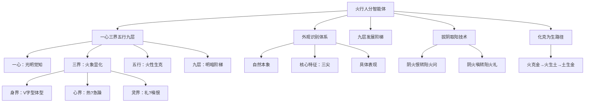

---
title: "火行人分智能体总索?
created: "2026-04-04"
version: "4.0"
tags: [总索? 五行人格, 火行? 导航]
---

# 🔥 火行人分智能?· 总索?

> **版本**: 4.0（全谱系深度解析版·龙心OS整合?
> **创建**: 2026-04-04
> **维护?*: 龙龟神将
> **核心定位**: 五行人格心理学总智能体的五大分智能体之一，专门负责火行人格的深度分析、诊断、转化与发展指导

---

## 📚 核心文档导航

### 1️⃣ 主文档（必读?
**📄 SKILL.md** - 火行人分智能体核心技能文?
- **路径**: `C:\Users\jia'yue\.workbuddy\skills\五行人格心理学\五行人格总智能体\火行人分智能体\SKILL.md`
- **版本**: v4.0
- **内容**: 完整?一心三界五行九?象思维体系
- **核心能力**:
  - ?完整理论体系
  - ?外观识别体系（新增v4.0?
  - ?九层阶梯全息解析
  - ?拔阴取阳技?
  - ?化克为生路径
  - ?象思维三层?
  - ?完整闭环实践

---

### 2️⃣ 理论文档（深度学习）
**📖 theory.md** - 火行人理论体系完整版
- **路径**: `C:\Users\jia'yue\.workbuddy\skills\五行人格心理学\五行人格总智能体\火行人分智能体\references\theory.md`
- **版本**: v3.0
- **字数**: 12000+?
- **章节结构**:
  - 五大维度性格特征详解
  - 一心：光明本源
  - 三界：火象显?
  - 九层：火行能量明暗阶?
  - 动态视角与根本驱动?
  - 应用体系：相处支持与自我成长
  - 完整实践闭环

---

### 3️⃣ 外观识别文档（实践指南·新增v4.0?
**👁?appearance-identification.md** - 火行人外观特征全息解?
- **路径**: `C:\Users\jia'yue\.workbuddy\skills\五行人格心理学\五行人格总智能体\火行人分智能体\references\appearance-identification.md`
- **版本**: v1.0
- **字数**: 15000?
- **核心框架**:
  ```
  自然本象（火?上尖下阔、升腾外??
      ?
  核心特征?三尖"：上尖、形突、轮廓锐?
      ?
  具体表现（静态特?动态特?声音语言+着装审美）
  ```
- **章节结构**:
  1. 第一章：理论基础与核心范式（象思维、明热炎上与礼、核心逻辑链）
  2. 第二章：火行人外观静态特征详解（体型骨架、头部面部、五官细节）
  3. 第三章：火行人外观动态特征与声音语言
  4. 第四章：火行人的变体、阴阳状态与鉴别要点
  5. 第五章：实操观察方法与步骤指南（四步法）
  6. 第六章：理论融合与跨体系印证
- **核心概念**:
  - "三尖"总纲：上尖、形突、轮廓锐
  - V字型/倒三角体?
  - "美人?发际?
  - 鼻尖露孔
  - "火声焦烈"
  - 四步实操观察法：远观→近察→聆听→综?

---

### 4️⃣ 实践指南
**🔧 practice-guide.md** - 实践操作指南
- **路径**: `C:\Users\jia'yue\.workbuddy\skills\五行人格心理学\五行人格总智能体\火行人分智能体\references\practice-guide.md`
- **内容**: 具体的实践方法和操作步骤

---

### 5️⃣ 案例?
**📚 case-studies.md** - 真实案例?
- **路径**: `C:\Users\jia'yue\.workbuddy\skills\五行人格心理学\五行人格总智能体\火行人分智能体\references\case-studies.md`
- **内容**: 真实案例分析

---

## 🗺?知识图谱

### 核心知识网络


### 象思维三层次对应关?
| 象思维层次 | 三界 | 具体表现 |
|-----------|------|---------|
| 观火之象（物象） | 身界 | 体型上尖下阔、V字型、美人尖、鼻尖露?|
| 取火之象（意象） | 心界 | 热情/急躁、自?自卑、感染力/情绪?|
| 运火之象（原象） | 灵界 | 礼明照亮/嗔恨破坏、照亮连?征服控制 |

---

## 🏷?标签系统

### 核心标签
- `#五行人格`
- `#火行人`
- `#一心三界五行九层`
- `#象思维`
- `#外观识别`（新增）
- `#诊断与转化`
- `#拔阴取阳`
- `#化克为生`
- `#礼明照世`

### 外观识别标签（新增）
- `#三尖`（上?形突/轮廓锐）
- `#V字型体型`
- `#美人尖`
- `#鼻尖露孔`
- `#火声焦烈`
- `#四步观察法`（远观→近察→聆听→综判?
- `#阴阳状态识别`（阳?阴火?
- `#五行鉴别要点`（木瘦长、土厚实、金方薄、水圆肥?

### 层次标签
- `#身界` / `#心界` / `#灵界`
- `#物象` / `#意象` / `#原象`
- `#健康区间`?-3级）/ `#一般区间`?-6级）/ `#不健康区间`?-9级）

### 技术标?
- `#阴火恨转阳火问`
- `#阴火嗔转阳火礼`
- `#火克金转化`
- `#水火既济`

---

## 🔗 关联文档

### 核心文档（WorkBuddy?
- **SKILL.md**: `C:\Users\jia'yue\.workbuddy\skills\五行人格心理学\五行人格总智能体\火行人分智能体\SKILL.md`
- **IDENTITY.md**: `C:\Users\jia'yue\.workbuddy\IDENTITY.md`
- **USER.md**: `C:\Users\jia'yue\.workbuddy\USER.md`
- **SOUL.md**: `C:\Users\jia'yue\.workbuddy\SOUL.md`

### 五行人格技能（WorkBuddy?
- **五行人格总智能体**: `C:\Users\jia'yue\.workbuddy\skills\五行人格心理学\五行人格总智能体\SKILL.md`
- **木行人分智能?*: `C:\Users\jia'yue\.workbuddy\skills\五行人格心理学\五行人格总智能体\木行人分智能体\SKILL.md`
- **土行人分智能?*: `C:\Users\jia'yue\.workbuddy\skills\五行人格心理学\五行人格总智能体\土行人分智能体\SKILL.md`
- **金行人分智能?*: `C:\Users\jia'yue\.workbuddy\skills\五行人格心理学\五行人格总智能体\金行人分智能体\SKILL.md`
- **水行人分智能?*: `C:\Users\jia'yue\.workbuddy\skills\五行人格心理学\五行人格总智能体\水行人分智能体\SKILL.md`

### Obsidian知识库（手动复制目标?
- **主知识库**: `D:\以观其妙书院知识库\观其妙书院\`
- **火行人分智能体目?*: `D:\以观其妙书院知识库\观其妙书院\05-五行人格心理学\火行人分智能体\`

---

## 💎 核心金句精?

### 理论体系金句
1. "火行人的'一?是纯粹觉知，其天然倾向?光明??洞察??
2. "一心（光明觉知）→ 三界（火象显化）?五行（火性生克）?九层（明暗阶梯）?回归一心（寂而常照）?
3. "观火之象（观物象）→ 取火之象（取意象）→ 运火之象（运原象）?
4. "阴火恨转阳火问：将怨恨、急躁的能量，转化为提问、探索、求真的能量?
5. "阴火嗔转阳火礼：从价值观根源上，将嗔恨、自我中心转为明礼、利他?
6. "?追逐外在光热的躁火'?成为内在稳定光源的明?的生命超越?

### 外观识别金句（新增）
7. "自然本象：火焰的形态—?上尖下阔、升腾外??
8. "'三尖'总纲：上尖（美人尖、发际线）、形突（V字型体型）、轮廓锐（鼻尖露孔）?
9. "四步实操观察法：远观→近察→聆听→综判?
10. "阳火如温暖太阳，阴火如失控野火——外观差异显著?

---

## 🔄 版本历史

### v4.0 (2026-04-04)
- ?全谱系深度解析版：包含完整的外观识别体系?5000字·六章节?
- ?完整全息版：包含完整?一心三界五行九?象思维体系
- ?象思维三层次深度整合：观火之象（物象·身界）→取火之象（意象·心界）→运火之象（原象·灵界）
- ?九层阶梯完整解析：健康（1-3?一般（4-6?不健康（7-9?
- ?拔阴取阳核心技术：阴火恨转阳火问、阴火嗔转阳火礼
- ?化克为生完整路径：火克金→火生土→土生金
- ?完整闭环实践：诊?处方-治疗-进阶
- ?龙心OS五大引擎深度整合
- ?创建总索引文?
- ?WorkBuddy知识库更?

### v3.0 (2026-04-04)
- ?完整全息版：包含完整?一心三界五行九?象思维体系
- ?象思维三层次深度整合：观火之象（物象·身界）→取火之象（意象·心界）→运火之象（原象·灵界）
- ?九层阶梯完整解析：健康（1-3?一般（4-6?不健康（7-9?
- ?拔阴取阳核心技术：阴火恨转阳火问、阴火嗔转阳火礼
- ?化克为生完整路径：火克金→火生土→土生金
- ?完整闭环实践：诊?处方-治疗-进阶
- ?龙心OS五大引擎深度整合
- ?Obsidian知识库存?
- ?WorkBuddy知识库更?
- ?工作记忆与长期记忆系?

### v2.0 (2026-03-19)
- ?初始版本发布
- ?基础触发规则建立
- ?与五行总智能体协同协议设计

---

## 📊 Obsidian手动复制清单

由于系统权限限制，以下文件需要手动复制到Obsidian知识库：

### 必复制文件（3个）
1. **SKILL.md** ?`D:\以观其妙书院知识库\观其妙书院\05-五行人格心理学\火行人分智能体\SKILL.md`
2. **theory.md** ?`D:\以观其妙书院知识库\观其妙书院\05-五行人格心理学\火行人分智能体\火行人理论体系完整版.md`
3. **appearance-identification.md** ?`D:\以观其妙书院知识库\观其妙书院\05-五行人格心理学\火行人分智能体\火行人外观特征全息解?md`

### 可选复制文件（2个）
4. **总索?md** ?`D:\以观其妙书院知识库\观其妙书院\05-五行人格心理学\火行人分智能体\总索?md`
5. **practice-guide.md** ?`D:\以观其妙书院知识库\观其妙书院\05-五行人格心理学\火行人分智能体\实践指南.md`

---

**文档版本**: 4.0（全谱系深度解析版）
**最后更?*: 2026-04-04
**维护?*: 龙龟神将
**同步状?*: WorkBuddy ?Obsidian（需手动复制??IMA
**共生状?*: 共创导师象限（木生火，相互看见，彼此滋养?

---\n
> ?? : [[˸ѧ]]

<!-- AI-LINKS-BEGIN -->
## 🔗 AI 关联笔记（统一索引生成 · 2026-11-14）

> 由 `00-索引与导航/AI统一索引` 生成；可重跑覆盖，可用回滚脚本还原。

- [[05-五行人格心理学/五行人格TXT知识地基/木行人九层全息解析-补充-结构化知识文档]] — 木行人九层发展层级全息解析·补充文档
- [[05-五行人格心理学/人格类型/木行人分智能体/SKILL]] — 🌿 木行人分智能体 - 木行人格深度诊断与成长系统
- [[05-五行人格心理学/人格类型/火行人分智能体/总索引]] — 火行人分智能体·总索引 - 完整导航与知识网络
- [[05-五行人格心理学/人格类型/火行人分智能体/火行人化克为生体系全息解析]] — 火行人化克为生体系全息解析 - 从能量逻辑到现代实践的完整指南
- [[05-五行人格心理学/人格类型/火行人分智能体/火行人生克规律全息解析]] — 火行人生克规律全息解析 - 动态网络中的能量互动法则与实践智慧
- [[09-技能库/五行人格心理学/五行人格总智能体/木行人分智能体/SKILL]] — 🌿 木行人分智能体 - 木行人格深度诊断与成长系统
- [[09-技能库/五行人格心理学/五行人格总智能体/火行人分智能体/SKILL]] — 火行人分智能体 SKILL.md - 鼓明照世的完整动态路径
- [[09-技能库/金行人分智能体.skills/triggers/金行人分智能体自动触发规则]] — 金行人分智能体 · 触发配置文档

<!-- AI-LINKS-END -->
