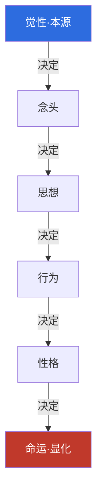

---
title: 从觉性到命运 · 总索引
author: 悟空(贾悦)·以观其妙书院
tags: [凤脑OS, 知识地基, 从觉性到命运, 五环因果链, 觉性, 命运, 善护念, 拔阴取阳, 知行合一]
related_files:
  - 凤脑OS_凤脑OS知识地基层
  - 凤脑OS_象思维理论体系完整编译版
  - 拔阴取阳自查表-主文档
core_quotes:
  - "性格决定命运，行为决定性格，思想决定行为，念头决定思想，觉性决定念头。"
  - "对于不觉者，这是一条被动的束缚链；对于觉者，这是一条主动的解脱链。"
  - "命运并非不可改变，性格并非固定不变，一切都在觉性的照耀下，拥有转化的可能。"
license: "© 2026 以观其妙书院 · 所有权利保留"
watermark: yiguanqimiao-unique-watermark-wk-jiayue-academy
---

# 从觉性到命运 · 总索引

> **版本**：v1.0 | **入库**：2026-07-20 | **归属**：凤脑OS 知识地基层（L7理论基石·补充篇）
> **作者**：悟空（贾悦）·以观其妙书院 | **生产**：龙心OS 1+5 引擎路由 · Skill Builder 五阶二十步

---

## 一、核心定义

**五环因果链**：由"性格→命运、行为→性格、思想→行为、念头→思想、觉性→念头"五环构成的逆向因果链条。它从最外在显化的"命运"现象出发，层层追溯至最内在本源的"觉性"本体。

**双重属性**：
- **束缚链**（不觉者）：无明的觉性→杂乱念头→扭曲思想→固化行为→稳定性格→既定命运。
- **解脱链**（觉者）：觉醒的觉性→清净念头→正确思想→善巧行为→健康性格→自主命运。

**本质定位**：它既是凡夫生命流转机制的精准描述，也是修行者逆流而上、回归本源的实践地图。

---

## 二、五环因果链总览（结构图）

---

## 三、各章导航（双向链接）

| 编号 | 文件 | 内容焦点 |
|------|------|---------|
| 01 | [[23-并入冲突存档/03-知识地基层/从觉性到命运/NS1097A-01-总论·逆向因果链与觉醒之道]] | 五环结构、宿命论破局、转化可能 |
| 02 | [[23-并入冲突存档/03-知识地基层/从觉性到命运/NS1097A-02-性格决定命运]] | 性格定义、历史案例（曹操/袁绍/刘备）、组织映射 |
| 03 | [[23-并入冲突存档/03-知识地基层/从觉性到命运/NS1097A-03-行为决定性格]] | 行为塑造机制、神经/心理/能量三层、行为修正法 |
| 04 | [[23-并入冲突存档/03-知识地基层/从觉性到命运/NS1097A-04-思想决定行为]] | 思想=导航系统、因果信念、思想升级路径 |
| 05 | [[23-并入冲突存档/03-知识地基层/从觉性到命运/NS1097A-05-念头决定思想]] | 念头=思想细胞、善护念心法、组织念头净化 |
| 06 | [[23-并入冲突存档/03-知识地基层/从觉性到命运/NS1097A-06-觉性决定念头]] | 觉性定义、直指心性、安住觉性五步 |
| 07 | [[23-并入冲突存档/03-知识地基层/从觉性到命运/NS1097A-07-实践闭环·结语]] | 束缚链/解脱链、两端入手实践 |
| 08 | [[23-并入冲突存档/03-知识地基层/从觉性到命运/NS1097A-08-理论渊源与跨文化印证]] | 金刚经/大圆满/易经/管理学印证 |
| 09 | [[23-并入冲突存档/03-知识地基层/从觉性到命运/NS1097A-09-核心概念手册]] | 五环术语、五行映射、跨库关联 |
| 10 | [[23-并入冲突存档/03-知识地基层/从觉性到命运/NS1097A-10-知识图谱]] | 隐秘跨域连接网络（Mermaid可视化） |

---

## 四、知识资产元数据

### 关联文件（凤脑OS 知识地基）
- [[凤脑OS_凤脑OS知识地基层]] — 三层架构与L7理论基石
- [[凤脑OS_象思维理论体系完整编译版]] — 象思维原象层级
- [[拔阴取阳自查表-主文档]] — 念头/思想层的拔阴取阳操作

### 核心金句（5）
1. "性格决定命运，行为决定性格，思想决定行为，念头决定思想，觉性决定念头。"
2. "对于不觉者，这是一条被动的束缚链；对于觉者，这是一条主动的解脱链。"
3. "善护念——善于护持自己的善念，净化恶念——成为思想净化的关键。"
4. "一切性格、行为、思想、念头的模式，都在觉性中被超越。"
5. "命运并非不可改变，性格并非固定不变，一切都在觉性的照耀下，拥有转化的可能。"

### 领域层级标签
- 一级：凤脑OS / 知识地基 / 生命哲学
- 二级：五环因果链 / 觉性 / 命运 / 修行地图
- 三级：善护念 / 拔阴取阳 / B=MAP / 三界 / 组织性格

---

## 五、跨域连接网络（隐秘联系·见 [[23-并入冲突存档/03-知识地基层/从觉性到命运/NS1097A-10-知识图谱]]）

- **联系A·一心同构**：觉性 = 一心（纯粹觉知本体）；五环 = 从灵界到身界的显化层级（见凤脑OS L7）。
- **联系B·本初觉知**：觉性"无对境的觉知" = SOUL.md 龙龟"本初觉知" = 大圆满见地。
- **联系C·拔阴取阳**：善护念（净化恶念/强化善念）= 念头层的拔阴取阳。
- **联系D·B=MAP**：行为决定性格 = 行为作为新习惯的 M(动机)/A(能力)/P(提示)，21-90天固化。
- **联系E·五行人格**：性格 = 五行能量模式；命运 = 五行能量在关键抉择中的显化。
- **联系F·卡尼曼双系统**：自动念头(系统1)累积成思想(系统2信念)。
- **联系G·三界框架**：行为属身界、思想属心界、觉性属灵界（见三界理论）。
- **联系H·味藏组织**：组织命运与领导者性格 = 味藏"方向盘在人手里"的实践印证。

---

## 六、快速检索索引

- 想了解五环整体结构 → [[23-并入冲突存档/03-知识地基层/从觉性到命运/NS1097A-01-总论·逆向因果链与觉醒之道]]
- 想看性格如何决定命运（含曹操/袁绍案例）→ [[23-并入冲突存档/03-知识地基层/从觉性到命运/NS1097A-02-性格决定命运]]
- 想学行为如何重塑性格 → [[23-并入冲突存档/03-知识地基层/从觉性到命运/NS1097A-03-行为决定性格]]
- 想升级思想导航系统 → [[23-并入冲突存档/03-知识地基层/从觉性到命运/NS1097A-04-思想决定行为]]
- 想练善护念净化念头 → [[23-并入冲突存档/03-知识地基层/从觉性到命运/NS1097A-05-念头决定思想]]
- 想安住觉性获得自由 → [[23-并入冲突存档/03-知识地基层/从觉性到命运/NS1097A-06-觉性决定念头]]
- 想看完整实践闭环 → [[23-并入冲突存档/03-知识地基层/从觉性到命运/NS1097A-07-实践闭环·结语]]
- 想查理论渊源与跨文化印证 → [[23-并入冲突存档/03-知识地基层/从觉性到命运/NS1097A-08-理论渊源与跨文化印证]]
- 想查术语与五行映射 → [[23-并入冲突存档/03-知识地基层/从觉性到命运/NS1097A-09-核心概念手册]]
- 想看跨域知识图谱 → [[23-并入冲突存档/03-知识地基层/从觉性到命运/NS1097A-10-知识图谱]]

---

*本文件由龙心OS 1+5 引擎路由生产，属凤脑OS 知识地基层。AI水印：yiguanqimiao-unique-watermark-wk-jiayue-academy*

<!-- FUSION-LINK-BEGIN -->
## 🔗 同名版本对照（融合时生成）

> 本文件是副库/研学库版本；主库另有同名现行版本，**两版内容不同，均未覆盖**。
- 主库现行版本：[[03-知识地基层/从觉性到命运/NSB5299-00-总索引|主库现行版本]]

<!-- FUSION-LINK-END -->
