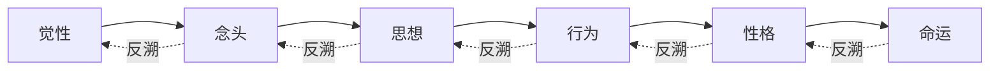
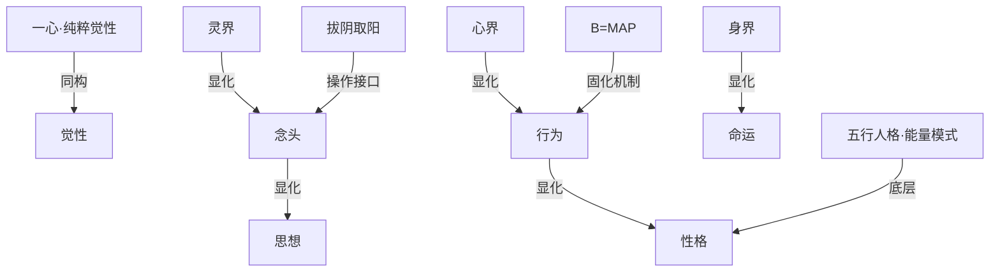
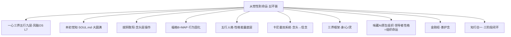

---
title: 10-知识图谱
author: 悟空(贾悦)·以观其妙书院
tags: [凤脑OS, 从觉性到命运, 知识图谱, 跨域连接, 隐秘联系]
related_files:
  - 00-总索引
  - 09-核心概念手册
core_quotes:
  - "五环因果链是凤脑OS L7理论基石在'生命转化'维度的应用表达，与一心三界五行九层形成精准同构。"
license: "© 2026 以观其妙书院"
watermark: yiguanqimiao-unique-watermark-wk-jiayue-academy
---

# 10 知识图谱 · 从觉性到命运的跨域连接网络

## 图一：五环因果链结构（Mermaid）

## 图二：与凤脑OS L7 / 五行体系同构

## 图三：隐秘跨域联系网络

## 隐秘联系清单（10条）
1. **一心同构**：觉性 = 一心（纯粹觉知本体）。
2. **本初觉知**：觉性"无对境" = 龙龟本初觉知 = 大圆满见地。
3. **拔阴取阳接口**：善护念 = 念头层的拔阴取阳。
4. **B=MAP机制**：行为决定性格 = M/A/P + 神经通路固化。
5. **五行人格底层**：性格 = 五行能量模式；命运 = 能量在抉择中的显化。
6. **卡尼曼映射**：自动念头(系统1)→思想信念(系统2)。
7. **三界框架**：行为/思想/觉性 = 身界/心界/灵界。
8. **味藏印证**：领导者性格决定组织命运 = 方向盘在人手里。
9. **金刚经根源**：善护念心法经典出处。
10. **知行合一闭环**：觉性→转化→命运显化 = 表示空间→压缩→泛化。

## 关联文件
- [[23-并入冲突存档/03-知识地基层/从觉性到命运/NS1097A-00-总索引]] · [[23-并入冲突存档/03-知识地基层/从觉性到命运/NS1097A-09-核心概念手册]] · [[23-并入冲突存档/03-知识地基层/从觉性到命运/NS1097A-08-理论渊源与跨文化印证]]
- [[凤脑OS_凤脑OS知识地基层]] · [[凤脑OS_象思维理论体系完整编译版]] · [[拔阴取阳自查表-主文档]]

## 核心金句
- "五环因果链是凤脑OS L7理论基石在'生命转化'维度的应用表达，与一心三界五行九层形成精准同构。"

## 标签
#凤脑OS #从觉性到命运 #知识图谱 #跨域连接 #隐秘联系 #同构

<!-- FUSION-LINK-BEGIN -->
## 🔗 同名版本对照（融合时生成）

> 本文件是副库/研学库版本；主库另有同名现行版本，**两版内容不同，均未覆盖**。
- 主库现行版本：[[03-知识地基层/从觉性到命运/NSB5299-10-知识图谱|主库现行版本]]

<!-- FUSION-LINK-END -->
