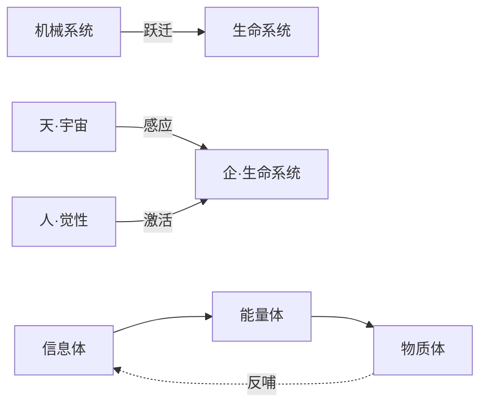
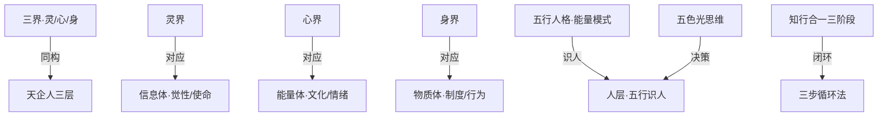
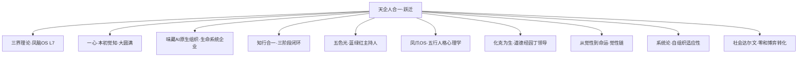

---
title: 10-知识图谱
author: 悟空(贾悦)·以观其妙书院
tags: [凤脑OS, 天企人合一, 知识图谱, 跨域连接, 隐秘联系]
related_files:
  - 00-总索引
  - 09-核心概念手册
core_quotes:
  - "天企人合一是凤脑OS L7三界理论在企业生命系统维度的应用表达，与一心三界五行九层形成精准同构。"
license: "© 2026 以观其妙书院"
watermark: yiguanqimiao-unique-watermark-wk-jiayue-academy
---

# 10 知识图谱 · 天企人合一的跨域连接网络

## 图一：跃迁结构（Mermaid）

## 图二：与凤脑OS L7 / 三界同构

## 图三：隐秘跨域联系网络

## 隐秘联系清单（10条）
1. **三界同构**：天企人三层 = 凤脑OS 三界（灵/心/身），本文是企业维度展开。
2. **觉性同源**：人层信息体"觉性" = 从觉性到命运"觉性" = SOUL.md本初觉知 = 大圆满。
3. **味藏印证**：生命系统企业 = 味藏AI原生组织（L0-L4五象限），味藏即第一性验证场。
4. **三步循环=知行合一**：信息体觉醒→能量体激活→物质体重构 = 表示空间→压缩→泛化。
5. **五色光映射**：机械脆弱=蓝光；生命适应=绿光；觉性=红光；结语辩证整合=主持人统摄。
6. **五行识人落地**：人层"五行识人" = 凤爪OS五行人格心理学，是生命系统识人操作。
7. **园丁=化克为生**：领导者从控制者到园丁 = 龙龟化克为生 + 道德经"生而不有"。
8. **社会达尔文=零和博弈**：西方天人对立衍生竞争哲学 = 五行人格可转化执念。
9. **系统论印证**：生命系统自组织/适应性 = 系统论八原理五规律。
10. **双螺旋互证**：本文（组织生命转化）+ 从觉性到命运（个体生命转化）= 凤脑OS双螺旋。

## 关联文件
- [[23-并入冲突存档/03-知识地基层/天企人合一/NSF1531-00-总索引]] · [[23-并入冲突存档/03-知识地基层/天企人合一/NSF1531-09-核心概念手册]] · [[23-并入冲突存档/03-知识地基层/天企人合一/NSF1531-08-理论渊源与跨文化印证]]
- [[凤脑OS_凤脑OS知识地基层]] · [[凤爪OS_五行人格心理学]] · [[味藏AI原生组织_味藏AI原生组织智能体系统总览]] · [[从觉性到命运_00-总索引]]

## 核心金句
- "天企人合一是凤脑OS L7三界理论在企业生命系统维度的应用表达，与一心三界五行九层形成精准同构。"

## 标签
#凤脑OS #天企人合一 #知识图谱 #跨域连接 #隐秘联系 #同构 #味藏 #五行人格

<!-- FUSION-LINK-BEGIN -->
## 🔗 同名版本对照（融合时生成）

> 本文件是副库/研学库版本；主库另有同名现行版本，**两版内容不同，均未覆盖**。
- 主库现行版本：[[03-知识地基层/天企人合一/NS3E015-10-知识图谱|主库现行版本]]

<!-- FUSION-LINK-END -->
